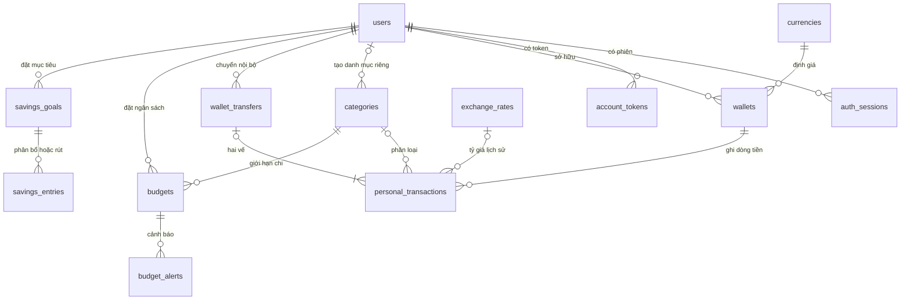
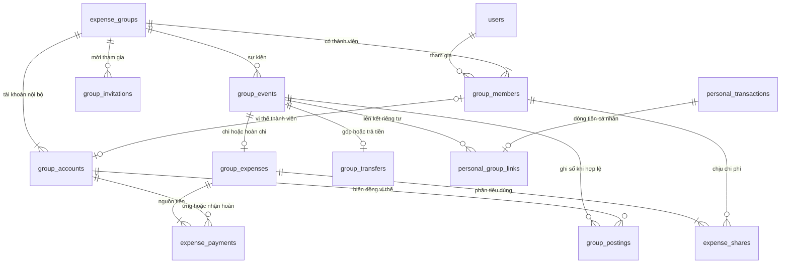
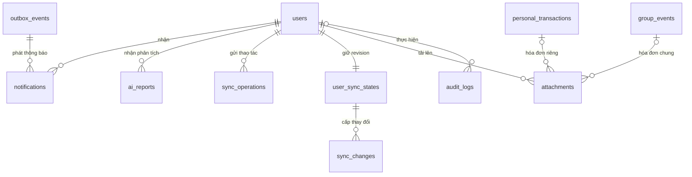

# FinSync — Thiết kế cơ sở dữ liệu
> *Performed by: Codex (AI) | Reviewed by: Chưa được nhóm rà soát | Edited by: Codex (AI)*

**Ngày lập:** 28/10/2026.  
**Trạng thái:** Bản thiết kế đề xuất để nhóm triển khai và rà soát; chưa phải migration đã chạy.  
**Công nghệ:** PostgreSQL, Spring Boot / Java 21, Spring Data JPA / Hibernate, Flyway.  
**Phạm vi:** 10 nhóm chức năng của FinSync và AI Financial Advisor.

Tài liệu viết bằng tiếng Việt theo yêu cầu trực tiếp của người dùng. Tên bảng, cột và giá trị trạng thái dùng tiếng Anh để thuận tiện triển khai. Nội dung dựa trên [CODEX.md](CODEX.md), đồng thời giữ các quy tắc chi tiết đã có tại [PA2 — Vision Document, phần B.4–B.6](PA/PA2/report.md). [PA3](PA/PA3/report.md) hiện còn nhiều mục mẫu; các mục đó không được xem là chức năng đã triển khai.

## 1. Mục tiêu và quyết định thiết kế
> *Performed by: Codex (AI) | Reviewed by: Chưa được nhóm rà soát | Edited by: Codex (AI)*

FinSync là ứng dụng **ghi sổ**, không giữ tiền và không thực hiện giao dịch ngân hàng. Một khoản “đã thanh toán” chỉ là xác nhận do người dùng thực hiện sau khi thanh toán bên ngoài ứng dụng.

| Quyết định | Thiết kế đề xuất và lý do |
|---|---|
| Tách dữ liệu cá nhân và nhóm | Ví và giao dịch cá nhân nằm trong các bảng riêng. Nhóm có sổ công nợ và quỹ riêng; thành viên không được xem ví riêng của nhau. |
| Phân biệt dòng tiền và tiêu dùng | Người ứng trước 900.000 đồng không nhất thiết tiêu dùng 900.000 đồng. Báo cáo chỉ tính phần chi được phân bổ cho người đó. |
| Nguồn dữ liệu số dư | Tính từ giao dịch và các dòng sổ đã ghi nhận. Không cho client gửi số dư mới để ghi đè. |
| Quỹ chung | Mỗi nhóm có đúng một tài khoản quỹ; mỗi thành viên có một tài khoản vị thế công nợ. Các tài khoản này không phải tài khoản ngân hàng. |
| Xác nhận thanh toán | Người nhận xác nhận khoản trả nợ; Owner xác nhận tiền vào quỹ. `PENDING` chưa làm thay đổi công nợ hoặc số dư quỹ. |
| Lịch sử nhóm | Sự kiện đã ghi sổ không sửa/xóa trực tiếp; hoàn tiền hoặc sửa sai bằng sự kiện liên kết và bút toán bù trừ. |
| Nhiều người ứng trước | Tách bảng nguồn thanh toán khỏi bảng phần phải chịu, hỗ trợ nhiều người trả cho một hóa đơn. |
| Tiền tệ | Hỗ trợ VND/USD; mỗi ví và nhóm có một đồng tiền cố định sau khi có dữ liệu tài chính. Lưu tỷ giá lịch sử bất biến. |
| Ngoại tuyến | Cho phép tạo/sửa/xóa giao dịch cá nhân trên thiết bị; dùng mã thao tác ổn định và phiên bản để đồng bộ. Thao tác ghi nhóm phải trực tuyến. |
| AI | Lưu kết quả phân tích và dữ liệu tổng hợp đầu vào; AI không trực tiếp cập nhật số dư, công nợ hoặc ngân sách. |

**Các lựa chọn bổ sung của bản thiết kế:** danh mục nhóm dùng danh mục chi mặc định của hệ thống; danh mục cá nhân có thể tùy chỉnh. Nhóm mới có thể chỉ có Owner để chờ lời mời, nhưng khoản chi chia nhóm cần ít nhất hai thành viên đang hoạt động. Một người được chọn tối đa một ví cá nhân để liên kết với mỗi sự kiện nhóm. Đây là các quyết định triển khai đề xuất, không phải nội dung đã được chốt trong `CODEX.md`.

## 2. Quy ước dữ liệu
> *Performed by: Codex (AI) | Reviewed by: Chưa được nhóm rà soát | Edited by: Codex (AI)*

| Quy ước | Áp dụng |
|---|---|
| Tên | `snake_case`, bảng số nhiều; tránh tên dễ xung đột như `user`, `group`, `transaction`. |
| Khóa | `uuid` cho định danh nghiệp vụ. Client được tạo UUID của giao dịch cá nhân khi ngoại tuyến. |
| Tiền | `numeric(19,2)`; VND phải nguyên đồng, USD tối đa hai chữ số thập phân. Java dùng `BigDecimal`. |
| Tỷ giá | `numeric(24,10)`, luôn dương; quy ước một USD bằng bao nhiêu VND. |
| Tỷ lệ chia | `numeric(7,4)`, trong khoảng 0–100. |
| Thời gian | `timestamptz`; lưu thời điểm tuyệt đối, hiển thị theo múi giờ người dùng. Ngày hạn/chốt kỳ dùng `date`. |
| Phiên bản | `version bigint NOT NULL DEFAULT 0` cho bản ghi có thể sửa; ánh xạ JPA `@Version`. |
| Trạng thái | `varchar(32)` kèm `CHECK` liệt kê giá trị hợp lệ. Không cho client tự đặt trạng thái đã xác nhận. |
| Văn bản | Chuỗi tên có giới hạn; ghi chú dùng `text` với giới hạn độ dài ở API. |
| JSON | `jsonb` dành cho dữ liệu đầu vào AI, thông báo và nhật ký; số tiền, quan hệ và trạng thái tài chính vẫn là cột có kiểu. |
| Xóa | Dữ liệu tài chính dùng lưu trữ, dấu xóa hoặc bút toán đảo. FK tài chính mặc định `ON DELETE RESTRICT`. |

Các bảng dưới đây mặc định có `created_at timestamptz NOT NULL`. Bảng có thể sửa có thêm `updated_at timestamptz NOT NULL` và `version`; bảng bất biến không cần hai cột này. Ngoại lệ: bảng nối dùng khóa ghép như mô tả. Ký hiệu **?** nghĩa là cho phép `NULL`; các cột còn lại là `NOT NULL`. `PK`, `FK`, `UQ` lần lượt là khóa chính, khóa ngoại, duy nhất.

`numeric` phù hợp cho số tiền cần phép toán chính xác; không dùng `float`, `real` hoặc `double` cho tiền. API phải kiểm tra số chữ số thập phân **trước khi** lưu, tránh cơ sở dữ liệu tự làm tròn đầu vào sai. [Tài liệu PostgreSQL về kiểu số](https://www.postgresql.org/docs/16/datatype-numeric.html).

**Khối tiền tệ M**, được lặp lại bằng các cột vật lý trên `personal_transactions`, `group_events`, `savings_entries`:

| Cột | Kiểu | Ý nghĩa |
|---|---|---|
| `amount` | `numeric(19,2)` | Số tiền dương sau quy đổi sang đồng tiền đích. |
| `currency_code` | `varchar(3)`, FK → `currencies.code` | Đồng tiền của ví, nhóm hoặc mục tiêu tương ứng. |
| `original_amount` | `numeric(19,2)` | Số tiền dương do người dùng nhập trước quy đổi. |
| `original_currency_code` | `varchar(3)`, FK → `currencies.code` | Đồng tiền gốc. |
| `exchange_rate_id` | `uuid?`, FK → `exchange_rates.id` | Bản ghi tỷ giá bất biến đã áp dụng; bắt buộc nếu hai đồng tiền khác nhau. |

Nếu hai đồng tiền giống nhau, `amount = original_amount`. Có thể vẫn gắn tỷ giá để báo cáo lịch sử sang đồng tiền còn lại. Nếu chưa có tỷ giá, vẫn lưu giao dịch cùng đồng tiền; tổng quy đổi phải báo thiếu dữ liệu. Không tự lấy tỷ giá mới nhất để thay thế tỷ giá đã lưu. Việc bổ sung tỷ giá còn thiếu cần lựa chọn rõ ràng của người dùng, có audit và phiên bản, không sửa số tiền gốc.

## 3. Sơ đồ quan hệ tổng quan
> *Performed by: Codex (AI) | Reviewed by: Chưa được nhóm rà soát | Edited by: Codex (AI)*

Các sơ đồ thể hiện quan hệ chính; từ điển dữ liệu và mục ràng buộc là đặc tả đầy đủ, bao gồm các FK ghép kiểm tra cùng chủ sở hữu/cùng nhóm.







## 4. Từ điển dữ liệu — tài khoản và dữ liệu tham chiếu
> *Performed by: Codex (AI) | Reviewed by: Chưa được nhóm rà soát | Edited by: Codex (AI)*

### 4.1. `currencies` — đồng tiền hỗ trợ
> *Performed by: Codex (AI) | Reviewed by: Chưa được nhóm rà soát | Edited by: Codex (AI)*

| Cột | Kiểu / khóa | Ý nghĩa |
|---|---|---|
| `code` | `varchar(3)`, PK | `VND`, `USD`. |
| `name` | `varchar(64)` | Tên hiển thị. |
| `minor_units` | `smallint` | VND = 0, USD = 2. |

Seed hai dòng; không cho thay đổi độ chính xác sau khi có dữ liệu tài chính.

### 4.2. `exchange_rates` — lịch sử tỷ giá bất biến
> *Performed by: Codex (AI) | Reviewed by: Chưa được nhóm rà soát | Edited by: Codex (AI)*

| Cột | Kiểu / khóa | Ý nghĩa |
|---|---|---|
| `id` | `uuid`, PK | Định danh bản tỷ giá. |
| `vnd_per_usd` | `numeric(24,10)` | Giá trị > 0, hữu hạn. |
| `source` | `varchar(500)` | Nguồn tham chiếu do Admin nhập. |
| `effective_at` | `timestamptz` | Thời điểm tỷ giá có hiệu lực. |
| `created_by` | `uuid`, FK → `users.id` | Admin nhập tỷ giá. |
| `supersedes_id` | `uuid?`, FK → cùng bảng | Bản bị thay thế khi sửa sai. |

Chỉ thêm bản mới; cấm cập nhật/xóa bản đã công bố. FK `exchange_rate_id` vì thế giữ nguyên cả giá trị, nguồn và thời điểm áp dụng, tương đương một snapshot tham chiếu bất biến. Tỷ giá chọn cho giao dịch mới phải có hiệu lực phù hợp với ngày giao dịch và được người dùng nhìn thấy.

### 4.3. `users` — người dùng và hồ sơ
> *Performed by: Codex (AI) | Reviewed by: Chưa được nhóm rà soát | Edited by: Codex (AI)*

| Cột | Kiểu / khóa | Ý nghĩa |
|---|---|---|
| `id` | `uuid`, PK | Định danh người dùng. |
| `email` | `varchar(254)` | Chuẩn hóa khoảng trắng, so sánh không phân biệt hoa thường. |
| `password_hash` | `varchar(255)` | Mật khẩu đã băm, không lưu mật khẩu gốc. |
| `display_name` | `varchar(100)` | Tên hiển thị. |
| `avatar_object_key` | `text?` | Khóa ảnh trong kho lưu trữ. |
| `system_role` | `varchar(32)` | `USER`, `ADMIN`. |
| `status` | `varchar(32)` | `ACTIVE`, `LOCKED`, `DEACTIVATED`. |
| `reporting_currency_code` | `varchar(3)`, FK → `currencies` | Mặc định `VND`. |
| `language` | `varchar(5)` | `vi`, `en`. |
| `timezone` | `varchar(64)` | Mặc định `Asia/Ho_Chi_Minh`; kiểm tra tên múi giờ tại backend. |
| `auth_version` | `bigint` | Tăng khi đổi mật khẩu, khóa tài khoản hoặc thu hồi toàn bộ phiên. |
| `locked_at`, `deactivated_at` | `timestamptz?` | Mốc quản trị tài khoản. |

Unique index trên `lower(email)`. Vai trò Owner thuộc **nhóm cụ thể**, không nằm trong `system_role`. API tài chính không cấp quyền đọc dữ liệu riêng chỉ vì người gọi là Admin.

### 4.4. `auth_sessions` và `account_tokens` — phiên và khôi phục tài khoản
> *Performed by: Codex (AI) | Reviewed by: Chưa được nhóm rà soát | Edited by: Codex (AI)*

| Bảng | Cột nghiệp vụ |
|---|---|
| `auth_sessions` | `id uuid PK`, `user_id uuid FK users`, `device_id uuid`, `refresh_token_hash varchar(128) UQ`, `expires_at timestamptz`, `revoked_at timestamptz?`, `last_used_at timestamptz?`. |
| `account_tokens` | `id uuid PK`, `user_id uuid FK users`, `purpose varchar(32)` = `RESET_PASSWORD` / `VERIFY_EMAIL`, `token_hash varchar(128) UQ`, `expires_at timestamptz`, `used_at timestamptz?`. |

Chỉ lưu hash của token ngẫu nhiên đủ mạnh. Refresh token được thay mới sau khi dùng; token reset chỉ dùng một lần trong transaction có khóa dòng. Kiểm tra `expires_at > created_at`. Đăng xuất thu hồi phiên; backend kiểm tra trạng thái phiên và `auth_version` để token truy cập còn hạn không vượt qua việc khóa/thu hồi. Không lưu JWT hoặc secret dưới dạng rõ trong bảng nhật ký.

### 4.5. `categories` — danh mục thu/chi
> *Performed by: Codex (AI) | Reviewed by: Chưa được nhóm rà soát | Edited by: Codex (AI)*

| Cột | Kiểu / khóa | Ý nghĩa |
|---|---|---|
| `id` | `uuid`, PK | Danh mục. |
| `owner_user_id` | `uuid?`, FK → `users` | `NULL`: danh mục hệ thống; có giá trị: danh mục riêng. |
| `name` | `varchar(100)` | Tên danh mục. |
| `kind` | `varchar(32)` | `INCOME`, `EXPENSE`. |
| `icon`, `color` | `varchar(64)?`, `varchar(16)?` | Trình bày giao diện. |
| `archived_at` | `timestamptz?` | Ngừng dùng cho bản ghi mới. |

Hai unique index có điều kiện: `(kind, lower(name))` cho danh mục hệ thống đang hoạt động; `(owner_user_id, kind, lower(name))` cho danh mục riêng đang hoạt động. Không đổi `kind` hoặc chủ sở hữu sau khi được tham chiếu. Backend kiểm tra danh mục thuộc người dùng hoặc là danh mục hệ thống. Chi nhóm chỉ dùng danh mục hệ thống có `kind = EXPENSE`.

## 5. Từ điển dữ liệu — tài chính cá nhân
> *Performed by: Codex (AI) | Reviewed by: Chưa được nhóm rà soát | Edited by: Codex (AI)*

### 5.1. `wallets` — ví ghi sổ cá nhân
> *Performed by: Codex (AI) | Reviewed by: Chưa được nhóm rà soát | Edited by: Codex (AI)*

| Cột | Kiểu / khóa | Ý nghĩa |
|---|---|---|
| `id` | `uuid`, PK | Ví. |
| `user_id` | `uuid`, FK → `users` | Chủ ví. |
| `name` | `varchar(100)` | Tên ví. |
| `wallet_type` | `varchar(32)` | `CASH`, `BANK`, `CREDIT_CARD`. |
| `currency_code` | `varchar(3)`, FK → `currencies` | Đồng tiền ví. |
| `opening_balance` | `numeric(19,2)` | Số dư ban đầu có dấu. |
| `opening_at` | `timestamptz` | Thời điểm bắt đầu theo dõi. |
| `archived_at` | `timestamptz?` | Ngừng ghi mới, giữ lịch sử. |

UQ `(id, user_id, currency_code)` để bảng giao dịch tham chiếu bằng FK ghép. `opening_balance` và `opening_at` chỉ sửa khi chưa có giao dịch; sau đó điều chỉnh qua giao dịch có audit. Dư nợ thẻ tín dụng được biểu diễn bằng số dư âm. Không lưu thông tin đăng nhập ngân hàng hay số thẻ đầy đủ.

### 5.2. `personal_transactions` — dòng tiền của ví
> *Performed by: Codex (AI) | Reviewed by: Chưa được nhóm rà soát | Edited by: Codex (AI)*

| Cột | Kiểu / khóa | Ý nghĩa |
|---|---|---|
| `id` | `uuid`, PK | ID ổn định, có thể tạo trên thiết bị. |
| `user_id`, `wallet_id` | `uuid`, FK | Người sở hữu và ví. |
| Khối M | Theo mục 2 | `currency_code` phải bằng đồng tiền ví. |
| `direction` | `varchar(8)` | `IN`, `OUT`. |
| `purpose` | `varchar(32)` | `INCOME`, `EXPENSE`, `TRANSFER`, `ADJUSTMENT`. |
| `category_id` | `uuid?`, FK → `categories` | Bắt buộc cho thu/chi; rỗng cho chuyển tiền/điều chỉnh. |
| `wallet_transfer_id` | `uuid?`, FK → `wallet_transfers` | Ghép hai vế chuyển giữa ví. |
| `occurred_at` | `timestamptz` | Ngày thực tế, giữ nguyên khi đồng bộ. |
| `note` | `text?` | Ghi chú. |
| `deleted_at` | `timestamptz?` | Dấu xóa để thiết bị khác đồng bộ được. |

FK ghép `(wallet_id, user_id, currency_code)` → `wallets(id, user_id, currency_code)` ngăn giao dịch trỏ vào ví người khác. Có UQ `(id, user_id)` phục vụ các liên kết riêng tư.

`INCOME` chỉ đi với `IN`; `EXPENSE` chỉ đi với `OUT`. `TRANSFER` và `ADJUSTMENT` có thể vào hoặc ra, không đưa vào thống kê thu nhập/tiêu dùng. Mọi số tiền phải dương và hữu hạn. Điều chỉnh cần ghi chú lý do. Ngày giao dịch không trước `opening_at`.

Giao dịch cá nhân thông thường được sửa/xóa mềm và ghi lịch sử trong audit. Giao dịch đã liên kết nhóm hoặc chuyển nội bộ không được sửa riêng một vế; phải xử lý cùng nghiệp vụ liên quan trong một transaction.

### 5.3. `wallet_transfers` — chuyển tiền giữa hai ví của cùng người
> *Performed by: Codex (AI) | Reviewed by: Chưa được nhóm rà soát | Edited by: Codex (AI)*

| Cột | Kiểu / khóa | Ý nghĩa |
|---|---|---|
| `id` | `uuid`, PK | Lần chuyển nội bộ. |
| `user_id` | `uuid`, FK → `users` | Chủ cả hai ví. |
| `from_wallet_id`, `to_wallet_id` | `uuid`, FK → `wallets` | Hai ví khác nhau. |
| `occurred_at` | `timestamptz` | Thời điểm chuyển. |
| `deleted_at` | `timestamptz?` | Hủy đồng thời hai vế. |

Mỗi lần chuyển có đúng hai giao dịch `TRANSFER`: một `OUT` ở ví nguồn, một `IN` ở ví đích. UQ có điều kiện `(wallet_transfer_id, direction)` khi `wallet_transfer_id IS NOT NULL`; service/trigger kiểm tra đủ hai vế, đúng chủ, đúng ví, cùng trạng thái xóa. Nếu khác đồng tiền, vế vào lưu số tiền nguồn ở `original_amount` và tỷ giá áp dụng; không coi chênh lệch con số giữa VND/USD là thu nhập.

Chuyển giữa ví là lựa chọn mở rộng hợp lý cho quản lý nhiều ví, triển khai sau luồng thu/chi cơ bản; thao tác này yêu cầu trực tuyến trong thiết kế ban đầu.

## 6. Từ điển dữ liệu — nhóm, chia tiền và quỹ chung
> *Performed by: Codex (AI) | Reviewed by: Chưa được nhóm rà soát | Edited by: Codex (AI)*

### 6.1. `expense_groups`, `group_members` — nhóm và thành viên
> *Performed by: Codex (AI) | Reviewed by: Chưa được nhóm rà soát | Edited by: Codex (AI)*

| Bảng | Cột nghiệp vụ |
|---|---|
| `expense_groups` | `id uuid PK`, `name varchar(120)`, `description text?`, `currency_code varchar(3) FK currencies`, `owner_member_id uuid`, `created_by uuid FK users`, `ledger_version bigint DEFAULT 0`, `archived_at timestamptz?`. |
| `group_members` | `id uuid PK`, `group_id uuid FK expense_groups`, `user_id uuid FK users`, `status varchar(32)` = `ACTIVE` / `LEFT` / `REMOVED`, `joined_at timestamptz`, `left_at timestamptz?`. |

UQ `group_members(group_id, user_id)` và `(id, group_id)`. FK ghép `expense_groups(owner_member_id, id)` → `group_members(id, group_id)` được kiểm tra cuối transaction (`DEFERRABLE INITIALLY DEFERRED`) để tạo nhóm và Owner cùng lúc. Owner phải đang `ACTIVE`.

Vai trò được **suy ra**: thành viên có ID bằng `owner_member_id` là Owner, người khác là Member. Cách này tránh hai nguồn vai trò mâu thuẫn. Chuyển Owner cập nhật con trỏ sau khi kiểm tra thành viên đích; không cho Owner rời nhóm trước khi chuyển quyền.

Giữ dòng thành viên khi rời nhóm để bảo toàn lịch sử. Khi tham gia lại, dùng lại ID và ghi audit lần tham gia mới. Đề xuất chỉ cho rời/xóa thành viên khi vị thế bằng 0 và không có yêu cầu thanh toán đang chờ liên quan. Đóng nhóm yêu cầu tất cả vị thế và tiền quỹ bằng 0; báo cáo lịch sử vẫn còn.

### 6.2. `group_invitations` — lời mời bằng liên kết hoặc mã
> *Performed by: Codex (AI) | Reviewed by: Chưa được nhóm rà soát | Edited by: Codex (AI)*

| Cột | Kiểu / khóa | Ý nghĩa |
|---|---|---|
| `id` | `uuid`, PK | Lời mời. |
| `group_id` | `uuid`, FK → `expense_groups` | Nhóm đích. |
| `created_by_member_id` | `uuid`, FK → `group_members` | Owner tạo lời mời. |
| `token_hash` | `varchar(128)`, UQ | Hash của token/mã mời. |
| `expires_at`, `revoked_at` | `timestamptz`, `timestamptz?` | Hết hạn hoặc thu hồi. |
| `max_uses`, `use_count` | `integer`, `integer DEFAULT 0` | Số lượt tối đa và số lượt đã dùng. |

`max_uses > 0`, `0 <= use_count <= max_uses`. Khi tham gia, khóa lời mời, kiểm tra còn hiệu lực và thêm thành viên trong cùng transaction. Retry của người đã tham gia không tăng lượt dùng. Mã ngắn cần giới hạn số lần thử ở API.

### 6.3. `group_accounts` — tài khoản công nợ thành viên và quỹ
> *Performed by: Codex (AI) | Reviewed by: Chưa được nhóm rà soát | Edited by: Codex (AI)*

| Cột | Kiểu / khóa | Ý nghĩa |
|---|---|---|
| `id` | `uuid`, PK | Tài khoản nội bộ. |
| `group_id` | `uuid`, FK → `expense_groups` | Nhóm. |
| `account_type` | `varchar(16)` | `MEMBER`, `FUND`. |
| `member_id` | `uuid?`, FK ghép cùng nhóm | Có giá trị khi `MEMBER`; rỗng khi `FUND`. |

Unique index `(group_id)` với `account_type = 'FUND'`; unique `(member_id)` với `account_type = 'MEMBER'`; UQ `(id, group_id)`. Tạo tài khoản quỹ cùng lúc tạo nhóm và tài khoản thành viên cùng lúc thêm thành viên. Không có cột số dư được cập nhật độc lập.

### 6.4. `group_events` — đầu mục sự kiện tài chính nhóm
> *Performed by: Codex (AI) | Reviewed by: Chưa được nhóm rà soát | Edited by: Codex (AI)*

| Cột | Kiểu / khóa | Ý nghĩa |
|---|---|---|
| `id` | `uuid`, PK | Định danh sự kiện chung. |
| `group_id` | `uuid`, FK → `expense_groups` | Nhóm sở hữu. |
| `event_type` | `varchar(32)` | `EXPENSE`, `EXPENSE_REFUND`, `EXPENSE_REVERSAL`, `TRANSFER`, `TRANSFER_REVERSAL`. |
| `status` | `varchar(32)` | `PENDING`, `POSTED`, `REJECTED`, `CANCELLED`. |
| Khối M | Theo mục 2 | Đồng tiền đích bằng đồng tiền nhóm. |
| `original_event_id` | `uuid?`, FK ghép cùng nhóm → `group_events` | Sự kiện gốc khi hoàn tiền hoặc đảo bút toán. |
| `created_by_member_id` | `uuid`, FK ghép cùng nhóm | Người tạo. |
| `confirmed_by_member_id` | `uuid?`, FK ghép cùng nhóm | Người xác nhận khi nghiệp vụ yêu cầu. |
| `occurred_at` | `timestamptz` | Thời điểm nghiệp vụ. |
| `posted_at` | `timestamptz?` | Thời điểm ghi sổ thành công. |
| `reason` | `text?` | Lý do từ chối, hủy hoặc điều chỉnh. |

UQ `(id, group_id)`. `POSTED` cần `posted_at`; các trạng thái khác không có bút toán. `EXPENSE` được ghi sổ ngay sau kiểm tra; `TRANSFER` bắt đầu ở `PENDING`. `EXPENSE_REFUND` là ghi nhận hoàn tiền thực tế do người ghi chi/Owner nhập. Mọi FK thành viên phải cùng nhóm, và quyền ghi mới kiểm tra trạng thái đang hoạt động.

Mỗi sự kiện có **đúng một** bản ghi chi tiết phù hợp loại: `group_expenses` hoặc `group_transfers`. Khi đã `POSTED`, đầu mục, chi tiết và các dòng sổ là bất biến. Đảo bút toán không đổi trạng thái sự kiện gốc thành “không tính”; phải tính cả gốc và dòng đảo để tránh trừ hai lần.

### 6.5. `group_expenses` — khoản chi, hoàn tiền và điều chỉnh chi
> *Performed by: Codex (AI) | Reviewed by: Chưa được nhóm rà soát | Edited by: Codex (AI)*

| Cột | Kiểu / khóa | Ý nghĩa |
|---|---|---|
| `event_id` | `uuid`, PK/FK → `group_events` | Quan hệ 1–1. |
| `group_id` | `uuid`, FK ghép với sự kiện | Dùng để cưỡng chế quan hệ cùng nhóm. |
| `title` | `varchar(200)` | Nội dung chi. |
| `category_id` | `uuid`, FK → `categories` | Danh mục chi hệ thống. |
| `funding_type` | `varchar(16)` | `MEMBERS`, `FUND`. |
| `split_method` | `varchar(16)` | `EQUAL`, `PERCENTAGE`, `EXACT`. |
| `note` | `text?` | Ghi chú. |

UQ `(event_id, group_id)`. `MEMBERS` chỉ có nguồn từ tài khoản thành viên; `FUND` chỉ có đúng một nguồn là tài khoản quỹ. Không cho cùng một hóa đơn vừa trừ quỹ vừa tính toàn bộ cho người ứng tiền.

Refund và reversal dùng lại cấu trúc này để giữ đầy đủ nguồn tiền và phần phân bổ. Chúng phải trỏ tới `EXPENSE` gốc đã ghi sổ và kế thừa danh mục. Các số tiền trong chi tiết vẫn dương; chiều tác động do loại sự kiện quyết định.

### 6.6. `expense_payments`, `expense_shares` — người trả và người chịu chi
> *Performed by: Codex (AI) | Reviewed by: Chưa được nhóm rà soát | Edited by: Codex (AI)*

| Bảng | Cột nghiệp vụ |
|---|---|
| `expense_payments` | `event_id uuid`, `group_id uuid`, `account_id uuid`, `amount numeric(19,2) > 0`; PK `(event_id, account_id)`. FK ghép đến `group_expenses` và `group_accounts`. |
| `expense_shares` | `event_id uuid`, `group_id uuid`, `member_id uuid`, `amount numeric(19,2) >= 0`, `percentage numeric(7,4)?`, `allocation_order integer > 0`; PK `(event_id, member_id)`. FK ghép đến `group_expenses` và `group_members`. |

UQ `(event_id, allocation_order)`. Số tiền dùng đồng tiền của sự kiện, không lưu đồng tiền lặp lại ở từng dòng. `SUM(payments.amount) = SUM(shares.amount) = event.amount`. Cho phép phần chia 0 vì một số tiền rất nhỏ có thể chia cho nhiều người.

Với `PERCENTAGE`, tỷ lệ không rỗng và tổng đúng 100; phương pháp khác để tỷ lệ rỗng. Backend tính và lưu số tiền cuối cùng, không tính lại từ phần trăm mỗi lần mở báo cáo. `allocation_order` là thứ tự ổn định được lưu lúc tạo để phân bổ phần dư nhất quán.

Đối với hoàn tiền, `expense_payments` ghi tài khoản thực sự nhận lại tiền; `expense_shares` ghi phần giảm tiêu dùng của từng thành viên gốc. Không giả định người nhận hoàn tiền luôn là người đã ứng ban đầu.

### 6.7. `group_transfers` — góp quỹ, trả nợ và trả lại tiền quỹ
> *Performed by: Codex (AI) | Reviewed by: Chưa được nhóm rà soát | Edited by: Codex (AI)*

| Cột | Kiểu / khóa | Ý nghĩa |
|---|---|---|
| `event_id` | `uuid`, PK/FK → `group_events` | Đầu mục thanh toán. |
| `group_id` | `uuid`, FK ghép cùng sự kiện | Nhóm. |
| `transfer_type` | `varchar(32)` | `CONTRIBUTION`, `MEMBER_SETTLEMENT`, `FUND_REPAYMENT`, `FUND_RETURN`. |
| `from_account_id`, `to_account_id` | `uuid`, FK ghép → `group_accounts` | Bên trả và bên nhận, khác nhau. |
| `expected_confirmer_member_id` | `uuid`, FK ghép → `group_members` | Người được quyền xác nhận. |
| `payment_method` | `varchar(32)` | `CASH`, `BANK_TRANSFER`, `OTHER`; chỉ là mô tả. |
| `external_reference` | `varchar(200)?` | Mã ghi chú thanh toán bên ngoài, không phải khóa giao dịch ngân hàng xác thực. |

| Loại | Tuyến tiền | Người tạo / xác nhận | Giới hạn khi ghi sổ |
|---|---|---|---|
| `CONTRIBUTION` | Thành viên → quỹ | Thành viên tạo; Owner xác nhận | Tiền dương; là bổ sung vốn quỹ, có thể vượt khoản đang nợ. |
| `MEMBER_SETTLEMENT` | Thành viên → thành viên | Người trả tạo; người nhận xác nhận | Không quá vị thế nợ của người trả và vị thế được nhận của người nhận. |
| `FUND_REPAYMENT` | Thành viên → quỹ | Người trả tạo; Owner xác nhận | Không quá phần vị thế âm của người trả. |
| `FUND_RETURN` | Quỹ → thành viên | Owner tạo; thành viên nhận xác nhận | Không quá tiền quỹ và vị thế dương của người nhận. |

Nếu Owner tự góp quỹ, có thể vừa là người khai báo vừa là người xác nhận với tư cách thủ quỹ; đây là ngoại lệ minh bạch cho góp quỹ, không áp dụng cho trả nợ giữa hai người. Khi đổi Owner, hủy các yêu cầu vào/ra quỹ còn chờ và tạo lại theo Owner mới, giữ lịch sử hủy.

Đảo một thanh toán đã xác nhận cần sự đồng ý của bên nhận như luồng xác nhận ban đầu; không cho Owner tự đảo thay hai thành viên. Sự kiện `TRANSFER_REVERSAL` tham chiếu bản gốc, chỉ đảo đúng một lần và tạo tác động đối dấu. Phải kiểm tra không làm tiền quỹ âm; không dùng giới hạn “nợ hiện tại” của thanh toán mới để ngăn việc ghi nhận bút toán đảo hợp lệ.

### 6.8. `group_postings` — các dòng sổ công nợ/quỹ
> *Performed by: Codex (AI) | Reviewed by: Chưa được nhóm rà soát | Edited by: Codex (AI)*

| Cột | Kiểu / khóa | Ý nghĩa |
|---|---|---|
| `event_id`, `group_id` | `uuid`, FK ghép → `group_events` | Sự kiện đã ghi sổ. |
| `line_no` | `smallint` | Số thứ tự dòng > 0. |
| `account_id` | `uuid`, FK ghép → `group_accounts` | Tài khoản chịu tác động. |
| `delta` | `numeric(19,2)` | Thay đổi có dấu, khác 0. |
| `posting_role` | `varchar(32)` | `PAYMENT`, `CONSUMPTION`, `TRANSFER`; giúp giải thích dòng sổ. |

PK `(event_id, line_no)`. Các dòng có giá trị 0 được bỏ qua. Dòng `PAYMENT` và `CONSUMPTION` có thể cùng tài khoản nhưng không gộp mất nguồn giải thích. Mỗi sự kiện `POSTED` phải có ít nhất hai dòng và tổng `delta` bằng 0; sự kiện chưa ghi sổ không được có dòng nào.

Đây là sổ đối ứng nội bộ phục vụ quỹ và công nợ, không phải mô hình kế toán doanh nghiệp đầy đủ. Công thức và ví dụ tại mục 10.

### 6.9. `personal_group_links` — liên kết dòng tiền riêng với sự kiện chung
> *Performed by: Codex (AI) | Reviewed by: Chưa được nhóm rà soát | Edited by: Codex (AI)*

| Cột | Kiểu / khóa | Ý nghĩa |
|---|---|---|
| `personal_transaction_id` | `uuid`, PK | FK ghép `(personal_transaction_id, user_id)` → giao dịch cá nhân. |
| `user_id` | `uuid`, FK → `users` | Người sở hữu liên kết. |
| `group_event_id`, `group_id` | `uuid`, FK ghép → `group_events` | Sự kiện nhóm đã ghi sổ. |
| `member_id` | `uuid`, FK ghép → `group_members` | Phải là thành viên tương ứng `user_id`. |

UQ `(group_event_id, user_id)`. Thêm UQ trên bộ `(id, group_id, user_id)` của `group_members` và FK tương ứng ở bảng này để chống liên kết nhầm người.

Liên kết do **chính chủ ví** tạo, chỉ truy cập từ API cá nhân. Nó có thể gắn giao dịch đã nhập trước đó hoặc tạo dòng tiền mới theo lựa chọn của người dùng. Khi liên kết một giao dịch `EXPENSE` cũ, chuyển mục đích sang `TRANSFER`, bỏ danh mục cá nhân và ghi audit; phần tiêu dùng lấy từ `expense_shares`.

Số tiền và chiều phải khớp tiền thực sự ứng/nhận của người đó trong sự kiện, sau quy đổi theo snapshot của giao dịch cá nhân. Thành viên chỉ chịu phần chia nhưng không trả tiền ngay thì không phát sinh dòng tiền ví. Một người không được liên kết ví riêng với khoản chi từ quỹ chỉ vì người đó là Owner.

Xác nhận công nợ không tự chọn ví của người nhận. Mỗi bên có thể liên kết ví của mình sau khi sự kiện được xác nhận; sự kiện nhóm vẫn hợp lệ khi chưa có liên kết cá nhân. Bút toán đảo phải đảo đồng thời các dòng ví đã liên kết, giữ lại cả gốc và dòng bù trừ.

## 7. Từ điển dữ liệu — ngân sách, tiết kiệm và báo cáo AI
> *Performed by: Codex (AI) | Reviewed by: Chưa được nhóm rà soát | Edited by: Codex (AI)*

### 7.1. `budgets`, `budget_alerts` — ngân sách và cảnh báo
> *Performed by: Codex (AI) | Reviewed by: Chưa được nhóm rà soát | Edited by: Codex (AI)*

| Bảng | Cột nghiệp vụ |
|---|---|
| `budgets` | `id uuid PK`, `user_id uuid FK users`, `category_id uuid FK categories`, `currency_code varchar(3) FK currencies`, `limit_amount numeric(19,2) > 0`, `period_type varchar(16)` = `WEEK` / `MONTH`, `period_start date`, `period_end date`, `timezone varchar(64)`, `auto_renew boolean DEFAULT false`, `previous_budget_id uuid? FK budgets UQ`, `archived_at timestamptz?`. |
| `budget_alerts` | `id uuid PK`, `budget_id uuid FK budgets`, `threshold smallint` = 80 / 100, `observed_amount numeric(19,2)`, `triggered_at timestamptz`, `notification_id uuid? FK notifications UQ`. |

Khoảng kỳ là **[ngày bắt đầu, ngày kết thúc)**. Tuần bắt đầu thứ Hai, kết thúc thứ Hai tiếp theo; tháng bắt đầu ngày 1 và kết thúc ngày 1 tháng tiếp theo. Lưu múi giờ tại thời điểm lập kỳ để việc thay đổi múi giờ hồ sơ không âm thầm dịch chuyển kỳ cũ.

UQ `(user_id, category_id, currency_code, period_type, period_start)`. Cho phép có cả ngân sách tuần và tháng; chúng được đánh giá riêng. Danh mục phải là `EXPENSE` thuộc hệ thống hoặc người lập. Danh mục nhóm mặc định và danh mục cá nhân trùng tên vẫn là hai ID khác nhau, không tự hợp nhất.

`auto_renew` tạo một dòng ngân sách mới cho kỳ tiếp theo, giữ nguyên lịch sử kỳ trước; UQ trên `previous_budget_id` chống job tạo trùng. Chi đã dùng được tính từ nguồn tiêu dùng tại mục 11, không lưu thêm `spent_amount` có thể lệch sổ.

UQ `(budget_id, threshold)` bảo đảm mỗi ngưỡng chỉ phát một lần trong kỳ. Nếu vượt thẳng 100%, ghi nhận cả hai ngưỡng nhưng có thể gộp thành một thông báo vượt mức ở giao diện. Hoàn tiền làm giảm số đã dùng nhưng không xóa lịch sử cảnh báo. Cảnh báo ngoại tuyến là tạm tính; đồng bộ không phát lặp thông báo máy chủ đã có.

### 7.2. `savings_goals`, `savings_entries` — mục tiêu và phân bổ tiết kiệm
> *Performed by: Codex (AI) | Reviewed by: Chưa được nhóm rà soát | Edited by: Codex (AI)*

| Bảng | Cột nghiệp vụ |
|---|---|
| `savings_goals` | `id uuid PK`, `user_id uuid FK users`, `name varchar(120)`, `currency_code varchar(3) FK currencies`, `target_amount numeric(19,2) > 0`, `target_date date?`, `status varchar(32)` = `ACTIVE` / `COMPLETED` / `ARCHIVED`. |
| `savings_entries` | `id uuid PK`, `goal_id uuid FK savings_goals`, `user_id uuid FK users`, khối M, `direction varchar(16)` = `ALLOCATE` / `WITHDRAW`, `occurred_at timestamptz`, `note text?`, `reverses_entry_id uuid? FK savings_entries UQ`. |

UQ `(id, user_id, currency_code)` trên mục tiêu và FK ghép từ khoản phân bổ bảo đảm đúng chủ, đúng đồng tiền. Dòng phân bổ là bất biến; sửa bằng dòng đối ứng có liên kết, cùng chủ, cùng mục tiêu, cùng số tiền/tỷ giá và ngược chiều với dòng gốc. Khóa mục tiêu trước khi rút, không cho tổng phân bổ ròng âm. Được phân bổ vượt mục tiêu; phần trăm hiển thị có thể chặn ở 100%, nhưng số tiền thực tế vẫn giữ nguyên.

**Phân bổ là đánh dấu tiền dành cho mục tiêu, không tạo thêm tiền và không tự trừ ví.** Nếu người dùng thực sự chuyển tiền giữa hai ví, ghi một `wallet_transfer` riêng; không đưa vào thu/chi. Số tiết kiệm chỉ phục vụ tiến độ, không cộng thêm vào tổng tài sản vốn đã nằm trong ví. Thiết kế này không cam kết rằng toàn bộ tiền được đánh dấu còn tồn tại trong ví thực tế.

Không có cột `current_amount` độc lập; tính `SUM(ALLOCATE) - SUM(WITHDRAW)`. Khi đạt hoặc tụt dưới mục tiêu, cập nhật trạng thái trong cùng transaction, trừ mục tiêu đã lưu trữ.

### 7.3. `ai_reports` — kết quả tư vấn tài chính
> *Performed by: Codex (AI) | Reviewed by: Chưa được nhóm rà soát | Edited by: Codex (AI)*

| Cột | Kiểu / khóa | Ý nghĩa |
|---|---|---|
| `id` | `uuid`, PK | Lần phân tích. |
| `user_id` | `uuid`, FK → `users` | Người nhận. |
| `period_start`, `period_end` | `date` | Khoảng dữ liệu [bắt đầu, kết thúc). |
| `timezone` | `varchar(64)` | Múi giờ chia kỳ. |
| `currency_code` | `varchar(3)`, FK → `currencies` | Đồng tiền báo cáo. |
| `trigger_type` | `varchar(16)` | `MONTHLY`, `ON_DEMAND`. |
| `job_key` | `varchar(200)`, UQ | Chống trùng tác vụ; tháng tự động dùng khóa theo người/tháng. |
| `status` | `varchar(16)` | `QUEUED`, `RUNNING`, `SUCCEEDED`, `FAILED`. |
| `provider`, `model_name`, `prompt_version` | `varchar(100)?` | Dấu vết cấu hình thực sự đã dùng. |
| `input_snapshot` | `jsonb` | Tổng hợp thu/chi, ngân sách, mục tiêu và dấu hiệu thiếu dữ liệu. |
| `input_hash` | `varchar(128)` | Định danh nội dung tổng hợp đầu vào. |
| `data_as_of` | `timestamptz` | Thời điểm chốt dữ liệu. |
| `result` | `jsonb?` | Phát hiện, đề xuất ngân sách, giải thích, hạn chế dữ liệu. |
| `error_code` | `varchar(64)?` | Mã lỗi an toàn, không chứa secret. |
| `started_at`, `completed_at` | `timestamptz?` | Theo dõi xử lý. |

Backend tạo snapshot nhất quán từ cùng nguồn báo cáo, gồm chi cá nhân và phần chi nhóm của chính người dùng. Không gửi mật khẩu, email, ảnh hóa đơn hoặc lịch sử riêng của thành viên khác cho dịch vụ AI. FastAPI nhận dữ liệu đã lọc qua API nội bộ, không cần quyền ghi vào các bảng tài chính.

Kết quả AI phải được kiểm tra cấu trúc trước khi lưu `SUCCEEDED`. Người dùng muốn áp dụng một gợi ý phải thực hiện thao tác tạo/sửa ngân sách bình thường. AI lỗi không rollback giao dịch tài chính đã thành công và không làm mất tư vấn cũ.

## 8. Từ điển dữ liệu — tệp, thông báo và nhật ký
> *Performed by: Codex (AI) | Reviewed by: Chưa được nhóm rà soát | Edited by: Codex (AI)*

### 8.1. `attachments` — ảnh hóa đơn
> *Performed by: Codex (AI) | Reviewed by: Chưa được nhóm rà soát | Edited by: Codex (AI)*

| Cột | Kiểu / khóa | Ý nghĩa |
|---|---|---|
| `id` | `uuid`, PK | Định danh tệp, tạo được trên thiết bị. |
| `uploaded_by` | `uuid`, FK → `users` | Người tải lên. |
| `personal_transaction_id` | `uuid?`, FK → `personal_transactions` | Chủ thể riêng tư. |
| `group_event_id` | `uuid?`, FK → `group_events` | Chủ thể chia sẻ trong nhóm. |
| `object_key` | `text`, UQ | Khóa trong kho tệp riêng tư. |
| `mime_type` | `varchar(100)` | Loại tệp đã kiểm tra. |
| `size_bytes` | `bigint` | Dung lượng > 0. |
| `checksum` | `varchar(128)` | Kiểm tra tệp tải lên. |
| `upload_status` | `varchar(16)` | `PENDING`, `READY`, `FAILED`. |
| `deleted_at` | `timestamptz?` | Ngừng hiển thị, chờ dọn tệp. |

`CHECK` đúng một trong hai FK chủ thể khác `NULL`. Không dùng cặp `entity_type/entity_id` không có FK cho hóa đơn. Backend xác minh quyền của người tải đối với chủ thể. Ảnh riêng muốn chia sẻ cho nhóm phải có thao tác rõ ràng tạo bản đính kèm nhóm; không tự công khai ảnh ví riêng khi liên kết giao dịch.

Lưu binary ở kho đối tượng hoặc thư mục riêng của backend trong môi trường demo; PostgreSQL chỉ lưu metadata. URL tải xuống có hạn và kiểm tra quyền mỗi lần cấp. Upload sau đồng bộ có thể retry; không rollback giao dịch tiền chỉ vì ảnh thất bại.

### 8.2. `notifications`, `outbox_events` — thông báo đáng tin cậy
> *Performed by: Codex (AI) | Reviewed by: Chưa được nhóm rà soát | Edited by: Codex (AI)*

| Bảng | Cột nghiệp vụ |
|---|---|
| `notifications` | `id uuid PK`, `user_id uuid FK users`, `type varchar(32)` = `DEBT_REMINDER` / `PAYMENT_REQUEST` / `PAYMENT_CONFIRMED` / `BUDGET_ALERT` / `GROUP_INVITATION` / `AI_READY`, `title varchar(200)`, `body text`, `group_event_id uuid? FK group_events`, `budget_id uuid? FK budgets`, `ai_report_id uuid? FK ai_reports`, `outbox_event_id uuid? FK outbox_events`, `dedupe_key varchar(200)`, `read_at timestamptz?`. |
| `outbox_events` | `id uuid PK`, `event_type varchar(64)`, `payload jsonb`, `dedupe_key varchar(200) UQ`, `status varchar(16)` = `PENDING` / `PROCESSING` / `DONE`, `attempts integer DEFAULT 0`, `available_at timestamptz`, `locked_until timestamptz?`, `processed_at timestamptz?`, `last_error_code varchar(64)?`. |

UQ `notifications(user_id, dedupe_key)`. Nội dung tài chính trong thông báo chỉ dành cho đúng người nhận; liên kết mở dữ liệu nhóm vẫn kiểm tra quyền hiện tại. Sự kiện outbox được thêm **cùng transaction** với ghi sổ. Worker xử lý sau commit, thử lại khi lỗi; lease `locked_until` giúp khôi phục job nếu worker dừng đột ngột.

Khóa chống trùng của nhắc nợ gồm người nhận, nhóm và kỳ nhắc; mỗi kỳ mới có thể gửi lại nhưng không gửi nhiều bản do retry. Ngay trước khi gửi phải kiểm tra còn nợ và còn quyền xem nhóm.

### 8.3. `audit_logs` — dấu vết thay đổi
> *Performed by: Codex (AI) | Reviewed by: Chưa được nhóm rà soát | Edited by: Codex (AI)*

| Cột | Kiểu / khóa | Ý nghĩa |
|---|---|---|
| `id` | `uuid`, PK | Dòng nhật ký. |
| `actor_user_id` | `uuid?`, FK → `users` | Người thao tác; `NULL` cho job hệ thống. |
| `action` | `varchar(64)` | Ví dụ `USER_LOCKED`, `PERSONAL_TRANSACTION_UPDATED`, `GROUP_EVENT_POSTED`. |
| `entity_type`, `entity_id` | `varchar(64)`, `uuid` | Định danh đối tượng được ghi lại. |
| `owner_user_id`, `group_id` | `uuid?`, FK tương ứng | Phạm vi quyền đọc. |
| `before_data`, `after_data` | `jsonb?` | Dữ liệu trước/sau đã loại bỏ thông tin bí mật. |
| `request_id` | `uuid` | Truy vết một yêu cầu. |

Nhật ký chỉ thêm, không sửa/xóa qua API thông thường. Cặp loại/ID ở đây là **tham chiếu lịch sử**, không phải nguồn tính tiền nên chấp nhận không có FK đa hình. Không ghi password hash, token, secret hoặc toàn bộ payload AI vào audit. Lịch sử cá nhân vẫn riêng tư; Admin chỉ xem log quản trị cần thiết, không nhận toàn bộ `before_data/after_data` của giao dịch cá nhân.

## 9. Từ điển dữ liệu và giao thức đồng bộ ngoại tuyến
> *Performed by: Codex (AI) | Reviewed by: Chưa được nhóm rà soát | Edited by: Codex (AI)*

### 9.1. `sync_operations` — chống thực hiện trùng và giữ xung đột
> *Performed by: Codex (AI) | Reviewed by: Chưa được nhóm rà soát | Edited by: Codex (AI)*

| Cột | Kiểu / khóa | Ý nghĩa |
|---|---|---|
| `user_id`, `operation_id` | `uuid`, PK ghép; `user_id` FK → `users` | Khóa một thao tác, ổn định qua mọi lần gửi lại. |
| `device_id` | `uuid` | Thiết bị gửi. |
| `operation_type` | `varchar(64)` | Tạo/sửa/xóa cá nhân hoặc thao tác ghi trực tuyến khác. |
| `entity_id` | `uuid` | Định danh đối tượng đích. |
| `base_version` | `bigint?` | Phiên bản client đã đọc; rỗng với thao tác tạo mới. |
| `request_hash` | `varchar(128)` | Hash payload đã chuẩn hóa. |
| `client_payload` | `jsonb` | Bản client gửi, để giữ lại khi xung đột. |
| `server_snapshot` | `jsonb?` | Bản server tại lúc phát hiện xung đột. |
| `status` | `varchar(16)` | `APPLIED`, `CONFLICT`, `REJECTED`. |
| `response_payload` | `jsonb` | Kết quả để trả lại khi retry. |
| `resolved_by_operation_id` | `uuid?` | FK ghép `(user_id, resolved_by_operation_id)` → cùng bảng. |

Áp dụng mã thao tác cho **mọi lệnh ghi tài chính**, không chỉ ngoại tuyến. Không commit dòng “đang xử lý” tách khỏi nghiệp vụ: insert khóa thao tác và thay đổi dữ liệu phải nằm trong cùng transaction. Nếu lỗi giữa chừng, rollback cả hai; retry có thể làm lại an toàn.

Một khóa đã có với cùng hash trả lại kết quả cũ; cùng khóa nhưng khác payload trả lỗi xung đột. Khi `base_version` cũ, lưu `CONFLICT` với cả hai bản và không cập nhật giao dịch. Người dùng xử lý bằng thao tác **mới**, tham chiếu phiên bản server mới nhất, rồi liên kết `resolved_by_operation_id`. Nếu lại có người sửa trước, tiếp tục phát hiện xung đột, không tự ưu tiên bản mới nhất theo đồng hồ thiết bị.

Giao dịch đã xóa mềm vẫn chiếm ID. Retry tạo cùng ID không được làm sống lại giao dịch đã xóa. Metadata chống trùng phải giữ ít nhất trong vòng đời dữ liệu tương ứng; không dọn theo TTL ngắn trong khi client còn có thể phát lại thao tác cũ.

### 9.2. `user_sync_states`, `sync_changes` — lấy thay đổi và dấu xóa
> *Performed by: Codex (AI) | Reviewed by: Chưa được nhóm rà soát | Edited by: Codex (AI)*

| Bảng | Cột nghiệp vụ |
|---|---|
| `user_sync_states` | `user_id uuid PK/FK users`, `current_revision bigint DEFAULT 0`. |
| `sync_changes` | `user_id uuid FK user_sync_states`, `revision bigint`, `ordinal integer`, `entity_type varchar(64)`, `entity_id uuid`, `change_type varchar(16)` = `UPSERT` / `DELETE`, `entity_version bigint`, `payload jsonb?`; PK `(user_id, revision, ordinal)`. |

Một thay đổi cá nhân khóa dòng `user_sync_states`, tăng revision, ghi dữ liệu và feed trong cùng transaction. Giữ khóa tới commit để revision phản ánh đúng thứ tự các transaction đã hoàn tất. **Không dùng riêng `updated_at` hoặc một sequence toàn cục làm cursor**, vì transaction lấy số trước có thể commit sau và bị bỏ sót khi client phân trang.

Client lấy feed theo thứ tự `(revision, ordinal)`, chỉ cập nhật cursor sau khi lưu cả trang thành công. Xóa trả `DELETE` và ID để xóa bản cache. Khi cần dọn feed cũ, công bố `minimum_revision`; client có cursor quá cũ phải tải snapshot mới, vẫn giữ riêng hàng đợi chưa gửi.

Snapshot ban đầu được đọc trong một database transaction nhất quán, kèm revision tương ứng. Dữ liệu cá nhân được đồng bộ qua feed; danh mục mặc định, ngân sách, mục tiêu, báo cáo AI và snapshot nhóm có thể tải lại riêng khi kết nối. `ledger_version` của nhóm giúp nhận biết cache công nợ đã cũ, không thay thế quyền truy cập.

### 9.3. Luồng đồng bộ
> *Performed by: Codex (AI) | Reviewed by: Chưa được nhóm rà soát | Edited by: Codex (AI)*

1. Sau đăng nhập trực tuyến, thiết bị tải dữ liệu được phép xem và lưu cục bộ có mã hóa.
2. Khi mất mạng, người dùng tạo/sửa/xóa **giao dịch cá nhân thông thường** trên ví đã cache. Mỗi thao tác có UUID riêng, ID bản ghi ổn định và phiên bản gốc.
3. Thiết bị lưu hàng đợi bền vững trước khi báo thành công cục bộ; ảnh hóa đơn chờ upload riêng.
4. Khi có mạng và phiên hợp lệ, gửi thao tác tuần tự theo từng bản ghi. Backend kiểm tra chủ sở hữu, ví/danh mục còn hợp lệ và phiên bản.
5. Lệnh thành công lưu cả dữ liệu, audit, feed và kết quả chống trùng. Client đánh dấu đã đồng bộ sau khi nhận kết quả hoặc sau một lần retry nhận lại kết quả đó.
6. Xung đột hiển thị hai bản để chọn hợp nhất, giữ bản server hoặc áp dụng nội dung client bằng một lệnh mới.
7. Client tải feed và các snapshot cần thiết, rồi thử tải ảnh còn chờ.

Thao tác phụ thuộc phải đợi kết quả trước: chẳng hạn sửa một giao dịch vừa tạo sẽ dùng phiên bản server trả về sau lệnh tạo. Không gửi hàng loạt bản sửa cùng `base_version` và kỳ vọng ghi đè lần lượt.

Nhóm, trả nợ, xác nhận góp quỹ, quản trị và yêu cầu AI mới chỉ ghi khi trực tuyến. Khi bị thu hồi quyền nhóm, lần đồng bộ tiếp theo phải bỏ cache tương ứng. Không thể bảo đảm xóa ngay dữ liệu đã cache trên một thiết bị đang hoàn toàn ngoại tuyến; ứng dụng phải hiển thị thời điểm đồng bộ gần nhất và hạn chế phiên cache theo chính sách đăng nhập.

## 10. Quy tắc tính số dư, chia tiền và hoàn tiền
> *Performed by: Codex (AI) | Reviewed by: Chưa được nhóm rà soát | Edited by: Codex (AI)*

### 10.1. Số dư cá nhân và vị thế nhóm
> *Performed by: Codex (AI) | Reviewed by: Chưa được nhóm rà soát | Edited by: Codex (AI)*

```text
Số dư ví = opening_balance
           + tổng amount của giao dịch IN chưa xóa
           - tổng amount của giao dịch OUT chưa xóa

Vị thế tài khoản nhóm = tổng delta của các sự kiện POSTED

Vị thế MEMBER > 0: thành viên có quyền nhận lại tiền.
Vị thế MEMBER < 0: thành viên còn phải đóng/trả.
Tiền khả dụng của quỹ = - vị thế tài khoản FUND.

Tổng vị thế tất cả tài khoản trong một nhóm = 0.
Tổng vị thế thành viên = tiền quỹ hiện có.
```

Quỹ bắt đầu bằng 0; tiền ban đầu của nhóm được nhập bằng khoản góp đã xác nhận để biết ai góp. Đề xuất không cho tiền quỹ âm. Số dư ví cá nhân có thể âm vì có thẻ tín dụng hoặc dữ liệu nhập chưa đầy đủ.

| Nghiệp vụ đã ghi sổ | Dòng `delta` |
|---|---|
| Thành viên ứng tiền chi chung | `+amount` cho từng tài khoản ứng tiền; `-share` cho từng thành viên chịu chi. |
| Chi từ quỹ | `+amount` vào tài khoản FUND; `-share` cho từng thành viên chịu chi. |
| Góp quỹ / trả nợ / hoàn quỹ | `+amount` cho tài khoản trả; `-amount` cho tài khoản nhận. |
| Hoàn tiền hóa đơn | `-amount` cho tài khoản nhận tiền hoàn; `+share` cho người được giảm chi phí. |
| Đảo bút toán | Sao chép đầy đủ dòng gốc với `delta` đổi dấu. |

Vị thế FUND mang dấu âm khi đang giữ tiền để toàn bộ sổ đối ứng cân bằng; giao diện hiển thị **tiền quỹ dương** theo công thức trên. Owner không sở hữu toàn bộ quỹ và không được cộng số tiền này vào tài sản cá nhân.

### 10.2. Chia tiền chính xác và xử lý phần dư
> *Performed by: Codex (AI) | Reviewed by: Chưa được nhóm rà soát | Edited by: Codex (AI)*

1. Chuyển tổng hóa đơn về đồng tiền nhóm bằng tỷ giá đã chốt, làm tròn half-up một lần theo độ chính xác của đồng tiền.
2. Đổi số tiền đã làm tròn sang đơn vị nhỏ nhất: một đồng VND hoặc một cent USD.
3. `EQUAL`: chia nguyên cho số người; phân bổ từng đơn vị dư theo `allocation_order` tăng dần.
4. `PERCENTAGE`: tổng tỷ lệ phải đúng 100; tính phần chính xác, lấy phần nguyên đơn vị nhỏ nhất rồi cấp phần dư theo thứ tự đã lưu.
5. `EXACT`: kiểm tra từng số tiền đúng độ chính xác và tổng bằng hóa đơn; không tự sửa số người dùng đã nhập.
6. Lưu cả số tiền cuối cùng và thứ tự. Mọi lần đọc sau dùng các giá trị đã lưu.

Ví dụ 100.000 VND chia ba người theo thứ tự A, B, C cho kết quả **33.334; 33.333; 33.333**, tổng đúng 100.000. Không cho ba phép làm tròn độc lập tạo tổng 99.999 hoặc 100.001.

### 10.3. Ví dụ ứng trước và thanh toán từng phần
> *Performed by: Codex (AI) | Reviewed by: Chưa được nhóm rà soát | Edited by: Codex (AI)*

A trả hóa đơn 900.000 VND cho A, B, C, chia đều:

| Tài khoản | Ứng tiền | Phần phải chịu | Vị thế sau chi |
|---|---:|---:|---:|
| A | +900.000 | -300.000 | +600.000 |
| B | 0 | -300.000 | -300.000 |
| C | 0 | -300.000 | -300.000 |
| Tổng | +900.000 | -900.000 | 0 |

B khai đã trả A 200.000: trạng thái `PENDING`, vị thế chưa đổi. Khi A xác nhận, thêm B `+200.000`, A `-200.000`. Vị thế mới: A `+400.000`, B `-100.000`, C `-300.000`. Xác nhận lại cùng yêu cầu không thêm dòng sổ.

Nếu A liên kết hóa đơn vào ví, ví A giảm 900.000 nhưng tiêu dùng của A chỉ tăng 300.000. Sau khi xác nhận B trả 200.000, A có thể liên kết khoản thu tiền 200.000 vào ví như `TRANSFER`; khoản đó không phải thu nhập.

### 10.4. Ví dụ quỹ chung
> *Performed by: Codex (AI) | Reviewed by: Chưa được nhóm rà soát | Edited by: Codex (AI)*

A và B mỗi người góp 500.000 VND, Owner đã xác nhận:

| Thời điểm | A | B | FUND | Tiền quỹ hiển thị |
|---|---:|---:|---:|---:|
| Sau góp quỹ | +500.000 | +500.000 | -1.000.000 | 1.000.000 |
| Quỹ chi 600.000, chia đôi | +200.000 | +200.000 | -400.000 | 400.000 |
| Quỹ trả lại A 200.000, A xác nhận | 0 | +200.000 | -200.000 | 200.000 |
| Quỹ trả lại B 200.000, B xác nhận | 0 | 0 | 0 | 0 |

Mỗi người tiêu dùng 300.000. Góp tiền và nhận lại tiền dư đều là chuyển tiền. Một hóa đơn được trả từ quỹ không tạo khoản ứng tiền riêng cho Owner.

### 10.5. Hoàn tiền và sửa sai sau khi đã thanh toán
> *Performed by: Codex (AI) | Reviewed by: Chưa được nhóm rà soát | Edited by: Codex (AI)*

**Hoàn tiền thực tế:** tạo `EXPENSE_REFUND` trỏ về `EXPENSE` gốc. Khóa dòng nhóm và khoản chi gốc trước khi kiểm tra tổng hoàn. Tổng hoàn không vượt số tiền gốc; không hoàn một khoản đã được đảo toàn bộ.

Phần hoàn cho từng người dựa trên tỷ trọng phần chi gốc, làm tròn theo đơn vị nhỏ nhất và thứ tự ổn định. Không được vượt phần chưa hoàn của từng người. Khi chạm giới hạn, phần dư tiếp tục phân cho các thành viên còn khả năng nhận hoàn. Lần hoàn hết phần còn lại phải trả đúng phần dư chưa hoàn của từng người, bảo đảm tổng cộng không ai được giảm tiêu dùng quá phần chi ban đầu.

Giữ tỷ giá gốc khi tính giảm tiêu dùng lịch sử. Nếu tiền thực nhận vào ví dùng tỷ giá khác, tỷ giá đó chỉ thuộc dòng tiền cá nhân liên kết; không tính lại phần chia hoặc công nợ cũ. Hoàn tiền được ghi ở ngày hoàn, không tự viết lại báo cáo tháng trước.

Ví dụ sau hóa đơn 900.000 và B, C đã trả hết cho A, mọi vị thế bằng 0. Nhà cung cấp hoàn 300.000 cho A: ghi A `-300.000`, rồi A/B/C mỗi người `+100.000`. Kết quả A `-200.000`, B và C mỗi người `+100.000`: A cần trả lại tiền cho B và C. Các thanh toán đã xác nhận vẫn nằm trong lịch sử.

**Sửa sai, không có dòng tiền mới thực tế:** tạo `EXPENSE_REVERSAL` đảo toàn bộ chi gốc, rồi tạo chi thay thế trong cùng transaction. Bản thay thế có thể đổi số tiền, người trả hoặc phần chia; audit ghi liên hệ giữa hai sự kiện. Chỉ dùng đường đảo toàn bộ khi chi gốc chưa có refund, chưa bị đảo trước đó. Thanh toán công nợ đã xác nhận không ngăn việc điều chỉnh này; vị thế được tính lại mà vẫn giữ các settlement cũ.

**Giới hạn đề xuất cho bản đầu:** khoản chi đã có refund không được sửa toàn bộ bằng luồng đảo đơn giản trên. Vẫn được ghi thêm hoàn tiền thực tế trong giới hạn còn lại. Nếu cần sửa một chuỗi chi đã hoàn tiền một phần, phải bổ sung đặc tả bút toán điều chỉnh cả chuỗi trước khi mở chức năng; không giả tạo một refund tiền mặt để sửa sai dữ liệu. Đây là nhánh nghiệp vụ cần nhóm mở rộng khi triển khai, không được xử lý bằng cách sửa trực tiếp lịch sử đã chốt.

Bản đảo có đúng chi tiết gốc và tỷ giá gốc. Số tiền quỹ sau toàn bộ transaction không được âm. Nếu có dòng ví đã liên kết, tạo dòng bù trừ tương ứng; không xóa lịch sử thu/chi cũ. Bản chi thay thế được người sở hữu ví liên kết riêng để giữ quyền lựa chọn ví.

### 10.6. Gợi ý đơn giản hóa nợ
> *Performed by: Codex (AI) | Reviewed by: Chưa được nhóm rà soát | Edited by: Codex (AI)*

Tính vị thế hiện tại từ sổ, ghép bên có vị thế âm với bên có vị thế dương để đề xuất thanh toán. Với quỹ, xử lý FUND như nguồn tiền có thể trả ra tối đa số tiền đang giữ; người xác nhận vẫn là người nhận thực tế. Gợi ý giữa hai thành viên có thể khác cặp ứng tiền ban đầu nhưng phải giữ nguyên vị thế ròng của từng người.

Không lưu bảng `debts` có số dư cập nhật riêng cạnh `group_postings`: hai nguồn này dễ lệch nhau. Gợi ý chỉ là kết quả tính toán, mang `ledger_version`. Nếu sổ đổi, tính lại trước khi xác nhận. Giải thuật tham lam có thể giảm số lần trả so với danh sách nợ thô; không tuyên bố luôn tìm được số lần chuyển ít nhất tuyệt đối.

## 11. Báo cáo, ngân sách và tránh tính trùng
> *Performed by: Codex (AI) | Reviewed by: Chưa được nhóm rà soát | Edited by: Codex (AI)*

Đề xuất các view/DTO truy vấn dùng chung:

| View hoặc truy vấn | Nguồn và mục đích |
|---|---|
| `v_wallet_balances` | Số dư đầu + dòng tiền cá nhân chưa xóa, nhóm theo ví. |
| `v_group_account_balances` | Tổng `group_postings.delta` của sự kiện `POSTED`, nhóm theo tài khoản. |
| `v_user_consumption` | Chi cá nhân còn hiệu lực chưa liên kết nhóm, cộng phần chi nhóm của người dùng, trừ refund/reversal. |
| `v_user_income` | Giao dịch cá nhân `INCOME`; không gồm settlement, góp/hoàn quỹ, chuyển ví. |
| `v_savings_progress` | Tổng phân bổ ròng theo mục tiêu. |

`v_user_consumption` trả các cột tối thiểu: `user_id`, `source_type`, `source_id`, `category_id`, `occurred_at`, `amount_signed`, `currency_code`, `exchange_rate_id`. `source_type` phân biệt giao dịch riêng và phần chia nhóm; khóa nguồn giúp truy vết và chống cộng hai lần. Mọi view phải được truy vấn với điều kiện người dùng đã xác thực; bản thân view không thay thế phân quyền.

Một khoản chi nhóm đã liên kết giao dịch riêng chỉ tính **phần chia**, không tính thêm `personal_transactions.amount`. Thu hồi công nợ chỉ là dòng tiền. Phần chi nhóm vẫn được tính dù chưa thanh toán hoặc chưa liên kết ví; đây là tiêu dùng phát sinh, khác với tiền đã ra khỏi ví.

**Hai cơ sở tỷ giá khác nhau:**

- Tổng giá trị ví hiện tại dùng tỷ giá định giá được chỉ rõ tại thời điểm xem, đồng thời hiển thị số dư nguyên tệ.
- Báo cáo tiêu dùng lịch sử dùng snapshot của từng sự kiện; đổi đồng tiền hiển thị không sửa dữ liệu nguồn. Khi quy đổi phần chia sang đồng tiền báo cáo, quy đổi tổng sự kiện rồi phân bổ phần dư ổn định cho các thành viên để tổng các phần bằng tổng sự kiện đã quy đổi.

Nếu thiếu tỷ giá cho một phần dữ liệu, trả tổng nguyên tệ theo từng đồng tiền và cờ `incomplete_conversion`; không bỏ âm thầm các khoản đó hoặc đưa ra tổng quy đổi đầy đủ giả. Ngân sách/AI cũng nhận cờ thiếu dữ liệu, không kết luận “chưa vượt mức” dựa trên tổng thiếu.

Dashboard hiển thị tổng ví cá nhân, vị thế nhóm và tiền quỹ thành các chỉ số riêng. Không cộng cơ học vị thế nhóm vào tổng ví khi chưa biết các dòng tiền nhóm đã được phản ánh đủ trong ví hay chưa. Muốn cung cấp giá trị tài sản ròng mở rộng cần kiểm tra độ đầy đủ liên kết trước, tránh cộng cả tiền quỹ và quyền lợi thành viên.

Xuất PDF/Excel được tạo từ truy vấn đã kiểm tra quyền trong snapshot nhất quán; metadata có người yêu cầu, khoảng ngày, đồng tiền, cơ sở tỷ giá và thời điểm chốt. Bản đầu không cần bảng riêng lưu mọi file báo cáo; chỉ lưu job/tệp xuất nếu sau này cần xuất bất đồng bộ và lịch sử tải xuống.

## 12. Ràng buộc toàn vẹn và transaction
> *Performed by: Codex (AI) | Reviewed by: Chưa được nhóm rà soát | Edited by: Codex (AI)*

### 12.1. Phân chia trách nhiệm kiểm tra
> *Performed by: Codex (AI) | Reviewed by: Chưa được nhóm rà soát | Edited by: Codex (AI)*

| Quy tắc | Tầng bắt buộc thực hiện |
|---|---|
| ID duy nhất, email duy nhất, một tài khoản quỹ mỗi nhóm | PK / unique index. |
| Ví đúng chủ, nguồn thanh toán và phần chia cùng nhóm | FK ghép; các bảng cha có UQ tương ứng. |
| Tiền dương, chiều hợp lệ, FK đính kèm loại trừ nhau | `NOT NULL` và `CHECK` trên cùng dòng. |
| VND nguyên đồng, USD hai chữ số, loại bỏ `NaN`/vô cực | Kiểm tra API trước chuyển kiểu; DB `CHECK` trên cột tiền có đồng tiền, trigger cho chi tiết kế thừa đồng tiền. |
| Tổng tiền ứng = tổng phần chia = tổng hóa đơn | Service trong transaction và constraint trigger kiểm tra cuối transaction. |
| Mỗi sự kiện ghi sổ có tổng `delta = 0`, đúng số dòng và đúng nội dung | Service sinh dòng sổ từ chi tiết; trigger đối chiếu chi tiết với dòng sổ và trạng thái. Chỉ cân tổng bằng 0 là chưa đủ. |
| Bản ghi `POSTED` không được sửa hoặc xóa | Quyền database và trigger từ chối thay đổi đầu mục/chi tiết/dòng sổ đã chốt. |
| Đúng một subtype sự kiện và đúng loại tham chiếu gốc | Service và trigger kiểm tra liên bảng. |
| Hạn mức hoàn, hạn mức thanh toán, quỹ không âm | Khóa dòng nhóm rồi đọc lại số dư; kiểm tra trong transaction; trigger kiểm tra tổng ở trạng thái cuối. |
| Owner đang hoạt động, danh mục đúng phạm vi và loại | Service; trigger bảo vệ quan hệ/trạng thái quan trọng. |
| Đúng người nhận xác nhận | Backend lấy người gọi từ phiên xác thực, không tin `confirmed_by` trong payload. |
| Chống trùng thao tác và xác nhận lại | PK thao tác, kiểm tra trạng thái, khóa dòng và unique index. |

PostgreSQL `CHECK` không phù hợp để kiểm tra tổng tiền ở nhiều dòng/bảng. Vì vậy không đặt `CHECK (SUM(...))` vào bảng chia tiền; dùng transaction và trigger phù hợp. [Tài liệu PostgreSQL về ràng buộc](https://www.postgresql.org/docs/16/ddl-constraints.html).

Đối với dữ liệu tiền có kiểu `numeric`, kiểm tra hữu hạn rõ ràng trước khi kiểm tra lớn hơn 0. Không chỉ dựa vào `amount > 0` để loại mọi giá trị đặc biệt. Các tổng và tỷ lệ không được tính bằng số dấu phẩy động ở client rồi tin là chính xác.

**Cưỡng chế bất biến:** khi ghi sổ, service tạo đầu mục/chi tiết ở `PENDING`, thêm các dòng và chuyển `POSTED` trong cùng transaction. Trigger kiểm tra cuối transaction thấy trạng thái cuối hợp lệ. Những lần UPDATE/DELETE sau commit bị chặn. Một rollback hoàn toàn không để lại sự kiện nửa chừng; outbox chỉ được thêm nếu nghiệp vụ thành công.

### 12.2. Thứ tự khóa và ghi nguyên tử
> *Performed by: Codex (AI) | Reviewed by: Chưa được nhóm rà soát | Edited by: Codex (AI)*

Đối với quy mô đồ án, đề xuất tuần tự hóa các lệnh ghi tài chính **trong từng nhóm** bằng khóa dòng `expense_groups`. Hai nhóm khác nhau vẫn xử lý song song. Backend có thể dùng JPA pessimistic lock; tác dụng khóa dòng được mô tả trong [tài liệu PostgreSQL về explicit locking](https://www.postgresql.org/docs/16/explicit-locking.html).

Thứ tự khóa chung: **nhóm → trạng thái đồng bộ của các người dùng theo UUID tăng dần → ví/mục tiêu theo UUID tăng dần → đầu mục con cần sửa**. Lệnh cá nhân không chạm nhóm có thể bắt đầu từ trạng thái đồng bộ người dùng; nếu cần liên kết nhóm phải biết và khóa nhóm ngay từ đầu. Không lấy khóa theo thứ tự ngược giữa các endpoint.

Luồng xác nhận trả nợ:

1. Mở transaction; đăng ký khóa thao tác duy nhất của yêu cầu.
2. Khóa nhóm, đầu mục thanh toán; kiểm tra người gọi, membership và trạng thái phiên hiện tại.
3. Nếu đã `POSTED`, trả lại kết quả cũ mà không tạo bút toán mới. Nếu đã bị từ chối/hủy, không được xác nhận nữa.
4. Đọc lại vị thế đã xác nhận. Với trả nợ giữa hai người, yêu cầu `amount <= min(-payer_balance, receiver_balance)` và hai vị thế có dấu phù hợp.
5. Kiểm tra quỹ nếu có; khóa dữ liệu riêng cần tạo/cập nhật liên kết theo thứ tự thống nhất.
6. Ghi hai dòng đối ứng, người xác nhận, `posted_at`; tăng `ledger_version`, ghi audit, feed cá nhân nếu có và outbox.
7. Commit; lỗi ở bất kỳ bước nào rollback toàn bộ.

Hai yêu cầu đang chờ có thể cộng lại vượt khoản nợ; **không giữ chỗ nợ** ở trạng thái chờ. Khi xác nhận yêu cầu thứ hai, hệ thống phải đọc lại số dư và từ chối nếu đã vượt phần còn lại. Không tự cắt giảm số tiền đã khai; người trả tạo yêu cầu mới với số đúng.

Khóa tương tự được dùng khi chi quỹ, hoàn tiền và chuyển Owner. Các truy vấn nhiều bước cho dashboard/AI/export dùng snapshot nhất quán để không trộn dữ liệu trước và sau một lần thanh toán.

### 12.3. Ví dụ DDL của các ràng buộc trọng yếu
> *Performed by: Codex (AI) | Reviewed by: Chưa được nhóm rà soát | Edited by: Codex (AI)*

Đoạn SQL sau minh họa cách hiện thực các ràng buộc đã mô tả, **không phải migration đầy đủ**. Cần tạo bảng, PK và UQ cha trước khi thêm FK. SQL định nghĩa schema đặt trong Flyway; mã ứng dụng dùng repository/JPQL theo quy ước dự án.

```sql
CREATE UNIQUE INDEX uq_users_email_normalized
    ON users (lower(email));

ALTER TABLE wallets
    ADD CONSTRAINT uq_wallet_identity_owner_currency
    UNIQUE (id, user_id, currency_code);

ALTER TABLE personal_transactions
    ADD CONSTRAINT fk_personal_wallet_owner_currency
    FOREIGN KEY (wallet_id, user_id, currency_code)
    REFERENCES wallets (id, user_id, currency_code);

ALTER TABLE group_members
    ADD CONSTRAINT uq_member_identity_group
    UNIQUE (id, group_id);

ALTER TABLE expense_groups
    ADD CONSTRAINT fk_group_owner_membership
    FOREIGN KEY (owner_member_id, id)
    REFERENCES group_members (id, group_id)
    DEFERRABLE INITIALLY DEFERRED;

CREATE UNIQUE INDEX uq_group_fund
    ON group_accounts (group_id)
    WHERE account_type = 'FUND';

ALTER TABLE group_accounts
    ADD CONSTRAINT ck_group_account_kind
    CHECK (
        (account_type = 'MEMBER' AND member_id IS NOT NULL)
        OR (account_type = 'FUND' AND member_id IS NULL)
    );

ALTER TABLE attachments
    ADD CONSTRAINT ck_attachment_exactly_one_parent
    CHECK (
        (personal_transaction_id IS NOT NULL AND group_event_id IS NULL)
        OR (personal_transaction_id IS NULL AND group_event_id IS NOT NULL)
    );

CREATE UNIQUE INDEX uq_posted_reversal_of_event
    ON group_events (original_event_id)
    WHERE status = 'POSTED'
      AND event_type IN ('EXPENSE_REVERSAL', 'TRANSFER_REVERSAL');

ALTER TABLE budget_alerts
    ADD CONSTRAINT uq_budget_threshold UNIQUE (budget_id, threshold);
```

Khi triển khai trigger, cần gắn kiểm tra vào cả bảng cha và các bảng con: thay đổi/xóa một phần chia cũng phải kích hoạt kiểm tra, không chỉ khi thay đổi `group_events`. Ràng buộc “đúng một FUND” gồm unique index bảo đảm **tối đa một**, cộng kiểm tra tạo nhóm/trigger bảo đảm **ít nhất một**.

## 13. Chỉ mục và truy vấn thường gặp
> *Performed by: Codex (AI) | Reviewed by: Chưa được nhóm rà soát | Edited by: Codex (AI)*

Ngoài PK/UQ, đề xuất các chỉ mục sau. Đây là thiết kế ban đầu; chỉ bổ sung thêm sau khi có truy vấn và đo bằng `EXPLAIN ANALYZE` trên dữ liệu thử.

| Bảng | Chỉ mục | Truy vấn phục vụ |
|---|---|---|
| `wallets` | `(user_id)` WHERE `archived_at IS NULL` | Danh sách ví đang dùng. |
| `personal_transactions` | `(user_id, occurred_at DESC, id)` WHERE `deleted_at IS NULL` | Lịch sử và phân trang theo cursor. |
| `personal_transactions` | `(wallet_id, occurred_at)` WHERE `deleted_at IS NULL` | Số dư và lịch sử ví. |
| `personal_transactions` | `(user_id, category_id, occurred_at)` WHERE `deleted_at IS NULL` | Ngân sách/chi theo danh mục. |
| `group_members` | `(user_id, status, group_id)` | Nhóm người dùng được xem. |
| `group_events` | `(group_id, occurred_at DESC, id)` | Lịch sử nhóm. |
| `group_events` | `(original_event_id)` | Tổng refund, tra bút toán gốc. |
| `group_transfers` | `(expected_confirmer_member_id, event_id)` | Các yêu cầu cần xác nhận; join trạng thái đầu mục. |
| `expense_shares` | `(member_id, event_id)` | Phần tiêu dùng nhóm của người dùng. |
| `group_postings` | `(group_id, account_id, event_id)` | Tổng vị thế và đối soát. |
| `personal_group_links` | `(user_id, group_event_id)` UQ | Tìm dòng ví và chống liên kết trùng. |
| `budgets` | `(user_id, period_start, period_end)` | Ngân sách trong kỳ. |
| `savings_entries` | `(goal_id, occurred_at)` | Tiến độ tiết kiệm. |
| `notifications` | `(user_id, created_at DESC)` WHERE `read_at IS NULL` | Hộp thư chưa đọc. |
| `outbox_events` | `(status, available_at, locked_until)` | Worker lấy job chờ hoặc lease hết hạn. |
| `ai_reports` | `(user_id, period_start DESC, created_at DESC)` | Lịch sử tư vấn. |
| `exchange_rates` | `(effective_at DESC, created_at DESC)` | Tìm bản tỷ giá áp dụng. |
| `audit_logs` | `(entity_type, entity_id, created_at)` | Xem lịch sử một đối tượng. |
| `attachments` | Chỉ mục riêng cho từng FK chủ thể | Lấy hóa đơn theo giao dịch. |
| `auth_sessions`, `account_tokens` | `(user_id)`, `(expires_at)` | Thu hồi theo người và dọn token hết hạn. |

FK không tự bảo đảm có chỉ mục phù hợp ở phía con; kiểm tra các FK hay join khi viết migration. Không tạo lại chỉ mục nếu PK hoặc unique index đã đáp ứng truy vấn. Bản đầu chưa cần partition, materialized view hay cache số dư. Nếu sau này cache, dữ liệu cache phải tái dựng được từ sổ và được đối soát định kỳ.

## 14. Phân quyền và vòng đời dữ liệu
> *Performed by: Codex (AI) | Reviewed by: Chưa được nhóm rà soát | Edited by: Codex (AI)*

| Chủ thể | Quyền dữ liệu |
|---|---|
| Người dùng | Đọc/ghi ví, giao dịch, ngân sách, mục tiêu, liên kết và tư vấn của mình. |
| Member đang hoạt động | Xem sổ nhóm được phép; thêm chi, khai thanh toán của mình, xác nhận khoản mình nhận. |
| Owner | Quản lý membership/lời mời/cấu hình; xác nhận tiền vào quỹ; tạo trả tiền từ quỹ; sửa chi qua điều chỉnh có audit. |
| Admin | Khóa/mở người dùng, quản lý danh mục hệ thống/tỷ giá, xem thống kê tổng hợp. Không tự động có quyền xem sổ riêng hoặc xác nhận thay thành viên. |
| AI worker | Chỉ nhận tổng hợp cần thiết và ghi kết quả tư vấn qua backend. |

Mỗi truy vấn dữ liệu cá nhân lấy `user_id` từ phiên, không tin chủ sở hữu gửi trong request. Mọi endpoint nhóm kiểm tra membership hiện tại, kể cả tải tệp, export và mở link thông báo. UUID không thay thế phân quyền. DTO nhóm không chứa `wallet_id`, tên ví hay liên kết cá nhân của người khác.

Ứng dụng dùng tài khoản DB riêng có quyền tối thiểu; Flyway dùng tài khoản có quyền sửa schema. Client và AI không kết nối PostgreSQL trực tiếp. Có thể bổ sung Row-Level Security sau khi đã thiết kế cách đặt ngữ cảnh người dùng cho connection pool; không tuyên bố RLS đã tồn tại khi chỉ có kiểm tra ở service.

| Dữ liệu | Cách xử lý xóa/lưu trữ |
|---|---|
| User | Khóa hoặc ngừng hoạt động; không cascade xóa lịch sử nhóm. Xóa thông tin nhận dạng cần quy trình ẩn danh riêng. |
| Ví, danh mục, mục tiêu | Lưu trữ khi đã có tham chiếu. Bản ghi cũ vẫn hiển thị trong lịch sử. |
| Giao dịch cá nhân độc lập | Xóa mềm và ghi tombstone cho đồng bộ. |
| Chi nhóm, refund, settlement đã ghi sổ | Không xóa; điều chỉnh bằng sự kiện liên kết. |
| Thành viên | Giữ danh tính quan hệ lịch sử, đổi trạng thái. |
| Token/phiên hết hạn | Có thể dọn theo tác vụ vận hành sau khi đã hết khả năng sử dụng. |
| Hóa đơn | Xóa metadata có dấu rồi dọn object theo tác vụ; vẫn giữ audit cần thiết. |
| Audit, idempotency và tỷ giá đã tham chiếu | Không dọn tùy tiện; tránh phá truy vết và làm retry tạo bản ghi mới. |

**Trường hợp thành viên đã rời:** lịch sử phần chia vẫn giữ nguyên. Đề xuất yêu cầu thành viên tái gia nhập có xác nhận trước khi ghi refund/điều chỉnh có thể tạo vị thế mới cho họ. Điều này tránh tạo nợ cho một tài khoản đã mất quyền thanh toán trong nhóm. Nếu nhóm muốn hoàn tiền cho người đã rời mà không cần tái gia nhập, cần bổ sung luồng quyền truy cập giới hạn cho việc tất toán; không tự mở lại toàn bộ quyền xem nhóm.

Theo NFR-R2 của PA2, kế hoạch vận hành phải sao lưu hằng ngày, giữ 7 bản gần nhất và diễn tập khôi phục sang database thử trong 30 phút trước demo. Đây là **yêu cầu cần kiểm chứng khi triển khai**, chưa phải kết quả thử nghiệm của tài liệu này. Kho hóa đơn cũng cần được sao lưu/đối chiếu với metadata.

## 15. Kế hoạch triển khai bằng Flyway
> *Performed by: Codex (AI) | Reviewed by: Chưa được nhóm rà soát | Edited by: Codex (AI)*

| Migration đề xuất | Nội dung |
|---|---|
| `V1__create_identity_and_reference_tables.sql` | Tiền tệ, users, phiên, token, danh mục, tỷ giá và dữ liệu seed tham chiếu. |
| `V2__create_personal_finance_tables.sql` | Ví, chuyển ví, giao dịch cá nhân; FK và ràng buộc tiền. |
| `V3__create_group_membership_tables.sql` | Nhóm, thành viên, lời mời, tài khoản quỹ/thành viên; thêm FK Owner sau khi cả hai bảng tồn tại. |
| `V4__create_group_ledger_tables.sql` | Sự kiện, chi, nguồn trả, phần chia, chuyển tiền, dòng sổ, liên kết ví riêng. |
| `V5__create_planning_and_ai_tables.sql` | Ngân sách, mục tiêu, phân bổ tiết kiệm, báo cáo AI. |
| `V6__create_support_and_sync_tables.sql` | Tệp, outbox, thông báo, cảnh báo ngân sách, audit, đồng bộ. Tạo bảng trước rồi thêm các FK vòng tham chiếu khi cần. |
| `V7__add_financial_constraints_and_views.sql` | Trigger bất biến/cân sổ, ràng buộc liên bảng, view và chỉ mục còn lại. |

Không sửa migration đã chạy trên môi trường dùng chung; thêm bản migration mới. Hibernate chỉ xác thực schema khi khởi động, không tự thay đổi schema của môi trường dùng chung. Các hàm/trigger DB thuộc migration, được kiểm tra bằng integration test PostgreSQL thực tế.

Triển khai nghiệp vụ theo thứ tự: xác thực → ví/giao dịch/đồng bộ cá nhân → nhóm/chia tiền/quỹ → xác nhận/hoàn tiền → ngân sách/tiết kiệm → báo cáo/AI. Kết cấu dữ liệu có thể tạo trước, nhưng không được đánh dấu chức năng hoàn thành khi chưa có API và kiểm chứng ràng buộc tương ứng.

## 16. Đối chiếu chức năng và kịch bản kiểm chứng
> *Performed by: Codex (AI) | Reviewed by: Chưa được nhóm rà soát | Edited by: Codex (AI)*

### 16.1. Bao phủ yêu cầu
> *Performed by: Codex (AI) | Reviewed by: Chưa được nhóm rà soát | Edited by: Codex (AI)*

| Nhóm chức năng | Các bảng/truy vấn chính |
|---|---|
| 1. Xác thực và bảo mật | `users`, `auth_sessions`, `account_tokens`, `audit_logs`. |
| 2. Hồ sơ | `users`, `currencies`. |
| 3. Ví cá nhân | `wallets`, `personal_transactions`, `wallet_transfers`, `v_wallet_balances`. |
| 4. Ghi thu/chi cá nhân | `personal_transactions`, `categories`, `attachments`, bộ bảng đồng bộ. |
| 5. Nhóm và ví chung | `expense_groups`, `group_members`, `group_invitations`, `group_accounts`, `group_transfers`, `group_postings`. |
| 6. Chia tiền và thanh toán | `group_events`, `group_expenses`, `expense_payments`, `expense_shares`, `group_transfers`, `group_postings`, `personal_group_links`. |
| 7. Ngân sách và cảnh báo | `budgets`, `budget_alerts`, `notifications`, `v_user_consumption`. |
| 8. Báo cáo và phân tích | Các view ở mục 11, `exchange_rates`, truy vấn export có phân quyền. |
| 9. Mục tiêu tiết kiệm | `savings_goals`, `savings_entries`. |
| 10. Quản trị | `users`, `categories`, `exchange_rates`, `audit_logs`, truy vấn thống kê tổng hợp. |
| AI Financial Advisor | `ai_reports`, nguồn tiêu dùng/thu nhập/ngân sách/mục tiêu đã lọc. |

Các bảng outbox và đồng bộ là hạ tầng bảo đảm tính nhất quán cho những nhóm chức năng trên, không phải nhóm chức năng sản phẩm mới.

### 16.2. Kịch bản cần kiểm thử khi triển khai
> *Performed by: Codex (AI) | Reviewed by: Chưa được nhóm rà soát | Edited by: Codex (AI)*

| Mã | Kịch bản | Kết quả phải đạt |
|---|---|---|
| DB-01 | Dùng ví người khác khi tạo giao dịch | FK/quyền truy cập chặn; không có dữ liệu mới. |
| DB-02 | Dùng thành viên hoặc tài khoản quỹ của nhóm khác trong phần chia | FK ghép từ chối. |
| DB-03 | Chia 100.000 VND cho ba người; chạy lặp | Luôn ra 33.334 / 33.333 / 33.333 cùng thứ tự. |
| DB-04 | Chia phần trăm không đủ 100 hoặc số tiền cụ thể không đúng tổng | Không ghi đầu mục/chi tiết/dòng sổ dở dang. |
| DB-05 | Hai người ứng trước cùng một hóa đơn | Tổng ứng đúng tổng hóa đơn; vị thế mỗi người theo tiền ứng trừ phần chịu. |
| DB-06 | Góp quỹ đang chờ, bị từ chối hoặc bị hủy | Quỹ và vị thế không đổi. |
| DB-07 | Owner xác nhận thay người nhận khoản trả nợ cá nhân | Từ chối, kể cả Owner là người tạo nhóm. |
| DB-08 | Hai yêu cầu trả cùng khoản nợ được xác nhận đồng thời | Khóa nhóm tuần tự hóa; yêu cầu vượt phần còn lại thất bại. |
| DB-09 | Hai khoản chi quỹ đồng thời vượt tổng tiền quỹ | Chỉ khoản còn đủ tiền được ghi sổ; quỹ không âm. |
| DB-10 | Gửi lại cùng thao tác hoặc xác nhận ba lần | Một hiệu ứng tài chính; trả cùng kết quả. |
| DB-11 | Dùng lại operation ID với nội dung khác | Trả xung đột, không ghi đè dữ liệu. |
| DB-12 | Hoàn tiền nhiều lần, gồm số không chia hết | Tổng hoàn không vượt gốc và từng phần chia; hoàn hết đưa tiêu dùng ròng về 0. |
| DB-13 | Hoàn tiền sau khi mọi người đã trả hết | Tạo vị thế hoàn trả mới; không xóa settlement cũ. |
| DB-14 | Đổi tỷ giá/thay đồng tiền báo cáo | Số tiền gốc, phần chia và thanh toán lịch sử không đổi. |
| DB-15 | Thiếu tỷ giá khi ghi cùng đồng tiền | Vẫn lưu nguyên tệ; tổng quy đổi và cảnh báo nêu rõ thiếu dữ liệu. |
| DB-16 | Liên kết giao dịch cá nhân cũ vào chi nhóm | Ví không bị trừ lần hai; báo cáo chỉ tính phần chia của chủ ví. |
| DB-17 | Rút tiết kiệm vượt tổng phân bổ ròng | Từ chối; không thay đổi số dư ví. |
| DB-18 | Chi vượt ngưỡng ngân sách, worker gửi lại | Mỗi ngưỡng một bản ghi; không lặp thông báo do retry. |
| DB-19 | Sửa cùng giao dịch trên hai thiết bị | Giữ hai bản khi xung đột; không tự ghi đè bản server. |
| DB-20 | Ngoại tuyến 24 giờ, 100 thay đổi và khởi động lại | Không mất thay đổi đã lưu cục bộ; replay ba lần không tạo trùng. |
| DB-21 | Xóa cá nhân rồi đồng bộ thiết bị thứ hai | Thiết bị nhận tombstone, không khôi phục bản cũ. |
| DB-22 | Transaction chết sau tạo sự kiện nhưng trước ghi đủ sổ | Rollback toàn bộ, không phát thông báo thành công. |
| DB-23 | Worker chết sau khi gửi nhưng trước đánh dấu hoàn tất | Lease cho phép thử lại; unique key chặn thông báo trùng. |
| DB-24 | Người đã rời nhóm mở link hóa đơn/export | Từ chối truy cập; không lộ ví hoặc dữ liệu nhóm. |
| DB-25 | AI timeout hoặc trả JSON sai | Báo cáo `FAILED`, tiền và ngân sách không đổi. |
| DB-26 | Admin xem thống kê | Chỉ nhận tổng hợp; không được đọc lịch sử thu/chi riêng qua DTO quản trị. |
| DB-27 | Đảo một khoản chi hoặc settlement hai lần | Chỉ một sự kiện đảo được ghi sổ; tổng vị thế vẫn cân bằng. |
| DB-28 | Hai transaction cá nhân hoàn tất theo thứ tự khác thời điểm bắt đầu | Cursor đồng bộ không bỏ sót bản ghi. |

Các mục trên là tiêu chí chấp nhận cho phần cài đặt tương lai. Tài liệu này chưa chứng minh migration, trigger, API hay các bài kiểm thử tích hợp đã chạy thành công.

## 17. Nguồn và ghi nhận hỗ trợ AI
> *Performed by: Codex (AI) | Reviewed by: Chưa được nhóm rà soát | Edited by: Codex (AI)*

Nguồn nghiệp vụ chính là [CODEX.md](CODEX.md), [README.md](README.md) và [PA2](PA/PA2/report.md), đặc biệt quy tắc ghi sổ, xác nhận thanh toán, ngoại tuyến và tỷ giá tại phần B.4. Các yêu cầu trình bày được đối chiếu với [đặc tả PA3](PA/PA3/pa3_project_assignment_specification.md); ngôn ngữ tiếng Việt theo yêu cầu riêng của người dùng. Các nguồn PostgreSQL hỗ trợ chi tiết kỹ thuật đã được dẫn tại mục liên quan.

**Ghi nhận AI:** Codex hỗ trợ đọc ngữ cảnh, đề xuất mô hình và soạn toàn bộ bản thiết kế này ngày 28/10/2026. Yêu cầu gốc: “đọc [CODEX.md](CODEX.md) để hiểu về dự án, sau đó thiết kế cơ sở dữ liệu cho tôi, làm thành 1 file Database_Design.md (dùng tiếng việt)”. Chưa có bằng chứng nhóm đã rà soát hoặc chỉnh sửa; không gán tên thành viên vào vai trò người thực hiện/người duyệt thay cho họ. Nhóm có thể dùng lịch sử phiên này để ghi nhật ký AI thực tế khi đưa tài liệu vào hồ sơ đồ án.
