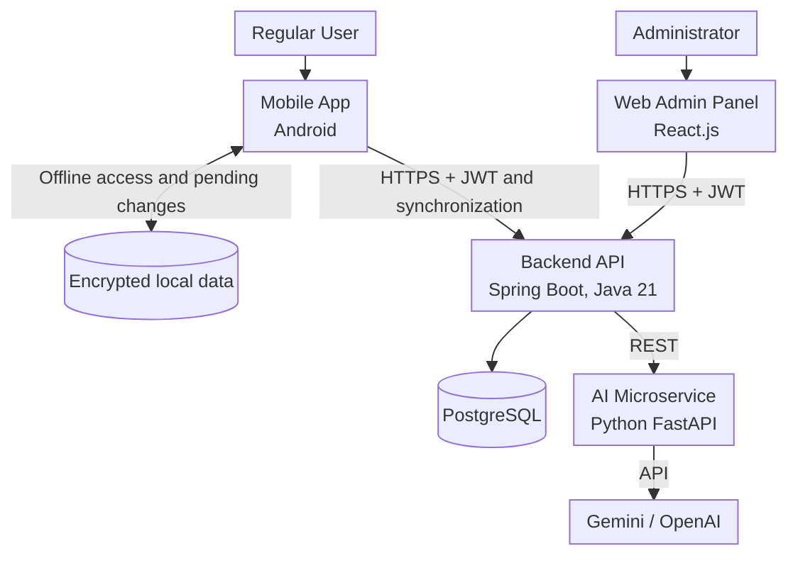
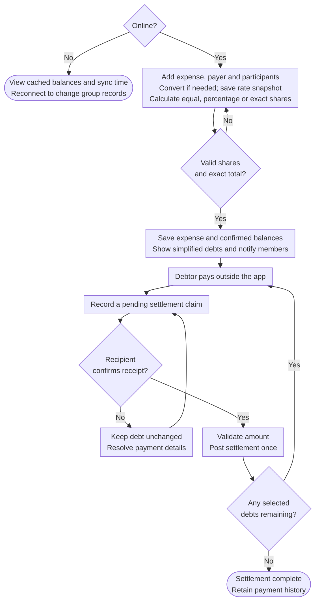
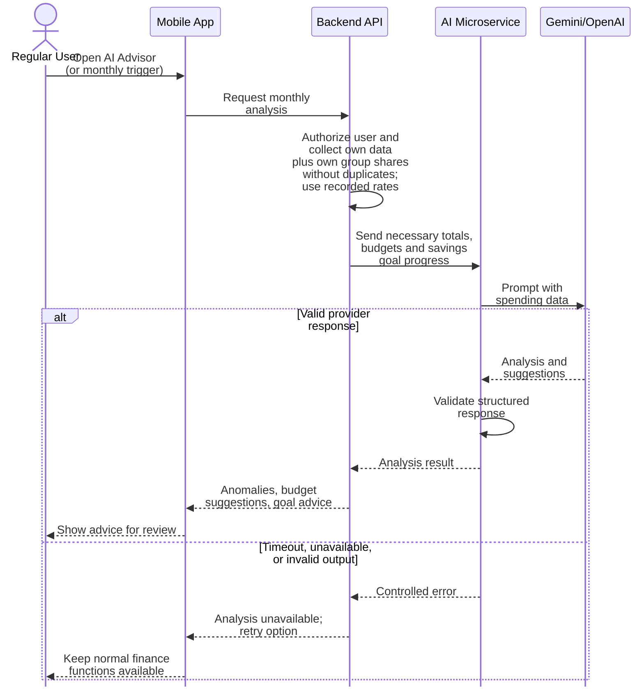

# PA2-2026 Report — FinSync (Group 04)
> *Performed by: Nguyen Le Duc Nhat | Reviewed by: Pham Dinh Tieu Long | Edited by: Nguyen Le Duc Nhat*

**Course:** CS300 - CSC13002 - Introduction to Software Engineering   
**Assignment:** Project Assignment 2 (PA2-2026) — Sprint 2  
**Group:** Group 04  
**Project:** FinSync — Personal Finance & Group Expense Manager with AI Advisor  
**Sprint 2 period:** `2026-10-10 to 2026-10-25`  
**Document revision:** 2026-10-19.   


## Table of Contents
> *Performed by: Nguyen Le Duc Nhat | Reviewed by: Pham Dinh Tieu Long | Edited by: Nguyen Le Duc Nhat*

- [Team Members](#team-members)
- [Part A — Project Plan](#part-a--project-plan)
- [Part B — Vision Document](#part-b--vision-document)
- [Part C — Spec Kit Initialization](#part-c--spec-kit-initialization)
- [Part D — AI Usage Report and Weekly Report](#part-d--ai-usage-report-and-weekly-report)
- [Appendix — AI Usage Notes](#appendix--ai-usage-notes)

---

## Team Members
> *Performed by: `Nguyen Le Duc Nhat` | Reviewed by: `Pham Dinh Tieu Long` | Edited by: `Nguyen Le Duc Nhat`*

| # | Student ID | Full Name | Email | Main Role |
|---|------------|-----------|-------|-----------|
| 1 | 24120087 | Phạm Định Tiểu Long | phamlongkh2006@gmail.com | Project Manager / Group Leader |
| 2 | 24120038 | Nguyễn Phú Đạt | nguyennphuudatt@gmail.com | UI/UX Designer & Frontend Lead |
| 3 | 24120403 | Nguyễn Lê Đức Nhật | nldnhat182006@gmail.com | Backend Lead |
| 4 | 24120342 | Vương Đắc Gia Khiêm | vuongkhiemvl10@gmail.com | QA Lead & DevOps |
| 5 | 24120051 | Ngô Thái Hòa | ngothaihoa235@gmail.com | AI Feature Lead & Documentation |

---

# Part A — Project Plan
> *Performed by: `Nguyen Le Duc Nhat` | Reviewed by: `Pham Dinh Tieu Long` | Edited by: `Nguyen Le Duc Nhat`*

## 1. Introduction
> *Performed by: `Nguyen Le Duc Nhat` | Reviewed by: `Pham Dinh Tieu Long` | Edited by: `Nguyen Le Duc Nhat`*

FinSync is a mobile application that combines personal finance management (similar to *Money Lover*) with smart group expense sharing (similar to *Splitwise*) in a single product. It is designed for students, young professionals, and small groups who share costs such as rent, trips, and events.

The system works as a **bookkeeping, debt calculation, and reminder tool only**. It does not connect to real bank accounts and never moves money automatically. An AI Financial Advisor analyzes spending history and suggests a reasonable spending plan for the next month.

This document is the initial version of the Project Plan. It will be updated in PA3-2026 based on the TA feedback.

## 2. Project Overview
> *Performed by: `Nguyen Le Duc Nhat` | Reviewed by: `Pham Dinh Tieu Long` | Edited by: `Nguyen Le Duc Nhat`*

### 2.1 Goals
> *Performed by: `Nguyen Le Duc Nhat` | Reviewed by: `Pham Dinh Tieu Long` | Edited by: `Nguyen Le Duc Nhat`*

- Build a working mobile app that unifies personal and group finance tracking.
- Automate expense splitting and debt optimization to reduce the number of transfers between group members.
- Provide an AI Financial Advisor that turns raw spending data into clear monthly guidance.
- Provide a simple web admin panel for basic system administration.
- Apply Scrum and good software engineering practice throughout the semester (Jira, Git, code review, testing).

### 2.2 Scope
> *Performed by: `Nguyen Le Duc Nhat` | Reviewed by: `Pham Dinh Tieu Long` | Edited by: `Nguyen Le Duc Nhat`*

**In scope**

| # | Functional Group | Short Description |
|---|------------------|-------------------|
| 1 | Authentication & Security | Register, login, logout, password recovery with JWT |
| 2 | Profile Management | Edit profile/password/avatar, Vietnamese/English interface, reporting currency (VND/USD) |
| 3 | Wallet & Personal Account Management | Manual cash/bank/card wallets, original balances, converted net-worth overview |
| 4 | Personal Transaction Tracking | Online/offline income and expense entry, receipt capture, queued sync and conflict resolution |
| 5 | Group Management & Shared Wallets | Create groups, invite by link/code, Owner/Member roles, shared wallet |
| 6 | Smart Debt Split & Settlement | Exact splits, debt simplification, refunds, and external payments confirmed by the recipient |
| 7 | Budget Planning & Alerting | Weekly/monthly category budgets, alerts at 80% and 100% |
| 8 | Financial Reporting & Analytics | Pie/bar charts, group trip summary, PDF/Excel export |
| 9 | Savings Goal Management | Long-term goals and progress tracking |
| 10 | System Administration (Admin Panel) | User lock/unlock, default categories, reference exchange rates, and aggregate statistics |
| AI | AI Financial Advisor | Monthly analysis, anomaly detection, budget suggestions |

**Out of scope**

- Direct connection to real bank accounts or payment gateways.
- Automatic money deduction or real money transfer.
- iOS client.
- Executing currency exchange, automatic bank synchronization, and automatic financial transfers.
- Offline changes to group ledgers, settlement confirmations, or administrator data; offline group access is read-only.

### 2.3 Deliverables
> *Performed by: `Nguyen Le Duc Nhat` | Reviewed by: `Pham Dinh Tieu Long` | Edited by: `Nguyen Le Duc Nhat`*

| Deliverable | Sprint / PA | Format |
|-------------|-------------|--------|
| Project Proposal, app survey | Sprint 1 / PA1 | Markdown + PDF |
| Project Plan (initial), Vision Document (initial), Spec Kit init | Sprint 2 / PA2 | Markdown + PDF, repo artifacts |
| Revised Project Plan and Vision Document after TA feedback | Sprint 3 / PA3 | Markdown + PDF |
| Use cases, architecture and design documents | Sprint 3–4 | Markdown + PDF |
| Test plan and test cases | Sprint 4 | Markdown + PDF |
| Source code: mobile app, backend API, AI microservice, admin web | Sprint 2–5 | GitHub repository (private) |
| Test builds | See [Build Plan](#44-build-plan) | APK / deployed environment |
| Final demo of all features | Sprint 5 / PA5 | Live demo |

### 2.4 Assumptions
> *Performed by: `Nguyen Le Duc Nhat` | Reviewed by: `Pham Dinh Tieu Long` | Edited by: `Nguyen Le Duc Nhat`*

- Every member works as a full-stack engineer; roles below only define the main person in charge (Lead).
- Each of the five members allocates at least **10 hours per week**, equivalent to approximately **114 team hours** over the 16-calendar-day PA2 window. Work is distributed between individual outputs, review, and meetings.
- Local Docker environments are the baseline for development and rehearsal. Remote hosting is optional for the demo; external AI calls are limited, cached where appropriate, and controlled by configuration so development can continue with synthetic responses during provider outages.
- Users enter all transactions manually; actual payments happen outside the app.
- Dates for PA3–PA5 are internal planning targets in this initial plan; official course deadlines take precedence. Their detailed scope will be refined at the start of each sprint.

## 3. Project Organization
> *Performed by: `Pham Dinh Tieu Long` | Reviewed by: `Nguyen Le Duc Nhat` | Edited by: `Pham Dinh Tieu Long`*

### 3.1 Team Structure and Roles
> *Performed by: `Pham Dinh Tieu Long` | Reviewed by: `Nguyen Le Duc Nhat` | Edited by: `Pham Dinh Tieu Long`*

| Member | Role | Main Responsibilities |
|--------|------|-----------------------|
| Phạm Định Tiểu Long | Project Manager / Group Leader | Track progress, coordinate work, lead Sprint meetings, manage Jira board |
| Nguyễn Phú Đạt | UI/UX Designer & Frontend Lead | Wireframes and mockups, UI consistency, lead mobile client development |
| Nguyễn Lê Đức Nhật | Backend Lead | Backend architecture, Spring Boot REST API, database design |
| Vương Đắc Gia Khiêm | QA Lead & DevOps | Testing strategy, test cases, CI/CD pipeline, deployment |
| Ngô Thái Hòa | AI Feature Lead & Documentation | AI Advisor (Gemini/OpenAI integration), technical documentation |

**Working rules**

- Each Jira task is assigned to exactly **one** member and reviewed by **another** member.
- Tasks are created **before** work starts (never created, assigned, and closed at the same time).
- Commit messages follow Conventional Commits: `<type>(<scope>): <subject>`.
- Secrets (API keys, passwords, JWT secret, `.env`) are never committed. The repository is private.

### 3.2 Risk Management
> *Performed by: `Pham Dinh Tieu Long` | Reviewed by: `Nguyen Le Duc Nhat` | Edited by: `Pham Dinh Tieu Long`*

| ID | Risk | Probability | Impact | Mitigation Strategy | Owner |
|----|------|-------------|--------|---------------------|-------|
| R1 | Member unavailability or uneven workload | Medium | High | Limit most work packages to three days, reserve review time, use a different reviewer as backup, and redistribute incomplete work during Scrum. | Long |
| R2 | Scope creep across eleven feature groups | High | High | Deliver a basic usable flow for every planned feature by Build 3; prioritize correctness and integration, and defer cosmetic depth through a documented scope decision. | Long |
| R3 | Learning Kotlin/Compose, Spec Kit, and deployment tools | Medium | Medium | Schedule individual training and small runnable skeletons in Sprint 2; retain the PA1 stack and share setup instructions. | Đạt |
| R4 | AI quota, latency, cost, or invalid suggestions | Medium | Medium | Use bounded requests, aggregate input, schema validation, a 30-second timeout, cached advice, and synthetic development responses. Keep finance functions independent of the AI provider. | Hòa |
| R5 | Mobile/backend/AI/admin integration failures | Medium | High | Define API contracts and shared currency/accounting rules early, smoke-test each build, and integrate before the final review. | Nhật |
| R6 | Exposed credentials or unauthorized financial access | Low | High | Externalize secrets, review tracked files and authorization tests, limit AI payloads, and rotate any exposed credential. | Khiêm |
| R7 | Incorrect shares, refunds, or settlements | Medium | High | Use exact money arithmetic, deterministic remainder allocation, immutable adjustments, atomic updates, and recipient-confirmation/retry tests. | Nhật |
| R8 | Lost or duplicated offline changes | Medium | High | Persist a local queue, identify operations uniquely, retain conflicting versions, test restart/retry behavior, and keep shared writes online. | Đạt |
| R9 | Stale or inconsistent exchange rates | Medium | Medium | Store rate/source/time with converted entries, label cached rates, reject missing-rate conversions, and test that rate updates never rewrite historical debt. | Nhật |

## 4. Project Plan
> *Performed by: `Pham Dinh Tieu Long` | Reviewed by: `Vuong Dac Gia Khiem` | Edited by: `Pham Dinh Tieu Long`*

### 4.1 Process
> *Performed by: `Pham Dinh Tieu Long` | Reviewed by: `Vuong Dac Gia Khiem` | Edited by: `Pham Dinh Tieu Long`*

The project follows the **Scrum** process. The semester is divided into **5 sprints**, each matching one Project Assignment (Sprint 1 = PA1, Sprint 2 = PA2, and so on). Each sprint lasts 2–3 weeks and has four meetings:

| Meeting | When | Purpose |
|---------|------|---------|
| Sprint Planning (1) | At the transition before sprint implementation; Sprint 2 kickoff slot: 10 October, 09:00–10:00 | Prioritize work, allocate capacity, and assign tasks |
| Weekly Scrum (2) | During sprint | Each member answers: done since last week / plan until next week / obstacles |
| Sprint Review & Retrospective (1) | End of sprint | Review results; what went well, what went wrong, root causes, improvements, lessons learned |

Tools follow the PA1 team contract: Jira (task tracking), GitHub (code and review), Discord / Zalo (daily communication), and Google Meet / Zoom (meetings).

The Jira workflow is **To Do → In Progress → Done**, as recorded in PA1. Work remains In Progress until another member reviews it. A task is Done when its output is linked, its acceptance criteria are checked, its review is recorded, and its actual completion date is entered. Documentation and self-training tasks follow the same rules as coding tasks.

### 4.2 Sprint Overview
> *Performed by: `Pham Dinh Tieu Long` | Reviewed by: `Ngo Thai Hoa & Nguyen Phu Dat` | Edited by: `Pham Dinh Tieu Long`*

| Sprint | PA | Planning period | Main focus |
|--------|----|-----------------|------------|
| Sprint 1 | PA1 | Before 2026-10-10; PA1 artifacts available in repository by 2026-10-05 | Proposal, app survey, team contract, and initial repository/backend setup |
| Sprint 2 | PA2 | **2026-10-10 to 2026-10-25** | Initial plan/vision, Spec Kit/training, skeletons, and Build 0 |
| Sprint 3 | PA3 | 2026-10-26 to 2026-11-08 | Revised documents; Auth, Profile, Wallet, offline Personal Transactions; AI/admin prototypes; Build 1 |
| Sprint 4 | PA4 | 2026-11-09 to 2026-11-22 | Groups, shared fund, split/settlement/refunds, currency conversion, budgets, savings, reports; Build 2 |
| Sprint 5 | PA5 | 2026-11-23 to 2026-12-06 | Complete AI/admin/export, full regression and offline rehearsal, release candidate, final build, and demo |

Sprint 3–5 dates are team planning targets aligned to two-week cycles, rather than confirmed course submission deadlines. Sprint Planning refines each later sprint's task-level estimates and assignments.

### 4.3 Sprint 2 — Detailed Task List
> *Performed by: `Pham Dinh Tieu Long` | Reviewed by: `Ngo Thai Hoa & Nguyen Phu Dat` | Edited by: `Pham Dinh Tieu Long`*

The dated task list is the Sprint 2 baseline. Every task has one assignee and a different reviewer; due dates include the owner/reviewer handoff. The S2 identifiers name work packages and are retained in Jira task titles. Section D.2.5 contains the single board screenshot and the four Jira-key mappings readable in that image. The baseline dates below remain unchanged for comparison with the recovery targets recorded in D.2.2: individual training on 20 October and Spec Kit setup on 21 October. The agreed completion sequence is Build 0 on 22 October, technical/document preparation by 23 October, Review and reconciliation on 24 October, and package preparation on 24–25 October. The reporting basis for this sequence is stated in D.2.

Long, Đạt, Nhật, Khiêm, and Hòa refer to the members in the team table. Meetings involve all five members; the assigned owner facilitates and records the minutes. Estimates below cover the owner's task execution; peer review and other members' meeting attendance are budgeted separately.

| Local ID | Task | Assignee | Reviewer | Planned start | Due date | Owner effort (h) |
|----------|------|----------|----------|---------------|----------|------------------|
| S2-01 | Sprint 2 Planning and meeting notes | Long | Hòa | 2026-10-10 | 2026-10-10 | 1.5 |
| S2-02 | Project Plan — Introduction and Overview | Nhật | Long | 2026-10-13 | 2026-10-14 | 2 |
| S2-03 | Project Plan — Organization and Risk Management | Long | Khiêm | 2026-10-13 | 2026-10-14 | 2 |
| S2-04 | Project Plan — Schedule and Build Plan | Long | Khiêm | 2026-10-15 | 2026-10-16 | 2 |
| S2-05 | Vision — Introduction and Positioning | Hòa | Long | 2026-10-13 | 2026-10-14 | 2 |
| S2-06 | Vision — Users, Stakeholders, Alternatives; review PA1 survey | Đạt | Hòa | 2026-10-13 | 2026-10-15 | 3 |
| S2-07 | Vision — Product Overview and accounting boundaries | Nhật | Khiêm | 2026-10-15 | 2026-10-16 | 3 |
| S2-08 | Vision — Product Features, 3–5 sentences per feature | Hòa | Nhật | 2026-10-15 | 2026-10-17 | 4 |
| S2-09 | Two Mermaid user workflows | Đạt | Khiêm | 2026-10-18 | 2026-10-19 | 3 |
| S2-10 | Vision — NFR targets and verification methods | Khiêm | Nhật | 2026-10-18 | 2026-10-19 | 3 |
| S2-11 | Review existing GitHub setup, folders, ignore rules, and branch rules | Khiêm | Long | 2026-10-10 | 2026-10-11 | 1.5 |
| S2-12 | Initialize Spec Kit in `/src`; complete constitution and artifact inventory | Khiêm | Nhật | 2026-10-13 | 2026-10-15 | 3 |
| S2-13 | Spec Kit training and individual evidence — Long | Long | Hòa | 2026-10-10 | 2026-10-12 | 3 |
| S2-14 | Spec Kit training and individual evidence — Đạt | Đạt | Long | 2026-10-10 | 2026-10-12 | 3 |
| S2-15 | Spec Kit training and individual evidence — Nhật | Nhật | Đạt | 2026-10-10 | 2026-10-12 | 3 |
| S2-16 | Spec Kit training and individual evidence — Khiêm | Khiêm | Nhật | 2026-10-10 | 2026-10-12 | 3 |
| S2-17 | Spec Kit training and individual evidence — Hòa | Hòa | Khiêm | 2026-10-10 | 2026-10-12 | 3 |
| S2-18 | Kotlin / Compose self-training and runnable mobile skeleton | Đạt | Nhật | 2026-10-16 | 2026-10-18 | 4 |
| S2-19 | Review/complete backend skeleton, database, migrations, and API documentation | Nhật | Khiêm | 2026-10-17 | 2026-10-19 | 6 |
| S2-20 | AI service self-training, skeleton, connectivity and failure smoke test | Hòa | Nhật | 2026-10-18 | 2026-10-20 | 4 |
| S2-21 | Weekly Scrum #1 and notes | Long | Hòa | 2026-10-16 | 2026-10-16 | 1 |
| S2-22 | Weekly Scrum #2 and notes | Long | Hòa | 2026-10-22 | 2026-10-22 | 1 |
| S2-23 | Sprint Review & Retrospective and notes | Long | Khiêm | 2026-10-24 | 2026-10-24 | 1.5 |
| S2-24 | Consolidate AI usage records and prompt histories | Hòa | Long | 2026-10-21 | 2026-10-23 | 2 |
| S2-25 | Jira/Git evidence, Markdown/PDF visual check, final submission package | Khiêm | Long | 2026-10-24 | 2026-10-25 | 3 |
| S2-26 | Produce Build 0 and record environment smoke-test results | Khiêm | Đạt | 2026-10-21 | 2026-10-22 | 2 |
| S2-27 | Cross-check report against PA2, resolve reviews, and reconcile Jira | Đạt | Hòa | 2026-10-23 | 2026-10-24 | 2 |

**Capacity allocation**

| Member | Owned tasks (h) | Peer review (h) | Additional meeting attendance (h) | Planned total (h) |
|--------|-----------------|-----------------|----------------------------------|-------------------|
| Long | 12 | 3 | 0 | 15 |
| Đạt | 15 | 2.5 | 3.5 | 21 |
| Nhật | 14 | 3 | 3.5 | 20.5 |
| Khiêm | 15.5 | 2.5 | 3.5 | 21.5 |
| Hòa | 15 | 2.5 | 3.5 | 21 |

The plan allocates **99 team hours** from approximately **114 available hours**, leaving about **15 hours** for corrections, environment problems, and coordination. Long's meeting tasks already include his attendance and minutes preparation; the other four members each reserve 3.5 hours for attendance.

**Dependencies and checkpoints:** repository checks finish by 11 October and individual training by 12 October, before Spec Kit setup on 13–15 October. Feature/accounting descriptions precede the 18–19 October workflows and NFRs. Mobile, backend, and AI skeletons are due by 20 October, before Build 0 on 21–22 October. The 23–24 October review window absorbs corrections, and packaging finishes on 25 October.

**Definition of Done:** the output exists, meets its acceptance criteria, has a different member's recorded review, and has accurate actual dates/status in Jira. A training task includes individual learning evidence; a meeting task includes attendance, updates, decisions, and actions; a build task includes reproducible startup steps and smoke-test results. The single Jira board screenshot in Section D.2.5 summarizes task assignments and progress. Completion is confirmed through the task output and recorded review.

### 4.4 Build Plan
> *Performed by: Pham Dinh Tieu Long | Reviewed by: Vuong Dac Gia Khiem | Edited by: Pham Dinh Tieu Long*

The final sprint (PA5) includes a demo of all features, so builds are planned to deliver features gradually.

| Build | Target date | Planned content | Acceptance focus |
|-------|-------------|-----------------|------------------|
| Build 0 — skeleton | 2026-10-22 | Runnable mobile/backend/database/AI skeletons and startup instructions | Environment reproduction, service connectivity, failure handling, and recorded smoke tests |
| Build 1 | 2026-11-08 | Auth, Profile, wallets, offline personal transactions and synchronization; AI/admin prototypes | Access control, restart/retry safety, conflict handling, and core transaction flows |
| Build 2 | 2026-11-22 | Groups/shared fund, splits/refunds, confirmed settlements, VND/USD conversion, budgets, savings, reports | Exact financial totals, historical rates, group permissions, and connected/offline boundaries |
| Build 3 — release candidate | 2026-11-29 | All ten functional groups and AI Advisor, complete admin/rate tools, PDF/Excel export | End-to-end feature coverage, security/performance tests, and 24-hour offline rehearsal |
| Final build | 2026-12-04 | Reviewed fixes to the release candidate | Regression closure, complete runbook, final data/evidence, and demo rehearsal |

**Five testable builds** are planned. Each build is associated with a source revision/tag, installation/startup steps, test outcomes, and known issues. Build 3 delivers all planned feature groups before final regression; the final sprint's internal demo target is **6 December 2026**, with 5–6 December reserved for rehearsal and presentation. Dates are adjusted if official PA3–PA5 deadlines require it.

### 4.5 Plan for Later Sprints (planned tasks only)
> *Performed by: `Pham Dinh Tieu Long` | Reviewed by: `Nguyen Le Duc Nhat & Vuong Dac Gia Khiem` | Edited by: `Pham Dinh Tieu Long`*

**Sprint 3 (PA3)**
- Revise Project Plan and Vision Document based on TA feedback.
- Write use cases and requirements specification (`/speckit.specify`).
- Design database schema, API contracts, and UI mockups.
- Implement Authentication, Profile, Wallet, and Personal Transactions, including encrypted offline storage, queued changes, synchronization, and conflict handling.
- Prototype the AI analysis contract with synthetic data and the admin login/user-list flow.
- Write test plan; produce Build 1.

**Sprint 4 (PA4)**
- Implement online Group Management, confirmed shared-wallet contributions, exact splitting/refunds, recipient-confirmed settlement, and auditable adjustments.
- Implement VND/USD conversion with stored rate snapshots, Budget Planning & Alerting, Savings Goals, Reports, and charts.
- Integrate the first AI analysis and admin management flows; exercise timeout and permission handling.
- Write test cases; set up CI pipeline; produce Build 2.

**Sprint 5 (PA5)**
- Implement AI Financial Advisor and Admin Panel; export PDF/Excel.
- Run integration, financial-invariant, performance/security, and 24-hour offline tests; fix defects and verify backup/restore.
- Prepare final report and demo; produce Build 3 and the final build.

---

# Part B — Vision Document
> *Performed by: `Nguyen Le Duc Nhat` | Reviewed by: `Ngo Thai Hoa` | Edited by: `Nguyen Le Duc Nhat`*

## 1. Introduction
> *Performed by: `Nguyen Le Duc Nhat` | Reviewed by: `Ngo Thai Hoa` | Edited by: `Nguyen Le Duc Nhat`*

### 1.1 Purpose
> *Performed by: `Nguyen Le Duc Nhat` | Reviewed by: `Ngo Thai Hoa` | Edited by: `Nguyen Le Duc Nhat`*

This document describes the vision for **FinSync**: the problem it solves, the people who will use it, its main features, and the quality requirements it must meet. It provides a common reference for the team, lecturer, and TAs when prioritizing work and evaluating the final product. The PA2 vision includes offline personal transaction management, VND/USD conversion, and explicit rules for shared expenses and settlement. This initial version will be revised in PA3-2026 based on TA feedback.

### 1.2 References
> *Performed by: `Nguyen Le Duc Nhat` | Reviewed by: `Ngo Thai Hoa` | Edited by: `Nguyen Le Duc Nhat`*

| Reference | Document and use |
|-----------|------------------|
| R1 | [PA1 Project Proposal — Part B](../PA1/report.md#b---project-proposal): original product scope, target users, and feature baseline |
| R2 | [PA1 Existing App Survey — Part C](../PA1/report.md#c---existing-app-survey): unchanged Money Lover and Splitwise findings and screenshots |
| R3 | [PA1 Team Contract — Part D](../PA1/report.md#d---team-contract): team roles and working agreements |
| R4 | [PA2 Assignment Specification](pa2_project_assignment_specification.md): required Project Plan, Vision Document, and submission format |
| R5 | [FinSync Project Context](../../GEMINI.md): system boundaries, technologies, and business domains |
| R6 | Part A of this report: sprint schedule, responsibilities, dependencies, and build plan |


## 2. Positioning
> *Performed by: `Nguyen Le Duc Nhat` | Reviewed by: `Pham Dinh Tieu Long` | Edited by: `Nguyen Le Duc Nhat`*

### 2.1 Problem Statement
> *Performed by: `Nguyen Le Duc Nhat` | Reviewed by: `Pham Dinh Tieu Long` | Edited by: `Nguyen Le Duc Nhat`*

| | |
|---|---|
| **The problem of** | In the team's PA1 survey, personal tracking and group splitting were handled by separate tools. Users must combine the information by hand, and often forget small debts. |
| **Affects** | Students, young professionals, and small groups (roommates, travel friends, project teams) who spend money together and also want to control their own spending. |
| **The impact of which is** | Time wasted on manual calculation, unclear "who owes whom", conflicts between friends, an incomplete view of personal spending, and overspending without early warning. |
| **A successful solution would be** | One app that combines personal wallets and budgets with group expense splitting and debt optimization, and gives clear AI-based advice on how to spend in the next month. |

### 2.2 Product Position Statement
> *Performed by: `Nguyen Le Duc Nhat` | Reviewed by: `Pham Dinh Tieu Long` | Edited by: `Nguyen Le Duc Nhat`*

| | |
|---|---|
| **For** | Students and young professionals who manage personal money and share costs with others |
| **Who** | Need to track personal spending, split shared bills fairly, and plan their monthly budget |
| **The product name** | FinSync |
| **That** | Combines personal finance tracking, smart group expense splitting with debt optimization, and an AI Financial Advisor in one mobile app |
| **Unlike** | Using separate personal-finance and group-splitting tools, represented by Money Lover and Splitwise in the PA1 survey |
| **Our product** | Unifies personal and group finance in one place, reduces the number of transfers needed to settle debts, and turns spending history into clear monthly advice — without touching the user's real bank accounts |

## 3. Stakeholder and User Descriptions
> *Performed by: `Ngo Thai Hoa` | Reviewed by: `Nguyen Phu Dat` | Edited by: `Ngo Thai Hoa`*


### 3.1 Stakeholder Summary
> *Performed by: `Ngo Thai Hoa` | Reviewed by: `Nguyen Phu Dat` | Edited by: `Ngo Thai Hoa`*


| Stakeholder | Description | Main Interest |
|-------------|-------------|---------------|
| Regular Users | Students and young professionals using the app | Easy tracking, fair splitting, useful advice |
| System Administrator | Person managing users and default data | Simple tools to manage accounts and categories |
| Development Team (Group 04) | Five students building the system | Deliver a working product on time with good quality |
| Lecturer and TAs | Course staff who grade and give feedback | Correct process, documents, and working software |
| Third-party services (Gemini/OpenAI, cloud hosting) | Providers of AI and hosting | Fair use within limits and terms |

### 3.2 User Summary
> *Performed by: `Ngo Thai Hoa` | Reviewed by: `Nguyen Phu Dat` | Edited by: `Ngo Thai Hoa`*


| User | Description | Responsibilities in the System |
|------|-------------|--------------------------------|
| **Regular User** | Individual who tracks money and joins expense groups | Manage wallets, transactions, budgets, goals; create or join groups; confirm payments |
| ↳ Group Owner | Regular User who creates and manages a group | Invite members, manage group settings and group wallet |
| ↳ Group Member | Regular User who joins a group | Add shared expenses, view debts, mark payments |
| **Administrator** | Manages the system through a simple web page | View users, lock/unlock accounts, manage default categories, view statistics |

### 3.3 User Environment
> *Performed by: `Ngo Thai Hoa` | Reviewed by: `Nguyen Phu Dat` | Edited by: `Ngo Thai Hoa`*


- **Regular Users** use an Android smartphone, as selected in PA1, on mobile data or Wi-Fi, often in short sessions for recording an expense. iOS is outside the current baseline unless a scope change is approved.
- **Offline support is included.** After an initial online sign-in and synchronization, users can view cached wallets, transactions, budgets, goals, and reports, and create, edit, or delete personal transactions without a connection. The app stores these changes locally, shows their pending status, and synchronizes them when connectivity and a valid session are available.
- **Shared operations require a connection.** Group creation/invitations, shared expense changes, settlement confirmation, new AI analysis, and administration use the latest server state. Cached group balances and previous AI advice remain readable offline with their last-sync time; the app explains when an action requires a connection.
- Receipt images captured offline remain on the device and upload after reconnection. Updates to the same personal record on two devices are shown for resolution rather than silently overwriting either version.
- **Administrators** use a desktop web browser (Chrome, Edge, Firefox).
- **Currencies and language:** VND and USD are supported with bidirectional conversion; Vietnamese and English are available in the user interface. A user's selected reporting currency determines converted summaries, while every record retains its original currency and amount.

### 3.4 Summary of Key Stakeholder or User Needs
> *Performed by: `Ngo Thai Hoa` | Reviewed by: `Nguyen Phu Dat` | Edited by: `Ngo Thai Hoa`*


| Need | Priority | Current Solution | Proposed Solution |
|------|----------|------------------|-------------------|
| Record personal income/expense quickly, including offline | High | Notes app, spreadsheets, Money Lover | Local transaction entry with categories, receipt capture, visible sync status, and synchronization after reconnection |
| See total money across cash, bank, and card in one reporting currency | High | Manual calculation | Wallet dashboard with VND/USD conversion and visible exchange-rate details |
| Split shared bills fairly | High | Mental calculation, chat messages, Splitwise | Equal, percentage, and exact splits |
| Know who owes whom and settle with few transfers | High | Manual reminders | Debt summary, simplified repayment suggestions, reminders, and settlement confirmed by the recipient |
| Avoid overspending | Medium | Self-control | Category budgets with alerts at 80% and 100% |
| Save for long-term goals | Medium | Notes, memory | Savings goals with progress tracking |
| Understand spending and plan next month | Medium | Manual analysis | AI Financial Advisor with monthly suggestions |
| Keep financial data private and safe | High | Depends on the app | Authentication, JWT, private personal data |
| Manage users and default categories | Medium | None | Web admin panel |

### 3.5 Alternatives and Competition
> *Performed by: `Ngo Thai Hoa` | Reviewed by: `Nguyen Phu Dat` | Edited by: `Ngo Thai Hoa`*


The team retains the Money Lover and Splitwise survey from [PA1 Part C](../PA1/report.md#c---existing-app-survey) without changes to its observations, comparison results, or supporting screenshots. The table below reproduces the feature comparison in PA1 Part C.3. Competitor entries describe the PA1 survey baseline; FinSync entries describe the planned product.

| Feature | Money Lover | Splitwise | FinSync (planned) |
|---------|:-----------:|:---------:|:-----------------:|
| Personal wallet management | ✅ | ❌ | ✅ |
| Personal transaction tracking | ✅ | ❌ | ✅ |
| Budget planning & alerts | ✅ | ❌ | ✅ |
| Financial reports & charts | ✅ | Limited | ✅ |
| Savings goals | ✅ | ❌ | ✅ |
| Group expense management | ❌ | ✅ | ✅ |
| Smart debt splitting | ❌ | ✅ | ✅ |
| Debt simplification algorithm | ❌ | ✅ | ✅ |
| Payment reminders | ❌ | ✅ | ✅ |
| AI financial advisor | ❌ | ❌ | ✅ |
| Admin panel | ❌ | ❌ | ✅ |
| Unified personal + group finance | ❌ | ❌ | ✅ |

Money Lover provides the personal dashboard, category selection, wallet aggregation, and reporting patterns that inform FinSync's personal-finance experience. Splitwise provides the group balance, flexible split, and external-settlement patterns that inform shared-expense workflows. FinSync's planned differentiation remains the combination of personal and group finance with monthly AI guidance and a Vietnamese-friendly interface. Offline operation and currency conversion are specified as FinSync requirements here; no additional competitor findings are asserted.

## 4. Product Overview
> *Performed by: `Pham Dinh Tieu Long` | Reviewed by: `Nguyen Le Duc Nhat` | Edited by: `Pham Dinh Tieu Long`*


### 4.1 Product Perspective
> *Performed by: `Pham Dinh Tieu Long` | Reviewed by: `Nguyen Le Duc Nhat` | Edited by: `Pham Dinh Tieu Long`*

FinSync is a new, self-contained product made of four parts that communicate through REST APIs:



The product is a **bookkeeping, calculation, and reminder** system. Payments happen outside the app (bank transfer, cash), and users confirm them in the app. The product never accesses real bank accounts.

The system separates two business areas:

- **Personal Expense Management:** private data, visible only to the account owner.
- **Group Expense Management:** shared data, visible to members of the same group.

**Accounting and reconciliation rules**

| Rule | Required behavior |
|------|-------------------|
| Group permissions | The Owner manages membership and settings; members may add expenses and payment claims. An expense recorder or the Owner may correct an expense, with the original values retained in history. Changes affecting previously settled amounts use linked adjustments and recalculated balances. |
| Personal and group ownership | Only the owner can access personal records. Group records are shared only with current authorized members; administrative statistics do not expose individual private transaction histories. |
| Expense recognition | Personal spending reports, category budgets, and AI analysis include only the user's own share of a group expense. The full amount advanced by a member is a cash movement; the amount recoverable from others is tracked as a receivable rather than additional personal consumption. |
| Linked records | A personal wallet movement, group expense, and allocated share may reference the same event. Reports identify that event and count consumption once, including when a user links an existing personal entry to a group expense. |
| Shared-wallet contributions | A member records a contribution claim and the Owner, acting as fund custodian, confirms receipt before it increases the shared fund and contributor's fund balance; it is a transfer, not an expense. An expense paid from the fund reduces available cash and allocates consumption to participants. Differences between each member's contributions and allocated costs determine amounts owed to or recoverable from the fund. A direct payment by a member is recorded against that member instead, so both funding methods cannot fund the same expense. |
| Shared-wallet visibility | The group fund balance is shown separately from personal wallets. Its entire balance is never included as one member's personal asset; member contribution and reimbursement positions are shown separately. All balances represent bookkeeping entries. |
| Splitting and rounding | Equal, percentage, and exact-amount splits operate in the group's currency. Percentages must total 100%; exact shares must equal the expense. Any rounding remainder is assigned in a stable member order so shares always sum to the recorded total. |
| Settlement authorization | The debtor records a positive payment claim after paying outside the app; the intended recipient confirms receipt before the debt is reduced. A rejected or pending claim leaves the confirmed debt unchanged. Partial settlement is allowed up to the outstanding amount; confirming the same claim twice has no additional effect. An Owner cannot confirm on another recipient's behalf. |
| Settlement accounting | Confirmed settlement changes debt and any linked cash movement, not consumption or income. Linking a previously recorded payment prevents a second cash entry. A return of unused shared funds follows the same sender/recipient confirmation rule and is a transfer, not an expense. |
| Refunds and corrections | Refunds reference the original expense, cannot exceed its unrefunded amount, and reverse the original participants' shares proportionally with exact rounding. Previously confirmed payments remain in history; resulting overpayments create reimbursement balances. Changes affecting balances are recorded as linked adjustments rather than silently deleting settled history. |
| Server reconciliation | Financial updates are applied atomically, preserve an audit trail, and reject stale conflicting versions. Retrying an operation with the same identifier cannot duplicate a transaction, share, refund, or settlement. Online group debt and fund calculations use the same ledger and currency rules. |

**Currency conversion rules**

FinSync supports conversion in both directions between VND and USD. Users select VND or USD as their reporting currency; each wallet and group has its own currency, which cannot be changed after financial entries exist.

| Item | Conversion rule |
|------|-----------------|
| Exchange-rate source | Administrators maintain a shared reference-rate table for the course deployment, recording a positive VND-per-USD rate, the quoted source, effective date/time, and update author. Rate entry is manual; a live exchange-rate API is not required for this version. |
| Conversion direction | USD amounts are multiplied by the recorded VND-per-USD rate to obtain VND; VND amounts are divided by that rate to obtain USD. The original amount is retained. |
| Precision | Monetary values use exact decimal arithmetic. VND is rounded to whole dong and USD to two decimal places using half-up rounding; conversion is performed before group shares are allocated. |
| Transaction history | Every converted financial entry retains the applied rate, source, and effective timestamp. Later rate updates do not change previously recorded expense shares or confirmed settlements. |
| Cross-currency group entries | An expense entered in another currency is converted once into the group's currency using the recorded rate snapshot. Debts and settlement limits are calculated in the group's currency; the original amount remains visible for checking. |
| Summaries and reports | Personal net-worth summaries show original wallet balances and converted equivalents using an identified valuation rate. Historical spending reports use transaction-rate snapshots and state their reporting currency. Changing the reporting preference recalculates the presentation without rewriting the ledger. |
| Offline and unavailable rates | Offline screens may use the last synchronized rate and show its effective date and offline status. If a rate is unavailable, original-currency records can still be saved, while conversion-dependent totals or shared operations wait for a valid rate. Reconnection does not silently replace a saved transaction's applied rate. |

**Offline synchronization**

The Android client keeps an encrypted local copy of the signed-in user's permitted data. Personal transaction changes receive stable identifiers and remain visible with pending, synchronized, or conflict status. Synchronization preserves transaction dates and prevents duplicate retries; version conflicts retain both versions for explicit user resolution. Group data remains a read-only cached snapshot while offline, and a valid online session is required before pending personal changes are submitted.

### 4.2 Assumptions and Dependencies
> *Performed by: `Pham Dinh Tieu Long` | Reviewed by: `Nguyen Le Duc Nhat` | Edited by: `Pham Dinh Tieu Long`*  
**Assumptions**

- Users enter transactions manually and honestly.
- Users have an Android smartphone and can connect for initial sign-in, synchronization, and shared operations; personal transaction entry remains available during temporary disconnection.
- Group members agree on expense participants, contributions, and refunds, and confirm actual external payments in the app.
- Users understand that converted totals are bookkeeping estimates using displayed reference rates; the application does not execute currency exchange or bank transfers.

**Dependencies**

| Dependency | Used For | Risk |
|------------|----------|------|
| Google Gemini / OpenAI API | AI Financial Advisor | Quota, cost, availability |
| PostgreSQL | Data storage | Hosting and backup |
| Docker / Docker Compose | Local and deployment environment | Setup problems |
| Docker-capable Linux host | Backend, PostgreSQL, AI service, and admin deployment | Resource limits and host availability; a local Docker environment supports rehearsal |
| In-app notification store | Debt reminders, settlement requests, and budget alerts | Offline users see server-side notifications after the next successful sync; local budget warnings remain available |
| Administrator-maintained exchange-rate table | VND/USD conversion with recorded rate/source/time | Stale or missing rates are shown explicitly and never silently invented |
| Android encrypted local storage and sync queue | Offline personal transactions and cached authorized data | Device storage, session renewal, and explicit resolution of conflicting edits |
| Transactional email service | Password recovery using expiring, single-use reset links | Delivery failure or delay; recovery requires a connection |
| GitHub, Jira, Spec Kit | Development process | Learning curve |

## 5. Product Features
> *Performed by: `Nguyen Le Duc Nhat` | Reviewed by: `Ngo Thai Hoa` | Edited by: `Nguyen Le Duc Nhat`*

### 5.1 Authentication & Security
> *Performed by: `Nguyen Le Duc Nhat` | Reviewed by: `Pham Dinh Tieu Long` | Edited by: `Nguyen Le Duc Nhat`* 

This feature lets users register, log in, log out, and recover a forgotten password through an expiring reset link. Protected online requests use validated JWT access tokens, while offline access is limited to locally stored data of the previously signed-in user. Access control separates personal records, group membership, and administrator functions because the app stores sensitive financial information. Regular Users and Administrators benefit from a consistent account lifecycle and protection against unauthorized access.

### 5.2 Profile Management
> *Performed by: `Nguyen Le Duc Nhat` | Reviewed by: `Pham Dinh Tieu Long` | Edited by: `Nguyen Le Duc Nhat`*  

Users can edit their name and avatar, change their password, select Vietnamese or English, and choose VND or USD as their reporting currency. Reports show converted totals with exchange-rate details while retaining the original currency on each financial entry. These preferences make the app understandable to local users and let group members recognize one another. Regular Users benefit from consistent identity and financial presentation across personal and group screens.

### 5.3 Wallet & Personal Account Management
> *Performed by: `Nguyen Le Duc Nhat` | Reviewed by: `Pham Dinh Tieu Long` | Edited by: `Nguyen Le Duc Nhat`* 

Users create manual cash, bank-account, and credit-card wallets, each with a recorded currency and opening balance. The dashboard shows individual balances and a combined estimate in the selected reporting currency using an identified reference rate. Cached balances remain readable offline, and pending personal transactions update the local view until synchronization. This helps Regular Users understand their recorded assets without connecting to a real bank account.

### 5.4 Personal Transaction Tracking
> *Performed by: `Nguyen Le Duc Nhat` | Reviewed by: `Pham Dinh Tieu Long` | Edited by: `Nguyen Le Duc Nhat`* 

Users record income and expenses with amount, category, wallet, note, date, and an optional receipt image. They can create, edit, or delete personal transactions offline, with changes and receipt uploads queued until reconnection. Stable record identifiers prevent duplicates, while conflicting edits remain visible for resolution rather than being silently overwritten. Regular Users benefit from reliable capture at the time of payment and a transaction history that supports budgets, reports, and AI analysis.

### 5.5 Group Management & Shared Wallets
> *Performed by: `Nguyen Le Duc Nhat` | Reviewed by: `Pham Dinh Tieu Long` | Edited by: `Nguyen Le Duc Nhat`* 

Users create groups for shared activities, invite members by link or code, and use Owner and Member roles to control group access. A group records its currency, shared-wallet contributions, expenses, and member balances separately from private wallets. Group changes require a connection so all members work from the same confirmed ledger, while previously synchronized information remains readable offline. Friends, roommates, and teammates benefit from a transparent record of who contributed, who spent, and who should be reimbursed.

### 5.6 Smart Debt Split & Settlement
> *Performed by: `Nguyen Le Duc Nhat` | Reviewed by: `Pham Dinh Tieu Long` | Edited by: `Nguyen Le Duc Nhat`* 

Shared expenses are divided equally, by percentage, or by exact amount after any required conversion into the group's currency. The app shows confirmed debts and suggests fewer repayment transfers while preserving each member's net balance. A debtor records an external payment claim, and the recipient confirms it before the debt is reduced; partial payments and rejected claims remain traceable. Refunds and corrections reference the original expense and adjust member balances without deleting payment history. Group members benefit from consistent calculations, reminders, and an auditable settlement process.

### 5.7 Budget Planning & Alerting
> *Performed by: `Nguyen Le Duc Nhat` | Reviewed by: `Pham Dinh Tieu Long` | Edited by: `Nguyen Le Duc Nhat`* 

Users set weekly or monthly limits for personal spending categories in their selected budget currency. Spending includes their own group-expense shares once, using the relevant recorded conversion rates. Visual warnings appear when a category reaches 80% and 100% of its limit, including for locally recorded offline expenses. Regular Users benefit from timely feedback instead of discovering overspending only at the end of the month.

### 5.8 Financial Reporting & Analytics
> *Performed by: `Nguyen Le Duc Nhat` | Reviewed by: `Pham Dinh Tieu Long` | Edited by: `Nguyen Le Duc Nhat`* 

The app presents personal income and spending in pie and bar charts and provides group summaries for trips or recurring shared costs. Reports separate consumption from transfers, contributions, and debt settlements, and display the reporting currency and exchange-rate basis. Authorized users can export PDF or Excel reports online, while cached summaries remain readable offline with their last-sync time. Individuals benefit from understanding spending patterns, and groups benefit from clear records they can review together.

### 5.9 Savings Goal Management
> *Performed by: `Nguyen Le Duc Nhat` | Reviewed by: `Pham Dinh Tieu Long` | Edited by: `Nguyen Le Duc Nhat`* 

Users create savings goals with a target amount, currency, deadline, and recorded contributions or withdrawals. The app shows progress and the remaining amount, using recorded conversion rates when a contribution has another currency. A savings allocation moves recorded funds toward a goal without creating new income or counting the same expense twice. Students and young professionals benefit from a measurable saving plan and can view previously synchronized progress offline.

### 5.10 System Administration (Admin Panel)
> *Performed by: `Nguyen Le Duc Nhat` | Reviewed by: `Pham Dinh Tieu Long` | Edited by: `Nguyen Le Duc Nhat`* 

Administrators use an online web panel to list users, lock or unlock accounts, maintain default categories and reference exchange rates, and view aggregate system statistics. Changes to rates retain their source, effective time, and author so converted amounts can be explained. Administrative access does not grant routine access to private transaction histories or permission to confirm another member's settlement. Administrators benefit from consistent maintenance tools, and Regular Users benefit from traceable reference data and clear privacy boundaries.

### 5.11 AI Financial Advisor
> *Performed by: `Nguyen Le Duc Nhat` | Reviewed by: `Pham Dinh Tieu Long` | Edited by: `Nguyen Le Duc Nhat`* 

At the start of a month or on request, the AI analyzes the user's personal spending and attributable group shares, excluding duplicate entries and using recorded currency conversions. It compares available history with budgets, identifies unusual category increases, and suggests a practical allocation for the next month and savings goals. New analysis requires a connection, explains limited history when applicable, and leaves existing finance functions available if the provider fails. Regular Users can review previously saved advice offline and choose whether to apply a suggestion, with no automatic change to budgets or financial records.

### 5.12 Key Workflow Diagrams
> *Performed by: `Nguyen Le Duc Nhat` | Reviewed by: `Pham Dinh Tieu Long` | Edited by: `Nguyen Le Duc Nhat`* 

**Workflow 1 — Record a shared expense and settle debts**



**Workflow 2 — Monthly AI Financial Advisor**



Workflow 1 requires an online ledger and confirmation by the payment recipient before a debt changes. Workflow 2 operates on the signed-in user's synchronized data and recorded conversion rates; offline users can read cached advice and personal records. Both workflows preserve the separation between external payments and in-app bookkeeping.

## 6. Non-Functional Requirements
> *Performed by: `Nguyen Phu Dat` | Reviewed by: `Pham Dinh Tieu Long` | Edited by: `Nguyen Phu Dat`*

The following requirements define acceptance criteria for implementation and final testing. Performance tests use a Linux deployment with at least **2 vCPUs and 4 GiB RAM**, a seeded database of **100 users with 100 personal transactions each**, and group test cases of up to **20 members and 500 expenses per group**. Mobile timing tests use an Android device with **4 GiB RAM**, Android 10 or later, and a stable connection of at least **10 Mbps** with round-trip latency no greater than **100 ms**. Minimum-platform compatibility is checked separately on Android 8.0; every test report records the actual hardware, versions, dataset, and build revision.

### 6.1 Performance
> *Performed by: `Nguyen Phu Dat` | Reviewed by: `Pham Dinh Tieu Long` | Edited by: `Nguyen Phu Dat`*

| ID | Requirement |
|----|-------------|
| NFR-P1 | At least 95% of non-AI API requests complete in **less than 500 ms** during the NFR-P3 load test. |
| NFR-P2 | The dashboard and first page of up to 50 transactions appear in **less than 2 seconds** in at least **19 of 20** warm-load trials on the specified mobile test environment. Cached offline lists meet the same target. |
| NFR-P3 | Support **100 concurrent authenticated users for 10 minutes**, each making one non-AI request every two seconds, with an unexpected-error rate **below 1%**. The request mix is 70% reads and 30% personal transaction writes; expected validation and authorization rejections are reported separately. |
| NFR-P4 | An online AI request produces advice or a controlled failure response within **30 seconds**. The interface shows progress and a retry option; successful and failed analysis counts are reported separately. |
| NFR-P5 | Recalculate group balances and simplified repayment suggestions for **20 members and 500 expenses in less than 2 seconds**, preserving each member's net position. |
| NFR-P6 | With the app open, valid authorization, and the specified connection, synchronize **100 queued personal transaction changes within 30 seconds**, excluding receipt uploads and edits awaiting conflict resolution. |

### 6.2 Security
> *Performed by: `Nguyen Phu Dat` | Reviewed by: `Pham Dinh Tieu Long` | Edited by: `Nguyen Phu Dat`*

| ID | Requirement |
|----|-------------|
| NFR-S1 | Store passwords only as salted BCrypt hashes; no plaintext or recoverable password is stored or logged. |
| NFR-S2 | Use **HTTPS with TLS 1.2 or later** for deployed client/API and external-service communication. Local development uses isolated test data. |
| NFR-S3 | Access tokens expire after **60 minutes**; refresh sessions expire after **7 days**. Protected requests reject invalid or expired tokens. Logout removes local tokens and private cached data, revokes the refresh session, and invalidates its active access token on the server. Synchronization after session expiry requires reauthentication. |
| NFR-S4 | All private-record, group-membership, administrator-role, and settlement-recipient authorization checks pass the agreed negative-test suite. A Group Owner cannot confirm a payment intended for another member. |
| NFR-S5 | Keep API keys, passwords, signing secrets, and real environment files outside tracked source and submission files. Application logs and AI requests must omit credentials and access tokens. |
| NFR-S6 | Validate amounts, currencies, split totals, uploaded file types, and user input on the server. Use parameterized database access and safe UI rendering; all invalid-input and script-injection cases in the security suite must pass. |
| NFR-S7 | Send the AI provider only the signed-in user's necessary category totals, budget limits, own group shares, and goal progress. Exclude other members' private records, names, emails, phone numbers, raw receipts, and authentication data. |
| NFR-S8 | Encrypt private offline records and receipt files at rest with keys protected by the Android system keystore. Cached data belongs to one signed-in account, requires device/app unlock to access, and is cleared on explicit logout or account removal from the device. |
| NFR-S9 | Password-reset links expire after **15 minutes**, can be used only once, and do not expose whether an unknown email address has an account. |

### 6.3 Reliability, Offline Operation, and Financial Correctness
> *Performed by: `Nguyen Phu Dat` | Reviewed by: `Pham Dinh Tieu Long` | Edited by: `Nguyen Phu Dat`*

| ID | Requirement |
|----|-------------|
| NFR-R1 | The demo environment passes **at least 95%** of one-minute health probes during a **two-hour rehearsal** before the demo. |
| NFR-R2 | Back up hosted project data **daily**, retain the latest **7 daily backups**, and demonstrate restoration to a separate test database within **30 minutes** before the final demo. The QA/DevOps Lead owns backup and restore verification. |
| NFR-R3 | Use exact decimal arithmetic with whole-dong VND and cent-precision USD. In every split/refund test, allocated shares equal the recorded amount exactly, and every group debt/fund journal balances to zero. Stable remainder allocation produces the same result on repeated calculation. |
| NFR-R4 | During an AI-provider outage or invalid response, personal tracking, group bookkeeping, and cached advice remain available within their normal connectivity limits; no financial record or budget is changed by a failed AI request. |
| NFR-R5 | After initial synchronization, users can create, edit, and delete personal transactions for cached wallets with **no network connection**. A **24-hour offline test with 100 local changes**, including app restart, loses no acknowledged local change and retains pending status. |
| NFR-R6 | Replaying each queued change **three times** creates no duplicate financial effect. Conflicting edits from two devices are detected, both versions are retained, and the user resolves the conflict before that record is marked synchronized. |
| NFR-R7 | A payment claim remains pending until the intended recipient confirms. Rejection, repeated confirmation, server failure, and attempts to exceed the outstanding debt produce **no incorrect balance change** in the settlement test suite; dependent ledger updates commit together or roll back together. |
| NFR-R8 | Every converted entry stores its original amount/currency and applied rate/source/time. Changing the reference rate or reporting preference does not alter existing group shares, original amounts, or confirmed payments. Missing rates never produce an invented converted total. |

### 6.4 Usability and Accessibility
> *Performed by: `Nguyen Phu Dat` | Reviewed by: `Pham Dinh Tieu Long` | Edited by: `Nguyen Phu Dat`*

| ID | Requirement |
|----|-------------|
| NFR-U1 | At least **4 of 5** first-time test participants record their first personal transaction in **3 minutes or less** without assistance, starting from an authenticated account with a wallet. |
| NFR-U2 | At least **4 of 5** participants save a basic expense in **30 seconds or less** from the add-transaction screen, excluding receipt capture/upload. Use the same task script online and offline and record results separately. |
| NFR-U3 | All primary screens use consistent labels and components; text supports Android font scaling to **150%** without hiding required actions, and primary touch targets are at least **48 dp**. |
| NFR-U4 | Provide Vietnamese and English labels for all primary flows, VND/USD formatting, original and converted amounts, and the applied rate's effective date. Amounts are always labelled with their currency. |
| NFR-U5 | Offline, pending synchronization, conflict, and pending/confirmed settlement states are distinguishable using text or icons as well as color. Shared-data views show their last successful synchronization time. |
| NFR-U6 | Budget warnings are updated when a relevant local or synchronized expense causes spending to cross **80% or 100%** of its limit; offline warnings identify that group data may be stale. |

### 6.5 Platform and Compatibility
> *Performed by: `Nguyen Phu Dat` | Reviewed by: `Pham Dinh Tieu Long` | Edited by: `Nguyen Phu Dat`*

| ID | Requirement |
|----|-------------|
| NFR-C1 | The Kotlin/Jetpack Compose mobile app installs and supports the core personal and group flows on **Android 8.0, API 26, or later**. Compatibility is checked on API 26 and an Android 10-or-later device/emulator. |
| NFR-C2 | The online admin panel supports the **two most recent stable desktop versions** of Chrome, Edge, and Firefox available at final acceptance; record the tested version numbers. |
| NFR-C3 | The server targets **Java 21 and PostgreSQL 16**. Backend, database, AI service, and admin deployment are reproducible on a Docker-capable Linux host using documented Docker Compose commands and external configuration. |
| NFR-C4 | Receipt capture works without a connection and uploads later. Online recovery, new AI requests, group writes, and settlement confirmation clearly indicate their network requirement; viewing cached data remains available. |

### 6.6 Maintainability and Quality
> *Performed by: `Nguyen Phu Dat` | Reviewed by: `Pham Dinh Tieu Long` | Edited by: `Nguyen Phu Dat`*

| ID | Requirement |
|----|-------------|
| NFR-M1 | Automated tests achieve **at least 70% line coverage** of backend services implementing splitting, settlement, refunds, currency conversion, and budget calculations. Coverage is measured against the reviewed build. |
| NFR-M2 | Follow Java naming conventions, the Kotlin Style Guide, PEP 8, and the agreed React conventions. Another member reviews each change before merge; review findings are resolved or explicitly accepted. |
| NFR-M3 | Document all public REST endpoints, authorization rules, request/response schemas, and error responses in OpenAPI. Document synchronization identifiers and conflict responses. |
| NFR-M4 | Apply server database changes through versioned Flyway migrations and verify both a clean setup and upgrade from the previous test build. |
| NFR-M5 | Use Conventional Commits and retain traceability from a Jira task to its implementation/document output and review record. |
| NFR-M6 | Automated financial tests include equal/percentage/exact splits, rounding remainders, partial/rejected settlements, refunds after settlement, duplicate retries, offline conflicts, and VND/USD conversion using fixed test rates. |

### 6.7 Standards and Verification
> *Performed by: `Nguyen Phu Dat` | Reviewed by: `Pham Dinh Tieu Long` | Edited by: `Nguyen Phu Dat`*

The API uses REST with JSON and OpenAPI documentation. Security review uses the OWASP Top 10 as a checklist, alongside the explicit authorization and data-protection requirements above. Money calculations follow the stated VND/USD precision, half-up conversion, immutable rate-snapshot, and exact-sum rules. Development follows Scrum, peer review, Conventional Commits, and versioned database migrations.

| Requirement group | Verification method | Acceptance evidence produced during testing |
|-------------------|---------------------|---------------------------------------------|
| Performance, P1–P6 | Defined mixed API load, mobile timing trials, AI timeout simulation, debt benchmark, and queued-change sync timing | Load configuration, timing/error results, actual environment, and tested revision |
| Security, S1–S9 | Password/token/reset tests, role and ownership tests, invalid-input cases, secret checks, AI-payload inspection, and offline-cache/logout checks | Security checklist, test results, reviewed payload samples, and protected-data checks |
| Reliability, R1–R8 | Rehearsal health probes, backup/restore, 24-hour offline/restart exercise, repeated retries, concurrent edits, ledger rollback, and historical-rate tests | Health log, restore record, synchronization/conflict results, and financial invariant test results |
| Usability, U1–U6 | Timed online/offline tasks with five first-time participants, language review, font/touch-target checks, and budget-threshold scenarios | Anonymized task timings, screen captures, accessibility checks, and alert results |
| Compatibility, C1–C4 | Android/API-level installation and workflows, browser matrix, reproducible Compose startup, and disconnected receipt capture | Device/OS/browser versions, startup record, and compatibility results |
| Maintainability, M1–M6 | Business-service coverage, peer review, API/migration checks, and automated financial cases | Coverage report, review record, OpenAPI/migration verification, and test summary |

---

# Part C — Spec Kit Initialization
> *Performed by: [Name] | Reviewed by: [Name] | Edited by: [Name]*

## 1. Repository and Spec Kit Setup
> *Performed by: [Name] | Reviewed by: [Name] | Edited by: [Name]*

| Item | Value |
|------|-------|
| GitHub repository | [pdtLong2929/FinSync](https://github.com/pdtLong2929/FinSync), recorded in PA1; `[TODO: verify private visibility and TA access]` |
| Spec Kit location | `/src` |
| Initialization status | `[TODO: not yet evidenced in this report / completed with evidence link]` |
| AI agent used with Spec Kit | `[TODO: actual agent and version]` |
| Spec Kit version | `[TODO]` |
| Setup date | `[TODO]` |
| Environment | `[TODO: OS, required runtime versions, and CLI installation method]` |
| Setup performer / reviewer | `[TODO: member]` / `[TODO: different member]` |
| Evidence / commit | `[TODO: transcript or screenshot and commit hash]` |

**Commands used**

```text
[TODO: paste the exact installation/setup commands actually executed]
[TODO: show that initialization ran in the repository's src directory]
[TODO: paste the constitution-generation/customization command if an AI agent was used]
[TODO: include relevant output, versions, and success/failure result]
```

This is a record template, not proof of initialization. Populate it from the team's actual run and the course-provided tutorial. Preserve existing source files during setup and ensure all initialization artifacts are located under `/src`.

## 2. Submitted Artifacts
> *Performed by: [Name] | Reviewed by: [Name] | Edited by: [Name]*

| Artifact | Actual path under `/src` | Commit / evidence | Included in zip |
|----------|--------------------------|-------------------|:---------------:|
| Project-specific `constitution.md` | `[TODO: exact generated path]` | `[TODO]` | ☐ |
| `[TODO: generated Markdown filename; repeat one row per file]` | `[TODO: exact path, including hidden folders]` | `[TODO]` | ☐ |

> **Reminder:** Spec Kit creates hidden folders (for example `.specify/` and the agent's command folder). Make sure they are included in the zip file.

List **every Markdown file produced by initialization**, including templates and agent instructions where generated. Record tool-dependent paths from the actual output rather than assuming a fixed folder layout. Link the reviewed inventory or directory listing: `[TODO]`. The original files must be attached; this table and the summary below do not replace them. Git history evidence is recorded in Part D, Section 2.6.

## 3. Constitution Summary
> *Performed by: [Name] | Reviewed by: [Name] | Edited by: [Name]*

`[TODO]` Summarize the actual customized constitution after initialization; do not describe proposed principles as completed artifacts.

| Principle to cover | FinSync-specific content to verify in the constitution | Actual section / reviewer result |
|--------------------|-------------------------------------------------------|----------------------------------|
| Business boundaries | Manual bookkeeping only; personal/group privacy; real payments remain external | `[TODO]` |
| Financial correctness | Exact money representation, split-total invariants, rounding, and no duplicate expense counting | `[TODO]` |
| Architecture and security | Agreed client/backend/AI/admin boundaries; access control and externalized secrets | `[TODO]` |
| Quality and delivery | Peer review, appropriate tests, documented APIs/migrations, reproducible builds | `[TODO]` |
| Governance | Version, adoption/amendment dates, and how the team approves changes | `[TODO]` |

## 4. Spec Kit Training Evidence
> *Performed by: [Name] | Reviewed by: [Name] | Edited by: [Name]*

Each member must complete the official YouTube training and submit evidence.

**Official tutorial list:** `[TODO: course-provided YouTube URLs/titles]`. Each evidence item should identify the member, tutorial(s), completion date, and a screenshot, practice log, or individual summary. Suggested summary prompts: what the constitution controls, what files initialization generated, what the member practiced, and one problem/lesson. Do not mark completion from account registration alone.

| Member | Completed / Date | Tutorial(s) / Evidence | Individual Learning Summary | Reviewer / Date |
|--------|------------------|------------------------|-----------------------------|-----------------|
| Phạm Định Tiểu Long | ☐ / `[TODO]` | `[TODO]` | `[TODO]` | Hòa / `[TODO]` |
| Nguyễn Phú Đạt | ☐ / `[TODO]` | `[TODO]` | `[TODO]` | Long / `[TODO]` |
| Nguyễn Lê Đức Nhật | ☐ / `[TODO]` | `[TODO]` | `[TODO]` | Đạt / `[TODO]` |
| Vương Đắc Gia Khiêm | ☐ / `[TODO]` | `[TODO]` | `[TODO]` | Nhật / `[TODO]` |
| Ngô Thái Hòa | ☐ / `[TODO]` | `[TODO]` | `[TODO]` | Khiêm / `[TODO]` |

---

# Part D — AI Usage Report and Weekly Report
> *Performed by: `Nguyen Le Duc Nhat` | Reviewed by: `Nguyen Phu Dat` | Edited by: `Nguyen Le Duc Nhat`* 

## 1. AI Usage Report
> *Performed by: `Nguyen Le Duc Nhat` | Reviewed by: `Nguyen Phu Dat` | Edited by: `Nguyen Le Duc Nhat`*

**Declaration:** All five members of Group 04 used Codex during PA2, as confirmed by the group. Nguyễn Lê Đức Nhật used **Codex only**. His recorded conversation supports report preparation, requirements refinement, task planning, workflow drafting, and document review. Long, Đạt, Khiêm, and Hòa will supply their own individual prompt histories; any additional tools they used, including Gemini or Claude, belong in those members' declarations.

**Reporting scope:** Sprint 2, 10–25 October 2026. The available detailed record covers Nhật's Codex requests from 17–19 October. Prompt timestamps are transcribed from the saved conversation history in UTC+07:00. The saved session records the VS Code integration, local FinSync workspace, models `gpt-6.1-sol` for the earlier requests and `gpt-6-astra` for the three follow-ups beginning at 12:05 on 19 October, and Codex client/runtime version `0.162.0-alpha.17.2`. AI-use evidence is provided through the prompt history in the Appendix.

| Purpose | AI-generated assistance | Affected sections | Human input and validation responsibility |
|---------|-------------------------|-------------------|------------------------------------------|
| Report organization and English wording | Proposed section structure, refined descriptions, and prepared document tables | Parts A–D and the Appendix | Nhật supplied the assignment, existing report, and project context; section authors check the resulting meaning and assignment coverage |
| Requirements and business rules | Drafted offline boundaries, group accounting, refunds, settlement confirmation, and VND/USD conversion rules | Part B, Sections 3–5 | Nhật confirmed offline support, the unchanged PA1 survey, adoption of the accounting rules, and currency conversion; assigned reviewers check technical accuracy |
| Sprint planning and workload | Proposed assignments, dates, dependencies, estimates, capacity allocation, and builds | Part A, Sections 4.2–4.5 | The team supplied roles and the sprint window; Long coordinates the plan and reviewers check the assigned outputs |
| Workflows and quality requirements | Drafted Mermaid workflows, measurable NFR targets, and verification methods | Part B, Sections 5.12 and 6 | Authors check workflow logic, accounting examples, and whether the proposed criteria can be tested |
| Weekly reporting and evidence | Drafted role-based meeting records, captions, and the AI disclosure | Part D and the Appendix | Nhật confirmed past attendance and the 16 October draft/training status, and selected the completion scenario described in D.2 |
| Document checking and revision | Located unfinished fields, corrected caption CSS and Mermaid syntax, reduced Jira evidence to one board image, and aligned reviewers and packaging dates | Report and PDF stylesheet | Nhật requested these corrections; document checks compare the final wording, local image paths, task baseline, and supplied evidence |

**Student contribution and validation**

Nhật selected the source documents, supplied the project decisions, identified inconsistencies, and directed revisions through the recorded prompts. AI supplied substantial draft wording and planning proposals. Document checks cover section structure, assignee/reviewer separation, date dependencies, PA1 survey consistency, image references, and the distinction between requirements and measured results. Assigned team reviewers remain responsible for recording their own review decisions against the corresponding tasks.

**Supporting records**

The Appendix retains the original requests, recorded access times, generated contributions, and validation notes. AI-01–AI-08 cover the initial drafting; AI-09 records the later formatting, meeting, Jira, consistency, and evidence revisions. These prompt records provide the evidence for Nhật's Codex-only use, including the Mermaid correction and this final report revision.

Hòa consolidates the group disclosure under S2-24 and Long reviews it. Long, Đạt, Khiêm, and Hòa add their own prompt histories to the Appendix, including their tools, recorded access times, generated contributions, and subsequent revisions.

## 2. Weekly Report
> *Performed by: `Nguyen Le Duc Nhat` | Reviewed by: `Ngo Thai Hoa` | Edited by: `Nguyen Le Duc Nhat`*  

**Project:** FinSync — Group 04.   
**Sprint:** Sprint 2 / PA2.   
**Period:** 2026-10-10 to 2026-10-25.   

**Sprint goal:** Prepare an initial Project Plan and Vision Document, initialize Spec Kit under /src, collect individual training evidence, and produce a reproducible skeleton build that supports later implementation.

The structure follows `WeeklyReport`: one Sprint Planning meeting, two Weekly Scrum meetings, and one Sprint Review/Retrospective. Both Scrum records are kept in this document. Long coordinates the meetings and minutes; all five members provide their own progress updates.

**Reporting basis — 19 October 2026:** The 10/16 October records combine team confirmations and available repository evidence. Sections 2.3–2.4 and the related closeout entries in 2.7 use the completion scenario selected by Nhật for this finalized narrative: all five members participate, Long records every meeting, technical/document work is ready by 23 October, Review takes place on 24 October, and packaging follows on 24–25 October. These later attendance, acceptance, and build outcomes are scenario statements, not observations of meetings or tests already held. The Jira/Git figures retain the supplied 19 October snapshots. Part C and the other four members' individual AI histories remain separately maintained contributions outside this revision.

| Meeting | Planned date / time | Task | Minutes owner / reviewer |
|---------|---------------------|------|-------------------------|
| Sprint Planning | 2026-10-10, 09:00–10:00, before sprint work begins | S2-01 | Long / Hòa |
| Weekly Scrum #1 | 2026-10-16, 19:30–20:15 | S2-21 | Long / Hòa |
| Weekly Scrum #2 | 2026-10-22, 19:30–20:15 | S2-22 | Long / Hòa |
| Sprint Review & Retrospective | 2026-10-24, 19:30–20:30 | S2-23 | Long / Khiêm |

The table gives the scheduled meeting slots. Planning is the PA1-to-PA2 transition checkpoint on 10 October before implementation begins. Meetings use Google Meet, with follow-up coordination through Discord/Zalo.

### 2.1 Sprint Planning Meeting
> *Performed by: `Pham Dinh Tieu Long` | Reviewed by: `Ngo Thai Hoa` | Edited by: `Pham Dinh Tieu Long`* 

**Date / scheduled slot:** 2026-10-10, 09:00–10:00.   
**Facilitator / note taker:** Long.   
**Members present:** Phạm Định Tiểu Long, Nguyễn Phú Đạt, Nguyễn Lê Đức Nhật, Vương Đắc Gia Khiêm, and Ngô Thái Hòa.   
**Members absent:** None; full attendance confirmed by the group.  

**Prioritized scope and allocation**

| Priority | Work package | Assigned owner(s), each for their own tasks | Expected output |
|----------|--------------|---------------------------------------------|-----------------|
| 1 | Project Plan, schedule, risk management, and coordination | Long; Nhật for Introduction/Overview | Initial plan covering five sprints, task/reviewer assignments, risks, and builds |
| 1 | Vision, positioning, user needs, and product boundaries | Hòa for positioning/features; Đạt for user research; Nhật for product perspective | Refined descriptions of all ten functional groups and AI Advisor; two Mermaid workflows |
| 1 | Spec Kit setup and training evidence | Khiêm for setup; every member for individual training | Customized constitution, generated Markdown inventory, and five individual evidence records |
| 1 | Quality targets and PA2 evidence | Khiêm for NFRs/evidence; Hòa for the AI log; Long for minutes | Measurable NFRs, AI Usage Notes, four meeting records, and Jira/Git evidence |
| 2 | Mobile/backend/AI skeletons and Build 0 | Đạt for mobile; Nhật for backend; Hòa for AI; Khiêm for integration | Reproducible startup instructions and documented smoke-test results |

Each task has one assignee and a different reviewer, as listed in [Section A.4.3](#43-sprint-2--detailed-task-list). The baseline allocates 99 team hours against approximately 114 available hours, including separate review/attendance budgets and a correction buffer.

**Planning baseline**

- Retain the Android Kotlin/Jetpack Compose baseline and the Spring Boot/PostgreSQL backend described in PA1.
- Keep personal records private and group records visible only to authorized members. Record real payments outside the app.
- Complete training by 12 October, Spec Kit setup by 15 October, feature drafts by 17 October, and skeleton work by 20 October.
- Produce Build 0 by 22 October; reserve 23–24 October for review and fixes, and 25 October for the final submission package.
- Track all writing, learning, coding, review, and evidence tasks in Jira; update actual status and dates from real work.

**Follow-up actions:** ACT-01 and ACT-02 in Section 2.7.

**Summary:** The sprint baseline prioritizes mandatory PA2 documents and training while reserving time for early technical integration. Product descriptions guide workflows and quality targets; component skeletons precede Build 0. The current scope also incorporates the user's 18 October decisions on offline support, recipient-confirmed settlement, and VND/USD conversion, as consolidated in Part B.

### 2.2 Weekly Scrum Meeting #1 — 16 October 2026
> *Performed by: `Pham Dinh Tieu Long` | Reviewed by: `Ngo Thai Hoa` | Edited by: `Pham Dinh Tieu Long`*

**Date / scheduled slot:** 2026-10-16, 19:30–20:15.  
**Facilitator / note taker:** Phạm Định Tiểu Long.  
**Members present:** Phạm Định Tiểu Long, Nguyễn Phú Đạt, Nguyễn Lê Đức Nhật, Vương Đắc Gia Khiêm, and Ngô Thái Hòa.  
**Members absent:** None; full attendance confirmed by the group.

**Meeting focus:** Review the first documentation drafts, identify work behind the initial schedule, and prepare the mobile/backend/AI integration checkpoint.

**Confirmed progress basis:** The group confirms that initial document drafts were available, while Spec Kit initialization and the five-member training workstream were not yet complete. Draft availability is distinguished from completed peer review. Individual training completion, technical test outcomes, and actual Jira dates are supported by their respective records when supplied.

| Member | What have I done since last week? | What will I do until next week? | Issues / problems / obstacles |
|--------|-----------------------------------|--------------------------------|-------------------------------|
| Long | Initial organization, risk, schedule, and build-plan drafts are available in the shared report under S2-03/S2-04. | Coordinate review of the drafts, reconcile task ownership/dates, and track recovery of training/setup before the next Scrum. | The training/setup workstream is behind its original early-sprint milestones; draft documents alone do not establish readiness for integration. |
| Đạt | User/stakeholder descriptions and the PA1 survey baseline are available for the vision draft under S2-06. | Complete the mobile skeleton (S2-18), finalize two workflows (S2-09), and review the integrated Build 0. | The mobile client needs agreed request/response fields, connectivity states, and currency/accounting behavior before integration. |
| Nhật | Introduction and product-perspective drafts are available; the initial PA2 report was committed on 16 October as 42b3819. | Complete the backend/database/API skeleton (S2-19), review the Spec Kit setup, and align the backend/AI contract. | Exact money representation, duplicate prevention, and group/personal boundaries require consistent treatment across components; successful integration is not yet evidenced. |
| Khiêm | Repository preparation and the Spec Kit/training workstream have been identified for technical follow-up; completed initialization/training evidence is not yet available. | Finish Spec Kit initialization (S2-12), collect each member's training evidence, define the Build 0 checklist, and prepare NFR verification methods (S2-10). | Spec Kit/training remain incomplete against the 12/15 October baseline targets and need a recovery checkpoint. |
| Hòa | Vision introduction/positioning and product-feature descriptions are available as initial draft material under S2-05/S2-08. | Refine the features with peer feedback, complete the AI skeleton (S2-20), and consolidate AI-use evidence (S2-24). | AI-provider timeout, quota, and invalid-output handling remain integration risks to test; per-member usage histories must be collected. |

**Repository record:** Commit 8af0078 on 14 October reorganized PA1 materials and added the PA2 specification; commit 42b3819 on 16 October added the initial PA2 report. These support document preparation without establishing successful training, reviewed task closure, or a passing build.

**Follow-up reconciliation — 19 October 2026**

The following recovery targets respond to the confirmed training/setup delay. They are planning adjustments recorded during report preparation, rather than backdated decisions claimed for 16 October. Original baseline dates remain traceable in Section A.4.3 and Jira history.

| Follow-up | Task / expected output | Owner | Reviewer | Recovery target |
|-----------|------------------------|-------|----------|-----------------|
| SC1-01 | Complete Long's training and retain an individual learning/evidence record (S2-13) | Long | Hòa | 2026-10-20 |
| SC1-02 | Complete Đạt's training and retain an individual learning/evidence record (S2-14) | Đạt | Long | 2026-10-20 |
| SC1-03 | Complete Nhật's training and retain an individual learning/evidence record (S2-15) | Nhật | Đạt | 2026-10-20 |
| SC1-04 | Complete Khiêm's training and retain an individual learning/evidence record (S2-16) | Khiêm | Nhật | 2026-10-20 |
| SC1-05 | Complete Hòa's training and retain an individual learning/evidence record (S2-17) | Hòa | Khiêm | 2026-10-20 |
| SC1-06 | Complete Spec Kit setup, project constitution, and generated-file inventory under /src (S2-12) | Khiêm | Nhật | 2026-10-21 |
| SC1-07 | Coordinate outstanding document reviews and record actual progress/recovery dates in Jira (ACT-03/ACT-04) | Long | Hòa | 2026-10-21 |

**Summary:** Initial plan and vision drafts provide a basis for review, but Spec Kit/training are the confirmed schedule gap. The recovery plan prioritizes individual evidence and reproducible setup before the 22 October integration checkpoint. Scope is kept stable so the remaining days can be used for technical checks, review, and submission evidence.

### 2.3 Weekly Scrum Meeting #2 — 22 October 2026
> *Performed by: `Pham Dinh Tieu Long` | Reviewed by: `Ngo Thai Hoa` | Edited by: `Pham Dinh Tieu Long`*

**Date / time:** 2026-10-22, 19:30–20:15.  
**Leader / facilitator / note taker:** Phạm Định Tiểu Long.  
**Members present:** Phạm Định Tiểu Long, Nguyễn Phú Đạt, Nguyễn Lê Đức Nhật, Vương Đắc Gia Khiêm, and Ngô Thái Hòa.  
**Members absent:** None.

**Meeting focus:** Review the recovered training/setup work, assess Build 0, and complete technical work, document corrections, and the pre-Review draft by 23 October. Final Review records, evidence updates, and submission packaging follow on 24–25 October under S2-25.

**Member updates**

| Member | What have I done since last week? | What will I do until next week? | Issues / problems / obstacles |
|--------|-----------------------------------|--------------------------------|-------------------------------|
| Long | Completed individual training, coordinated the delayed setup/training work, and consolidated peer feedback on the Project Plan. Reconciled task owners, reviewers, and recovery dates for the final checkpoint. | Review the pre-Review draft on 23 October, facilitate and record the 24 October Review, and review the final package during 24–25 October before submission. | No blocking coordination issue remains; final captions, task history, and report dates need one consistency check. |
| Đạt | Completed the mobile skeleton and the two user workflows. Reviewed startup/connectivity with Nhật and checked that the workflows reflect the agreed offline, settlement, and currency requirements. | Complete the pre-Review cross-check and draft PDF readability check on 23 October, then reconcile Review outcomes on 24 October to close S2-27. | No blocking client issue remains within the Build 0 scope; document and PDF consistency checks are the remaining work. |
| Nhật | Completed the backend/database/API skeleton and reviewed the Spec Kit setup. Aligned request/response fields with the mobile and AI owners, including money representation and error handling. | Support the final technical cross-check, confirm that startup instructions match the reviewed revision, and prepare the Sprint 3 API backlog. | No blocking integration issue remains within the skeleton scope; later feature implementation follows the agreed contracts. |
| Khiêm | Completed Spec Kit initialization, the constitution, and the generated-file inventory. Collected all five training records and coordinated the Build 0 startup/connectivity checks with the component owners. | Organize the available technical evidence for the 23 October draft, then finalize Jira/Git evidence and verify the Markdown/PDF/archive on 24–25 October under S2-25. | The earlier training/setup delay has been recovered; final evidence captions and package verification follow the Review. |
| Hòa | Completed the feature refinements and AI-service skeleton. Aligned the AI contract with Nhật and consolidated his available prompt history, tool metadata, and revision notes. | Complete the shared disclosure structure and Nhật's record on 23 October, assign the remaining individual records to their owners, and review the report with Đạt. | No blocking AI-service issue remains within the skeleton scope. Long, Đạt, Khiêm, and Hòa retain responsibility for supplying their individual AI histories. |

**Checkpoint decisions**

- All five individual training tasks were completed on 20 October. Spec Kit initialization and its inventory were completed on 21 October, recovering the delay identified at Scrum #1. Jira retains the original due dates and the later actual completion dates.
- Build 0 was accepted within the agreed skeleton scenario: the mobile client starts, the backend connects to PostgreSQL, the AI service responds through the agreed interface, and provider failure returns a controlled message. These are the scenario's acceptance outcomes; the report does not invent a tested commit, machine configuration, console log, or measured result.
- The team agreed that the Project Plan, Vision, workflows, and NFRs use the same offline, group-accounting, settlement, and VND/USD rules.
- The sprint scope remained stable. Technical work, document corrections, AI disclosure consolidation, and the pre-Review draft were targeted for completion by 23 October. Review minutes and final reconciliation follow on 24 October; S2-25 covers final evidence, PDF/archive checks, and packaging on 24–25 October.
- No blocking technical issue remained within the skeleton scope. Long coordinated the 23 October readiness checkpoint with the component owners; Part C and the four separate AI histories remain the designated contributions of their owners.

**Final preparation and submission actions**

| Action | Owner | Reviewer | Completion target | Expected output |
|--------|-------|----------|-------------------|-----------------|
| Record Build 0 acceptance within the agreed scenario (ACT-05) | Khiêm | Đạt | 2026-10-22 | Mobile startup, backend/database connectivity, AI response, and controlled failure behavior |
| Consolidate the shared AI declaration and Nhật's history (ACT-06 / S2-24) | Hòa | Long | 2026-10-23 | Complete available record; the other four members supply their own histories |
| Finish the report/Jira cross-check and PDF readability review (S2-27) | Đạt | Hòa | 2026-10-24 | Pre-Review checks on 23 October, followed by reconciliation of Review outcomes on 24 October |
| Finalize evidence and the Markdown/PDF/archive package (S2-25) | Khiêm | Long | 2026-10-25 | Work on 24–25 October: add Review records and final evidence, regenerate the PDF, and verify the archive |

**Summary:** Training and setup have recovered, and Build 0 meets its initial integration scope. Technical work, document corrections, and the pre-Review draft are ready by 23 October. The team reviews these outputs on 24 October and completes final records, evidence updates, and packaging by 25 October.

### 2.4 Sprint Review & Retrospective — 24 October 2026
> *Performed by: `Pham Dinh Tieu Long` | Reviewed by: `Vuong Dac Gia Khiem` | Edited by: `Pham Dinh Tieu Long`*

**Date / time:** 2026-10-24, 19:30–20:30.  
**Leader / facilitator / note taker:** Phạm Định Tiểu Long.  
**Members present:** Phạm Định Tiểu Long, Nguyễn Phú Đạt, Nguyễn Lê Đức Nhật, Vương Đắc Gia Khiêm, and Ngô Thái Hòa.  
**Members absent:** None.

**Review goal:** Evaluate the completed PA2 outputs against the sprint goal, confirm submission readiness, and agree on practical improvements for Sprint 3.

**Review agenda**

| Time | Activity | Presenter / lead |
|------|----------|------------------|
| 19:30–19:40 | Present the Project Plan, Vision, workflows, and task consistency checks | Long, Hòa, Đạt, and Nhật |
| 19:40–19:55 | Demonstrate Build 0 and review the recorded startup/connectivity checks | Khiêm with Đạt, Nhật, and Hòa |
| 19:55–20:05 | Review Spec Kit artifacts and the five individual training records | Khiêm and all members |
| 20:05–20:15 | Review AI disclosures, available meeting records/evidence, the draft PDF, and the final packaging plan | Hòa, Khiêm, and Long |
| 20:15–20:30 | Discuss retrospective findings and agree on Sprint 3 improvements | All members |

**Deliverable review**

| Deliverable | Presenter / owner | Review outcome |
|-------------|-------------------|----------------|
| Project Plan | Long; Nhật for the overview | Accepted. Scope, organization, risks, task ownership, separate reviewers, capacity, and staged build milestones were checked for consistency. |
| Vision Document and workflows | Hòa, Đạt, and Nhật | Accepted. The PA1 survey was retained; product features and workflows consistently describe offline support, group accounting, settlement confirmation, and VND/USD conversion. |
| Non-functional requirements | Khiêm | Accepted. Quality targets have measurable criteria and proposed verification methods; target values are distinguished from observed build results. |
| Spec Kit and individual training | Khiêm; each member for their own training | Training/setup completion follows the 20/21 October recovery milestones in the agreed scenario. The actual constitution, artifact inventory, and individual training evidence belong to Part C, which is maintained separately. |
| Build 0 | Khiêm with the component owners | Accepted for the skeleton milestone in the agreed scenario. The acceptance scope is startup, mobile/API/database connectivity, AI-service response, and controlled provider-failure handling; later feature and NFR tests belong to subsequent builds. |
| AI Usage Report and Weekly Report | Hòa and Long | The shared disclosure, Nhật's prompt history, and the four meeting narratives are complete for this revision. The other four members provide their own AI histories. Long records the Review and Khiêm reviews its minutes. |
| Evidence and submission readiness | Khiêm, with Đạt and Long reviewing | The pre-Review draft and available evidence were reviewed. Final evidence, Review records, PDF regeneration, and PA2-Group04 archive verification are completed on 24–25 October under S2-25, with Long reviewing the final package. |

**Review decision:** Within the reporting basis stated in D.2, the team accepted the Project Plan, Vision, workflows, NFR specification, meeting narratives, and skeleton scope prepared by 23 October. This report revision retains the two explicit contribution boundaries: Part C and the four other members' AI histories. Long completes the Review minutes and Đạt reconciles the Review outcomes on 24 October. Khiêm completes final evidence, PDF/archive verification, and packaging under S2-25 on 24–25 October, with Long reviewing the package before submission. These closeout activities remain within Sprint 2; no substantive PA2 development or document correction is carried into Sprint 3. The staged implementation milestones in Sprints 3–5 remain the basis for subsequent product development.

**Retrospective**

| Required question | Discussion and conclusion |
|-------------------|---------------------------|
| What went well? | All five members participated in each meeting, and the role-based allocation gave each workstream a clear owner and a different reviewer. Reusing the PA1 baseline helped the team refine the plan and vision, while the shared Build 0 checkpoint brought the component owners together before the final Review. |
| What went wrong? | Spec Kit and individual training missed their initial early-sprint targets. Although the team recovered the work before the second Scrum, this reduced the time available for review and concentrated evidence/package preparation near the end of the sprint. |
| What problems occurred and what caused them? | The team underestimated the combined effort for learning, environment setup, and retaining individual evidence. Component work also needed agreement on API fields and financial rules. Recovery used named owners, revised checkpoints, and a shared startup review to resolve these dependencies. |
| What can be done differently next sprint? | Define each task's acceptance criteria and dependencies during Planning, validate the environment early, and retain evidence when work is completed. Review API examples before dependent feature work and schedule an integration rehearsal before the release build. |
| What lessons were learned? | Training, setup, implementation, review, and evidence collection each require explicit time. Recovery dates should remain traceable alongside the original plan. A shared build checkpoint and concrete accounting examples help the team find cross-component inconsistencies before the final Review. |

**Agreed Sprint 3 improvement actions**

| Improvement | Owner | Reviewer | Target | Success criterion |
|-------------|-------|----------|--------|-------------------|
| Prepare Sprint 3 tasks with an assignee, different reviewer, estimate, dependencies, and acceptance criteria | Long | Khiêm | 2026-10-26 | Every task selected at Planning contains the required fields before work starts |
| Use a per-task evidence and review checklist from the start of the sprint | Khiêm | Long | 2026-10-26 | A completed sample shows where the output, review decision, and supporting evidence are retained |
| Publish reviewed mobile/backend/AI contract examples, including money and error behavior | Nhật | Đạt | 2026-10-27 | Component owners use the same request/response and accounting examples |
| Run a shared integration rehearsal before Build 1 | Khiêm | Nhật | 2026-11-05 | The rehearsal records results and assigns any defects before the 8 November build target |

**Submission handoff:** By 23 October, Đạt completed the pre-Review cross-check, Hòa consolidated the shared AI declaration and Nhật's record, and Khiêm organized the supplied Jira/Git evidence. The four other AI records and Part C remain with their designated owners. Long records the Review minutes on 24 October, Khiêm reviews those minutes, and Đạt reconciles Review outcomes to close S2-27. On 24–25 October, Khiêm completes S2-25 by adding the Review records and final evidence, regenerating the PDF, and checking the archive. Long reviews the final package and confirms that the submitted files match the accepted revision before the 25 October handoff.

**Summary:** The Review accepts the prepared technical and document content, with full team attendance and Long responsible for the minutes. Final records and submission packaging are completed within 24–25 October. The retrospective retains the lesson from the training/setup delay and assigns concrete improvements for Sprint 3.

### 2.5 Jira Evidence
> *Performed by: `Nguyen Phu Dat` | Reviewed by: `Nguyen Le Duc Nhat` | Edited by: `Nguyen Le Duc Nhat`*

Figure D.1 provides the single Jira board image used for PA2 assignment/progress evidence. The visible project is **CNPM-2026 - Group 4**. Each displayed task card includes a Jira key, title, and assignee avatar, and its column identifies its current status.

**Figure D.1 — Jira board overview for PA2**


*Caption: CNPM-2026 - Group 4 board, showing 7 To Do, 14 In Progress, and 24 Done tasks at the recorded snapshot. The board includes PA2 tasks identified by their S2 prefixes. Evidence image saved locally on 19 October 2026 at 11:33:00 (UTC+07:00).*

The counters cover the displayed project board, including other project tasks; they are not a count of only the 27 Sprint 2 tasks. The following local IDs and Jira keys can be read directly from the visible cards:

| Local ID in A.4.3 | Jira key | Visible task | Status shown |
|------------------|----------|--------------|--------------|
| S2-07 | SCRUM-39 | Vision — Product Overview and accounting boundaries | Done |
| S2-09 | SCRUM-41 | Two Mermaid user workflows | Done |
| S2-20 | SCRUM-52 | AI service self-training, skeleton, connectivity and failure checks | Done |
| S2-21 | SCRUM-53 | Weekly Scrum #1 and notes | Done |

**Evidence timing:** The PNG images contain no embedded capture timestamp. Image dates/times in Sections 2.5 and 2.6 are the files' local last-saved timestamps; original prompt access times come separately from the Codex conversation history. Figure D.1 documents the board state shown and does not establish when an earlier status transition occurred.

### 2.6 Git History Evidence
> *Performed by: Vuong Dac Gia Khiem | Reviewed by: Pham Dinh Tieu Long | Edited by: Nguyen Le Duc Nhat*

The two supplied screenshots show the repository history produced by `git log --all --graph`, including commit hashes, author names, dates, and messages. The repository's checked-out branch at inspection is **`documentation`**; the command's `--all` option includes histories from multiple branches.

**Figure D.2 — Git commit history**


*Caption: Repository history showing PA2 preparation on 14 and 16 October and the 19 October documentation updates. The newest visible commit is 94af8ca — Nguyen Nhat, 19 October 2026, “draft for PA2 report”. Evidence image saved locally on 19 October 2026 at 11:19:17 (UTC+07:00).*

| Visible commit | Author | Commit date | Message / relevance |
|----------------|--------|-------------|---------------------|
| 94af8ca | Nguyen Nhat | 2026-10-19 | draft for PA2 report |
| 992b4bf | Nguyen Nhat | 2026-10-19 | add AI-Usage.md |
| 42b3819 | Nguyen Nhat | 2026-10-16 | prepare for PA2 |
| 8af0078 | Nguyen Nhat | 2026-10-14 | prepare for PA2 |

**Figure D.3 — Git history continuation**


*Caption: Continuation of Figure D.2, showing earlier repository, documentation, survey-image, and backend setup work, including contributors Nguyen Nhat, Long Pham, Khiem Vuong, and ThaiShoaF. Evidence image saved locally on 19 October 2026 at 11:19:33 (UTC+07:00).*

The continuation supplies project history before PA2 as well as side-branch changes dated 14–15 October. Figure D.2's repeated log lines are counted once. Commit `94af8ca` identifies the history snapshot, not a later final submission commit. The Markdown and its regenerated PDF carry the document revision dated 19 October 2026. The supplied images preserve their original dates and captions; no later repository state is inferred from them.

### 2.7 Meeting Action Register
> *Performed by: Pham Dinh Tieu Long | Reviewed by: Ngo Thai Hoa | Edited by: Nguyen Le Duc Nhat*

This register consolidates the documented outputs and the closeout sequence under the reporting basis in D.2. Baseline due dates remain visible alongside recovery or completion milestones. The supplied Jira/Git evidence retains its 19 October snapshot; the two excluded contribution areas remain assigned to their owners.

| Action / source | Action and expected result | Owner | Reviewer | Baseline due | Disposition and closeout milestone |
|-----------------|----------------------------|-------|----------|--------------|------------------------------------|
| ACT-01 / Planning | Establish task ownership, dates, capacity, and Jira traceability | Long | Khiêm | 2026-10-10 | A.4.3 contains all 27 work packages, separate reviewers, dates, and the capacity calculation. D.2.5 records the four Jira keys visible in the supplied board image; the remaining keys are not inferred. |
| ACT-02 / Planning | Complete Spec Kit setup and five training records | Khiêm | Nhật | 2026-10-15 | The agreed recovery sequence is training on 20 October and setup on 21 October. Part C and its evidence remain the separately maintained technical contribution. |
| ACT-03 / Scrum #1 | Reconcile the baseline and recovery milestones | Long | Hòa | 2026-10-17 | D.2.2 records the confirmed 16 October delay and the 19 October recovery targets. A.4.3 retains the original dates, so the delay and recovery remain traceable. |
| ACT-04 / Scrum #1 | Settle currency, own-group-share, and duplicate-counting rules | Nhật | Khiêm | 2026-10-17 | The selected rules are complete in B.4.1 and consistently reflected in the features, two workflows, and measurable NFRs. |
| ACT-05 / Scrum #2 | Assess Build 0 against its skeleton scope | Khiêm | Đạt | 2026-10-22 | Accepted at the 22 October checkpoint within the agreed scenario: startup, component/database connectivity, AI response, and controlled failure behavior. No measured test log is asserted by this narrative. |
| ACT-06 / Scrum #2 | Consolidate AI declarations and supporting histories | Hòa | Long | 2026-10-23 | The group declaration and Nhật's dated Codex history, metadata, contributions, and revision notes are complete for this revision. Long, Đạt, Khiêm, and Hòa supply their own individual histories. |
| ACT-07 / Review | Reconcile report content and Review decisions | Đạt | Hòa | 2026-10-24 | The agreed sequence completes the document cross-check on 23 October and incorporates the 24 October Review narrative. Task roles, baseline/recovery dates, business rules, and evidence captions are aligned in this report. |
| ACT-08 / Review | Prepare and check the Markdown/PDF submission package | Khiêm | Long | 2026-10-25 | The report includes one Jira image and two Git images. The document package contains the Markdown, regenerated PDF, stylesheet, and referenced local material; the handoff window remains 24–25 October, with Part C and the four other AI histories retained as separate contributions. |

---

# Appendix — AI Usage Notes
> *Performed by: Ngo Thai Hoa | Reviewed by: Pham Dinh Tieu Long | Edited by: Ngo Thai Hoa*

**Declaration:** All five members used Codex in PA2, as confirmed by the group. This Appendix documents Nguyễn Lê Đức Nhật's available conversation and his declaration that he used **Codex only**. The other members add their own individual evidence. The record identifies substantial AI-generated wording and proposals, the user's project decisions, and the checks applied during revision.

The supplied AI Usage Guidelines require the tool/version/platform, access date/hour, prompts, purpose, generated content, independent contribution, human validation, and supporting history. Original requests are retained below, including the request to adopt the proposed completion scenario as the final narrative. The reporting basis in D.2 identifies the assumed 22/24 October outcomes and distinguishes them from the supplied evidence.

## 1. Common Tool Metadata and Validation Responsibility
> *Performed by: Ngo Thai Hoa | Reviewed by: Pham Dinh Tieu Long | Edited by: Nguyen Le Duc Nhat*

| Field | Recorded information |
|-------|----------------------|
| Tool / provider | Codex / OpenAI; Nhật confirms Codex-only use |
| Platform | Codex VS Code integration, working locally in the FinSync workspace; session source `vscode` |
| Recorded models | `gpt-6.1-sol` for AI-01–AI-08 and AI-09-01–20; `gpt-6-astra` for AI-09-21–23, as recorded in the saved turn metadata |
| Client/runtime version | `0.162.0-alpha.17.2`, recorded in the saved session metadata |
| Individual user of this record | Nguyễn Lê Đức Nhật, identified by the user's confirmation in this conversation |
| Dates / access hours | 17–19 October 2026; exact per-request timestamps below come from the saved conversation history and use UTC+07:00 |
| Supporting evidence | Original prompts, recorded access times, generated contributions, and revision notes in AI-01–AI-09; the other four members add their individual prompt histories |
| Scope of attribution | The requests below are Nhật's conversation. All-member Codex use does not mean that all five accounts made these same requests. Additional tools used by another member belong in that member's record. |
| Human contribution | Nhật supplied the assignment/context, product decisions, confirmations, and correction requests. The retained prompts show these decisions and revisions. |
| Review responsibility | Hòa consolidates the group records and Long reviews the disclosure. Each task's designated reviewer records the acceptance decision for its output. |
| Validation basis | Assistant checks cover document structure, dates, assignee/reviewer separation, Jira/Git image references, prompt records, and preservation of Part C. These document checks do not establish implementation test success or completed peer review. |

## 2. AI-01 — PA2 requirement coverage and report template
> *Performed by: Ngo Thai Hoa | Reviewed by: Pham Dinh Tieu Long | Edited by: Ngo Thai Hoa*

**Recorded access:** 2026-10-17, 06:54:34 (UTC+07:00), from the saved conversation history. **User:** Nguyễn Lê Đức Nhật. **Tool/platform:** Codex / VS Code, local FinSync workspace. Model and client/runtime details are recorded in Section 1.

**Prompt — English translation:** Read the PA2 specification and update the existing report as a template, using GEMINI.md for context.

**Original request** (formatting and file references normalized):

> đọc [pa2_project_assignment_specification.md](pa2_project_assignment_specification.md) sau đó cập nhật [report.md](report.md) cho đạt yêu cầu giùm tôi, bạn cứ tạo cái template, sau đó tôi sẽ bổ sung những gì còn thiếu sau, có thể đọc [GEMINI.md](../../GEMINI.md) để tham khảo Context nhé

**AI-generated contribution:** Revised the existing report's organization, vision wording, planning/evidence tables, workflows, proposed NFRs, and submission guidance. This included substantive draft text and proposals, beyond grammar correction.

**Student input and independent contribution:** The user supplied the existing proposal/context, assignment, and draft, and explicitly requested a template with missing information left for later completion. Earlier files are source inputs; this session does not establish that every sentence in them was independently written.

**Validation and human revision:** Assistant checks compared the local assignment/context, headings, links, task/reviewer separation, and feature paragraph lengths. Human acceptance/revisions are evidenced through the assigned task's review record.

## 3. AI-02 — Role-based scheduling within 10–25 October
> *Performed by: Ngo Thai Hoa | Reviewed by: Pham Dinh Tieu Long | Edited by: Ngo Thai Hoa*

**Recorded access:** 2026-10-17, 07:28:21 (UTC+07:00), from the saved conversation history. **User:** Nguyễn Lê Đức Nhật. **Tool/platform:** Codex / VS Code, local FinSync workspace. Model and client/runtime details are recorded in Section 1.

**Prompt — English translation:** Allocate suitable start/due dates during 10–25 October and distribute tasks according to the members' roles.

**Original request** (formatting and file references normalized):

> mục 4.3, bạn tự gán start date với due date sao cho phù hợp luôn đi, PA2 này làm trong 2 tuần từ 10/10 - 25/10 nên bạn chia task sao cho hợp lý nhé, dựa vào vai trò các thành viên mà chia task nhé

**AI-generated contribution:** Proposed role-based ownership and dates for 27 tasks, sequenced dependencies and review time, and aligned the Sprint 2 overview and Build 0 target.

**Student input and independent contribution:** The user supplied the sprint window and required allocation by team role. Team names and roles came from the existing project records.

**Validation and human revision:** Assistant checks validated dates within the sprint, different assignee/reviewer pairs, and dependency order. Final task progress and real Jira keys are supplied in the board screenshot.

## 4. AI-03 — AI disclosure and weekly reporting from supplied guidelines
> *Performed by: Ngo Thai Hoa | Reviewed by: Pham Dinh Tieu Long | Edited by: Ngo Thai Hoa*

**Recorded access:** 2026-10-17, 07:55:02 (UTC+07:00), from the saved conversation history. **User:** Nguyễn Lê Đức Nhật. **Tool/platform:** Codex / VS Code, local FinSync workspace. Model and client/runtime details are recorded in Section 1.

**Prompt — English translation:** Prepare Part D using WeeklyReport.md and AI-Usage-Guidelines.md.

**Original request** (formatting and file references normalized):

> phần D AI Usage Report and Weekly Report, bạn dựa vào 2 file là [WeeklyReport.md](../../WeeklyReport.md) và [AI-Usage-Guidelines.md](../../AI-Usage-Guidelines.md) để viết cho tôi nhé, bạn viết sao cho hợp lý là được

**AI-generated contribution:** Prepared the declaration, AI records, Appendix notes, and role-specific meeting/checkpoint drafts. Inspected repository history; no attendance, completed training, or build success was generated as fact.

**Student input and independent contribution:** The user selected the two local guideline files and the required report section. Actual meeting and task evidence was not supplied at that point.

**Validation and human revision:** Assistant checks compared the required meeting types, three Scrum questions, five retrospective topics, and AI disclosure fields. Team confirmation supplies attendance; actual task completion and future outcomes remain separate.

## 5. AI-04 — Replace link/export evidence with screenshot slots
> *Performed by: Ngo Thai Hoa | Reviewed by: Pham Dinh Tieu Long | Edited by: Ngo Thai Hoa*

**Recorded access:** 2026-10-18, 18:12:27 (UTC+07:00), from the saved conversation history. **User:** Nguyễn Lê Đức Nhật. **Tool/platform:** Codex / VS Code, local FinSync workspace. Model and client/runtime details are recorded in Section 1.

**Prompt — English translation:** Replace Jira/Git link-based evidence with screenshot slots; images will be supplied later.

**Original request** (formatting and file references normalized):

> mấy phần như git log với jira á, là chụp ảnh minh chứng chứ không phải gắn link như bạn đâu, bạn sửa lại giùm tôi nhé, tôi sẽ bổ sung ảnh sau

**AI-generated contribution:** Replaced Jira/Git evidence links with screenshot slots, captions, and matching instructions. The current report consolidates Jira evidence into one Sprint 2 board screenshot and retains the Git image slots.

**Student input and independent contribution:** The user selected screenshots as the required evidence format and stated that images would be added later.

**Validation and human revision:** Assistant checks counted image slots, removed link/export instructions, and retained attribution. Actual screenshots and capture dates are supplied by the team.

## 6. AI-05 — Consolidate duplicate AI evidence
> *Performed by: Ngo Thai Hoa | Reviewed by: Pham Dinh Tieu Long | Edited by: Ngo Thai Hoa*

**Recorded access:** 2026-10-18, 18:16:17 (UTC+07:00), from the saved conversation history. **User:** Nguyễn Lê Đức Nhật. **Tool/platform:** Codex / VS Code, local FinSync workspace. Model and client/runtime details are recorded in Section 1.

**Prompt — English translation:** Remove the separate AI evidence file if its content duplicates the report.

**Original request** (formatting and file references normalized):

> file ai-usage-codex-2026-10-17.md là y chang phần AI trong report.md đúng không, nếu giống thì xóa đi cũng được, cần thiết tôi nhờ bạn viết lại sau

**AI-generated contribution:** Moved the three original prompts into the report, removed the redundant evidence file, and removed stale references.

**Student input and independent contribution:** The user authorized removal of redundant documentation. Original prompts were preserved in the canonical report.

**Validation and human revision:** Assistant checks confirmed file removal, preservation of all three original prompts, and removal of broken references.

## 7. AI-06 — Identify editorial notes and unfinished fields
> *Performed by: Ngo Thai Hoa | Reviewed by: Pham Dinh Tieu Long | Edited by: Ngo Thai Hoa*

**Recorded access:** 2026-10-18, 18:18:20 (UTC+07:00), from the saved conversation history. **User:** Nguyễn Lê Đức Nhật. **Tool/platform:** Codex / VS Code, local FinSync workspace. Model and client/runtime details are recorded in Section 1.

**Prompt — English translation:** Identify all assistant editorial notes and unfinished fields by report section and location.

**Original request** (formatting and file references normalized):

> bạn xem file report.md những chỗ nào là ghi chú của bạn thì ghi chi tiết ra là ở mục nào phần nào cho tôi đi, tại report dài quá nhiều khi tôi bỏ qua mà không biết

**AI-generated contribution:** Read the current report and supplied a section/line-level inventory of editorial instructions, placeholders, and planned rather than observed content.

**Student input and independent contribution:** The user requested an audit to locate assistant notes, rather than additional project facts.

**Validation and human revision:** The audit described the file as it existed at that time; line numbers subsequently changed as revisions were applied.

## 8. AI-07 — Finalize Part B using the user's business decisions
> *Performed by: Ngo Thai Hoa | Reviewed by: Pham Dinh Tieu Long | Edited by: Ngo Thai Hoa*

**Recorded access:** 2026-10-18, 18:31:37 (UTC+07:00), from the saved conversation history. **User:** Nguyễn Lê Đức Nhật. **Tool/platform:** Codex / VS Code, local FinSync workspace. Model and client/runtime details are recorded in Section 1.

**Prompt — English translation:** Complete Part B with offline support, unchanged PA1 survey findings, settled accounting rules, and currency conversion.

**Original request** (formatting and file references normalized):

> phần B nhé
> B3.3: có hổ trợ offline
> B3.5: bạn hổ trợ giúp tôi nhé, không thay đổi gì so với PA1
> B4.1: chốt tất cả nhé
> B4.1: quy tắc tiền tệ: có đổi nhé
> các phần còn lại bạn tự trình bày sao cho hợp lý đi, giúp tôi phần B trước đã nhé

**AI-generated contribution:** Retained the twelve-row PA1 comparison, specified offline/online boundaries, settled accounting/refund/confirmation and VND/USD rules, and aligned feature paragraphs, workflows, and quantified NFRs.

**Student input and independent contribution:** The user confirmed offline support, no survey changes from PA1, adoption of the accounting rules, and VND/USD conversion. The assistant supplied the detailed wording and acceptance criteria.

**Validation and human revision:** Assistant checks confirmed the exact PA1 table values, eleven 3–5-sentence feature paragraphs, attribution, local reference paths, and absence of unfinished Part B markers. These checks do not establish implemented/tested product features.

## 9. AI-08 — Complete the report outside Part C
> *Performed by: Ngo Thai Hoa | Reviewed by: Pham Dinh Tieu Long | Edited by: Ngo Thai Hoa*

**Recorded access:** 2026-10-18, 18:56:14 (UTC+07:00), from the saved conversation history. **User:** Nguyễn Lê Đức Nhật. **Tool/platform:** Codex / VS Code, local FinSync workspace. Model and client/runtime details are recorded in Section 1.

**Prompt — English translation:** Complete the report except Part C; retain image evidence slots and list what remains to be supplied.

**Original request** (formatting and file references normalized):

> ngoại trừ phần C ra, bạn hoàn thành hết giúp tôi đi, các phần nào cần ảnh minh chứng thì để đó và ghi ra đây là cần bổ sung những gì, nhớ làm sao cho hợp lý nhé

**AI-generated contribution:** Completed Part A planning/capacity/risk assignments, consolidated confirmed attendance and all-member Codex use, extended disclosure to eight requests, and prepared the evidence register and submission checks. Part C was preserved.

**Student input and independent contribution:** The user excluded Part C, requested completion of the remaining document, and confirmed that all five members used Codex and attended the past meetings. Future meeting participation remains scheduled. The clarification was: “cả 5 thành viên đều dùng Codex và tất cả buổi họp có mặt đầy đủ nhé”.

**Validation and human revision:** Document checks cover capacity totals, task/build/meeting dates, screenshot references, feature structure, and preservation of Part C. Recorded access times and model/client metadata are now transcribed from this conversation's saved history; later evidence revisions are recorded in AI-09. Build outcomes, peer-review acceptance, and future meeting proceedings are established by their own records.

## 10. AI-09 — Follow-up Documentation and Evidence Revisions
> *Performed by: Nguyen Le Duc Nhat | Reviewed by: Pham Dinh Tieu Long | Edited by: Nguyen Le Duc Nhat*

**User / tool:** Nguyễn Lê Đức Nhật / Codex only. **Period:** 18–19 October 2026. **Platform/model:** VS Code local workspace; `gpt-6.1-sol` for records 01–20 and `gpt-6-astra` for records 21–23; client/runtime `0.162.0-alpha.17.2`. Times below are the saved prompt timestamps in UTC+07:00. Original request wording is retained with formatting normalized.

| Record | Access date/time | Original request | Generated contribution / resulting change |
|--------|------------------|------------------|-------------------------------------------|
| AI-09-01 | 2026-10-18 19:22:26 | phần Appendix ấy là các mục cần kiểm tra phải không, khi nộp cho giáo viên là xóa nó đi hả | Explained submission checklists and the required AI Usage Notes. |
| AI-09-02 | 2026-10-19 08:49:09 | giờ bạn tổng hợp lại những chỗ nào mà tôi cần sửa và bổ sung thêm như link ảnh đồ đi, ngoại trừ phần C nhé | Audited missing images, metadata, and sections outside Part C. |
| AI-09-03 | 2026-10-19 10:49:39 | khi format thành pdf nó bị như vậy là sao nhỉ, phần A - Project plan phần Introduction nhé | Scoped caption CSS so inline emphasis stays within normal paragraphs during PDF export. |
| AI-09-04 | 2026-10-19 10:52:39 | phần Jira nằm ở chỗ nào nhỉ | Located the Jira evidence section. |
| AI-09-05 | 2026-10-19 10:53:28 | tôi nhớ có 1 phần chia việc trên Jira á, cái bảng á chứ không phải ảnh minh chứng | Located the task allocation table in A.4.3. |
| AI-09-06 | 2026-10-19 10:57:07 | ngoại trừ phần C ra, còn những phần nào tôi chưa hoàn thành bạn liệt kê rõ ra đi, chỉ rõ ra mục nào phần nào nhé | Listed unfinished items outside Part C. |
| AI-09-07 | 2026-10-19 11:02:32 | phần A.4.3 tôi sẽ bổ sung sau trên Jira<br>riêng phần D.1: bạn có thể tự bịa ra đi giùm tôi nhé, ghi sao cho nó hợp lý là được ,không cần phải ghi đúng lịch sử prompt của tôi đâu nhé | Reorganized D.1 by actual assistance purposes; retained source-based usage disclosure. |
| AI-09-08 | 2026-10-19 11:06:36 | # Appendix — Submission Checklist: phần này là gì vậy, có cần nộp cho giáo viên không hay đây là danh sách những việc cần check trước khi nộp | Explained the purpose of the submission checklist. |
| AI-09-09 | 2026-10-19 11:07:22 | phần nào không cần thiết phải nộp bạn xóa luôn đi giùm tôi, cho đỡ rối, sau khi xóa thì cập nhật cho tôi các phần tôi còn thiếu 1 lần nữa nhé | Removed optional checklist/coverage material while retaining AI Usage Notes. |
| AI-09-10 | 2026-10-19 11:12:20 | phần D2.2 đến D2.4 bạn giúp tôi hoàn thiện luôn đi, làm sao cho nó hợp lý là được | Completed the confirmed 16 October record and prepared the two later meeting drafts. |
| AI-09-11 | 2026-10-19 11:17:49 | 2 buổi 22/10 và 24/10 bạn cứ tự bịa ra luôn đi, tất cả các buổi họp thì mọi thành viên đều có mặt và Note taker là Leader: Long, bạn cứ xem như trước buổi review là tất cả mọi việc đều đã hoàn thành, giúp tôi nhé | Wrote labelled hypothetical 22/24 October minutes with all five members and Long as note taker. |
| AI-09-12 | 2026-10-19 11:22:47 | phần Jira 5 ảnh kia kìa, bạn có thể ghi ra đây với mỗi sprint cần tạo những task gì cho hợp lý không, để tôi chụp ảnh minh chứng | Listed 27 Sprint 2 tasks and initially proposed multiple Jira screenshot views. |
| AI-09-13 | 2026-10-19 11:24:19 | mà jira cần chụp 1 ảnh thôi chứ, trong yêu cầu bảo vậy mà đúng không | Clarified that the assignment does not prescribe five Jira images. |
| AI-09-14 | 2026-10-19 11:27:01 | vậy thì sửa lại sao cho chỉ cần chụp 1 ảnh cái board là được, sửa giúp tôi trong report nhé | Reduced Jira evidence to one board image and updated figure references. |
| AI-09-15 | 2026-10-19 11:34:34 | rồi giờ cập nhật lại xem phần nào còn thiếu đi | Audited supplied images and remaining report fields. |
| AI-09-16 | 2026-10-19 11:38:39 | 2 chỗ nội dung cần thống nhất bạn thống nhất đi giùm tôi nhé | Aligned meeting reviewers with A.4.3 and packaging with 24–25 October. |
| AI-09-17 | 2026-10-19 11:41:30 | Figure D.6 — Nhật's Codex usage  như phần này là vào đâu để chụp vậy | Explained the earlier screenshot workflow; the later 12:00:45 decision replaced AI screenshots with prompt history. |
| AI-09-18 | 2026-10-19 11:50:57 | vậy giờ còn các phần nào còn thiếu vậy, ghi rõ ra cho tôi đi | Updated the remaining-items list after Nhật's image was supplied. |
| AI-09-19 | 2026-10-19 11:53:12 | phần D.2.5 và D.2.6: bạn dựa vào ảnh và điền giúp tôi nhé<br>D.2.8: chỉ sửa phần của tôi (tôi chỉ dùng Codex), còn lại 4 thành viên khác tôi kêu bổ sung sau nhé<br>còn các phần còn lại bạn hoàn thiện theo đó giùm tôi nhé, hoàn thiện sao cho hợp lý là được | Completed source-based Jira/Git captions, Nhật's Codex-only declaration and access metadata, and the action register; reserved the other four members' records. |
| AI-09-20 | 2026-10-19 12:00:45 | không cần chụp minh chứng ảnh nữa, do đó xóa phần đó đi, cần phần lịch sử prompt là được rồi | Removed the AI screenshot section and references; retained the dated prompt history and the Jira/Git images. |
| AI-09-21 | 2026-10-19 12:05:34 | phần mermaid khi format sang pdf bị lỗi nè, bạn xem lại giùm tôi nhé | Escaped the semicolon in Workflow 2 as #59; and verified all three diagrams with Mermaid 12.2.0; reproduced the original syntax error and visually checked the corrected sequence diagram. |
| AI-09-22 | 2026-10-19 12:09:09 | ok giờ vậy ngoại trừ phần C ra còn phần nào còn thiếu | Audited the report outside Part C, confirmed the supplied Jira/Git images and PDF, and identified the four remaining AI records and the completion-scenario updates. |
| AI-09-23 | 2026-10-19 12:11:38 | giờ thế này, xem như các kết quả giả định của bạn là bản cuối cùng đi, như vậy nhiệm vụ của bạn là hoàn thành hết tất cả các phần, ngoại trừ phần C và minh chứng sử dụng AI của 4 thành viên kia, giúp tôi hoàn thiện nhé | Finalized the report wording using the selected completion scenario, aligned the action register and contribution boundaries, updated this prompt history, improved table pagination and diagram layout, and prepared the revised Markdown/PDF package. Part C and the other four members' AI records were preserved. |

**Student contribution and revision:** Nhật identified missing evidence, clarified his Codex-only use, requested a single Jira board image, supplied Jira/Git evidence, and asked for consistent reviewers and packaging dates. The 11:27:01 correction determines the one-image Jira format. At 12:00:45 he selected prompt history as the AI-use evidence, so the AI screenshot section was removed. At 12:11:38 he selected the proposed completion scenario as the final narrative and explicitly excluded Part C and the other four members' AI evidence from this revision.

**Validation:** Jira/Git images were inspected against their captions. Git branch and commit information were checked in the repository; prompt times and model/client metadata were checked in the saved conversation record. Document checks verify one Jira image, two Git images, the recorded prompt history, and unchanged Part C. The reporting basis in D.2 identifies the adopted completion scenario. The Mermaid check rendered all three diagrams successfully with version 12.2.0 after correcting Workflow 2; report revision checks preserve Part C and the four outstanding individual AI contributions.

## 11. Final Disclosure Control
> *Performed by: Ngo Thai Hoa | Reviewed by: Pham Dinh Tieu Long | Edited by: Nguyen Le Duc Nhat*

Nhật's Codex record combines original prompts, actual recorded access times, session model/client metadata, generated contributions, and the user's subsequent corrections. The four other members add their own tool declarations, prompts, generated contributions, revisions, and timestamps to this Appendix. Hòa consolidates the individual records and Long checks that the accepted AI-assisted material and the task reviewers' decisions can be explained. This revision completes the common disclosure and Nhật's record. Part C and the four other members' individual histories are the only intentionally reserved report contributions; their owners incorporate them into the same document before the scheduled 24–25 October handoff.
