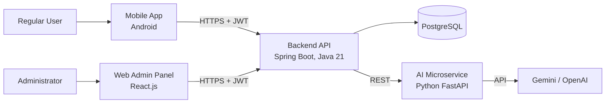
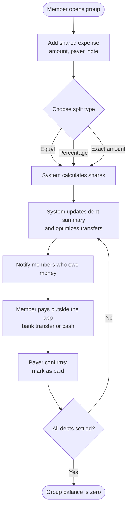
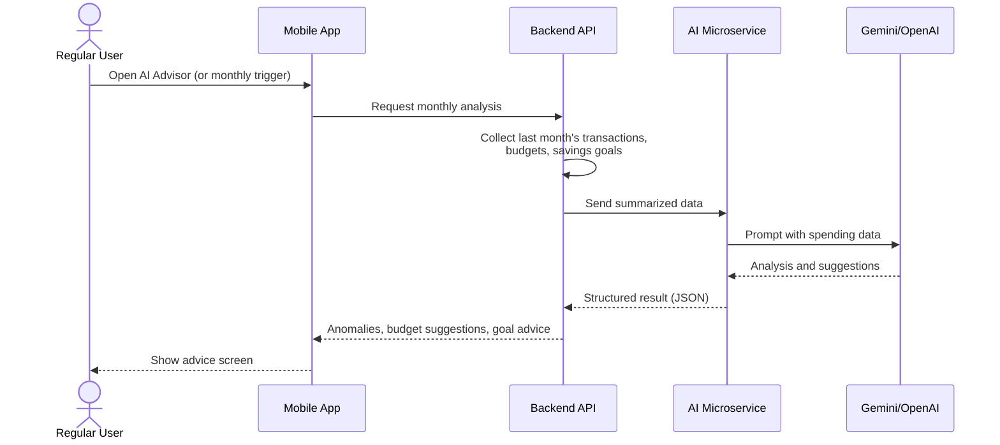

# PA2-2026 Report — FinSync (Group 04)

**Course:** CS300 - CSC13002 - Introduction to Software Engineering
**Assignment:** Project Assignment 2 (PA2-2026) — Sprint 2
**Semester:** Fall 2026
**Group:** Group 04
**Project:** FinSync — Personal Finance & Group Expense Manager with AI Advisor

> **How to read the attribution lines:** every section starts with a line in the format
> `Performed by | Reviewed by | Edited by`, as required by the submission guidelines.
> Replace `[Name]` with the real member name when the section is finished.
> Items marked **`[TODO]`** or **`[TBD]`** must be completed by the team before submission.

## Table of Contents

- [Team Members](#team-members)
- [Part A — Project Plan](#part-a--project-plan)
- [Part B — Vision Document](#part-b--vision-document)
- [Part C — Spec Kit Initialization](#part-c--spec-kit-initialization)
- [Part D — AI Usage Report and Weekly Report](#part-d--ai-usage-report-and-weekly-report)
- [Appendix — Submission Checklist](#appendix--submission-checklist)

---

## Team Members

| # | Student ID | Full Name | Email | Main Role |
|---|------------|-----------|-------|-----------|
| 1 | 24120087 | Phạm Định Tiểu Long | phamlongkh2006@gmail.com | Project Manager / Group Leader |
| 2 | 24120038 | Nguyễn Phú Đạt | nguyennphuudatt@gmail.com | UI/UX Designer & Frontend Lead |
| 3 | 24120403 | Nguyễn Lê Đức Nhật | nldnhat182006@gmail.com | Backend Lead |
| 4 | 24120342 | Vương Đắc Gia Khiêm | vuongkhiemvl10@gmail.com | QA Lead & DevOps |
| 5 | 24120051 | Ngô Thái Hòa | ngothaihoa235@gmail.com | AI Feature Lead & Documentation |

---

# Part A — Project Plan

## 1. Introduction

> *Performed by: Nguyen Le Duc Nhat | Reviewed by: Pham Dinh Tieu Long | Edited by: Nguyen Le Duc Nhat

FinSync is a mobile application that combines personal finance management (similar to *Money Lover*) with smart group expense sharing (similar to *Splitwise*) in a single product. It is designed for students, young professionals, and small groups who share costs such as rent, trips, and events.

The system works as a **bookkeeping, debt calculation, and reminder tool only**. It does not connect to real bank accounts and never moves money automatically. An AI Financial Advisor analyzes spending history and suggests a reasonable spending plan for the next month.

This document is the initial version of the Project Plan. It will be updated in PA3-2026 based on the TA feedback.

## 2. Project Overview

> *Performed by: [Name] | Reviewed by: [Name] | Edited by: [Name]*

### 2.1 Goals

> *Performed by: [Name] | Reviewed by: [Name] | Edited by: [Name]*

- Build a working mobile app that unifies personal and group finance tracking.
- Automate expense splitting and debt optimization to reduce the number of transfers between group members.
- Provide an AI Financial Advisor that turns raw spending data into clear monthly guidance.
- Provide a simple web admin panel for basic system administration.
- Apply Scrum and good software engineering practice throughout the semester (Jira, Git, code review, testing).

### 2.2 Scope

> *Performed by: [Name] | Reviewed by: [Name] | Edited by: [Name]*

**In scope**

| # | Functional Group | Short Description |
|---|------------------|-------------------|
| 1 | Authentication & Security | Register, login, logout, password recovery with JWT |
| 2 | Profile Management | Edit profile, change password, avatar, default currency (VND/USD) |
| 3 | Wallet & Personal Account Management | Manual wallets: cash, bank account, credit card; net-worth overview |
| 4 | Personal Transaction Tracking | Record income/expense with amount, category, note, date, receipt image |
| 5 | Group Management & Shared Wallets | Create groups, invite by link/code, Owner/Member roles, shared wallet |
| 6 | Smart Debt Split & Settlement | Equal / percentage / exact split, debt summary, reminders, mark as paid |
| 7 | Budget Planning & Alerting | Weekly/monthly category budgets, alerts at 80% and 100% |
| 8 | Financial Reporting & Analytics | Pie/bar charts, group trip summary, PDF/Excel export |
| 9 | Savings Goal Management | Long-term goals and progress tracking |
| 10 | System Administration (Admin Panel) | User list, lock/unlock, default categories, statistics |
| AI | AI Financial Advisor | Monthly analysis, anomaly detection, budget suggestions |

**Out of scope**

- Direct connection to real bank accounts or payment gateways.
- Automatic money deduction or real money transfer.
- iOS client (`[TODO]` confirm with the team).

### 2.3 Deliverables

> *Performed by: [Name] | Reviewed by: [Name] | Edited by: [Name]*

| Deliverable | Sprint / PA | Format |
|-------------|-------------|--------|
| Project Proposal, app survey | Sprint 1 / PA1 | Markdown + PDF |
| Project Plan (initial), Vision Document (initial), Spec Kit init | Sprint 2 / PA2 | Markdown + PDF, repo artifacts |
| `[TODO]` Project Plan v2, Vision Document v2 | Sprint 3 / PA3 | Markdown + PDF |
| `[TODO]` Use cases, architecture and design documents | Sprint 3–4 | Markdown + PDF |
| `[TODO]` Test plan and test cases | Sprint 4 | Markdown + PDF |
| Source code: mobile app, backend API, AI microservice, admin web | Sprint 2–5 | GitHub repository (private) |
| Test builds | See [Build Plan](#44-build-plan) | APK / deployed environment |
| Final demo of all features | Sprint 5 / PA5 | Live demo |

### 2.4 Assumptions

> *Performed by: [Name] | Reviewed by: [Name] | Edited by: [Name]*

- Every member works as a full-stack engineer; roles below only define the main person in charge (Lead).
- All members can work at least `[TODO]` hours per week on the project.
- Free tiers of Gemini/OpenAI APIs and cloud hosting are enough for development and demo.
- Users enter all transactions manually; actual payments happen outside the app.
- Course requirements and deadlines for PA3–PA5 stay close to the current plan.

## 3. Project Organization

> *Performed by: [Name] | Reviewed by: [Name] | Edited by: [Name]*

### 3.1 Team Structure and Roles

> *Performed by: [Name] | Reviewed by: [Name] | Edited by: [Name]*

| Member | Role | Main Responsibilities |
|--------|------|-----------------------|
| Phạm Định Tiểu Long | Project Manager / Group Leader | Track progress, coordinate work, lead Sprint meetings, manage Jira board |
| Nguyễn Phú Đạt | UI/UX Designer & Frontend Lead | Wireframes and mockups, UI consistency, lead mobile client development |
| Nguyễn Lê Đức Nhật | Backend Lead | Backend architecture, Spring Boot REST API, database design |
| Vương Đắc Gia Khiêm | QA Lead & DevOps | Testing strategy, test cases, CI/CD pipeline, deployment |
| Ngô Thái Hòa | AI Feature Lead & Documentation | AI Advisor (Gemini/OpenAI integration), technical documentation |

**Working rules**

- Each Jira task is assigned to exactly **one** member and reviewed by **another** member.
- Tasks are created **before** work starts (never created, assigned, and closed at the same time).
- Commit messages follow Conventional Commits: `<type>(<scope>): <subject>`.
- Secrets (API keys, passwords, JWT secret, `.env`) are never committed. The repository is private.

### 3.2 Risk Management

> *Performed by: [Name] | Reviewed by: [Name] | Edited by: [Name]*

| ID | Risk | Probability | Impact | Mitigation Strategy | Owner |
|----|------|-------------|--------|---------------------|-------|
| R1 | **Member unavailability** (exams, illness, other courses) | Medium | High | Keep every task small (≤ 3 days); each task has a reviewer who knows the context; share knowledge in Scrum meetings; keep a buffer in every sprint. | `[TBD]` |
| R2 | **Scope creep** (too many features for one semester) | High | High | Prioritize features (Must / Should / Could); freeze the scope of each sprint at Sprint Planning; AI Advisor and export features are the first to be reduced if time is short. | `[TBD]` |
| R3 | **Technology issues** (team is new to Jetpack Compose/Flutter, FastAPI, Spec Kit, Docker) | Medium | Medium | Add self-training tasks in Sprint 2; build a small proof of concept before the full feature; choose **one** mobile stack early. | `[TBD]` |
| R4 | **AI API problems** (quota limit, cost, slow response, wrong suggestions) | Medium | Medium | Use free tier with caching; keep a rule-based fallback for simple analysis; validate AI output format before showing it to users. | `[TBD]` |
| R5 | **Integration problems** between mobile, backend, AI service, and admin web | Medium | High | Define API contracts early (OpenAPI/Swagger); use Docker Compose for a shared environment; integrate every sprint, not only at the end. | `[TBD]` |
| R6 | **Security leak** (API keys or secrets pushed to GitHub) | Low | High | Use environment variables and `.gitignore`; review every pull request; rotate any key that is exposed. | `[TBD]` |
| R7 | **Incorrect debt calculation** (rounding errors, wrong optimization) | Medium | High | Use `BigDecimal` / integer minor units; write unit tests for split and settlement algorithms before coding the UI. | `[TBD]` |

## 4. Project Plan

> *Performed by: [Name] | Reviewed by: [Name] | Edited by: [Name]*

### 4.1 Process

> *Performed by: [Name] | Reviewed by: [Name] | Edited by: [Name]*

The project follows the **Scrum** process. The semester is divided into **5 sprints**, each matching one Project Assignment (Sprint 1 = PA1, Sprint 2 = PA2, and so on). Each sprint lasts 2–3 weeks and has four meetings:

| Meeting | When | Purpose |
|---------|------|---------|
| Sprint Planning (1) | Start of sprint | Break down requirements, create and assign Jira tasks |
| Weekly Scrum (2) | During sprint | Each member answers: done since last week / plan until next week / obstacles |
| Sprint Review & Retrospective (1) | End of sprint | Review results; what went well, what went wrong, root causes, improvements, lessons learned |

Tools: Jira (task tracking), GitHub (code, private), Discord/Zalo `[TODO]` (communication).

### 4.2 Sprint Overview

> *Performed by: [Name] | Reviewed by: [Name] | Edited by: [Name]*

| Sprint | PA | Dates | Main Focus |
|--------|----|-------|------------|
| Sprint 1 | PA1 | `[TBD]` | Proposal, app survey, team contract (completed) |
| **Sprint 2** | **PA2** | `[TBD]` | **Project Plan, Vision Document, Spec Kit setup, self-training, project skeleton** |
| Sprint 3 | PA3 | `[TBD]` | Revised plan/vision, requirements and design, Auth + Profile + Wallet + Transaction (Build 1) |
| Sprint 4 | PA4 | `[TBD]` | Group, Debt Split, Budget, Savings Goal, Reports; testing (Build 2) |
| Sprint 5 | PA5 | `[TBD]` | AI Advisor, Admin Panel, bug fixing, final build, demo (Build 3) |

> **Note:** The exact scope of Sprint 3–5 depends on the official PA3–PA5 requirements. This table will be updated in PA3.

### 4.3 Sprint 2 — Detailed Task List

> *Performed by: [Name] | Reviewed by: [Name] | Edited by: [Name]*

> This table must match the Jira board. Create every task in Jira **before** the work starts, and fill in the real dates.
> Each task has one assignee and a different reviewer.

| ID | Task | Assignee | Reviewer | Created | Due | Status |
|----|------|----------|----------|---------|-----|--------|
| S2-01 | Sprint 2 Planning meeting and meeting notes | Long | Hòa | `[TBD]` | `[TBD]` | To Do |
| S2-02 | Write Project Plan — Introduction, Overview | Long | Nhật | `[TBD]` | `[TBD]` | To Do |
| S2-03 | Write Project Plan — Organization and Risk Management | Long | Khiêm | `[TBD]` | `[TBD]` | To Do |
| S2-04 | Write Project Plan — Schedule and Build Plan | Long | Đạt | `[TBD]` | `[TBD]` | To Do |
| S2-05 | Write Vision — Introduction and Positioning (problem/product statements) | Hòa | Long | `[TBD]` | `[TBD]` | To Do |
| S2-06 | Write Vision — Stakeholder and User Descriptions, Alternatives (update PA1 survey) | Đạt | Hòa | `[TBD]` | `[TBD]` | To Do |
| S2-07 | Write Vision — Product Overview | Nhật | Đạt | `[TBD]` | `[TBD]` | To Do |
| S2-08 | Write Vision — Product Features (paragraphs) | Hòa | Nhật | `[TBD]` | `[TBD]` | To Do |
| S2-09 | Draw Mermaid workflow diagrams (2 diagrams) | Đạt | Khiêm | `[TBD]` | `[TBD]` | To Do |
| S2-10 | Write Vision — Non-Functional Requirements | Khiêm | Nhật | `[TBD]` | `[TBD]` | To Do |
| S2-11 | Create GitHub repository, folder structure, `.gitignore`, branch rules | Khiêm | Long | `[TBD]` | `[TBD]` | To Do |
| S2-12 | Install and initialize Spec Kit in `/src`; write `constitution.md` | Nhật | Khiêm | `[TBD]` | `[TBD]` | To Do |
| S2-13 | Spec Kit training — Long | Long | Hòa | `[TBD]` | `[TBD]` | To Do |
| S2-14 | Spec Kit training — Đạt | Đạt | Long | `[TBD]` | `[TBD]` | To Do |
| S2-15 | Spec Kit training — Nhật | Nhật | Đạt | `[TBD]` | `[TBD]` | To Do |
| S2-16 | Spec Kit training — Khiêm | Khiêm | Nhật | `[TBD]` | `[TBD]` | To Do |
| S2-17 | Spec Kit training — Hòa | Hòa | Khiêm | `[TBD]` | `[TBD]` | To Do |
| S2-18 | Decide mobile stack (Kotlin/Compose or Flutter) and write a short comparison | Đạt | Nhật | `[TBD]` | `[TBD]` | To Do |
| S2-19 | Backend skeleton: Spring Boot project, PostgreSQL via Docker Compose, Flyway, Swagger | Nhật | Khiêm | `[TBD]` | `[TBD]` | To Do |
| S2-20 | AI microservice skeleton: FastAPI project and Gemini/OpenAI connectivity test | Hòa | Nhật | `[TBD]` | `[TBD]` | To Do |
| S2-21 | Weekly Scrum meeting #1 and notes | Long | Hòa | `[TBD]` | `[TBD]` | To Do |
| S2-22 | Weekly Scrum meeting #2 and notes | Long | Hòa | `[TBD]` | `[TBD]` | To Do |
| S2-23 | Sprint Review & Retrospective meeting and notes | Long | Khiêm | `[TBD]` | `[TBD]` | To Do |
| S2-24 | Write AI Usage Report (this sprint) | Hòa | Long | `[TBD]` | `[TBD]` | To Do |
| S2-25 | Collect Jira screenshots, Git log; convert Markdown to PDF; build submission zip | Khiêm | Long | `[TBD]` | `[TBD]` | To Do |

### 4.4 Build Plan

> *Performed by: [Name] | Reviewed by: [Name] | Edited by: [Name]*

The final sprint (PA5) includes a demo of all features, so builds are planned to deliver features gradually.

| Build | Planned In | Planned Content | Test Focus |
|-------|------------|-----------------|------------|
| Build 0 (skeleton) | End of Sprint 2 | Backend skeleton, database, empty mobile app, AI service connectivity | Environment runs with Docker Compose |
| Build 1 | End of Sprint 3 | Auth, Profile, Wallet, Personal Transactions | Core flows, API tests, login security |
| Build 2 | End of Sprint 4 | Groups, Debt Split & Settlement, Budget alerts, Savings Goals, Reports | Split/settlement correctness, group permissions |
| Build 3 (release candidate) | Middle/late Sprint 5 | AI Advisor, Admin Panel, export, bug fixes | Full regression, performance, demo rehearsal |
| Final build | End of Sprint 5 | Fixed version used in the final demo | Demo checklist |

`[TODO]` Confirm number of builds and exact dates with the team and the lecturer's requirements.

### 4.5 Plan for Later Sprints (planned tasks only)

> *Performed by: [Name] | Reviewed by: [Name] | Edited by: [Name]*

**Sprint 3 (PA3)**
- Revise Project Plan and Vision Document based on TA feedback.
- Write use cases and requirements specification (`/speckit.specify`).
- Design database schema, API contracts, and UI mockups.
- Implement Authentication, Profile, Wallet, Personal Transactions (backend + mobile).
- Write test plan; produce Build 1.

**Sprint 4 (PA4)**
- Implement Group Management, Shared Wallets, Debt Split & Settlement algorithms.
- Implement Budget Planning & Alerting, Savings Goals, Reports and charts.
- Write test cases; set up CI pipeline; produce Build 2.

**Sprint 5 (PA5)**
- Implement AI Financial Advisor and Admin Panel; export PDF/Excel.
- Integration testing, performance and security checks, bug fixing.
- Prepare final report and demo; produce Build 3 and the final build.

---

# Part B — Vision Document

## 1. Introduction

> *Performed by: [Name] | Reviewed by: [Name] | Edited by: [Name]*

### 1.1 Purpose

> *Performed by: [Name] | Reviewed by: [Name] | Edited by: [Name]*

This document describes the vision for **FinSync**: the problem it solves, the people who will use it, its main features, and the quality requirements it must meet. It is the common reference for the team, the lecturer, and the TAs. This is the initial version and will be revised in PA3-2026.

### 1.2 References

> *Performed by: [Name] | Reviewed by: [Name] | Edited by: [Name]*

| Ref | Document |
|-----|----------|
| [1] | PA1-2026 Project Proposal — FinSync (`[TODO]` file path/link) |
| [2] | PA1-2026 Existing App Survey (`[TODO]` file path/link) |
| [3] | PA2-2026 Project Assignment Specification |
| [4] | Team Contract (`[TODO]` file path/link) |
| [5] | PA2-2026 Project Plan (Part A of this report) |

## 2. Positioning

> *Performed by: [Name] | Reviewed by: [Name] | Edited by: [Name]*

### 2.1 Problem Statement

> *Performed by: [Name] | Reviewed by: [Name] | Edited by: [Name]*

| | |
|---|---|
| **The problem of** | Personal finance apps do not support shared expenses, while expense-splitting apps do not support personal budgets and accounts. Users must use several apps and combine the information by hand, and often forget small debts. |
| **Affects** | Students, young professionals, and small groups (roommates, travel friends, project teams) who spend money together and also want to control their own spending. |
| **The impact of which is** | Time wasted on manual calculation, unclear "who owes whom", conflicts between friends, an incomplete view of personal spending, and overspending without early warning. |
| **A successful solution would be** | One app that combines personal wallets and budgets with group expense splitting and debt optimization, and gives clear AI-based advice on how to spend in the next month. |

### 2.2 Product Position Statement

> *Performed by: [Name] | Reviewed by: [Name] | Edited by: [Name]*

| | |
|---|---|
| **For** | Students and young professionals who manage personal money and share costs with others |
| **Who** | Need to track personal spending, split shared bills fairly, and plan their monthly budget |
| **The product name** | FinSync |
| **That** | Combines personal finance tracking, smart group expense splitting with debt optimization, and an AI Financial Advisor in one mobile app |
| **Unlike** | Money Lover (no group expense features) and Splitwise (no personal budgets, wallets, or savings goals) |
| **Our product** | Unifies personal and group finance in one place, reduces the number of transfers needed to settle debts, and turns spending history into clear monthly advice — without touching the user's real bank accounts |

## 3. Stakeholder and User Descriptions

> *Performed by: [Name] | Reviewed by: [Name] | Edited by: [Name]*

### 3.1 Stakeholder Summary

> *Performed by: [Name] | Reviewed by: [Name] | Edited by: [Name]*

| Stakeholder | Description | Main Interest |
|-------------|-------------|---------------|
| Regular Users | Students and young professionals using the app | Easy tracking, fair splitting, useful advice |
| System Administrator | Person managing users and default data | Simple tools to manage accounts and categories |
| Development Team (Group 04) | Five students building the system | Deliver a working product on time with good quality |
| Lecturer and TAs | Course staff who grade and give feedback | Correct process, documents, and working software |
| Third-party services (Gemini/OpenAI, cloud hosting) | Providers of AI and hosting | Fair use within limits and terms |

### 3.2 User Summary

> *Performed by: [Name] | Reviewed by: [Name] | Edited by: [Name]*

| User | Description | Responsibilities in the System |
|------|-------------|--------------------------------|
| **Regular User** | Individual who tracks money and joins expense groups | Manage wallets, transactions, budgets, goals; create or join groups; confirm payments |
| ↳ Group Owner | Regular User who creates and manages a group | Invite members, manage group settings and group wallet |
| ↳ Group Member | Regular User who joins a group | Add shared expenses, view debts, mark payments |
| **Administrator** | Manages the system through a simple web page | View users, lock/unlock accounts, manage default categories, view statistics |

### 3.3 User Environment

> *Performed by: [Name] | Reviewed by: [Name] | Edited by: [Name]*

- **Regular Users** use an Android smartphone (`[TODO]` confirm iOS), mostly on mobile data or Wi-Fi, often in short sessions of less than one minute (recording an expense).
- Users may have unstable internet, so the app should show clear messages when offline. `[TODO]` Decide whether offline mode is in scope.
- **Administrators** use a desktop web browser (Chrome, Edge, Firefox).
- Amounts are mainly in VND; USD is supported as an alternative currency.

### 3.4 Summary of Key Stakeholder or User Needs

> *Performed by: [Name] | Reviewed by: [Name] | Edited by: [Name]*

| Need | Priority | Current Solution | Proposed Solution |
|------|----------|------------------|-------------------|
| Record personal income/expense quickly | High | Notes app, spreadsheets, Money Lover | Fast transaction entry with categories and receipt photo |
| See total money across cash, bank, and card | High | Manual calculation | Wallets with a single net-worth dashboard |
| Split shared bills fairly | High | Mental calculation, chat messages, Splitwise | Equal, percentage, and exact splits |
| Know who owes whom and settle with few transfers | High | Manual reminders | Debt summary, debt optimization, reminders, "mark as paid" |
| Avoid overspending | Medium | Self-control | Category budgets with alerts at 80% and 100% |
| Save for long-term goals | Medium | Notes, memory | Savings goals with progress tracking |
| Understand spending and plan next month | Medium | Manual analysis | AI Financial Advisor with monthly suggestions |
| Keep financial data private and safe | High | Depends on the app | Authentication, JWT, private personal data |
| Manage users and default categories | Medium | None | Web admin panel |

### 3.5 Alternatives and Competition

> *Performed by: [Name] | Reviewed by: [Name] | Edited by: [Name]*

> `[TODO]` Copy the results from the PA1-2026 app survey and update them if the team's understanding has changed.

| Feature | Money Lover | Splitwise | **FinSync (planned)** |
|---------|:-----------:|:---------:|:---------------------:|
| Personal wallets and transactions | ✔ | ✘ | ✔ |
| Personal budgets and alerts | ✔ | ✘ | ✔ |
| Savings goals | ✔ | ✘ | ✔ |
| Group expense splitting | ✘ | ✔ | ✔ |
| Debt optimization | ✘ | ✔ | ✔ |
| AI monthly spending advice | `[TODO]` | ✘ | ✔ |
| Connects to real bank accounts | `[TODO]` | ✘ | ✘ (by design) |

> `[TODO]` Verify every cell against the PA1 survey and add other apps from the survey (for example, Spendee, Wallet by BudgetBakers, Tricount).

## 4. Product Overview

> *Performed by: [Name] | Reviewed by: [Name] | Edited by: [Name]*

### 4.1 Product Perspective

> *Performed by: [Name] | Reviewed by: [Name] | Edited by: [Name]*

FinSync is a new, self-contained product made of four parts that communicate through REST APIs:



The product is a **bookkeeping, calculation, and reminder** system. Payments happen outside the app (bank transfer, cash), and users confirm them in the app. The product never accesses real bank accounts.

The system separates two business areas:

- **Personal Expense Management:** private data, visible only to the account owner.
- **Group Expense Management:** shared data, visible to members of the same group.

### 4.2 Assumptions and Dependencies

> *Performed by: [Name] | Reviewed by: [Name] | Edited by: [Name]*

**Assumptions**

- Users enter transactions manually and honestly.
- Users have a smartphone with internet access most of the time.
- Group members agree to use the app to record shared expenses.

**Dependencies**

| Dependency | Used For | Risk |
|------------|----------|------|
| Google Gemini / OpenAI API | AI Financial Advisor | Quota, cost, availability |
| PostgreSQL | Data storage | Hosting and backup |
| Docker / Docker Compose | Local and deployment environment | Setup problems |
| Cloud hosting `[TODO]` | Deploying backend, AI service, admin web | Free-tier limits |
| Push notification service `[TODO]` (e.g., Firebase Cloud Messaging) | Debt reminders, budget alerts | Setup and delivery delay |
| GitHub, Jira, Spec Kit | Development process | Learning curve |

## 5. Product Features

> *Performed by: [Name] | Reviewed by: [Name] | Edited by: [Name]*

> Each feature below should be a paragraph of **3–5 sentences**: what it does, why it is needed, and who benefits.
> The paragraphs below are first drafts. Please review and improve them.

### 5.1 Authentication & Security

> *Performed by: [Name] | Reviewed by: [Name] | Edited by: [Name]*

This feature lets users register, log in, log out, and recover a forgotten password. The system uses JWT tokens so that every request is checked and each user can only access the data they are allowed to see. It is needed because the app stores sensitive financial information that must stay private. All users, including administrators, benefit from a safe and simple sign-in process.

### 5.2 Profile Management

> *Performed by: [Name] | Reviewed by: [Name] | Edited by: [Name]*

Users can view and edit their personal information, change their password, update their avatar, and choose a default currency (VND or USD). This feature is needed so that amounts, reports, and group displays match each user's preference and identity. Regular Users benefit most, because group members can recognize each other by name and avatar.

### 5.3 Wallet & Personal Account Management

> *Performed by: [Name] | Reviewed by: [Name] | Edited by: [Name]*

Users create manual wallets such as cash, bank account, and credit card, and keep each balance up to date through transactions. The dashboard combines all wallets into one net-worth view. This feature is needed because people keep money in several places and rarely see the total. Regular Users get a clear picture of their assets without connecting any real bank account.

### 5.4 Personal Transaction Tracking

> *Performed by: [Name] | Reviewed by: [Name] | Edited by: [Name]*

Users record income and expenses with amount, category, note, date, and an optional receipt photo. Entry must be fast, because users usually record spending right after paying. These records are the base data for budgets, reports, and the AI Advisor. Regular Users benefit from an accurate history of where their money goes.

### 5.5 Group Management & Shared Wallets

> *Performed by: [Name] | Reviewed by: [Name] | Edited by: [Name]*

Users can create a group (for example, a rented room, a trip, or a class project), invite others by link or code, and assign Owner and Member roles. Each group has a shared wallet that is completely separate from personal finances. This feature is needed to give shared expenses a clear and private place. Groups of friends, roommates, and teammates benefit from one trusted record of shared spending.

### 5.6 Smart Debt Split & Settlement

> *Performed by: [Name] | Reviewed by: [Name] | Edited by: [Name]*

When a member records a shared expense, the system splits it equally, by percentage, or by exact amounts, and updates who owes whom. A debt optimization algorithm reduces the number of transfers needed to settle everything. The app sends reminders, and the payer marks a debt as "paid" after the real payment is done outside the app. This removes manual calculation and arguments, and benefits every member of a group.

### 5.7 Budget Planning & Alerting

> *Performed by: [Name] | Reviewed by: [Name] | Edited by: [Name]*

Users set weekly or monthly spending limits for each category. The app shows visual alerts when spending reaches 80% and 100% of a limit. This is needed because people often notice overspending only after the month ends. Regular Users who want to control their spending benefit most.

### 5.8 Financial Reporting & Analytics

> *Performed by: [Name] | Reviewed by: [Name] | Edited by: [Name]*

The app shows spending and income in pie and bar charts and can create a summary report for a group (for example, after a trip). Reports can be exported to PDF or Excel. Charts help users understand their habits quickly, and exported reports help groups share and check final numbers. Both individual users and groups benefit.

### 5.9 Savings Goal Management

> *Performed by: [Name] | Reviewed by: [Name] | Edited by: [Name]*

Users create long-term goals, such as buying a laptop or taking a trip, with a target amount and deadline. The app tracks progress and shows how much is still needed. This feature is needed to turn saving from an intention into a measurable plan. Students and young professionals who save for specific goals benefit from it.

### 5.10 System Administration (Admin Panel)

> *Performed by: [Name] | Reviewed by: [Name] | Edited by: [Name]*

Administrators use a simple web page to view the user list, lock or unlock accounts, manage default income/expense categories, and see overview statistics. It is needed to keep the system safe and consistent, for example by blocking abusive accounts. The Administrator benefits directly, and all Regular Users benefit from a cleaner and safer platform.

### 5.11 AI Financial Advisor

> *Performed by: [Name] | Reviewed by: [Name] | Edited by: [Name]*

At the start of each month, or on request, the AI reviews last month's personal and group transactions. It compares actual spending with budgets and with the average of previous months, warns about unusual increases, and suggests a budget for each category. It also checks progress toward savings goals and gives advice. This turns raw data into clear guidance such as how much to spend this month, and benefits any Regular User who wants to plan better.

### 5.12 Key Workflow Diagrams

> *Performed by: [Name] | Reviewed by: [Name] | Edited by: [Name]*

**Workflow 1 — Record a shared expense and settle debts**



**Workflow 2 — Monthly AI Financial Advisor**



> `[TODO]` Optionally replace or add a diagram for the "Register → create wallet → add first transaction" flow.

## 6. Non-Functional Requirements

> *Performed by: [Name] | Reviewed by: [Name] | Edited by: [Name]*

> The values below are proposed targets. Please check that the team can test every one of them.

### 6.1 Performance

> *Performed by: [Name] | Reviewed by: [Name] | Edited by: [Name]*

| ID | Requirement |
|----|-------------|
| NFR-P1 | 95% of API requests (except AI requests) respond in **< 500 ms** under normal load. |
| NFR-P2 | Main screens (dashboard, transaction list) show data in **< 2 seconds** on a mid-range Android phone with 4G. |
| NFR-P3 | The system supports at least **100 concurrent users** without errors. |
| NFR-P4 | The AI Advisor returns a result in **< 30 seconds**; the app shows a loading state meanwhile. |
| NFR-P5 | Recalculating group debts for a group of **20 members and 500 expenses** takes **< 2 seconds**. |

### 6.2 Security

> *Performed by: [Name] | Reviewed by: [Name] | Edited by: [Name]*

| ID | Requirement |
|----|-------------|
| NFR-S1 | Passwords are stored only as salted hashes (BCrypt); never in plain text. |
| NFR-S2 | All communication uses HTTPS/TLS 1.2 or higher. |
| NFR-S3 | JWT access tokens expire in **≤ 1 hour** `[TODO]` and are checked on every protected request. |
| NFR-S4 | Personal data can be read only by its owner; group data only by group members; admin functions only by Administrators (role-based access control). |
| NFR-S5 | No API key, password, JWT secret, or `.env` file is stored in the repository; secrets use environment variables. |
| NFR-S6 | All user input is validated on the server to prevent SQL injection and XSS. |
| NFR-S7 | The AI service receives only the data needed for analysis (no email, password, or phone number). |

### 6.3 Reliability and Availability

> *Performed by: [Name] | Reviewed by: [Name] | Edited by: [Name]*

| ID | Requirement |
|----|-------------|
| NFR-R1 | The demo environment is available **≥ 95%** of the time during the demo period. |
| NFR-R2 | Database is backed up at least **once per day** `[TODO]` (if hosted). |
| NFR-R3 | Money amounts are stored with exact precision (no floating-point errors); split totals always equal the original expense. |
| NFR-R4 | If the AI service fails, other app features continue to work and the user sees a clear error message. |

### 6.4 Usability

> *Performed by: [Name] | Reviewed by: [Name] | Edited by: [Name]*

| ID | Requirement |
|----|-------------|
| NFR-U1 | A new user can record the first transaction in **≤ 3 minutes** without help. |
| NFR-U2 | Recording a transaction takes **≤ 4 taps** after opening the add-transaction screen `[TODO]`. |
| NFR-U3 | The UI uses one consistent design system (colors, fonts, components) across all screens. |
| NFR-U4 | The app supports Vietnamese and English `[TODO]` and VND/USD formats. |

### 6.5 Platform and Compatibility

> *Performed by: [Name] | Reviewed by: [Name] | Edited by: [Name]*

| ID | Requirement |
|----|-------------|
| NFR-C1 | Mobile app runs on Android **8.0 (API 26)** or higher `[TODO]`. |
| NFR-C2 | Admin web runs on the latest two versions of Chrome, Edge, and Firefox. |
| NFR-C3 | Backend runs on Java 21 and PostgreSQL `[TODO version]` and can be started with `docker compose up`. |

### 6.6 Maintainability and Quality

> *Performed by: [Name] | Reviewed by: [Name] | Edited by: [Name]*

| ID | Requirement |
|----|-------------|
| NFR-M1 | Backend unit test coverage of business logic (split, settlement, budget) is **≥ 70%** `[TODO]`. |
| NFR-M2 | Code follows the agreed style guides (Java naming, Kotlin Style Guide / Effective Dart, PEP 8) and is reviewed by another member before merging. |
| NFR-M3 | All REST APIs are documented with OpenAPI/Swagger. |
| NFR-M4 | Database changes are done only through Flyway migrations. |
| NFR-M5 | Commit messages follow Conventional Commits. |

### 6.7 Standards

> *Performed by: [Name] | Reviewed by: [Name] | Edited by: [Name]*

- REST API design with JSON.
- OWASP Top 10 as the security guideline.
- Conventional Commits for Git history.
- Scrum for the development process.

---

# Part C — Spec Kit Initialization

> *Performed by: [Name] | Reviewed by: [Name] | Edited by: [Name]*

## 1. Repository and Spec Kit Setup

> *Performed by: [Name] | Reviewed by: [Name] | Edited by: [Name]*

| Item | Value |
|------|-------|
| GitHub repository | `[TODO: link]` (private) |
| Spec Kit location | `/src` |
| AI agent used with Spec Kit | `[TODO: e.g., Claude Code / GitHub Copilot / Gemini CLI]` |
| Spec Kit version | `[TODO]` |
| Setup date | `[TODO]` |

**Commands used**

```bash
# TODO: replace with the exact commands the team ran
cd src
specify init . --ai <agent>
```

## 2. Submitted Artifacts

> *Performed by: [Name] | Reviewed by: [Name] | Edited by: [Name]*

| Artifact | Path in repository | Included in zip |
|----------|--------------------|:---------------:|
| `constitution.md` | `[TODO]` | ☐ |
| Other Markdown files generated by Spec Kit | `[TODO]` | ☐ |
| Git log (screenshot or exported file) | `[TODO]` | ☐ |

> **Reminder:** Spec Kit creates hidden folders (for example `.specify/` and the agent's command folder). Make sure they are included in the zip file.

## 3. Constitution Summary

> *Performed by: [Name] | Reviewed by: [Name] | Edited by: [Name]*

`[TODO]` Briefly describe the main principles written in `constitution.md` (for example: code quality, testing rules, security rules, architecture, naming conventions, and Git rules).

## 4. Spec Kit Training Evidence

> *Performed by: [Name] | Reviewed by: [Name] | Edited by: [Name]*

Each member must complete the official YouTube training and submit evidence.

| Member | Training Completed | Evidence | Summary of What Was Learned |
|--------|:------------------:|----------|-----------------------------|
| Phạm Định Tiểu Long | ☐ | `[TODO]` | `[TODO]` |
| Nguyễn Phú Đạt | ☐ | `[TODO]` | `[TODO]` |
| Nguyễn Lê Đức Nhật | ☐ | `[TODO]` | `[TODO]` |
| Vương Đắc Gia Khiêm | ☐ | `[TODO]` | `[TODO]` |
| Ngô Thái Hòa | ☐ | `[TODO]` | `[TODO]` |

---

# Part D — AI Usage Report and Weekly Report

> *Performed by: [Name] | Reviewed by: [Name] | Edited by: [Name]*

## 1. AI Usage Report

> *Performed by: [Name] | Reviewed by: [Name] | Edited by: [Name]*

**Declaration:** ☐ AI tools were used in this sprint  ☐ AI tools were **not** used in this sprint

`[TODO]` If AI tools were used, fill in the log below following the course AI usage guidelines. Every usage must be listed.

| # | Date | Member | AI Tool | Task / Purpose | Prompt Summary | How the Output Was Used | Human Review / Changes |
|---|------|--------|---------|----------------|----------------|-------------------------|------------------------|
| 1 | `[TBD]` | `[TBD]` | `[TBD]` | `[TBD]` | `[TBD]` | `[TBD]` | `[TBD]` |

> Remember to include the usage of Spec Kit commands (for example, generating `constitution.md`) if an AI agent was involved.

## 2. Weekly Report

> *Performed by: [Name] | Reviewed by: [Name] | Edited by: [Name]*

> `[TODO]` Follow the format in the course "WeeklyReports" document. Meeting notes can also be stored in `/docs/management/weekly-reports/`.

### 2.1 Sprint Planning Meeting

> *Performed by: [Name] | Reviewed by: [Name] | Edited by: [Name]*

| Item | Details |
|------|---------|
| Date / time | `[TODO]` |
| Place / platform | `[TODO]` |
| Attendees | `[TODO]` |
| Sprint goal | `[TODO]` |
| Tasks created and assigned in Jira | `[TODO]` (see [Section 4.3](#43-sprint-2--detailed-task-list)) |
| Decisions | `[TODO]` |

### 2.2 Weekly Scrum Meeting #1

> *Performed by: [Name] | Reviewed by: [Name] | Edited by: [Name]*

| Member | What have I done since last week? | What will I do until next week? | Issues / problems / obstacles |
|--------|-----------------------------------|----------------------------------|-------------------------------|
| Long | `[TODO]` | `[TODO]` | `[TODO]` |
| Đạt | `[TODO]` | `[TODO]` | `[TODO]` |
| Nhật | `[TODO]` | `[TODO]` | `[TODO]` |
| Khiêm | `[TODO]` | `[TODO]` | `[TODO]` |
| Hòa | `[TODO]` | `[TODO]` | `[TODO]` |

Date / time: `[TODO]`  |  Attendees: `[TODO]`

### 2.3 Weekly Scrum Meeting #2

> *Performed by: [Name] | Reviewed by: [Name] | Edited by: [Name]*

| Member | What have I done since last week? | What will I do until next week? | Issues / problems / obstacles |
|--------|-----------------------------------|----------------------------------|-------------------------------|
| Long | `[TODO]` | `[TODO]` | `[TODO]` |
| Đạt | `[TODO]` | `[TODO]` | `[TODO]` |
| Nhật | `[TODO]` | `[TODO]` | `[TODO]` |
| Khiêm | `[TODO]` | `[TODO]` | `[TODO]` |
| Hòa | `[TODO]` | `[TODO]` | `[TODO]` |

Date / time: `[TODO]`  |  Attendees: `[TODO]`

### 2.4 Sprint Review & Retrospective

> *Performed by: [Name] | Reviewed by: [Name] | Edited by: [Name]*

| Item | Details |
|------|---------|
| Date / time | `[TODO]` |
| Attendees | `[TODO]` |
| Completed work (demo / review of deliverables) | `[TODO]` |
| Not completed work and reason | `[TODO]` |

**Retrospective questions**

| Question | Answer |
|----------|--------|
| What went well? | `[TODO]` |
| What went wrong? | `[TODO]` |
| What are the root causes? | `[TODO]` |
| Actionable improvements for the next sprint | `[TODO]` |
| Lessons learned | `[TODO]` |

### 2.5 Jira Evidence

> *Performed by: [Name] | Reviewed by: [Name] | Edited by: [Name]*

Screenshots must show task assignment, dates, and progress for Sprint 2.

| Screenshot | When Taken | File |
|------------|------------|------|
| Jira board at Sprint Planning | `[TODO]` | `screenshots/jira-sprint2-planning.png` |
| Jira board at Weekly Scrum #1 | `[TODO]` | `screenshots/jira-sprint2-scrum1.png` |
| Jira board at Weekly Scrum #2 | `[TODO]` | `screenshots/jira-sprint2-scrum2.png` |
| Jira board at Sprint Review | `[TODO]` | `screenshots/jira-sprint2-review.png` |

---

# Appendix — Submission Checklist

> *Performed by: [Name] | Reviewed by: [Name] | Edited by: [Name]*

- [ ] All documents are in **English** and **Markdown**; diagrams use **Mermaid**.
- [ ] Every section has the attribution line (performed / reviewed / edited by) right after the header.
- [ ] Project Plan: all required sections, at least 3 risks, schedule matches the Jira board.
- [ ] Vision Document: problem statement, product position statement, feature paragraphs, 1–2 Mermaid workflow diagrams, quantified NFRs.
- [ ] Spec Kit initialized inside `/src`; `constitution.md` and other generated `.md` files included (including hidden folders).
- [ ] Spec Kit training evidence for **all 5 members**.
- [ ] AI Usage Report completed; Weekly Report with all 4 meetings; Jira screenshots included.
- [ ] Original `.md` files **and** PDF files converted from Markdown.
- [ ] Git log (screenshot or exported file).
- [ ] No secrets or `.env` files in the repository.
- [ ] Everything compressed in a folder named `PA2-Group04` and submitted as `PA2-Group04.zip`.