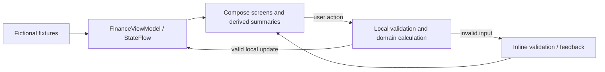

# FinSync — Android Frontend Technical Guide

> *Performed by: Nguyễn Phú Đạt (24120038) | Reviewed by: Pending team review | Edited by: Pending confirmation*

Updated **2026-11-02** from the Android source/build configuration. This describes
the implemented local client, not completion of PA3 Part E integration. The team
must still confirm the selected Part E functional group and acceptance criteria.

## 1. Delivery boundary

> *Performed by: Nguyễn Phú Đạt (24120038) | Reviewed by: Pending team review | Edited by: Pending confirmation*

Kotlin/Jetpack Compose/Material 3 implement the four tabs and child screens in the
approved bright Liquid Metal style. Finance operations use fictional **in-memory**
state. No backend HTTP client, persistent database, real JWT authentication, remote
invitation or personalized AI service is integrated.

`UnavailableAuthRepository` returns a not-connected result for login, registration
and recovery. Explore FinSync opens an explicit local sample workspace; it is not
an authenticated session. No real credentials are needed. Figma Make/browser
prototype captures are separate artifacts and do not certify native execution,
financial persistence or backend integration.

## 2. Toolchain and prerequisites

> *Performed by: Nguyễn Phú Đạt (24120038) | Reviewed by: Pending team review | Edited by: Pending confirmation*

| Item | Configuration |
|---|---|
| Gradle project | `src/mobile` in the FinSync source checkout |
| Application / launcher | `com.finsync` / `com.finsync/.MainActivity` |
| App version | `0.1.0`, version code 1 |
| Minimum / compile / target SDK | 26 / 37 / 37 |
| Gradle Wrapper | 9.6.0 |
| Android Gradle Plugin | 9.4.1 |
| Compose compiler plugin | `org.jetbrains.kotlin.plugin.compose` 2.2.10 |
| Kotlin integration | AGP built-in Kotlin; no separate Kotlin Android plugin applied |
| Java source/target compatibility | 17; use the working Android Studio bundled JDK as Gradle runtime |
| SDK on recorded workstation | `%LOCALAPPDATA%\Android\Sdk`; installed Build Tools 36.0.0 |
| Existing emulator | `Pixel_7_2`, Android 16 / API 36, native viewport 1080 × 2400 |

An emulator OS may be lower than compile SDK if it meets minSdk. The compilation
platform must still match the Gradle configuration. Install missing SDK packages
using SDK Manager. First dependency resolution needs Google Maven, Maven Central
and the Gradle distribution. Use the wrapper rather than a global Gradle install.
Versions here are source facts, not dependency-upgrade recommendations.

## 3. Configure and build on Windows

> *Performed by: Nguyễn Phú Đạt (24120038) | Reviewed by: Pending team review | Edited by: Pending confirmation*

These paths match the recorded workstation; replace them on another computer.
Open `src/mobile`, not the repository root, as the Android Gradle project.

```powershell
Set-Location 'C:\Users\namda\FinSync\src\mobile'
$env:JAVA_HOME = 'C:\Program Files\Android\Android Studio\jbr'
$env:ANDROID_HOME = "$env:LOCALAPPDATA\Android\Sdk"
& "$env:JAVA_HOME\bin\java.exe" -version
.\gradlew.bat --version
.\gradlew.bat :app:assembleDebug --console=plain
if ($LASTEXITCODE -ne 0) { throw 'Build failed; inspect the Gradle error before installing.' }
```

Android Studio can create ignored `local.properties` with the SDK path. Do not
commit machine paths or credentials. No API URL, `.env`, secret or backend account
is needed by the current client. Debug APK:
`app/build/outputs/apk/debug/app-debug.apk`. This is a development build; production
signing, Play Store distribution and release deployment are not configured here.

## 4. Automatically start the existing Pixel 7 AVD

> *Performed by: Nguyễn Phú Đạt (24120038) | Reviewed by: Pending team review | Edited by: Pending confirmation*

ADB/emulator run directly; manually opening Android Studio is optional. Inspect
existing devices/processes and reuse a running Pixel_7_2. Start only when that AVD
is not already running; do not create a duplicate emulator process.

```powershell
$adb = Join-Path $env:ANDROID_HOME 'platform-tools\adb.exe'
$emulatorExe = Join-Path $env:ANDROID_HOME 'emulator\emulator.exe'
& $adb start-server
& $adb devices -l
Get-Process emulator,qemu-system-x86_64 -ErrorAction SilentlyContinue
& $emulatorExe -list-avds

# Only if Pixel_7_2 is not already running:
Start-Process -FilePath $emulatorExe -ArgumentList @('-avd','Pixel_7_2') -WindowStyle Hidden

$deviceSerial = $null
$deadline = (Get-Date).AddSeconds(120)
do {
    foreach ($line in @(& $adb devices)) {
        if ($line -match '^(emulator-\d+)\s+device\s*$') {
            $candidate = $Matches[1]
            $avdName = @(& $adb -s $candidate emu avd name)
            if ($avdName -contains 'Pixel_7_2') { $deviceSerial = $candidate; break }
        }
    }
    if (-not $deviceSerial) { Start-Sleep -Seconds 3 }
} while (-not $deviceSerial -and (Get-Date) -lt $deadline)
if (-not $deviceSerial) { throw 'Pixel_7_2 is unavailable through ADB; inspect emulator logs.' }

$booted = $false
$deadline = (Get-Date).AddSeconds(120)
do {
    $booted = ((@(& $adb -s $deviceSerial shell getprop sys.boot_completed) -join '').Trim() -eq '1')
    if (-not $booted) { Start-Sleep -Seconds 3 }
} while (-not $booted -and (Get-Date) -lt $deadline)
if (-not $booted) { throw 'Android did not finish booting within the wait period.' }
& $adb devices -l
```

If the AVD is absent on another machine, create a Pixel 7 device with an installed
compatible system image in Device Manager. Do not replace/wipe an existing AVD
to resolve detection problems. Inspect logs/process state first. Cold boot without
snapshot loading preserves the AVD user-data partition.

## 5. Install, launch and navigate

> *Performed by: Nguyễn Phú Đạt (24120038) | Reviewed by: Pending team review | Edited by: Pending confirmation*

Use the serial discovered above, or select it explicitly from `adb devices -l`.
`install -r` retains Android package data but cannot preserve in-memory finance
state across process termination. Do not use uninstall/clear-data/wipe commands.

```powershell
& $adb -s $deviceSerial install -r 'app\build\outputs\apk\debug\app-debug.apk'
if ($LASTEXITCODE -ne 0) { throw 'APK installation failed.' }
& $adb -s $deviceSerial shell am start -n com.finsync/.MainActivity
```

1. Choose **Explore FinSync → Open sample workspace**.
2. Use **Overview**, **Wallets**, **Groups**, **Reports** in the dock.
3. Central Add opens personal entry outside Groups; in Groups it opens shared
   entry for the single joined group or a chooser when needed.
4. Open **Wallets → All personal transactions** or **Overview → See All** for history.
5. Reports has Compare/Category/Trend; **See analytics** opens additional questions.

Android Studio alternative: open `src/mobile`, sync, select `app` and the emulator,
then Run. On macOS/Linux configure the appropriate JDK/SDK and use `sh ./gradlew`;
the Windows startup script is not cross-platform.

## 6. Code structure and state flow

> *Performed by: Nguyễn Phú Đạt (24120038) | Reviewed by: Pending team review | Edited by: Pending confirmation*

Source paths below are under `app/src/main/java/com/finsync/`:

| Path | Responsibility |
|---|---|
| `MainActivity.kt` | Edge-to-edge host, Activity ViewModels, theme/auth entry |
| `auth/` | Auth screens/controller and repository boundary |
| `ui/FinSyncApp.kt` | Destinations, local child-route strings, Back/origin and feedback |
| `ui/FinanceViewModel.kt` | FinanceState, StateFlow and validated local mutations |
| `data/` | Fictional personal/group/budget/goal fixtures |
| `domain/` | VND validation/arithmetic, transfers, splits/debts and report calculations |
| `ui/dashboard/` | Overview components, mapping and dashboard state |
| `ui/wallets/` | Wallet CRUD/history and transfer form/review/result |
| `ui/transactions/` | Add/edit, category/wallet selection, history/filters/detail/delete |
| `ui/groups/` | Groups/members, allocation, debt details and settlement |
| `ui/reports/` | Report home, analytics, budgets, goals and authored guide |
| `ui/components/` | Shared Liquid Metal surfaces/dock, forms, dialogs, icons and notices |
| `ui/theme/` | Material theme, typography, spacing/layout/material tokens |

Other project paths: `app/src/main/res/` for strings/icons/decorative artwork;
`app/src/test/` for JVM tests; `app/src/androidTest/` for Compose instrumentation
and capture helpers; `gradle/libs.versions.toml` for dependency versions.



This is the implemented local path; no API/database operation occurs. Navigation
uses destination plus route state, not Navigation Compose or registered external
deep links. Examples: `transaction/new`, `transaction/{id}`, `wallet/{id}`,
`group/{id}/expense`, `budgets`, `charts`.

## 7. Declared libraries

> *Performed by: Nguyễn Phú Đạt (24120038) | Reviewed by: Pending team review | Edited by: Pending confirmation*

| Library | Declared version | Purpose |
|---|---|---|
| Compose BOM | 2026.02.01 | Align Compose artifact versions |
| Compose Material3 | BOM-managed | Material controls/theme/surfaces |
| Compose tooling preview / debug tooling | BOM-managed | Previews/development tooling |
| AndroidX Activity Compose | 1.8.2 | Compose Activity integration |
| Lifecycle ViewModel / runtime Compose | 2.9.4 | ViewModels and lifecycle-aware collection |
| JUnit | 4.13.2 | Local JVM tests |
| Compose UI test JUnit4 / test manifest | BOM-managed | Instrumented UI tests |
| AndroidX test JUnit extension | 1.1.5 | Android test integration |
| AndroidX test runner | 1.5.2 | Instrumentation runner |

The BOM is a version platform, not executable functionality. Coroutines/StateFlow
are used through resolved AndroidX dependencies; no separate coroutines version
is directly declared in this app module. Native Compose drawing renders charts.
No external chart library, Retrofit/OkHttp/Ktor, Room, remote image loader or AI SDK
is declared. Chrome artwork is local decoration; controls/text/charts remain native.

## 8. Functional coverage and financial boundaries

> *Performed by: Nguyễn Phú Đạt (24120038) | Reviewed by: Pending team review | Edited by: Pending confirmation*

| Area | Implemented local behavior | Integration limit |
|---|---|---|
| Overview | Derived personal totals, trend, privacy, budget and recent records | No server refresh |
| Wallets | Cash/bank/credit/e-wallet, create/edit/history/search, active/all, archive/restore | No bank connection/server store |
| Transfers | Active eligible non-credit wallets, review/confirm/result/history, request-ID duplicate protection | Manual bookkeeping, no money movement |
| Transactions | Whole-VND amount, expense/income, category grid, wallet/default, date/notes, validation, edit/detail/delete/Undo | No remote write, durable persistence or receipt upload |
| History | Day grouping; title/note/category/wallet search; type/date/category/wallet/amount filters; Apply/Reset | Local filtering |
| Groups | Create/search/details/members, sample invitation, Equal/Exact/Percentage/Shares and live allocation difference | No online invitations or multi-user sync |
| Debts | Summary/details/history, confirmation and local external-settlement record | No payment service or remote recipient acknowledgement |
| Reports | Comparison/category/trend/drilldown; donut/bar/line/stacked/calendar/budget views via compatible analytics questions | Local ledger; no export service |
| Budgets | Weekly/monthly create/edit, on-screen 80%/100% warnings | No OS push/background alert service |
| Goals | Target/deadline and manually recorded saved progress | No automatic wallet allocation |
| Spending guide | Authored general advice | Not personalized AI output |
| Authentication | Forms, validation, navigation and unavailable feedback | No successful backend login/register/reset, JWT or secure session |

Existing whole-VND rules are preserved. Exact group allocations must sum to the
expense; non-exact split rounding remainder goes to the payer in `splitExpense`.
Personal wallets/reports and group ledgers remain separate. Transfers are excluded
from income/spending. Archived wallet balances remain in net worth; credit debt
reduces it. Savings progress is a separate tracker, not another net-worth asset.

## 9. Data lifetime and UI states

> *Performed by: Nguyễn Phú Đạt (24120038) | Reviewed by: Pending team review | Edited by: Pending confirmation*

Fixtures are recreated for a new app process. `DemoFixtures.today` uses
`LocalDate.now()` on initialization; dates follow the device clock/month. Activity
ViewModels retain finance state across ordinary configuration changes. Selected
drafts/browsing state use `rememberSaveable` where implemented; this is not a
financial database. Process death/relaunch loses financial edits.

Loading/empty/error/offline variants exist, but some are preview/test parameters
rather than live network failures. Save guards, confirmations, Undo and keyboard
insets are local behavior. No permissions are requested in the current manifest.

Navigation changes to a rail at 600dp; maximum content width is 840dp. Large fonts
stack controls where implemented; category selection switches to two columns.
The approved palette stays bright under both system appearance settings. Full
localization/RTL, TalkBack, minimum-API runtime, foldable/two-pane acceptance and
frame-time benchmarking remain unverified; no production certification is asserted.

## 10. Verification and recorded results

> *Performed by: Nguyễn Phú Đạt (24120038) | Reviewed by: Pending team review | Edited by: Pending confirmation*

Developer commands from `src/mobile` with the JDK/SDK configured:

```powershell
.\gradlew.bat :app:testDebugUnitTest :app:lintDebug --console=plain
# Requires a booted emulator/device:
.\gradlew.bat :app:connectedDebugAndroidTest --console=plain
```

Generated reports: `app/build/reports/tests/testDebugUnitTest/index.html`,
`app/build/reports/lint-results-debug.html`, and
`app/build/reports/androidTests/connected/`. These outputs are not submission source.
UI tests may recreate/replace the running Activity and use fixtures/stub callbacks;
they do not prove production auth or persistence.

The 2026-11-01 rollout recorded build/install success, 51/51 JVM tests, 25/25 selected
integration UI tests, 9/9 secondary/auth UI tests and a later category test 1/1.
Lint recorded 0 errors / 30 warnings / 2 hints before that final isolated layout correction.
These are separate historical runs, not a new full-suite pass for this update.
See `APP_MATERIAL_ROLLOUT.md` and `output/liquid-app/*-ui.txt` for exact evidence.
This docs-only update checks content/configuration/links; build/tests were not rerun.

## 11. Emulator and capture troubleshooting

> *Performed by: Nguyễn Phú Đạt (24120038) | Reviewed by: Pending team review | Edited by: Pending confirmation*

- **Empty ADB list:** inspect devices, emulator/QEMU processes and available AVDs.
  Reuse/start Pixel_7_2 and wait for boot. An empty list immediately after launch
  does not establish that automatic startup is unavailable.
- **Stuck boot:** inspect emulator stdout/stderr before restarting; avoid duplicate
  processes and wiping data. Recover the ADB server if it reports a daemon error,
  taking care with other connected devices.
- **Hardware typing/IME:** inspect virtual-keyboard settings with a hardware keyboard
  attached. A prior Gboard floating stylus toolbar produced zero IME bottom inset;
  disabling emulator stylus handwriting restored docked keyboard tests. Record
  settings before changing them; do not fake IME assertions.
- **Screenshots:** shell `screencap` previously crashed this AVD. Existing
  `ScreenCapture.kt` uses Compose capture or `UiAutomation.takeScreenshot`, invoked
  through instrumentation and retrieved with ADB. Root/window capture bounds differ.
  Read test methods before running: some mutate local fixtures or use stub callbacks.
  `SubmissionCaptureTest#captureSubmissionScreens` renders child screens directly
  and does not establish complete navigation/save journeys.
- **Stale evidence:** check APK/test/capture timestamps. Earlier results are historical,
  not results from a new run. Do not substitute Figma/browser images for Android captures.

## 12. Backend handoff and remaining work

> *Performed by: Nguyễn Phú Đạt (24120038) | Reviewed by: Pending team review | Edited by: Pending confirmation*

Confirm the Part E functional group and agree actual endpoints, JSON schemas,
identifiers, VND/date rules, error format, auth/session behavior and duplicate-write
handling with the team. This guide does not define an approved API contract.

For the selected group, connect the approved service/persistence behavior while
preserving financial rules and UI. Implement real asynchronous loading/error/retry
and secure sessions where required. Required networking permission/configuration
is not present today. Acceptance must exercise UI → backend → database → UI,
including reopening to verify persistence and a relevant failure/alternative flow.
Local ViewModel success or Figma simulation does not complete Part E.

Other unfinished integrations include receipts, durable/offline queues, conflict
handling, online invitations, AI, push alerts, report export and automatic savings
allocation. Their PA3 priority depends on the confirmed group and specification.

The review copy at `FinSync-documentation/PA/PA3/frontend/frontend-guide.md` describes
this same source snapshot. Keep both copies synchronized after future changes.
Reviewer/editor credits remain pending until actual team review.
