# PA3-2026 Report — FinSync (Group 04)

**Course:** CS300 - CSC13002 - Introduction to Software Engineering  
**Assignment:** Project Assignment 3 (PA3-2026) — Sprint 3  
**Group:** Group 04  
**Project:** FinSync — Personal Finance & Group Expense Manager with AI Advisor  
**Sprint 3 period:** `2026-10-26 to 2026-11-08`

## Table of Contents
> *Performed by: `Nguyen Le Duc Nhat` | Reviewed by: `Pham Dinh Tieu Long` | Edited by: `Nguyen Le Duc Nhat`

- [Team Members](#team-members)
- [Part A — Revised Project Plan](#part-a--revised-project-plan)
- [Part B — Detailed Vision Document](#part-b--detailed-vision-document)
- [Part C — Use-Case Model](#part-c--use-case-model)
- [Part D — Use-Case Specifications and UI Prototypes](#part-d--use-case-specifications-and-ui-prototypes)
- [Part E — Implement One Functional Group Using Spec Kit](#part-e--implement-one-functional-group-using-spec-kit)
- [Part F — AI Usage Report and Weekly Report](#part-f--ai-usage-report-and-weekly-report)
- [Appendix A — Individual AI Usage Notes](#appendix-a--individual-ai-usage-notes)
- [Appendix B — Submission Checklist](#appendix-b--submission-checklist)


---

## Team Members
> *Performed by: `Nguyen Le Duc Nhat` | Reviewed by: `Pham Dinh Tieu Long` | Edited by: `Nguyen Le Duc Nhat`


All members participate as Full-stack Engineers. The roles below retain the PA2 baseline; actual PA3 task ownership is recorded in Section A.4.

| # | Student ID | Full Name | Email | Main Role |
|---|------------|-----------|-------|-----------|
| 1 | 24120087 | Phạm Định Tiểu Long | phamlongkh2006@gmail.com | Project Manager / Group Leader |
| 2 | 24120038 | Nguyễn Phú Đạt | nguyennphuudatt@gmail.com | UI/UX Designer & Frontend Lead |
| 3 | 24120403 | Nguyễn Lê Đức Nhật | nldnhat182006@gmail.com | Backend Lead |
| 4 | 24120342 | Vương Đắc Gia Khiêm | vuongkhiemvl10@gmail.com | QA Lead & DevOps |
| 5 | 24120051 | Ngô Thái Hòa | ngothaihoa235@gmail.com | AI Feature Lead & Documentation |

---

## Part A — Revised Project Plan
> *Performed by: [TODO: Name] | Reviewed by: [TODO: Name] | Edited by: [TODO: Name]*

### A.1. Introduction and Revision Summary
> *Performed by: [TODO: Name] | Reviewed by: [TODO: Name] | Edited by: [TODO: Name]*

[TODO: State the purpose, revision date, PA2 baseline revision, and planning horizon. Complete the revised plan below, retaining valid PA2 content and updating affected sections. A list of changes alone is not the revised plan.]

| Feedback / change ID | TA feedback or new information | Affected PA2 section | PA3 response and location | Entry in shared Changes.md | Review status |
|----------------------|--------------------------------|----------------------|---------------------------|----------------------------|---------------|
| [TODO] | [TODO: Actual feedback, or state that feedback has not been received] | [TODO] | [TODO] | [TODO] | [TODO] |

### A.2. Project Overview
> *Performed by: [TODO: Name] | Reviewed by: [TODO: Name] | Edited by: [TODO: Name]*

**Goals:** [TODO: Update product goals and measurable project outcomes from PA2.]

**Scope:** [TODO: Describe the complete project scope, the PA3 implementation commitment, and deferred work separately. Retain or explicitly revise the PA2 offline and currency-conversion requirements.]

**Business boundary:** FinSync records finances, calculates debts, and issues reminders. It does not connect to real bank accounts or automatically transfer or deduct money. Personal data is private; group data is shared only with authorized group members.

| Deliverable | Scope / acceptance criteria | Planned milestone | Owner | Output location |
|-------------|-----------------------------|-------------------|-------|-----------------|
| Revised Project Plan and Vision | Complete revised documents and shared Changes.md | [TODO] | [TODO] | [TODO] |
| Use-case model and specifications | Every functional requirement mapped; every modeled use case specified | [TODO] | [TODO] | Parts C–D |
| UI prototypes | Screens for basic and all applicable alternative flows of every use case | [TODO] | [TODO] | [TODO] |
| Implemented functional group | Working frontend, backend/API, and database persistence using Spec Kit | [TODO] | [TODO] | Part E; [TODO: source/artifact paths] |
| Sprint records and submission | AI log, four meetings, Jira/Git evidence, narrated demo, Markdown/PDF package | [TODO] | [TODO] | Part F; appendices |

**Assumptions and dependencies:** [TODO: Availability, environment readiness, external services, API contracts, course dates, and unresolved decisions.]

### A.3. Project Organization and Risk Management
> *Performed by: [TODO: Name] | Reviewed by: [TODO: Name] | Edited by: [TODO: Name]*

**Team structure and responsibilities:** [TODO: Confirm the team table, coordination process, lead duties, and any changes from PA2.]

**Working rules:** Each Jira task has exactly one assignee and a different reviewer. Create tasks before work starts, record creation/assignment/completion dates, and retain output and review evidence. Keep the repository private and configuration secrets outside source control. Use Conventional Commits and the agreed peer-review process.

| Risk ID | Risk / change since PA2 | Probability | Impact | Mitigation / contingency | Owner | Current status |
|---------|------------------------|-------------|--------|---------------------------|-------|----------------|
| [TODO: Retain PA2 IDs where applicable] | [TODO] | [TODO] | [TODO] | [TODO] | [TODO] | [TODO] |

### A.4. Process, Schedule, and Sprint 3 Tasks
> *Performed by: [TODO: Name] | Reviewed by: [TODO: Name] | Edited by: [TODO: Name]*

**Process:** Scrum; one sprint per PA, lasting 2–3 weeks. Hold one Sprint Planning, two Weekly Scrum meetings, and one Sprint Review/Retrospective. Record the actual meetings in Part F.

**Schedule baseline:** PA2 planned Sprint 3 for 26 October–8 November 2026, Sprint 4 for 9–22 November, and Sprint 5 for 23 November–6 December. These are team targets, not confirmed course deadlines.

| Sprint | Previous target | Updated dates | Scope / milestone | Reason for change |
|--------|-----------------|---------------|-------------------|-------------------|
| Sprint 3 / PA3 | 2026-10-26 to 2026-11-08 | [TODO] | [TODO] | [TODO] |
| Sprint 4 / PA4 | 2026-11-09 to 2026-11-22 | [TODO] | [TODO] | [TODO] |
| Sprint 5 / PA5 | 2026-11-23 to 2026-12-06 | [TODO] | [TODO] | [TODO] |

PA2 proposed multiple feature groups for Build 1. PA3 requires at least one complete functional group. [TODO: Confirm the team's actual commitment, explain any rescheduling of the broader PA2 plan, and record changes in Changes.md.]

| Task ID / Jira key | Work package and acceptance criteria | Assignee | Reviewer | Dependencies | Planned start | Due date | Effort (h) |
|--------------------|--------------------------------------|----------|----------|--------------|---------------|----------|------------|
| S3-01 / [TODO] | [TODO] | [TODO] | [TODO] | [TODO] | [TODO] | [TODO] | [TODO] |

Include document revisions, diagrams, every use-case specification and prototype, Spec Kit work, implementation, integration, meetings, AI disclosure, review, and submission preparation.

| Member | Available hours | Owned tasks | Review / meetings | Buffer | Planned total |
|--------|-----------------|-------------|-------------------|--------|---------------|
| Phạm Định Tiểu Long | [TODO] | [TODO] | [TODO] | [TODO] | [TODO] |
| Nguyễn Phú Đạt | [TODO] | [TODO] | [TODO] | [TODO] | [TODO] |
| Nguyễn Lê Đức Nhật | [TODO] | [TODO] | [TODO] | [TODO] | [TODO] |
| Vương Đắc Gia Khiêm | [TODO] | [TODO] | [TODO] | [TODO] | [TODO] |
| Ngô Thái Hòa | [TODO] | [TODO] | [TODO] | [TODO] | [TODO] |

### A.5. Build Plan and Later Sprints
> *Performed by: [TODO: Name] | Reviewed by: [TODO: Name] | Edited by: [TODO: Name]*

[TODO: Update the PA2 build sequence, retain completed-build references, and reschedule remaining features explicitly. Distinguish planned acceptance criteria from observed results.]

| Build | Previous target | Updated target | Planned content | Acceptance criteria | Revision / result evidence |
|-------|-----------------|----------------|-----------------|---------------------|----------------------------|
| Build 1 | 2026-11-08 | [TODO] | [TODO] | [TODO] | [TODO] |
| Build 2 | 2026-11-22 | [TODO] | [TODO] | [TODO] | [TODO] |
| Build 3 — release candidate | 2026-11-29 | [TODO] | [TODO] | [TODO] | [TODO] |
| Final build | 2026-12-04 | [TODO] | [TODO] | [TODO] | [TODO] |

**Later-sprint tasks and dependencies:** [TODO: Remaining functional groups, integration, testing, deployment, and final demo preparation.]

---

## Part B — Detailed Vision Document
> *Performed by: [TODO: Name] | Reviewed by: [TODO: Name] | Edited by: [TODO: Name]*

### B.1. Introduction and Revision Summary
> *Performed by: [TODO: Name] | Reviewed by: [TODO: Name] | Edited by: [TODO: Name]*

**Purpose and audience:** [TODO: State the updated vision's purpose and intended readers.]

**Baseline and references:** PA2 Part B, PA1 proposal and app survey, GEMINI.md, and actual TA feedback. See References below.

| Feedback / change ID | TA feedback or clarification | Affected requirement / section | Revision and rationale | Entry in shared Changes.md |
|----------------------|------------------------------|--------------------------------|------------------------|----------------------------|
| [TODO] | [TODO] | [TODO] | [TODO] | [TODO] |

### B.2. Positioning
> *Performed by: [TODO: Name] | Reviewed by: [TODO: Name] | Edited by: [TODO: Name]*

| Problem statement element | Revised description |
|---------------------------|---------------------|
| The problem of | [TODO] |
| Affects | [TODO] |
| The impact of which is | [TODO] |
| A successful solution would be | [TODO] |

| Product position element | Revised description |
|--------------------------|---------------------|
| For / Who | [TODO: Target users and unmet needs] |
| The product / That | FinSync — [TODO: Product category and main value] |
| Unlike | [TODO: Alternatives from the PA1 survey] |
| Our product | [TODO: Differentiation supported by planned requirements] |

### B.3. Stakeholders, Users, and Environments
> *Performed by: [TODO: Name] | Reviewed by: [TODO: Name] | Edited by: [TODO: Name]*

| Stakeholder / user | Needs and responsibilities | Environment / constraints | Priority |
|--------------------|----------------------------|---------------------------|----------|
| Regular User | [TODO] | Android mobile app; [TODO: Usage context] | [TODO] |
| Group Owner / Member | [TODO: Group permissions and needs] | [TODO: Shared operations and connectivity] | [TODO] |
| Administrator | [TODO] | Desktop web admin panel; [TODO: Browser constraints] | [TODO] |
| Development team / course staff | [TODO] | [TODO] | [TODO] |

**User environment:** [TODO: Detail devices, platforms, network conditions, offline behavior, languages, currencies, accessibility, and expected usage. Reconcile with PA2 rather than silently dropping its requirements.]

### B.4. Alternatives and Competition
> *Performed by: [TODO: Name] | Reviewed by: [TODO: Name] | Edited by: [TODO: Name]*

[TODO: Retain and reference the PA1 Money Lover / Splitwise survey, as PA2 did. Identify any new findings with their source and observation date. Distinguish observed competitor behavior from planned FinSync capabilities.]

| Need / capability | Money Lover — surveyed behavior | Splitwise — surveyed behavior | FinSync — planned response | Evidence / source |
|-------------------|----------------------------------|--------------------------------|---------------------------|-------------------|
| [TODO] | [TODO] | [TODO] | [TODO] | [TODO] |

### B.5. Product Overview, Business Rules, and Dependencies
> *Performed by: [TODO: Name] | Reviewed by: [TODO: Name] | Edited by: [TODO: Name]*

**Product perspective:** [TODO: Update the PA2 overview and Mermaid architecture/workflows where needed. Record confirmed technologies and external dependencies.]

**PA2 rules to preserve or explicitly revise:** private personal records versus authorized group records; bookkeeping-only payments; recipient-confirmed settlement; shared-fund contribution confirmation; counting only the user's own group share once; exact splitting and refunds; immutable historical exchange-rate snapshots; offline personal changes with duplicate prevention and conflict resolution; online shared writes; and AI advice that does not automatically change financial records.

| Rule ID | Business rule / constraint | Related requirements | Rationale / PA2 reference | Change status |
|---------|----------------------------|----------------------|--------------------------|---------------|
| [TODO] | [TODO: Precise rule, including permissions and financial effects] | [TODO] | [TODO] | [TODO: Retained / revised / new] |

**Assumptions and dependencies:** [TODO: Platform, authentication, data availability, exchange-rate maintenance, AI service, deployment, and unresolved decisions.]

### B.6. Detailed Functional Requirements
> *Performed by: [TODO: Name] | Reviewed by: [TODO: Name] | Edited by: [TODO: Name]*

Expand each baseline group into individual, testable requirements. Preserve existing IDs if available; otherwise assign stable IDs such as `FR-AUTH-01`. A functional group can contain several use cases. Parts C and D must cover the **whole vision**, including groups not implemented in PA3.

| Functional group from PA2 | Coverage to detail | Requirement IDs |
|--------------------------|--------------------|-----------------|
| Authentication & Security | Registration, login/logout, password recovery, session and access rules | [TODO] |
| Profile Management | Profile/avatar, password, language, reporting-currency preferences | [TODO] |
| Wallet & Personal Account Management | Manual wallets, opening balances, currencies, consolidated/cached balances | [TODO] |
| Personal Transaction Tracking | Income/expense, edits/deletion, receipts, offline queue, synchronization/conflicts | [TODO] |
| Group Management & Shared Wallets | Groups, invitations, roles, contributions/confirmation, shared-fund visibility | [TODO] |
| Smart Debt Split & Settlement | Equal/percentage/exact splits, debt summary/simplification, reminders, claims/confirmation, refunds | [TODO] |
| Budget Planning & Alerting | Weekly/monthly limits, own group shares, 80%/100% alerts, offline status | [TODO] |
| Financial Reporting & Analytics | Personal/group reports, charts, currency basis, PDF/Excel export | [TODO] |
| Savings Goal Management | Goals, contributions/withdrawals, progress, currency rules | [TODO] |
| System Administration | User lock/unlock, default categories, reference rates, aggregate statistics | [TODO] |
| AI Financial Advisor | Requested/monthly analysis, advice/history, limited data, provider failure | [TODO] |

**Requirement entry — duplicate for every functional requirement:**

| Field | Content |
|-------|---------|
| Requirement ID / name | [TODO] |
| Description | [TODO: The system shall ...] |
| Actor / trigger | [TODO] |
| Inputs, validation, and business rules | [TODO] |
| Expected outputs / financial effects | [TODO] |
| Priority and planned sprint | [TODO] |
| Acceptance criteria | [TODO: Observable success and rejection behavior] |
| Related use-case IDs | [TODO] |

### B.7. Detailed Non-Functional Requirements
> *Performed by: [TODO: Name] | Reviewed by: [TODO: Name] | Edited by: [TODO: Name]*

[TODO: Carry forward or explicitly revise PA2 NFRs, retaining their IDs. Cover performance, security, reliability/offline operation/financial correctness, usability/accessibility, compatibility, and maintainability. Preserve test conditions and measurable thresholds; requirements are not measured results.]

| NFR ID | Category | Requirement and measurable target | Conditions / environment | Verification method | Related use cases | Change from PA2 |
|--------|----------|------------------------------------|--------------------------|---------------------|-------------------|-----------------|
| [TODO] | [TODO] | [TODO] | [TODO] | [TODO] | [TODO] | [TODO] |

---

## Part C — Use-Case Model
> *Performed by: [TODO: Name] | Reviewed by: [TODO: Name] | Edited by: [TODO: Name]*

### C.1. System Boundary and Actors
> *Performed by: [TODO: Name] | Reviewed by: [TODO: Name] | Edited by: [TODO: Name]*

**System boundary:** FinSync, including its mobile app, backend, database, admin panel, and internal AI service. External payments occur outside this boundary.

| Actor | Role / goals | Scope and permissions |
|-------|--------------|-----------------------|
| Regular User | Personal finance and participation in groups | Own personal data and authorized group data |
| Group Owner | Regular User acting as group owner | Group membership/settings and authorized fund operations |
| Group Member | Regular User participating in a group | Group actions permitted by the revised business rules |
| Administrator | System administration | Administrative functions; no routine private-history access |
| [TODO: External supporting actor, if applicable] | [TODO] | [TODO: Define actual external interaction] |

### C.2. Use-Case Catalog and Requirement Traceability
> *Performed by: [TODO: Name] | Reviewed by: [TODO: Name] | Edited by: [TODO: Name]*

Use one row per use case, with stable IDs such as `UC-AUTH-01`. Include supporting use cases introduced by `include` or `extend` relationships. Order the catalog and specifications consistently by workflow or importance.

| Use-case ID | Use-case name / user goal | Actor(s) | Functional requirement IDs | Diagram | Specification location | Prototype screen IDs |
|-------------|--------------------------|----------|----------------------------|---------|------------------------|----------------------|
| [TODO] | [TODO] | [TODO] | [TODO] | [TODO] | [TODO] | [TODO] |

**Coverage review:** [TODO: Confirm that every functional requirement in B.6 maps to at least one use case and every diagram use case maps to a specification and prototype evidence. Explain any gaps before submission.]

### C.3. Mermaid Use-Case Diagrams
> *Performed by: [TODO: Name] | Reviewed by: [TODO: Name] | Edited by: [TODO: Name]*

Create readable diagrams by functional group or business area. Place actors outside the FinSync boundary and use cases inside it. The following is a **notation scaffold only**, not the FinSync model; replace its example nodes and duplicate as needed.

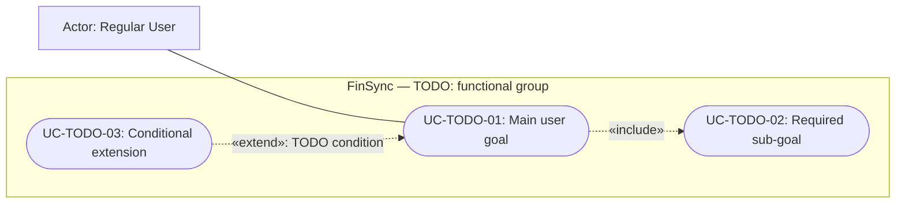

**Notation:** Solid undirected lines represent actor participation. `include` points from the base use case to required reused behavior; `extend` points from conditional behavior to the base use case and identifies the extension condition. Where generalization applies, draw a directed connection from specialized actor/use case to general actor/use case, label it `generalization`, and explain the inheritance. Add relationships only when supported by the actual model.

| Diagram ID | Functional groups covered | Mermaid block / document location | Relationship rationale |
|------------|---------------------------|------------------------------------|------------------------|
| [TODO] | [TODO] | [TODO] | [TODO: Include/extend/generalization where applicable] |

---

## Part D — Use-Case Specifications and UI Prototypes
> *Performed by: [TODO: Name] | Reviewed by: [TODO: Name] | Edited by: [TODO: Name]*

**Weight:** 45 points. Complete one specification for **every** modeled use case, including reused or extending use cases. Keep them here or in linked Markdown files submitted with the report. Screenshots of all prototype screens must appear alongside the corresponding specification; a design-tool link alone is insufficient.

### D.1. Specification and Prototype Conventions
> *Performed by: [TODO: Name] | Reviewed by: [TODO: Name] | Edited by: [TODO: Name]*

**Ordering:** [TODO: Workflow order or importance; match C.2.]

**Design tool(s):** [TODO: Figma, Google Stitch, v0, Bolt, Excalidraw, or actual tool used.]  
**Prototype project / access link:** [TODO]  
**Screen naming:** Use `UC-<group>-<number>-S<number>` or another documented consistent scheme.  
**Suggested screenshot location:** `screenshots/prototypes/<use-case-id>/` relative to this report.

Each basic-flow and alternative-flow screen/state must be identifiable. Shared screens may be reused, but embed and explain the relevant screenshots with each specification. Refine any specification whose prototype cannot express its stated behavior coherently.

### D.1a. Regular User / Client Use Cases and Prototype Evidence
> *Performed by: Nguyễn Phú Đạt (24120038) | Reviewed by: Pending team review | Edited by: Pending confirmation*

The Client contribution contains **12 use-case specifications (UC-CLI-01 through UC-CLI-12)** and **65 prototype evidence PNGs**, mapped to Basic, Alternative and Exception flows. Detailed specifications and all embedded figures are in the [Client catalogue](use-cases/client-use-cases.md).

**Evidence source: Figma Make Prototype — Simulated UI.** These are browser prototype captures using simulated, in-memory financial data, not Android emulator screenshots. No backend integration, PostgreSQL persistence, real JWT authentication, real device behavior or native Android pixel accuracy is verified. Imported validation claims belong to the supplied archive; no browser scenario tests were rerun during this documentation integration.

| Client documentation | Review entry point |
|---|---|
| Twelve specifications and per-UC coverage | [Client catalogue](use-cases/client-use-cases.md) |
| Scenario-to-image mapping | [Screenshot matrix](screenshots/prototypes/client-evidence/Screenshot-Matrix.csv) |
| Verification, provenance and limitations | [Client evidence audit](screenshots/prototypes/client-evidence/client-evidence-audit.md) |
| Supplied prototype URL and scope caveat | [Prototype reference](use-cases/client-prototype-link.md) |

All three flow categories have supplied image coverage for each Client use case. This does not certify every source-spec path or live Figma interaction. Identical final-state images for cancelled edit, cancellation of deletion and Undo do not independently prove the intermediate actions. Existing Account/Admin and other subsystem contributions retain their own ownership and evidence.

### D.1b. Data & Logic Use Cases


> *Performed by: `Nguyen Le Duc Nhat` | Reviewed by: Pending team review | Edited by: Pending confirmation*

**FinSync · Group 04 · PA3-2026 · Version 2.0 (compact), 2026-11-04.** This contribution follows [the Part D requirements](pa3_project_assignment_specification.md) and the five-subsection [report template](report.md). Detailed API, database-locking and job-runtime design is kept separately in [Backend Notes](use-cases/D_backend_notes.md).

## D.1. Scope and Shared Conventions
> *Performed by: `Nguyen Le Duc Nhat` | Reviewed by: Pending team review | Edited by: Pending confirmation*

**Scope:** Eight core use cases cover financial processing, shared-fund claims, splitting, settlement, refunds, synchronization, reporting and batch notifications. Existing IDs are preserved; gaps in numbering do not indicate missing cases. Part C is still a team template, so this is a scoped catalogue for integration, not a claim that the team has approved its final use-case model.

Wallet setup, member administration, basic navigation, searches and form details are referenced from the [Client catalogue](use-cases/client-use-cases.md), rather than specified twice. Account/Admin and AI remain separate contributions. Budget creation and savings-goal management are outside this narrowed assignment and still need explicit team coverage; Client budget viewing alone does not satisfy those requirements. On-demand reporting (former UC-DL-11) is merged into UC-DL-13.

**Business baseline:** Preserve PA2 bookkeeping-only payments, exact rounding, recipient/custodian confirmation, historical currency snapshots, own-group-share recognition and durable offline personal changes. The narrower database v1 differs in these areas; [the appendix](use-cases/D_backend_notes.md) records the gaps. This document does not silently approve scope reductions or claim those backend functions are implemented.

**Prototypes:** [Local HTML wireframes](prototypes/data-logic/index.html) and labeled PNG exports are newly authored specification designs, not captures proving implemented features. Each case reuses six frames for its form/review/result and domain variants; common dialogs are shown once below. Alternative flows specify the content/action variant in that reused frame. Amounts and rates are illustrative.
| Use case | Goal / related client scope | Local requirement |
|---|---|---|
| UC-DL-02 | Record, Edit and Delete Personal Transactions | FR-DL-02 |
| UC-DL-05 | Record and Confirm Shared-Fund Contributions | FR-DL-05 |
| UC-DL-06 | Record and Split a Group Expense | FR-DL-06 |
| UC-DL-07 | View Debts and Confirm a Settlement | FR-DL-07 |
| UC-DL-08 | Record Expense Refunds and Return Unused Funds | FR-DL-08 |
| UC-DL-12 | Synchronize Offline Personal Changes and Resolve Conflicts | FR-DL-12 |
| UC-DL-13 | Generate Financial Reports on Demand or Automatically | FR-DL-13 |
| UC-DL-14 | Evaluate Budget Alerts and Send Debt Reminders in Batches | FR-DL-14 |

FR-DL IDs are local traceability labels to merge into Part B; they are not asserted to be already approved requirement IDs.

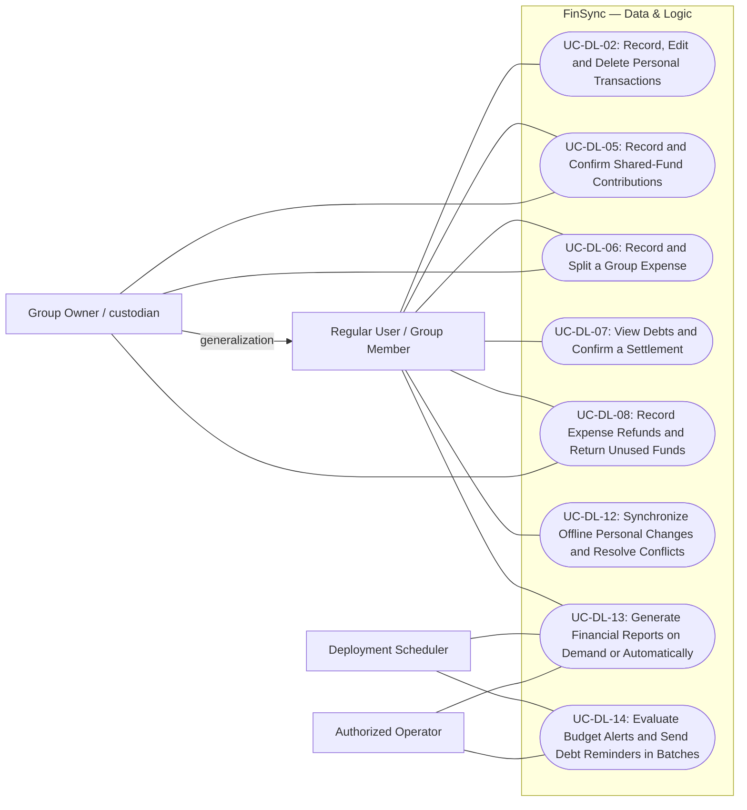

Actors are outside FinSync; database/worker internals are not actors. Generalization denotes inherited participation. No include/extend relationship is forced onto validation steps; cross-referenced workflows have separate triggers.

### D.1.1. Common Alternative and Exception Flows
> *Performed by: `Nguyen Le Duc Nhat` | Reviewed by: Pending team review | Edited by: Pending confirmation*

C1–C5 apply wherever their condition is relevant; each case references this table instead of repeating it. Scheduled runs have no user form to discard; their explicit stop/recovery branch applies instead.

| ID / condition | Actions and outcome | Return / shared screen |
|---|---|---|
| C1 — Cancel before confirmation | Keep editing or discard the uncommitted draft; no new effect. | Step 2 or end; DL-C01 |
| C2 — Session/permission changed | Stop the action; reauthenticate if permitted, otherwise deny without exposing data. | Step 1 or end; DL-C02 |
| C3 — Stale review/concurrent edit | Show current values, retain a safe draft and request fresh confirmation; no silent overwrite. | Steps 2–3; DL-C04 |
| C4 — Network/service failure | Do not claim success; reconcile the original request outcome before retry. Confirmed items stay committed; unresolved items remain pending/failed. | Step 4 or end; DL-C05 |
| C5 — Duplicate submission/replay | Return the existing acknowledged result rather than apply the action again. | Step 5; DL-C06 |

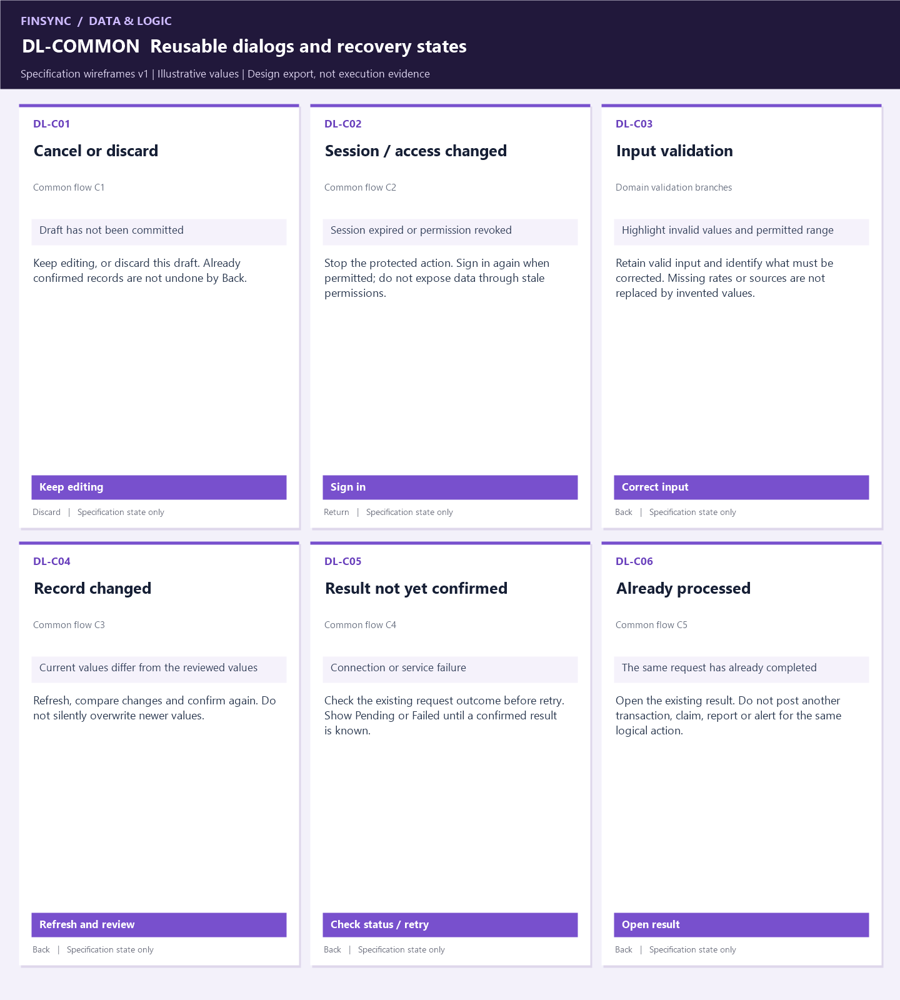

*Shared prototype: DL-C01–06. These same dialogs are referenced by the specifications below; a new screen is not required for each backend branch.*

## D.2. UC-DL-02 — Record, Edit and Delete Personal Transactions
> *Performed by: `Nguyen Le Duc Nhat` | Reviewed by: Pending team review | Edited by: Pending confirmation*


### D.2.1. Overview and Preconditions
> *Performed by: `Nguyen Le Duc Nhat` | Reviewed by: Pending team review | Edited by: Pending confirmation*

| Field | Specification |
|---|---|
| Use-case ID and name | UC-DL-02 — Record, Edit and Delete Personal Transactions |
| Primary actor | Regular User |
| Supporting actor(s) | None. |
| Description / goal | Maintain income and expense records, optional receipts and correct balances without duplicate posting. |
| Trigger | The user selects Add transaction or opens an owned transaction. |
| Related requirements / rules | FR-DL-02; bookkeeping only, authorized data, exact amounts and no duplicate consumption. |
| Related NFRs | NFR-S4, NFR-S6, NFR-S8, NFR-R3, NFR-R5, NFR-R6 |
| Relationships | Actor associations in D.1; shared C1–C5 apply as relevant. No mandatory included sub-use-case. |
| Preconditions | 1. User has an authorized session, or an unlocked encrypted cache after initial sign-in for the offline branch.<br>2. An owned wallet and applicable category exist.<br>3. Group records are not edited through this flow. |


### D.2.2. Basic Flow — Main Success Scenario
> *Performed by: `Nguyen Le Duc Nhat` | Reviewed by: Pending team review | Edited by: Pending confirmation*

| Step | Actor action | System response / state change | Screen |
|---|---|---|---|
| 1 | The user selects Add transaction or opens an owned transaction. | Check access; show eligible scope and current state. | S01 |
| 2 | Enter amount, wallet, category, date and note; optionally attach a receipt. | Validate the selected inputs and prepare a review; no financial effect yet. | S01 |
| 3 | Review and confirm the action. | Review a 120,000 VND Food expense and the selected wallet. | S02 |
| 4 | Wait for the acknowledged result. | Validate ownership and category type; atomically record the transaction and its attachment references; update derived totals. | S03 |
| 5 | Open the authorized result or status. | One expense appears in history; Cash decreases by 120,000 VND and Food spending increases once. | S03 |


### D.2.3. Alternative and Exception Flows
> *Performed by: `Nguyen Le Duc Nhat` | Reviewed by: Pending team review | Edited by: Pending confirmation*

| Flow / branch point | Ordered actions | Resume / resulting state | Screen variant |
|---|---|---|---|
| AF-01 — Income or edit<br>Step 2: change type or open an existing entry | 1. Choose an income category or edit allowed values. 2. Recalculate affected wallet/category totals; keep the original ID when editing. | 3 — Only the difference changes totals. | S04 |
| AF-02 — Delete / Undo<br>Step 2: Delete selected | 1. Confirm deletion and recalculate. 2. Offer Undo for 7 seconds; valid Undo restores the same ID/values once. If expired or unavailable, return to history without recreating it. | 5 / end — Deleted or restored once. | S04 |
| AF-03 — Offline or receipt pending<br>Step 4: network/upload unavailable | 1. Save an authorized personal change locally as Pending and invoke UC-DL-12 on reconnection. 2. If only the receipt fails after posting, retry the upload without another financial entry. | End / UC-DL-12 — Local and server status remain distinct. | S04 |
| AF-04 — Link a group movement<br>Step 2: money relates to a group event | 1. Select the authorized source event. 2. Link the movement rather than creating another consumption entry; the user's share is counted once. | 3 — Cash and consumption are not duplicated. | S05 / S06 |
| AF-05 — Invalid input or reference<br>Step 3: bad amount/date/category/receipt or ineligible wallet | 1. Identify the invalid field/file or reference. 2. Retain valid input and ask for correction; reject the whole invalid write. | 2 — No invalid financial effect. | S05 / S06 |

**Shared branches:** C1–C5 from D.1.1 where applicable. Use DL-C03 for field validation; use S06 for the case-specific pending/recovery result. Domain branches above take precedence where a conflict, offline state or scheduled stop needs different behavior.

### D.2.4. Postconditions and Special Requirements
> *Performed by: `Nguyen Le Duc Nhat` | Reviewed by: Pending team review | Edited by: Pending confirmation*

**Success:** One expense appears in history; Cash decreases by 120,000 VND and Food spending increases once.  
**Failure/cancellation:** No unauthorized or partially committed financial change. Pending claims do not change confirmed balances; acknowledged sync/batch items remain completed while other items can fail.  
**Special requirements:** NFR-S4, NFR-S6, NFR-S8, NFR-R3, NFR-R5, NFR-R6 Monetary values and historical rates must remain exact. These are requirements, not measured test results.

### D.2.5. UI Prototype Screenshots
> *Performed by: `Nguyen Le Duc Nhat` | Reviewed by: Pending team review | Edited by: Pending confirmation*

**Prototype:** [Compact wireframes v2](prototypes/data-logic/index.html#UC-DL-02). Screen IDs below use the `UC-DL-02-` prefix. Shared dialogs DL-C01–06 are embedded once in D.1.1.

| Frames | Flow coverage | Purpose |
|---|---|---|
| S01–S03 | Basic steps 1–5 | Input/scope, review and acknowledged result. |
| S04 | AF-01, AF-02, AF-03 | Alternative actions use the same entry/review layout with the selected variant. |
| S05–S06 | AF-04, AF-05; pending/recovery states | Changed values, unavailable data or incomplete outcome; no extra screen per internal check. |

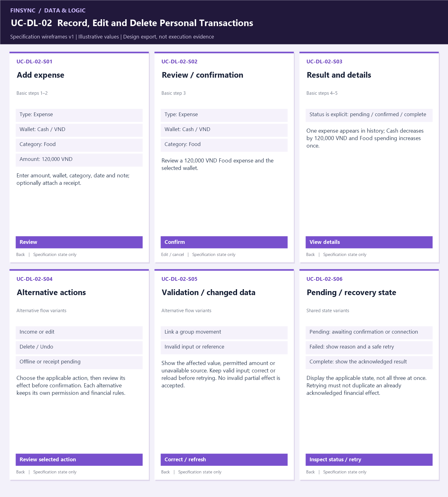

*Figure D.2 — UC-DL-02-S01–S06. Labeled design variants illustrate the specified flows; they are not proof of executed backend behavior.*

## D.3. UC-DL-05 — Record and Confirm Shared-Fund Contributions
> *Performed by: `Nguyen Le Duc Nhat` | Reviewed by: Pending team review | Edited by: Pending confirmation*


### D.3.1. Overview and Preconditions
> *Performed by: `Nguyen Le Duc Nhat` | Reviewed by: Pending team review | Edited by: Pending confirmation*

| Field | Specification |
|---|---|
| Use-case ID and name | UC-DL-05 — Record and Confirm Shared-Fund Contributions |
| Primary actor | Group Member |
| Supporting actor(s) | Group Owner acting as fund custodian. |
| Description / goal | Record money contributed outside the app and increase the shared fund only after the custodian confirms receipt. |
| Trigger | A member opens the group fund and selects Contribute. |
| Related requirements / rules | FR-DL-05; bookkeeping only, authorized data, exact amounts and no duplicate consumption. |
| Related NFRs | NFR-S4, NFR-R3, NFR-R6, NFR-R7 |
| Relationships | Actor associations in D.1; shared C1–C5 apply as relevant. No mandatory included sub-use-case. |
| Preconditions | 1. Both actors have online authorized group sessions.<br>2. The group fund exists and is active.<br>3. Actual payment occurs outside FinSync. |


### D.3.2. Basic Flow — Main Success Scenario
> *Performed by: `Nguyen Le Duc Nhat` | Reviewed by: Pending team review | Edited by: Pending confirmation*

| Step | Actor action | System response / state change | Screen |
|---|---|---|---|
| 1 | A member opens the group fund and selects Contribute. | Check access; show eligible scope and current state. | S01 |
| 2 | Enter the amount/date and declare that the external contribution was made. | Validate the selected inputs and prepare a review; no financial effect yet. | S01 |
| 3 | Review and confirm the action. | Review a 500,000 VND contribution claim; explain that it does not increase the fund yet. | S02 |
| 4 | Group Owner verifies and confirms receipt. | Save a pending claim; notify the Owner; the Owner opens it, verifies receipt and confirms; atomically post the fund credit. | S03 |
| 5 | Open the authorized result or status. | Fund balance becomes 1,500,000 VND; Laura's confirmed contribution position increases by 500,000; no expense is created. | S03 |


### D.3.3. Alternative and Exception Flows
> *Performed by: `Nguyen Le Duc Nhat` | Reviewed by: Pending team review | Edited by: Pending confirmation*

| Flow / branch point | Ordered actions | Resume / resulting state | Screen variant |
|---|---|---|---|
| AF-01 — Pending / rejected / withdrawn<br>Step 4: no confirmation, rejection or contributor withdrawal | 1. Keep a new claim Pending until the Owner responds. 2. On rejection store the reason; allow withdrawal only while Pending. | End — Confirmed fund remains unchanged. | S04 |
| AF-02 — Invalid claim or missing rate<br>Step 3: invalid amount/date or foreign currency | 1. Validate a positive contribution. 2. Show original amount and approved quote; if no rate exists, defer the conversion-dependent claim rather than inventing a total. | 2 / 3 — Only valid reviewed claims proceed. | S04 |
| AF-03 — Wrong confirmer / repeated decision<br>Step 4: another member confirms or status already changed | 1. Require the fund custodian. 2. Recheck claim status; a prior confirmation returns its existing result, a conflicting decision is rejected. | End — One receipt effect at most. | S04 |
| AF-04 — History / empty fund<br>Step 1: inspect fund without contributing | 1. Show confirmed cash and member positions separately from pending claims. 2. Show zero if empty; unused-fund return opens UC-DL-08. | End — No ledger mutation. | S05 / S06 |

**Shared branches:** C1–C5 from D.1.1 where applicable. Use DL-C03 for field validation; use S06 for the case-specific pending/recovery result. Domain branches above take precedence where a conflict, offline state or scheduled stop needs different behavior.

### D.3.4. Postconditions and Special Requirements
> *Performed by: `Nguyen Le Duc Nhat` | Reviewed by: Pending team review | Edited by: Pending confirmation*

**Success:** Fund balance becomes 1,500,000 VND; Laura's confirmed contribution position increases by 500,000; no expense is created.  
**Failure/cancellation:** No unauthorized or partially committed financial change. Pending claims do not change confirmed balances; acknowledged sync/batch items remain completed while other items can fail.  
**Special requirements:** NFR-S4, NFR-R3, NFR-R6, NFR-R7 Monetary values and historical rates must remain exact. These are requirements, not measured test results.

### D.3.5. UI Prototype Screenshots
> *Performed by: `Nguyen Le Duc Nhat` | Reviewed by: Pending team review | Edited by: Pending confirmation*

**Prototype:** [Compact wireframes v2](prototypes/data-logic/index.html#UC-DL-05). Screen IDs below use the `UC-DL-05-` prefix. Shared dialogs DL-C01–06 are embedded once in D.1.1.

| Frames | Flow coverage | Purpose |
|---|---|---|
| S01–S03 | Basic steps 1–5 | Input/scope, review and acknowledged result. |
| S04 | AF-01, AF-02, AF-03 | Alternative actions use the same entry/review layout with the selected variant. |
| S05–S06 | AF-04; pending/recovery states | Changed values, unavailable data or incomplete outcome; no extra screen per internal check. |

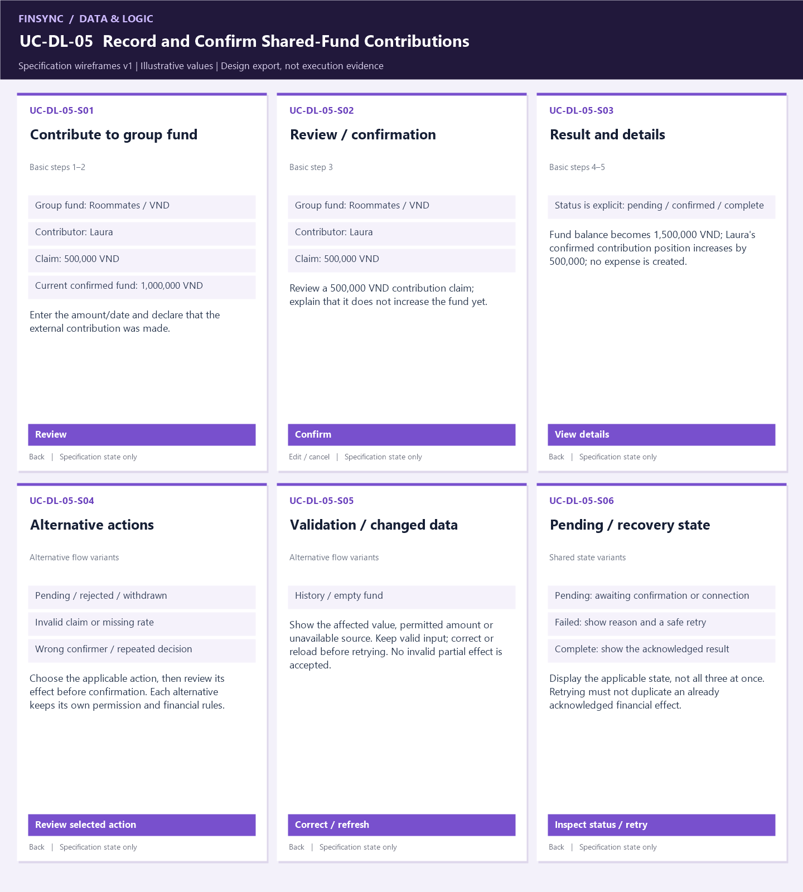

*Figure D.3 — UC-DL-05-S01–S06. Labeled design variants illustrate the specified flows; they are not proof of executed backend behavior.*

## D.4. UC-DL-06 — Record and Split a Group Expense
> *Performed by: `Nguyen Le Duc Nhat` | Reviewed by: Pending team review | Edited by: Pending confirmation*


### D.4.1. Overview and Preconditions
> *Performed by: `Nguyen Le Duc Nhat` | Reviewed by: Pending team review | Edited by: Pending confirmation*

| Field | Specification |
|---|---|
| Use-case ID and name | UC-DL-06 — Record and Split a Group Expense |
| Primary actor | Group Member |
| Supporting actor(s) | Group Owner when authorizing shared-fund spending. |
| Description / goal | Allocate a real group expense exactly, preserve the funding source and update member positions without counting consumption twice. |
| Trigger | An authorized member selects Add group expense. |
| Related requirements / rules | FR-DL-06; bookkeeping only, authorized data, exact amounts and no duplicate consumption. |
| Related NFRs | NFR-P5, NFR-S4, NFR-S6, NFR-R3, NFR-R8 |
| Relationships | Actor associations in D.1; shared C1–C5 apply as relevant. No mandatory included sub-use-case. |
| Preconditions | 1. Online active membership.<br>2. Group currency and participants are known.<br>3. A valid rate exists for a foreign-currency bill; sufficient fund cash exists for fund-funded spending. |


### D.4.2. Basic Flow — Main Success Scenario
> *Performed by: `Nguyen Le Duc Nhat` | Reviewed by: Pending team review | Edited by: Pending confirmation*

| Step | Actor action | System response / state change | Screen |
|---|---|---|---|
| 1 | An authorized member selects Add group expense. | Check access; show eligible scope and current state. | S01 |
| 2 | Enter title/date/category, payer or fund, original amount/currency and participating members; select split mode. | Validate the selected inputs and prepare a review; no financial effect yet. | S01 |
| 3 | Review and confirm the action. | Review You 100,001; Laura 100,000; Minh 100,000 VND. Total equals 300,001 VND. | S02 |
| 4 | Wait for the acknowledged result. | Revalidate membership, quote, split inputs and funding; atomically post the expense, allocations and the applicable payer/fund entry. | S03 |
| 5 | Open the authorized result or status. | One expense appears. Member debt/fund positions update; each user's consumption is only their allocated share. | S03 |


### D.4.3. Alternative and Exception Flows
> *Performed by: `Nguyen Le Duc Nhat` | Reviewed by: Pending team review | Edited by: Pending confirmation*

| Flow / branch point | Ordered actions | Resume / resulting state | Screen variant |
|---|---|---|---|
| AF-01 — Alternative split mode<br>Step 2: Exact, Percentage or Shares | 1. Enter exact amounts totaling the bill, percentages totaling 100%, or positive weights. 2. Calculate final shares and distribute rounding remainders in a stable order. | 3 — Final shares sum exactly to the expense. | S04 |
| AF-02 — Change participants / payer<br>Step 2: selection changes | 1. Verify all selected identities belong to the group. 2. Recalculate and remove obsolete draft allocations before review. | 3 — No hidden shares for removed participants. | S04 |
| AF-03 — Pay from shared fund<br>Step 2: fund selected | 1. Check custodian permission and available confirmed cash. 2. Debit the fund instead of crediting an individual payer; update member fund positions once. | 3 — Only one funding source is used. | S04 |
| AF-04 — Foreign-currency bill<br>Step 2: currency differs from group | 1. Show original amount and rate/source/time. 2. Convert once, then split and retain the snapshot. Missing/changed quote requires a new review. | 3 / 2 — No silent repricing of historical shares. | S05 / S06 |
| AF-05 — Invalid allocation / insufficient funds<br>Step 3 or 4: mismatch, no participants, bad weights or low fund cash | 1. Display the difference or available amount. 2. Keep the draft and reject the entire expense until corrected. | 2 — No partial expense, allocation or fund debit. | S05 / S06 |

**Shared branches:** C1–C5 from D.1.1 where applicable. Use DL-C03 for field validation; use S06 for the case-specific pending/recovery result. Domain branches above take precedence where a conflict, offline state or scheduled stop needs different behavior.

### D.4.4. Postconditions and Special Requirements
> *Performed by: `Nguyen Le Duc Nhat` | Reviewed by: Pending team review | Edited by: Pending confirmation*

**Success:** One expense appears. Member debt/fund positions update; each user's consumption is only their allocated share.  
**Failure/cancellation:** No unauthorized or partially committed financial change. Pending claims do not change confirmed balances; acknowledged sync/batch items remain completed while other items can fail.  
**Special requirements:** NFR-P5, NFR-S4, NFR-S6, NFR-R3, NFR-R8 Monetary values and historical rates must remain exact. These are requirements, not measured test results.

### D.4.5. UI Prototype Screenshots
> *Performed by: `Nguyen Le Duc Nhat` | Reviewed by: Pending team review | Edited by: Pending confirmation*

**Prototype:** [Compact wireframes v2](prototypes/data-logic/index.html#UC-DL-06). Screen IDs below use the `UC-DL-06-` prefix. Shared dialogs DL-C01–06 are embedded once in D.1.1.

| Frames | Flow coverage | Purpose |
|---|---|---|
| S01–S03 | Basic steps 1–5 | Input/scope, review and acknowledged result. |
| S04 | AF-01, AF-02, AF-03 | Alternative actions use the same entry/review layout with the selected variant. |
| S05–S06 | AF-04, AF-05; pending/recovery states | Changed values, unavailable data or incomplete outcome; no extra screen per internal check. |

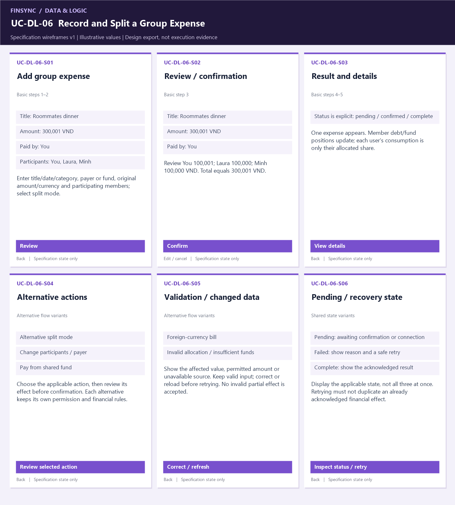

*Figure D.4 — UC-DL-06-S01–S06. Labeled design variants illustrate the specified flows; they are not proof of executed backend behavior.*

## D.5. UC-DL-07 — View Debts and Confirm a Settlement
> *Performed by: `Nguyen Le Duc Nhat` | Reviewed by: Pending team review | Edited by: Pending confirmation*


### D.5.1. Overview and Preconditions
> *Performed by: `Nguyen Le Duc Nhat` | Reviewed by: Pending team review | Edited by: Pending confirmation*

| Field | Specification |
|---|---|
| Use-case ID and name | UC-DL-07 — View Debts and Confirm a Settlement |
| Primary actor | Group Member acting as debtor |
| Supporting actor(s) | Intended recipient / creditor. |
| Description / goal | Inspect simplified debts and reduce debt only after the intended recipient confirms an external payment. |
| Trigger | The user opens Who owes whom and selects a debt. |
| Related requirements / rules | FR-DL-07; bookkeeping only, authorized data, exact amounts and no duplicate consumption. |
| Related NFRs | NFR-P5, NFR-S4, NFR-R3, NFR-R6, NFR-R7 |
| Relationships | Actor associations in D.1; shared C1–C5 apply as relevant. No mandatory included sub-use-case. |
| Preconditions | 1. Both parties are authorized active group members online.<br>2. A positive outstanding debt exists.<br>3. The debtor pays outside FinSync before claiming payment. |


### D.5.2. Basic Flow — Main Success Scenario
> *Performed by: `Nguyen Le Duc Nhat` | Reviewed by: Pending team review | Edited by: Pending confirmation*

| Step | Actor action | System response / state change | Screen |
|---|---|---|---|
| 1 | The user opens Who owes whom and selects a debt. | Check access; show eligible scope and current state. | S01 |
| 2 | Select the intended recipient, amount and date; indicate that external payment has occurred. | Validate the selected inputs and prepare a review; no financial effect yet. | S01 |
| 3 | Review and confirm the action. | Review the payer, recipient and claim amount; display Awaiting recipient confirmation. | S02 |
| 4 | Intended recipient confirms receipt. | Create a pending claim; notify the recipient; recipient confirms receipt after current-debt validation; atomically post settlement effects. | S03 |
| 5 | Open the authorized result or status. | Confirmed debt falls from 100,000 to 0 VND. The payment remains in history and is not new spending. | S03 |


### D.5.3. Alternative and Exception Flows
> *Performed by: `Nguyen Le Duc Nhat` | Reviewed by: Pending team review | Edited by: Pending confirmation*

| Flow / branch point | Ordered actions | Resume / resulting state | Screen variant |
|---|---|---|---|
| AF-01 — Inspect / simplify / remind<br>Step 1: no payment submitted | 1. Show transfers preserving every member's net position. 2. If requested, send an eligible deduplicated reminder; do not create a payment. | End — Debt unchanged. | S04 |
| AF-02 — Partial payment<br>Step 2: amount is below outstanding debt | 1. Review the smaller positive amount. 2. After recipient confirmation reduce only that amount: 50,000 paid against 100,000 leaves 50,000. | 3 — Remaining debt is retained. | S04 |
| AF-03 — Pending / rejected / withdrawn<br>Step 4: recipient does not confirm, rejects, or debtor cancels | 1. Keep pending debt unchanged. 2. Record rejection reason or cancel an unconfirmed claim; never cancel an already confirmed payment through this branch. | End — Only confirmed payments reduce debt. | S04 |
| AF-04 — Wrong confirmer<br>Step 4: Owner or another person tries to confirm | 1. Check intended recipient identity. 2. Reject confirmation by anyone else, including the Owner. | End — Claim and debt unchanged. | S05 / S06 |
| AF-05 — Invalid or stale debt<br>Step 3 or 4: invalid/excess amount or changed debt | 1. Recompute current outstanding debt. 2. Reject an excess claim and request fresh review; repeated confirmation returns the existing result. | 2 — No overpayment or duplicate effect. | S05 / S06 |

**Shared branches:** C1–C5 from D.1.1 where applicable. Use DL-C03 for field validation; use S06 for the case-specific pending/recovery result. Domain branches above take precedence where a conflict, offline state or scheduled stop needs different behavior.

### D.5.4. Postconditions and Special Requirements
> *Performed by: `Nguyen Le Duc Nhat` | Reviewed by: Pending team review | Edited by: Pending confirmation*

**Success:** Confirmed debt falls from 100,000 to 0 VND. The payment remains in history and is not new spending.  
**Failure/cancellation:** No unauthorized or partially committed financial change. Pending claims do not change confirmed balances; acknowledged sync/batch items remain completed while other items can fail.  
**Special requirements:** NFR-P5, NFR-S4, NFR-R3, NFR-R6, NFR-R7 Monetary values and historical rates must remain exact. These are requirements, not measured test results.

### D.5.5. UI Prototype Screenshots
> *Performed by: `Nguyen Le Duc Nhat` | Reviewed by: Pending team review | Edited by: Pending confirmation*

**Prototype:** [Compact wireframes v2](prototypes/data-logic/index.html#UC-DL-07). Screen IDs below use the `UC-DL-07-` prefix. Shared dialogs DL-C01–06 are embedded once in D.1.1.

| Frames | Flow coverage | Purpose |
|---|---|---|
| S01–S03 | Basic steps 1–5 | Input/scope, review and acknowledged result. |
| S04 | AF-01, AF-02, AF-03 | Alternative actions use the same entry/review layout with the selected variant. |
| S05–S06 | AF-04, AF-05; pending/recovery states | Changed values, unavailable data or incomplete outcome; no extra screen per internal check. |

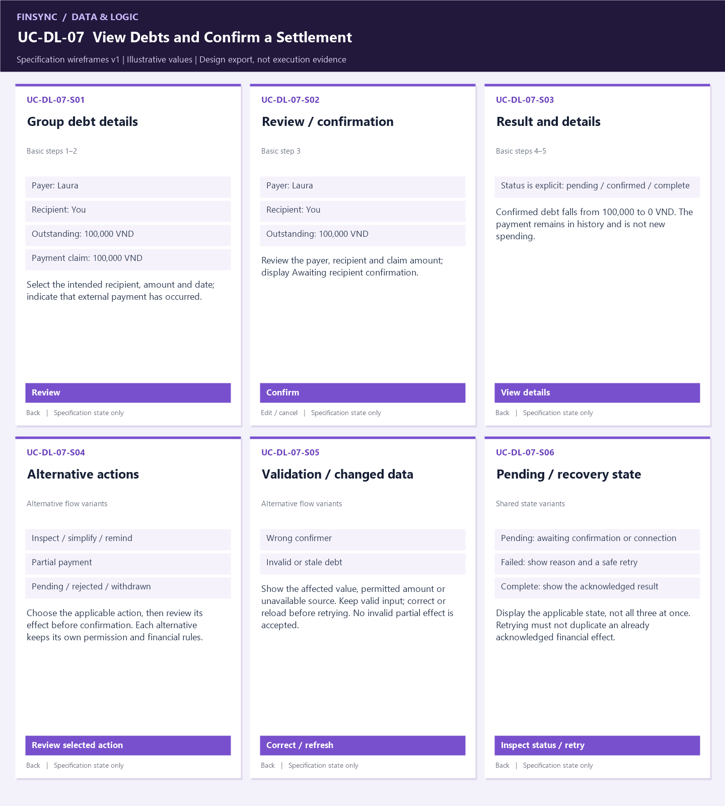

*Figure D.5 — UC-DL-07-S01–S06. Labeled design variants illustrate the specified flows; they are not proof of executed backend behavior.*

## D.6. UC-DL-08 — Record Expense Refunds and Return Unused Funds
> *Performed by: `Nguyen Le Duc Nhat` | Reviewed by: Pending team review | Edited by: Pending confirmation*


### D.6.1. Overview and Preconditions
> *Performed by: `Nguyen Le Duc Nhat` | Reviewed by: Pending team review | Edited by: Pending confirmation*

| Field | Specification |
|---|---|
| Use-case ID and name | UC-DL-08 — Record Expense Refunds and Return Unused Funds |
| Primary actor | Group Member who recorded the expense / authorized Group Owner |
| Supporting actor(s) | Intended recipient for an unused-fund return. |
| Description / goal | Record traceable corrections and reimbursements without deleting settled financial history. |
| Trigger | The user opens an original group expense and selects Record refund, or opens Return unused funds. |
| Related requirements / rules | FR-DL-08; bookkeeping only, authorized data, exact amounts and no duplicate consumption. |
| Related NFRs | NFR-S4, NFR-R3, NFR-R6, NFR-R7, NFR-R8 |
| Relationships | Actor associations in D.1; shared C1–C5 apply as relevant. No mandatory included sub-use-case. |
| Preconditions | 1. Online authorized membership.<br>2. Original confirmed expense exists for expense refunds.<br>3. Remaining refundable amount and original participants/rate are available. |


### D.6.2. Basic Flow — Main Success Scenario
> *Performed by: `Nguyen Le Duc Nhat` | Reviewed by: Pending team review | Edited by: Pending confirmation*

| Step | Actor action | System response / state change | Screen |
|---|---|---|---|
| 1 | The user opens an original group expense and selects Record refund, or opens Return unused funds. | Check access; show eligible scope and current state. | S01 |
| 2 | Select the original expense; enter refund amount/date/reason and actual recipient of the external refund. | Validate the selected inputs and prepare a review; no financial effect yet. | S01 |
| 3 | Review and confirm the action. | Review a 90,000 VND refund: reverse 30,000 consumption per original participant. | S02 |
| 4 | Wait for the acknowledged result. | Validate remaining refundable amount; atomically append a linked adjustment using original allocations and stored currency basis; retain all earlier payments. | S03 |
| 5 | Open the authorized result or status. | Net consumption is 210,000 VND. If already settled, reimbursement positions appear; no prior settlement is deleted. | S03 |


### D.6.3. Alternative and Exception Flows
> *Performed by: `Nguyen Le Duc Nhat` | Reviewed by: Pending team review | Edited by: Pending confirmation*

| Flow / branch point | Ordered actions | Resume / resulting state | Screen variant |
|---|---|---|---|
| AF-01 — Full / partial / repeated refund<br>Step 2: refund amount chosen | 1. Show unrefunded expense and per-member amounts. 2. Reverse only the selected remaining amount using the original allocation/rate basis and exact rounding. | 3 — Cumulative refunds never exceed original shares. | S04 |
| AF-02 — Refund after settlement<br>Step 4: original debt was already paid | 1. Retain all prior payments. 2. Show new reimbursement positions; any subsequent external payment uses UC-DL-07. | 5 — No settled history is erased. | S04 |
| AF-03 — Refund to shared fund<br>Step 2: original bill was fund-paid | 1. Verify the original funding source and returned money. 2. Credit the fund and reverse allocated consumption once. | 3 — Refund is not new income. | S04 |
| AF-04 — Return unused funds<br>Step 1: fund return selected | 1. Check cash and the member's entitlement; create a return claim. 2. Intended recipient confirms receipt; pending/rejected/withdrawn claims do not reduce confirmed cash. | 5 / end — Confirmed return reduces cash and entitlement once. | S05 / S06 |
| AF-05 — Invalid refund / changed position<br>Step 3 or 4: missing original, excess amount, missing quote or stale entitlement | 1. Show the current permitted amount or missing evidence. 2. Reject the adjustment and retain a correctable draft; the Owner cannot confirm receipt for another member. | 2 — No unlinked or excess correction. | S05 / S06 |

**Shared branches:** C1–C5 from D.1.1 where applicable. Use DL-C03 for field validation; use S06 for the case-specific pending/recovery result. Domain branches above take precedence where a conflict, offline state or scheduled stop needs different behavior.

### D.6.4. Postconditions and Special Requirements
> *Performed by: `Nguyen Le Duc Nhat` | Reviewed by: Pending team review | Edited by: Pending confirmation*

**Success:** Net consumption is 210,000 VND. If already settled, reimbursement positions appear; no prior settlement is deleted.  
**Failure/cancellation:** No unauthorized or partially committed financial change. Pending claims do not change confirmed balances; acknowledged sync/batch items remain completed while other items can fail.  
**Special requirements:** NFR-S4, NFR-R3, NFR-R6, NFR-R7, NFR-R8 Monetary values and historical rates must remain exact. These are requirements, not measured test results.

### D.6.5. UI Prototype Screenshots
> *Performed by: `Nguyen Le Duc Nhat` | Reviewed by: Pending team review | Edited by: Pending confirmation*

**Prototype:** [Compact wireframes v2](prototypes/data-logic/index.html#UC-DL-08). Screen IDs below use the `UC-DL-08-` prefix. Shared dialogs DL-C01–06 are embedded once in D.1.1.

| Frames | Flow coverage | Purpose |
|---|---|---|
| S01–S03 | Basic steps 1–5 | Input/scope, review and acknowledged result. |
| S04 | AF-01, AF-02, AF-03 | Alternative actions use the same entry/review layout with the selected variant. |
| S05–S06 | AF-04, AF-05; pending/recovery states | Changed values, unavailable data or incomplete outcome; no extra screen per internal check. |

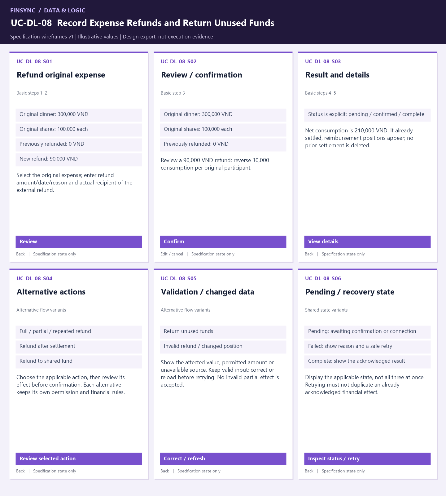

*Figure D.6 — UC-DL-08-S01–S06. Labeled design variants illustrate the specified flows; they are not proof of executed backend behavior.*

## D.7. UC-DL-12 — Synchronize Offline Personal Changes and Resolve Conflicts
> *Performed by: `Nguyen Le Duc Nhat` | Reviewed by: Pending team review | Edited by: Pending confirmation*


### D.7.1. Overview and Preconditions
> *Performed by: `Nguyen Le Duc Nhat` | Reviewed by: Pending team review | Edited by: Pending confirmation*

| Field | Specification |
|---|---|
| Use-case ID and name | UC-DL-12 — Synchronize Offline Personal Changes and Resolve Conflicts |
| Primary actor | Regular User |
| Supporting actor(s) | None; connectivity detection and synchronization worker are internal. |
| Description / goal | Submit encrypted locally queued personal changes exactly once and explicitly resolve version conflicts. |
| Trigger | Connectivity returns or the user selects Sync now after offline capture. |
| Related requirements / rules | FR-DL-12; bookkeeping only, authorized data, exact amounts and no duplicate consumption. |
| Related NFRs | NFR-P6, NFR-S3, NFR-S8, NFR-R5, NFR-R6 |
| Relationships | Actor associations in D.1; shared C1–C5 apply as relevant. No mandatory included sub-use-case. |
| Preconditions | 1. Initial authenticated synchronization has created an account-specific encrypted cache.<br>2. Stable operation IDs, base versions and pending changes exist.<br>3. Valid online session is available for server submission. |


### D.7.2. Basic Flow — Main Success Scenario
> *Performed by: `Nguyen Le Duc Nhat` | Reviewed by: Pending team review | Edited by: Pending confirmation*

| Step | Actor action | System response / state change | Screen |
|---|---|---|---|
| 1 | Connectivity returns or the user selects Sync now after offline capture. | Check access; show eligible scope and current state. | S01 |
| 2 | Unlock the local account cache, inspect pending records and select Sync now. | Validate the selected inputs and prepare a review; no financial effect yet. | S01 |
| 3 | Review and confirm the action. | Show pending operation IDs/order and local-only labels; verify session before submission. | S02 |
| 4 | Wait for the acknowledged result. | Submit operations with stable IDs/base versions; validate on server; acknowledge committed results; mark only acknowledged operations synchronized. | S03 |
| 5 | Open the authorized result or status. | Three changes synchronize once; local IDs match server records; balances refresh and pending status clears. | S03 |


### D.7.3. Alternative and Exception Flows
> *Performed by: `Nguyen Le Duc Nhat` | Reviewed by: Pending team review | Edited by: Pending confirmation*

| Flow / branch point | Ordered actions | Resume / resulting state | Screen variant |
|---|---|---|---|
| AF-01 — Offline again / app restart<br>Step 4: connection or process stops | 1. Keep unacknowledged operations durable. 2. Resume remaining work on reconnection; already acknowledged items stay synchronized. | 4 — No acknowledged local edit is lost. | S04 |
| AF-02 — Expired session / account switch<br>Step 3: authorization unavailable or logout requested | 1. Pause and request valid sign-in for the same account. 2. Before logout warn about pending edits; allow cancel-and-sync or explicit discard, then clear account-local data. | 3 / end — No cross-account upload. | S04 |
| AF-03 — Edit or delete conflict<br>Step 4: server version differs | 1. Show local/server values and any tombstone. 2. Keep server, reapply against the refreshed version, or explicitly recreate a deleted entry with a new ID; never overwrite/resurrect silently. | 4 — Conflict remains visible until resolved. | S04 |
| AF-04 — Duplicate / lost acknowledgement<br>Step 4: replay after uncertain response | 1. Reuse the original operation identity and retrieve its outcome. 2. Acknowledge the existing result without applying it again. | 4 — Exactly one financial effect. | S05 / S06 |
| AF-05 — Reference rejected / receipt failed<br>Step 4: wallet/category ineligible or upload fails | 1. Mark the invalid operation Action required and retain its draft; retry only a failed receipt upload. 2. Continue independent valid records. | 4 — No second financial entry; partial progress is explicit. | S05 / S06 |
| AF-06 — Offline group write<br>Step 2: user tries to change shared data | 1. Show cached group data as read-only. 2. Require an online session before shared writes; do not enqueue them as personal changes. | End — No unauthorized offline group update. | S05 / S06 |

**Shared branches:** C1–C5 from D.1.1 where applicable. Use DL-C03 for field validation; use S06 for the case-specific pending/recovery result. Domain branches above take precedence where a conflict, offline state or scheduled stop needs different behavior.

### D.7.4. Postconditions and Special Requirements
> *Performed by: `Nguyen Le Duc Nhat` | Reviewed by: Pending team review | Edited by: Pending confirmation*

**Success:** Three changes synchronize once; local IDs match server records; balances refresh and pending status clears.  
**Failure/cancellation:** No unauthorized or partially committed financial change. Pending claims do not change confirmed balances; acknowledged sync/batch items remain completed while other items can fail.  
**Special requirements:** NFR-P6, NFR-S3, NFR-S8, NFR-R5, NFR-R6 Monetary values and historical rates must remain exact. These are requirements, not measured test results.

### D.7.5. UI Prototype Screenshots
> *Performed by: `Nguyen Le Duc Nhat` | Reviewed by: Pending team review | Edited by: Pending confirmation*

**Prototype:** [Compact wireframes v2](prototypes/data-logic/index.html#UC-DL-12). Screen IDs below use the `UC-DL-12-` prefix. Shared dialogs DL-C01–06 are embedded once in D.1.1.

| Frames | Flow coverage | Purpose |
|---|---|---|
| S01–S03 | Basic steps 1–5 | Input/scope, review and acknowledged result. |
| S04 | AF-01, AF-02, AF-03 | Alternative actions use the same entry/review layout with the selected variant. |
| S05–S06 | AF-04, AF-05, AF-06; pending/recovery states | Changed values, unavailable data or incomplete outcome; no extra screen per internal check. |

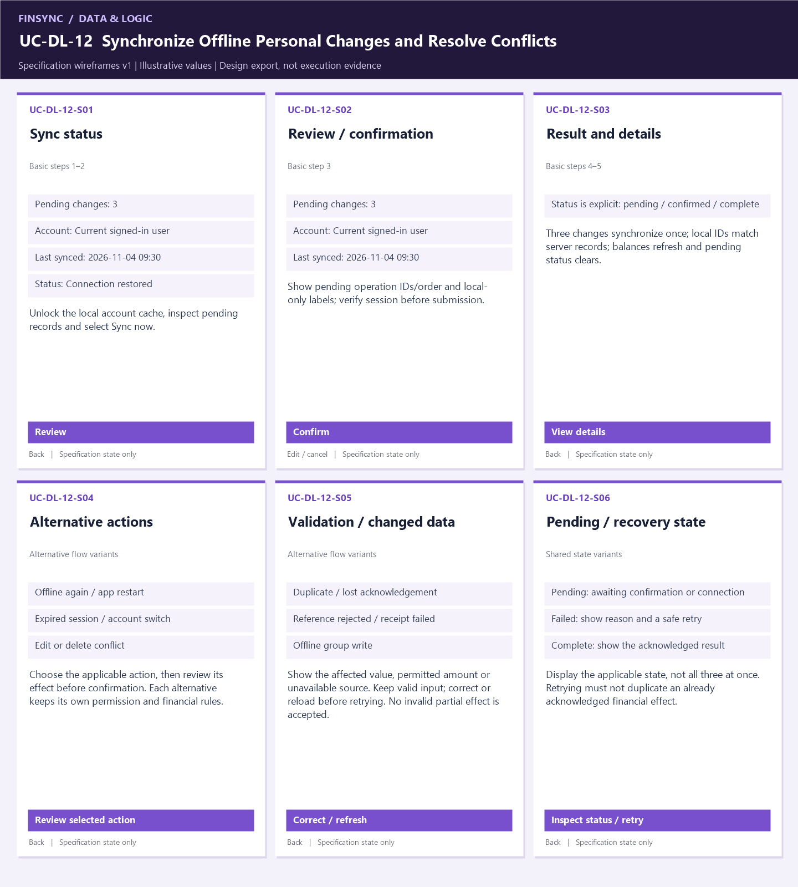

*Figure D.7 — UC-DL-12-S01–S06. Labeled design variants illustrate the specified flows; they are not proof of executed backend behavior.*

## D.8. UC-DL-13 — Generate Financial Reports on Demand or Automatically
> *Performed by: `Nguyen Le Duc Nhat` | Reviewed by: Pending team review | Edited by: Pending confirmation*


### D.8.1. Overview and Preconditions
> *Performed by: `Nguyen Le Duc Nhat` | Reviewed by: Pending team review | Edited by: Pending confirmation*

| Field | Specification |
|---|---|
| Use-case ID and name | UC-DL-13 — Generate Financial Reports on Demand or Automatically |
| Primary actor | Regular User; Deployment Scheduler for monthly runs |
| Supporting actor(s) | Authorized operator monitoring or retrying a scheduled run. |
| Description / goal | Produce authorized personal/group reports with consistent totals, an explicit currency basis and optional PDF/Excel output. |
| Trigger | The user opens Reports, or the monthly scheduler starts a due report. |
| Related requirements / rules | FR-DL-13; bookkeeping only, authorized data, exact amounts and no duplicate consumption. |
| Related NFRs | NFR-S4, NFR-R3, NFR-R8; recoverable, duplicate-safe background processing. |
| Relationships | Actor associations in D.1; shared C1–C5 apply as relevant. No mandatory included sub-use-case. |
| Preconditions | 1. Valid user or scheduler authorization.<br>2. Requested data scope and period are permitted.<br>3. Conversion-dependent totals have an identified rate basis. |


### D.8.2. Basic Flow — Main Success Scenario
> *Performed by: `Nguyen Le Duc Nhat` | Reviewed by: Pending team review | Edited by: Pending confirmation*

| Step | Actor action | System response / state change | Screen |
|---|---|---|---|
| 1 | The user opens Reports, or the monthly scheduler starts a due report. | Check access; show eligible scope and current state. | S01 |
| 2 | Choose personal/group scope, period, currency and output format; a scheduled run derives the closed month for each eligible user. | Validate the selected inputs and prepare a review; no financial effect yet. | S01 |
| 3 | Review and confirm the action. | Review the period, currency basis and source cutoff; preview the same totals used for details and export. | S02 |
| 4 | Wait for the acknowledged result. | Aggregate the authorized snapshot; generate the report and requested artifact; record completion before publication. | S03 |
| 5 | Open the authorized result or status. | The user can inspect or download the report with period/currency/cutoff labels. A scheduled result is published once; the financial ledger is unchanged. | S03 |


### D.8.3. Alternative and Exception Flows
> *Performed by: `Nguyen Le Duc Nhat` | Reviewed by: Pending team review | Edited by: Pending confirmation*

| Flow / branch point | Ordered actions | Resume / resulting state | Screen variant |
|---|---|---|---|
| AF-01 — Automatic monthly run<br>Step 1: scheduled trigger instead of user request | 1. Select each eligible user's closed month/currency. 2. Generate and publish one authorized result; duplicate triggers reuse the same logical run. | 2 — No repeated monthly publication. | S04 |
| AF-02 — Chart / group / export variant<br>Step 2: user changes view/scope/format | 1. Recheck group access and apply the same filters to totals and details. 2. Export the reviewed snapshot as PDF or Excel; never expose private member wallets. | 3 — View and export agree. | S04 |
| AF-03 — Empty data / invalid range / missing rate<br>Step 3: unavailable or invalid reporting inputs | 1. Reject invalid ranges; show zero/empty data or growth as not applicable for a zero baseline. 2. If conversion is missing, show original-currency subtotals and incomplete status. | 2 / end — No invented totals or growth. | S04 |
| AF-04 — Cached data / later changes<br>Step 3 or 5: offline viewing or source changes | 1. Label cached/pending data and its cutoff. 2. Regeneration creates an explicit revised snapshot; it does not silently rewrite a previously issued report. | 3 / end — The report remains attributable to its source period. | S05 / S06 |
| AF-05 — Processing / export / delivery failure<br>Step 4 or 5: an output stage fails | 1. Preserve confirmed results and retry the failed unit without re-posting financial data. 2. Keep delivery pending, or mark failed after the retry limit; revoke access if eligibility changed. | 4 / end — No false success or unauthorized download. | S05 / S06 |
| AF-06 — Scheduled run interrupted / cancelled<br>Step 4: worker restart or operator stop | 1. Resume from acknowledged work without duplicating published results, or stop new work at safe boundaries. 2. Retain completed results and expose remaining/failed counts. | 4 / end — Partial completion is explicit. | S05 / S06 |

**Shared branches:** C1–C5 from D.1.1 where applicable. Use DL-C03 for field validation; use S06 for the case-specific pending/recovery result. Domain branches above take precedence where a conflict, offline state or scheduled stop needs different behavior.

### D.8.4. Postconditions and Special Requirements
> *Performed by: `Nguyen Le Duc Nhat` | Reviewed by: Pending team review | Edited by: Pending confirmation*

**Success:** The user can inspect or download the report with period/currency/cutoff labels. A scheduled result is published once; the financial ledger is unchanged.  
**Failure/cancellation:** No unauthorized or partially committed financial change. Pending claims do not change confirmed balances; acknowledged sync/batch items remain completed while other items can fail.  
**Special requirements:** NFR-S4, NFR-R3, NFR-R8; recoverable, duplicate-safe background processing. Monetary values and historical rates must remain exact. These are requirements, not measured test results.

### D.8.5. UI Prototype Screenshots
> *Performed by: `Nguyen Le Duc Nhat` | Reviewed by: Pending team review | Edited by: Pending confirmation*

**Prototype:** [Compact wireframes v2](prototypes/data-logic/index.html#UC-DL-13). Screen IDs below use the `UC-DL-13-` prefix. Shared dialogs DL-C01–06 are embedded once in D.1.1.

| Frames | Flow coverage | Purpose |
|---|---|---|
| S01–S03 | Basic steps 1–5 | Input/scope, review and acknowledged result. |
| S04 | AF-01, AF-02, AF-03 | Alternative actions use the same entry/review layout with the selected variant. |
| S05–S06 | AF-04, AF-05, AF-06; pending/recovery states | Changed values, unavailable data or incomplete outcome; no extra screen per internal check. |

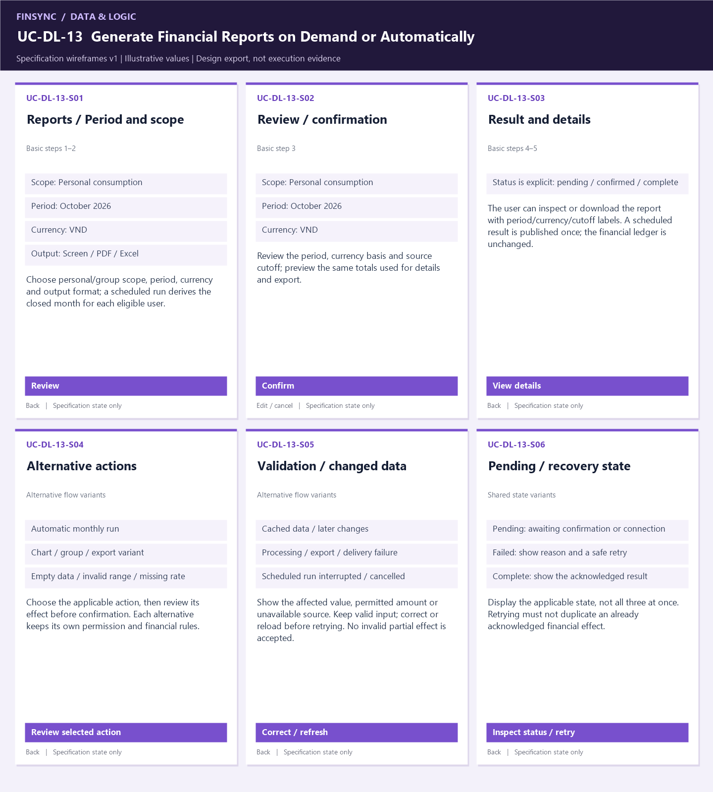

*Figure D.8 — UC-DL-13-S01–S06. Labeled design variants illustrate the specified flows; they are not proof of executed backend behavior.*

## D.9. UC-DL-14 — Evaluate Budget Alerts and Send Debt Reminders in Batches
> *Performed by: `Nguyen Le Duc Nhat` | Reviewed by: Pending team review | Edited by: Pending confirmation*


### D.9.1. Overview and Preconditions
> *Performed by: `Nguyen Le Duc Nhat` | Reviewed by: Pending team review | Edited by: Pending confirmation*

| Field | Specification |
|---|---|
| Use-case ID and name | UC-DL-14 — Evaluate Budget Alerts and Send Debt Reminders in Batches |
| Primary actor | Deployment Scheduler (external time trigger) |
| Supporting actor(s) | Regular User receiving alerts; authorized operator retrying failed items. |
| Description / goal | Evaluate many eligible budgets/debts reliably and deliver each logical alert once without changing recorded balances. |
| Trigger | A scheduled sweep starts or an authorized operator resumes failed notification work. |
| Related requirements / rules | FR-DL-14; bookkeeping only, authorized data, exact amounts and no duplicate consumption. |
| Related NFRs | NFR-S4, NFR-R3, NFR-U6; recoverable, duplicate-safe background processing. |
| Relationships | Actor associations in D.1; shared C1–C5 apply as relevant. No mandatory included sub-use-case. |
| Preconditions | 1. Valid scheduler identity and configured recipient-local schedule.<br>2. Budget/debt data is available.<br>3. Durable checkpoints, deduplication keys and delivery state are available. |


### D.9.2. Basic Flow — Main Success Scenario
> *Performed by: `Nguyen Le Duc Nhat` | Reviewed by: Pending team review | Edited by: Pending confirmation*

| Step | Actor action | System response / state change | Screen |
|---|---|---|---|
| 1 | A scheduled sweep starts or an authorized operator resumes failed notification work. | Check access; show eligible scope and current state. | S01 |
| 2 | Authenticate the trigger; select eligible users and a stable sweep window; create or reuse the run. | Validate the selected inputs and prepare a review; no financial effect yet. | S01 |
| 3 | Scheduler supplies the due scope. | Claim a bounded page with a lease; expose processed/failed counts and the checkpoint, not private transaction details. | S02 |
| 4 | Scheduler starts processing; operator monitors progress. | Recompute current consumption and confirmed debts; atomically insert eligible deduplicated inbox/outbox events and acknowledge the item; advance the checkpoint only after commit. | S03 |
| 5 | Open the authorized result or status. | Eligible users receive one logical threshold/reminder event; completed items are counted; financial balances remain unchanged. | S03 |


### D.9.3. Alternative and Exception Flows
> *Performed by: `Nguyen Le Duc Nhat` | Reviewed by: Pending team review | Edited by: Pending confirmation*

| Flow / branch point | Ordered actions | Resume / resulting state | Screen variant |
|---|---|---|---|
| AF-01 — Nothing due / already notified<br>Step 2 or 4: no eligible event or existing logical alert | 1. Skip the item or finish with zero recipients. 2. Do not create placeholder or duplicate messages. | 4 / end — One logical alert at most. | S04 |
| AF-02 — Debt settled / access revoked<br>Step 4 or 5: queued information became stale | 1. Recheck debt and recipient rights. 2. Suppress obsolete reminders or protected content before delivery. | 4 — No false debt reminder or data leak. | S04 |
| AF-03 — Overlapping worker / restart<br>Step 3 or 4: concurrent processing or worker failure | 1. Resume unacknowledged work only. 2. Reject stale completion and reuse existing committed event identities. | 4 — No lost acknowledged item or duplicate event. | S04 |
| AF-04 — Transient / permanent failure<br>Step 4 or 5: evaluation or delivery fails | 1. Retry transient errors within a configured limit; retain the failed item after permanent/exhausted failure. 2. Continue other recipients and report Partial/Failed. | 4 / end — Failure is visible and retryable, not silently dropped. | S05 / S06 |
| AF-05 — Pause / cancel / invalid trigger<br>Step 1 or 3: invalid service identity or operator stop | 1. Reject an invalid/untracked start, or stop new claims at item boundaries. 2. Keep completed events and checkpoints for an authorized resume. | End — No uncontrolled processing or ledger change. | S05 / S06 |

**Shared branches:** C1–C5 from D.1.1 where applicable. Use DL-C03 for field validation; use S06 for the case-specific pending/recovery result. Domain branches above take precedence where a conflict, offline state or scheduled stop needs different behavior.

### D.9.4. Postconditions and Special Requirements
> *Performed by: `Nguyen Le Duc Nhat` | Reviewed by: Pending team review | Edited by: Pending confirmation*

**Success:** Eligible users receive one logical threshold/reminder event; completed items are counted; financial balances remain unchanged.  
**Failure/cancellation:** No unauthorized or partially committed financial change. Pending claims do not change confirmed balances; acknowledged sync/batch items remain completed while other items can fail.  
**Special requirements:** NFR-S4, NFR-R3, NFR-U6; recoverable, duplicate-safe background processing. Monetary values and historical rates must remain exact. These are requirements, not measured test results.

### D.9.5. UI Prototype Screenshots
> *Performed by: `Nguyen Le Duc Nhat` | Reviewed by: Pending team review | Edited by: Pending confirmation*

**Prototype:** [Compact wireframes v2](prototypes/data-logic/index.html#UC-DL-14). Screen IDs below use the `UC-DL-14-` prefix. Shared dialogs DL-C01–06 are embedded once in D.1.1.

| Frames | Flow coverage | Purpose |
|---|---|---|
| S01–S03 | Basic steps 1–5 | Input/scope, review and acknowledged result. |
| S04 | AF-01, AF-02, AF-03 | Alternative actions use the same entry/review layout with the selected variant. |
| S05–S06 | AF-04, AF-05; pending/recovery states | Changed values, unavailable data or incomplete outcome; no extra screen per internal check. |

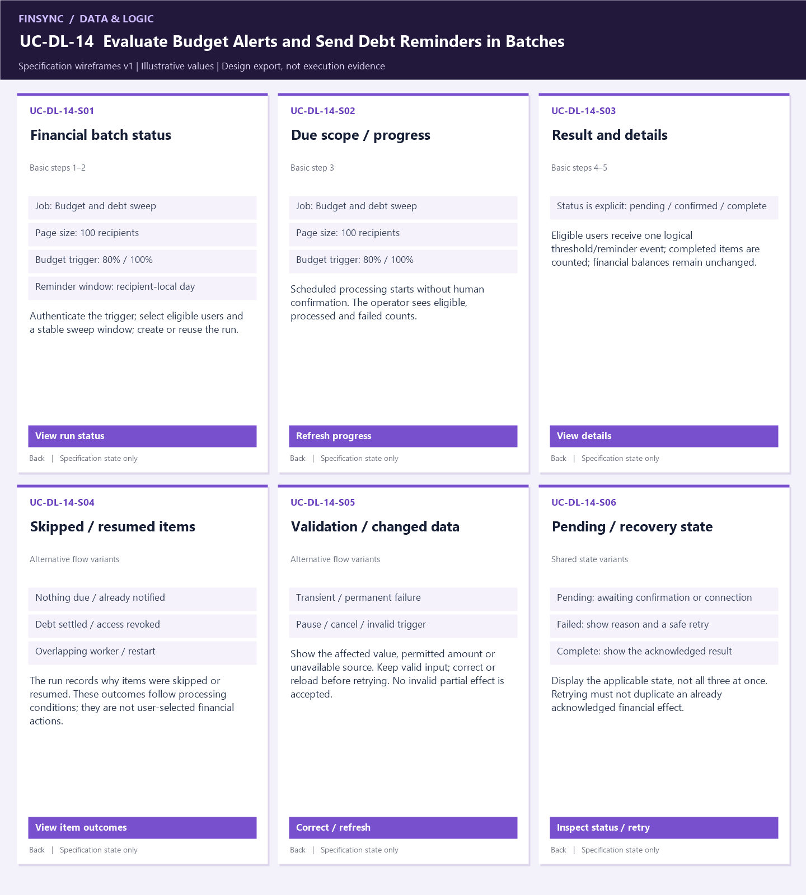

*Figure D.9 — UC-DL-14-S01–S06. Labeled design variants illustrate the specified flows; they are not proof of executed backend behavior.*

## D.10. Coverage and Team Handoff
> *Performed by: `Nguyen Le Duc Nhat` | Reviewed by: Pending team review | Edited by: Pending confirmation*

| Leader requirement | Covered by |
|---|---|
| Core financial processing | UC-DL-02, 05–08: validation, exact allocation, confirmation, corrections and consistent results. |
| Automatic report aggregation | UC-DL-13: user-requested or monthly reports, same snapshot for view/export, explicit failures and revisions. |
| Data synchronization | UC-DL-12: pending changes, conflict resolution, replay, interruption and receipt retry. |
| Batch jobs | UC-DL-14 and scheduled UC-DL-13: eligible work, progress, duplicate suppression, restart, partial failure and stop. |

**Scope transfer:** UC-DL-01 wallet setup → UC-CLI-02; UC-DL-03 transfers → UC-CLI-03; UC-DL-04 membership → UC-CLI-10. UC-DL-09 budget viewing → UC-CLI-08, while budget creation and UC-DL-10 savings management still require team assignment/specification. UC-DL-11 report viewing/export is consolidated into UC-DL-13. Keep the PA2 currency/confirmation requirements when reconciling those contributions. This is not the full team Part D.

**Before submission:** Merge these eight IDs into the actual Part C catalogue; reconcile baseline differences using [Backend Notes](use-cases/D_backend_notes.md); obtain peer review and export the final Markdown/figures to PDF. AI-assisted drafting and wireframe creation should be declared in the team AI Usage Report.


### D.2. UC-[TODO] — [TODO: Use-Case Name]
> *Performed by: [TODO: Name] | Reviewed by: [TODO: Name] | Edited by: [TODO: Name]*

> **Template block:** Duplicate D.2 and its subsections for each use case, update section numbers and IDs, then remove this instruction.

#### D.2.1. Overview and Preconditions
> *Performed by: [TODO: Name] | Reviewed by: [TODO: Name] | Edited by: [TODO: Name]*

| Field | Specification |
|-------|---------------|
| Use-case ID and name | [TODO] |
| Primary actor | [TODO] |
| Supporting actor(s) | [TODO: List or explain none] |
| Description / goal | [TODO] |
| Trigger | [TODO] |
| Related functional requirements | [TODO: B.6 IDs] |
| Related business rules / NFRs | [TODO: B.5 and B.7 IDs] |
| Relationships | [TODO: Include, extend, generalization, or none; match C.3] |
| Preconditions | [TODO: Numbered conditions, permissions, connectivity, and required data] |

#### D.2.2. Basic Flow — Main Success Scenario
> *Performed by: [TODO: Name] | Reviewed by: [TODO: Name] | Edited by: [TODO: Name]*

| Step | Actor action | System response / state change | Prototype screen ID |
|------|--------------|--------------------------------|---------------------|
| 1 | [TODO: Initiate the goal] | [TODO: Display initial state] | [TODO] |
| 2 | [TODO: Provide input / choose action] | [TODO: Validate and respond] | [TODO] |
| 3 | [TODO: Confirm] | [TODO: Persist, show result, and satisfy success postconditions] | [TODO] |

[TODO: Add all steps required by this specific use case. Identify invoked use cases by ID.]

#### D.2.3. Alternative and Exception Flows
> *Performed by: [TODO: Name] | Reviewed by: [TODO: Name] | Edited by: [TODO: Name]*

List **all applicable** alternative flows, not only common ones. For each branch, specify the trigger, branching step, ordered actor/system actions, recovery or termination, and resulting state.

| Flow ID / name | Branch point / condition | Ordered actions and system responses | Resume step / termination | Resulting state | Screen IDs |
|----------------|--------------------------|--------------------------------------|---------------------------|-----------------|------------|
| AF-01 / [TODO] | [TODO: Basic-flow step and condition] | 1. [TODO]<br>2. [TODO] | [TODO] | [TODO] | [TODO] |
| AF-02 / [TODO] | [TODO] | 1. [TODO]<br>2. [TODO] | [TODO] | [TODO] | [TODO] |

**Completeness review:** Consider input validation, cancellation/back navigation, empty data, duplicate/repeated actions, permission/session changes, offline/network failures, stale data/concurrent edits, and persistence/service failures. For relevant FinSync use cases, also consider invalid split totals/rounding, unavailable exchange rates, partial/rejected settlement, refunds after settlement, and AI timeout/invalid output. Document each applicable branch; explain why other categories do not apply rather than forcing unrelated flows into the use case.

#### D.2.4. Postconditions and Special Requirements
> *Performed by: [TODO: Name] | Reviewed by: [TODO: Name] | Edited by: [TODO: Name]*

**Success postconditions:** [TODO: Persisted records, visible results, balances, and notifications.]  
**Failure / cancellation postconditions:** [TODO: Unchanged state, rollback, pending changes, and recoverability.]  
**Special requirements:** [TODO: Applicable NFR IDs, permissions, money precision, accessibility, audit history, or other constraints; state none with a reason if appropriate.]

#### D.2.5. UI Prototype Screenshots
> *Performed by: [TODO: Name] | Reviewed by: [TODO: Name] | Edited by: [TODO: Name]*

**Prototype link / version:** [TODO]  
**Coverage:** [TODO: List basic-flow steps and every alternative-flow ID represented.]

| Screen ID | Screen / state | Basic step or alternative flow | Purpose and expected behavior | Screenshot file |
|-----------|----------------|--------------------------------|-------------------------------|-----------------|
| [TODO] | [TODO] | [TODO] | [TODO] | [TODO] |

[TODO: Embed every screenshot below with a caption naming the screen, flow, inputs, actions, and expected result.]

<!-- Replace the example path and remove comment markers after adding the actual image.


*Figure D.1 — UC-ID, screen S01, basic step 1 / alternative AF-01: explain what the prototype shows.*
-->

---

## Part E — Implement One Functional Group Using Spec Kit
> *Performed by: [TODO: Name] | Reviewed by: [TODO: Name] | Edited by: [TODO: Name]*

**Weight:** 20 points. Implement one complete functional group end-to-end: frontend, backend/API or logic, and database persistence.

### E.1. Selected Group and Implementation Scope
> *Performed by: [TODO: Name] | Reviewed by: [TODO: Name] | Edited by: [TODO: Name]*

**Selected functional group:** [TODO]  
**Selection rationale:** [TODO: Value, dependencies, and achievable end-to-end scope.]  
**Related FR / UC IDs:** [TODO]  
**Source revision / branch / tag:** [TODO]  
**Acceptance criteria:** [TODO: Observable behavior that demonstrates the entire selected group.]

| Requirement / use case | Frontend screen | Backend endpoint / logic | Database entity / migration | Actual status / evidence |
|------------------------|-----------------|--------------------------|-----------------------------|--------------------------|
| [TODO] | [TODO] | [TODO] | [TODO] | [TODO] |

**Dependencies and limitations:** [TODO: Prerequisite features, unfinished work, and any mock services. The selected group's required persistence and business behavior must work end-to-end.]

### E.2. Spec Kit Workflow and Artifacts
> *Performed by: [TODO: Name] | Reviewed by: [TODO: Name] | Edited by: [TODO: Name]*

[TODO: Describe the actual workflow and commands used, decisions made by the team, and how the artifacts guided implementation. Link submitted files, not only screenshots of commands.]

| Stage | Actual command / activity and date | Inputs / decisions | Generated artifact path | Human review / implementation evidence |
|-------|------------------------------------|--------------------|-------------------------|----------------------------------------|
| Constitution / project context | [TODO: Existing PA2 baseline and any updates] | [TODO] | [TODO] | [TODO] |
| Specification | [TODO] | [TODO: FR/UC IDs and acceptance criteria] | [TODO: spec file] | [TODO] |
| Clarification, if used | [TODO] | [TODO] | [TODO] | [TODO] |
| Technical plan | [TODO] | [TODO] | [TODO: plan file] | [TODO] |
| Task breakdown | [TODO] | [TODO] | [TODO: tasks file] | [TODO] |
| Implementation | [TODO] | [TODO] | [TODO: Source paths / commits] | [TODO] |
| Analysis / test generation, if used | [TODO] | [TODO] | [TODO] | [TODO] |

PA3 permits completing all Spec Kit steps, including test generation, but does **not** require reviewing or refining generated test cases at this stage. Report what was actually generated, executed, and reviewed separately.

### E.3. Full-Stack Design and Reproduction Steps
> *Performed by: [TODO: Name] | Reviewed by: [TODO: Name] | Edited by: [TODO: Name]*

**Actual stack and versions:** [TODO: Confirm frontend, backend, database, and required runtime versions. PA2 used Kotlin/Jetpack Compose, Spring Boot/Java 21, and PostgreSQL, with React admin and FastAPI where relevant.]

**Data flow:** [TODO: Add a Mermaid diagram tracing the selected group's UI action through API/business logic to persistent data and back.]

| Step | Exact command / action | Working directory | Required configuration | Expected result |
|------|------------------------|-------------------|------------------------|-----------------|
| 1. Prerequisites / setup | [TODO] | [TODO] | [TODO: Variable names, no secret values] | [TODO] |
| 2. Database / migrations | [TODO] | [TODO] | [TODO] | [TODO] |
| 3. Backend startup | [TODO] | [TODO] | [TODO] | [TODO] |
| 4. Frontend startup | [TODO] | [TODO] | [TODO] | [TODO] |
| 5. Demo data / feature walkthrough | [TODO] | [TODO] | [TODO: Synthetic accounts/data] | [TODO] |

#### E.3.1. Android Frontend Reproduction Guide
> *Performed by: Nguyễn Phú Đạt (24120038) | Reviewed by: Pending team review | Edited by: Pending confirmation*

The [Android Frontend Technical Guide](frontend/frontend-guide.md) records the
current source structure, dependency versions, Windows build/install steps,
automatic Pixel 7 AVD startup, local feature coverage and known limitations.
The client uses fictional in-memory data and is not connected to backend APIs,
PostgreSQL or real authentication. This frontend contribution does not establish
completion of Part E end-to-end integration or select the functional group for
the team. Existing full-stack setup and integration fields below remain pending.

### E.4. Integration Results and Known Issues
> *Performed by: [TODO: Name] | Reviewed by: [TODO: Name] | Edited by: [TODO: Name]*

**Environment / date / source revision:** [TODO]

| Scenario / UC flow | Actions and expected result | Observed result | Status | Evidence |
|--------------------|-----------------------------|-----------------|--------|----------|
| Main end-to-end flow | [TODO: UI action → API/logic → database → visible result] | [TODO] | [TODO] | [TODO] |
| Persistence | [TODO: Reopen/reload or restart and verify saved data] | [TODO] | [TODO] | [TODO] |
| Relevant alternative / error flow | [TODO] | [TODO] | [TODO] | [TODO] |

**Known issues / follow-up tasks:** [TODO: Impact, owner, Jira key, and next action; do not claim unperformed checks passed.]

### E.5. Narrated Video Demo and Source Submission
> *Performed by: [TODO: Name] | Reviewed by: [TODO: Name] | Edited by: [TODO: Name]*

**YouTube URL:** [TODO: Unlisted or Public video with narration]  
**Visibility / access checked on:** [TODO]  
**Duration / language / narrator(s):** [TODO]  
**Demonstrated source revision:** [TODO]

| Timestamp | Demonstration segment | Requirement / use case |
|-----------|-----------------------|------------------------|
| [TODO] | Selected group, context, and scope | [TODO] |
| [TODO] | Working basic flow across UI, backend, and persistence | [TODO] |
| [TODO] | Relevant alternative flow and explanation of results | [TODO] |
| [TODO] | Spec Kit artifacts and implementation summary | [TODO] |

**Source location in submission:** [TODO]  
**Spec Kit artifact location:** [TODO: Include specs, plans, and tasks.]  
**Run instructions location:** [TODO]

Exclude dependency folders, virtual environments, build artifacts, and generated caches from the submission copy, including `node_modules`, `venv`, `.venv`, `target`, `build`, `dist`, and `__pycache__` where applicable. Keep source, manifests, lockfiles, migrations, required assets, and Spec Kit artifacts. Provide example configuration without real credentials.

---

## Part F — AI Usage Report and Weekly Report
> *Performed by: [TODO: Name] | Reviewed by: [TODO: Name] | Edited by: [TODO: Name]*

**Weight:** 5 points.

### F.1. AI Usage Declaration and Summary
> *Performed by: [TODO: Name] | Reviewed by: [TODO: Name] | Edited by: [TODO: Name]*

**Declaration:** [TODO: Declare AI use for PA3 and identify the actual tools, purposes, and affected artifacts. This report template was prepared with AI assistance; include that use in the final disclosure.]  
**Reporting period / cutoff:** [TODO]  
**Applicable course AI guidelines:** [TODO: Reference the supplied guidelines and check any additional required fields.]

| Member | AI used? | Tool / model as recorded | Purposes / affected artifacts | Log entries / location |
|--------|----------|--------------------------|------------------------------|------------------------|
| Phạm Định Tiểu Long | [TODO] | [TODO] | [TODO] | Appendix A.1 |
| Nguyễn Phú Đạt | [TODO] | [TODO] | [TODO] | Appendix A.2 |
| Nguyễn Lê Đức Nhật | [TODO] | [TODO] | [TODO] | Appendix A.3 |
| Vương Đắc Gia Khiêm | [TODO] | [TODO] | [TODO] | Appendix A.4 |
| Ngô Thái Hòa | [TODO] | [TODO] | [TODO] | Appendix A.5 |

**AI contribution versus student work:** [TODO: Explain generated content/code/prototypes, human decisions and edits, rejected suggestions, and completed validation. Record all uses, including Spec Kit and AI-assisted design.]

### F.2. Sprint Overview and Meeting Schedule
> *Performed by: [TODO: Name] | Reviewed by: [TODO: Name] | Edited by: [TODO: Name]*

**Sprint:** Sprint 3 / PA3.  
**Confirmed period:** [TODO]  
**Sprint goal:** [TODO]  
**Meeting platform / location:** [TODO]  
**Time zone:** UTC+07:00 (Vietnam), unless explicitly stated otherwise.

| Meeting | Planned date / time | Actual date / time | Facilitator / note taker | Jira task |
|---------|---------------------|--------------------|--------------------------|-----------|
| Sprint Planning | [TODO: Before sprint implementation starts] | [TODO] | [TODO] | [TODO] |
| Weekly Scrum #1 | [TODO] | [TODO] | [TODO] | [TODO] |
| Weekly Scrum #2 | [TODO] | [TODO] | [TODO] | [TODO] |
| Sprint Review & Retrospective | [TODO: End of sprint] | [TODO] | [TODO] | [TODO] |

Keep both Scrum records in this report, following WeeklyReport.md. Record actual attendance and outcomes after each meeting.

### F.3. Sprint Planning Meeting
> *Performed by: [TODO: Name] | Reviewed by: [TODO: Name] | Edited by: [TODO: Name]*

**Date / time:** [TODO]  
**Facilitator / note taker:** [TODO]  
**Members present:** [TODO]  
**Members absent / written updates:** [TODO]

**Agenda:** [TODO: PA2 feedback, priorities, use-case/prototype coverage, selected implementation group, capacity, dependencies, and acceptance criteria.]

| Priority | Task / user story / use-case scope | Assignee | Reviewer | Due date | Expected output / acceptance criteria |
|----------|-----------------------------------|----------|----------|----------|---------------------------------------|
| [TODO] | [TODO] | [TODO] | [TODO] | [TODO] | [TODO] |

**Decisions and actions:** [TODO: Link actions to F.7 and tasks to A.4.]  
**Meeting summary:** [TODO]

### F.4. Weekly Scrum Meeting #1
> *Performed by: [TODO: Name] | Reviewed by: [TODO: Name] | Edited by: [TODO: Name]*

**Date / time:** [TODO]  
**Facilitator / note taker:** [TODO]  
**Members present:** [TODO]  
**Members absent / written updates:** [TODO]

| Member | What have I done since last week? | What will I do until next week? | Issues / problems / obstacles |
|--------|-----------------------------------|--------------------------------|-------------------------------|
| Phạm Định Tiểu Long | [TODO: Tasks/evidence] | [TODO: Tasks/dates] | [TODO] |
| Nguyễn Phú Đạt | [TODO] | [TODO] | [TODO] |
| Nguyễn Lê Đức Nhật | [TODO] | [TODO] | [TODO] |
| Vương Đắc Gia Khiêm | [TODO] | [TODO] | [TODO] |
| Ngô Thái Hòa | [TODO] | [TODO] | [TODO] |

**Actions / decisions:** [TODO: Owner, due date, and F.7 action ID.]  
**Meeting summary:** [TODO]

### F.5. Weekly Scrum Meeting #2
> *Performed by: [TODO: Name] | Reviewed by: [TODO: Name] | Edited by: [TODO: Name]*

**Date / time:** [TODO]  
**Facilitator / note taker:** [TODO]  
**Members present:** [TODO]  
**Members absent / written updates:** [TODO]

| Member | What have I done since last week? | What will I do until next week? | Issues / problems / obstacles |
|--------|-----------------------------------|--------------------------------|-------------------------------|
| Phạm Định Tiểu Long | [TODO: Tasks/evidence] | [TODO: Tasks/dates] | [TODO] |
| Nguyễn Phú Đạt | [TODO] | [TODO] | [TODO] |
| Nguyễn Lê Đức Nhật | [TODO] | [TODO] | [TODO] |
| Vương Đắc Gia Khiêm | [TODO] | [TODO] | [TODO] |
| Ngô Thái Hòa | [TODO] | [TODO] | [TODO] |

**Actions / decisions:** [TODO: Owner, due date, and F.7 action ID.]  
**Meeting summary:** [TODO]

### F.6. Sprint Review and Retrospective
> *Performed by: [TODO: Name] | Reviewed by: [TODO: Name] | Edited by: [TODO: Name]*

**Date / time:** [TODO]  
**Facilitator / note taker:** [TODO]  
**Members present:** [TODO]  
**Members absent:** [TODO]  
**Review goal and agenda:** [TODO]

| Deliverable | Owner / presenter | Evidence / revision | Outcome and remaining work |
|-------------|-------------------|---------------------|----------------------------|
| Revised plan, vision, and Changes.md | [TODO] | [TODO] | [TODO] |
| Use-case model, specifications, and all prototype screens | [TODO] | [TODO] | [TODO] |
| Implemented group, Spec Kit artifacts, and narrated demo | [TODO] | [TODO] | [TODO] |
| AI log, sprint records, Jira/Git evidence, and submission package | [TODO] | [TODO] | [TODO] |

| Retrospective question | Discussion / conclusion |
|------------------------|-------------------------|
| What went well? | [TODO] |
| What went wrong? | [TODO] |
| What problems occurred and what caused them? | [TODO] |
| What can be done differently next sprint to improve? | [TODO] |
| What lessons were learned? | [TODO] |

**Review decision and carryover:** [TODO: Accepted/rejected/pending items with evidence and follow-up tasks.]  
**Meeting summary:** [TODO]

### F.7. Meeting Action Register
> *Performed by: [TODO: Name] | Reviewed by: [TODO: Name] | Edited by: [TODO: Name]*

| Action ID / source meeting | Action / expected result | Owner | Reviewer | Due date | Status / evidence |
|----------------------------|--------------------------|-------|----------|----------|-------------------|
| [TODO] | [TODO] | [TODO] | [TODO] | [TODO] | [TODO] |

[TODO: Track PA2 retrospective handoff actions as well: complete task acceptance/dependency fields, collect evidence per task, review API examples, and rehearse integration before Build 1.]

### F.8. Jira Task Assignment and Progress Evidence
> *Performed by: [TODO: Name] | Reviewed by: [TODO: Name] | Edited by: [TODO: Name]*

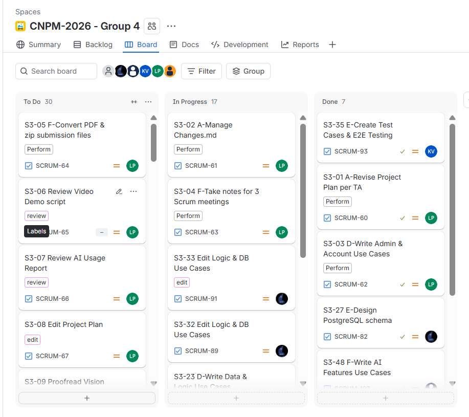

| Local task ID | Jira key | Task | Assignee | Created | Assigned | Completed | Status at capture | Evidence |
|---------------|----------|------|----------|---------|----------|-----------|-------------------|----------|
| [TODO] | [TODO] | [TODO] | [TODO] | [TODO] | [TODO] | [TODO: Actual date or pending] | [TODO] | [TODO] |

### F.9. Git History Evidence
> *Performed by: [TODO: Name] | Reviewed by: [TODO: Name] | Edited by: [TODO: Name]*

[TODO: Add the actual exported-log link or embed screenshots, and explain which commits demonstrate PA3 work.]
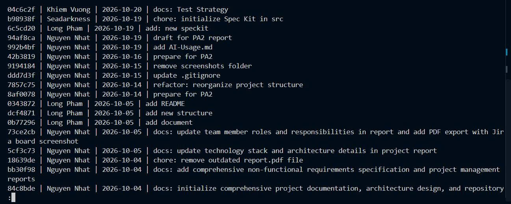

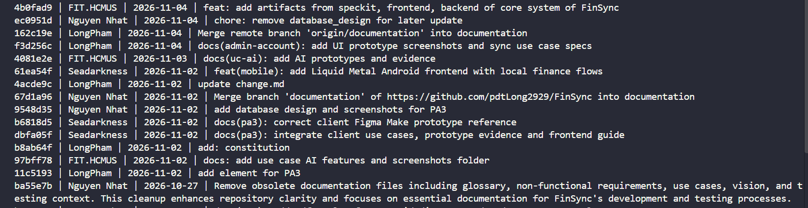

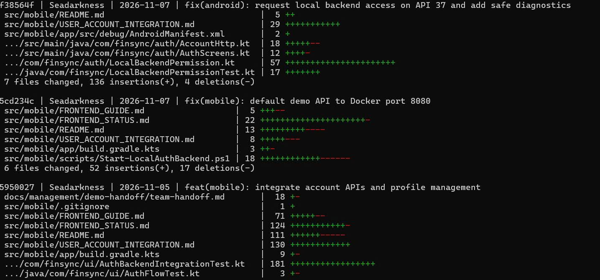

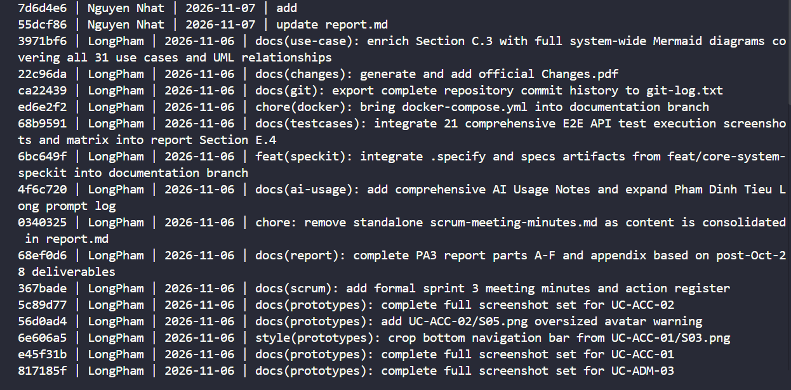


---

## Appendix A — Individual AI Usage Notes
> *Performed by: [TODO: Name] | Reviewed by: [TODO: Name] | Edited by: [TODO: Name]*

For each member, repeat the entry format below for **every** usage. Record actual model labels and dates; if a model is unavailable, state that it was not recorded. Do not copy PA2 usage histories into PA3. If a member used no AI, include an explicit declaration for the reporting period.

**Entry format:**

- **Entry ID / date / time / time zone:** [TODO]
- **Tool / provider / model:** [TODO]
- **Exact prompt or faithful English translation:** [TODO: Label translations.]
- **Purpose and affected section / task / artifact:** [TODO]
- **AI contribution:** [TODO: What was actually produced.]
- **Student contribution and edits:** [TODO]
- **Validation performed and outcome:** [TODO: Distinguish completed validation from pending review.]
- **Supporting history / output reference:** [TODO]

### Appendix A.1. Phạm Định Tiểu Long
> *Performed by: `Pham Dinh Tieu Long` | Reviewed by: `Nguyen Le Duc Nhat` | Edited by: `Pham Dinh Tieu Long`*


### Appendix A.2. Nguyễn Phú Đạt
> *Performed by: `Nguyen Phu Dat` | Reviewed by: `Ngo Thai Hoa` | Edited by: `Nguyen Phu Dat`*


### Appendix A.3. Nguyễn Lê Đức Nhật
> *Performed by: `Nguyen Le Duc Nhat` | Reviewed by: `Vuong Dac Gia Khiem` | Edited by: `Nguyen Le Duc Nhat`*


### Appendix A.4. Vương Đắc Gia Khiêm
> *Performed by: `Vuong Dac Gia Khiem` | Reviewed by: `Nguyen Phu Dat` | Edited by: `Vuong Dac Gia Khiem`*


### Appendix A.5. Ngô Thái Hòa
> *Performed by: `Ngo Thai Hoa` | Reviewed by: `Pham Dinh Tieu Long` | Edited by: `Ngo Thai Hoa`*


---

**Suggested submission layout — create and adjust when packaging:**

```text
PA3-Group04/
├── report.md
├── report.pdf
├── Changes.md
├── Changes.pdf
├── screenshots/
│   ├── prototypes/
│   ├── jira/
│   └── git/
├── use-cases/          # If specifications are split into separate Markdown/PDF files
├── spec-kit/           # Submitted specs, plans, tasks, and related artifacts

```
