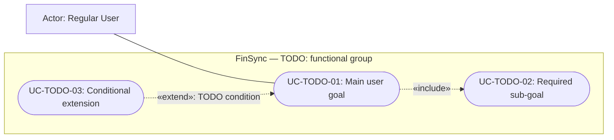

# PA3-2026 Report — FinSync (Group 04)

**Course:** CS300 - CSC13002 - Introduction to Software Engineering  
**Assignment:** Project Assignment 3 (PA3-2026) — Sprint 3  
**Group:** Group 04  
**Project:** FinSync — Personal Finance & Group Expense Manager with AI Advisor  
**Sprint 3 period:** `2026-10-26 to 2026-11-08` (PA2 planning target; confirm at Sprint Planning)  

## Table of Contents
> *Performed by: `Nguyen Le Duc Nhat` | Reviewed by: `Pham Dinh Tieu Long` | Edited by: `Nguyen Le Duc Nhat`

- [Team Members](#team-members)
- [Part A — Revised Project Plan](#part-a--revised-project-plan)
- [Part B — Detailed Vision Document](#part-b--detailed-vision-document)
- [Part C — Use-Case Model](#part-c--use-case-model)
- [Part D — Use-Case Specifications and UI Prototypes](#part-d--use-case-specifications-and-ui-prototypes)
- [Part E — Implement One Functional Group Using Spec Kit](#part-e--implement-one-functional-group-using-spec-kit)
- [Part F — AI Usage Report and Weekly Report](#part-f--ai-usage-report-and-weekly-report)
- [Appendix A — Individual AI Usage Notes](#appendix-a--individual-ai-usage-notes)
- [Appendix B — Submission Checklist](#appendix-b--submission-checklist)
- [References](#references)

---

## Team Members
> *Performed by: `Nguyen Le Duc Nhat` | Reviewed by: `Pham Dinh Tieu Long` | Edited by: `Nguyen Le Duc Nhat`


All members participate as Full-stack Engineers. The roles below retain the PA2 baseline; actual PA3 task ownership is recorded in Section A.4.

| # | Student ID | Full Name | Email | Main Role |
|---|------------|-----------|-------|-----------|
| 1 | 24120087 | Phạm Định Tiểu Long | phamlongkh2006@gmail.com | Project Manager / Group Leader |
| 2 | 24120038 | Nguyễn Phú Đạt | nguyennphuudatt@gmail.com | UI/UX Designer & Frontend Lead |
| 3 | 24120403 | Nguyễn Lê Đức Nhật | nldnhat182006@gmail.com | Backend Lead |
| 4 | 24120342 | Vương Đắc Gia Khiêm | vuongkhiemvl10@gmail.com | QA Lead & DevOps |
| 5 | 24120051 | Ngô Thái Hòa | ngothaihoa235@gmail.com | AI Feature Lead & Documentation |

---

## Part A — Revised Project Plan
> *Performed by: [TODO: Name] | Reviewed by: [TODO: Name] | Edited by: [TODO: Name]*

### A.1. Introduction and Revision Summary
> *Performed by: [TODO: Name] | Reviewed by: [TODO: Name] | Edited by: [TODO: Name]*

[TODO: State the purpose, revision date, PA2 baseline revision, and planning horizon. Complete the revised plan below, retaining valid PA2 content and updating affected sections. A list of changes alone is not the revised plan.]

| Feedback / change ID | TA feedback or new information | Affected PA2 section | PA3 response and location | Entry in shared Changes.md | Review status |
|----------------------|--------------------------------|----------------------|---------------------------|----------------------------|---------------|
| [TODO] | [TODO: Actual feedback, or state that feedback has not been received] | [TODO] | [TODO] | [TODO] | [TODO] |

### A.2. Project Overview
> *Performed by: [TODO: Name] | Reviewed by: [TODO: Name] | Edited by: [TODO: Name]*

**Goals:** [TODO: Update product goals and measurable project outcomes from PA2.]

**Scope:** [TODO: Describe the complete project scope, the PA3 implementation commitment, and deferred work separately. Retain or explicitly revise the PA2 offline and currency-conversion requirements.]

**Business boundary:** FinSync records finances, calculates debts, and issues reminders. It does not connect to real bank accounts or automatically transfer or deduct money. Personal data is private; group data is shared only with authorized group members.

| Deliverable | Scope / acceptance criteria | Planned milestone | Owner | Output location |
|-------------|-----------------------------|-------------------|-------|-----------------|
| Revised Project Plan and Vision | Complete revised documents and shared Changes.md | [TODO] | [TODO] | [TODO] |
| Use-case model and specifications | Every functional requirement mapped; every modeled use case specified | [TODO] | [TODO] | Parts C–D |
| UI prototypes | Screens for basic and all applicable alternative flows of every use case | [TODO] | [TODO] | [TODO] |
| Implemented functional group | Working frontend, backend/API, and database persistence using Spec Kit | [TODO] | [TODO] | Part E; [TODO: source/artifact paths] |
| Sprint records and submission | AI log, four meetings, Jira/Git evidence, narrated demo, Markdown/PDF package | [TODO] | [TODO] | Part F; appendices |

**Assumptions and dependencies:** [TODO: Availability, environment readiness, external services, API contracts, course dates, and unresolved decisions.]

### A.3. Project Organization and Risk Management
> *Performed by: [TODO: Name] | Reviewed by: [TODO: Name] | Edited by: [TODO: Name]*

**Team structure and responsibilities:** [TODO: Confirm the team table, coordination process, lead duties, and any changes from PA2.]

**Working rules:** Each Jira task has exactly one assignee and a different reviewer. Create tasks before work starts, record creation/assignment/completion dates, and retain output and review evidence. Keep the repository private and configuration secrets outside source control. Use Conventional Commits and the agreed peer-review process.

| Risk ID | Risk / change since PA2 | Probability | Impact | Mitigation / contingency | Owner | Current status |
|---------|------------------------|-------------|--------|---------------------------|-------|----------------|
| [TODO: Retain PA2 IDs where applicable] | [TODO] | [TODO] | [TODO] | [TODO] | [TODO] | [TODO] |

### A.4. Process, Schedule, and Sprint 3 Tasks
> *Performed by: [TODO: Name] | Reviewed by: [TODO: Name] | Edited by: [TODO: Name]*

**Process:** Scrum; one sprint per PA, lasting 2–3 weeks. Hold one Sprint Planning, two Weekly Scrum meetings, and one Sprint Review/Retrospective. Record the actual meetings in Part F.

**Schedule baseline:** PA2 planned Sprint 3 for 26 October–8 November 2026, Sprint 4 for 9–22 November, and Sprint 5 for 23 November–6 December. These are team targets, not confirmed course deadlines.

| Sprint | Previous target | Updated dates | Scope / milestone | Reason for change |
|--------|-----------------|---------------|-------------------|-------------------|
| Sprint 3 / PA3 | 2026-10-26 to 2026-11-08 | [TODO] | [TODO] | [TODO] |
| Sprint 4 / PA4 | 2026-11-09 to 2026-11-22 | [TODO] | [TODO] | [TODO] |
| Sprint 5 / PA5 | 2026-11-23 to 2026-12-06 | [TODO] | [TODO] | [TODO] |

PA2 proposed multiple feature groups for Build 1. PA3 requires at least one complete functional group. [TODO: Confirm the team's actual commitment, explain any rescheduling of the broader PA2 plan, and record changes in Changes.md.]

| Task ID / Jira key | Work package and acceptance criteria | Assignee | Reviewer | Dependencies | Planned start | Due date | Effort (h) |
|--------------------|--------------------------------------|----------|----------|--------------|---------------|----------|------------|
| S3-01 / [TODO] | [TODO] | [TODO] | [TODO] | [TODO] | [TODO] | [TODO] | [TODO] |

Include document revisions, diagrams, every use-case specification and prototype, Spec Kit work, implementation, integration, meetings, AI disclosure, review, and submission preparation.

| Member | Available hours | Owned tasks | Review / meetings | Buffer | Planned total |
|--------|-----------------|-------------|-------------------|--------|---------------|
| Phạm Định Tiểu Long | [TODO] | [TODO] | [TODO] | [TODO] | [TODO] |
| Nguyễn Phú Đạt | [TODO] | [TODO] | [TODO] | [TODO] | [TODO] |
| Nguyễn Lê Đức Nhật | [TODO] | [TODO] | [TODO] | [TODO] | [TODO] |
| Vương Đắc Gia Khiêm | [TODO] | [TODO] | [TODO] | [TODO] | [TODO] |
| Ngô Thái Hòa | [TODO] | [TODO] | [TODO] | [TODO] | [TODO] |

### A.5. Build Plan and Later Sprints
> *Performed by: [TODO: Name] | Reviewed by: [TODO: Name] | Edited by: [TODO: Name]*

[TODO: Update the PA2 build sequence, retain completed-build references, and reschedule remaining features explicitly. Distinguish planned acceptance criteria from observed results.]

| Build | Previous target | Updated target | Planned content | Acceptance criteria | Revision / result evidence |
|-------|-----------------|----------------|-----------------|---------------------|----------------------------|
| Build 1 | 2026-11-08 | [TODO] | [TODO] | [TODO] | [TODO] |
| Build 2 | 2026-11-22 | [TODO] | [TODO] | [TODO] | [TODO] |
| Build 3 — release candidate | 2026-11-29 | [TODO] | [TODO] | [TODO] | [TODO] |
| Final build | 2026-12-04 | [TODO] | [TODO] | [TODO] | [TODO] |

**Later-sprint tasks and dependencies:** [TODO: Remaining functional groups, integration, testing, deployment, and final demo preparation.]

---

## Part B — Detailed Vision Document
> *Performed by: [TODO: Name] | Reviewed by: [TODO: Name] | Edited by: [TODO: Name]*

### B.1. Introduction and Revision Summary
> *Performed by: [TODO: Name] | Reviewed by: [TODO: Name] | Edited by: [TODO: Name]*

**Purpose and audience:** [TODO: State the updated vision's purpose and intended readers.]

**Baseline and references:** PA2 Part B, PA1 proposal and app survey, GEMINI.md, and actual TA feedback. See References below.

| Feedback / change ID | TA feedback or clarification | Affected requirement / section | Revision and rationale | Entry in shared Changes.md |
|----------------------|------------------------------|--------------------------------|------------------------|----------------------------|
| [TODO] | [TODO] | [TODO] | [TODO] | [TODO] |

### B.2. Positioning
> *Performed by: [TODO: Name] | Reviewed by: [TODO: Name] | Edited by: [TODO: Name]*

| Problem statement element | Revised description |
|---------------------------|---------------------|
| The problem of | [TODO] |
| Affects | [TODO] |
| The impact of which is | [TODO] |
| A successful solution would be | [TODO] |

| Product position element | Revised description |
|--------------------------|---------------------|
| For / Who | [TODO: Target users and unmet needs] |
| The product / That | FinSync — [TODO: Product category and main value] |
| Unlike | [TODO: Alternatives from the PA1 survey] |
| Our product | [TODO: Differentiation supported by planned requirements] |

### B.3. Stakeholders, Users, and Environments
> *Performed by: [TODO: Name] | Reviewed by: [TODO: Name] | Edited by: [TODO: Name]*

| Stakeholder / user | Needs and responsibilities | Environment / constraints | Priority |
|--------------------|----------------------------|---------------------------|----------|
| Regular User | [TODO] | Android mobile app; [TODO: Usage context] | [TODO] |
| Group Owner / Member | [TODO: Group permissions and needs] | [TODO: Shared operations and connectivity] | [TODO] |
| Administrator | [TODO] | Desktop web admin panel; [TODO: Browser constraints] | [TODO] |
| Development team / course staff | [TODO] | [TODO] | [TODO] |

**User environment:** [TODO: Detail devices, platforms, network conditions, offline behavior, languages, currencies, accessibility, and expected usage. Reconcile with PA2 rather than silently dropping its requirements.]

### B.4. Alternatives and Competition
> *Performed by: [TODO: Name] | Reviewed by: [TODO: Name] | Edited by: [TODO: Name]*

[TODO: Retain and reference the PA1 Money Lover / Splitwise survey, as PA2 did. Identify any new findings with their source and observation date. Distinguish observed competitor behavior from planned FinSync capabilities.]

| Need / capability | Money Lover — surveyed behavior | Splitwise — surveyed behavior | FinSync — planned response | Evidence / source |
|-------------------|----------------------------------|--------------------------------|---------------------------|-------------------|
| [TODO] | [TODO] | [TODO] | [TODO] | [TODO] |

### B.5. Product Overview, Business Rules, and Dependencies
> *Performed by: [TODO: Name] | Reviewed by: [TODO: Name] | Edited by: [TODO: Name]*

**Product perspective:** [TODO: Update the PA2 overview and Mermaid architecture/workflows where needed. Record confirmed technologies and external dependencies.]

**PA2 rules to preserve or explicitly revise:** private personal records versus authorized group records; bookkeeping-only payments; recipient-confirmed settlement; shared-fund contribution confirmation; counting only the user's own group share once; exact splitting and refunds; immutable historical exchange-rate snapshots; offline personal changes with duplicate prevention and conflict resolution; online shared writes; and AI advice that does not automatically change financial records.

| Rule ID | Business rule / constraint | Related requirements | Rationale / PA2 reference | Change status |
|---------|----------------------------|----------------------|--------------------------|---------------|
| [TODO] | [TODO: Precise rule, including permissions and financial effects] | [TODO] | [TODO] | [TODO: Retained / revised / new] |

**Assumptions and dependencies:** [TODO: Platform, authentication, data availability, exchange-rate maintenance, AI service, deployment, and unresolved decisions.]

### B.6. Detailed Functional Requirements
> *Performed by: [TODO: Name] | Reviewed by: [TODO: Name] | Edited by: [TODO: Name]*

Expand each baseline group into individual, testable requirements. Preserve existing IDs if available; otherwise assign stable IDs such as `FR-AUTH-01`. A functional group can contain several use cases. Parts C and D must cover the **whole vision**, including groups not implemented in PA3.

| Functional group from PA2 | Coverage to detail | Requirement IDs |
|--------------------------|--------------------|-----------------|
| Authentication & Security | Registration, login/logout, password recovery, session and access rules | [TODO] |
| Profile Management | Profile/avatar, password, language, reporting-currency preferences | [TODO] |
| Wallet & Personal Account Management | Manual wallets, opening balances, currencies, consolidated/cached balances | [TODO] |
| Personal Transaction Tracking | Income/expense, edits/deletion, receipts, offline queue, synchronization/conflicts | [TODO] |
| Group Management & Shared Wallets | Groups, invitations, roles, contributions/confirmation, shared-fund visibility | [TODO] |
| Smart Debt Split & Settlement | Equal/percentage/exact splits, debt summary/simplification, reminders, claims/confirmation, refunds | [TODO] |
| Budget Planning & Alerting | Weekly/monthly limits, own group shares, 80%/100% alerts, offline status | [TODO] |
| Financial Reporting & Analytics | Personal/group reports, charts, currency basis, PDF/Excel export | [TODO] |
| Savings Goal Management | Goals, contributions/withdrawals, progress, currency rules | [TODO] |
| System Administration | User lock/unlock, default categories, reference rates, aggregate statistics | [TODO] |
| AI Financial Advisor | Requested/monthly analysis, advice/history, limited data, provider failure | [TODO] |

**Requirement entry — duplicate for every functional requirement:**

| Field | Content |
|-------|---------|
| Requirement ID / name | [TODO] |
| Description | [TODO: The system shall ...] |
| Actor / trigger | [TODO] |
| Inputs, validation, and business rules | [TODO] |
| Expected outputs / financial effects | [TODO] |
| Priority and planned sprint | [TODO] |
| Acceptance criteria | [TODO: Observable success and rejection behavior] |
| Related use-case IDs | [TODO] |

### B.7. Detailed Non-Functional Requirements
> *Performed by: [TODO: Name] | Reviewed by: [TODO: Name] | Edited by: [TODO: Name]*

[TODO: Carry forward or explicitly revise PA2 NFRs, retaining their IDs. Cover performance, security, reliability/offline operation/financial correctness, usability/accessibility, compatibility, and maintainability. Preserve test conditions and measurable thresholds; requirements are not measured results.]

| NFR ID | Category | Requirement and measurable target | Conditions / environment | Verification method | Related use cases | Change from PA2 |
|--------|----------|------------------------------------|--------------------------|---------------------|-------------------|-----------------|
| [TODO] | [TODO] | [TODO] | [TODO] | [TODO] | [TODO] | [TODO] |

---

## Part C — Use-Case Model
> *Performed by: [TODO: Name] | Reviewed by: [TODO: Name] | Edited by: [TODO: Name]*

### C.1. System Boundary and Actors
> *Performed by: [TODO: Name] | Reviewed by: [TODO: Name] | Edited by: [TODO: Name]*

**System boundary:** FinSync, including its mobile app, backend, database, admin panel, and internal AI service. External payments occur outside this boundary.

| Actor | Role / goals | Scope and permissions |
|-------|--------------|-----------------------|
| Regular User | Personal finance and participation in groups | Own personal data and authorized group data |
| Group Owner | Regular User acting as group owner | Group membership/settings and authorized fund operations |
| Group Member | Regular User participating in a group | Group actions permitted by the revised business rules |
| Administrator | System administration | Administrative functions; no routine private-history access |
| [TODO: External supporting actor, if applicable] | [TODO] | [TODO: Define actual external interaction] |

### C.2. Use-Case Catalog and Requirement Traceability
> *Performed by: [TODO: Name] | Reviewed by: [TODO: Name] | Edited by: [TODO: Name]*

Use one row per use case, with stable IDs such as `UC-AUTH-01`. Include supporting use cases introduced by `include` or `extend` relationships. Order the catalog and specifications consistently by workflow or importance.

| Use-case ID | Use-case name / user goal | Actor(s) | Functional requirement IDs | Diagram | Specification location | Prototype screen IDs |
|-------------|--------------------------|----------|----------------------------|---------|------------------------|----------------------|
| [TODO] | [TODO] | [TODO] | [TODO] | [TODO] | [TODO] | [TODO] |

**Coverage review:** [TODO: Confirm that every functional requirement in B.6 maps to at least one use case and every diagram use case maps to a specification and prototype evidence. Explain any gaps before submission.]

### C.3. Mermaid Use-Case Diagrams
> *Performed by: [TODO: Name] | Reviewed by: [TODO: Name] | Edited by: [TODO: Name]*

Create readable diagrams by functional group or business area. Place actors outside the FinSync boundary and use cases inside it. The following is a **notation scaffold only**, not the FinSync model; replace its example nodes and duplicate as needed.



**Notation:** Solid undirected lines represent actor participation. `include` points from the base use case to required reused behavior; `extend` points from conditional behavior to the base use case and identifies the extension condition. Where generalization applies, draw a directed connection from specialized actor/use case to general actor/use case, label it `generalization`, and explain the inheritance. Add relationships only when supported by the actual model.

| Diagram ID | Functional groups covered | Mermaid block / document location | Relationship rationale |
|------------|---------------------------|------------------------------------|------------------------|
| [TODO] | [TODO] | [TODO] | [TODO: Include/extend/generalization where applicable] |

---

## Part D — Use-Case Specifications and UI Prototypes
> *Performed by: [TODO: Name] | Reviewed by: [TODO: Name] | Edited by: [TODO: Name]*

**Weight:** 45 points. Complete one specification for **every** modeled use case, including reused or extending use cases. Keep them here or in linked Markdown files submitted with the report. Screenshots of all prototype screens must appear alongside the corresponding specification; a design-tool link alone is insufficient.

### D.1. Specification and Prototype Conventions
> *Performed by: [TODO: Name] | Reviewed by: [TODO: Name] | Edited by: [TODO: Name]*

**Ordering:** [TODO: Workflow order or importance; match C.2.]

**Design tool(s):** [TODO: Figma, Google Stitch, v0, Bolt, Excalidraw, or actual tool used.]  
**Prototype project / access link:** [TODO]  
**Screen naming:** Use `UC-<group>-<number>-S<number>` or another documented consistent scheme.  
**Suggested screenshot location:** `screenshots/prototypes/<use-case-id>/` relative to this report.

Each basic-flow and alternative-flow screen/state must be identifiable. Shared screens may be reused, but embed and explain the relevant screenshots with each specification. Refine any specification whose prototype cannot express its stated behavior coherently.

### D.2. UC-[TODO] — [TODO: Use-Case Name]
> *Performed by: [TODO: Name] | Reviewed by: [TODO: Name] | Edited by: [TODO: Name]*

> **Template block:** Duplicate D.2 and its subsections for each use case, update section numbers and IDs, then remove this instruction.

#### D.2.1. Overview and Preconditions
> *Performed by: [TODO: Name] | Reviewed by: [TODO: Name] | Edited by: [TODO: Name]*

| Field | Specification |
|-------|---------------|
| Use-case ID and name | [TODO] |
| Primary actor | [TODO] |
| Supporting actor(s) | [TODO: List or explain none] |
| Description / goal | [TODO] |
| Trigger | [TODO] |
| Related functional requirements | [TODO: B.6 IDs] |
| Related business rules / NFRs | [TODO: B.5 and B.7 IDs] |
| Relationships | [TODO: Include, extend, generalization, or none; match C.3] |
| Preconditions | [TODO: Numbered conditions, permissions, connectivity, and required data] |

#### D.2.2. Basic Flow — Main Success Scenario
> *Performed by: [TODO: Name] | Reviewed by: [TODO: Name] | Edited by: [TODO: Name]*

| Step | Actor action | System response / state change | Prototype screen ID |
|------|--------------|--------------------------------|---------------------|
| 1 | [TODO: Initiate the goal] | [TODO: Display initial state] | [TODO] |
| 2 | [TODO: Provide input / choose action] | [TODO: Validate and respond] | [TODO] |
| 3 | [TODO: Confirm] | [TODO: Persist, show result, and satisfy success postconditions] | [TODO] |

[TODO: Add all steps required by this specific use case. Identify invoked use cases by ID.]

#### D.2.3. Alternative and Exception Flows
> *Performed by: [TODO: Name] | Reviewed by: [TODO: Name] | Edited by: [TODO: Name]*

List **all applicable** alternative flows, not only common ones. For each branch, specify the trigger, branching step, ordered actor/system actions, recovery or termination, and resulting state.

| Flow ID / name | Branch point / condition | Ordered actions and system responses | Resume step / termination | Resulting state | Screen IDs |
|----------------|--------------------------|--------------------------------------|---------------------------|-----------------|------------|
| AF-01 / [TODO] | [TODO: Basic-flow step and condition] | 1. [TODO]<br>2. [TODO] | [TODO] | [TODO] | [TODO] |
| AF-02 / [TODO] | [TODO] | 1. [TODO]<br>2. [TODO] | [TODO] | [TODO] | [TODO] |

**Completeness review:** Consider input validation, cancellation/back navigation, empty data, duplicate/repeated actions, permission/session changes, offline/network failures, stale data/concurrent edits, and persistence/service failures. For relevant FinSync use cases, also consider invalid split totals/rounding, unavailable exchange rates, partial/rejected settlement, refunds after settlement, and AI timeout/invalid output. Document each applicable branch; explain why other categories do not apply rather than forcing unrelated flows into the use case.

#### D.2.4. Postconditions and Special Requirements
> *Performed by: [TODO: Name] | Reviewed by: [TODO: Name] | Edited by: [TODO: Name]*

**Success postconditions:** [TODO: Persisted records, visible results, balances, and notifications.]  
**Failure / cancellation postconditions:** [TODO: Unchanged state, rollback, pending changes, and recoverability.]  
**Special requirements:** [TODO: Applicable NFR IDs, permissions, money precision, accessibility, audit history, or other constraints; state none with a reason if appropriate.]

#### D.2.5. UI Prototype Screenshots
> *Performed by: [TODO: Name] | Reviewed by: [TODO: Name] | Edited by: [TODO: Name]*

**Prototype link / version:** [TODO]  
**Coverage:** [TODO: List basic-flow steps and every alternative-flow ID represented.]

| Screen ID | Screen / state | Basic step or alternative flow | Purpose and expected behavior | Screenshot file |
|-----------|----------------|--------------------------------|-------------------------------|-----------------|
| [TODO] | [TODO] | [TODO] | [TODO] | [TODO] |

[TODO: Embed every screenshot below with a caption naming the screen, flow, inputs, actions, and expected result.]

<!-- Replace the example path and remove comment markers after adding the actual image.


*Figure D.1 — UC-ID, screen S01, basic step 1 / alternative AF-01: explain what the prototype shows.*
-->

---

## Part E — Implement One Functional Group Using Spec Kit
> *Performed by: [TODO: Name] | Reviewed by: [TODO: Name] | Edited by: [TODO: Name]*

**Weight:** 20 points. Implement one complete functional group end-to-end: frontend, backend/API or logic, and database persistence.

### E.1. Selected Group and Implementation Scope
> *Performed by: [TODO: Name] | Reviewed by: [TODO: Name] | Edited by: [TODO: Name]*

**Selected functional group:** [TODO]  
**Selection rationale:** [TODO: Value, dependencies, and achievable end-to-end scope.]  
**Related FR / UC IDs:** [TODO]  
**Source revision / branch / tag:** [TODO]  
**Acceptance criteria:** [TODO: Observable behavior that demonstrates the entire selected group.]

| Requirement / use case | Frontend screen | Backend endpoint / logic | Database entity / migration | Actual status / evidence |
|------------------------|-----------------|--------------------------|-----------------------------|--------------------------|
| [TODO] | [TODO] | [TODO] | [TODO] | [TODO] |

**Dependencies and limitations:** [TODO: Prerequisite features, unfinished work, and any mock services. The selected group's required persistence and business behavior must work end-to-end.]

### E.2. Spec Kit Workflow and Artifacts
> *Performed by: [TODO: Name] | Reviewed by: [TODO: Name] | Edited by: [TODO: Name]*

[TODO: Describe the actual workflow and commands used, decisions made by the team, and how the artifacts guided implementation. Link submitted files, not only screenshots of commands.]

| Stage | Actual command / activity and date | Inputs / decisions | Generated artifact path | Human review / implementation evidence |
|-------|------------------------------------|--------------------|-------------------------|----------------------------------------|
| Constitution / project context | [TODO: Existing PA2 baseline and any updates] | [TODO] | [TODO] | [TODO] |
| Specification | [TODO] | [TODO: FR/UC IDs and acceptance criteria] | [TODO: spec file] | [TODO] |
| Clarification, if used | [TODO] | [TODO] | [TODO] | [TODO] |
| Technical plan | [TODO] | [TODO] | [TODO: plan file] | [TODO] |
| Task breakdown | [TODO] | [TODO] | [TODO: tasks file] | [TODO] |
| Implementation | [TODO] | [TODO] | [TODO: Source paths / commits] | [TODO] |
| Analysis / test generation, if used | [TODO] | [TODO] | [TODO] | [TODO] |

PA3 permits completing all Spec Kit steps, including test generation, but does **not** require reviewing or refining generated test cases at this stage. Report what was actually generated, executed, and reviewed separately.

### E.3. Full-Stack Design and Reproduction Steps
> *Performed by: [TODO: Name] | Reviewed by: [TODO: Name] | Edited by: [TODO: Name]*

**Actual stack and versions:** [TODO: Confirm frontend, backend, database, and required runtime versions. PA2 used Kotlin/Jetpack Compose, Spring Boot/Java 21, and PostgreSQL, with React admin and FastAPI where relevant.]

**Data flow:** [TODO: Add a Mermaid diagram tracing the selected group's UI action through API/business logic to persistent data and back.]

| Step | Exact command / action | Working directory | Required configuration | Expected result |
|------|------------------------|-------------------|------------------------|-----------------|
| 1. Prerequisites / setup | [TODO] | [TODO] | [TODO: Variable names, no secret values] | [TODO] |
| 2. Database / migrations | [TODO] | [TODO] | [TODO] | [TODO] |
| 3. Backend startup | [TODO] | [TODO] | [TODO] | [TODO] |
| 4. Frontend startup | [TODO] | [TODO] | [TODO] | [TODO] |
| 5. Demo data / feature walkthrough | [TODO] | [TODO] | [TODO: Synthetic accounts/data] | [TODO] |

### E.4. Integration Results and Known Issues
> *Performed by: [TODO: Name] | Reviewed by: [TODO: Name] | Edited by: [TODO: Name]*

**Environment / date / source revision:** [TODO]

| Scenario / UC flow | Actions and expected result | Observed result | Status | Evidence |
|--------------------|-----------------------------|-----------------|--------|----------|
| Main end-to-end flow | [TODO: UI action → API/logic → database → visible result] | [TODO] | [TODO] | [TODO] |
| Persistence | [TODO: Reopen/reload or restart and verify saved data] | [TODO] | [TODO] | [TODO] |
| Relevant alternative / error flow | [TODO] | [TODO] | [TODO] | [TODO] |

**Known issues / follow-up tasks:** [TODO: Impact, owner, Jira key, and next action; do not claim unperformed checks passed.]

### E.5. Narrated Video Demo and Source Submission
> *Performed by: [TODO: Name] | Reviewed by: [TODO: Name] | Edited by: [TODO: Name]*

**YouTube URL:** [TODO: Unlisted or Public video with narration]  
**Visibility / access checked on:** [TODO]  
**Duration / language / narrator(s):** [TODO]  
**Demonstrated source revision:** [TODO]

| Timestamp | Demonstration segment | Requirement / use case |
|-----------|-----------------------|------------------------|
| [TODO] | Selected group, context, and scope | [TODO] |
| [TODO] | Working basic flow across UI, backend, and persistence | [TODO] |
| [TODO] | Relevant alternative flow and explanation of results | [TODO] |
| [TODO] | Spec Kit artifacts and implementation summary | [TODO] |

**Source location in submission:** [TODO]  
**Spec Kit artifact location:** [TODO: Include specs, plans, and tasks.]  
**Run instructions location:** [TODO]

Exclude dependency folders, virtual environments, build artifacts, and generated caches from the submission copy, including `node_modules`, `venv`, `.venv`, `target`, `build`, `dist`, and `__pycache__` where applicable. Keep source, manifests, lockfiles, migrations, required assets, and Spec Kit artifacts. Provide example configuration without real credentials.

---

## Part F — AI Usage Report and Weekly Report
> *Performed by: [TODO: Name] | Reviewed by: [TODO: Name] | Edited by: [TODO: Name]*

**Weight:** 5 points.

### F.1. AI Usage Declaration and Summary
> *Performed by: [TODO: Name] | Reviewed by: [TODO: Name] | Edited by: [TODO: Name]*

**Declaration:** [TODO: Declare AI use for PA3 and identify the actual tools, purposes, and affected artifacts. This report template was prepared with AI assistance; include that use in the final disclosure.]  
**Reporting period / cutoff:** [TODO]  
**Applicable course AI guidelines:** [TODO: Reference the supplied guidelines and check any additional required fields.]

| Member | AI used? | Tool / model as recorded | Purposes / affected artifacts | Log entries / location |
|--------|----------|--------------------------|------------------------------|------------------------|
| Phạm Định Tiểu Long | [TODO] | [TODO] | [TODO] | Appendix A.1 |
| Nguyễn Phú Đạt | [TODO] | [TODO] | [TODO] | Appendix A.2 |
| Nguyễn Lê Đức Nhật | [TODO] | [TODO] | [TODO] | Appendix A.3 |
| Vương Đắc Gia Khiêm | [TODO] | [TODO] | [TODO] | Appendix A.4 |
| Ngô Thái Hòa | [TODO] | [TODO] | [TODO] | Appendix A.5 |

**AI contribution versus student work:** [TODO: Explain generated content/code/prototypes, human decisions and edits, rejected suggestions, and completed validation. Record all uses, including Spec Kit and AI-assisted design.]

### F.2. Sprint Overview and Meeting Schedule
> *Performed by: [TODO: Name] | Reviewed by: [TODO: Name] | Edited by: [TODO: Name]*

**Sprint:** Sprint 3 / PA3.  
**Confirmed period:** [TODO]  
**Sprint goal:** [TODO]  
**Meeting platform / location:** [TODO]  
**Time zone:** UTC+07:00 (Vietnam), unless explicitly stated otherwise.

| Meeting | Planned date / time | Actual date / time | Facilitator / note taker | Jira task |
|---------|---------------------|--------------------|--------------------------|-----------|
| Sprint Planning | [TODO: Before sprint implementation starts] | [TODO] | [TODO] | [TODO] |
| Weekly Scrum #1 | [TODO] | [TODO] | [TODO] | [TODO] |
| Weekly Scrum #2 | [TODO] | [TODO] | [TODO] | [TODO] |
| Sprint Review & Retrospective | [TODO: End of sprint] | [TODO] | [TODO] | [TODO] |

Keep both Scrum records in this report, following WeeklyReport.md. Record actual attendance and outcomes after each meeting.

### F.3. Sprint Planning Meeting
> *Performed by: [TODO: Name] | Reviewed by: [TODO: Name] | Edited by: [TODO: Name]*

**Date / time:** [TODO]  
**Facilitator / note taker:** [TODO]  
**Members present:** [TODO]  
**Members absent / written updates:** [TODO]

**Agenda:** [TODO: PA2 feedback, priorities, use-case/prototype coverage, selected implementation group, capacity, dependencies, and acceptance criteria.]

| Priority | Task / user story / use-case scope | Assignee | Reviewer | Due date | Expected output / acceptance criteria |
|----------|-----------------------------------|----------|----------|----------|---------------------------------------|
| [TODO] | [TODO] | [TODO] | [TODO] | [TODO] | [TODO] |

**Decisions and actions:** [TODO: Link actions to F.7 and tasks to A.4.]  
**Meeting summary:** [TODO]

### F.4. Weekly Scrum Meeting #1
> *Performed by: [TODO: Name] | Reviewed by: [TODO: Name] | Edited by: [TODO: Name]*

**Date / time:** [TODO]  
**Facilitator / note taker:** [TODO]  
**Members present:** [TODO]  
**Members absent / written updates:** [TODO]

| Member | What have I done since last week? | What will I do until next week? | Issues / problems / obstacles |
|--------|-----------------------------------|--------------------------------|-------------------------------|
| Phạm Định Tiểu Long | [TODO: Tasks/evidence] | [TODO: Tasks/dates] | [TODO] |
| Nguyễn Phú Đạt | [TODO] | [TODO] | [TODO] |
| Nguyễn Lê Đức Nhật | [TODO] | [TODO] | [TODO] |
| Vương Đắc Gia Khiêm | [TODO] | [TODO] | [TODO] |
| Ngô Thái Hòa | [TODO] | [TODO] | [TODO] |

**Actions / decisions:** [TODO: Owner, due date, and F.7 action ID.]  
**Meeting summary:** [TODO]

### F.5. Weekly Scrum Meeting #2
> *Performed by: [TODO: Name] | Reviewed by: [TODO: Name] | Edited by: [TODO: Name]*

**Date / time:** [TODO]  
**Facilitator / note taker:** [TODO]  
**Members present:** [TODO]  
**Members absent / written updates:** [TODO]

| Member | What have I done since last week? | What will I do until next week? | Issues / problems / obstacles |
|--------|-----------------------------------|--------------------------------|-------------------------------|
| Phạm Định Tiểu Long | [TODO: Tasks/evidence] | [TODO: Tasks/dates] | [TODO] |
| Nguyễn Phú Đạt | [TODO] | [TODO] | [TODO] |
| Nguyễn Lê Đức Nhật | [TODO] | [TODO] | [TODO] |
| Vương Đắc Gia Khiêm | [TODO] | [TODO] | [TODO] |
| Ngô Thái Hòa | [TODO] | [TODO] | [TODO] |

**Actions / decisions:** [TODO: Owner, due date, and F.7 action ID.]  
**Meeting summary:** [TODO]

### F.6. Sprint Review and Retrospective
> *Performed by: [TODO: Name] | Reviewed by: [TODO: Name] | Edited by: [TODO: Name]*

**Date / time:** [TODO]  
**Facilitator / note taker:** [TODO]  
**Members present:** [TODO]  
**Members absent:** [TODO]  
**Review goal and agenda:** [TODO]

| Deliverable | Owner / presenter | Evidence / revision | Outcome and remaining work |
|-------------|-------------------|---------------------|----------------------------|
| Revised plan, vision, and Changes.md | [TODO] | [TODO] | [TODO] |
| Use-case model, specifications, and all prototype screens | [TODO] | [TODO] | [TODO] |
| Implemented group, Spec Kit artifacts, and narrated demo | [TODO] | [TODO] | [TODO] |
| AI log, sprint records, Jira/Git evidence, and submission package | [TODO] | [TODO] | [TODO] |

| Retrospective question | Discussion / conclusion |
|------------------------|-------------------------|
| What went well? | [TODO] |
| What went wrong? | [TODO] |
| What problems occurred and what caused them? | [TODO] |
| What can be done differently next sprint to improve? | [TODO] |
| What lessons were learned? | [TODO] |

**Review decision and carryover:** [TODO: Accepted/rejected/pending items with evidence and follow-up tasks.]  
**Meeting summary:** [TODO]

### F.7. Meeting Action Register
> *Performed by: [TODO: Name] | Reviewed by: [TODO: Name] | Edited by: [TODO: Name]*

| Action ID / source meeting | Action / expected result | Owner | Reviewer | Due date | Status / evidence |
|----------------------------|--------------------------|-------|----------|----------|-------------------|
| [TODO] | [TODO] | [TODO] | [TODO] | [TODO] | [TODO] |

[TODO: Track PA2 retrospective handoff actions as well: complete task acceptance/dependency fields, collect evidence per task, review API examples, and rehearse integration before Build 1.]

### F.8. Jira Task Assignment and Progress Evidence
> *Performed by: [TODO: Name] | Reviewed by: [TODO: Name] | Edited by: [TODO: Name]*

**Project / board URL:** [TODO]  
**Sprint filter / capture date:** [TODO]

[TODO: Embed readable screenshots showing PA3 task assignments and progress, with captions explaining the capture date, visible scope, and status. Distinguish sprint-only counts from whole-board counts.]

<!--  -->

| Local task ID | Jira key | Task | Assignee | Created | Assigned | Completed | Status at capture | Evidence |
|---------------|----------|------|----------|---------|----------|-----------|-------------------|----------|
| [TODO] | [TODO] | [TODO] | [TODO] | [TODO] | [TODO] | [TODO: Actual date or pending] | [TODO] | [TODO] |

### F.9. Git History Evidence
> *Performed by: [TODO: Name] | Reviewed by: [TODO: Name] | Edited by: [TODO: Name]*

**Repository:** [TODO: Private repository URL]  
**Submission revision / branch:** [TODO]  
**Capture / export date:** [TODO]

Provide a screenshot or exported Git log showing commit hashes, authors, dates, and messages. An example export command, run from the repository root after creating the evidence folder:

```powershell
git log --all --graph --date=iso-strict --pretty=format:"%h | %an | %ad | %s" | Out-File -FilePath PA/PA3/evidence/git-log.txt -Encoding utf8
```

[TODO: Add the actual exported-log link or embed screenshots, and explain which commits demonstrate PA3 work.]

---

## Appendix A — Individual AI Usage Notes
> *Performed by: [TODO: Name] | Reviewed by: [TODO: Name] | Edited by: [TODO: Name]*

For each member, repeat the entry format below for **every** usage. Record actual model labels and dates; if a model is unavailable, state that it was not recorded. Do not copy PA2 usage histories into PA3. If a member used no AI, include an explicit declaration for the reporting period.

**Entry format:**

- **Entry ID / date / time / time zone:** [TODO]
- **Tool / provider / model:** [TODO]
- **Exact prompt or faithful English translation:** [TODO: Label translations.]
- **Purpose and affected section / task / artifact:** [TODO]
- **AI contribution:** [TODO: What was actually produced.]
- **Student contribution and edits:** [TODO]
- **Validation performed and outcome:** [TODO: Distinguish completed validation from pending review.]
- **Supporting history / output reference:** [TODO]

### Appendix A.1. Phạm Định Tiểu Long
> *Performed by: [TODO: Name] | Reviewed by: [TODO: Name] | Edited by: [TODO: Name]*

[TODO: Declaration and complete entries using the format above.]

### Appendix A.2. Nguyễn Phú Đạt
> *Performed by: [TODO: Name] | Reviewed by: [TODO: Name] | Edited by: [TODO: Name]*

[TODO: Declaration and complete entries using the format above.]

### Appendix A.3. Nguyễn Lê Đức Nhật
> *Performed by: [TODO: Name] | Reviewed by: [TODO: Name] | Edited by: [TODO: Name]*

[TODO: Declaration and complete entries using the format above.]

### Appendix A.4. Vương Đắc Gia Khiêm
> *Performed by: [TODO: Name] | Reviewed by: [TODO: Name] | Edited by: [TODO: Name]*

[TODO: Declaration and complete entries using the format above.]

### Appendix A.5. Ngô Thái Hòa
> *Performed by: [TODO: Name] | Reviewed by: [TODO: Name] | Edited by: [TODO: Name]*

[TODO: Declaration and complete entries using the format above.]

---

## Appendix B — Submission Checklist
> *Performed by: [TODO: Name] | Reviewed by: [TODO: Name] | Edited by: [TODO: Name]*

| Requirement | Points | Submission location | Ready? |
|-------------|--------|---------------------|--------|
| Revised Project Plan responding to PA2 feedback | 5 | Part A; shared Changes.md | [ ] |
| Detailed revised Vision Document | 5 | Part B; same Changes.md | [ ] |
| Mermaid use-case model covering all functional requirements | 10 | Part C / linked diagram documents | [ ] |
| Every use case specified, including all applicable alternatives, with all prototype screenshots | 45 | Part D / linked specifications and images | [ ] |
| One functional group implemented end-to-end using Spec Kit | 20 | Part E; source; specs/plans/tasks; narrated YouTube demo | [ ] |
| AI disclosure/logs, required meetings, and Jira evidence | 5 | Part F; Appendix A | [ ] |
| **Total** | **90** | | |

- [ ] Replace all TODO fields and example content; record actual attribution immediately after every section heading.
- [ ] Complete and include a single `Changes.md` with separate Project Plan and Vision Document sections, including all changes from PA2.
- [ ] Verify FR → use-case → specification → prototype traceability for the complete vision.
- [ ] Include basic-flow and alternative-flow screenshots alongside every use-case specification.
- [ ] Include the complete source and generated Spec Kit specs, plans, and tasks; exclude dependency/build folders and real credentials.
- [ ] Check the narrated YouTube demo is Unlisted or Public and accessible through the submitted link.
- [ ] Include four meeting records, full AI usage records, Jira assignment/progress screenshots, and Git history evidence.
- [ ] Submit original Markdown documents and corresponding PDFs, including separate submitted documents.
- [ ] Render and inspect the final PDFs for readable tables, Mermaid diagrams, screenshots, captions, and page breaks.
- [ ] Verify all local links and images in the packaged copy; include any referenced prior-report evidence needed for review.
- [ ] Package the submission inside `PA3-Group04/` and name the archive `PA3-Group04.zip`.

**Suggested submission layout — create and adjust when packaging:**

```text
PA3-Group04/
├── report.md
├── report.pdf
├── Changes.md
├── Changes.pdf
├── screenshots/
│   ├── prototypes/
│   ├── jira/
│   └── git/
├── evidence/
│   └── git-log.txt
├── use-cases/          # If specifications are split into separate Markdown/PDF files
├── spec-kit/           # Submitted specs, plans, tasks, and related artifacts
└── src/                # Complete source and run instructions, excluding generated folders
```


