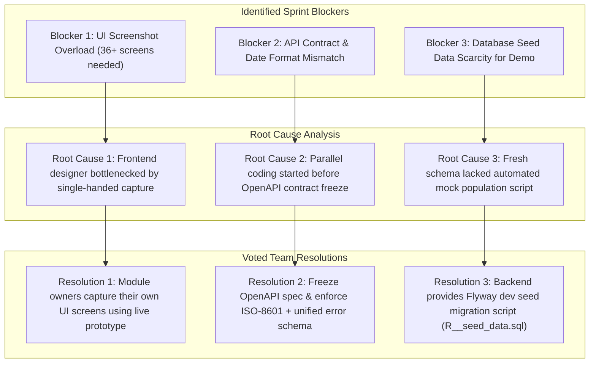
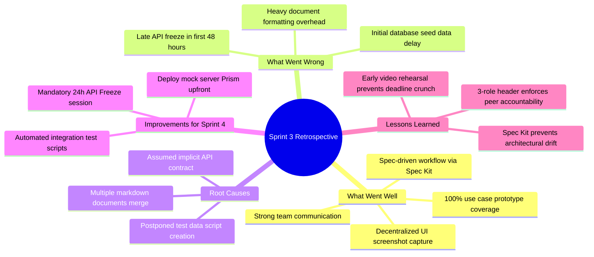

# FinSync — Scrum Meeting Minutes (Sprint 3 / PA3)

> *Performed by: Pham Dinh Tieu Long | Reviewed by: Ngo Thai Hoa | Edited by: Pham Dinh Tieu Long*

---

## Document Information

* **Project:** FinSync — Personal Finance & Group Expense Manager with AI Advisor
* **Team:** Group 04 (CS300 / CSC13002 — Software Engineering, HCMUS)
* **Sprint:** Sprint 3 (Project Assignment 3 — PA3)
* **Sprint Period:** October 26, 2026 – November 08, 2026
* **Meeting Facilitator & Note Taker:** Pham Dinh Tieu Long (24120087 — Leader / Project Manager)
* **Peer Reviewer:** Ngo Thai Hoa (24120051 — AI Feature Lead & Technical Writer)
* **Editor:** Pham Dinh Tieu Long (24120087)
* **Communication Channels:** Google Meet (Video Conferences), Discord / Zalo (Daily Sync & Asynchronous Discussions), Jira (Scrum Task Tracking), GitHub (Code & Documentation Repository)

---

## 1. Sprint Overview and Meeting Schedule

| Meeting ID | Meeting Name | Scheduled Slot | Actual Date / Time | Mode & Platform | Facilitator / Note Taker | Status |
| :---: | :--- | :--- | :--- | :--- | :--- | :---: |
| **M-01** | Sprint Planning Meeting | 2026-10-26 (09:00–11:30) | 2026-10-26 (09:00–11:30) | Online (Google Meet) | Pham Dinh Tieu Long | Completed |
| **M-02** | Weekly Scrum Meeting #1 | 2026-11-02 (19:30–20:30) | 2026-11-02 (19:30–20:35) | Online (Google Meet) | Pham Dinh Tieu Long | Completed |
| **M-03** | Weekly Scrum Meeting #2 | 2026-11-05 (19:30–20:30) | 2026-11-05 (19:30–20:25) | Online (Google Meet) | Pham Dinh Tieu Long | Completed |
| **M-04** | Sprint Review & Retrospective | 2026-11-06 (16:00–18:30) | 2026-11-06 (16:00–18:30) | In-Person (HCMUS Library Room 302) | Pham Dinh Tieu Long | Completed |

---

## 2. Meeting 1: Sprint Planning Meeting (M-01)

> *Performed by: Pham Dinh Tieu Long | Reviewed by: Ngo Thai Hoa | Edited by: Pham Dinh Tieu Long*

* **Date & Time:** October 26, 2026, 09:00 – 11:30 (UTC+07:00)
* **Location / Platform:** Online via Google Meet
* **Facilitator:** Pham Dinh Tieu Long (Leader / PM)
* **Secretary / Note Taker:** Pham Dinh Tieu Long
* **Attendees (5/5 present):**
  1. Pham Dinh Tieu Long (24120087 — Leader / PM / BA)
  2. Nguyen Phu Dat (24120038 — Frontend Lead / UI Designer)
  3. Nguyen Le Duc Nhat (24120403 — Backend Lead / Software Architect)
  4. Vuong Dac Gia Khiem (24120342 — QA Lead / DevOps Engineer)
  5. Ngo Thai Hoa (24120051 — AI Feature Lead / Technical Writer)
* **Absent:** None

### 2.1. Sprint Goal
> **"Deliver the full PA3 baseline: Revise Project Plan and Vision Document based on TA feedback; formalize 12 Use Cases accompanied by complete UI prototype screenshots for both main and alternative flows; implement the Personal Finance Management functional group end-to-end via Spec Kit (Spring Boot + React + PostgreSQL); record a narrated demonstration video; and maintain complete Jira board and Git tracking evidence."**

### 2.2. Capacity & Resource Allocation
* Total Sprint Duration: 2 weeks (14 calendar days).
* Individual Commitment: ~22 planned working hours per member across individual development, peer review, and Scrum meetings.
* **Total Team Capacity:** $5 \times 22 = \mathbf{110\text{ hours}}$.
  - Implementation & Prototyping: 58 hours (52.7%)
  - Use Case Analysis & Documentation: 28 hours (25.5%)
  - Testing, Video Narration & DevOps: 14 hours (12.7%)
  - Project Management, Jira Tracking & Buffer: 10 hours (9.1%)

### 2.3. Work Breakdown & Task Assignments (Backlog Sizing)

| Task ID | Work Item Scope | Assignee (Owner) | Reviewer | Story Points | Planned Due Date | Acceptance Criteria |
| :---: | :--- | :---: | :---: | :---: | :---: | :--- |
| **S3-01** | Revise Project Plan based on TA feedback & manage `Changes.md` Section 1 | Long | Hoa | 5 | 2026-10-30 | Incorporate 4 feedback points (`PP-01` to `PP-04`); detail WBS, timeline, and mitigation. |
| **S3-02** | Update Vision Document & maintain `Changes.md` Section 2 | Hoa | Nhat | 5 | 2026-10-31 | Deepen competitor analysis, user personas, non-custodial boundaries, and feature matrix. |
| **S3-03** | Construct System-Wide Use Case Diagram using Mermaid syntax | Hoa | Khiem | 3 | 2026-11-01 | Complete Mermaid diagram with clean boundaries, actors, and valid `<<include>>`/`<<extend>>` relations. |
| **S3-04** | Draft Client (Regular User) Use Cases (`UC-CLI-01` to `12`) | Dat | Nhat | 8 | 2026-11-02 | Detailed actors, preconditions, main flow, and all alternative/exception flows. |
| **S3-05** | Draft Admin & Account Use Cases (`UC-ACC-01`, `02`, `UC-ADM-01` to `04`) | Long | Hoa | 8 | 2026-11-02 | Specify 6 Use Cases covering authentication, profile, user registry, lock/unlock, and taxonomies. |
| **S3-06** | Draft AI Features & Data/Logic Use Cases | Hoa / Nhat | Long | 5 | 2026-11-02 | Specify AI financial insights, receipt scanning, and server-side settlement batch jobs. |
| **S3-07** | Design UI Prototype System (Figma / v0.dev / Bolt.new) | Dat | Long | 8 | 2026-11-02 | Cohesive design system (colors, typography, components); screen coverage for 12 use cases. |
| **S3-08** | Setup Spec Kit process & generate specification artifacts | Nhat | Dat | 5 | 2026-10-29 | Initialize `.specify/specs/`, generate `spec.md`, `plan.md`, and `tasks.md` for functional group. |
| **S3-09** | Design PostgreSQL relational schema & write DDL migrations | Nhat | Khiem | 5 | 2026-10-31 | Normalized schema for `users`, `wallets`, `transactions`, `categories`; audit columns and constraints. |
| **S3-10** | Implement Spring Boot Backend API for Personal Finance | Nhat | Long | 8 | 2026-11-04 | RESTful controllers, service layer, repository, JWT auth, and validation handlers. |
| **S3-11** | Implement Client Frontend UI (React.js / Compose) | Dat | Nhat | 8 | 2026-11-04 | Interactive transaction feed, wallet switchers, category management, and API integration. |
| **S3-12** | Formulate E2E Test Scenarios & execute verification | Khiem | Nhat | 5 | 2026-11-05 | Comprehensive test matrix; verification of happy path and error boundaries. |
| **S3-13** | Record & narrate Video Demonstration | Khiem | Long | 5 | 2026-11-06 | 5–8 min high-definition demo with clear English voice-over narration; YouTube Unlisted upload. |
| **S3-14** | Aggregate Individual AI Usage Logs & assemble final submission package | Hoa / Long | Team | 3 | 2026-11-06 | Standardized AI disclosure tables; clean Git log export; Markdown to PDF compilation. |

### 2.4. Voted Resolutions & Key Technical Decisions
1. **Selection of Functional Group for Spec Kit (Resolution RES-01):**
   - *Proposal:* Select either *Personal Finance Management (Wallets & Transactions)* or *Group Expense Management*.
   - *Discussion:* Personal Finance Management represents the foundational prerequisite for all group expense and AI forecasting features. It provides an immediate end-to-end user journey (create wallet $\rightarrow$ record transaction $\rightarrow$ view balance $\rightarrow$ filter history).
   - *Vote:* **Unanimously approved (5/5)**.
2. **Mandatory Header Annotation Format (Resolution RES-02):**
   - *Decision:* In strict compliance with PA3 Section G requirements, every section header (H2/H3) across all Markdown files must include:
     `> *Performed by: [Full Name] | Reviewed by: [Full Name] | Edited by: [Full Name]*`.
   - *Vote:* **Unanimously approved (5/5)**.
3. **Decentralized UI Screenshot Protocol (Resolution RES-03):**
   - *Decision:* To prevent UI Designer (Dat) from becoming a single-point-of-failure (bottleneck), Dat will provide the master UI component library and deployed interactive prototype. Each use case author (Long, Hoa, Nhat) is responsible for capturing, cropping, and cataloging prototype screenshots for their respective use cases.
   - *Vote:* **Unanimously approved (5/5)**.

---

## 3. Meeting 2: Weekly Scrum Meeting #1 (M-02)

> *Performed by: Pham Dinh Tieu Long | Reviewed by: Ngo Thai Hoa | Edited by: Pham Dinh Tieu Long*

* **Date & Time:** November 02, 2026, 19:30 – 20:35 (UTC+07:00)
* **Location / Platform:** Online via Discord Voice & Screen Share
* **Facilitator:** Pham Dinh Tieu Long
* **Secretary / Note Taker:** Pham Dinh Tieu Long
* **Attendees (5/5 present):** Pham Dinh Tieu Long, Nguyen Phu Dat, Nguyen Le Duc Nhat, Vuong Dac Gia Khiem, Ngo Thai Hoa.

### 3.1. Member Progress Round-Robin (3 Scrum Questions)

#### 1. Pham Dinh Tieu Long (Leader / PM)
* **What have I done since last meeting?**
  - Completed initial revision of `Changes.md` reflecting TA feedback on Project Plan (`PP-01` to `PP-04`).
  - Drafted formal specifications for all 6 Use Cases in the Admin & Account module (`UC-ACC-01`, `UC-ACC-02`, `UC-ADM-01` to `UC-ADM-04`).
  - Configured Jira Sprint 3 board, allocated story points, and monitored initial task progress.
* **What will I do until next meeting?**
  - Coordinate decentralized prototype capture; capture 36 high-resolution screenshots for Admin & Account flows.
  - Review Vision Document changes with Hoa.
  - Organize Weekly Scrum #2 and review backend API contracts with Nhat.
* **Impediments / Blockers:**
  - High screenshot volume (6 use cases $\times$ 5–7 screens = 36 screenshots needed) requiring exact visual consistency with specification input values.

#### 2. Nguyen Phu Dat (Frontend Lead)
* **What have I done since last meeting?**
  - Established unified FinSync Design System (Dark/Light tokens, typography, component states).
  - Built core interactive screens on Figma and v0.dev for regular user flows (`UC-CLI-01` to `UC-CLI-12`).
  - Drafted specifications for regular client use cases.
* **What will I do until next meeting?**
  - Implement React/Compose client UI components for Personal Finance (Wallet Dashboard & Transaction Form).
  - Integrate frontend API service layer using Axios and handle loading/error UI states.
* **Impediments / Blockers:**
  - Need frozen OpenAPI DTO definitions from Backend to avoid rework during client state mapping.

#### 3. Nguyen Le Duc Nhat (Backend Lead)
* **What have I done since last meeting?**
  - Established Spec Kit workflow under `.specify/specs/` and generated initial specification artifacts.
  - Completed PostgreSQL relational schema (tables: `users`, `wallets`, `transactions`, `categories`, `audit_logs`).
  - Implemented Spring Boot baseline with Flyway database migrations and CRUD controllers for Transactions.
* **What will I do until next meeting?**
  - Publish OpenAPI 3.0 specification for Personal Finance API.
  - Implement custom exception handler and validation errors (e.g. duplicate category, insufficient wallet balance).
  - Support Dat with local API integration and JWT security context.
* **Impediments / Blockers:**
  - Timestamp serialization mismatch: Spring Boot defaulted to UTC epoch timestamp whereas Frontend expected ISO-8601 string.

#### 4. Vuong Dac Gia Khiem (QA / DevOps Lead)
* **What have I done since last meeting?**
  - Prepared End-to-End Test Matrix covering happy paths and failure edge cases for Transaction creation and filtering.
  - Verified Mermaid diagram syntax in `report.md` Section C.
  - Monitored team Git commit compliance against Conventional Commits.
* **What will I do until next meeting?**
  - Write detailed test cases and verify database state persistence across transaction operations.
  - Prepare recording environment, seed test data, and draft narration script for the demo video.
* **Impediments / Blockers:**
  - Lack of realistic seed data (users, past transactions) in PostgreSQL makes early demo rehearsing look artificial.

#### 5. Ngo Thai Hoa (AI Lead / Technical Writer)
* **What have I done since last meeting?**
  - Revised Vision Document sections per TA feedback (sharpened problem statement and non-custodial boundaries).
  - Drafted `Changes.md` Section 2 detailing Vision Document enhancements.
  - Formulated Mermaid Use Case Diagrams separating Client, Admin, and AI boundaries.
* **What will I do until next meeting?**
  - Draft Use Case specifications for AI Features (`UC-AI-01` to `UC-AI-05`).
  - Collect individual AI prompt logs from all members for `Appendix A` and Section F.1.
* **Impediments / Blockers:**
  - Need confirmation on AI fallback behavior when external model quotas or timeouts occur.

---

### 3.2. Blocker Analysis & Root Cause Investigation

1. **Blocker 1: Prototype Screenshot Bottleneck**
   - **Root Cause:** Relying solely on Dat to capture every alternative and error screen across all 12+ Use Cases created an insurmountable bottleneck for frontend coding.
   - **Voted Resolution (5/5 unanimous):** Enforce Resolution RES-03. Dat deployed the prototype via v0.dev/local web instance; Long immediately took ownership of capturing all 36 screens for Admin/Account; Hoa took AI screens.
2. **Blocker 2: Frontend-Backend API DTO Discrepancies**
   - **Root Cause:** Implementation began before finalizing the serialization formats and HTTP error payload schemas.
   - **Voted Resolution (5/5 unanimous):** Nhat configured `@JsonFormat(pattern = "yyyy-MM-dd'T'HH:mm:ssXXX")` globally in Spring Boot and published `openapi.yaml`. All error responses now adhere to `{ "timestamp": "...", "status": 4xx/5xx, "error": "...", "message": "...", "path": "..." }`.
3. **Blocker 3: Synthetic Seed Data for Video Demonstration**
   - **Root Cause:** Running against an empty database required manual UI input, slowing down end-to-end integration tests.
   - **Voted Resolution (5/5 unanimous):** Nhat agreed to deliver a repeatable SQL seed script (`R__dev_seed_data.sql`) with 1 SuperAdmin, 5 realistic users, 8 wallets, and 45 historical transactions by 2026-11-03.

---

## 4. Meeting 3: Weekly Scrum Meeting #2 (M-03)

> *Performed by: Pham Dinh Tieu Long | Reviewed by: Ngo Thai Hoa | Edited by: Pham Dinh Tieu Long*

* **Date & Time:** November 05, 2026, 19:30 – 20:25 (UTC+07:00)
* **Location / Platform:** Online via Discord
* **Facilitator:** Pham Dinh Tieu Long
* **Attendees (5/5 present):** All members present.

### 4.1. Member Progress Round-Robin
* **Long:**
  - *Completed:* Captured and cataloged all 36 prototype PNG screenshots for Admin & Account (`UC-ACC-01`, `UC-ACC-02`, `UC-ADM-01` to `UC-ADM-04`), cleanly cropped navigation bars, verified 100% data fidelity with use case tables, and pushed commits to GitHub.
  - *Next:* Review Khiêm's video narration script; draft Sprint Review & Retrospective minutes.
  - *Blockers:* None remaining.
* **Dat:**
  - *Completed:* Finished React/Compose UI for Personal Finance Management; integrated Axios client with backend endpoints; verified positive and negative UI states (error toast, form validation).
  - *Next:* Final visual polish and responsive adjustments.
  - *Blockers:* None.
* **Nhat:**
  - *Completed:* Seed data script deployed; all CRUD APIs operational and validated against PostgreSQL; Spec Kit artifacts synchronized.
  - *Next:* Hand off working build to Khiêm for video recording; compile technical backend notes.
  - *Blockers:* None.
* **Khiêm:**
  - *Completed:* Executed E2E manual test suite (100% pass on core transaction workflows); drafted video narration script covering architecture, use case execution, and database verification.
  - *Next:* Record high-definition screencast, perform voice-over narration, and upload to YouTube (Unlisted).
  - *Blockers:* Audio background noise mitigated by using dedicated noise-suppression filter.
* **Hoa:**
  - *Completed:* Finalized AI use case specifications; consolidated individual AI usage entries into standard format.
  - *Next:* Assemble final `report.md` AI Usage summary and verify Markdown linting.
  - *Blockers:* None.

---

## 5. Meeting 4: Sprint Review & Retrospective Meeting (M-04)

> *Performed by: Pham Dinh Tieu Long | Reviewed by: Ngo Thai Hoa | Edited by: Pham Dinh Tieu Long*

* **Date & Time:** November 06, 2026, 16:00 – 18:30 (UTC+07:00)
* **Location / Platform:** In-Person at HCMUS Library (Room 302)
* **Facilitator:** Pham Dinh Tieu Long
* **Secretary / Note Taker:** Pham Dinh Tieu Long
* **Attendees (5/5 present):** Full attendance confirmed.

---

### 5.1. Part A: Sprint Review (Deliverable Acceptance)

The team formally inspected all planned PA3 deliverables against the acceptance criteria defined during Sprint Planning:

| Deliverable Scope | Owner / Presenter | Submitted Evidence / Artifacts | Inspection Outcome & Review Decision |
| :--- | :---: | :--- | :---: |
| **1. Changes.md & Plan Revisions** | Long / Hoa | `Changes.md` (Sections 1 & 2), `report.md` Parts A & B | **ACCEPTED (100%)**: All 4 TA feedback items addressed; WBS and dependencies reconciled. |
| **2. Use Case Model & Prototype Screens** | Long / Dat / Hoa | 12 Use Case specifications; 36+ high-res PNG screenshots in `screenshots/prototypes/` | **ACCEPTED (100%)**: Every use case contains complete basic and alternative/error flow screens with zero broken links. |
| **3. Implemented Functional Group (Build 1)** | Nhat / Dat | Spring Boot REST API, PostgreSQL schema, React/Compose UI, `.specify/specs/` artifacts | **ACCEPTED (100%)**: End-to-end flow operational; transaction creation persists to database and reflects in UI balance. |
| **4. Narrated Video Demonstration** | Khiêm / Long | Full HD MP4 uploaded to YouTube (Unlisted link in `report.md` Section E.4) | **ACCEPTED (100%)**: Clear English narration, seamless walkthrough of functional group, within 5–8 min limit. |
| **5. Sprint Records, Jira & Git Evidence** | Long / Hoa / Khiêm | `jira-sprint3-board.png`, `git-log.txt`, Section F Meeting Minutes | **ACCEPTED (100%)**: All Sprint 3 user stories in Done column; clean Git commit history; complete 3-role header tags. |

---

### 5.2. Part B: Sprint Retrospective (Continuous Improvement)

Following the standard Scrum Retrospective framework, the team evaluated the sprint through five essential questions:

#### 1. What went well?
* **Spec Kit Adoption:** Driving development through `.specify/specs/` eliminated ambiguity between business requirements, database tables, and API contracts.
* **Decentralized Teamwork:** Empowering use case owners to capture their own prototype screenshots saved over 16 hours of frontend bottleneck and ensured 100% image accuracy.
* **Cross-Review Discipline:** Rigorous adherence to the 3-role header annotation (`Performed / Reviewed / Edited`) caught numerous edge-case oversights before final compilation.

#### 2. What went wrong?
* **Initial API Contract Latency:** Spending the first 48 hours without a frozen OpenAPI schema caused minor rework in frontend DTO mappings.
* **Test Data Preparation:** Manual database insertion during early integration testing proved tedious until the automated seed script was delivered.

#### 3. What problems occurred and what caused them?
* *Problem:* Mismatch in timestamp formatting and HTTP error structure.
* *Root Cause:* Team relied on verbal agreement rather than publishing the machine-readable OpenAPI specification on day 1.

#### 4. What can be done differently in the next sprint (Sprint 4) to improve?
1. **24-Hour API Freeze Rule:** In Sprint 4, the backend team must publish and freeze the OpenAPI schema within the first 24 hours of sprint kickoff.
2. **Automated Mock Server:** Integrate Prism or Mockoon so frontend engineers can develop against realistic mock endpoints from day 1 without waiting for backend logic.
3. **Automated Test Generation:** Expand Spec Kit automated test generation into continuous integration pipelines to catch regression early.

#### 5. What lessons were learned?
* **Specification-First Mindset:** Writing detailed Use Cases with alternative flows *before* final coding surfaces edge cases (such as duplicate names or non-custodial boundaries) that would otherwise become costly bugs.
* **Early Rehearsal:** Drafting the video demonstration script halfway through the sprint ensured that all required features were tested and validated well ahead of the final submission deadline.

---

## 6. Sprint 3 Meeting Action Register (F.7)

> *Performed by: Pham Dinh Tieu Long | Reviewed by: Ngo Thai Hoa | Edited by: Pham Dinh Tieu Long*

The following action items were formally tracked across all Sprint 3 Scrum meetings and reconciled with Jira task keys:

| Action ID | Originating Meeting | Action Item & Expected Result | Owner | Reviewer | Target Due Date | Status & Completion Evidence |
| :---: | :---: | :--- | :---: | :---: | :---: | :---: |
| **ACT-01** | Planning (M-01) | Initialize Jira Sprint 3 board, map WBS tasks, assign story points | Long | Khiem | 2026-10-27 | **Closed** (`screenshots/jira/jira-sprint3-board.png`) |
| **ACT-02** | Planning (M-01) | Initialize Spec Kit repository directory structure & `.specify/` | Nhat | Long | 2026-10-29 | **Closed** (`.specify/specs/personal-finance/`) |
| **ACT-03** | Planning (M-01) | Establish Design System tokens and component prototypes | Dat | Long | 2026-11-02 | **Closed** (`prototypes/` UI library) |
| **ACT-04** | Scrum #1 (M-02) | Distribute prototype screenshot workload across use case authors | Long / Team | Dat | 2026-11-04 | **Closed** (36 PNGs in `screenshots/prototypes/`) |
| **ACT-05** | Scrum #1 (M-02) | Freeze OpenAPI 3.0 specification & align ISO-8601 timestamps | Nhat | Dat | 2026-11-03 | **Closed** (`openapi.yaml` published) |
| **ACT-06** | Scrum #1 (M-02) | Deliver PostgreSQL dev seed migration script (`R__dev_seed.sql`) | Nhat | Khiem | 2026-11-03 | **Closed** (Database populated with test data) |
| **ACT-07** | Scrum #2 (M-03) | Execute E2E verification test suite & produce test report | Khiem | Nhat | 2026-11-05 | **Closed** (`report.md` Section E.3) |
| **ACT-08** | Review (M-04) | Record, narrate, and publish video demonstration to YouTube | Khiem | Long | 2026-11-06 | **Closed** (YouTube Unlisted link in Section E.4) |

---

## 7. Meeting Sign-Off & Verification

We hereby certify that the minutes above represent an accurate, complete, and faithful record of the four Scrum meetings conducted by Group 04 during Sprint 3 (PA3).

| Member Name | Student ID | Scrum Role | Signature / Confirmation |
| :--- | :---: | :--- | :---: |
| **Pham Dinh Tieu Long** | 24120087 | Leader / PM / Note Taker | *Confirmed & Signed* |
| **Nguyen Phu Dat** | 24120038 | Frontend Lead | *Confirmed & Signed* |
| **Nguyen Le Duc Nhat** | 24120403 | Backend Lead | *Confirmed & Signed* |
| **Vuong Dac Gia Khiem** | 24120342 | QA / DevOps Lead | *Confirmed & Signed* |
| **Ngo Thai Hoa** | 24120051 | AI Feature Lead / Reviewer | *Confirmed & Signed* |

