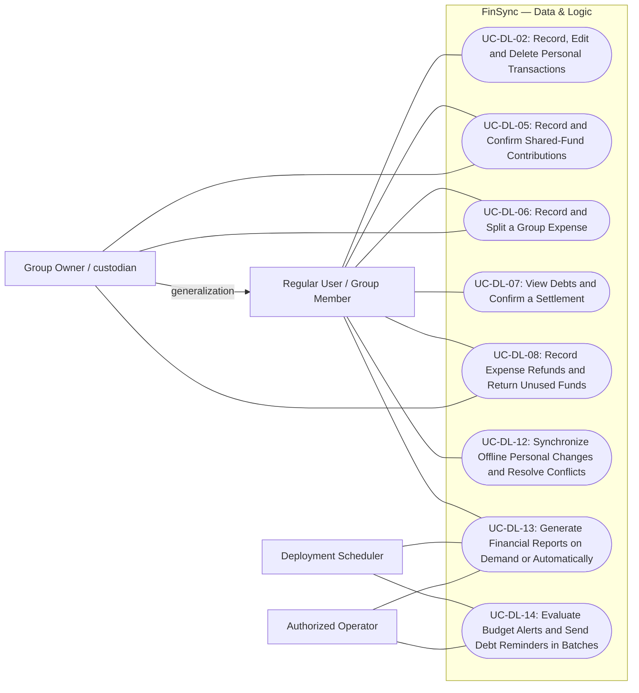
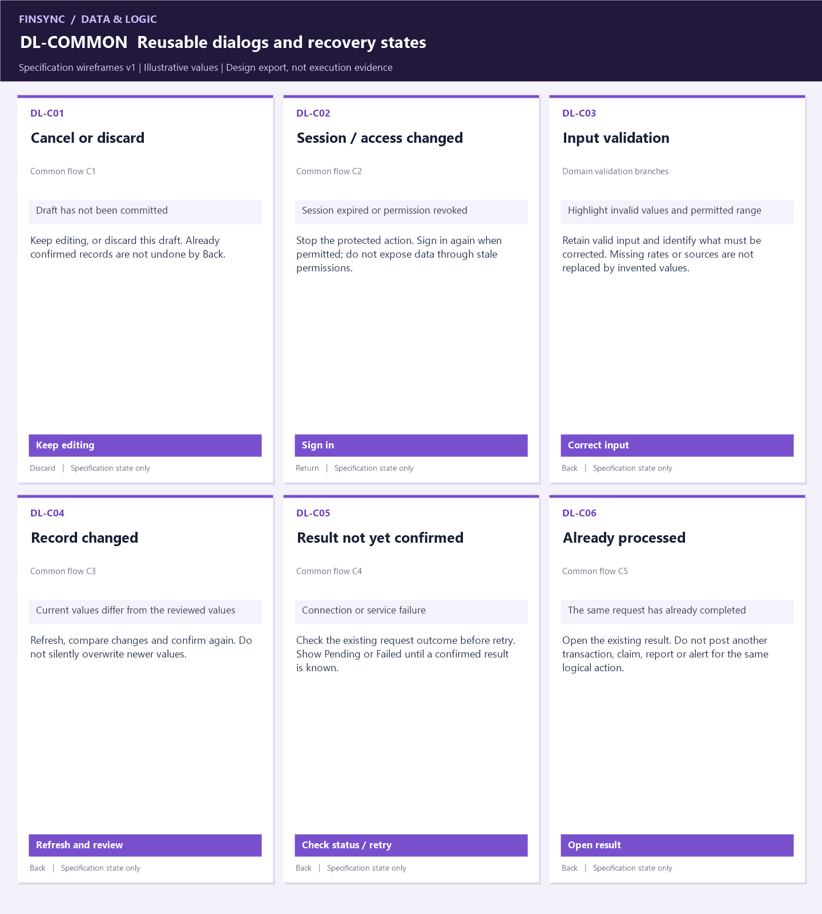
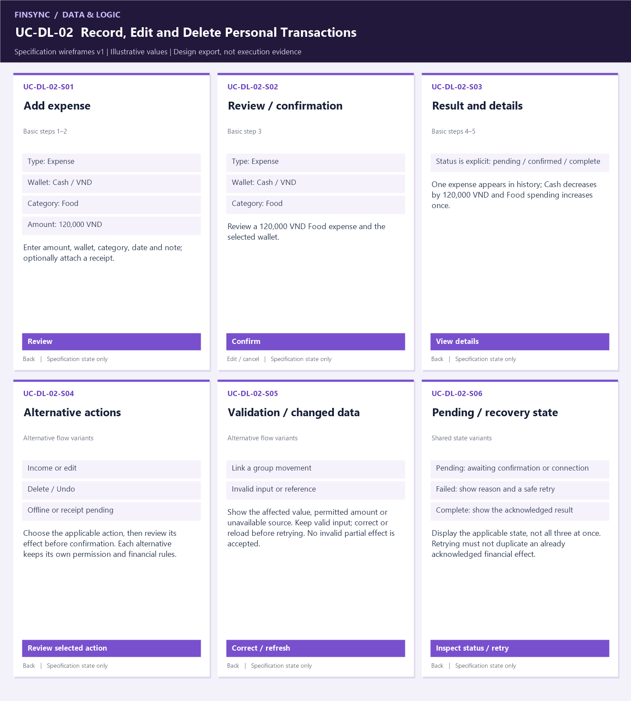
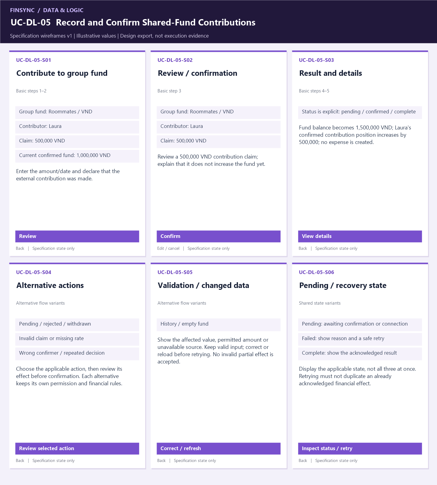
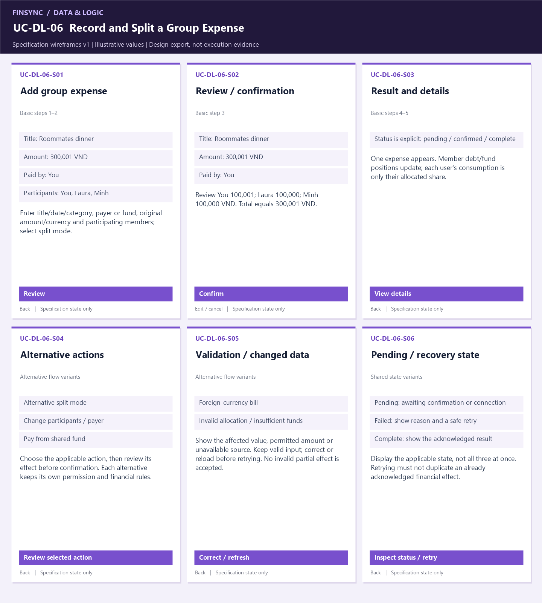
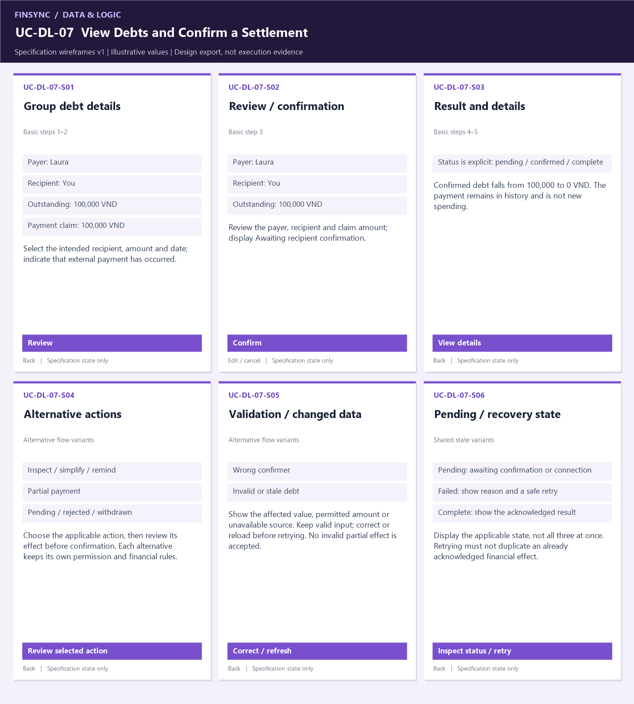
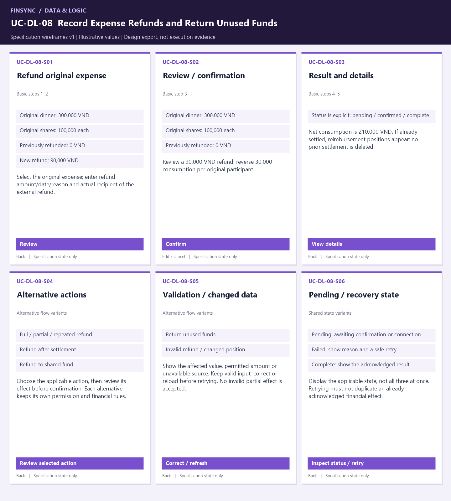
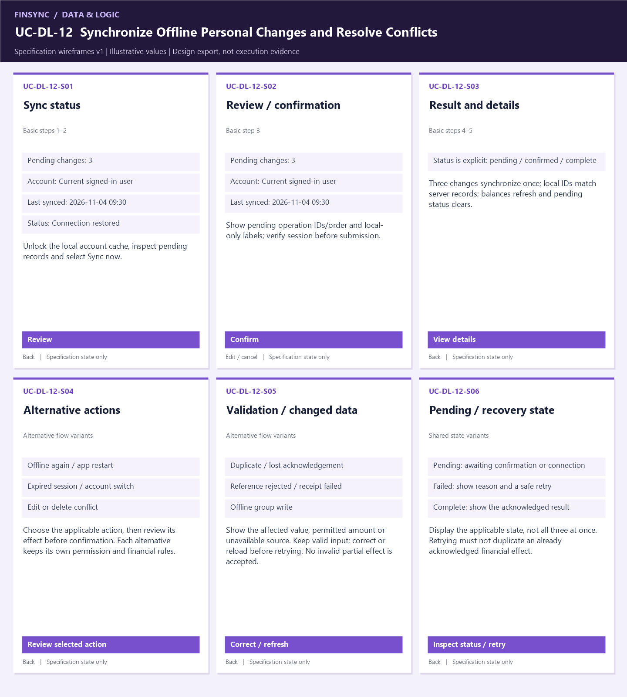
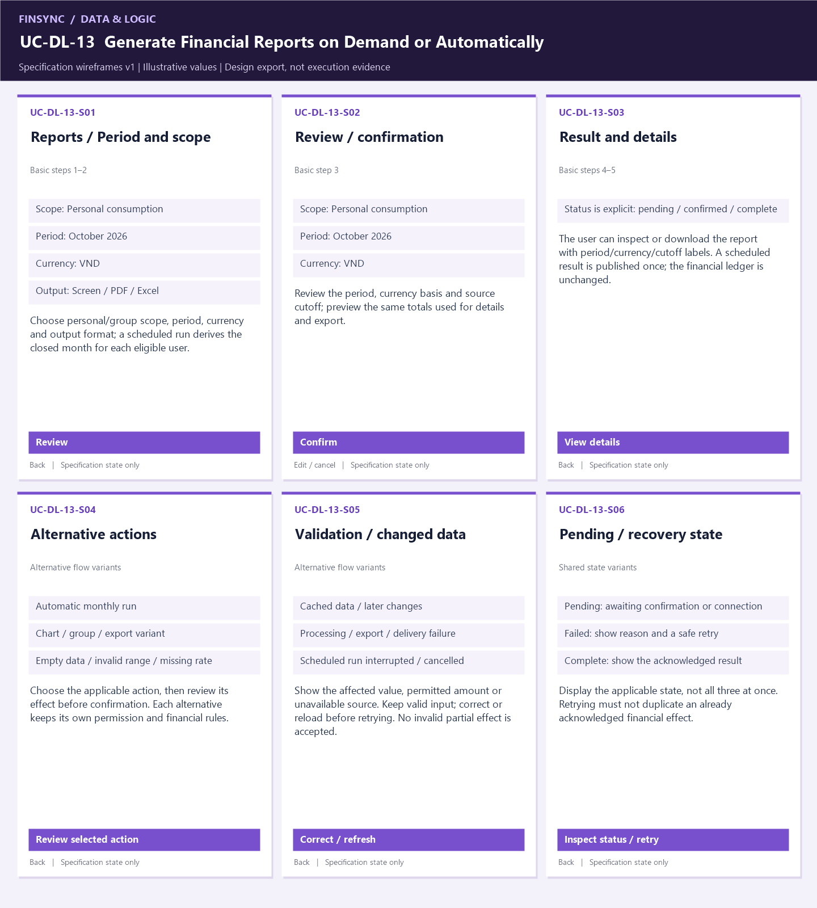
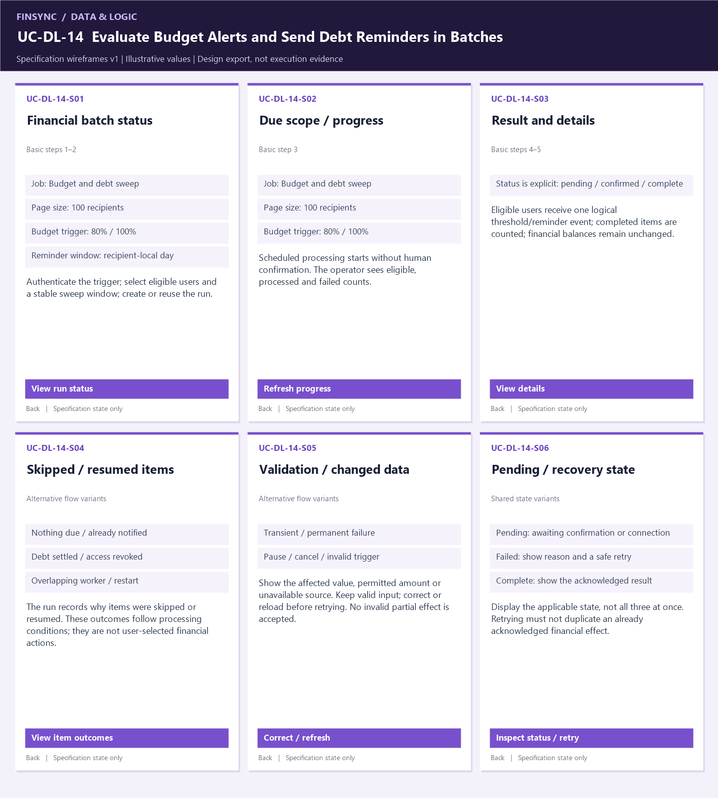

# Part D — Data & Logic Use-Case Specifications
> *Performed by: `Nguyen Le Duc Nhat` | Reviewed by: Pending team review | Edited by: Pending confirmation*

**FinSync · Group 04 · PA3-2026 · Version 2.0 (compact), 2026-11-04.** This contribution follows [the Part D requirements](../pa3_project_assignment_specification.md) and the five-subsection [report template](../report.md). Detailed API, database-locking and job-runtime design is kept separately in [Backend Notes](D_backend_notes.md).
 
## D.1. Scope and Shared Conventions
> *Performed by: `Nguyen Le Duc Nhat` | Reviewed by: Pending team review | Edited by: Pending confirmation*

**Scope:** Eight core use cases cover financial processing, shared-fund claims, splitting, settlement, refunds, synchronization, reporting and batch notifications. Existing IDs are preserved; gaps in numbering do not indicate missing cases. Part C is still a team template, so this is a scoped catalogue for integration, not a claim that the team has approved its final use-case model.

Wallet setup, member administration, basic navigation, searches and form details are referenced from the [Client catalogue](client-use-cases.md), rather than specified twice. Account/Admin and AI remain separate contributions. Budget creation and savings-goal management are outside this narrowed assignment and still need explicit team coverage; Client budget viewing alone does not satisfy those requirements. On-demand reporting (former UC-DL-11) is merged into UC-DL-13.

**Business baseline:** Preserve PA2 bookkeeping-only payments, exact rounding, recipient/custodian confirmation, historical currency snapshots, own-group-share recognition and durable offline personal changes. The narrower database v1 differs in these areas; [the appendix](D_backend_notes.md) records the gaps. This document does not silently approve scope reductions or claim those backend functions are implemented.

**Prototypes:** [Local HTML wireframes](../prototypes/data-logic/index.html) and labeled PNG exports are newly authored specification designs, not captures proving implemented features. Each case reuses six frames for its form/review/result and domain variants; common dialogs are shown once below. Alternative flows specify the content/action variant in that reused frame. Amounts and rates are illustrative.
| Use case | Goal / related client scope | Local requirement |
|---|---|---|
| UC-DL-02 | Record, Edit and Delete Personal Transactions | FR-DL-02 |
| UC-DL-05 | Record and Confirm Shared-Fund Contributions | FR-DL-05 |
| UC-DL-06 | Record and Split a Group Expense | FR-DL-06 |
| UC-DL-07 | View Debts and Confirm a Settlement | FR-DL-07 |
| UC-DL-08 | Record Expense Refunds and Return Unused Funds | FR-DL-08 |
| UC-DL-12 | Synchronize Offline Personal Changes and Resolve Conflicts | FR-DL-12 |
| UC-DL-13 | Generate Financial Reports on Demand or Automatically | FR-DL-13 |
| UC-DL-14 | Evaluate Budget Alerts and Send Debt Reminders in Batches | FR-DL-14 |

FR-DL IDs are local traceability labels to merge into Part B; they are not asserted to be already approved requirement IDs.

Actors are outside FinSync; database/worker internals are not actors. Generalization denotes inherited participation. No include/extend relationship is forced onto validation steps; cross-referenced workflows have separate triggers.

### D.1.1. Common Alternative and Exception Flows
> *Performed by: `Nguyen Le Duc Nhat` | Reviewed by: Pending team review | Edited by: Pending confirmation*

C1–C5 apply wherever their condition is relevant; each case references this table instead of repeating it. Scheduled runs have no user form to discard; their explicit stop/recovery branch applies instead.

| ID / condition | Actions and outcome | Return / shared screen |
|---|---|---|
| C1 — Cancel before confirmation | Keep editing or discard the uncommitted draft; no new effect. | Step 2 or end; DL-C01 |
| C2 — Session/permission changed | Stop the action; reauthenticate if permitted, otherwise deny without exposing data. | Step 1 or end; DL-C02 |
| C3 — Stale review/concurrent edit | Show current values, retain a safe draft and request fresh confirmation; no silent overwrite. | Steps 2–3; DL-C04 |
| C4 — Network/service failure | Do not claim success; reconcile the original request outcome before retry. Confirmed items stay committed; unresolved items remain pending/failed. | Step 4 or end; DL-C05 |
| C5 — Duplicate submission/replay | Return the existing acknowledged result rather than apply the action again. | Step 5; DL-C06 |

*Shared prototype: DL-C01–06. These same dialogs are referenced by the specifications below; a new screen is not required for each backend branch.*

## D.2. UC-DL-02 — Record, Edit and Delete Personal Transactions
> *Performed by: `Nguyen Le Duc Nhat` | Reviewed by: Pending team review | Edited by: Pending confirmation*

### D.2.1. Overview and Preconditions
> *Performed by: `Nguyen Le Duc Nhat` | Reviewed by: Pending team review | Edited by: Pending confirmation*

| Field | Specification |
|---|---|
| Use-case ID and name | UC-DL-02 — Record, Edit and Delete Personal Transactions |
| Primary actor | Regular User |
| Supporting actor(s) | None. |
| Description / goal | Maintain income and expense records, optional receipts and correct balances without duplicate posting. |
| Trigger | The user selects Add transaction or opens an owned transaction. |
| Related requirements / rules | FR-DL-02; bookkeeping only, authorized data, exact amounts and no duplicate consumption. |
| Related NFRs | NFR-S4, NFR-S6, NFR-S8, NFR-R3, NFR-R5, NFR-R6 |
| Relationships | Actor associations in D.1; shared C1–C5 apply as relevant. No mandatory included sub-use-case. |
| Preconditions | 1. User has an authorized session, or an unlocked encrypted cache after initial sign-in for the offline branch. 2. An owned wallet and applicable category exist. 3. Group records are not edited through this flow. |

### D.2.2. Basic Flow — Main Success Scenario
> *Performed by: `Nguyen Le Duc Nhat` | Reviewed by: Pending team review | Edited by: Pending confirmation*

| Step | Actor action | System response / state change | Screen |
|---|---|---|---|
| 1 | The user selects Add transaction or opens an owned transaction. | Check access; show eligible scope and current state. | S01 |
| 2 | Enter amount, wallet, category, date and note; optionally attach a receipt. | Validate the selected inputs and prepare a review; no financial effect yet. | S01 |
| 3 | Review and confirm the action. | Review a 120,000 VND Food expense and the selected wallet. | S02 |
| 4 | Wait for the acknowledged result. | Validate ownership and category type; atomically record the transaction and its attachment references; update derived totals. | S03 |
| 5 | Open the authorized result or status. | One expense appears in history; Cash decreases by 120,000 VND and Food spending increases once. | S03 |

### D.2.3. Alternative and Exception Flows
> *Performed by: `Nguyen Le Duc Nhat` | Reviewed by: Pending team review | Edited by: Pending confirmation*

| Flow / branch point | Ordered actions | Resume / resulting state | Screen variant |
|---|---|---|---|
| AF-01 — Income or edit Step 2: change type or open an existing entry | 1. Choose an income category or edit allowed values. 2. Recalculate affected wallet/category totals; keep the original ID when editing. | 3 — Only the difference changes totals. | S04 |
| AF-02 — Delete / Undo Step 2: Delete selected | 1. Confirm deletion and recalculate. 2. Offer Undo for 7 seconds; valid Undo restores the same ID/values once. If expired or unavailable, return to history without recreating it. | 5 / end — Deleted or restored once. | S04 |
| AF-03 — Offline or receipt pending Step 4: network/upload unavailable | 1. Save an authorized personal change locally as Pending and invoke UC-DL-12 on reconnection. 2. If only the receipt fails after posting, retry the upload without another financial entry. | End / UC-DL-12 — Local and server status remain distinct. | S04 |
| AF-04 — Link a group movement Step 2: money relates to a group event | 1. Select the authorized source event. 2. Link the movement rather than creating another consumption entry; the user's share is counted once. | 3 — Cash and consumption are not duplicated. | S05 / S06 |
| AF-05 — Invalid input or reference Step 3: bad amount/date/category/receipt or ineligible wallet | 1. Identify the invalid field/file or reference. 2. Retain valid input and ask for correction; reject the whole invalid write. | 2 — No invalid financial effect. | S05 / S06 |

**Shared branches:** C1–C5 from D.1.1 where applicable. Use DL-C03 for field validation; use S06 for the case-specific pending/recovery result. Domain branches above take precedence where a conflict, offline state or scheduled stop needs different behavior.

### D.2.4. Postconditions and Special Requirements
> *Performed by: `Nguyen Le Duc Nhat` | Reviewed by: Pending team review | Edited by: Pending confirmation*

**Success:** One expense appears in history; Cash decreases by 120,000 VND and Food spending increases once.  
**Failure/cancellation:** No unauthorized or partially committed financial change. Pending claims do not change confirmed balances; acknowledged sync/batch items remain completed while other items can fail.  
**Special requirements:** NFR-S4, NFR-S6, NFR-S8, NFR-R3, NFR-R5, NFR-R6 Monetary values and historical rates must remain exact. These are requirements, not measured test results.

### D.2.5. UI Prototype Screenshots
> *Performed by: `Nguyen Le Duc Nhat` | Reviewed by: Pending team review | Edited by: Pending confirmation*

**Prototype:** [Compact wireframes v2](../prototypes/data-logic/index.html#UC-DL-02). Screen IDs below use the `UC-DL-02-` prefix. Shared dialogs DL-C01–06 are embedded once in D.1.1.

| Frames | Flow coverage | Purpose |
|---|---|---|
| S01–S03 | Basic steps 1–5 | Input/scope, review and acknowledged result. |
| S04 | AF-01, AF-02, AF-03 | Alternative actions use the same entry/review layout with the selected variant. |
| S05–S06 | AF-04, AF-05; pending/recovery states | Changed values, unavailable data or incomplete outcome; no extra screen per internal check. |

*Figure D.2 — UC-DL-02-S01–S06. Labeled design variants illustrate the specified flows; they are not proof of executed backend behavior.*

## D.3. UC-DL-05 — Record and Confirm Shared-Fund Contributions
> *Performed by: `Nguyen Le Duc Nhat` | Reviewed by: Pending team review | Edited by: Pending confirmation*

### D.3.1. Overview and Preconditions
> *Performed by: `Nguyen Le Duc Nhat` | Reviewed by: Pending team review | Edited by: Pending confirmation*

| Field | Specification |
|---|---|
| Use-case ID and name | UC-DL-05 — Record and Confirm Shared-Fund Contributions |
| Primary actor | Group Member |
| Supporting actor(s) | Group Owner acting as fund custodian. |
| Description / goal | Record money contributed outside the app and increase the shared fund only after the custodian confirms receipt. |
| Trigger | A member opens the group fund and selects Contribute. |
| Related requirements / rules | FR-DL-05; bookkeeping only, authorized data, exact amounts and no duplicate consumption. |
| Related NFRs | NFR-S4, NFR-R3, NFR-R6, NFR-R7 |
| Relationships | Actor associations in D.1; shared C1–C5 apply as relevant. No mandatory included sub-use-case. |
| Preconditions | 1. Both actors have online authorized group sessions. 2. The group fund exists and is active. 3. Actual payment occurs outside FinSync. |

### D.3.2. Basic Flow — Main Success Scenario
> *Performed by: `Nguyen Le Duc Nhat` | Reviewed by: Pending team review | Edited by: Pending confirmation*

| Step | Actor action | System response / state change | Screen |
|---|---|---|---|
| 1 | A member opens the group fund and selects Contribute. | Check access; show eligible scope and current state. | S01 |
| 2 | Enter the amount/date and declare that the external contribution was made. | Validate the selected inputs and prepare a review; no financial effect yet. | S01 |
| 3 | Review and confirm the action. | Review a 500,000 VND contribution claim; explain that it does not increase the fund yet. | S02 |
| 4 | Group Owner verifies and confirms receipt. | Save a pending claim; notify the Owner; the Owner opens it, verifies receipt and confirms; atomically post the fund credit. | S03 |
| 5 | Open the authorized result or status. | Fund balance becomes 1,500,000 VND; Laura's confirmed contribution position increases by 500,000; no expense is created. | S03 |

### D.3.3. Alternative and Exception Flows
> *Performed by: `Nguyen Le Duc Nhat` | Reviewed by: Pending team review | Edited by: Pending confirmation*

| Flow / branch point | Ordered actions | Resume / resulting state | Screen variant |
|---|---|---|---|
| AF-01 — Pending / rejected / withdrawn Step 4: no confirmation, rejection or contributor withdrawal | 1. Keep a new claim Pending until the Owner responds. 2. On rejection store the reason; allow withdrawal only while Pending. | End — Confirmed fund remains unchanged. | S04 |
| AF-02 — Invalid claim or missing rate Step 3: invalid amount/date or foreign currency | 1. Validate a positive contribution. 2. Show original amount and approved quote; if no rate exists, defer the conversion-dependent claim rather than inventing a total. | 2 / 3 — Only valid reviewed claims proceed. | S04 |
| AF-03 — Wrong confirmer / repeated decision Step 4: another member confirms or status already changed | 1. Require the fund custodian. 2. Recheck claim status; a prior confirmation returns its existing result, a conflicting decision is rejected. | End — One receipt effect at most. | S04 |
| AF-04 — History / empty fund Step 1: inspect fund without contributing | 1. Show confirmed cash and member positions separately from pending claims. 2. Show zero if empty; unused-fund return opens UC-DL-08. | End — No ledger mutation. | S05 / S06 |

**Shared branches:** C1–C5 from D.1.1 where applicable. Use DL-C03 for field validation; use S06 for the case-specific pending/recovery result. Domain branches above take precedence where a conflict, offline state or scheduled stop needs different behavior.

### D.3.4. Postconditions and Special Requirements
> *Performed by: `Nguyen Le Duc Nhat` | Reviewed by: Pending team review | Edited by: Pending confirmation*

**Success:** Fund balance becomes 1,500,000 VND; Laura's confirmed contribution position increases by 500,000; no expense is created.  
**Failure/cancellation:** No unauthorized or partially committed financial change. Pending claims do not change confirmed balances; acknowledged sync/batch items remain completed while other items can fail.  
**Special requirements:** NFR-S4, NFR-R3, NFR-R6, NFR-R7 Monetary values and historical rates must remain exact. These are requirements, not measured test results.

### D.3.5. UI Prototype Screenshots
> *Performed by: `Nguyen Le Duc Nhat` | Reviewed by: Pending team review | Edited by: Pending confirmation*

**Prototype:** [Compact wireframes v2](../prototypes/data-logic/index.html#UC-DL-05). Screen IDs below use the `UC-DL-05-` prefix. Shared dialogs DL-C01–06 are embedded once in D.1.1.

| Frames | Flow coverage | Purpose |
|---|---|---|
| S01–S03 | Basic steps 1–5 | Input/scope, review and acknowledged result. |
| S04 | AF-01, AF-02, AF-03 | Alternative actions use the same entry/review layout with the selected variant. |
| S05–S06 | AF-04; pending/recovery states | Changed values, unavailable data or incomplete outcome; no extra screen per internal check. |

*Figure D.3 — UC-DL-05-S01–S06. Labeled design variants illustrate the specified flows; they are not proof of executed backend behavior.*

## D.4. UC-DL-06 — Record and Split a Group Expense
> *Performed by: `Nguyen Le Duc Nhat` | Reviewed by: Pending team review | Edited by: Pending confirmation*

### D.4.1. Overview and Preconditions
> *Performed by: `Nguyen Le Duc Nhat` | Reviewed by: Pending team review | Edited by: Pending confirmation*

| Field | Specification |
|---|---|
| Use-case ID and name | UC-DL-06 — Record and Split a Group Expense |
| Primary actor | Group Member |
| Supporting actor(s) | Group Owner when authorizing shared-fund spending. |
| Description / goal | Allocate a real group expense exactly, preserve the funding source and update member positions without counting consumption twice. |
| Trigger | An authorized member selects Add group expense. |
| Related requirements / rules | FR-DL-06; bookkeeping only, authorized data, exact amounts and no duplicate consumption. |
| Related NFRs | NFR-P5, NFR-S4, NFR-S6, NFR-R3, NFR-R8 |
| Relationships | Actor associations in D.1; shared C1–C5 apply as relevant. No mandatory included sub-use-case. |
| Preconditions | 1. Online active membership. 2. Group currency and participants are known. 3. A valid rate exists for a foreign-currency bill; sufficient fund cash exists for fund-funded spending. |

### D.4.2. Basic Flow — Main Success Scenario
> *Performed by: `Nguyen Le Duc Nhat` | Reviewed by: Pending team review | Edited by: Pending confirmation*

| Step | Actor action | System response / state change | Screen |
|---|---|---|---|
| 1 | An authorized member selects Add group expense. | Check access; show eligible scope and current state. | S01 |
| 2 | Enter title/date/category, payer or fund, original amount/currency and participating members; select split mode. | Validate the selected inputs and prepare a review; no financial effect yet. | S01 |
| 3 | Review and confirm the action. | Review You 100,001; Laura 100,000; Minh 100,000 VND. Total equals 300,001 VND. | S02 |
| 4 | Wait for the acknowledged result. | Revalidate membership, quote, split inputs and funding; atomically post the expense, allocations and the applicable payer/fund entry. | S03 |
| 5 | Open the authorized result or status. | One expense appears. Member debt/fund positions update; each user's consumption is only their allocated share. | S03 |

### D.4.3. Alternative and Exception Flows
> *Performed by: `Nguyen Le Duc Nhat` | Reviewed by: Pending team review | Edited by: Pending confirmation*

| Flow / branch point | Ordered actions | Resume / resulting state | Screen variant |
|---|---|---|---|
| AF-01 — Alternative split mode Step 2: Exact, Percentage or Shares | 1. Enter exact amounts totaling the bill, percentages totaling 100%, or positive weights. 2. Calculate final shares and distribute rounding remainders in a stable order. | 3 — Final shares sum exactly to the expense. | S04 |
| AF-02 — Change participants / payer Step 2: selection changes | 1. Verify all selected identities belong to the group. 2. Recalculate and remove obsolete draft allocations before review. | 3 — No hidden shares for removed participants. | S04 |
| AF-03 — Pay from shared fund Step 2: fund selected | 1. Check custodian permission and available confirmed cash. 2. Debit the fund instead of crediting an individual payer; update member fund positions once. | 3 — Only one funding source is used. | S04 |
| AF-04 — Foreign-currency bill Step 2: currency differs from group | 1. Show original amount and rate/source/time. 2. Convert once, then split and retain the snapshot. Missing/changed quote requires a new review. | 3 / 2 — No silent repricing of historical shares. | S05 / S06 |
| AF-05 — Invalid allocation / insufficient funds Step 3 or 4: mismatch, no participants, bad weights or low fund cash | 1. Display the difference or available amount. 2. Keep the draft and reject the entire expense until corrected. | 2 — No partial expense, allocation or fund debit. | S05 / S06 |

**Shared branches:** C1–C5 from D.1.1 where applicable. Use DL-C03 for field validation; use S06 for the case-specific pending/recovery result. Domain branches above take precedence where a conflict, offline state or scheduled stop needs different behavior.

### D.4.4. Postconditions and Special Requirements
> *Performed by: `Nguyen Le Duc Nhat` | Reviewed by: Pending team review | Edited by: Pending confirmation*

**Success:** One expense appears. Member debt/fund positions update; each user's consumption is only their allocated share.  
**Failure/cancellation:** No unauthorized or partially committed financial change. Pending claims do not change confirmed balances; acknowledged sync/batch items remain completed while other items can fail.  
**Special requirements:** NFR-P5, NFR-S4, NFR-S6, NFR-R3, NFR-R8 Monetary values and historical rates must remain exact. These are requirements, not measured test results.

### D.4.5. UI Prototype Screenshots
> *Performed by: `Nguyen Le Duc Nhat` | Reviewed by: Pending team review | Edited by: Pending confirmation*

**Prototype:** [Compact wireframes v2](../prototypes/data-logic/index.html#UC-DL-06). Screen IDs below use the `UC-DL-06-` prefix. Shared dialogs DL-C01–06 are embedded once in D.1.1.

| Frames | Flow coverage | Purpose |
|---|---|---|
| S01–S03 | Basic steps 1–5 | Input/scope, review and acknowledged result. |
| S04 | AF-01, AF-02, AF-03 | Alternative actions use the same entry/review layout with the selected variant. |
| S05–S06 | AF-04, AF-05; pending/recovery states | Changed values, unavailable data or incomplete outcome; no extra screen per internal check. |

*Figure D.4 — UC-DL-06-S01–S06. Labeled design variants illustrate the specified flows; they are not proof of executed backend behavior.*

## D.5. UC-DL-07 — View Debts and Confirm a Settlement
> *Performed by: `Nguyen Le Duc Nhat` | Reviewed by: Pending team review | Edited by: Pending confirmation*

### D.5.1. Overview and Preconditions
> *Performed by: `Nguyen Le Duc Nhat` | Reviewed by: Pending team review | Edited by: Pending confirmation*

| Field | Specification |
|---|---|
| Use-case ID and name | UC-DL-07 — View Debts and Confirm a Settlement |
| Primary actor | Group Member acting as debtor |
| Supporting actor(s) | Intended recipient / creditor. |
| Description / goal | Inspect simplified debts and reduce debt only after the intended recipient confirms an external payment. |
| Trigger | The user opens Who owes whom and selects a debt. |
| Related requirements / rules | FR-DL-07; bookkeeping only, authorized data, exact amounts and no duplicate consumption. |
| Related NFRs | NFR-P5, NFR-S4, NFR-R3, NFR-R6, NFR-R7 |
| Relationships | Actor associations in D.1; shared C1–C5 apply as relevant. No mandatory included sub-use-case. |
| Preconditions | 1. Both parties are authorized active group members online. 2. A positive outstanding debt exists. 3. The debtor pays outside FinSync before claiming payment. |

### D.5.2. Basic Flow — Main Success Scenario
> *Performed by: `Nguyen Le Duc Nhat` | Reviewed by: Pending team review | Edited by: Pending confirmation*

| Step | Actor action | System response / state change | Screen |
|---|---|---|---|
| 1 | The user opens Who owes whom and selects a debt. | Check access; show eligible scope and current state. | S01 |
| 2 | Select the intended recipient, amount and date; indicate that external payment has occurred. | Validate the selected inputs and prepare a review; no financial effect yet. | S01 |
| 3 | Review and confirm the action. | Review the payer, recipient and claim amount; display Awaiting recipient confirmation. | S02 |
| 4 | Intended recipient confirms receipt. | Create a pending claim; notify the recipient; recipient confirms receipt after current-debt validation; atomically post settlement effects. | S03 |
| 5 | Open the authorized result or status. | Confirmed debt falls from 100,000 to 0 VND. The payment remains in history and is not new spending. | S03 |

### D.5.3. Alternative and Exception Flows
> *Performed by: `Nguyen Le Duc Nhat` | Reviewed by: Pending team review | Edited by: Pending confirmation*

| Flow / branch point | Ordered actions | Resume / resulting state | Screen variant |
|---|---|---|---|
| AF-01 — Inspect / simplify / remind Step 1: no payment submitted | 1. Show transfers preserving every member's net position. 2. If requested, send an eligible deduplicated reminder; do not create a payment. | End — Debt unchanged. | S04 |
| AF-02 — Partial payment Step 2: amount is below outstanding debt | 1. Review the smaller positive amount. 2. After recipient confirmation reduce only that amount: 50,000 paid against 100,000 leaves 50,000. | 3 — Remaining debt is retained. | S04 |
| AF-03 — Pending / rejected / withdrawn Step 4: recipient does not confirm, rejects, or debtor cancels | 1. Keep pending debt unchanged. 2. Record rejection reason or cancel an unconfirmed claim; never cancel an already confirmed payment through this branch. | End — Only confirmed payments reduce debt. | S04 |
| AF-04 — Wrong confirmer Step 4: Owner or another person tries to confirm | 1. Check intended recipient identity. 2. Reject confirmation by anyone else, including the Owner. | End — Claim and debt unchanged. | S05 / S06 |
| AF-05 — Invalid or stale debt Step 3 or 4: invalid/excess amount or changed debt | 1. Recompute current outstanding debt. 2. Reject an excess claim and request fresh review; repeated confirmation returns the existing result. | 2 — No overpayment or duplicate effect. | S05 / S06 |

**Shared branches:** C1–C5 from D.1.1 where applicable. Use DL-C03 for field validation; use S06 for the case-specific pending/recovery result. Domain branches above take precedence where a conflict, offline state or scheduled stop needs different behavior.

### D.5.4. Postconditions and Special Requirements
> *Performed by: `Nguyen Le Duc Nhat` | Reviewed by: Pending team review | Edited by: Pending confirmation*

**Success:** Confirmed debt falls from 100,000 to 0 VND. The payment remains in history and is not new spending.  
**Failure/cancellation:** No unauthorized or partially committed financial change. Pending claims do not change confirmed balances; acknowledged sync/batch items remain completed while other items can fail.  
**Special requirements:** NFR-P5, NFR-S4, NFR-R3, NFR-R6, NFR-R7 Monetary values and historical rates must remain exact. These are requirements, not measured test results.

### D.5.5. UI Prototype Screenshots
> *Performed by: `Nguyen Le Duc Nhat` | Reviewed by: Pending team review | Edited by: Pending confirmation*

**Prototype:** [Compact wireframes v2](../prototypes/data-logic/index.html#UC-DL-07). Screen IDs below use the `UC-DL-07-` prefix. Shared dialogs DL-C01–06 are embedded once in D.1.1.

| Frames | Flow coverage | Purpose |
|---|---|---|
| S01–S03 | Basic steps 1–5 | Input/scope, review and acknowledged result. |
| S04 | AF-01, AF-02, AF-03 | Alternative actions use the same entry/review layout with the selected variant. |
| S05–S06 | AF-04, AF-05; pending/recovery states | Changed values, unavailable data or incomplete outcome; no extra screen per internal check. |

*Figure D.5 — UC-DL-07-S01–S06. Labeled design variants illustrate the specified flows; they are not proof of executed backend behavior.*

## D.6. UC-DL-08 — Record Expense Refunds and Return Unused Funds
> *Performed by: `Nguyen Le Duc Nhat` | Reviewed by: Pending team review | Edited by: Pending confirmation*

### D.6.1. Overview and Preconditions
> *Performed by: `Nguyen Le Duc Nhat` | Reviewed by: Pending team review | Edited by: Pending confirmation*

| Field | Specification |
|---|---|
| Use-case ID and name | UC-DL-08 — Record Expense Refunds and Return Unused Funds |
| Primary actor | Group Member who recorded the expense / authorized Group Owner |
| Supporting actor(s) | Intended recipient for an unused-fund return. |
| Description / goal | Record traceable corrections and reimbursements without deleting settled financial history. |
| Trigger | The user opens an original group expense and selects Record refund, or opens Return unused funds. |
| Related requirements / rules | FR-DL-08; bookkeeping only, authorized data, exact amounts and no duplicate consumption. |
| Related NFRs | NFR-S4, NFR-R3, NFR-R6, NFR-R7, NFR-R8 |
| Relationships | Actor associations in D.1; shared C1–C5 apply as relevant. No mandatory included sub-use-case. |
| Preconditions | 1. Online authorized membership. 2. Original confirmed expense exists for expense refunds. 3. Remaining refundable amount and original participants/rate are available. |

### D.6.2. Basic Flow — Main Success Scenario
> *Performed by: `Nguyen Le Duc Nhat` | Reviewed by: Pending team review | Edited by: Pending confirmation*

| Step | Actor action | System response / state change | Screen |
|---|---|---|---|
| 1 | The user opens an original group expense and selects Record refund, or opens Return unused funds. | Check access; show eligible scope and current state. | S01 |
| 2 | Select the original expense; enter refund amount/date/reason and actual recipient of the external refund. | Validate the selected inputs and prepare a review; no financial effect yet. | S01 |
| 3 | Review and confirm the action. | Review a 90,000 VND refund: reverse 30,000 consumption per original participant. | S02 |
| 4 | Wait for the acknowledged result. | Validate remaining refundable amount; atomically append a linked adjustment using original allocations and stored currency basis; retain all earlier payments. | S03 |
| 5 | Open the authorized result or status. | Net consumption is 210,000 VND. If already settled, reimbursement positions appear; no prior settlement is deleted. | S03 |

### D.6.3. Alternative and Exception Flows
> *Performed by: `Nguyen Le Duc Nhat` | Reviewed by: Pending team review | Edited by: Pending confirmation*

| Flow / branch point | Ordered actions | Resume / resulting state | Screen variant |
|---|---|---|---|
| AF-01 — Full / partial / repeated refund Step 2: refund amount chosen | 1. Show unrefunded expense and per-member amounts. 2. Reverse only the selected remaining amount using the original allocation/rate basis and exact rounding. | 3 — Cumulative refunds never exceed original shares. | S04 |
| AF-02 — Refund after settlement Step 4: original debt was already paid | 1. Retain all prior payments. 2. Show new reimbursement positions; any subsequent external payment uses UC-DL-07. | 5 — No settled history is erased. | S04 |
| AF-03 — Refund to shared fund Step 2: original bill was fund-paid | 1. Verify the original funding source and returned money. 2. Credit the fund and reverse allocated consumption once. | 3 — Refund is not new income. | S04 |
| AF-04 — Return unused funds Step 1: fund return selected | 1. Check cash and the member's entitlement; create a return claim. 2. Intended recipient confirms receipt; pending/rejected/withdrawn claims do not reduce confirmed cash. | 5 / end — Confirmed return reduces cash and entitlement once. | S05 / S06 |
| AF-05 — Invalid refund / changed position Step 3 or 4: missing original, excess amount, missing quote or stale entitlement | 1. Show the current permitted amount or missing evidence. 2. Reject the adjustment and retain a correctable draft; the Owner cannot confirm receipt for another member. | 2 — No unlinked or excess correction. | S05 / S06 |

**Shared branches:** C1–C5 from D.1.1 where applicable. Use DL-C03 for field validation; use S06 for the case-specific pending/recovery result. Domain branches above take precedence where a conflict, offline state or scheduled stop needs different behavior.

### D.6.4. Postconditions and Special Requirements
> *Performed by: `Nguyen Le Duc Nhat` | Reviewed by: Pending team review | Edited by: Pending confirmation*

**Success:** Net consumption is 210,000 VND. If already settled, reimbursement positions appear; no prior settlement is deleted.  
**Failure/cancellation:** No unauthorized or partially committed financial change. Pending claims do not change confirmed balances; acknowledged sync/batch items remain completed while other items can fail.  
**Special requirements:** NFR-S4, NFR-R3, NFR-R6, NFR-R7, NFR-R8 Monetary values and historical rates must remain exact. These are requirements, not measured test results.

### D.6.5. UI Prototype Screenshots
> *Performed by: `Nguyen Le Duc Nhat` | Reviewed by: Pending team review | Edited by: Pending confirmation*

**Prototype:** [Compact wireframes v2](../prototypes/data-logic/index.html#UC-DL-08). Screen IDs below use the `UC-DL-08-` prefix. Shared dialogs DL-C01–06 are embedded once in D.1.1.

| Frames | Flow coverage | Purpose |
|---|---|---|
| S01–S03 | Basic steps 1–5 | Input/scope, review and acknowledged result. |
| S04 | AF-01, AF-02, AF-03 | Alternative actions use the same entry/review layout with the selected variant. |
| S05–S06 | AF-04, AF-05; pending/recovery states | Changed values, unavailable data or incomplete outcome; no extra screen per internal check. |

*Figure D.6 — UC-DL-08-S01–S06. Labeled design variants illustrate the specified flows; they are not proof of executed backend behavior.*

## D.7. UC-DL-12 — Synchronize Offline Personal Changes and Resolve Conflicts
> *Performed by: `Nguyen Le Duc Nhat` | Reviewed by: Pending team review | Edited by: Pending confirmation*

### D.7.1. Overview and Preconditions
> *Performed by: `Nguyen Le Duc Nhat` | Reviewed by: Pending team review | Edited by: Pending confirmation*

| Field | Specification |
|---|---|
| Use-case ID and name | UC-DL-12 — Synchronize Offline Personal Changes and Resolve Conflicts |
| Primary actor | Regular User |
| Supporting actor(s) | None; connectivity detection and synchronization worker are internal. |
| Description / goal | Submit encrypted locally queued personal changes exactly once and explicitly resolve version conflicts. |
| Trigger | Connectivity returns or the user selects Sync now after offline capture. |
| Related requirements / rules | FR-DL-12; bookkeeping only, authorized data, exact amounts and no duplicate consumption. |
| Related NFRs | NFR-P6, NFR-S3, NFR-S8, NFR-R5, NFR-R6 |
| Relationships | Actor associations in D.1; shared C1–C5 apply as relevant. No mandatory included sub-use-case. |
| Preconditions | 1. Initial authenticated synchronization has created an account-specific encrypted cache. 2. Stable operation IDs, base versions and pending changes exist. 3. Valid online session is available for server submission. |

### D.7.2. Basic Flow — Main Success Scenario
> *Performed by: `Nguyen Le Duc Nhat` | Reviewed by: Pending team review | Edited by: Pending confirmation*

| Step | Actor action | System response / state change | Screen |
|---|---|---|---|
| 1 | Connectivity returns or the user selects Sync now after offline capture. | Check access; show eligible scope and current state. | S01 |
| 2 | Unlock the local account cache, inspect pending records and select Sync now. | Validate the selected inputs and prepare a review; no financial effect yet. | S01 |
| 3 | Review and confirm the action. | Show pending operation IDs/order and local-only labels; verify session before submission. | S02 |
| 4 | Wait for the acknowledged result. | Submit operations with stable IDs/base versions; validate on server; acknowledge committed results; mark only acknowledged operations synchronized. | S03 |
| 5 | Open the authorized result or status. | Three changes synchronize once; local IDs match server records; balances refresh and pending status clears. | S03 |

### D.7.3. Alternative and Exception Flows
> *Performed by: `Nguyen Le Duc Nhat` | Reviewed by: Pending team review | Edited by: Pending confirmation*

| Flow / branch point | Ordered actions | Resume / resulting state | Screen variant |
|---|---|---|---|
| AF-01 — Offline again / app restart Step 4: connection or process stops | 1. Keep unacknowledged operations durable. 2. Resume remaining work on reconnection; already acknowledged items stay synchronized. | 4 — No acknowledged local edit is lost. | S04 |
| AF-02 — Expired session / account switch Step 3: authorization unavailable or logout requested | 1. Pause and request valid sign-in for the same account. 2. Before logout warn about pending edits; allow cancel-and-sync or explicit discard, then clear account-local data. | 3 / end — No cross-account upload. | S04 |
| AF-03 — Edit or delete conflict Step 4: server version differs | 1. Show local/server values and any tombstone. 2. Keep server, reapply against the refreshed version, or explicitly recreate a deleted entry with a new ID; never overwrite/resurrect silently. | 4 — Conflict remains visible until resolved. | S04 |
| AF-04 — Duplicate / lost acknowledgement Step 4: replay after uncertain response | 1. Reuse the original operation identity and retrieve its outcome. 2. Acknowledge the existing result without applying it again. | 4 — Exactly one financial effect. | S05 / S06 |
| AF-05 — Reference rejected / receipt failed Step 4: wallet/category ineligible or upload fails | 1. Mark the invalid operation Action required and retain its draft; retry only a failed receipt upload. 2. Continue independent valid records. | 4 — No second financial entry; partial progress is explicit. | S05 / S06 |
| AF-06 — Offline group write Step 2: user tries to change shared data | 1. Show cached group data as read-only. 2. Require an online session before shared writes; do not enqueue them as personal changes. | End — No unauthorized offline group update. | S05 / S06 |

**Shared branches:** C1–C5 from D.1.1 where applicable. Use DL-C03 for field validation; use S06 for the case-specific pending/recovery result. Domain branches above take precedence where a conflict, offline state or scheduled stop needs different behavior.

### D.7.4. Postconditions and Special Requirements
> *Performed by: `Nguyen Le Duc Nhat` | Reviewed by: Pending team review | Edited by: Pending confirmation*

**Success:** Three changes synchronize once; local IDs match server records; balances refresh and pending status clears.  
**Failure/cancellation:** No unauthorized or partially committed financial change. Pending claims do not change confirmed balances; acknowledged sync/batch items remain completed while other items can fail.  
**Special requirements:** NFR-P6, NFR-S3, NFR-S8, NFR-R5, NFR-R6 Monetary values and historical rates must remain exact. These are requirements, not measured test results.

### D.7.5. UI Prototype Screenshots
> *Performed by: `Nguyen Le Duc Nhat` | Reviewed by: Pending team review | Edited by: Pending confirmation*

**Prototype:** [Compact wireframes v2](../prototypes/data-logic/index.html#UC-DL-12). Screen IDs below use the `UC-DL-12-` prefix. Shared dialogs DL-C01–06 are embedded once in D.1.1.

| Frames | Flow coverage | Purpose |
|---|---|---|
| S01–S03 | Basic steps 1–5 | Input/scope, review and acknowledged result. |
| S04 | AF-01, AF-02, AF-03 | Alternative actions use the same entry/review layout with the selected variant. |
| S05–S06 | AF-04, AF-05, AF-06; pending/recovery states | Changed values, unavailable data or incomplete outcome; no extra screen per internal check. |

*Figure D.7 — UC-DL-12-S01–S06. Labeled design variants illustrate the specified flows; they are not proof of executed backend behavior.*

## D.8. UC-DL-13 — Generate Financial Reports on Demand or Automatically
> *Performed by: `Nguyen Le Duc Nhat` | Reviewed by: Pending team review | Edited by: Pending confirmation*

### D.8.1. Overview and Preconditions
> *Performed by: `Nguyen Le Duc Nhat` | Reviewed by: Pending team review | Edited by: Pending confirmation*

| Field | Specification |
|---|---|
| Use-case ID and name | UC-DL-13 — Generate Financial Reports on Demand or Automatically |
| Primary actor | Regular User; Deployment Scheduler for monthly runs |
| Supporting actor(s) | Authorized operator monitoring or retrying a scheduled run. |
| Description / goal | Produce authorized personal/group reports with consistent totals, an explicit currency basis and optional PDF/Excel output. |
| Trigger | The user opens Reports, or the monthly scheduler starts a due report. |
| Related requirements / rules | FR-DL-13; bookkeeping only, authorized data, exact amounts and no duplicate consumption. |
| Related NFRs | NFR-S4, NFR-R3, NFR-R8; recoverable, duplicate-safe background processing. |
| Relationships | Actor associations in D.1; shared C1–C5 apply as relevant. No mandatory included sub-use-case. |
| Preconditions | 1. Valid user or scheduler authorization. 2. Requested data scope and period are permitted. 3. Conversion-dependent totals have an identified rate basis. |

### D.8.2. Basic Flow — Main Success Scenario
> *Performed by: `Nguyen Le Duc Nhat` | Reviewed by: Pending team review | Edited by: Pending confirmation*

| Step | Actor action | System response / state change | Screen |
|---|---|---|---|
| 1 | The user opens Reports, or the monthly scheduler starts a due report. | Check access; show eligible scope and current state. | S01 |
| 2 | Choose personal/group scope, period, currency and output format; a scheduled run derives the closed month for each eligible user. | Validate the selected inputs and prepare a review; no financial effect yet. | S01 |
| 3 | Review and confirm the action. | Review the period, currency basis and source cutoff; preview the same totals used for details and export. | S02 |
| 4 | Wait for the acknowledged result. | Aggregate the authorized snapshot; generate the report and requested artifact; record completion before publication. | S03 |
| 5 | Open the authorized result or status. | The user can inspect or download the report with period/currency/cutoff labels. A scheduled result is published once; the financial ledger is unchanged. | S03 |

### D.8.3. Alternative and Exception Flows
> *Performed by: `Nguyen Le Duc Nhat` | Reviewed by: Pending team review | Edited by: Pending confirmation*

| Flow / branch point | Ordered actions | Resume / resulting state | Screen variant |
|---|---|---|---|
| AF-01 — Automatic monthly run Step 1: scheduled trigger instead of user request | 1. Select each eligible user's closed month/currency. 2. Generate and publish one authorized result; duplicate triggers reuse the same logical run. | 2 — No repeated monthly publication. | S04 |
| AF-02 — Chart / group / export variant Step 2: user changes view/scope/format | 1. Recheck group access and apply the same filters to totals and details. 2. Export the reviewed snapshot as PDF or Excel; never expose private member wallets. | 3 — View and export agree. | S04 |
| AF-03 — Empty data / invalid range / missing rate Step 3: unavailable or invalid reporting inputs | 1. Reject invalid ranges; show zero/empty data or growth as not applicable for a zero baseline. 2. If conversion is missing, show original-currency subtotals and incomplete status. | 2 / end — No invented totals or growth. | S04 |
| AF-04 — Cached data / later changes Step 3 or 5: offline viewing or source changes | 1. Label cached/pending data and its cutoff. 2. Regeneration creates an explicit revised snapshot; it does not silently rewrite a previously issued report. | 3 / end — The report remains attributable to its source period. | S05 / S06 |
| AF-05 — Processing / export / delivery failure Step 4 or 5: an output stage fails | 1. Preserve confirmed results and retry the failed unit without re-posting financial data. 2. Keep delivery pending, or mark failed after the retry limit; revoke access if eligibility changed. | 4 / end — No false success or unauthorized download. | S05 / S06 |
| AF-06 — Scheduled run interrupted / cancelled Step 4: worker restart or operator stop | 1. Resume from acknowledged work without duplicating published results, or stop new work at safe boundaries. 2. Retain completed results and expose remaining/failed counts. | 4 / end — Partial completion is explicit. | S05 / S06 |

**Shared branches:** C1–C5 from D.1.1 where applicable. Use DL-C03 for field validation; use S06 for the case-specific pending/recovery result. Domain branches above take precedence where a conflict, offline state or scheduled stop needs different behavior.

### D.8.4. Postconditions and Special Requirements
> *Performed by: `Nguyen Le Duc Nhat` | Reviewed by: Pending team review | Edited by: Pending confirmation*

**Success:** The user can inspect or download the report with period/currency/cutoff labels. A scheduled result is published once; the financial ledger is unchanged.  
**Failure/cancellation:** No unauthorized or partially committed financial change. Pending claims do not change confirmed balances; acknowledged sync/batch items remain completed while other items can fail.  
**Special requirements:** NFR-S4, NFR-R3, NFR-R8; recoverable, duplicate-safe background processing. Monetary values and historical rates must remain exact. These are requirements, not measured test results.

### D.8.5. UI Prototype Screenshots
> *Performed by: `Nguyen Le Duc Nhat` | Reviewed by: Pending team review | Edited by: Pending confirmation*

**Prototype:** [Compact wireframes v2](../prototypes/data-logic/index.html#UC-DL-13). Screen IDs below use the `UC-DL-13-` prefix. Shared dialogs DL-C01–06 are embedded once in D.1.1.

| Frames | Flow coverage | Purpose |
|---|---|---|
| S01–S03 | Basic steps 1–5 | Input/scope, review and acknowledged result. |
| S04 | AF-01, AF-02, AF-03 | Alternative actions use the same entry/review layout with the selected variant. |
| S05–S06 | AF-04, AF-05, AF-06; pending/recovery states | Changed values, unavailable data or incomplete outcome; no extra screen per internal check. |

*Figure D.8 — UC-DL-13-S01–S06. Labeled design variants illustrate the specified flows; they are not proof of executed backend behavior.*

## D.9. UC-DL-14 — Evaluate Budget Alerts and Send Debt Reminders in Batches
> *Performed by: `Nguyen Le Duc Nhat` | Reviewed by: Pending team review | Edited by: Pending confirmation*

### D.9.1. Overview and Preconditions
> *Performed by: `Nguyen Le Duc Nhat` | Reviewed by: Pending team review | Edited by: Pending confirmation*

| Field | Specification |
|---|---|
| Use-case ID and name | UC-DL-14 — Evaluate Budget Alerts and Send Debt Reminders in Batches |
| Primary actor | Deployment Scheduler (external time trigger) |
| Supporting actor(s) | Regular User receiving alerts; authorized operator retrying failed items. |
| Description / goal | Evaluate many eligible budgets/debts reliably and deliver each logical alert once without changing recorded balances. |
| Trigger | A scheduled sweep starts or an authorized operator resumes failed notification work. |
| Related requirements / rules | FR-DL-14; bookkeeping only, authorized data, exact amounts and no duplicate consumption. |
| Related NFRs | NFR-S4, NFR-R3, NFR-U6; recoverable, duplicate-safe background processing. |
| Relationships | Actor associations in D.1; shared C1–C5 apply as relevant. No mandatory included sub-use-case. |
| Preconditions | 1. Valid scheduler identity and configured recipient-local schedule. 2. Budget/debt data is available. 3. Durable checkpoints, deduplication keys and delivery state are available. |

### D.9.2. Basic Flow — Main Success Scenario
> *Performed by: `Nguyen Le Duc Nhat` | Reviewed by: Pending team review | Edited by: Pending confirmation*

| Step | Actor action | System response / state change | Screen |
|---|---|---|---|
| 1 | A scheduled sweep starts or an authorized operator resumes failed notification work. | Check access; show eligible scope and current state. | S01 |
| 2 | Authenticate the trigger; select eligible users and a stable sweep window; create or reuse the run. | Validate the selected inputs and prepare a review; no financial effect yet. | S01 |
| 3 | Scheduler supplies the due scope. | Claim a bounded page with a lease; expose processed/failed counts and the checkpoint, not private transaction details. | S02 |
| 4 | Scheduler starts processing; operator monitors progress. | Recompute current consumption and confirmed debts; atomically insert eligible deduplicated inbox/outbox events and acknowledge the item; advance the checkpoint only after commit. | S03 |
| 5 | Open the authorized result or status. | Eligible users receive one logical threshold/reminder event; completed items are counted; financial balances remain unchanged. | S03 |

### D.9.3. Alternative and Exception Flows
> *Performed by: `Nguyen Le Duc Nhat` | Reviewed by: Pending team review | Edited by: Pending confirmation*

| Flow / branch point | Ordered actions | Resume / resulting state | Screen variant |
|---|---|---|---|
| AF-01 — Nothing due / already notified Step 2 or 4: no eligible event or existing logical alert | 1. Skip the item or finish with zero recipients. 2. Do not create placeholder or duplicate messages. | 4 / end — One logical alert at most. | S04 |
| AF-02 — Debt settled / access revoked Step 4 or 5: queued information became stale | 1. Recheck debt and recipient rights. 2. Suppress obsolete reminders or protected content before delivery. | 4 — No false debt reminder or data leak. | S04 |
| AF-03 — Overlapping worker / restart Step 3 or 4: concurrent processing or worker failure | 1. Resume unacknowledged work only. 2. Reject stale completion and reuse existing committed event identities. | 4 — No lost acknowledged item or duplicate event. | S04 |
| AF-04 — Transient / permanent failure Step 4 or 5: evaluation or delivery fails | 1. Retry transient errors within a configured limit; retain the failed item after permanent/exhausted failure. 2. Continue other recipients and report Partial/Failed. | 4 / end — Failure is visible and retryable, not silently dropped. | S05 / S06 |
| AF-05 — Pause / cancel / invalid trigger Step 1 or 3: invalid service identity or operator stop | 1. Reject an invalid/untracked start, or stop new claims at item boundaries. 2. Keep completed events and checkpoints for an authorized resume. | End — No uncontrolled processing or ledger change. | S05 / S06 |

**Shared branches:** C1–C5 from D.1.1 where applicable. Use DL-C03 for field validation; use S06 for the case-specific pending/recovery result. Domain branches above take precedence where a conflict, offline state or scheduled stop needs different behavior.

### D.9.4. Postconditions and Special Requirements
> *Performed by: `Nguyen Le Duc Nhat` | Reviewed by: Pending team review | Edited by: Pending confirmation*

**Success:** Eligible users receive one logical threshold/reminder event; completed items are counted; financial balances remain unchanged.  
**Failure/cancellation:** No unauthorized or partially committed financial change. Pending claims do not change confirmed balances; acknowledged sync/batch items remain completed while other items can fail.  
**Special requirements:** NFR-S4, NFR-R3, NFR-U6; recoverable, duplicate-safe background processing. Monetary values and historical rates must remain exact. These are requirements, not measured test results.

### D.9.5. UI Prototype Screenshots
> *Performed by: `Nguyen Le Duc Nhat` | Reviewed by: Pending team review | Edited by: Pending confirmation*

**Prototype:** [Compact wireframes v2](../prototypes/data-logic/index.html#UC-DL-14). Screen IDs below use the `UC-DL-14-` prefix. Shared dialogs DL-C01–06 are embedded once in D.1.1.

| Frames | Flow coverage | Purpose |
|---|---|---|
| S01–S03 | Basic steps 1–5 | Input/scope, review and acknowledged result. |
| S04 | AF-01, AF-02, AF-03 | Alternative actions use the same entry/review layout with the selected variant. |
| S05–S06 | AF-04, AF-05; pending/recovery states | Changed values, unavailable data or incomplete outcome; no extra screen per internal check. |

*Figure D.9 — UC-DL-14-S01–S06. Labeled design variants illustrate the specified flows; they are not proof of executed backend behavior.*

## D.10. Coverage and Team Handoff
> *Performed by: `Nguyen Le Duc Nhat` | Reviewed by: Pending team review | Edited by: Pending confirmation*

| Leader requirement | Covered by |
|---|---|
| Core financial processing | UC-DL-02, 05–08: validation, exact allocation, confirmation, corrections and consistent results. |
| Automatic report aggregation | UC-DL-13: user-requested or monthly reports, same snapshot for view/export, explicit failures and revisions. |
| Data synchronization | UC-DL-12: pending changes, conflict resolution, replay, interruption and receipt retry. |
| Batch jobs | UC-DL-14 and scheduled UC-DL-13: eligible work, progress, duplicate suppression, restart, partial failure and stop. |

**Scope transfer:** UC-DL-01 wallet setup → UC-CLI-02; UC-DL-03 transfers → UC-CLI-03; UC-DL-04 membership → UC-CLI-10. UC-DL-09 budget viewing → UC-CLI-08, while budget creation and UC-DL-10 savings management still require team assignment/specification. UC-DL-11 report viewing/export is consolidated into UC-DL-13. Keep the PA2 currency/confirmation requirements when reconciling those contributions. This is not the full team Part D.

**Before submission:** Merge these eight IDs into the actual Part C catalogue; reconcile baseline differences using [Backend Notes](D_backend_notes.md); obtain peer review and export the final Markdown/figures to PDF. AI-assisted drafting and wireframe creation should be declared in the team AI Usage Report.
