# AI Features — Use-Case Specifications and Prototypes
> *Performed by: `Ngo Thai Hoa` | Reviewed by: `Nguyen Phu Dat` | Edited by: `Pham Dinh Tieu Long`*

## 1. Scope and Conventions
> *Performed by: `Ngo Thai Hoa` | Reviewed by: `Nguyen Phu Dat` | Edited by: `Pham Dinh Tieu Long`*

**Functional group:** AI Financial Advisor (requested and monthly analysis, advice and history, limited data, provider failure).  
**Overview:** The advisor analyzes the previous month's income and expenses of a user (personal transactions and the user's share of group spending), compares them with budgets and the average of the previous three months, detects abnormal spending, and proposes a spending plan for the current month. FinSync remains a bookkeeping and reminder tool: the advisor only suggests and never changes budgets, wallets, or goals without an explicit user action.  
**Ordering:** Workflow order, from generating an analysis to viewing its parts and its history; the same order is used in the catalog (Section 3).  
**Design tool(s):** Figma
**Prototype project / access link:** https://www.figma.com/make/EmGJiMmZnimsqnlyt9UfqJ/Build-FinSync-Interactive-Prototype--Copy-?t=TquHC651KJu130j2-6
**Screen naming:** `UC-AI-<number>-S<number>`; screenshots are stored in `screenshots/prototypes/UC-AI-<number>/S<number>.png`. A screen reused from another use case is cited by its full ID.

### 1.1. Functional Requirements Covered
> *Performed by: `Ngo Thai Hoa` | Reviewed by: `Nguyen Phu Dat` | Edited by: `Pham Dinh Tieu Long`*

| Requirement ID | Requirement | Use cases |
|----------------|-------------|-----------|
| FR-AI-01 | The system shall analyze the previous month's finances on request and propose a spending plan. | UC-AI-01 |
| FR-AI-02 | The system shall generate the analysis automatically at the start of each month and notify the user. | UC-AI-02 |
| FR-AI-03 | The system shall detect and explain abnormal spending per category. | UC-AI-03 |
| FR-AI-04 | The system shall suggest a budget per category and let the user apply it after confirmation. | UC-AI-04 |
| FR-AI-05 | The system shall evaluate progress toward savings goals and recommend adjustments. | UC-AI-05 |
| FR-AI-06 | The system shall keep and display the history of analyses. | UC-AI-06 |
| FR-AI-07 | The system shall provide a basic rule-based analysis when the AI is unavailable or returns invalid output, and shall label limited data. | UC-AI-01, UC-AI-02 |

### 1.2. Business Rules
> *Performed by: `Ngo Thai Hoa` | Reviewed by: `Nguyen Phu Dat` | Edited by: `Pham Dinh Tieu Long`*

| ID | Rule |
|----|------|
| BR-AI-01 | The analysis covers the previous calendar month. The comparison baseline is the average of the previous 3 months; if fewer than 3 months exist, the available months are used and the result is labeled "Limited history". |
| BR-AI-02 | At least one income or expense transaction must exist in the previous month; otherwise no analysis is generated. |
| BR-AI-03 | Only aggregated data (category totals, budget limits, income baseline, goal progress) is sent to the LLM API. Names, emails, transaction notes, receipt images, and group member identities are never sent. |
| BR-AI-04 | The AI answer must be valid JSON matching the expected structure. Amounts must be non-negative, and the sum of suggested category budgets plus the savings reserve must not exceed the user's income baseline (average monthly income of the baseline months). Otherwise the answer is invalid. |
| BR-AI-05 | The call to the LLM API has a 30-second timeout and one automatic retry. After that, the basic rule-based analysis is used. |
| BR-AI-06 | One result is stored per user per month and is reused when the user reopens the screen. A user may request at most 5 analyses per day. |
| BR-AI-07 | A category is flagged as an anomaly when its spending exceeds its budget, or exceeds the baseline average by more than 30%. |
| BR-AI-08 | AI output is advisory. Budgets and goals change only after the user confirms. |
| BR-AI-09 | Every stored result carries its source ("AI" or "Basic analysis") and, when applicable, the "Limited history" label. |

The numeric parameters (30 seconds, 5 requests per day, 30%) are configurable team parameters.

### 1.3. Basic Rule-Based Analysis (Fallback)
> *Performed by: `Ngo Thai Hoa` | Reviewed by: `Nguyen Phu Dat` | Edited by: `Pham Dinh Tieu Long`*

The fallback runs inside UC-AI-01 (AF-04, AF-05) and UC-AI-02 (AF-03). It does not call the LLM API.

1. The backend computes the spending per category for the previous month and the average of the previous 3 months.
2. The backend flags categories using BR-AI-07.
3. For each flagged category, the suggested limit equals the baseline average.
4. The backend computes the status of each savings goal (On track, Slightly behind, Behind) from the saved amount, target, and deadline.
5. The result is stored with the source "Basic analysis" (BR-AI-09).
6. The app shows the banner "AI is temporarily unavailable. Showing a basic analysis. Try again later for personalized advice."

The user may later tap "Regenerate with AI", subject to BR-AI-06.

## 2. Actors
> *Performed by: `Ngo Thai Hoa` | Reviewed by: `Nguyen Phu Dat` | Edited by: `Pham Dinh Tieu Long`*

| Actor | Role / goals | Scope and permissions |
|-------|--------------|-----------------------|
| Regular User | Requests, views, and acts on AI advice | Own personal data and own share of group spending only |
| System Scheduler | Starts the monthly analysis job | Runs on the first day of each month; processes active users only |
| External LLM API | Returns structured advice for the aggregated data (Google Gemini API or OpenAI API) | Receives aggregated data only (BR-AI-03); has no access to FinSync data stores |

## 3. Use-Case Catalog and Mermaid Diagram
> *Performed by: `Ngo Thai Hoa` | Reviewed by: `Nguyen Phu Dat` | Edited by: `Pham Dinh Tieu Long`*

| Use-case ID | Use-case name / user goal | Actor(s) | Functional requirement IDs | Diagram | Specification location | Prototype screen IDs |
|-------------|---------------------------|----------|----------------------------|---------|------------------------|----------------------|
| UC-AI-01 | Generate AI Financial Analysis (On Demand) | Regular User; External LLM API | FR-AI-01, FR-AI-07 | AI-D1 | [Section 4.1](#41-uc-ai-01--generate-ai-financial-analysis-on-demand) | UC-AI-01-S01 to UC-AI-01-S11 |
| UC-AI-02 | Generate Monthly Analysis Automatically | System Scheduler; External LLM API; Regular User (notified) | FR-AI-02, FR-AI-07 | AI-D1 | [Section 4.2](#42-uc-ai-02--generate-monthly-analysis-automatically) | UC-AI-02-S01 to UC-AI-02-S03 |
| UC-AI-03 | View Spending Anomaly Alerts | Regular User | FR-AI-03 | AI-D1 | [Section 4.3](#43-uc-ai-03--view-spending-anomaly-alerts) | UC-AI-03-S01 to UC-AI-03-S06 |
| UC-AI-04 | View and Apply Optimized Budget Allocation | Regular User | FR-AI-04 | AI-D1 | [Section 4.4](#44-uc-ai-04--view-and-apply-optimized-budget-allocation) | UC-AI-04-S01 to UC-AI-04-S10 |
| UC-AI-05 | View Savings Goal Progress Evaluation | Regular User | FR-AI-05 | AI-D1 | [Section 4.5](#45-uc-ai-05--view-savings-goal-progress-evaluation) | UC-AI-05-S01 to UC-AI-05-S08 |
| UC-AI-06 | View AI Analysis History | Regular User | FR-AI-06 | AI-D1 | [Section 4.6](#46-uc-ai-06--view-ai-analysis-history) | UC-AI-06-S01 to UC-AI-06-S05 |

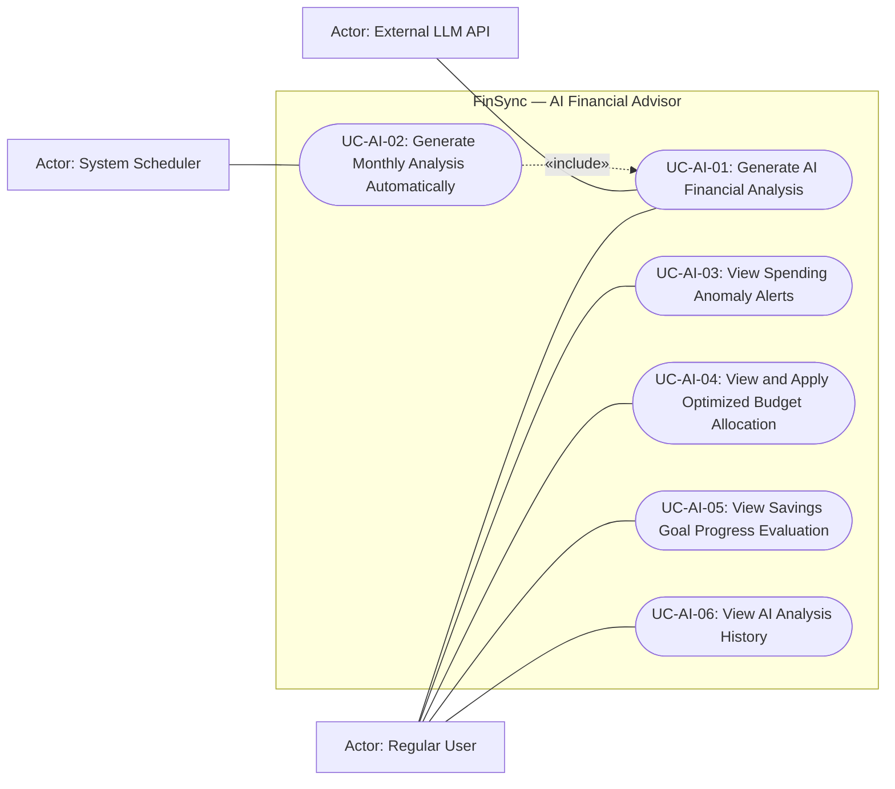

| Diagram ID | Functional groups covered | Mermaid block / document location | Relationship rationale |
|------------|---------------------------|------------------------------------|------------------------|
| AI-D1 | AI Financial Advisor | Section 3 of this file | UC-AI-02 «include» UC-AI-01 because the automatic job always reuses the full generation behavior. UC-AI-03 to UC-AI-05 do not include UC-AI-01: they read a stored result and only offer UC-AI-01 when none exists (AF-01 of UC-AI-03, equivalent branches elsewhere). The basic rule-based analysis and the application of budgets are alternative flows and the basic flow of their use cases, so no extra use case is modeled. |

**Coverage review:** FR-AI-01 to FR-AI-07 each map to at least one use case (Section 1.1), and every use case in the diagram has a specification in Section 4 with prototype screenshots for the basic flow and every alternative flow. Reused screens from other use cases are cited by their full IDs.

## 4. Use-Case Specifications
> *Performed by: `Ngo Thai Hoa` | Reviewed by: `Nguyen Phu Dat` | Edited by: `Pham Dinh Tieu Long`*

### 4.1. UC-AI-01 — Generate AI Financial Analysis (On Demand)
> *Performed by: `Ngo Thai Hoa` | Reviewed by: `Nguyen Phu Dat` | Edited by: `Pham Dinh Tieu Long`*

#### 4.1.1. Overview and Preconditions
> *Performed by: `Ngo Thai Hoa` | Reviewed by: `Nguyen Phu Dat` | Edited by: `Pham Dinh Tieu Long`*

| Field | Specification |
|-------|---------------|
| Use-case ID and name | UC-AI-01 — Generate AI Financial Analysis (On Demand) |
| Primary actor | Regular User |
| Supporting actor(s) | External LLM API (Google Gemini API or OpenAI API) |
| Description / goal | The user asks the AI Financial Advisor to analyze last month's finances and to propose a spending plan for the current month. The system aggregates the user's data, requests advice from the LLM API, validates the answer, stores it, and displays it. |
| Trigger | The user taps "Analyze with AI" on the AI Advisor screen. |
| Related functional requirements | FR-AI-01, FR-AI-07 |
| Related business rules / NFRs | BR-AI-01 to BR-AI-06, BR-AI-09; NFRs: privacy (data minimization), reliability (basic-analysis fallback), performance (30-second AI timeout) |
| Relationships | Included by UC-AI-02. The basic rule-based analysis (Section 1.3) is an alternative flow of this use case (AF-04, AF-05), not a separate use case. |
| Preconditions | 1. The user is logged in with a valid session. 2. The user account is active. 3. The device has network connectivity. |

#### 4.1.2. Basic Flow — Main Success Scenario
> *Performed by: `Ngo Thai Hoa` | Reviewed by: `Nguyen Phu Dat` | Edited by: `Pham Dinh Tieu Long`*

| Step | Actor action | System response / state change | Prototype screen ID |
|------|--------------|--------------------------------|---------------------|
| 1 | Opens the AI Advisor screen. | Displays the AI Advisor home with the "Analyze with AI" button and the date of the latest analysis, if any. | UC-AI-01-S01 |
| 2 | Taps "Analyze with AI". | Checks the daily regeneration limit (BR-AI-06) and the availability of previous-month data (BR-AI-02), disables the button, and shows the loading state. | UC-AI-01-S02 |
| 3 | - | Collects the previous-month personal transactions, the user's share of group spending, budgets, and savings goals, and aggregates them by category with the 3-month baseline (BR-AI-01, BR-AI-03). | UC-AI-01-S02 |
| 4 | - | Builds the prompt from the aggregated data and sends it to the External LLM API with a 30-second timeout (BR-AI-05). Receives the answer in JSON format. | UC-AI-01-S02 |
| 5 | - | Validates the answer (BR-AI-04), stores the result for the current month with source "AI" (BR-AI-06), and displays the Spending Summary, Anomalies, Recommended Budget, and Savings Progress sections. | UC-AI-01-S03 |
| 6 | Reviews the summary and opens a section. | Navigates to UC-AI-03, UC-AI-04, or UC-AI-05 according to the section selected. | UC-AI-01-S03 |

The symbol "-" means that the step is performed by the system without user action; "-" in the screen column means that no screen is involved.

#### 4.1.3. Alternative and Exception Flows
> *Performed by: `Ngo Thai Hoa` | Reviewed by: `Nguyen Phu Dat` | Edited by: `Pham Dinh Tieu Long`*

| Flow ID / name | Branch point / condition | Ordered actions and system responses | Resume step / termination | Resulting state | Screen IDs |
|----------------|--------------------------|--------------------------------------|---------------------------|-----------------|------------|
| AF-01 / Stored result exists | Step 1: a result already exists for the current month. | 1. System shows the stored result with its generation date and a "Regenerate" button. 2. User taps "Regenerate". | Resume at step 2. | Existing result unchanged until a new one is stored. | UC-AI-01-S04 |
| AF-02 / Limited history | Step 3: fewer than 3 previous months of data exist. | 1. System uses the available months as the baseline. 2. System marks the result "Limited history" (BR-AI-01). | Resume at step 4. | Result stored with the "Limited history" label. | UC-AI-01-S05 |
| AF-03 / User leaves while waiting | Steps 2-4: the user navigates away or backgrounds the app. | 1. Analysis continues on the server. 2. When the result is stored, system sends an in-app notification "Your AI analysis is ready." 3. User taps the notification. | Resume at step 5. | Result stored and displayed. | UC-AI-01-S06 |
| AF-04 / AI unavailable | Step 4: timeout, provider error, or provider unreachable. | 1. System retries once (BR-AI-05). 2. If the retry fails, system runs the basic rule-based analysis (Section 1.3). 3. System stores the result with source "Basic analysis" and shows a banner. | Resume at step 5 (display). | Basic result stored; the user may later use "Regenerate with AI". | UC-AI-01-S07 |
| AF-05 / Invalid AI output | Step 5: the answer is not valid JSON or fails BR-AI-04. | 1. System discards the answer and retries once. 2. If the new answer is still invalid, system performs AF-04 steps 2-3. | Resume at step 5 (display). | Basic result stored. | UC-AI-01-S07 |
| AF-06 / Not enough data | Step 2: no transaction exists in the previous month (BR-AI-02). | 1. System stops without calling the LLM API. 2. System shows "Not enough data yet. Add transactions to receive AI advice." | Terminates. | No result stored. | UC-AI-01-S08 |
| AF-07 / Daily limit reached | Step 2: the user has already requested 5 analyses today (BR-AI-06). | 1. System shows "You have reached today's limit. Try again tomorrow." 2. System keeps the latest stored result visible. | Terminates. | State unchanged. | UC-AI-01-S09 |
| AF-08 / Connectivity or server error | Step 2 or step 5: no network connection, or the server fails while storing the result. | 1. System shows an error message with a "Retry" button. 2. The stored result, if any, remains visible. 3. User taps "Retry". | Resume at step 2. | No new result stored. | UC-AI-01-S10 |
| AF-09 / Session expired | Any step: the access token is no longer valid. | 1. System redirects the user to the login screen. 2. After successful login, the app returns to the AI Advisor screen. | Resume at step 1. | The request is not processed. | UC-AI-01-S11 |

**Completeness review:** Input validation is not applicable because the user enters no data; data validity is covered by AF-06 and AF-02. Cancellation and back navigation are covered by AF-03. Repeated actions are covered by AF-01 and AF-07, and repeated taps while an analysis is running are ignored (the button is disabled in the loading state). Session changes are covered by AF-09, connectivity and persistence failures by AF-08, and AI timeout and invalid output by AF-04 and AF-05. Permission changes do not apply because the user can only access their own data.

#### 4.1.4. Postconditions and Special Requirements
> *Performed by: `Ngo Thai Hoa` | Reviewed by: `Nguyen Phu Dat` | Edited by: `Pham Dinh Tieu Long`*

**Success postconditions:** A result for the current month (source "AI" or "Basic analysis", optionally labeled "Limited history") is persisted and displayed. The request counts toward the daily limit (BR-AI-06).  
**Failure / cancellation postconditions:** For AF-06 to AF-09 no new result is stored. Any existing result, transactions, budgets, and goals remain unchanged, and the user may try again.  
**Special requirements:** BR-AI-01 to BR-AI-06 apply. Privacy: only aggregated data is sent to the LLM API (BR-AI-03). Reliability: the user always receives a usable result through the basic analysis. Amounts are computed with decimal arithmetic and shown in the user's reporting currency.

#### 4.1.5. UI Prototype Screenshots
> *Performed by: `Ngo Thai Hoa` | Reviewed by: `Nguyen Phu Dat` | Edited by: `Pham Dinh Tieu Long`*

**Prototype link / version:** See Section 1; each frame is named after its screen ID.  
**Coverage:** Basic-flow steps 1-6 and alternative flows AF-01 to AF-09. Background-only steps have no screen; flows that reuse a screen of another use case cite its full ID in the tables above.

| Screen ID | Screen / state | Basic step or alternative flow | Purpose and expected behavior | Screenshot file |
|-----------|----------------|--------------------------------|-------------------------------|-----------------|
| UC-AI-01-S01 | AI Advisor home | Basic step 1 | Entry point with the "Analyze with AI" button and the date of the latest analysis. | `../screenshots/prototypes/UC-AI-01/S01.png` |
| UC-AI-01-S02 | Loading state | Basic steps 2-4 | Shows "AI is analyzing your spending..." and a disabled button; the user may leave the screen (AF-03). | `../screenshots/prototypes/UC-AI-01/S02.png` |
| UC-AI-01-S03 | Analysis result overview | Basic steps 5-6 | Shows generation date, source "AI", and the four sections Spending Summary, Anomalies, Recommended Budget, Savings Progress. | `../screenshots/prototypes/UC-AI-01/S03.png` |
| UC-AI-01-S04 | Stored result with Regenerate | AF-01 | Shows the stored result, its generation date, and the "Regenerate" button. | `../screenshots/prototypes/UC-AI-01/S04.png` |
| UC-AI-01-S05 | Result with Limited history label | AF-02 | Shows the result with a "Limited history" label explaining that fewer than 3 months were used. | `../screenshots/prototypes/UC-AI-01/S05.png` |
| UC-AI-01-S06 | In-app notification | AF-03 | Shows the notification "Your AI analysis is ready." that opens the result. | `../screenshots/prototypes/UC-AI-01/S06.png` |
| UC-AI-01-S07 | Result with Basic analysis banner | AF-04, AF-05 | Shows the banner "AI is temporarily unavailable. Showing a basic analysis." and a "Regenerate with AI" button. | `../screenshots/prototypes/UC-AI-01/S07.png` |
| UC-AI-01-S08 | Not enough data | AF-06 | Empty state "Not enough data yet. Add transactions to receive AI advice." | `../screenshots/prototypes/UC-AI-01/S08.png` |
| UC-AI-01-S09 | Daily limit reached | AF-07 | Message "You have reached today's limit. Try again tomorrow." above the latest stored result. | `../screenshots/prototypes/UC-AI-01/S09.png` |
| UC-AI-01-S10 | Error with Retry | AF-08 | Error message for connectivity or server failure with a "Retry" button; reused by other use cases. | `../screenshots/prototypes/UC-AI-01/S10.png` |
| UC-AI-01-S11 | Session expired / login | AF-09 | Login screen shown after redirect; reused by other use cases. | `../screenshots/prototypes/UC-AI-01/S11.png` |

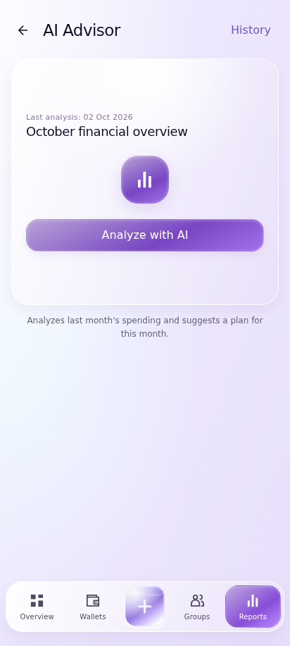

*Figure 4.1.1 — UC-AI-01, screen S01, Basic step 1: Entry point with the "Analyze with AI" button and the date of the latest analysis.*

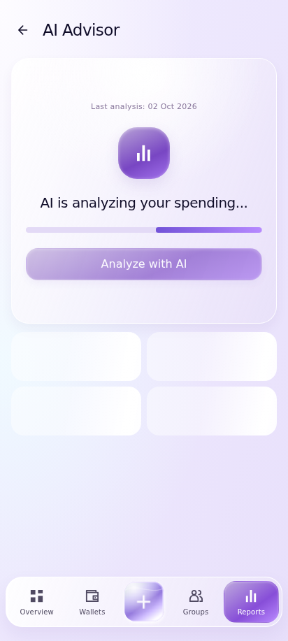

*Figure 4.1.2 — UC-AI-01, screen S02, Basic steps 2-4: Shows "AI is analyzing your spending..." and a disabled button; the user may leave the screen (AF-03).*

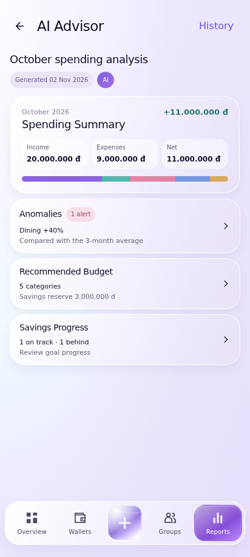

*Figure 4.1.3 — UC-AI-01, screen S03, Basic steps 5-6: Shows generation date, source "AI", and the four sections Spending Summary, Anomalies, Recommended Budget, Savings Progress.*

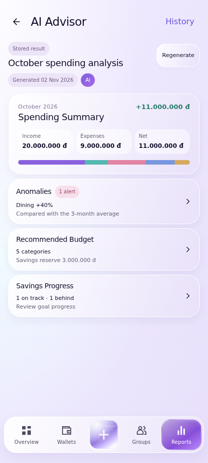

*Figure 4.1.4 — UC-AI-01, screen S04, AF-01: Shows the stored result, its generation date, and the "Regenerate" button.*

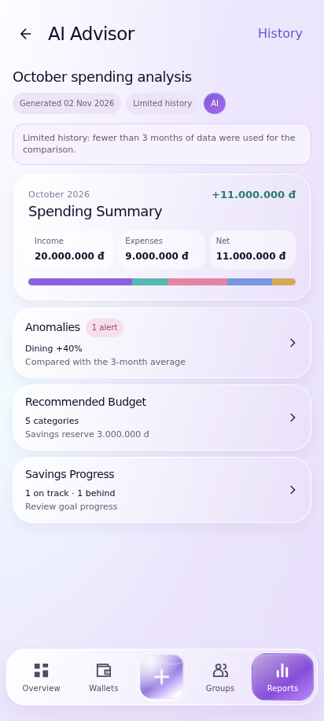

*Figure 4.1.5 — UC-AI-01, screen S05, AF-02: Shows the result with a "Limited history" label explaining that fewer than 3 months were used.*

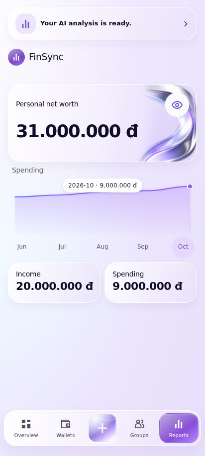

*Figure 4.1.6 — UC-AI-01, screen S06, AF-03: Shows the notification "Your AI analysis is ready." that opens the result.*

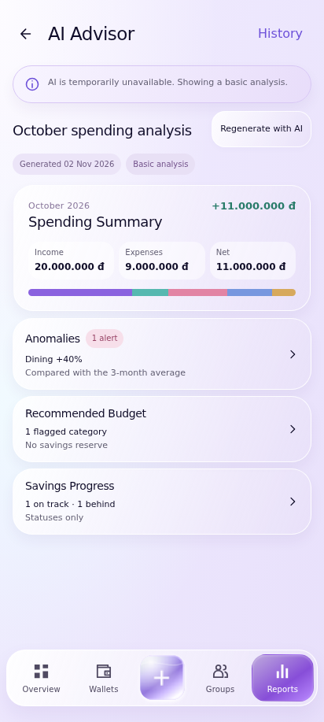

*Figure 4.1.7 — UC-AI-01, screen S07, AF-04, AF-05: Shows the banner "AI is temporarily unavailable. Showing a basic analysis." and a "Regenerate with AI" button.*

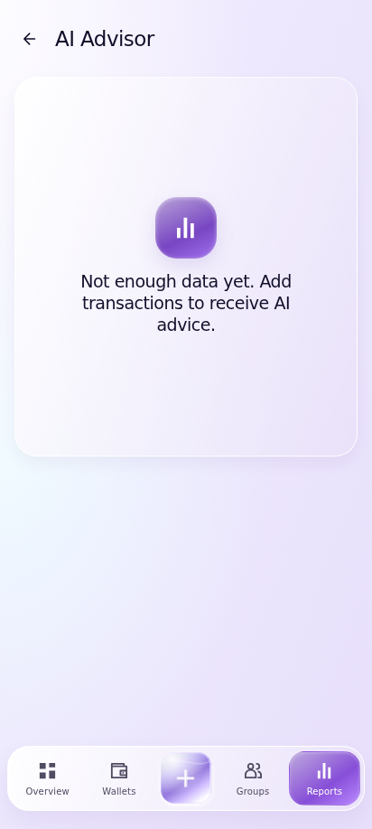

*Figure 4.1.8 — UC-AI-01, screen S08, AF-06: Empty state "Not enough data yet. Add transactions to receive AI advice."*

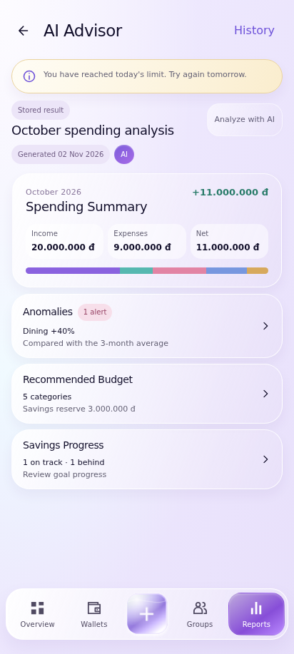

*Figure 4.1.9 — UC-AI-01, screen S09, AF-07: Message "You have reached today's limit. Try again tomorrow." above the latest stored result.*

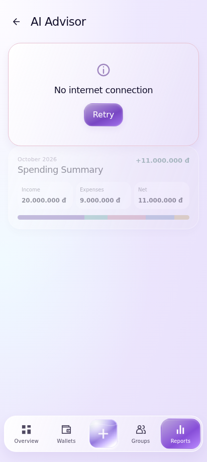

*Figure 4.1.10 — UC-AI-01, screen S10, AF-08: Error message for connectivity or server failure with a "Retry" button; reused by other use cases.*

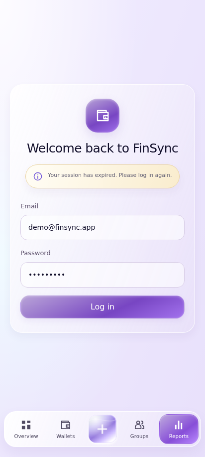

*Figure 4.1.11 — UC-AI-01, screen S11, AF-09: Login screen shown after redirect; reused by other use cases.*

### 4.2. UC-AI-02 — Generate Monthly Analysis Automatically
> *Performed by: `Ngo Thai Hoa` | Reviewed by: `Nguyen Phu Dat` | Edited by: `Pham Dinh Tieu Long`*

#### 4.2.1. Overview and Preconditions
> *Performed by: `Ngo Thai Hoa` | Reviewed by: `Nguyen Phu Dat` | Edited by: `Pham Dinh Tieu Long`*

| Field | Specification |
|-------|---------------|
| Use-case ID and name | UC-AI-02 — Generate Monthly Analysis Automatically |
| Primary actor | System Scheduler |
| Supporting actor(s) | External LLM API; Regular User (receives the notification) |
| Description / goal | At the start of each month the system automatically produces the AI analysis for every eligible user, so that advice is ready when the user opens the app. |
| Trigger | The scheduled job runs on the first day of each month. |
| Related functional requirements | FR-AI-02, FR-AI-07 |
| Related business rules / NFRs | BR-AI-01 to BR-AI-06, BR-AI-09; NFRs: reliability (the job can be re-run without duplicates), privacy (data minimization) |
| Relationships | «include» UC-AI-01 (aggregation, LLM request, validation, and storage in steps 3-5 of UC-AI-01). |
| Preconditions | 1. The backend scheduler is running. 2. The previous calendar month has ended. |

#### 4.2.2. Basic Flow — Main Success Scenario
> *Performed by: `Ngo Thai Hoa` | Reviewed by: `Nguyen Phu Dat` | Edited by: `Pham Dinh Tieu Long`*

| Step | Actor action | System response / state change | Prototype screen ID |
|------|--------------|--------------------------------|---------------------|
| 1 | Scheduler starts the monthly job. | Selects active users who have previous-month transactions and no result for the current month. | - |
| 2 | - | For each selected user, performs UC-AI-01 steps 3-5: aggregates data, requests advice from the LLM API, validates the answer, and stores the result. | - |
| 3 | - | Sends the user an in-app notification "Your monthly AI spending plan is ready." | UC-AI-02-S01 |
| 4 | User taps the notification. | Opens the AI Advisor screen displaying the new result. | UC-AI-02-S02 |

The symbol "-" means that the step is performed by the system without user action; "-" in the screen column means that no screen is involved.

#### 4.2.3. Alternative and Exception Flows
> *Performed by: `Ngo Thai Hoa` | Reviewed by: `Nguyen Phu Dat` | Edited by: `Pham Dinh Tieu Long`*

| Flow ID / name | Branch point / condition | Ordered actions and system responses | Resume step / termination | Resulting state | Screen IDs |
|----------------|--------------------------|--------------------------------------|---------------------------|-----------------|------------|
| AF-01 / Result already exists | Step 1: the user already generated an analysis for the current month. | 1. System skips this user. 2. No notification is sent. | Terminates for this user. | Existing result unchanged. | - |
| AF-02 / Notifications disabled | Step 3: the user has turned notifications off. | 1. System does not send the notification. 2. The result is available on the AI Advisor home with a "New analysis" badge. | Terminates for this user. | Result stored, no notification. | UC-AI-02-S03 |
| AF-03 / AI unavailable | Step 2: the LLM API fails or returns invalid output for a user. | 1. UC-AI-01 AF-04 or AF-05 is performed. 2. System stores the basic analysis with source "Basic analysis". | Resume at step 3. | Basic result stored; the banner is shown when the user opens it. | UC-AI-01-S07 |
| AF-04 / Job interrupted | Step 2: the server restarts or crashes during the job. | 1. On restart the job repeats step 1. 2. Users who already have a result are excluded, so no user is processed twice. | Resume at step 1. | Each eligible user has at most one result. | - |
| AF-05 / Account unavailable | Step 1 or 2: the account is locked by an administrator or deleted. | 1. System skips the account. | Terminates for this user. | No result stored. | - |
| AF-06 / Per-user processing failure | Step 2: storing the result fails for one user. | 1. System logs the error. 2. System continues with the next user. | Terminates for this user; the user can run UC-AI-01 manually. | No result stored for this user; other users unaffected. | - |
| AF-07 / Session expired on opening | Step 4: the user opens the notification after the session expired. | 1. System redirects the user to the login screen. 2. After login, the app opens the AI Advisor screen. | Resume at step 4. | Unchanged. | UC-AI-01-S11 |

**Completeness review:** This use case is a background job, so input validation, cancellation, and repeated user actions do not apply. Repeated execution is covered by AF-01 and AF-04, account-state changes by AF-05, service and persistence failures by AF-03 and AF-06, and session changes by AF-07. Offline behavior does not apply to the job; a user who is offline sees the result when connectivity returns.

#### 4.2.4. Postconditions and Special Requirements
> *Performed by: `Ngo Thai Hoa` | Reviewed by: `Nguyen Phu Dat` | Edited by: `Pham Dinh Tieu Long`*

**Success postconditions:** Each eligible user has exactly one stored result for the current month and, unless notifications are off, an in-app notification.  
**Failure / cancellation postconditions:** Users whose processing failed have no result and can use UC-AI-01. Users already processed are not affected.  
**Special requirements:** BR-AI-01 to BR-AI-06 apply. The job must be idempotent (AF-04). Only aggregated data is sent to the LLM API (BR-AI-03).

#### 4.2.5. UI Prototype Screenshots
> *Performed by: `Ngo Thai Hoa` | Reviewed by: `Nguyen Phu Dat` | Edited by: `Pham Dinh Tieu Long`*

**Prototype link / version:** See Section 1; each frame is named after its screen ID.  
**Coverage:** Basic-flow steps 1-4 and alternative flows AF-01 to AF-07. Background-only steps have no screen; flows that reuse a screen of another use case cite its full ID in the tables above.

| Screen ID | Screen / state | Basic step or alternative flow | Purpose and expected behavior | Screenshot file |
|-----------|----------------|--------------------------------|-------------------------------|-----------------|
| UC-AI-02-S01 | Monthly plan notification | Basic step 3 | Shows "Your monthly AI spending plan is ready." and opens the AI Advisor screen when tapped. | `../screenshots/prototypes/UC-AI-02/S01.png` |
| UC-AI-02-S02 | AI Advisor with new result | Basic step 4 | Shows the result generated automatically, with its generation date and source. | `../screenshots/prototypes/UC-AI-02/S02.png` |
| UC-AI-02-S03 | AI Advisor home with New analysis badge | AF-02 | Shows the "New analysis" badge when notifications are disabled. | `../screenshots/prototypes/UC-AI-02/S03.png` |

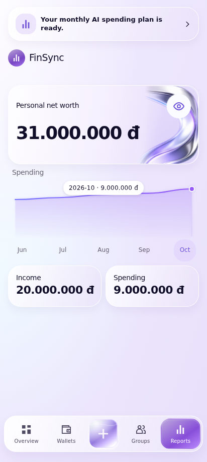

*Figure 4.2.1 — UC-AI-02, screen S01, Basic step 3: Shows "Your monthly AI spending plan is ready." and opens the AI Advisor screen when tapped.*

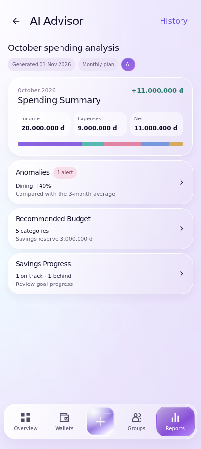

*Figure 4.2.2 — UC-AI-02, screen S02, Basic step 4: Shows the result generated automatically, with its generation date and source.*

*Figure 4.2.3 — UC-AI-02, screen S03, AF-02: Shows the "New analysis" badge when notifications are disabled.*

### 4.3. UC-AI-03 — View Spending Anomaly Alerts
> *Performed by: `Ngo Thai Hoa` | Reviewed by: `Nguyen Phu Dat` | Edited by: `Pham Dinh Tieu Long`*

#### 4.3.1. Overview and Preconditions
> *Performed by: `Ngo Thai Hoa` | Reviewed by: `Nguyen Phu Dat` | Edited by: `Pham Dinh Tieu Long`*

| Field | Specification |
|-------|---------------|
| Use-case ID and name | UC-AI-03 — View Spending Anomaly Alerts |
| Primary actor | Regular User |
| Supporting actor(s) | None |
| Description / goal | The user reviews the categories where spending exceeded the budget or increased abnormally, with an explanation and a suggested limit, and can inspect the transactions behind each alert. |
| Trigger | The user taps "Anomalies" on the AI Advisor result screen. |
| Related functional requirements | FR-AI-03 |
| Related business rules / NFRs | BR-AI-01, BR-AI-07, BR-AI-09; NFR: usability (clear explanation of each alert) |
| Relationships | None. When no analysis exists, the user may start UC-AI-01 (AF-01). |
| Preconditions | 1. The user is logged in with a valid session. 2. An analysis exists for the current month (otherwise see AF-01). |

#### 4.3.2. Basic Flow — Main Success Scenario
> *Performed by: `Ngo Thai Hoa` | Reviewed by: `Nguyen Phu Dat` | Edited by: `Pham Dinh Tieu Long`*

| Step | Actor action | System response / state change | Prototype screen ID |
|------|--------------|--------------------------------|---------------------|
| 1 | Taps "Anomalies" on the AI Advisor result screen. | Loads the stored analysis for the current month. | UC-AI-01-S03 |
| 2 | - | Displays the flagged categories with last month's spending, baseline average, percentage change, a suggested limit, and a short explanation. | UC-AI-03-S01 |
| 3 | Taps a category. | Loads and displays the previous-month transactions of that category. | UC-AI-03-S02 |
| 4 | Reviews the transactions and taps Back. | Returns to the anomaly list. | UC-AI-03-S01 |

The symbol "-" means that the step is performed by the system without user action; "-" in the screen column means that no screen is involved.

#### 4.3.3. Alternative and Exception Flows
> *Performed by: `Ngo Thai Hoa` | Reviewed by: `Nguyen Phu Dat` | Edited by: `Pham Dinh Tieu Long`*

| Flow ID / name | Branch point / condition | Ordered actions and system responses | Resume step / termination | Resulting state | Screen IDs |
|----------------|--------------------------|--------------------------------------|---------------------------|-----------------|------------|
| AF-01 / No analysis yet | Step 1: no analysis exists for the current month. | 1. System shows "No analysis for this month yet" with an "Analyze with AI" button. 2. If the user taps it, UC-AI-01 is performed. | Resume at step 2 after UC-AI-01 completes; terminates if the user does not tap the button. | Unchanged, or a new result stored. | UC-AI-03-S06 |
| AF-02 / No anomaly | Step 2: no category is flagged under BR-AI-07. | 1. System shows "Great job! No unusual spending detected." | Terminates. | Unchanged. | UC-AI-03-S03 |
| AF-03 / Basic analysis | Step 2: the stored result has source "Basic analysis". | 1. System builds the list from BR-AI-07 only. 2. System shows a standard explanation text and the basic-analysis banner. | Resume at step 3. | Unchanged. | UC-AI-03-S04 |
| AF-04 / Transactions fail to load | Step 3: the transaction list cannot be loaded. | 1. System shows "Unable to load transactions" with a "Retry" button. 2. The anomaly list remains visible. | Retry resumes at step 3; Back resumes at step 2. | Unchanged. | UC-AI-03-S05 |
| AF-05 / Connectivity error | Step 1: no network connection or server error while loading the analysis. | 1. System shows an error with a "Retry" button. | Retry resumes at step 1. | Unchanged. | UC-AI-01-S10 |
| AF-06 / Session expired | Any step: the access token is no longer valid. | 1. System redirects the user to the login screen. 2. After login, the app returns to the AI Advisor screen. | Resume at step 1. | Unchanged. | UC-AI-01-S11 |

**Completeness review:** This use case is read-only, so input validation, duplicate submissions, and concurrent edits do not apply. Empty data is covered by AF-01 and AF-02, back navigation by step 4, connectivity and service failures by AF-04 and AF-05, session changes by AF-06, and the degraded analysis source by AF-03.

#### 4.3.4. Postconditions and Special Requirements
> *Performed by: `Ngo Thai Hoa` | Reviewed by: `Nguyen Phu Dat` | Edited by: `Pham Dinh Tieu Long`*

**Success postconditions:** The user has seen the anomaly list and, optionally, the related transactions. No data is changed.  
**Failure / cancellation postconditions:** No data is changed in any case; the user may retry.  
**Special requirements:** BR-AI-07 defines when a category is flagged (budget exceeded, or more than 30% above the 3-month baseline). Only the user's own data is shown.

#### 4.3.5. UI Prototype Screenshots
> *Performed by: `Ngo Thai Hoa` | Reviewed by: `Nguyen Phu Dat` | Edited by: `Pham Dinh Tieu Long`*

**Prototype link / version:** See Section 1; each frame is named after its screen ID.  
**Coverage:** Basic-flow steps 1-4 and alternative flows AF-01 to AF-06. Background-only steps have no screen; flows that reuse a screen of another use case cite its full ID in the tables above.

| Screen ID | Screen / state | Basic step or alternative flow | Purpose and expected behavior | Screenshot file |
|-----------|----------------|--------------------------------|-------------------------------|-----------------|
| UC-AI-03-S01 | Anomaly list | Basic steps 2 and 4 | Lists flagged categories with spending, baseline, percentage change, suggested limit, and explanation. | `../screenshots/prototypes/UC-AI-03/S01.png` |
| UC-AI-03-S02 | Anomaly detail with transactions | Basic step 3 | Shows the previous-month transactions of the selected category. | `../screenshots/prototypes/UC-AI-03/S02.png` |
| UC-AI-03-S03 | No unusual spending | AF-02 | Shows "Great job! No unusual spending detected." | `../screenshots/prototypes/UC-AI-03/S03.png` |
| UC-AI-03-S04 | Anomaly list from basic analysis | AF-03 | Shows the list with the basic-analysis banner and standard explanation text. | `../screenshots/prototypes/UC-AI-03/S04.png` |
| UC-AI-03-S05 | Transactions load error | AF-04 | Shows "Unable to load transactions" with "Retry" while the list stays visible. | `../screenshots/prototypes/UC-AI-03/S05.png` |
| UC-AI-03-S06 | No analysis yet | AF-01 | Shows "No analysis for this month yet" with an "Analyze with AI" button; reused by UC-AI-04 and UC-AI-05. | `../screenshots/prototypes/UC-AI-03/S06.png` |

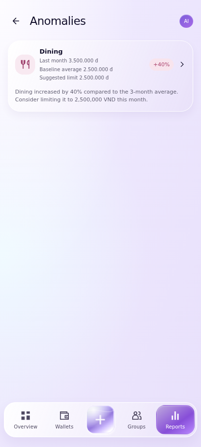

*Figure 4.3.1 — UC-AI-03, screen S01, Basic steps 2 and 4: Lists flagged categories with spending, baseline, percentage change, suggested limit, and explanation.*

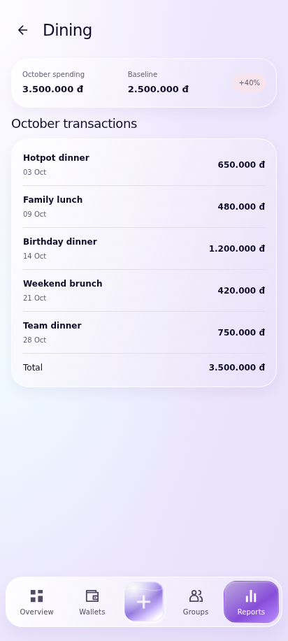

*Figure 4.3.2 — UC-AI-03, screen S02, Basic step 3: Shows the previous-month transactions of the selected category.*

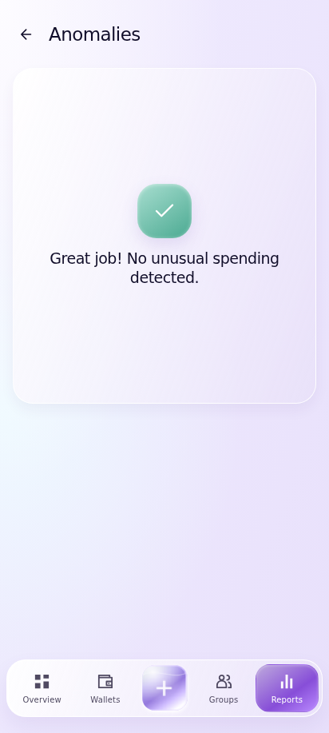

*Figure 4.3.3 — UC-AI-03, screen S03, AF-02: Shows "Great job! No unusual spending detected."*

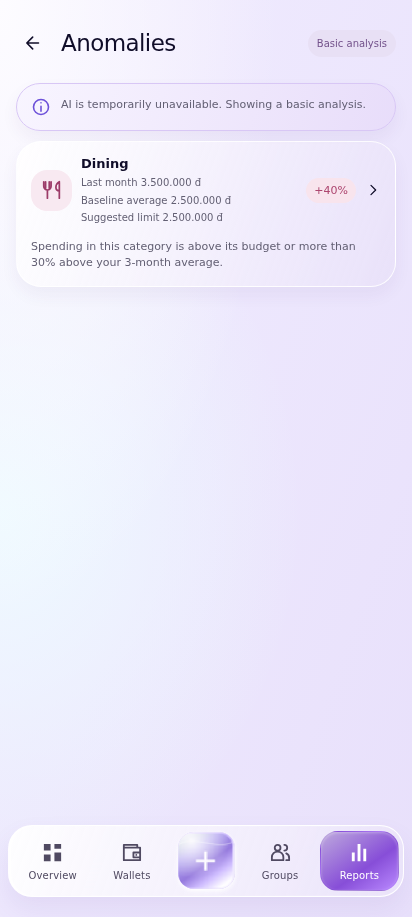

*Figure 4.3.4 — UC-AI-03, screen S04, AF-03: Shows the list with the basic-analysis banner and standard explanation text.*

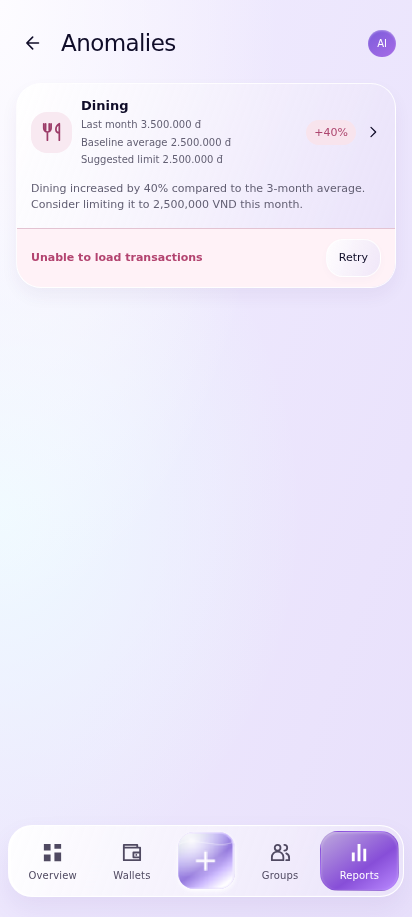

*Figure 4.3.5 — UC-AI-03, screen S05, AF-04: Shows "Unable to load transactions" with "Retry" while the list stays visible.*

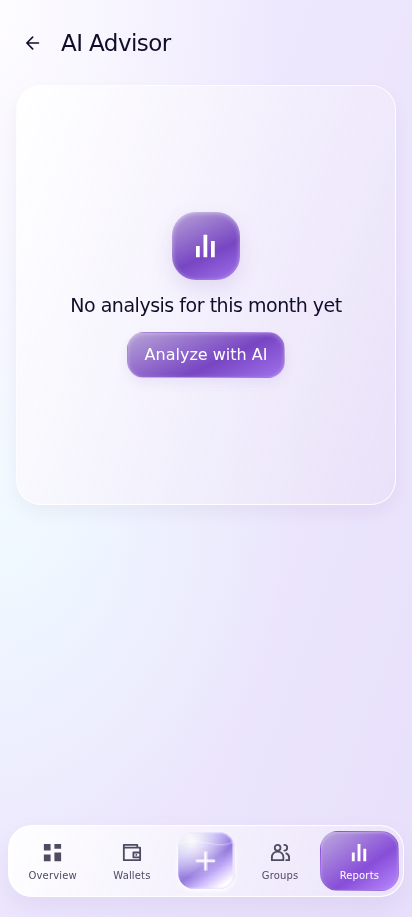

*Figure 4.3.6 — UC-AI-03, screen S06, AF-01: Shows "No analysis for this month yet" with an "Analyze with AI" button; reused by UC-AI-04 and UC-AI-05.*

### 4.4. UC-AI-04 — View and Apply Optimized Budget Allocation
> *Performed by: `Ngo Thai Hoa` | Reviewed by: `Nguyen Phu Dat` | Edited by: `Pham Dinh Tieu Long`*

#### 4.4.1. Overview and Preconditions
> *Performed by: `Ngo Thai Hoa` | Reviewed by: `Nguyen Phu Dat` | Edited by: `Pham Dinh Tieu Long`*

| Field | Specification |
|-------|---------------|
| Use-case ID and name | UC-AI-04 — View and Apply Optimized Budget Allocation |
| Primary actor | Regular User |
| Supporting actor(s) | None |
| Description / goal | The user views the budget per category suggested from income, savings goals, and actual spending habits, and may apply it to the monthly budgets of the Budget Planning & Alerting group. |
| Trigger | The user taps "Recommended Budget" on the AI Advisor result screen. |
| Related functional requirements | FR-AI-04 |
| Related business rules / NFRs | BR-AI-04, BR-AI-08, BR-AI-09; NFRs: data integrity (all-or-nothing update), usability |
| Relationships | None. Applying the budgets is part of the basic flow; budget data is owned by the Budget Planning & Alerting group. |
| Preconditions | 1. The user is logged in with a valid session. 2. An analysis exists for the current month (otherwise see AF-10). |

#### 4.4.2. Basic Flow — Main Success Scenario
> *Performed by: `Ngo Thai Hoa` | Reviewed by: `Nguyen Phu Dat` | Edited by: `Pham Dinh Tieu Long`*

| Step | Actor action | System response / state change | Prototype screen ID |
|------|--------------|--------------------------------|---------------------|
| 1 | Taps "Recommended Budget". | Loads the stored analysis and displays, per category, the current budget, the average spending, the suggested budget, and the amount reserved for savings. | UC-AI-04-S01 |
| 2 | Taps "Apply to my budgets". | Shows a confirmation dialog listing every budget that will be created or changed. | UC-AI-04-S02 |
| 3 | Confirms. | Creates or updates the budgets for the current month in one transaction and shows "Budgets updated successfully". | UC-AI-04-S03 |

The symbol "-" means that the step is performed by the system without user action; "-" in the screen column means that no screen is involved.

#### 4.4.3. Alternative and Exception Flows
> *Performed by: `Ngo Thai Hoa` | Reviewed by: `Nguyen Phu Dat` | Edited by: `Pham Dinh Tieu Long`*

| Flow ID / name | Branch point / condition | Ordered actions and system responses | Resume step / termination | Resulting state | Screen IDs |
|----------------|--------------------------|--------------------------------------|---------------------------|-----------------|------------|
| AF-01 / Edit suggested amount | Step 1: the user wants a different amount. | 1. User taps an amount and enters a new value. 2. System validates the value and updates the displayed total. | Resume at step 2 with the edited values. | No change until confirmed. | UC-AI-04-S04 |
| AF-02 / Apply a subset | Step 1: the user wants only some categories. | 1. User unchecks categories. 2. System recalculates the list of changes. | Resume at step 2 with checked categories only. | No change until confirmed. | UC-AI-04-S05 |
| AF-03 / Cancel | Step 2: the user taps "Cancel" in the dialog. | 1. System closes the dialog. | Return to step 1. | Budgets unchanged. | UC-AI-04-S02 |
| AF-04 / Invalid amount | AF-01 step 2: the value is empty, zero, negative, or not a number. | 1. System highlights the field and shows "Enter a valid amount". 2. System keeps the previous value. | Resume at AF-01 step 1. | Budgets unchanged. | UC-AI-04-S06 |
| AF-05 / Total exceeds income | Step 2: the total of budgets plus savings reserve exceeds the income baseline (BR-AI-04). | 1. System shows the warning "Total budget exceeds your income". 2. User adjusts the amounts, or confirms anyway. | Adjust: return to step 1. Confirm: resume at step 3. | Budgets unchanged until confirmed. | UC-AI-04-S07 |
| AF-06 / Save fails | Step 3: the server fails while saving. | 1. System rolls back all changes. 2. System shows "Could not update budgets. Please try again." with "Retry". | Retry resumes at step 3; Cancel returns to step 1. | Budgets unchanged. | UC-AI-04-S08 |
| AF-07 / No existing budget | Step 3: the user has no budget for a category in the current month. | 1. System creates new budgets with the confirmed values. 2. System shows "Budgets created". | Terminates. | New budgets stored. | UC-AI-04-S03 |
| AF-08 / Basic analysis | Step 1: the stored result has source "Basic analysis". | 1. System shows only flagged categories, with the suggested limit equal to the baseline average. 2. System shows the basic-analysis banner and no savings reserve. | Resume at step 2. | Unchanged. | UC-AI-04-S09 |
| AF-09 / Budgets changed elsewhere | Step 3: the budgets were changed after this screen was loaded. | 1. System aborts the update and shows "Your budgets changed since this screen was loaded." with "Refresh". 2. User taps "Refresh". | Resume at step 1. | Budgets unchanged by this action. | UC-AI-04-S10 |
| AF-10 / No analysis yet | Step 1: no analysis exists for the current month. | 1. Same as UC-AI-03 AF-01. | Resume at step 1 after UC-AI-01 completes. | Unchanged, or a new result stored. | UC-AI-03-S06 |
| AF-11 / Session expired | Any step: the access token is no longer valid. | 1. System redirects the user to the login screen. 2. After login, the app returns to the AI Advisor screen. | Resume at step 1. | Budgets unchanged. | UC-AI-01-S11 |

**Completeness review:** Input validation is covered by AF-04 and AF-05, cancellation by AF-03, empty data by AF-10, repeated or duplicate confirmation is prevented by closing the dialog and disabling the button during saving, concurrent edits by AF-09, persistence failures by AF-06, and session changes by AF-11. Connectivity failure during loading is handled as in UC-AI-03 AF-05 and shown with the shared error screen.

#### 4.4.4. Postconditions and Special Requirements
> *Performed by: `Ngo Thai Hoa` | Reviewed by: `Nguyen Phu Dat` | Edited by: `Pham Dinh Tieu Long`*

**Success postconditions:** The selected category budgets for the current month are created or updated and the user sees a confirmation. The AI result itself is not modified.  
**Failure / cancellation postconditions:** Budgets remain exactly as before (cancel, validation error, or rolled-back save).  
**Special requirements:** BR-AI-08: the advice is only applied after explicit confirmation. BR-AI-04: the total of suggested budgets must not exceed the income baseline. The update of all selected budgets is atomic. Amounts use decimal arithmetic in the user's reporting currency.

#### 4.4.5. UI Prototype Screenshots
> *Performed by: `Ngo Thai Hoa` | Reviewed by: `Nguyen Phu Dat` | Edited by: `Pham Dinh Tieu Long`*

**Prototype link / version:** See Section 1; each frame is named after its screen ID.  
**Coverage:** Basic-flow steps 1-3 and alternative flows AF-01 to AF-11. Background-only steps have no screen; flows that reuse a screen of another use case cite its full ID in the tables above.

| Screen ID | Screen / state | Basic step or alternative flow | Purpose and expected behavior | Screenshot file |
|-----------|----------------|--------------------------------|-------------------------------|-----------------|
| UC-AI-04-S01 | Recommended budget table | Basic step 1 | Shows current budget, average spending, suggested budget, and savings reserve per category with an "Apply to my budgets" button. | `../screenshots/prototypes/UC-AI-04/S01.png` |
| UC-AI-04-S02 | Confirmation dialog | Basic step 2, AF-03 | Lists every budget to be created or changed with "Confirm" and "Cancel". | `../screenshots/prototypes/UC-AI-04/S02.png` |
| UC-AI-04-S03 | Budgets updated | Basic step 3, AF-07 | Shows "Budgets updated successfully" (or "Budgets created" when none existed). | `../screenshots/prototypes/UC-AI-04/S03.png` |
| UC-AI-04-S04 | Edit suggested amount | AF-01 | Shows an editable amount field with the updated total. | `../screenshots/prototypes/UC-AI-04/S04.png` |
| UC-AI-04-S05 | Category selection | AF-02 | Shows checkboxes per category to apply only some suggestions. | `../screenshots/prototypes/UC-AI-04/S05.png` |
| UC-AI-04-S06 | Invalid amount error | AF-04 | Shows the highlighted field with "Enter a valid amount". | `../screenshots/prototypes/UC-AI-04/S06.png` |
| UC-AI-04-S07 | Total exceeds income warning | AF-05 | Shows the warning "Total budget exceeds your income" with "Adjust" and "Apply anyway". | `../screenshots/prototypes/UC-AI-04/S07.png` |
| UC-AI-04-S08 | Save failed | AF-06 | Shows "Could not update budgets. Please try again." with "Retry". | `../screenshots/prototypes/UC-AI-04/S08.png` |
| UC-AI-04-S09 | Recommended budget from basic analysis | AF-08 | Shows only flagged categories with the basic-analysis banner. | `../screenshots/prototypes/UC-AI-04/S09.png` |
| UC-AI-04-S10 | Budgets changed notice | AF-09 | Shows "Your budgets changed since this screen was loaded." with "Refresh". | `../screenshots/prototypes/UC-AI-04/S10.png` |

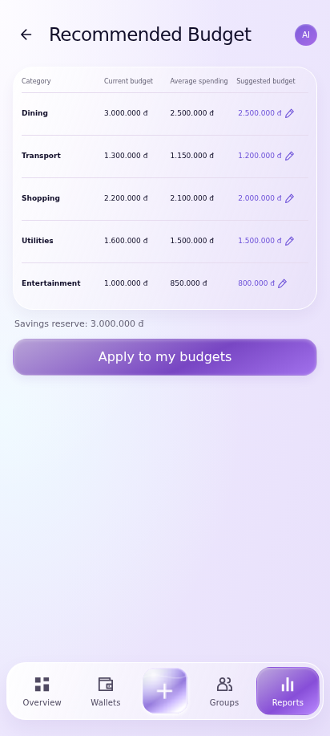

*Figure 4.4.1 — UC-AI-04, screen S01, Basic step 1: Shows current budget, average spending, suggested budget, and savings reserve per category with an "Apply to my budgets" button.*

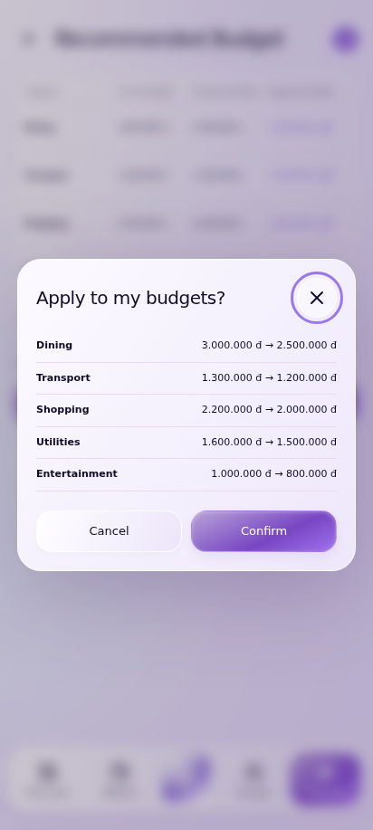

*Figure 4.4.2 — UC-AI-04, screen S02, Basic step 2, AF-03: Lists every budget to be created or changed with "Confirm" and "Cancel".*

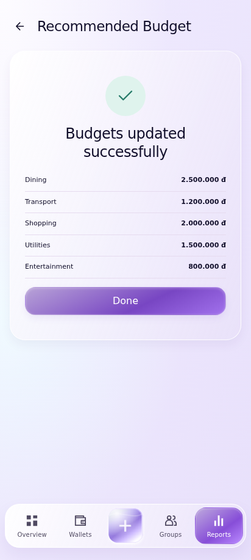

*Figure 4.4.3 — UC-AI-04, screen S03, Basic step 3, AF-07: Shows "Budgets updated successfully" (or "Budgets created" when none existed).*

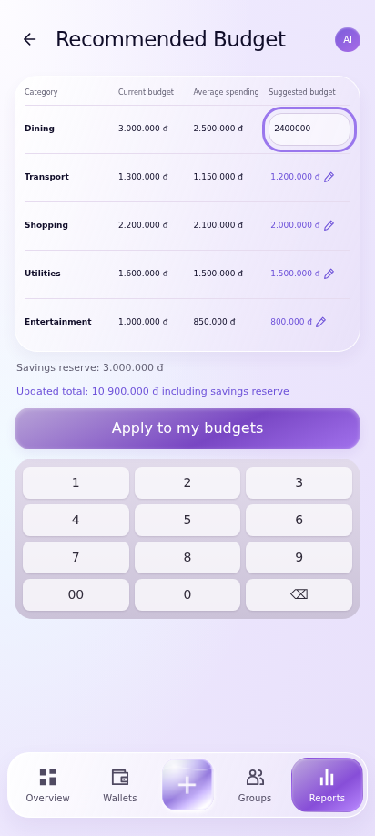

*Figure 4.4.4 — UC-AI-04, screen S04, AF-01: Shows an editable amount field with the updated total.*

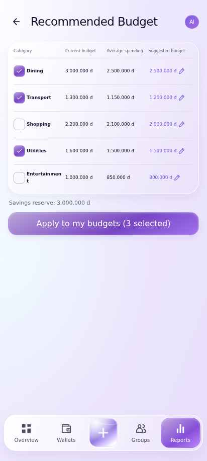

*Figure 4.4.5 — UC-AI-04, screen S05, AF-02: Shows checkboxes per category to apply only some suggestions.*

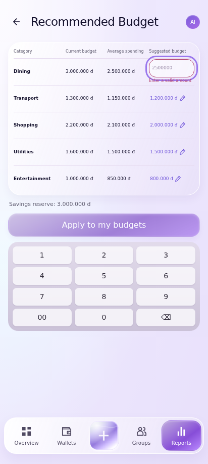

*Figure 4.4.6 — UC-AI-04, screen S06, AF-04: Shows the highlighted field with "Enter a valid amount".*

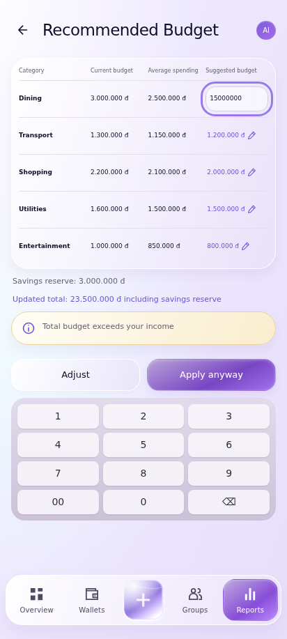

*Figure 4.4.7 — UC-AI-04, screen S07, AF-05: Shows the warning "Total budget exceeds your income" with "Adjust" and "Apply anyway".*

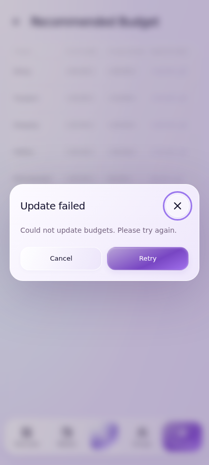

*Figure 4.4.8 — UC-AI-04, screen S08, AF-06: Shows "Could not update budgets. Please try again." with "Retry".*

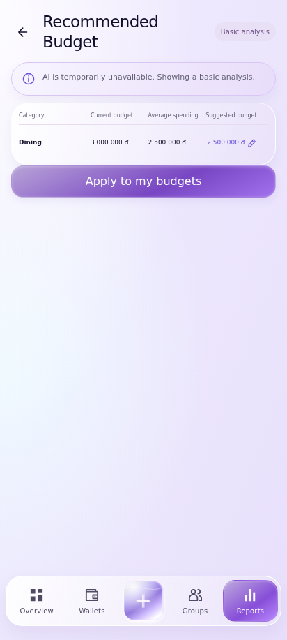

*Figure 4.4.9 — UC-AI-04, screen S09, AF-08: Shows only flagged categories with the basic-analysis banner.*

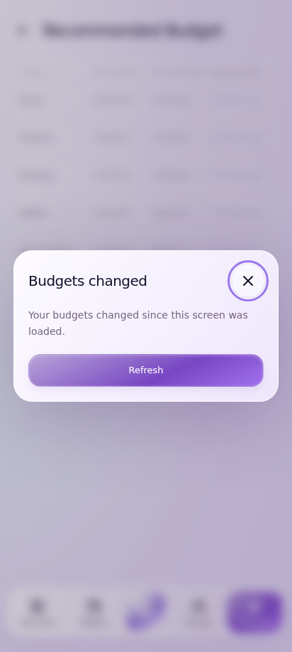

*Figure 4.4.10 — UC-AI-04, screen S10, AF-09: Shows "Your budgets changed since this screen was loaded." with "Refresh".*

### 4.5. UC-AI-05 — View Savings Goal Progress Evaluation
> *Performed by: `Ngo Thai Hoa` | Reviewed by: `Nguyen Phu Dat` | Edited by: `Pham Dinh Tieu Long`*

#### 4.5.1. Overview and Preconditions
> *Performed by: `Ngo Thai Hoa` | Reviewed by: `Nguyen Phu Dat` | Edited by: `Pham Dinh Tieu Long`*

| Field | Specification |
|-------|---------------|
| Use-case ID and name | UC-AI-05 — View Savings Goal Progress Evaluation |
| Primary actor | Regular User |
| Supporting actor(s) | None |
| Description / goal | The user reads the evaluation of progress toward each savings goal, together with recommendations when a goal is falling behind. |
| Trigger | The user taps "Savings Progress" on the AI Advisor result screen. |
| Related functional requirements | FR-AI-05 |
| Related business rules / NFRs | BR-AI-08, BR-AI-09; NFR: usability |
| Relationships | None. Opening or adjusting a goal continues in the Savings Goal Management group. |
| Preconditions | 1. The user is logged in with a valid session. 2. An analysis exists for the current month (otherwise see AF-06). |

#### 4.5.2. Basic Flow — Main Success Scenario
> *Performed by: `Ngo Thai Hoa` | Reviewed by: `Nguyen Phu Dat` | Edited by: `Pham Dinh Tieu Long`*

| Step | Actor action | System response / state change | Prototype screen ID |
|------|--------------|--------------------------------|---------------------|
| 1 | Taps "Savings Progress". | Loads the stored analysis and the savings goals, and displays for each goal the target amount, saved amount, progress percentage, deadline, and status (On track, Slightly behind, Behind). | UC-AI-05-S01 |
| 2 | Selects a goal that is behind. | Shows the recommendation: the monthly amount needed to reach the target, or a suggested deadline extension. | UC-AI-05-S02 |
| 3 | Taps "Go to goal". | Opens the goal detail in the Savings Goal Management group. | UC-AI-05-S03 |

The symbol "-" means that the step is performed by the system without user action; "-" in the screen column means that no screen is involved.

#### 4.5.3. Alternative and Exception Flows
> *Performed by: `Ngo Thai Hoa` | Reviewed by: `Nguyen Phu Dat` | Edited by: `Pham Dinh Tieu Long`*

| Flow ID / name | Branch point / condition | Ordered actions and system responses | Resume step / termination | Resulting state | Screen IDs |
|----------------|--------------------------|--------------------------------------|---------------------------|-----------------|------------|
| AF-01 / No savings goal | Step 1: the user has no savings goal. | 1. System shows "No savings goals yet" with a "Create a goal" button. | Terminates; the user may create a goal in the Savings Goal Management group. | Unchanged. | UC-AI-05-S04 |
| AF-02 / All goals on track | Step 1: every goal has the status "On track". | 1. System shows an encouraging message and no adjustment recommendation. | Terminates. | Unchanged. | UC-AI-05-S05 |
| AF-03 / Basic analysis | Step 1: the stored result has source "Basic analysis". | 1. System computes the progress and status from stored data. 2. System omits the AI recommendation text and shows the basic-analysis banner. | Resume at step 3. | Unchanged. | UC-AI-05-S06 |
| AF-04 / Accept suggested change | Step 2: the user taps "Adjust goal". | 1. System opens the goal edit screen with the suggested value pre-filled. 2. The goal is saved only when the user confirms there; if the user cancels, nothing changes. | Cancel returns to step 2. | Unchanged until the user saves in the Savings Goal Management group. | UC-AI-05-S07 |
| AF-05 / Goal changed or deleted | Step 3: the goal was changed or deleted after the analysis was generated. | 1. System shows "This goal was updated or no longer exists." 2. System refreshes the list. | Resume at step 1. | Unchanged. | UC-AI-05-S08 |
| AF-06 / No analysis yet | Step 1: no analysis exists for the current month. | 1. Same as UC-AI-03 AF-01. | Resume at step 1 after UC-AI-01 completes. | Unchanged, or a new result stored. | UC-AI-03-S06 |
| AF-07 / Connectivity error | Step 1: no network connection or server error. | 1. System shows an error with a "Retry" button. | Retry resumes at step 1. | Unchanged. | UC-AI-01-S10 |
| AF-08 / Session expired | Any step: the access token is no longer valid. | 1. System redirects the user to the login screen. 2. After login, the app returns to the AI Advisor screen. | Resume at step 1. | Unchanged. | UC-AI-01-S11 |

**Completeness review:** This use case is read-only, so input validation and duplicate submissions do not apply. Empty data is covered by AF-01 and AF-06, the positive case by AF-02, cancellation by AF-04, stale data by AF-05, connectivity failures by AF-07, session changes by AF-08, and the degraded analysis source by AF-03.

#### 4.5.4. Postconditions and Special Requirements
> *Performed by: `Ngo Thai Hoa` | Reviewed by: `Nguyen Phu Dat` | Edited by: `Pham Dinh Tieu Long`*

**Success postconditions:** The user has seen the progress and recommendations. No goal is changed by this use case.  
**Failure / cancellation postconditions:** No data is changed in any case.  
**Special requirements:** BR-AI-08: recommendations are advisory and never change a goal without the user's confirmation. Goals in different currencies follow the currency rules of the Savings Goal Management group.

#### 4.5.5. UI Prototype Screenshots
> *Performed by: `Ngo Thai Hoa` | Reviewed by: `Nguyen Phu Dat` | Edited by: `Pham Dinh Tieu Long`*

**Prototype link / version:** See Section 1; each frame is named after its screen ID.  
**Coverage:** Basic-flow steps 1-3 and alternative flows AF-01 to AF-08. Background-only steps have no screen; flows that reuse a screen of another use case cite its full ID in the tables above.

| Screen ID | Screen / state | Basic step or alternative flow | Purpose and expected behavior | Screenshot file |
|-----------|----------------|--------------------------------|-------------------------------|-----------------|
| UC-AI-05-S01 | Goal progress list | Basic step 1 | Lists each goal with target, saved amount, progress, deadline, and status. | `../screenshots/prototypes/UC-AI-05/S01.png` |
| UC-AI-05-S02 | Goal recommendation | Basic step 2 | Shows the monthly amount needed or the suggested deadline extension with "Adjust goal" and "Go to goal". | `../screenshots/prototypes/UC-AI-05/S02.png` |
| UC-AI-05-S03 | Goal detail | Basic step 3 | Goal detail screen of the Savings Goal Management group, reused here. | `../screenshots/prototypes/UC-AI-05/S03.png` |
| UC-AI-05-S04 | No savings goals | AF-01 | Shows "No savings goals yet" with "Create a goal". | `../screenshots/prototypes/UC-AI-05/S04.png` |
| UC-AI-05-S05 | All goals on track | AF-02 | Shows the encouraging message without recommendations. | `../screenshots/prototypes/UC-AI-05/S05.png` |
| UC-AI-05-S06 | Progress from basic analysis | AF-03 | Shows computed progress and status with the basic-analysis banner. | `../screenshots/prototypes/UC-AI-05/S06.png` |
| UC-AI-05-S07 | Goal edit with suggested value | AF-04 | Shows the goal edit screen with the suggested value pre-filled. | `../screenshots/prototypes/UC-AI-05/S07.png` |
| UC-AI-05-S08 | Goal changed notice | AF-05 | Shows "This goal was updated or no longer exists." | `../screenshots/prototypes/UC-AI-05/S08.png` |

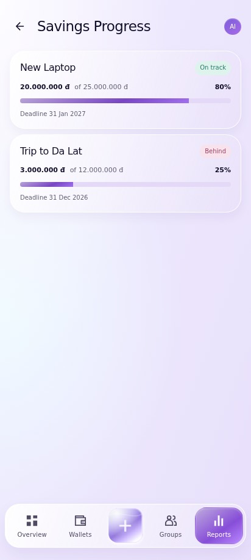

*Figure 4.5.1 — UC-AI-05, screen S01, Basic step 1: Lists each goal with target, saved amount, progress, deadline, and status.*

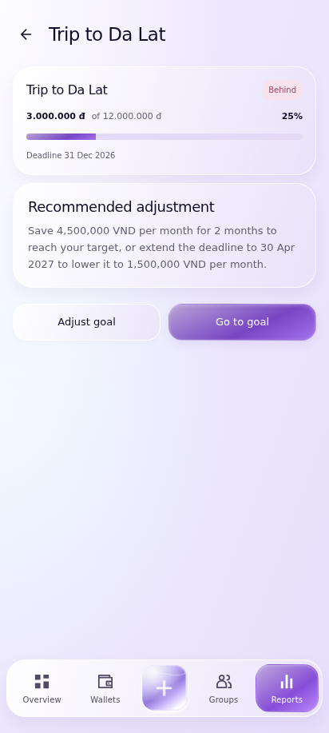

*Figure 4.5.2 — UC-AI-05, screen S02, Basic step 2: Shows the monthly amount needed or the suggested deadline extension with "Adjust goal" and "Go to goal".*

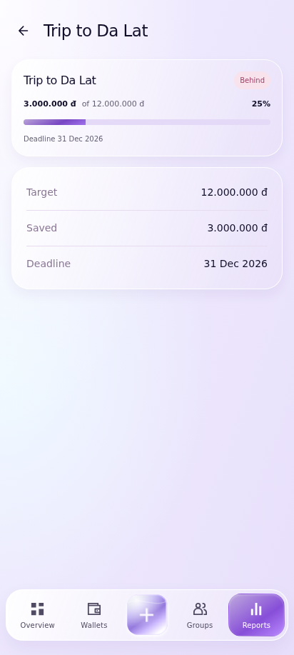

*Figure 4.5.3 — UC-AI-05, screen S03, Basic step 3: Goal detail screen of the Savings Goal Management group, reused here.*

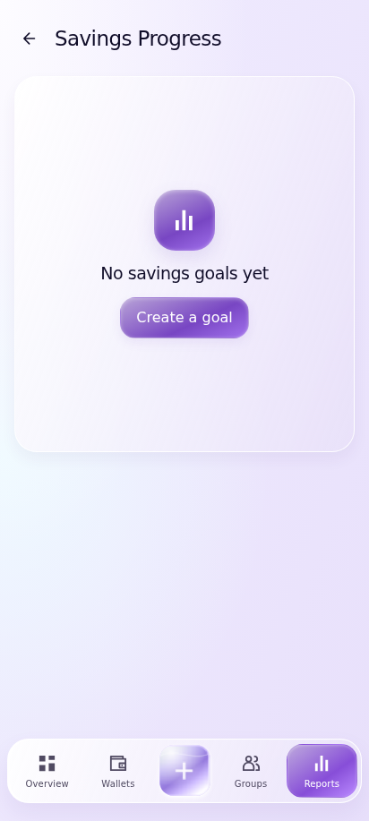

*Figure 4.5.4 — UC-AI-05, screen S04, AF-01: Shows "No savings goals yet" with "Create a goal".*

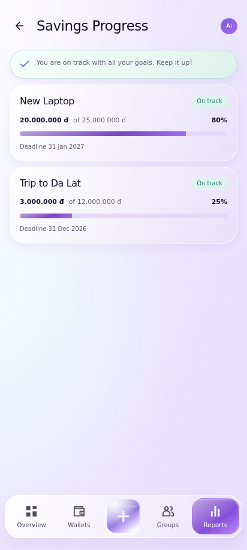

*Figure 4.5.5 — UC-AI-05, screen S05, AF-02: Shows the encouraging message without recommendations.*

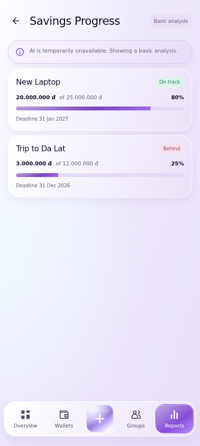

*Figure 4.5.6 — UC-AI-05, screen S06, AF-03: Shows computed progress and status with the basic-analysis banner.*

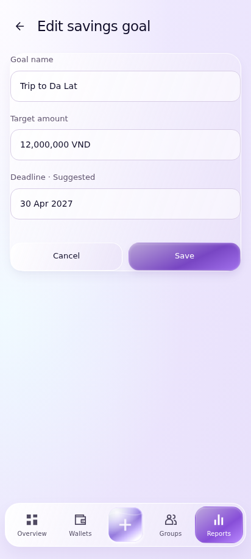

*Figure 4.5.7 — UC-AI-05, screen S07, AF-04: Shows the goal edit screen with the suggested value pre-filled.*

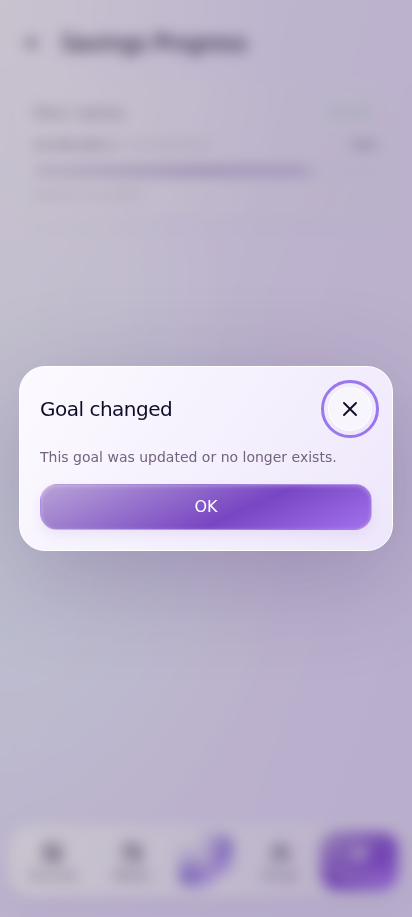

*Figure 4.5.8 — UC-AI-05, screen S08, AF-05: Shows "This goal was updated or no longer exists."*

### 4.6. UC-AI-06 — View AI Analysis History
> *Performed by: `Ngo Thai Hoa` | Reviewed by: `Nguyen Phu Dat` | Edited by: `Pham Dinh Tieu Long`*

#### 4.6.1. Overview and Preconditions
> *Performed by: `Ngo Thai Hoa` | Reviewed by: `Nguyen Phu Dat` | Edited by: `Pham Dinh Tieu Long`*

| Field | Specification |
|-------|---------------|
| Use-case ID and name | UC-AI-06 — View AI Analysis History |
| Primary actor | Regular User |
| Supporting actor(s) | None |
| Description / goal | The user browses analyses from previous months, in read-only mode, to follow how spending and the advice changed over time. |
| Trigger | The user taps "History" on the AI Advisor screen. |
| Related functional requirements | FR-AI-06 |
| Related business rules / NFRs | BR-AI-06, BR-AI-09; NFR: usability |
| Relationships | None. |
| Preconditions | 1. The user is logged in with a valid session. 2. At least one analysis has been stored (otherwise see AF-01). |

#### 4.6.2. Basic Flow — Main Success Scenario
> *Performed by: `Ngo Thai Hoa` | Reviewed by: `Nguyen Phu Dat` | Edited by: `Pham Dinh Tieu Long`*

| Step | Actor action | System response / state change | Prototype screen ID |
|------|--------------|--------------------------------|---------------------|
| 1 | Taps "History". | Lists the stored analyses, newest first, with the month, the source (AI or Basic analysis), and the number of anomalies. | UC-AI-06-S01 |
| 2 | Selects a month. | Displays that month's analysis in read-only mode: summary, anomalies, recommended budget, and savings evaluation. | UC-AI-06-S02 |
| 3 | Taps Back. | Returns to the history list. | UC-AI-06-S01 |

The symbol "-" means that the step is performed by the system without user action; "-" in the screen column means that no screen is involved.

#### 4.6.3. Alternative and Exception Flows
> *Performed by: `Ngo Thai Hoa` | Reviewed by: `Nguyen Phu Dat` | Edited by: `Pham Dinh Tieu Long`*

| Flow ID / name | Branch point / condition | Ordered actions and system responses | Resume step / termination | Resulting state | Screen IDs |
|----------------|--------------------------|--------------------------------------|---------------------------|-----------------|------------|
| AF-01 / No history | Step 1: no analysis has been stored. | 1. System shows "No analysis history yet" with an "Analyze with AI" button. 2. If the user taps it, UC-AI-01 is performed. | Terminates, or resumes at step 1 after UC-AI-01 completes. | Unchanged, or a new result stored. | UC-AI-06-S03 |
| AF-02 / Filter by year | Step 1: the user selects a year. | 1. System filters the list to that year. 2. If no analysis exists for the year, system shows "No analyses in this year". | Resume at step 2. | Unchanged. | UC-AI-06-S04 |
| AF-03 / Basic analysis entry | Step 2: the selected analysis has source "Basic analysis". | 1. System shows the analysis with the basic-analysis banner. | Resume at step 3. | Unchanged. | UC-AI-06-S05 |
| AF-04 / Load failure | Step 1 or 2: no network connection or server error. | 1. System shows an error with a "Retry" button. | Retry resumes at the failed step. | Unchanged. | UC-AI-01-S10 |
| AF-05 / Session expired | Any step: the access token is no longer valid. | 1. System redirects the user to the login screen. 2. After login, the app returns to the AI Advisor screen. | Resume at step 1. | Unchanged. | UC-AI-01-S11 |

**Completeness review:** This use case is read-only, so input validation, duplicate submissions, and concurrent edits do not apply, and past analyses cannot be changed or applied from the history. Empty data is covered by AF-01 and AF-02, back navigation by step 3, connectivity and service failures by AF-04, session changes by AF-05, and the degraded analysis source by AF-03.

#### 4.6.4. Postconditions and Special Requirements
> *Performed by: `Ngo Thai Hoa` | Reviewed by: `Nguyen Phu Dat` | Edited by: `Pham Dinh Tieu Long`*

**Success postconditions:** The user has viewed one or more stored analyses. No data is changed.  
**Failure / cancellation postconditions:** No data is changed in any case.  
**Special requirements:** History entries are read-only; the "Apply to my budgets" action is not offered for past analyses. Only the user's own analyses are shown.

#### 4.6.5. UI Prototype Screenshots
> *Performed by: `Ngo Thai Hoa` | Reviewed by: `Nguyen Phu Dat` | Edited by: `Pham Dinh Tieu Long`*

**Prototype link / version:** See Section 1; each frame is named after its screen ID.  
**Coverage:** Basic-flow steps 1-3 and alternative flows AF-01 to AF-05. Background-only steps have no screen; flows that reuse a screen of another use case cite its full ID in the tables above.

| Screen ID | Screen / state | Basic step or alternative flow | Purpose and expected behavior | Screenshot file |
|-----------|----------------|--------------------------------|-------------------------------|-----------------|
| UC-AI-06-S01 | History list | Basic steps 1 and 3 | Lists stored analyses newest first with month, source, and number of anomalies. | `../screenshots/prototypes/UC-AI-06/S01.png` |
| UC-AI-06-S02 | History detail (read-only) | Basic step 2 | Shows the four sections of the selected month without action buttons. | `../screenshots/prototypes/UC-AI-06/S02.png` |
| UC-AI-06-S03 | No history | AF-01 | Shows "No analysis history yet" with an "Analyze with AI" button. | `../screenshots/prototypes/UC-AI-06/S03.png` |
| UC-AI-06-S04 | History filtered by year | AF-02 | Shows the list filtered by year or "No analyses in this year". | `../screenshots/prototypes/UC-AI-06/S04.png` |
| UC-AI-06-S05 | History detail for basic analysis | AF-03 | Shows a past basic analysis with its banner. | `../screenshots/prototypes/UC-AI-06/S05.png` |

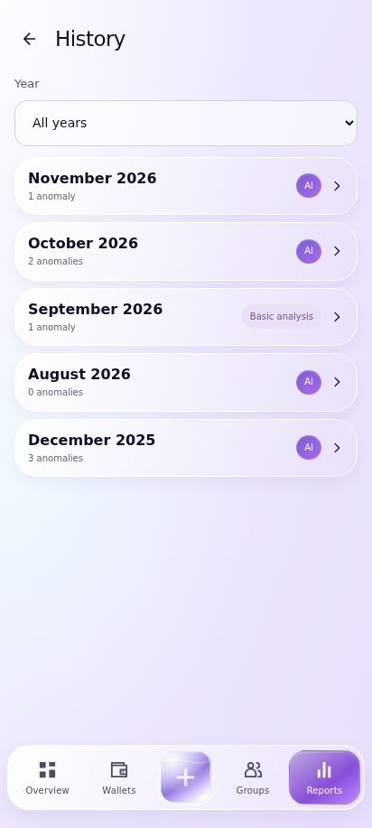

*Figure 4.6.1 — UC-AI-06, screen S01, Basic steps 1 and 3: Lists stored analyses newest first with month, source, and number of anomalies.*

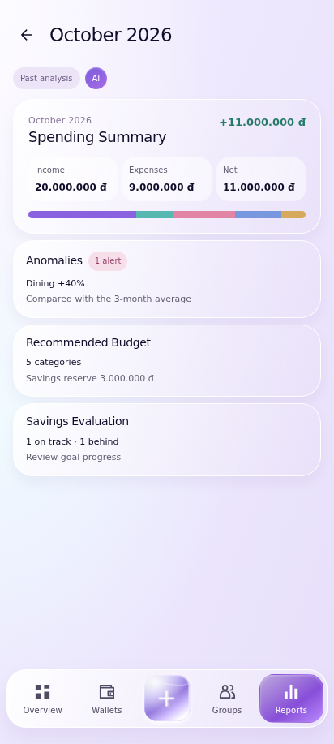

*Figure 4.6.2 — UC-AI-06, screen S02, Basic step 2: Shows the four sections of the selected month without action buttons.*

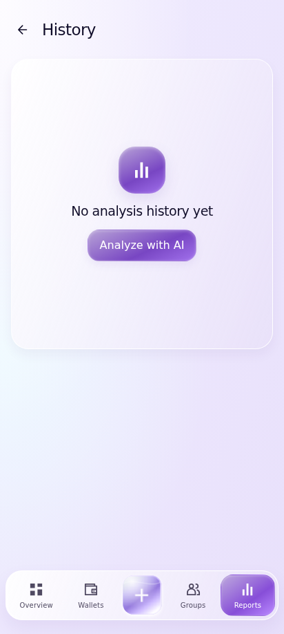

*Figure 4.6.3 — UC-AI-06, screen S03, AF-01: Shows "No analysis history yet" with an "Analyze with AI" button.*

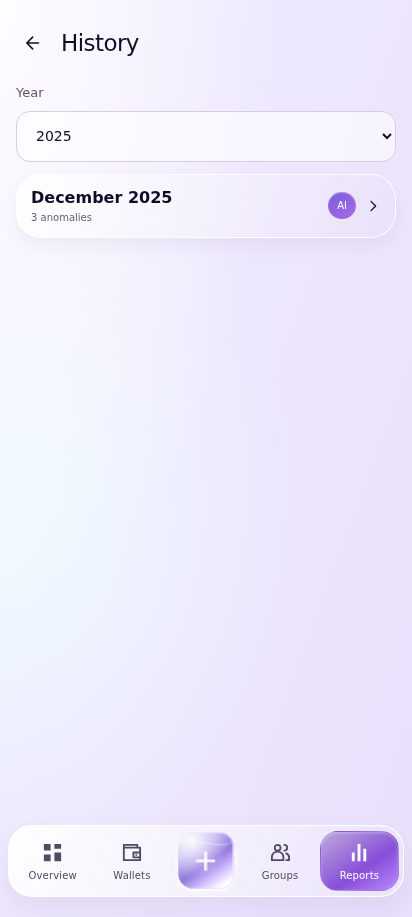

*Figure 4.6.4 — UC-AI-06, screen S04, AF-02: Shows the list filtered by year or "No analyses in this year".*

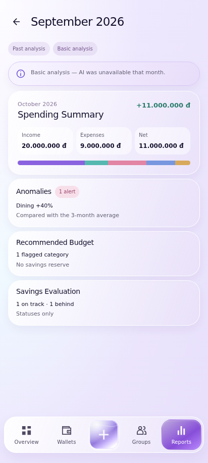

*Figure 4.6.5 — UC-AI-06, screen S05, AF-03: Shows a past basic analysis with its banner.*

---

## 5. Final Check
> *Performed by: `Ngo Thai Hoa` | Reviewed by: `Nguyen Phu Dat` | Edited by: `Pham Dinh Tieu Long`*

- [ ] Every use case in the diagram has a specification in Section 4.
- [ ] Every basic-flow step and every AF has a screen ID and an embedded screenshot with a caption.
- [ ] Use-case IDs, FR IDs, BR IDs, and screen IDs match B.5, B.6, C.2, and C.3 of `report.md`.
- [ ] Section 1 design tool and prototype link are filled in.
- [ ] Annotation line present after every heading, with the actual performer, reviewer, and editor.
- [ ] Image links resolve in the packaged copy and the PDF has been rendered and inspected.