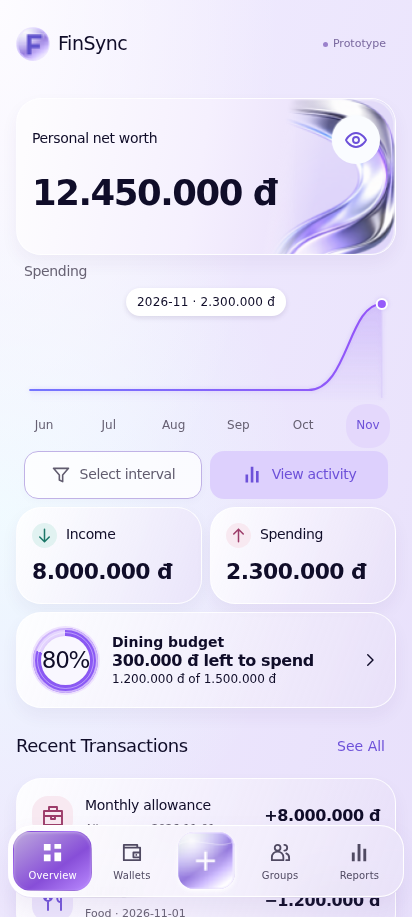
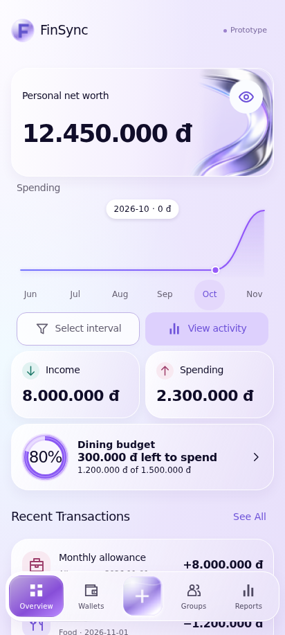
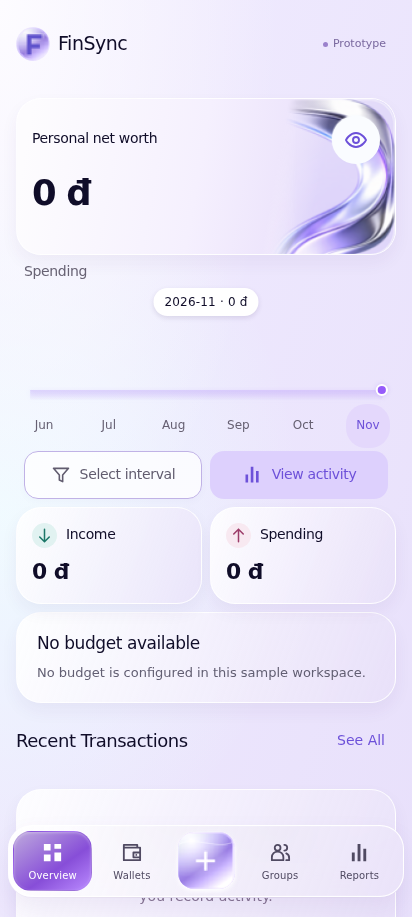

# UC-CLI-01 — View Financial Overview

> *Performed by: Nguyễn Phú Đạt (24120038) | Reviewed by: Pending team review | Edited by: Pending confirmation*

- **Goal:** Understand current financial position, income, spending, budget status, and recent activity at a glance.
- **Primary actor:** Regular User.
- **Trigger:** The user opens or returns to the Overview tab.
- **Preconditions:** The app can access an available personal-finance dataset; account/session availability depends on the actual app configuration.
- **Postconditions:** The user has viewed a consistent snapshot; no financial records are modified.
- **Basic Flow:**
  1. The user opens **Overview**.
  2. The app loads the available balance, income, spending, and recent transaction summaries.
  3. The app displays a primary financial card and an appropriate trend chart.
  4. The user selects an available time interval or interacts with the trend, if supported.
  5. The app refreshes the displayed values for the selected context.
  6. The user opens a recent transaction or a linked detail view.
- **Alternative Flows:** A1 — The user hides/reveals sensitive balances using the privacy control, if supported; A2 — The user changes the reporting interval; A3 — No budget exists, so the budget section shows an empty state rather than a fabricated amount.
- **Exception Flows:** E1 — No transactions are available: show honest zero/empty data and a relevant add-transaction action; E2 — Data retrieval fails: show a concise error and Retry without invented values.
- **Prototype frames:** `OV-01-Overview`, `OV-02-Trend-Selected`, `OV-03-Privacy-Hidden`, `OV-04-Empty`, `OV-05-Error`.
- **Required evidence:** Basic Overview and selected trend; alternative privacy/interval or equivalent; empty/error variation.

## Prototype evidence
> *Performed by: Nguyễn Phú Đạt (24120038) | Reviewed by: Pending team review | Edited by: Pending confirmation*

**Evidence source: Figma Make Prototype — Simulated UI.** These are browser prototype captures using simulated, in-memory financial data, not Android emulator screenshots. No backend integration, PostgreSQL persistence, real JWT authentication, real device behavior or native Android pixel accuracy is verified. Imported validation claims belong to the supplied archive; no browser scenario tests were rerun during this documentation integration.

**Prototype reference:** [Client prototype link and scope](client-prototype-link.md). **Mapping:** [Integrated screenshot matrix](../screenshots/prototypes/client-evidence/Screenshot-Matrix.csv); source descriptions, routes and screen IDs are retained. BF/AF/EF numbers are archive evidence labels and need not equal the A1/E1 numbering in the specification. Supplementary prototype scenarios do not amend the authoritative specification.

| Evidence | Flow | Declared scenario | Source screen / route | Image |
|---|---|---|---|---|
| D.1.1 | BF | Current balances, income, spending, budget and recent activity | `OV-01-Overview` / `overview` | [UC-CLI-01_BF_01_Overview.png](../screenshots/prototypes/UC-CLI-01/UC-CLI-01_BF_01_Overview.png) |
| D.1.2 | AF | Hide sensitive amounts and select the October trend point | `OV-01-Overview` / `overview` | [UC-CLI-01_AF_01_PrivacyAndPeriod.png](../screenshots/prototypes/UC-CLI-01/UC-CLI-01_AF_01_PrivacyAndPeriod.png) |
| D.1.3 | EF | No-recorded-data workspace has zero totals and no invented trend | `OV-01-Overview` / `overview` | [UC-CLI-01_EF_01_EmptyOverview.png](../screenshots/prototypes/UC-CLI-01/UC-CLI-01_EF_01_EmptyOverview.png) |

*Figure D.1.1 — UC-CLI-01 Basic Flow: `OV-01-Overview` in the simulated FinSync prototype. Supplied scenario: Current balances, income, spending, budget and recent activity.*

**Evidence interpretation:** The captured prototype screen supports inspection of the visible UI state only; it does not independently establish each preceding interaction or production integration.

*Figure D.1.2 — UC-CLI-01 Alternative Flow: `OV-01-Overview` in the simulated FinSync prototype. Supplied scenario: Hide sensitive amounts and select the October trend point.*

**Evidence interpretation:** The October point/period is visible, but financial totals remain visible; this image does not demonstrate the privacy-hidden state.

*Figure D.1.3 — UC-CLI-01 Exception Flow: `OV-01-Overview` in the simulated FinSync prototype. Supplied scenario: No-recorded-data workspace has zero totals and no invented trend.*

**Evidence interpretation:** The captured prototype screen supports inspection of the visible UI state only; it does not independently establish each preceding interaction or production integration.
