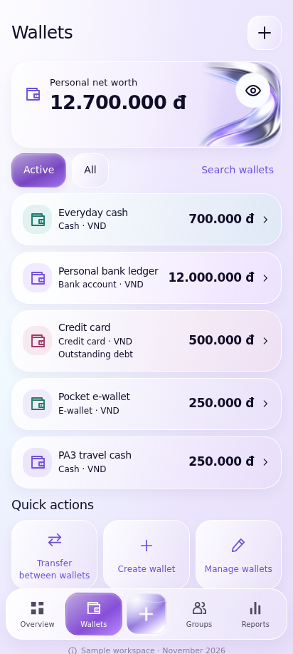
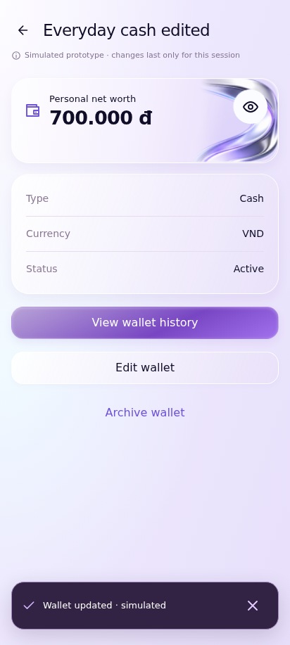
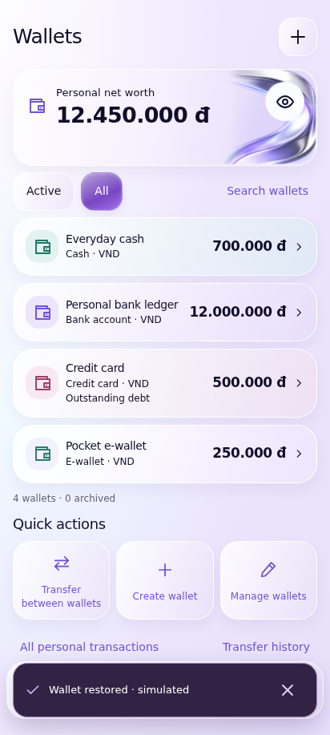
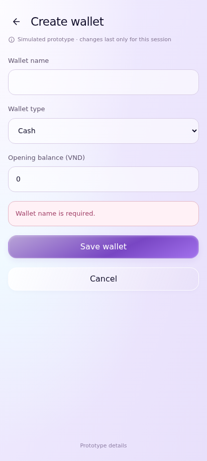
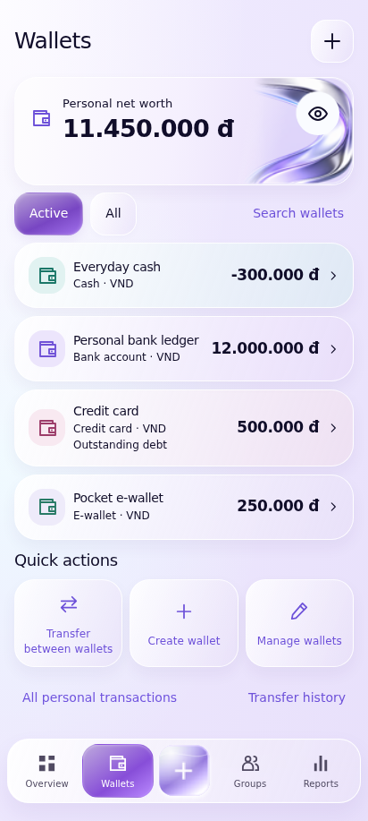

# UC-CLI-02 — Manage Personal Wallets

> *Performed by: Nguyễn Phú Đạt (24120038) | Reviewed by: Pending team review | Edited by: Pending confirmation*

- **Goal:** View, create, inspect, and update personal wallet information through supported actions.
- **Primary actor:** Regular User.
- **Trigger:** The user opens the Wallets tab or selects an Add/Manage Wallet action.
- **Preconditions:** The app has access to a personal wallet store or service; available wallet operations have been implemented.
- **Postconditions:** The wallet collection displays the latest successful change, or remains unchanged after cancellation/failure.
- **Basic Flow:**
  1. The user opens **Wallets**.
  2. The app displays the personal net-worth summary and wallet list.
  3. The user opens a wallet to inspect its details.
  4. The user chooses **Create Wallet** or an existing edit/manage operation.
  5. The user enters the required wallet information and confirms the action.
  6. The app validates the input, applies the successful change, and refreshes the affected list/detail display.
- **Alternative Flows:** A1 — The user searches or filters wallets; A2 — The user cancels the form without saving; A3 — The user opens a different wallet type, where supported.
- **Exception Flows:** E1 — Required wallet name or other validated field is missing/invalid: show inline guidance; E2 — The change cannot be saved: retain entered data and offer retry; E3 — No wallets exist: show a contextual create-wallet empty state.
- **Prototype frames:** `WL-01-Wallet-List`, `WL-02-Wallet-Details`, `WL-03-Wallet-Create`, `WL-04-Wallet-Edit`, `WL-05-Validation-Error`, `WL-06-Empty`.
- **Required evidence:** Wallet list, details and successful create/edit; cancellation/filter variation; form-validation or save-failure variation.

## Prototype evidence
> *Performed by: Nguyễn Phú Đạt (24120038) | Reviewed by: Pending team review | Edited by: Pending confirmation*

**Evidence source: Figma Make Prototype — Simulated UI.** These are browser prototype captures using simulated, in-memory financial data, not Android emulator screenshots. No backend integration, PostgreSQL persistence, real JWT authentication, real device behavior or native Android pixel accuracy is verified. Imported validation claims belong to the supplied archive; no browser scenario tests were rerun during this documentation integration.

**Prototype reference:** [Client prototype link and scope](client-prototype-link.md). **Mapping:** [Integrated screenshot matrix](../screenshots/prototypes/client-evidence/Screenshot-Matrix.csv); source descriptions, routes and screen IDs are retained. BF/AF/EF numbers are archive evidence labels and need not equal the A1/E1 numbering in the specification. Supplementary prototype scenarios do not amend the authoritative specification.

| Evidence | Flow | Declared scenario | Source screen / route | Image |
|---|---|---|---|---|
| D.2.1 | BF | Create a stable-identity cash wallet and view its details | `WL-01-Wallet-List` / `wallets` | [UC-CLI-02_BF_01_CreateWallet.png](../screenshots/prototypes/UC-CLI-02/UC-CLI-02_BF_01_CreateWallet.png) |
| D.2.2 | AF | Edit an existing wallet and preserve its identity/history | `WL-02-Wallet-Details` / `wallet/cash` | [UC-CLI-02_AF_01_EditWallet.png](../screenshots/prototypes/UC-CLI-02/UC-CLI-02_AF_01_EditWallet.png) |
| D.2.3 | AF | Cancel archive, then archive and restore without losing balances | `WL-01-Wallet-List` / `wallets` | [UC-CLI-02_AF_02_ArchiveAndRestore.png](../screenshots/prototypes/UC-CLI-02/UC-CLI-02_AF_02_ArchiveAndRestore.png) |
| D.2.4 | EF | Missing wallet name is rejected without creating a wallet | `WL-05-Validation-Error` / `wallet/new` | [UC-CLI-02_EF_01_InvalidWallet.png](../screenshots/prototypes/UC-CLI-02/UC-CLI-02_EF_01_InvalidWallet.png) |
| D.2.5 | AF | A non-credit wallet retains its negative sign when the simulated ledger goes below zero | `WL-01-Wallet-List` / `wallets` | [UC-CLI-02_AF_03_SignedWalletBalance.png](../screenshots/prototypes/UC-CLI-02/UC-CLI-02_AF_03_SignedWalletBalance.png) |

*Figure D.2.1 — UC-CLI-02 Basic Flow: `WL-01-Wallet-List` in the simulated FinSync prototype. Supplied scenario: Create a stable-identity cash wallet and view its details.*

**Evidence interpretation:** The captured prototype screen supports inspection of the visible UI state only; it does not independently establish each preceding interaction or production integration.

*Figure D.2.2 — UC-CLI-02 Alternative Flow: `WL-02-Wallet-Details` in the simulated FinSync prototype. Supplied scenario: Edit an existing wallet and preserve its identity/history.*

**Evidence interpretation:** The captured prototype screen supports inspection of the visible UI state only; it does not independently establish each preceding interaction or production integration.

*Figure D.2.3 — UC-CLI-02 Alternative Flow: `WL-01-Wallet-List` in the simulated FinSync prototype. Supplied scenario: Cancel archive, then archive and restore without losing balances.*

**Evidence interpretation:** The list and Wallet restored feedback are visible; the preceding archive/cancel/restore sequence is not independently shown.

*Figure D.2.4 — UC-CLI-02 Exception Flow: `WL-05-Validation-Error` in the simulated FinSync prototype. Supplied scenario: Missing wallet name is rejected without creating a wallet.*

**Evidence interpretation:** The captured prototype screen supports inspection of the visible UI state only; it does not independently establish each preceding interaction or production integration.

*Figure D.2.5 — UC-CLI-02 Alternative Flow: `WL-01-Wallet-List` in the simulated FinSync prototype. Supplied scenario: A non-credit wallet retains its negative sign when the simulated ledger goes below zero.*

**Evidence interpretation:** The captured prototype screen supports inspection of the visible UI state only; it does not independently establish each preceding interaction or production integration.
