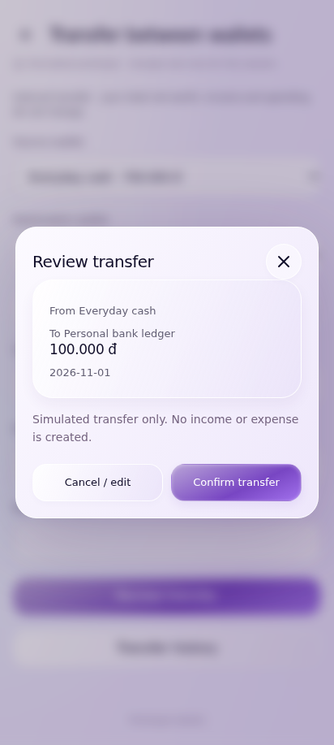
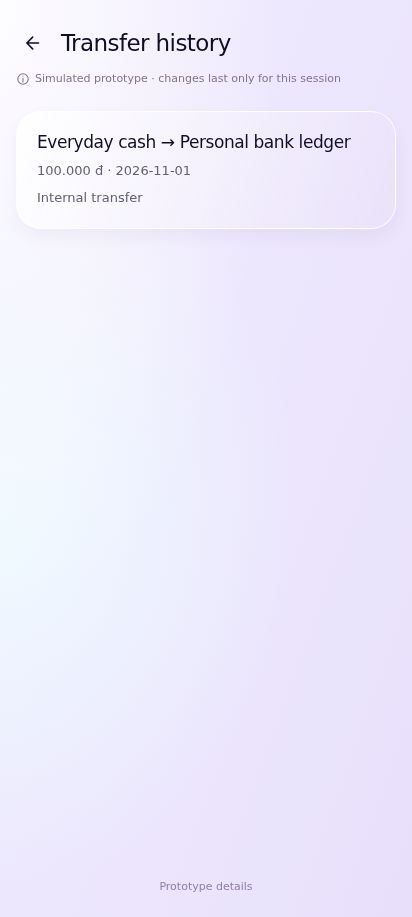
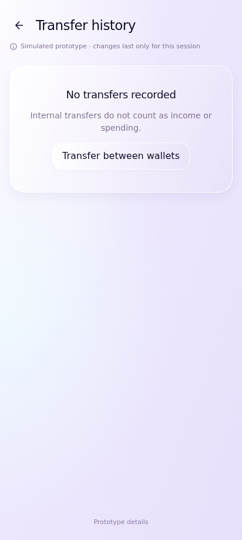
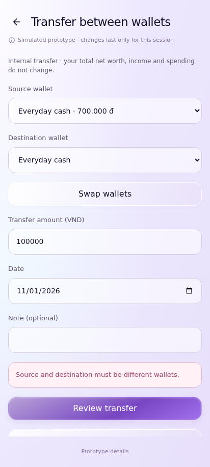
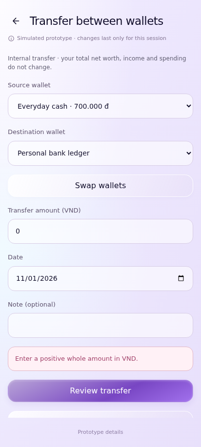
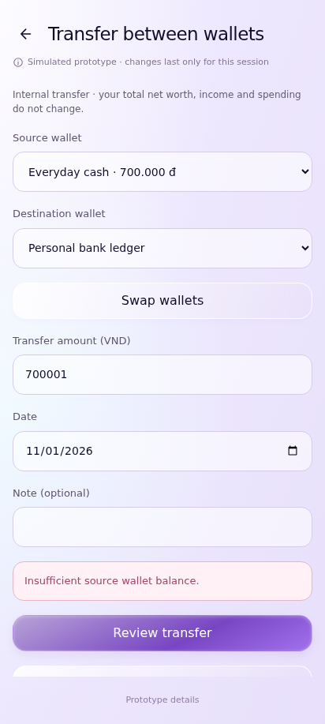

# UC-CLI-03 — Transfer Funds Between Wallets

> *Performed by: Nguyễn Phú Đạt (24120038) | Reviewed by: Pending team review | Edited by: Pending confirmation*

- **Goal:** Move money between two eligible personal wallets without recording income or expense.
- **Primary actor:** Regular User.
- **Trigger:** The user selects the wallet transfer action.
- **Preconditions:** At least two eligible wallets exist; transfer functionality is available.
- **Postconditions:** A successful transfer adjusts the applicable wallet balances consistently; an invalid or cancelled transfer makes no change.
- **Basic Flow:**
  1. The user opens **Transfer** from Wallets.
  2. The app displays a transfer form.
  3. The user selects a source wallet and a different destination wallet.
  4. The user enters an amount and any supported details.
  5. The app validates the selected wallets and amount.
  6. The user reviews and confirms the transfer.
  7. The app shows the result and updates wallet balances and applicable transfer history.
- **Alternative Flows:** A1 — The user swaps source and destination; A2 — The user changes the amount before confirmation; A3 — The user cancels at the review step.
- **Exception Flows:** E1 — Both wallets are the same: show a validation message; E2 — Amount is missing, zero, or invalid: block confirmation; E3 — Insufficient funds, if restricted by wallet policy: show a clear warning; E4 — Processing fails: show error and prevent partial or duplicate UI updates.
- **Prototype frames:** `TR-01-Transfer-Form`, `TR-02-Transfer-Review`, `TR-03-Transfer-Success`, `TR-04-Transfer-Validation`, `TR-05-Transfer-Failure`.
- **Required evidence:** Form-to-success path; changed/cancelled transfer; invalid wallet/amount or failure.

## Prototype evidence
> *Performed by: Nguyễn Phú Đạt (24120038) | Reviewed by: Pending team review | Edited by: Pending confirmation*

**Evidence source: Figma Make Prototype — Simulated UI.** These are browser prototype captures using simulated, in-memory financial data, not Android emulator screenshots. No backend integration, PostgreSQL persistence, real JWT authentication, real device behavior or native Android pixel accuracy is verified. Imported validation claims belong to the supplied archive; no browser scenario tests were rerun during this documentation integration.

**Prototype reference:** [Client prototype link and scope](client-prototype-link.md). **Mapping:** [Integrated screenshot matrix](../screenshots/prototypes/client-evidence/Screenshot-Matrix.csv); source descriptions, routes and screen IDs are retained. BF/AF/EF numbers are archive evidence labels and need not equal the A1/E1 numbering in the specification. Supplementary prototype scenarios do not amend the authoritative specification.

| Evidence | Flow | Declared scenario | Source screen / route | Image |
|---|---|---|---|---|
| D.3.1 | BF | Review transfer between two different active wallets | `TR-02-Transfer-Review` / `transfer/new` | [UC-CLI-03_BF_01_TransferReview.png](../screenshots/prototypes/UC-CLI-03/UC-CLI-03_BF_01_TransferReview.png) |
| D.3.2 | BF | Transfer succeeds; net worth and personal income/spending remain unchanged | `TR-History` / `transfer/history` | [UC-CLI-03_BF_02_TransferSuccess.png](../screenshots/prototypes/UC-CLI-03/UC-CLI-03_BF_02_TransferSuccess.png) |
| D.3.3 | AF | Swap wallets, change amount and cancel review without posting | `TR-History` / `transfer/history` | [UC-CLI-03_AF_01_ChangedTransferCancelled.png](../screenshots/prototypes/UC-CLI-03/UC-CLI-03_AF_01_ChangedTransferCancelled.png) |
| D.3.4 | EF | Reject same source and destination | `TR-04-Transfer-Validation` / `transfer/new` | [UC-CLI-03_EF_01_SameWallet.png](../screenshots/prototypes/UC-CLI-03/UC-CLI-03_EF_01_SameWallet.png) |
| D.3.5 | EF | Reject zero transfer amount | `TR-04-Transfer-Validation` / `transfer/new` | [UC-CLI-03_EF_02_InvalidTransferAmount.png](../screenshots/prototypes/UC-CLI-03/UC-CLI-03_EF_02_InvalidTransferAmount.png) |
| D.3.6 | EF | Reject a transfer larger than the source balance | `TR-04-Transfer-Validation` / `transfer/new` | [UC-CLI-03_EF_03_InsufficientBalance.png](../screenshots/prototypes/UC-CLI-03/UC-CLI-03_EF_03_InsufficientBalance.png) |

*Figure D.3.1 — UC-CLI-03 Basic Flow: `TR-02-Transfer-Review` in the simulated FinSync prototype. Supplied scenario: Review transfer between two different active wallets.*

**Evidence interpretation:** The captured prototype screen supports inspection of the visible UI state only; it does not independently establish each preceding interaction or production integration.

*Figure D.3.2 — UC-CLI-03 Basic Flow: `TR-History` in the simulated FinSync prototype. Supplied scenario: Transfer succeeds; net worth and personal income/spending remain unchanged.*

**Evidence interpretation:** Transfer history shows a simulated entry; unchanged net worth and income/spending across the operation require separate behavioral evidence.

*Figure D.3.3 — UC-CLI-03 Alternative Flow: `TR-History` in the simulated FinSync prototype. Supplied scenario: Swap wallets, change amount and cancel review without posting.*

**Evidence interpretation:** Empty transfer history is visible; swap/edit/cancel intermediate controls are not shown.

*Figure D.3.4 — UC-CLI-03 Exception Flow: `TR-04-Transfer-Validation` in the simulated FinSync prototype. Supplied scenario: Reject same source and destination.*

**Evidence interpretation:** The captured prototype screen supports inspection of the visible UI state only; it does not independently establish each preceding interaction or production integration.

*Figure D.3.5 — UC-CLI-03 Exception Flow: `TR-04-Transfer-Validation` in the simulated FinSync prototype. Supplied scenario: Reject zero transfer amount.*

**Evidence interpretation:** The captured prototype screen supports inspection of the visible UI state only; it does not independently establish each preceding interaction or production integration.

*Figure D.3.6 — UC-CLI-03 Exception Flow: `TR-04-Transfer-Validation` in the simulated FinSync prototype. Supplied scenario: Reject a transfer larger than the source balance.*

**Evidence interpretation:** The captured prototype screen supports inspection of the visible UI state only; it does not independently establish each preceding interaction or production integration.
