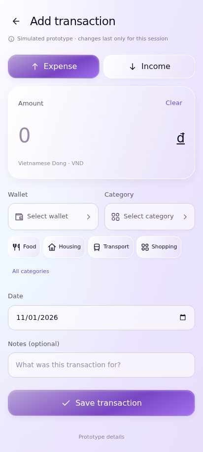
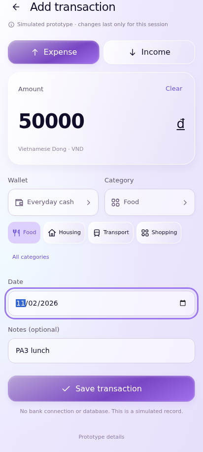
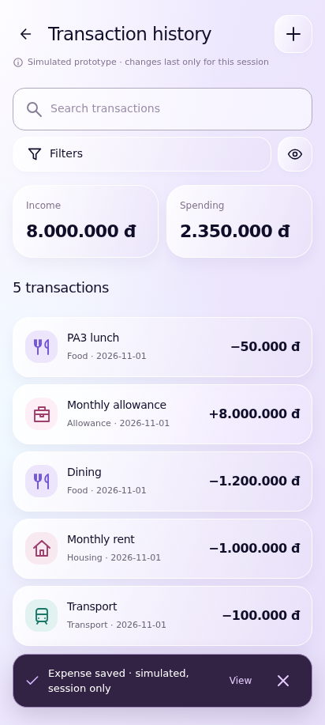
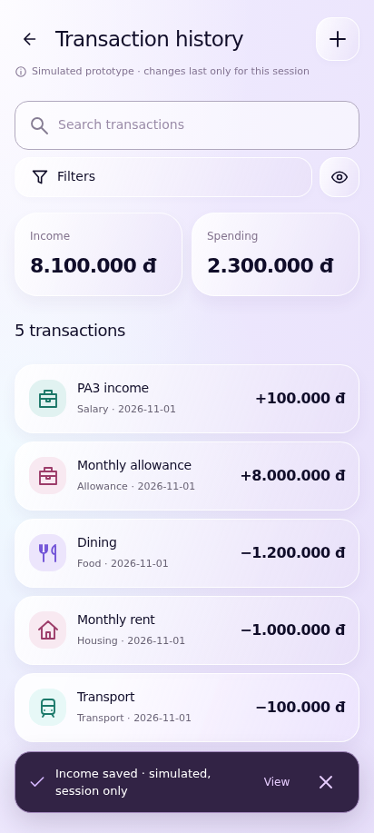
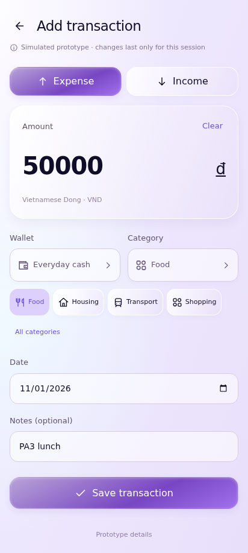
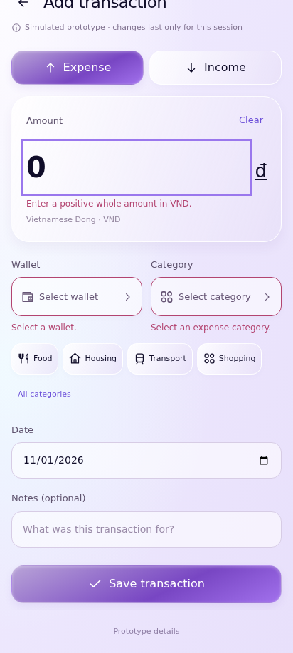
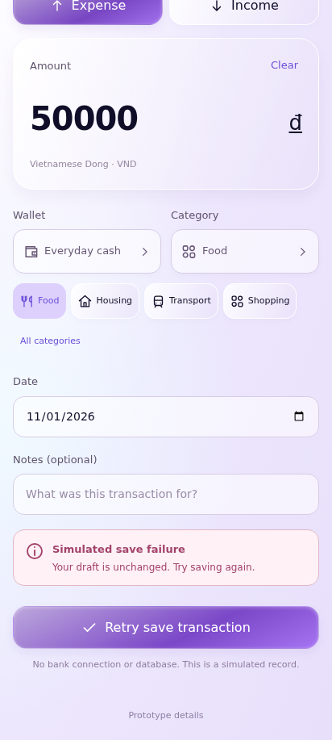

# UC-CLI-04 — Record Income or Expense

> *Performed by: Nguyễn Phú Đạt (24120038) | Reviewed by: Pending team review | Edited by: Pending confirmation*

- **Goal:** Record a personal income or expense with an amount, category, and wallet.
- **Primary actor:** Regular User.
- **Trigger:** The user presses the central Add Transaction action.
- **Preconditions:** The transaction form is available and the user has an eligible wallet, or receives a suitable create-wallet prompt.
- **Postconditions:** A valid saved transaction is reflected in history and relevant summaries; an invalid input is not saved.
- **Basic Flow:**
  1. The user opens **Add Transaction**.
  2. The user chooses **Expense** or **Income**.
  3. The user enters a positive monetary amount.
  4. The user selects a semantic category and a wallet.
  5. The user optionally adjusts the date or adds a note.
  6. The user presses **Save**.
  7. The app validates the entry, displays success feedback, and updates relevant lists and summaries.
- **Alternative Flows:** A1 — The user switches from Expense to Income; A2 — The user selects a recent/default wallet or category, where supported; A3 — The user edits the date/note; A4 — The user exits and discards the draft through the app's supported navigation.
- **Exception Flows:** E1 — Amount is blank, zero, or invalid; E2 — Category/wallet is unselected or unavailable; E3 — A save operation fails: keep the form input and show retry; E4 — Double-tapping Save does not create duplicate records.
- **Prototype frames:** `TX-01-Add-Expense`, `TX-02-Add-Income`, `TX-03-Category-Picker`, `TX-04-Wallet-Picker`, `TX-05-Validation`, `TX-06-Saving`, `TX-07-Success`, `TX-08-Save-Failure`.
- **Required evidence:** Expense success and optionally Income variation; category/wallet/date variation; missing amount and failed-save states.

## Prototype evidence
> *Performed by: Nguyễn Phú Đạt (24120038) | Reviewed by: Pending team review | Edited by: Pending confirmation*

**Evidence source: Figma Make Prototype — Simulated UI.** These are browser prototype captures using simulated, in-memory financial data, not Android emulator screenshots. No backend integration, PostgreSQL persistence, real JWT authentication, real device behavior or native Android pixel accuracy is verified. Imported validation claims belong to the supplied archive; no browser scenario tests were rerun during this documentation integration.

**Prototype reference:** [Client prototype link and scope](client-prototype-link.md). **Mapping:** [Integrated screenshot matrix](../screenshots/prototypes/client-evidence/Screenshot-Matrix.csv); source descriptions, routes and screen IDs are retained. BF/AF/EF numbers are archive evidence labels and need not equal the A1/E1 numbering in the specification. Supplementary prototype scenarios do not amend the authoritative specification.

| Evidence | Flow | Declared scenario | Source screen / route | Image |
|---|---|---|---|---|
| D.4.1 | BF | Central Add opens Expense from every main tab | `TX-01-Add-Expense` / `transaction/new` | [UC-CLI-04_BF_01_AddExpense.png](../screenshots/prototypes/UC-CLI-04/UC-CLI-04_BF_01_AddExpense.png) |
| D.4.2 | BF | Completed expense with wallet/category/date/notes | `TX-01-Add-Expense` / `transaction/new` | [UC-CLI-04_BF_02_ValidExpenseForm.png](../screenshots/prototypes/UC-CLI-04/UC-CLI-04_BF_02_ValidExpenseForm.png) |
| D.4.3 | BF | Save a valid expense once and see success/history | `HX-01-History` / `transactions` | [UC-CLI-04_BF_03_SaveSuccess.png](../screenshots/prototypes/UC-CLI-04/UC-CLI-04_BF_03_SaveSuccess.png) |
| D.4.4 | AF | Switch to Income and save an income-category record | `HX-01-History` / `transactions` | [UC-CLI-04_AF_01_AddIncome.png](../screenshots/prototypes/UC-CLI-04/UC-CLI-04_AF_01_AddIncome.png) |
| D.4.5 | AF | Back cancellation keeps the entered draft | `TX-01-Add-Expense` / `transaction/new` | [UC-CLI-04_AF_02_KeepDraft.png](../screenshots/prototypes/UC-CLI-04/UC-CLI-04_AF_02_KeepDraft.png) |
| D.4.6 | EF | Zero/missing required fields prevent saving | `TX-05-Validation` / `transaction/new` | [UC-CLI-04_EF_01_InvalidAmount.png](../screenshots/prototypes/UC-CLI-04/UC-CLI-04_EF_01_InvalidAmount.png) |
| D.4.7 | EF | Clearly labeled failure retains the draft for retry | `TX-08-Save-Failure` / `transaction/new` | [UC-CLI-04_EF_02_SimulatedSaveFailure.png](../screenshots/prototypes/UC-CLI-04/UC-CLI-04_EF_02_SimulatedSaveFailure.png) |

*Figure D.4.1 — UC-CLI-04 Basic Flow: `TX-01-Add-Expense` in the simulated FinSync prototype. Supplied scenario: Central Add opens Expense from every main tab.*

**Evidence interpretation:** The captured prototype screen supports inspection of the visible UI state only; it does not independently establish each preceding interaction or production integration.

*Figure D.4.2 — UC-CLI-04 Basic Flow: `TX-01-Add-Expense` in the simulated FinSync prototype. Supplied scenario: Completed expense with wallet/category/date/notes.*

**Evidence interpretation:** The captured prototype screen supports inspection of the visible UI state only; it does not independently establish each preceding interaction or production integration.

*Figure D.4.3 — UC-CLI-04 Basic Flow: `HX-01-History` in the simulated FinSync prototype. Supplied scenario: Save a valid expense once and see success/history.*

**Evidence interpretation:** History contains the PA3 lunch entry and an Expense saved simulated message; no server persistence is implied.

*Figure D.4.4 — UC-CLI-04 Alternative Flow: `HX-01-History` in the simulated FinSync prototype. Supplied scenario: Switch to Income and save an income-category record.*

**Evidence interpretation:** History and Income saved simulated feedback are visible; this is the final income result, not an image of the Income form.

*Figure D.4.5 — UC-CLI-04 Alternative Flow: `TX-01-Add-Expense` in the simulated FinSync prototype. Supplied scenario: Back cancellation keeps the entered draft.*

**Evidence interpretation:** A populated draft is visible; the preceding keep/discard dialog action is not shown.

*Figure D.4.6 — UC-CLI-04 Exception Flow: `TX-05-Validation` in the simulated FinSync prototype. Supplied scenario: Zero/missing required fields prevent saving.*

**Evidence interpretation:** The captured prototype screen supports inspection of the visible UI state only; it does not independently establish each preceding interaction or production integration.

*Figure D.4.7 — UC-CLI-04 Exception Flow: `TX-08-Save-Failure` in the simulated FinSync prototype. Supplied scenario: Clearly labeled failure retains the draft for retry.*

**Evidence interpretation:** The captured prototype screen supports inspection of the visible UI state only; it does not independently establish each preceding interaction or production integration.
