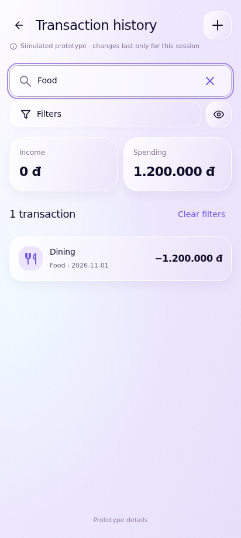
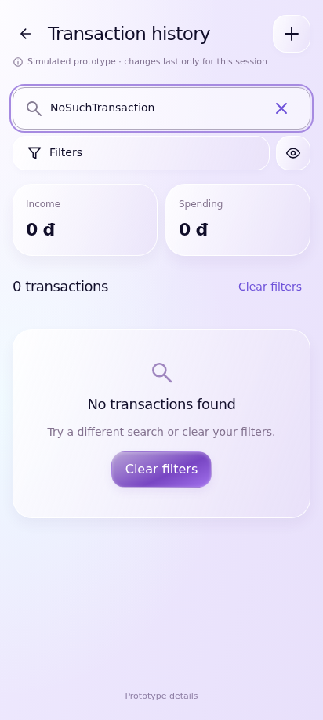
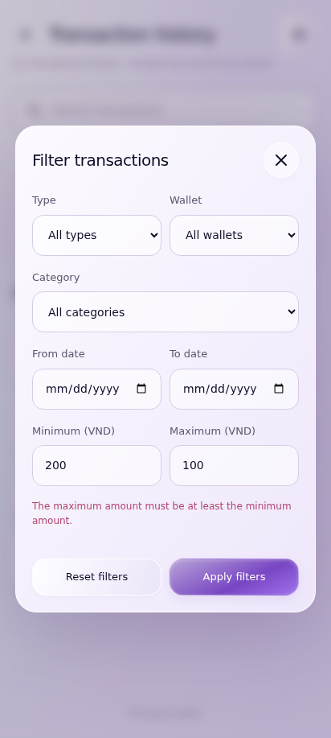

# UC-CLI-05 — Search and Filter Transactions

> *Performed by: Nguyễn Phú Đạt (24120038) | Reviewed by: Pending team review | Edited by: Pending confirmation*

- **Goal:** Find transactions using supported search criteria and filters.
- **Primary actor:** Regular User.
- **Trigger:** The user opens the personal transaction history.
- **Preconditions:** Transaction history and the supported filtering UI are available.
- **Postconditions:** The visible list reflects the chosen query and filters; records are not modified.
- **Basic Flow:**
  1. The user opens **Transaction History**.
  2. The app displays transactions ordered by the supported default sort.
  3. The user enters a search query or opens the filter panel.
  4. The user selects supported criteria such as date, wallet, category, type, or amount range.
  5. The app applies the criteria and updates the results.
  6. The user selects a matching transaction or resets the filters.
- **Alternative Flows:** A1 — The user clears the search query; A2 — The user combines multiple supported filters; A3 — The user resets filters to the original result list.
- **Exception Flows:** E1 — No transactions match: show a no-results state with Clear Filters; E2 — Invalid filter range: display validation and prevent applying the range; E3 — Data cannot be loaded: display a retry state.
- **Prototype frames:** `HX-01-History`, `HX-02-Search`, `HX-03-Filter-Sheet`, `HX-04-Filtered-Results`, `HX-05-No-Results`, `HX-06-Invalid-Filter`.
- **Required evidence:** Search/filter success; reset/multiple-filter variation; no-results and invalid-range states.

## Prototype evidence
> *Performed by: Nguyễn Phú Đạt (24120038) | Reviewed by: Pending team review | Edited by: Pending confirmation*

**Evidence source: Figma Make Prototype — Simulated UI.** These are browser prototype captures using simulated, in-memory financial data, not Android emulator screenshots. No backend integration, PostgreSQL persistence, real JWT authentication, real device behavior or native Android pixel accuracy is verified. Imported validation claims belong to the supplied archive; no browser scenario tests were rerun during this documentation integration.

**Prototype reference:** [Client prototype link and scope](client-prototype-link.md). **Mapping:** [Integrated screenshot matrix](../screenshots/prototypes/client-evidence/Screenshot-Matrix.csv); source descriptions, routes and screen IDs are retained. BF/AF/EF numbers are archive evidence labels and need not equal the A1/E1 numbering in the specification. Supplementary prototype scenarios do not amend the authoritative specification.

| Evidence | Flow | Declared scenario | Source screen / route | Image |
|---|---|---|---|---|
| D.5.1 | BF | Search an existing transaction in the shared ledger | `HX-01-History` / `transactions` | [UC-CLI-05_BF_01_SearchHistory.png](../screenshots/prototypes/UC-CLI-05/UC-CLI-05_BF_01_SearchHistory.png) |
| D.5.2 | AF | Combine wallet/category/type filters and reset them | `HX-01-History` / `transactions` | [UC-CLI-05_AF_01_CombinedFilters.png](../screenshots/prototypes/UC-CLI-05/UC-CLI-05_AF_01_CombinedFilters.png) |
| D.5.3 | EF | Unmatched query shows helpful clear-filter recovery | `HX-01-History` / `transactions` | [UC-CLI-05_EF_01_NoResults.png](../screenshots/prototypes/UC-CLI-05/UC-CLI-05_EF_01_NoResults.png) |
| D.5.4 | EF | Reversed amount range is blocked | `HX-01-History` / `transactions` | [UC-CLI-05_EF_02_InvalidRange.png](../screenshots/prototypes/UC-CLI-05/UC-CLI-05_EF_02_InvalidRange.png) |

*Figure D.5.1 — UC-CLI-05 Basic Flow: `HX-01-History` in the simulated FinSync prototype. Supplied scenario: Search an existing transaction in the shared ledger.*

**Evidence interpretation:** The captured prototype screen supports inspection of the visible UI state only; it does not independently establish each preceding interaction or production integration.

*Figure D.5.2 — UC-CLI-05 Alternative Flow: `HX-01-History` in the simulated FinSync prototype. Supplied scenario: Combine wallet/category/type filters and reset them.*

**Evidence interpretation:** The resulting filtered list is visible; the selected filter values and reset sequence are not independently shown.

*Figure D.5.3 — UC-CLI-05 Exception Flow: `HX-01-History` in the simulated FinSync prototype. Supplied scenario: Unmatched query shows helpful clear-filter recovery.*

**Evidence interpretation:** The captured prototype screen supports inspection of the visible UI state only; it does not independently establish each preceding interaction or production integration.

*Figure D.5.4 — UC-CLI-05 Exception Flow: `HX-01-History` in the simulated FinSync prototype. Supplied scenario: Reversed amount range is blocked.*

**Evidence interpretation:** The captured prototype screen supports inspection of the visible UI state only; it does not independently establish each preceding interaction or production integration.
