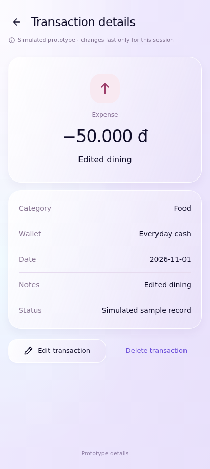
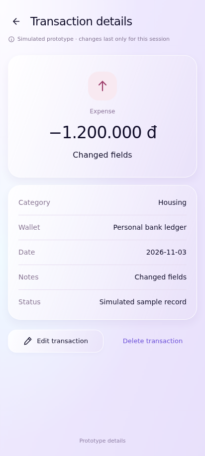
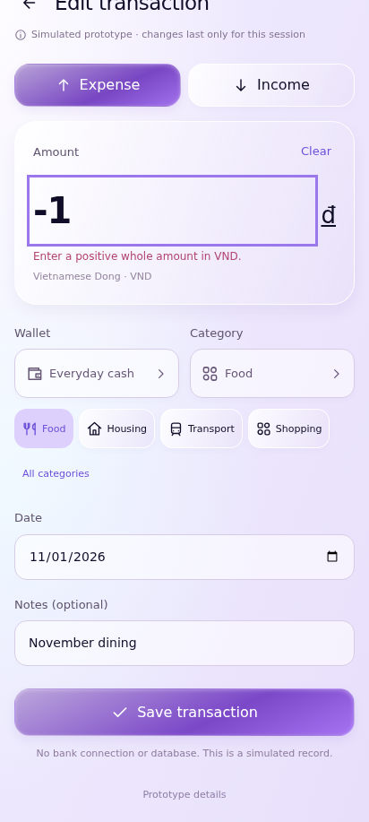
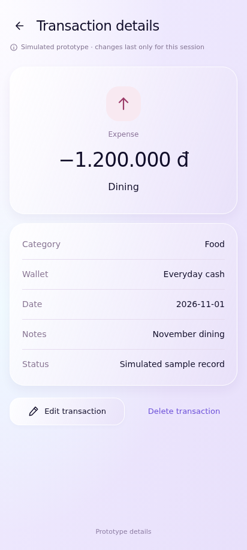

# UC-CLI-06 — View and Edit Transaction

> *Performed by: Nguyễn Phú Đạt (24120038) | Reviewed by: Pending team review | Edited by: Pending confirmation*

- **Goal:** Inspect a recorded transaction and update editable fields.
- **Primary actor:** Regular User.
- **Trigger:** The user selects an item in Transaction History or Recent Transactions.
- **Preconditions:** The selected transaction exists and is editable under the app's actual rules.
- **Postconditions:** A successful edit updates the transaction and dependent financial summaries; cancellation leaves values unchanged.
- **Basic Flow:**
  1. The user selects a transaction.
  2. The app displays its recorded details.
  3. The user selects **Edit**.
  4. The app opens a prefilled transaction form.
  5. The user changes an allowed field, such as amount, category, wallet, date, or note.
  6. The user saves the changes.
  7. The app confirms the update and refreshes relevant views.
- **Alternative Flows:** A1 — The user views details without editing; A2 — The user cancels edits; A3 — The user changes multiple editable fields before saving.
- **Exception Flows:** E1 — A modified value fails validation; E2 — The transaction no longer exists or cannot be edited; E3 — Save fails: retain the draft and show retry.
- **Prototype frames:** `ED-01-Transaction-Details`, `ED-02-Edit-Prefilled`, `ED-03-Edit-Validation`, `ED-04-Edit-Success`, `ED-05-Edit-Failure`.
- **Required evidence:** Details-to-edit success; cancel variation; validation/save-failure state.

## Prototype evidence
> *Performed by: Nguyễn Phú Đạt (24120038) | Reviewed by: Pending team review | Edited by: Pending confirmation*

**Evidence source: Figma Make Prototype — Simulated UI.** These are browser prototype captures using simulated, in-memory financial data, not Android emulator screenshots. No backend integration, PostgreSQL persistence, real JWT authentication, real device behavior or native Android pixel accuracy is verified. Imported validation claims belong to the supplied archive; no browser scenario tests were rerun during this documentation integration.

**Prototype reference:** [Client prototype link and scope](client-prototype-link.md). **Mapping:** [Integrated screenshot matrix](../screenshots/prototypes/client-evidence/Screenshot-Matrix.csv); source descriptions, routes and screen IDs are retained. BF/AF/EF numbers are archive evidence labels and need not equal the A1/E1 numbering in the specification. Supplementary prototype scenarios do not amend the authoritative specification.

| Evidence | Flow | Declared scenario | Source screen / route | Image |
|---|---|---|---|---|
| D.6.1 | BF | Save edits to the original record and recalculate summaries | `Transaction details` / `transaction/food` | [UC-CLI-06_BF_01_EditedTransaction.png](../screenshots/prototypes/UC-CLI-06/UC-CLI-06_BF_01_EditedTransaction.png) |
| D.6.2 | AF | Change wallet, category, date and notes on an existing record | `Transaction details` / `transaction/food` | [UC-CLI-06_AF_01_ChangedTransactionFields.png](../screenshots/prototypes/UC-CLI-06/UC-CLI-06_AF_01_ChangedTransactionFields.png) |
| D.6.3 | EF | Reject invalid edited values without replacing the original record | `TX-05-Validation` / `transaction/edit/food` | [UC-CLI-06_EF_01_InvalidEdit.png](../screenshots/prototypes/UC-CLI-06/UC-CLI-06_EF_01_InvalidEdit.png) |
| D.6.4 | AF | Back offers keep/discard and cancellation preserves the original transaction | `Transaction details` / `transaction/food` | [UC-CLI-06_AF_02_CancelledEdit.png](../screenshots/prototypes/UC-CLI-06/UC-CLI-06_AF_02_CancelledEdit.png) |

*Figure D.6.1 — UC-CLI-06 Basic Flow: `Transaction details` in the simulated FinSync prototype. Supplied scenario: Save edits to the original record and recalculate summaries.*

**Evidence interpretation:** The details screen shows the edited amount/note; recalculation across summaries is not independently shown.

*Figure D.6.2 — UC-CLI-06 Alternative Flow: `Transaction details` in the simulated FinSync prototype. Supplied scenario: Change wallet, category, date and notes on an existing record.*

**Evidence interpretation:** Updated fields appear on the details screen; the field-editing sequence is not shown.

*Figure D.6.3 — UC-CLI-06 Exception Flow: `TX-05-Validation` in the simulated FinSync prototype. Supplied scenario: Reject invalid edited values without replacing the original record.*

**Evidence interpretation:** The captured prototype screen supports inspection of the visible UI state only; it does not independently establish each preceding interaction or production integration.

*Figure D.6.4 — UC-CLI-06 Alternative Flow: `Transaction details` in the simulated FinSync prototype. Supplied scenario: Back offers keep/discard and cancellation preserves the original transaction.*

**Evidence interpretation:** Identical final transaction-details pixels are shared with the other cancelled-edit/cancel-deletion/Undo captures. The image alone does not independently demonstrate the intermediate action, preserved ID or recalculated balances.
