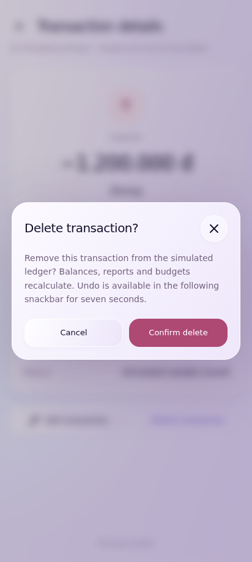
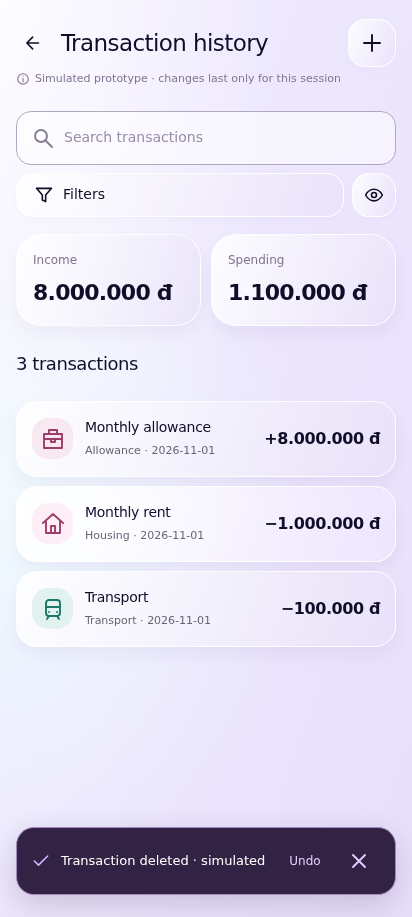
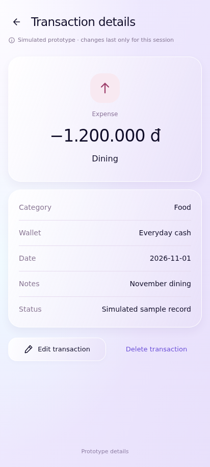
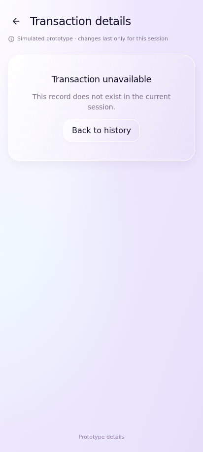

# UC-CLI-07 — Delete and Restore Transaction

> *Performed by: Nguyễn Phú Đạt (24120038) | Reviewed by: Pending team review | Edited by: Pending confirmation*

- **Goal:** Remove a transaction safely and restore it using Undo when available.
- **Primary actor:** Regular User.
- **Trigger:** The user invokes Delete from a transaction detail or supported list action.
- **Preconditions:** An eligible transaction is selected; delete functionality is available.
- **Postconditions:** A confirmed deletion removes the transaction from applicable views; a valid Undo restores the same transaction once.
- **Basic Flow:**
  1. The user opens a transaction and selects **Delete**.
  2. The app asks for confirmation.
  3. The user confirms.
  4. The app removes the transaction from the visible dataset and updates related summaries.
  5. The app presents a brief **Undo** option when supported.
  6. The user may select Undo within the available window to restore the original record.
- **Alternative Flows:** A1 — The user cancels the confirmation; A2 — The user does not select Undo and the delete action remains applied; A3 — The user restores the deleted record through Undo.
- **Exception Flows:** E1 — Deletion fails: show error and keep or restore consistent UI state; E2 — Undo has expired or is no longer available: do not claim restoration; E3 — Repeated Undo must not duplicate the record.
- **Prototype frames:** `DL-01-Delete-Confirmation`, `DL-02-Deleted-Snackbar`, `DL-03-Undo-Restored`, `DL-04-Delete-Failure`.
- **Required evidence:** Confirmed delete, alternate cancel/Undo, and failure/expired-Undo state.

## Prototype evidence
> *Performed by: Nguyễn Phú Đạt (24120038) | Reviewed by: Pending team review | Edited by: Pending confirmation*

**Evidence source: Figma Make Prototype — Simulated UI.** These are browser prototype captures using simulated, in-memory financial data, not Android emulator screenshots. No backend integration, PostgreSQL persistence, real JWT authentication, real device behavior or native Android pixel accuracy is verified. Imported validation claims belong to the supplied archive; no browser scenario tests were rerun during this documentation integration.

**Prototype reference:** [Client prototype link and scope](client-prototype-link.md). **Mapping:** [Integrated screenshot matrix](../screenshots/prototypes/client-evidence/Screenshot-Matrix.csv); source descriptions, routes and screen IDs are retained. BF/AF/EF numbers are archive evidence labels and need not equal the A1/E1 numbering in the specification. Supplementary prototype scenarios do not amend the authoritative specification.

| Evidence | Flow | Declared scenario | Source screen / route | Image |
|---|---|---|---|---|
| D.7.1 | BF | Delete requires explicit confirmation | `DL-01-Delete-Confirmation` / `transaction/food` | [UC-CLI-07_BF_01_DeleteConfirmation.png](../screenshots/prototypes/UC-CLI-07/UC-CLI-07_BF_01_DeleteConfirmation.png) |
| D.7.2 | BF | Confirmed deletion removes the record and offers Undo | `HX-01-History` / `transactions` | [UC-CLI-07_BF_02_DeletedTransaction.png](../screenshots/prototypes/UC-CLI-07/UC-CLI-07_BF_02_DeletedTransaction.png) |
| D.7.3 | AF | Cancel confirmation leaves transaction and ledger intact | `Transaction details` / `transaction/food` | [UC-CLI-07_AF_01_CancelDeletion.png](../screenshots/prototypes/UC-CLI-07/UC-CLI-07_AF_01_CancelDeletion.png) |
| D.7.4 | AF | Undo restores the same transaction ID and dependent balances | `Transaction details` / `transaction/food` | [UC-CLI-07_AF_02_UndoRestoresOriginal.png](../screenshots/prototypes/UC-CLI-07/UC-CLI-07_AF_02_UndoRestoresOriginal.png) |
| D.7.5 | EF | Already removed or missing IDs show a recovery state | `Transaction details` / `transaction/missing-record` | [UC-CLI-07_EF_01_UnavailableTransaction.png](../screenshots/prototypes/UC-CLI-07/UC-CLI-07_EF_01_UnavailableTransaction.png) |

*Figure D.7.1 — UC-CLI-07 Basic Flow: `DL-01-Delete-Confirmation` in the simulated FinSync prototype. Supplied scenario: Delete requires explicit confirmation.*

**Evidence interpretation:** The captured prototype screen supports inspection of the visible UI state only; it does not independently establish each preceding interaction or production integration.

*Figure D.7.2 — UC-CLI-07 Basic Flow: `HX-01-History` in the simulated FinSync prototype. Supplied scenario: Confirmed deletion removes the record and offers Undo.*

**Evidence interpretation:** The captured prototype screen supports inspection of the visible UI state only; it does not independently establish each preceding interaction or production integration.

*Figure D.7.3 — UC-CLI-07 Alternative Flow: `Transaction details` in the simulated FinSync prototype. Supplied scenario: Cancel confirmation leaves transaction and ledger intact.*

**Evidence interpretation:** Identical final transaction-details pixels are shared with the other cancelled-edit/cancel-deletion/Undo captures. The image alone does not independently demonstrate the intermediate action, preserved ID or recalculated balances.

*Figure D.7.4 — UC-CLI-07 Alternative Flow: `Transaction details` in the simulated FinSync prototype. Supplied scenario: Undo restores the same transaction ID and dependent balances.*

**Evidence interpretation:** Identical final transaction-details pixels are shared with the other cancelled-edit/cancel-deletion/Undo captures. The image alone does not independently demonstrate the intermediate action, preserved ID or recalculated balances.

*Figure D.7.5 — UC-CLI-07 Exception Flow: `Transaction details` in the simulated FinSync prototype. Supplied scenario: Already removed or missing IDs show a recovery state.*

**Evidence interpretation:** The captured prototype screen supports inspection of the visible UI state only; it does not independently establish each preceding interaction or production integration.
