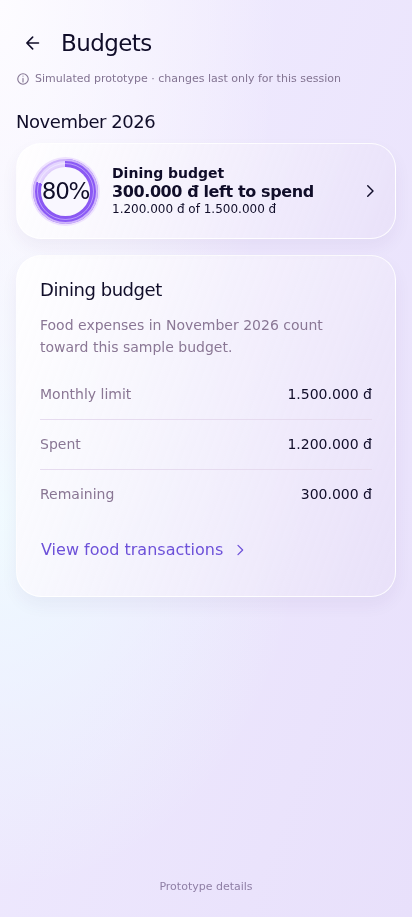
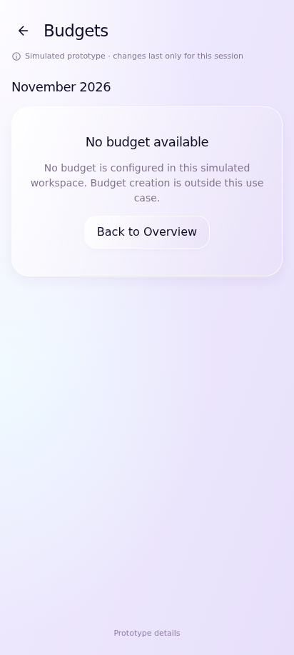

# UC-CLI-08 — View Budget Status

> *Performed by: Nguyễn Phú Đạt (24120038) | Reviewed by: Pending team review | Edited by: Pending confirmation*

- **Goal:** Understand how much of an available budget has been used and what remains.
- **Primary actor:** Regular User.
- **Trigger:** The user selects a budget preview or opens its details.
- **Preconditions:** Budget information is available or an appropriate empty state exists.
- **Postconditions:** The user has inspected budget status; records remain unchanged.
- **Basic Flow:**
  1. The user opens Overview or the supported budget entry point.
  2. The app displays a budget progress indicator.
  3. The user selects the budget card.
  4. The app displays budget details, the used amount, and the remaining amount.
  5. The user returns to Overview.
- **Alternative Flows:** A1 — The user inspects a different budget, if the app supports multiple budgets; A2 — The user views an over-budget state; A3 — An unavailable budget is represented by an empty state.
- **Exception Flows:** E1 — Budget data cannot be loaded: show a retry action; E2 — Invalid/inconsistent source data: do not manufacture a progress percentage.
- **Prototype frames:** `BG-01-Budget-Preview`, `BG-02-Budget-Detail`, `BG-03-Over-Budget`, `BG-04-Budget-Empty`, `BG-05-Budget-Error`.
- **Required evidence:** Budget overview/details; over-budget or alternate budget; empty/error state.
- **Scope limitation:** Creating or editing budgets is a separate optional use case only if verified in the app's approved scope.

## Prototype evidence
> *Performed by: Nguyễn Phú Đạt (24120038) | Reviewed by: Pending team review | Edited by: Pending confirmation*

**Evidence source: Figma Make Prototype — Simulated UI.** These are browser prototype captures using simulated, in-memory financial data, not Android emulator screenshots. No backend integration, PostgreSQL persistence, real JWT authentication, real device behavior or native Android pixel accuracy is verified. Imported validation claims belong to the supplied archive; no browser scenario tests were rerun during this documentation integration.

**Prototype reference:** [Client prototype link and scope](client-prototype-link.md). **Mapping:** [Integrated screenshot matrix](../screenshots/prototypes/client-evidence/Screenshot-Matrix.csv); source descriptions, routes and screen IDs are retained. BF/AF/EF numbers are archive evidence labels and need not equal the A1/E1 numbering in the specification. Supplementary prototype scenarios do not amend the authoritative specification.

| Evidence | Flow | Declared scenario | Source screen / route | Image |
|---|---|---|---|---|
| D.8.1 | BF | Budget limit, used amount, remaining amount and progress | `Budgets` / `budgets` | [UC-CLI-08_BF_01_BudgetStatus.png](../screenshots/prototypes/UC-CLI-08/UC-CLI-08_BF_01_BudgetStatus.png) |
| D.8.2 | AF | Over-budget state calculated from the same expense ledger | `Budgets` / `budgets` | [UC-CLI-08_AF_01_OverBudget.png](../screenshots/prototypes/UC-CLI-08/UC-CLI-08_AF_01_OverBudget.png) |
| D.8.3 | EF | Honest unavailable-budget state with no creation claim | `Budgets` / `budgets` | [UC-CLI-08_EF_01_NoBudget.png](../screenshots/prototypes/UC-CLI-08/UC-CLI-08_EF_01_NoBudget.png) |
| D.8.4 | AF | Budget links to the contributing spending and Back returns to Overview | `Budgets` / `budgets` | [UC-CLI-08_AF_02_BudgetDrilldown.png](../screenshots/prototypes/UC-CLI-08/UC-CLI-08_AF_02_BudgetDrilldown.png) |

*Figure D.8.1 — UC-CLI-08 Basic Flow: `Budgets` in the simulated FinSync prototype. Supplied scenario: Budget limit, used amount, remaining amount and progress.*

**Evidence interpretation:** The captured prototype screen supports inspection of the visible UI state only; it does not independently establish each preceding interaction or production integration.

*Figure D.8.2 — UC-CLI-08 Alternative Flow: `Budgets` in the simulated FinSync prototype. Supplied scenario: Over-budget state calculated from the same expense ledger.*

**Evidence interpretation:** The captured prototype screen supports inspection of the visible UI state only; it does not independently establish each preceding interaction or production integration.

*Figure D.8.3 — UC-CLI-08 Exception Flow: `Budgets` in the simulated FinSync prototype. Supplied scenario: Honest unavailable-budget state with no creation claim.*

**Evidence interpretation:** The captured prototype screen supports inspection of the visible UI state only; it does not independently establish each preceding interaction or production integration.

*Figure D.8.4 — UC-CLI-08 Alternative Flow: `Budgets` in the simulated FinSync prototype. Supplied scenario: Budget links to the contributing spending and Back returns to Overview.*

**Evidence interpretation:** The budget status and View food transactions link are visible; the downstream transaction list and Back transition are not shown.
