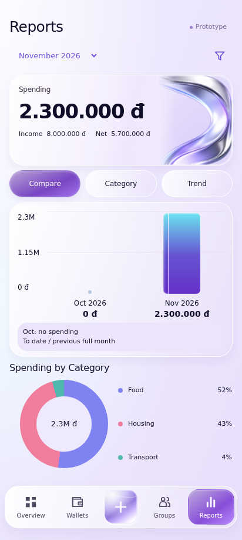
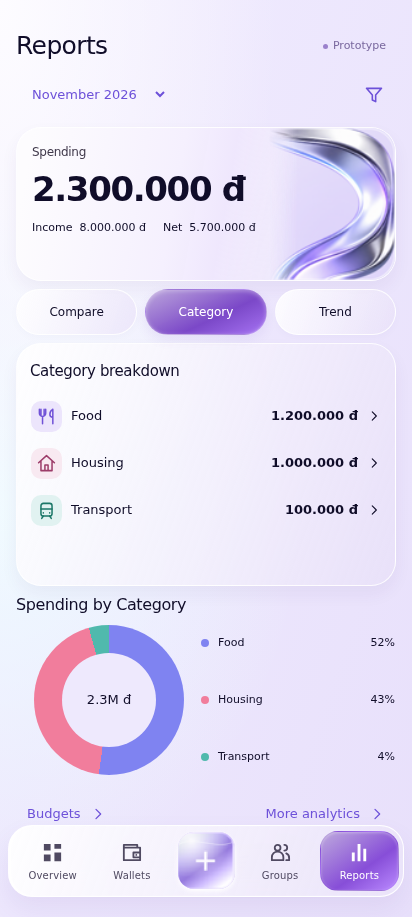
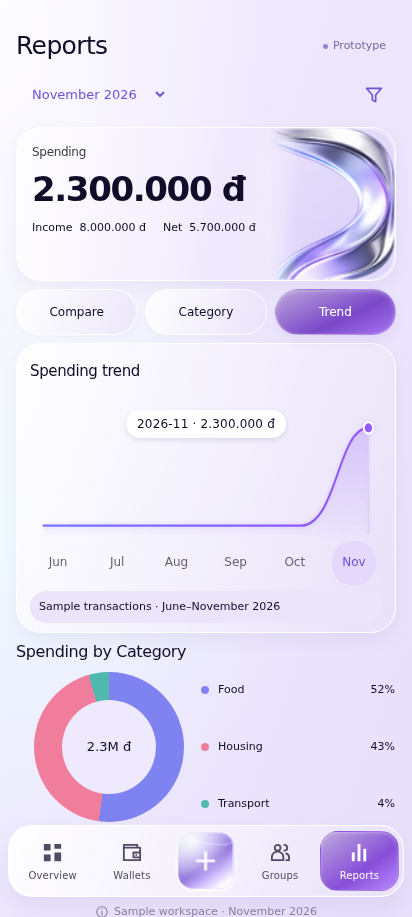
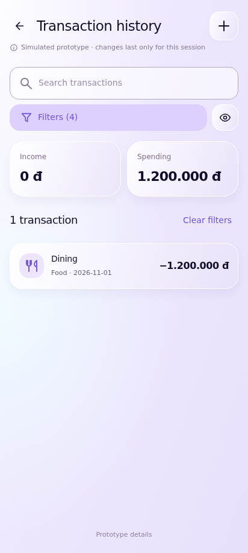
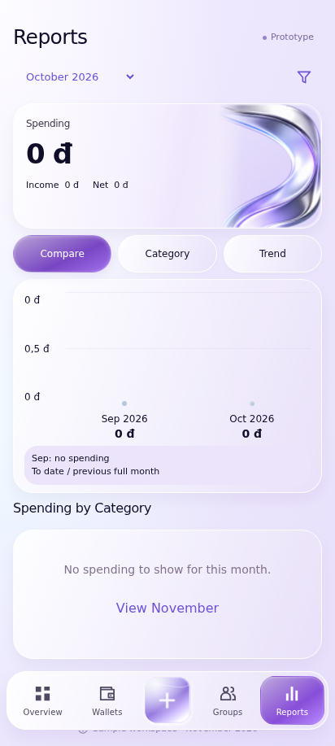
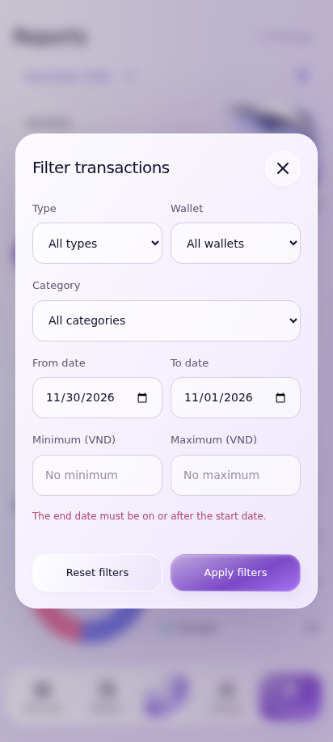
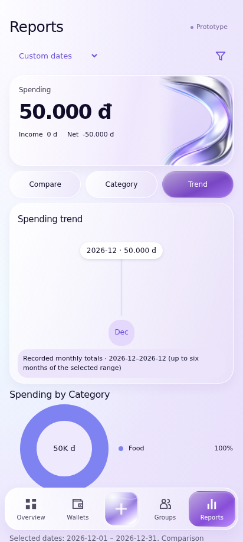

# UC-CLI-09 — View and Filter Financial Reports

> *Performed by: Nguyễn Phú Đạt (24120038) | Reviewed by: Pending team review | Edited by: Pending confirmation*

- **Goal:** Analyze personal financial activity by period, category, wallet, and supported chart type.
- **Primary actor:** Regular User.
- **Trigger:** The user opens Reports.
- **Preconditions:** The app can access recorded financial data and its supported analytics views.
- **Postconditions:** The user has examined filtered summaries or related transactions; no records are modified.
- **Basic Flow:**
  1. The user opens **Reports**.
  2. The app shows spending/income summary information for the selected period.
  3. The user selects an available report mode such as **Compare**, **Category**, or **Trend**.
  4. The app renders the corresponding accurate chart.
  5. The user adjusts supported month/date, wallet, or category filters.
  6. The app updates the chart and summary values consistently.
  7. The user selects a chart element or related detail to inspect contributing transactions, if supported.
- **Alternative Flows:** A1 — The user switches chart mode; A2 — The user compares a month with no prior recorded spending; A3 — The user resets filters or selects a different date range.
- **Exception Flows:** E1 — No matching data: display an honest empty chart state; E2 — The comparison baseline is zero or absent: do not invent a growth percentage; E3 — An invalid custom date range is rejected; E4 — Aggregation/retrieval fails: show an error/retry state.
- **Prototype frames:** `RP-01-Compare`, `RP-02-Category`, `RP-03-Trend`, `RP-04-Filter-Sheet`, `RP-05-Chart-Selected`, `RP-06-No-Data`, `RP-07-Invalid-Range`, `RP-08-Report-Error`.
- **Required evidence:** Compare/Category/Trend main views; changing filters and selecting chart data; no-data, zero-baseline, and invalid-range states.

## Prototype evidence
> *Performed by: Nguyễn Phú Đạt (24120038) | Reviewed by: Pending team review | Edited by: Pending confirmation*

**Evidence source: Figma Make Prototype — Simulated UI.** These are browser prototype captures using simulated, in-memory financial data, not Android emulator screenshots. No backend integration, PostgreSQL persistence, real JWT authentication, real device behavior or native Android pixel accuracy is verified. Imported validation claims belong to the supplied archive; no browser scenario tests were rerun during this documentation integration.

**Prototype reference:** [Client prototype link and scope](client-prototype-link.md). **Mapping:** [Integrated screenshot matrix](../screenshots/prototypes/client-evidence/Screenshot-Matrix.csv); source descriptions, routes and screen IDs are retained. BF/AF/EF numbers are archive evidence labels and need not equal the A1/E1 numbering in the specification. Supplementary prototype scenarios do not amend the authoritative specification.

| Evidence | Flow | Declared scenario | Source screen / route | Image |
|---|---|---|---|---|
| D.9.1 | BF | Compare recorded spending without fabricating zero-baseline growth | `RP-01-Compare` / `reports` | [UC-CLI-09_BF_01_CompareReport.png](../screenshots/prototypes/UC-CLI-09/UC-CLI-09_BF_01_CompareReport.png) |
| D.9.2 | AF | Switch to category chart with ledger-derived amounts | `RP-01-Compare` / `reports` | [UC-CLI-09_AF_01_CategoryReport.png](../screenshots/prototypes/UC-CLI-09/UC-CLI-09_AF_01_CategoryReport.png) |
| D.9.3 | AF | Trend uses only recorded monthly data | `RP-01-Compare` / `reports` | [UC-CLI-09_AF_02_TrendReport.png](../screenshots/prototypes/UC-CLI-09/UC-CLI-09_AF_02_TrendReport.png) |
| D.9.4 | AF | Filter report by wallet/category and drill into contributing transactions | `HX-01-History` / `transactions?wallet=cash&category=Food&start=2026-11-01&end=2026-11-30` | [UC-CLI-09_AF_03_FilteredReport.png](../screenshots/prototypes/UC-CLI-09/UC-CLI-09_AF_03_FilteredReport.png) |
| D.9.5 | EF | No recorded spending produces a genuine no-data state | `RP-01-Compare` / `reports` | [UC-CLI-09_EF_01_EmptyReport.png](../screenshots/prototypes/UC-CLI-09/UC-CLI-09_EF_01_EmptyReport.png) |
| D.9.6 | EF | Reject reversed custom report dates | `RP-01-Compare` / `reports` | [UC-CLI-09_EF_02_InvalidReportDates.png](../screenshots/prototypes/UC-CLI-09/UC-CLI-09_EF_02_InvalidReportDates.png) |
| D.9.7 | AF | Out-of-sample date ranges use actual monthly labels, baseline, and point drilldown | `RP-01-Compare` / `reports` | [UC-CLI-09_AF_04_CustomPeriodTrend.png](../screenshots/prototypes/UC-CLI-09/UC-CLI-09_AF_04_CustomPeriodTrend.png) |

*Figure D.9.1 — UC-CLI-09 Basic Flow: `RP-01-Compare` in the simulated FinSync prototype. Supplied scenario: Compare recorded spending without fabricating zero-baseline growth.*

**Evidence interpretation:** The captured prototype screen supports inspection of the visible UI state only; it does not independently establish each preceding interaction or production integration.

*Figure D.9.2 — UC-CLI-09 Alternative Flow: `RP-01-Compare` in the simulated FinSync prototype. Supplied scenario: Switch to category chart with ledger-derived amounts.*

**Evidence interpretation:** The captured prototype screen supports inspection of the visible UI state only; it does not independently establish each preceding interaction or production integration.

*Figure D.9.3 — UC-CLI-09 Alternative Flow: `RP-01-Compare` in the simulated FinSync prototype. Supplied scenario: Trend uses only recorded monthly data.*

**Evidence interpretation:** The captured prototype screen supports inspection of the visible UI state only; it does not independently establish each preceding interaction or production integration.

*Figure D.9.4 — UC-CLI-09 Alternative Flow: `HX-01-History` in the simulated FinSync prototype. Supplied scenario: Filter report by wallet/category and drill into contributing transactions.*

**Evidence interpretation:** The capture shows transaction history with four active filters, not a filtered Reports chart.

*Figure D.9.5 — UC-CLI-09 Exception Flow: `RP-01-Compare` in the simulated FinSync prototype. Supplied scenario: No recorded spending produces a genuine no-data state.*

**Evidence interpretation:** The captured prototype screen supports inspection of the visible UI state only; it does not independently establish each preceding interaction or production integration.

*Figure D.9.6 — UC-CLI-09 Exception Flow: `RP-01-Compare` in the simulated FinSync prototype. Supplied scenario: Reject reversed custom report dates.*

**Evidence interpretation:** The captured prototype screen supports inspection of the visible UI state only; it does not independently establish each preceding interaction or production integration.

*Figure D.9.7 — UC-CLI-09 Alternative Flow: `RP-01-Compare` in the simulated FinSync prototype. Supplied scenario: Out-of-sample date ranges use actual monthly labels, baseline, and point drilldown.*

**Evidence interpretation:** The captured prototype screen supports inspection of the visible UI state only; it does not independently establish each preceding interaction or production integration.
