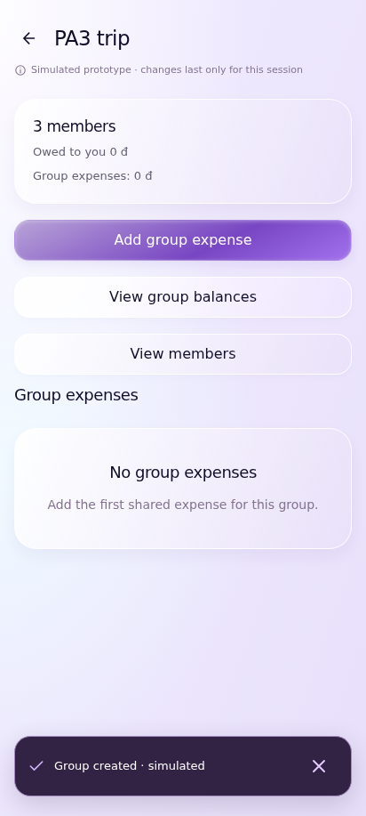
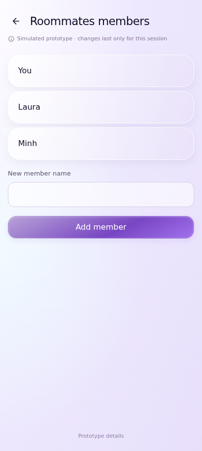
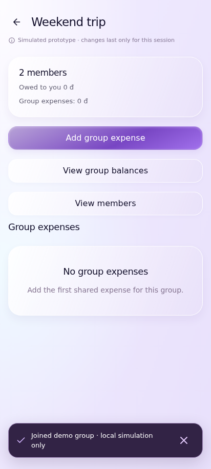
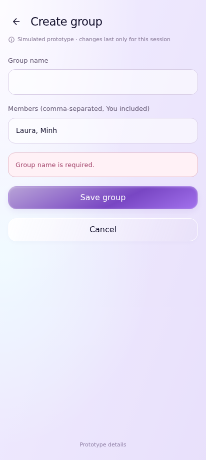
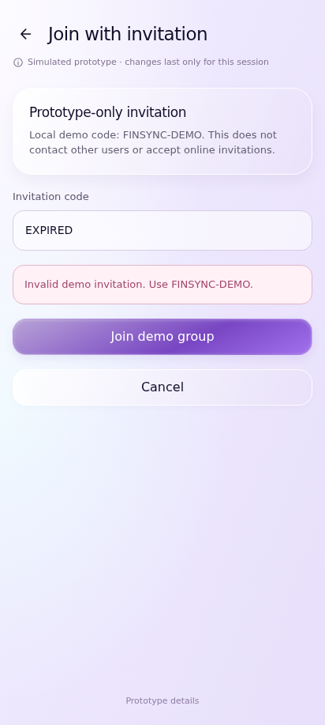

# UC-CLI-10 — Create, Join, and View Groups

> *Performed by: Nguyễn Phú Đạt (24120038) | Reviewed by: Pending team review | Edited by: Pending confirmation*

- **Goal:** Create and view shared-expense groups and join an existing group where invitation handling is supported.
- **Primary actor:** Regular User.
- **Trigger:** The user opens Groups and selects Create Group, Join, or a group card.
- **Preconditions:** Group screens are available; invitations require an approved invitation mechanism.
- **Postconditions:** A successful action changes group membership/listing appropriately; failures do not create phantom groups.
- **Basic Flow:**
  1. The user opens **Groups**.
  2. The app shows available groups and relevant debt/receivable summaries.
  3. The user selects **Create Group**.
  4. The user supplies required group information and any supported members.
  5. The user confirms creation.
  6. The app shows the new group in the group list and permits opening its details.
- **Alternative Flows:** A1 — The user opens an existing group without creating a new one; A2 — The user searches groups; A3 — The user chooses **Join by Invitation** only if this flow is supported by the team's implementation/prototype scope.
- **Exception Flows:** E1 — Group name/required input is invalid; E2 — Create/join fails: show a concise error and preserve input; E3 — Invitation is missing/expired/invalid only if invitations are implemented; E4 — No groups exist: show a contextual empty state.
- **Prototype frames:** `GR-01-Groups-List`, `GR-02-Create-Group`, `GR-03-Group-Details`, `GR-04-Join-Invitation-Conditional`, `GR-05-Group-Validation`, `GR-06-Group-Empty`, `GR-07-Group-Failure`.
- **Required evidence:** Groups list and successful creation; existing-group/search/invitation variation; invalid input or failure.
- **Scope limitation:** Network-based invitation acceptance must not be presented as working without real supporting implementation.

## Prototype evidence
> *Performed by: Nguyễn Phú Đạt (24120038) | Reviewed by: Pending team review | Edited by: Pending confirmation*

**Evidence source: Figma Make Prototype — Simulated UI.** These are browser prototype captures using simulated, in-memory financial data, not Android emulator screenshots. No backend integration, PostgreSQL persistence, real JWT authentication, real device behavior or native Android pixel accuracy is verified. Imported validation claims belong to the supplied archive; no browser scenario tests were rerun during this documentation integration.

**Prototype reference:** [Client prototype link and scope](client-prototype-link.md). **Mapping:** [Integrated screenshot matrix](../screenshots/prototypes/client-evidence/Screenshot-Matrix.csv); source descriptions, routes and screen IDs are retained. BF/AF/EF numbers are archive evidence labels and need not equal the A1/E1 numbering in the specification. Supplementary prototype scenarios do not amend the authoritative specification.

| Evidence | Flow | Declared scenario | Source screen / route | Image |
|---|---|---|---|---|
| D.10.1 | BF | Create a group with stable member identities and view its overview | `GR-03-Group-Details` / `group/aae0bc1f-488b-49d6-8002-aa030feeefe9` | [UC-CLI-10_BF_01_CreatedGroup.png](../screenshots/prototypes/UC-CLI-10/UC-CLI-10_BF_01_CreatedGroup.png) |
| D.10.2 | AF | Open an existing group and its members | `GR-Members` / `group/roommates/members` | [UC-CLI-10_AF_01_ExistingGroup.png](../screenshots/prototypes/UC-CLI-10/UC-CLI-10_AF_01_ExistingGroup.png) |
| D.10.3 | AF | Supported source invitation is explicitly prototype-only and local | `GR-03-Group-Details` / `group/32937b30-5eb9-4917-9273-f7ca61a9252e` | [UC-CLI-10_AF_02_LocalInvitation.png](../screenshots/prototypes/UC-CLI-10/UC-CLI-10_AF_02_LocalInvitation.png) |
| D.10.4 | EF | Reject a missing required group name | `GR-05-Group-Validation` / `group-new` | [UC-CLI-10_EF_01_InvalidGroup.png](../screenshots/prototypes/UC-CLI-10/UC-CLI-10_EF_01_InvalidGroup.png) |
| D.10.5 | EF | Reject an unknown local demo code without phantom membership | `GR-05-Group-Validation` / `group-join` | [UC-CLI-10_EF_02_InvalidInvitation.png](../screenshots/prototypes/UC-CLI-10/UC-CLI-10_EF_02_InvalidInvitation.png) |

*Figure D.10.1 — UC-CLI-10 Basic Flow: `GR-03-Group-Details` in the simulated FinSync prototype. Supplied scenario: Create a group with stable member identities and view its overview.*

**Evidence interpretation:** The captured prototype screen supports inspection of the visible UI state only; it does not independently establish each preceding interaction or production integration.

*Figure D.10.2 — UC-CLI-10 Alternative Flow: `GR-Members` in the simulated FinSync prototype. Supplied scenario: Open an existing group and its members.*

**Evidence interpretation:** The capture shows the existing group member list.

*Figure D.10.3 — UC-CLI-10 Alternative Flow: `GR-03-Group-Details` in the simulated FinSync prototype. Supplied scenario: Supported source invitation is explicitly prototype-only and local.*

**Evidence interpretation:** The captured prototype screen supports inspection of the visible UI state only; it does not independently establish each preceding interaction or production integration.

*Figure D.10.4 — UC-CLI-10 Exception Flow: `GR-05-Group-Validation` in the simulated FinSync prototype. Supplied scenario: Reject a missing required group name.*

**Evidence interpretation:** The captured prototype screen supports inspection of the visible UI state only; it does not independently establish each preceding interaction or production integration.

*Figure D.10.5 — UC-CLI-10 Exception Flow: `GR-05-Group-Validation` in the simulated FinSync prototype. Supplied scenario: Reject an unknown local demo code without phantom membership.*

**Evidence interpretation:** The captured prototype screen supports inspection of the visible UI state only; it does not independently establish each preceding interaction or production integration.
