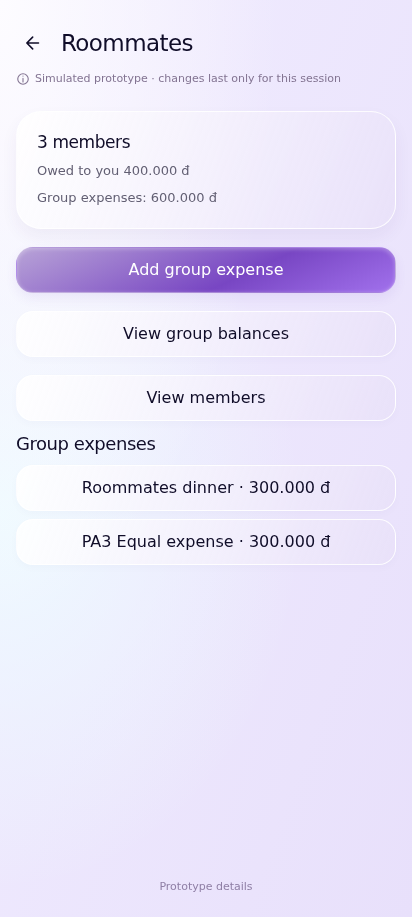
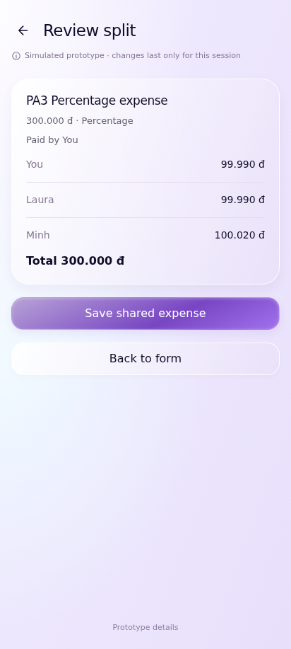
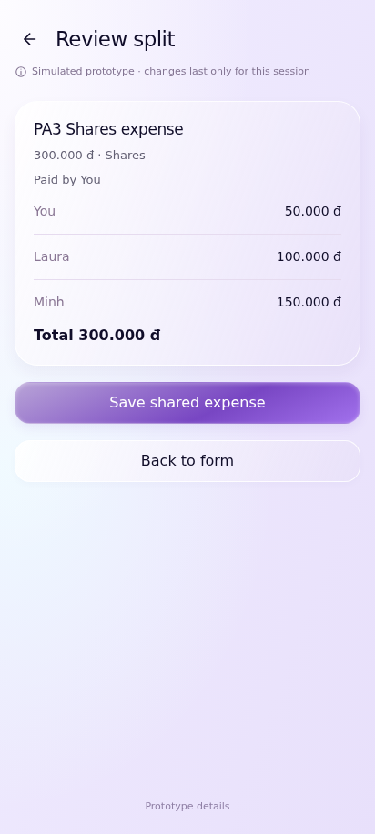
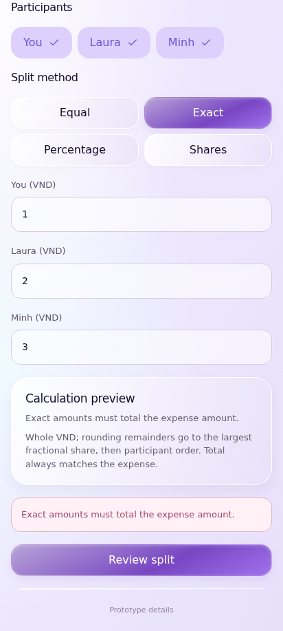
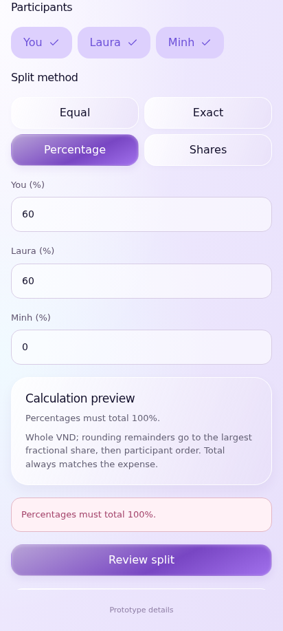
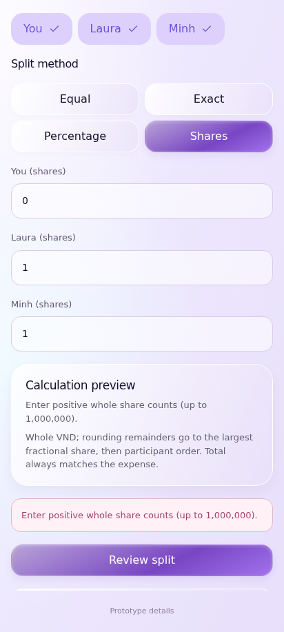
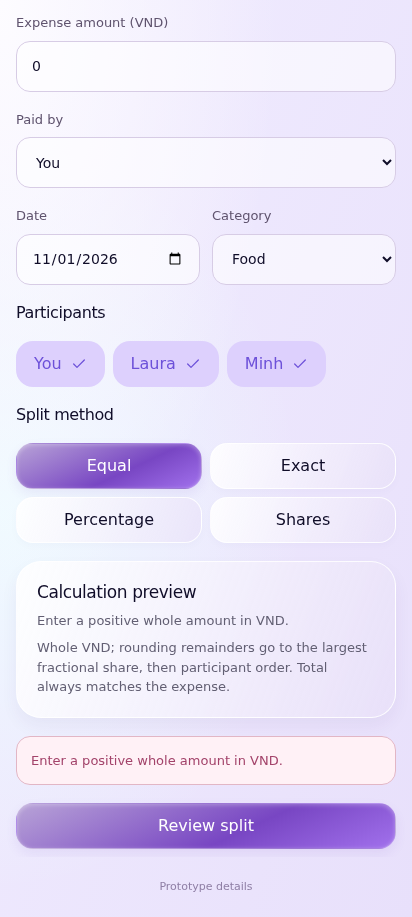

# UC-CLI-11 — Add and Split Group Expense

> *Performed by: Nguyễn Phú Đạt (24120038) | Reviewed by: Pending team review | Edited by: Pending confirmation*

- **Goal:** Record an expense paid for a group and allocate its cost among participants.
- **Primary actor:** Regular User.
- **Trigger:** The user selects Add Expense inside a group.
- **Preconditions:** The group and supported participants are available; split functionality exists.
- **Postconditions:** A valid group expense is recorded with consistent individual allocations and calculated balances; invalid allocations are rejected.
- **Basic Flow:**
  1. The user opens a group and selects **Add Expense**.
  2. The user enters the amount and supported expense details.
  3. The user selects the paying member and participating members.
  4. The user chooses a split mode such as **Equal**.
  5. The app calculates and displays each participant's share.
  6. The user reviews the allocations and confirms.
  7. The app records the expense and updates group balance information.
- **Alternative Flows:** A1 — The user switches to **Exact Amount**; A2 — The user uses **Percentage**; A3 — The user uses **Shares**; A4 — The user changes selected participants before saving.
- **Exception Flows:** E1 — Allocated exact amounts do not equal the expense total; E2 — Percentages do not total 100%; E3 — Shares or amount are zero/invalid; E4 — A monetary rounding remainder is handled deterministically rather than silently changing the total; E5 — Save fails and no duplicate group expense is created.
- **Prototype frames:** `SP-01-Group-Expense-Form`, `SP-02-Split-Equal`, `SP-03-Split-Exact`, `SP-04-Split-Percentage`, `SP-05-Split-Shares`, `SP-06-Split-Validation`, `SP-07-Split-Review`, `SP-08-Split-Success`, `SP-09-Split-Failure`.
- **Required evidence:** Equal split success; exact/percentage/shares variations; allocation mismatch and failed-save states.
- **Business rule boundary:** Client documentation describes displayed allocations and validations; backend-owned balance algorithms and persistence remain in the Data & Logic specification.

## Prototype evidence
> *Performed by: Nguyễn Phú Đạt (24120038) | Reviewed by: Pending team review | Edited by: Pending confirmation*

**Evidence source: Figma Make Prototype — Simulated UI.** These are browser prototype captures using simulated, in-memory financial data, not Android emulator screenshots. No backend integration, PostgreSQL persistence, real JWT authentication, real device behavior or native Android pixel accuracy is verified. Imported validation claims belong to the supplied archive; no browser scenario tests were rerun during this documentation integration.

**Prototype reference:** [Client prototype link and scope](client-prototype-link.md). **Mapping:** [Integrated screenshot matrix](../screenshots/prototypes/client-evidence/Screenshot-Matrix.csv); source descriptions, routes and screen IDs are retained. BF/AF/EF numbers are archive evidence labels and need not equal the A1/E1 numbering in the specification. Supplementary prototype scenarios do not amend the authoritative specification.

| Evidence | Flow | Declared scenario | Source screen / route | Image |
|---|---|---|---|---|
| D.11.1 | BF | Equal split conserves an odd VND total with deterministic rounding | `SP-07-Split-Review` / `group/roommates/expense` | [UC-CLI-11_BF_01_EqualSplitReview.png](../screenshots/prototypes/UC-CLI-11/UC-CLI-11_BF_01_EqualSplitReview.png) |
| D.11.2 | BF | Save shared expense and update group overview without personal duplication | `GR-03-Group-Details` / `group/roommates` | [UC-CLI-11_BF_02_SharedExpenseSuccess.png](../screenshots/prototypes/UC-CLI-11/UC-CLI-11_BF_02_SharedExpenseSuccess.png) |
| D.11.3 | AF | Exact allocations total the expense | `SP-07-Split-Review` / `group/roommates/expense` | [UC-CLI-11_AF_01_ExactSplit.png](../screenshots/prototypes/UC-CLI-11/UC-CLI-11_AF_01_ExactSplit.png) |
| D.11.4 | AF | Percentages total 100 with precise whole-VND preview | `SP-07-Split-Review` / `group/roommates/expense` | [UC-CLI-11_AF_02_PercentageSplit.png](../screenshots/prototypes/UC-CLI-11/UC-CLI-11_AF_02_PercentageSplit.png) |
| D.11.5 | AF | Positive share weights produce consistent allocations | `SP-07-Split-Review` / `group/roommates/expense` | [UC-CLI-11_AF_03_SharesSplit.png](../screenshots/prototypes/UC-CLI-11/UC-CLI-11_AF_03_SharesSplit.png) |
| D.11.6 | EF | Reject exact amounts not totaling expense | `SP-06-Split-Validation` / `group/roommates/expense` | [UC-CLI-11_EF_01_InvalidExact.png](../screenshots/prototypes/UC-CLI-11/UC-CLI-11_EF_01_InvalidExact.png) |
| D.11.7 | EF | Reject percentages not totaling 100 | `SP-06-Split-Validation` / `group/roommates/expense` | [UC-CLI-11_EF_02_InvalidPercentage.png](../screenshots/prototypes/UC-CLI-11/UC-CLI-11_EF_02_InvalidPercentage.png) |
| D.11.8 | EF | Reject nonpositive shares | `SP-06-Split-Validation` / `group/roommates/expense` | [UC-CLI-11_EF_03_InvalidShares.png](../screenshots/prototypes/UC-CLI-11/UC-CLI-11_EF_03_InvalidShares.png) |
| D.11.9 | EF | Reject zero group expense | `SP-06-Split-Validation` / `group/roommates/expense` | [UC-CLI-11_EF_04_InvalidGroupAmount.png](../screenshots/prototypes/UC-CLI-11/UC-CLI-11_EF_04_InvalidGroupAmount.png) |

*Figure D.11.1 — UC-CLI-11 Basic Flow: `SP-07-Split-Review` in the simulated FinSync prototype. Supplied scenario: Equal split conserves an odd VND total with deterministic rounding.*

**Evidence interpretation:** The captured prototype screen supports inspection of the visible UI state only; it does not independently establish each preceding interaction or production integration.

*Figure D.11.2 — UC-CLI-11 Basic Flow: `GR-03-Group-Details` in the simulated FinSync prototype. Supplied scenario: Save shared expense and update group overview without personal duplication.*

**Evidence interpretation:** The captured prototype screen supports inspection of the visible UI state only; it does not independently establish each preceding interaction or production integration.

*Figure D.11.3 — UC-CLI-11 Alternative Flow: `SP-07-Split-Review` in the simulated FinSync prototype. Supplied scenario: Exact allocations total the expense.*

**Evidence interpretation:** The captured prototype screen supports inspection of the visible UI state only; it does not independently establish each preceding interaction or production integration.

*Figure D.11.4 — UC-CLI-11 Alternative Flow: `SP-07-Split-Review` in the simulated FinSync prototype. Supplied scenario: Percentages total 100 with precise whole-VND preview.*

**Evidence interpretation:** The captured prototype screen supports inspection of the visible UI state only; it does not independently establish each preceding interaction or production integration.

*Figure D.11.5 — UC-CLI-11 Alternative Flow: `SP-07-Split-Review` in the simulated FinSync prototype. Supplied scenario: Positive share weights produce consistent allocations.*

**Evidence interpretation:** The captured prototype screen supports inspection of the visible UI state only; it does not independently establish each preceding interaction or production integration.

*Figure D.11.6 — UC-CLI-11 Exception Flow: `SP-06-Split-Validation` in the simulated FinSync prototype. Supplied scenario: Reject exact amounts not totaling expense.*

**Evidence interpretation:** The captured prototype screen supports inspection of the visible UI state only; it does not independently establish each preceding interaction or production integration.

*Figure D.11.7 — UC-CLI-11 Exception Flow: `SP-06-Split-Validation` in the simulated FinSync prototype. Supplied scenario: Reject percentages not totaling 100.*

**Evidence interpretation:** The captured prototype screen supports inspection of the visible UI state only; it does not independently establish each preceding interaction or production integration.

*Figure D.11.8 — UC-CLI-11 Exception Flow: `SP-06-Split-Validation` in the simulated FinSync prototype. Supplied scenario: Reject nonpositive shares.*

**Evidence interpretation:** The captured prototype screen supports inspection of the visible UI state only; it does not independently establish each preceding interaction or production integration.

*Figure D.11.9 — UC-CLI-11 Exception Flow: `SP-06-Split-Validation` in the simulated FinSync prototype. Supplied scenario: Reject zero group expense.*

**Evidence interpretation:** The captured prototype screen supports inspection of the visible UI state only; it does not independently establish each preceding interaction or production integration.
