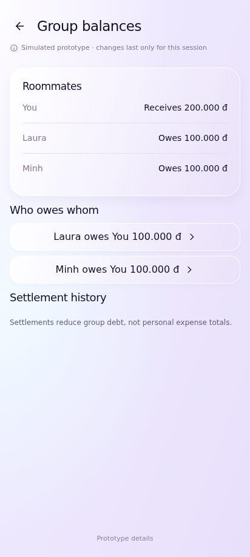
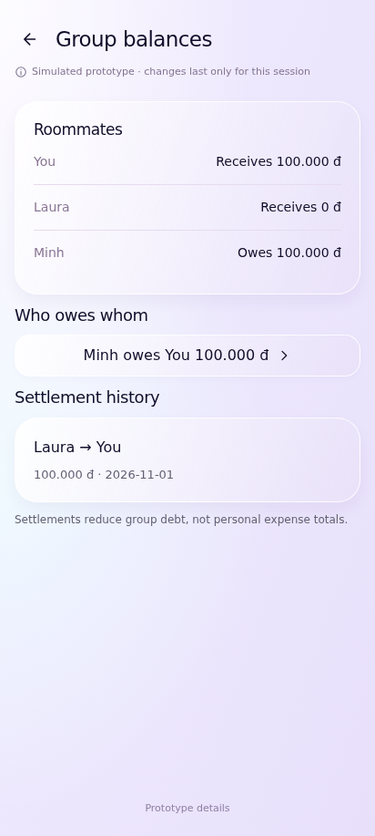
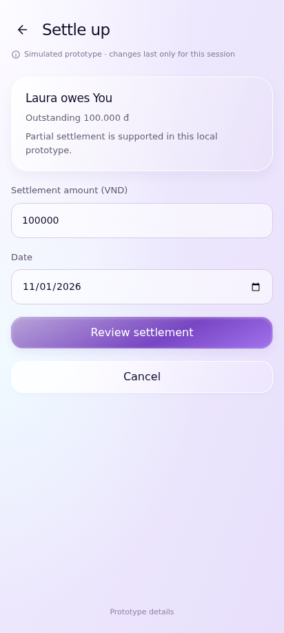
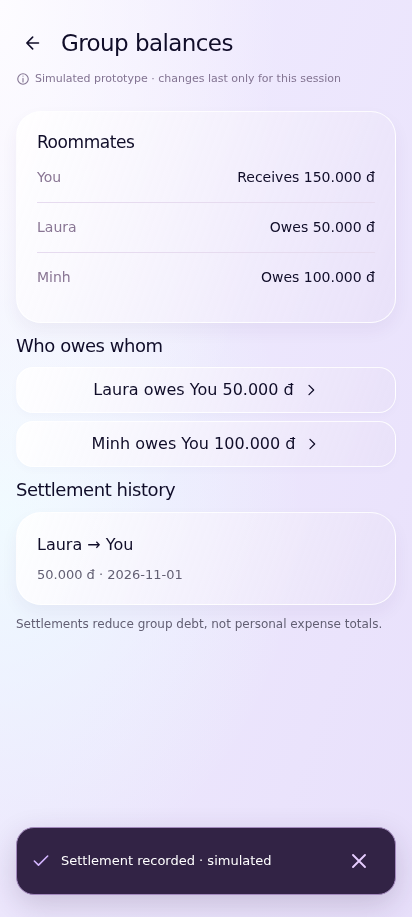
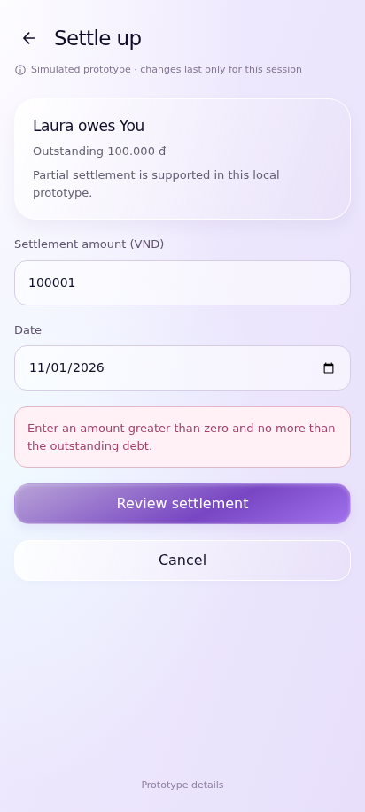
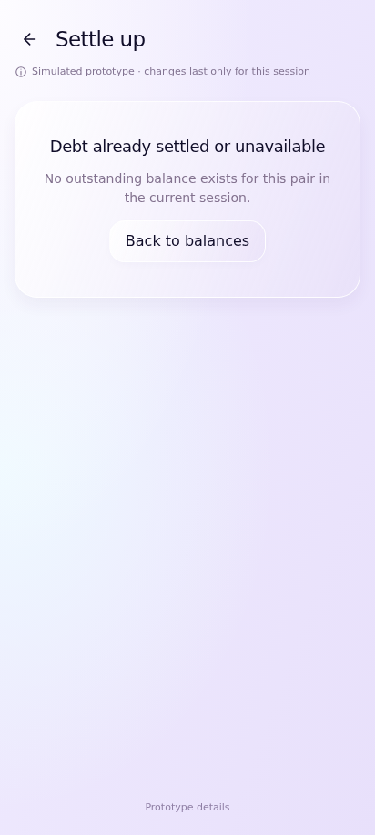

# UC-CLI-12 — View and Settle Group Debts

> *Performed by: Nguyễn Phú Đạt (24120038) | Reviewed by: Pending team review | Edited by: Pending confirmation*

- **Goal:** Identify outstanding balances between group participants and record a supported settlement.
- **Primary actor:** Regular User.
- **Trigger:** The user opens group debt details or selects Settle Up.
- **Preconditions:** An applicable group and its balance state are available; settlement functionality is supported.
- **Postconditions:** A valid settlement updates balances and supported settlement history; rejected/cancelled actions do not alter recorded debts.
- **Basic Flow:**
  1. The user opens a group.
  2. The app shows debt/receivable summaries and, where supported, who owes whom.
  3. The user selects a debt relationship and **Settle Up**.
  4. The app shows payer, receiver, and settlement amount for review.
  5. The user confirms the settlement.
  6. The app shows success and updates outstanding balances and history.
- **Alternative Flows:** A1 — The user views debt details without paying; A2 — The user cancels confirmation; A3 — A partial settlement is entered only if the real product supports it.
- **Exception Flows:** E1 — The settlement amount is invalid or exceeds the supported outstanding amount; E2 — The selected debt is already settled or no longer available; E3 — Processing fails: show an error and preserve consistent balances; E4 — Prevent duplicate settlement confirmation.
- **Prototype frames:** `ST-01-Debt-Summary`, `ST-02-Debt-Detail`, `ST-03-Settlement-Review`, `ST-04-Settlement-Success`, `ST-05-Settlement-Invalid`, `ST-06-Settlement-Failure`.
- **Required evidence:** Debt summary to settlement success; cancellation/partial settlement (if supported); invalid amount and failure state.
- **Financial integrity note:** A group settlement must not be counted as a new personal expense merely because money changed hands.

## Prototype evidence
> *Performed by: Nguyễn Phú Đạt (24120038) | Reviewed by: Pending team review | Edited by: Pending confirmation*

**Evidence source: Figma Make Prototype — Simulated UI.** These are browser prototype captures using simulated, in-memory financial data, not Android emulator screenshots. No backend integration, PostgreSQL persistence, real JWT authentication, real device behavior or native Android pixel accuracy is verified. Imported validation claims belong to the supplied archive; no browser scenario tests were rerun during this documentation integration.

**Prototype reference:** [Client prototype link and scope](client-prototype-link.md). **Mapping:** [Integrated screenshot matrix](../screenshots/prototypes/client-evidence/Screenshot-Matrix.csv); source descriptions, routes and screen IDs are retained. BF/AF/EF numbers are archive evidence labels and need not equal the A1/E1 numbering in the specification. Supplementary prototype scenarios do not amend the authoritative specification.

| Evidence | Flow | Declared scenario | Source screen / route | Image |
|---|---|---|---|---|
| D.12.1 | BF | View ledger-derived who-owes-whom and member balances | `ST-01-Debt-Summary` / `group/roommates/debts` | [UC-CLI-12_BF_01_DebtSummary.png](../screenshots/prototypes/UC-CLI-12/UC-CLI-12_BF_01_DebtSummary.png) |
| D.12.2 | BF | Settlement reduces debt and leaves personal expenses unchanged | `ST-01-Debt-Summary` / `group/roommates/debts` | [UC-CLI-12_BF_02_SettlementSuccess.png](../screenshots/prototypes/UC-CLI-12/UC-CLI-12_BF_02_SettlementSuccess.png) |
| D.12.3 | AF | Cancel review without changing debt | `ST-02-Debt-Detail` / `group/roommates/settle/laura/you` | [UC-CLI-12_AF_01_CancelledSettlement.png](../screenshots/prototypes/UC-CLI-12/UC-CLI-12_AF_01_CancelledSettlement.png) |
| D.12.4 | AF | Prototype-supported partial settlement reduces remaining balance | `ST-01-Debt-Summary` / `group/roommates/debts` | [UC-CLI-12_AF_02_PartialSettlement.png](../screenshots/prototypes/UC-CLI-12/UC-CLI-12_AF_02_PartialSettlement.png) |
| D.12.5 | EF | Reject an amount above outstanding debt | `ST-05-Settlement-Invalid` / `group/roommates/settle/laura/you` | [UC-CLI-12_EF_01_InvalidSettlement.png](../screenshots/prototypes/UC-CLI-12/UC-CLI-12_EF_01_InvalidSettlement.png) |
| D.12.6 | EF | Already settled or unavailable debt has recovery navigation | `ST-02-Debt-Detail` / `group/roommates/settle/missing/you` | [UC-CLI-12_EF_02_UnavailableDebt.png](../screenshots/prototypes/UC-CLI-12/UC-CLI-12_EF_02_UnavailableDebt.png) |

*Figure D.12.1 — UC-CLI-12 Basic Flow: `ST-01-Debt-Summary` in the simulated FinSync prototype. Supplied scenario: View ledger-derived who-owes-whom and member balances.*

**Evidence interpretation:** The captured prototype screen supports inspection of the visible UI state only; it does not independently establish each preceding interaction or production integration.

*Figure D.12.2 — UC-CLI-12 Basic Flow: `ST-01-Debt-Summary` in the simulated FinSync prototype. Supplied scenario: Settlement reduces debt and leaves personal expenses unchanged.*

**Evidence interpretation:** The captured prototype screen supports inspection of the visible UI state only; it does not independently establish each preceding interaction or production integration.

*Figure D.12.3 — UC-CLI-12 Alternative Flow: `ST-02-Debt-Detail` in the simulated FinSync prototype. Supplied scenario: Cancel review without changing debt.*

**Evidence interpretation:** The settlement form is visible with its amount; the earlier confirmation/cancel action is not shown.

*Figure D.12.4 — UC-CLI-12 Alternative Flow: `ST-01-Debt-Summary` in the simulated FinSync prototype. Supplied scenario: Prototype-supported partial settlement reduces remaining balance.*

**Evidence interpretation:** The captured prototype screen supports inspection of the visible UI state only; it does not independently establish each preceding interaction or production integration.

*Figure D.12.5 — UC-CLI-12 Exception Flow: `ST-05-Settlement-Invalid` in the simulated FinSync prototype. Supplied scenario: Reject an amount above outstanding debt.*

**Evidence interpretation:** The captured prototype screen supports inspection of the visible UI state only; it does not independently establish each preceding interaction or production integration.

*Figure D.12.6 — UC-CLI-12 Exception Flow: `ST-02-Debt-Detail` in the simulated FinSync prototype. Supplied scenario: Already settled or unavailable debt has recovery navigation.*

**Evidence interpretation:** The captured prototype screen supports inspection of the visible UI state only; it does not independently establish each preceding interaction or production integration.
