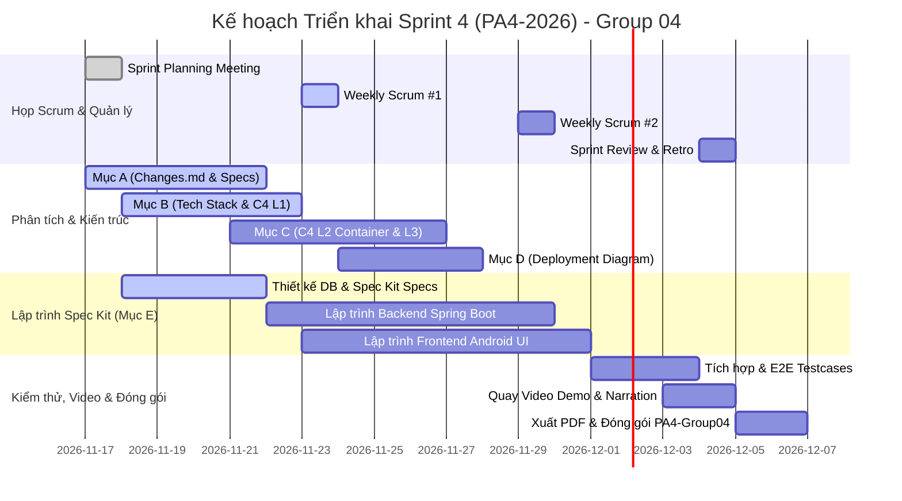

# FinSync — Sprint 4 / Project Assignment 4 (PA4-2026)
# BẢNG PHÂN CÔNG NHIỆM VỤ VÀ MÔ TẢ CHI TIẾT CÔNG VIỆC

---

## 1. MỤC TIÊU CỐT LÕI CỦA SPRINT 4 (PA4)

1. **Hoàn thiện tài liệu Kiến trúc Phần mềm chuyên sâu (Software Architecture — 50/90 điểm):**
   - **Mục B (20đ):** Mô tả Tech Stack toàn diện và vẽ sơ đồ **C4 Model Level 1 (System Context Diagram)** kèm thuyết minh.
   - **Mục C (25đ):** Vẽ sơ đồ **C4 Model Level 2 (Container Diagram)** và **C4 Model Level 3 (Component Diagram)** cho cả Frontend và Backend bằng Mermaid kèm thuyết minh chi tiết. *Đặc biệt: Sơ đồ phải phản ánh chính xác 100% mã nguồn thực tế.*
   - **Mục D (5đ):** Vẽ sơ đồ **Triển khai hạ tầng (Deployment Diagram)** bằng Mermaid mô tả ánh xạ các container lên môi trường chạy thực tế (Docker, Local PC, Cloud nodes, Ports, Protocols).
2. **Lập trình trọn vẹn thêm 2 nhóm chức năng (Functional Groups via Spec Kit — 30/90 điểm):**
   - **2 Nhóm chức năng (Functional Groups):** Cả nhóm sẽ cùng thảo luận, đánh giá mức độ khả thi và biểu quyết chọn chính thức 2 nhóm chức năng cụ thể trong buổi họp **Sprint Planning Meeting** đầu Sprint 4.
   - Đảm bảo hoàn chỉnh đầy đủ 3 tầng: **Frontend UI (Jetpack Compose / React) + Backend API (Spring Boot 3) + Database Persistence (PostgreSQL 16 & Flyway)**.
   - Quay video demo có thuyết minh tiếng Anh (5–8 phút) giải thích 2 nhóm chức năng đã hoàn thành và tải lên YouTube Unlisted.
3. **Hiệu chỉnh Use Case và quản lý tiến độ Scrum (10/90 điểm):**
   - **Mục A (5đ):** Cập nhật Use Case theo phản hồi của TA và lập bảng theo dõi bắt buộc trong `Changes.md`.
   - **Mục F (5đ):** Họp đủ 4 buổi Scrum (Planning, 2 Weekly Scrums, Review/Retro), quản lý bảng Jira Sprint 4, lập báo cáo nhật ký AI Usage của 5 thành viên.

---

## 2. BẢNG PHÂN BỔ CÔNG VIỆC THEO TỪNG THÀNH VIÊN

> **Quy tắc bắt buộc của môn học:**  
> 1. Mỗi mục trong báo cáo đều phải có dòng 3 vai trò: `> *Performed by: ... | Reviewed by: ... | Edited by: ...*`.  
> 2. Người thực hiện chính (**Performer**) bắt buộc phải khác người rà soát (**Reviewer**) để đảm bảo đánh giá chéo khách quan.  
> 3. Dưới đây là bảng công việc chi tiết chia theo từng bạn, bao gồm cả phần **tự làm chính (Performer)** và phần **rà soát chéo cho đồng đội (Reviewer)**.

---

### 📋 BẢNG 1: PHẠM ĐỊNH TIỂU LONG (Leader / Project Manager — MSSV: 24120087)
* **Trọng tâm Sprint 4:** Quản trị tiến độ Scrum, Jira Sprint 4, AI Usage log, rà soát chất lượng tổng thể tài liệu và đóng gói phát hành.
* **Tổng thời gian dự kiến:** ~30 giờ.

| Mã Task | Hạng mục PA4 | Tên công việc & Nhiệm vụ cụ thể | Vai trò | Người phối hợp | Hạn chót (Deadline) | Dự kiến (Giờ) |
| :---: | :---: | :--- | :---: | :---: | :---: | :---: |
| **S4-13** | **Mục F** (3đ) | **Quản trị Scrum & Họp:** Lập bảng Jira Sprint 4 (15 tasks), điều phối và ghi biên bản 4 cuộc họp Scrum (Planning, 2 Weekly Scrums, Review/Retro), lập Action Register (`ACT-01`..`08`). | **Performer** | Reviewer: Ngô Thái Hòa | 04/12/2026 | 14h |
| **S4-14** | **Mục F** (2đ) | **Báo cáo AI Usage:** Thu thập và kiểm tra prompt logs từ 5 thành viên, viết Mục F.1 (AI Declaration) và tổng hợp toàn bộ Appendix A.1 đến A.5. | **Performer** | Reviewer: Vương Đắc Gia Khiêm | 04/12/2026 | 8h |
| **S4-15** | **Đóng gói** | **Kiểm toán & Đóng gói:** Kiểm tra 100% dòng 3 vai trò, tối ưu hóa ảnh (<20MB), xuất bản `report.pdf`, `Changes.pdf`, đóng gói file `PA4-Group04.zip`. | **Performer** | Reviewer: Toàn đội | 06/12/2026 | 8h |
| *Review S4-01* | Mục A (5đ) | Rà soát chéo các thay đổi Use Case và file `Changes.md` do Hòa soạn thảo. | **Reviewer** | Performer: Ngô Thái Hòa | 22/11/2026 | 2h |
| *Review S4-03* | Mục B (10đ) | Rà soát sơ đồ C4 Level 1 (System Context) và bài thuyết minh do Hòa vẽ. | **Reviewer** | Performer: Ngô Thái Hòa | 22/11/2026 | 2h |
| *Review S4-10* | Mục E (12đ) | Chạy thử nghiệm và rà soát giao diện Android Jetpack Compose của Đạt. | **Reviewer** | Performer: Nguyễn Phú Đạt | 01/12/2026 | 2h |
| *Review S4-12* | Mục E | Nghe duyệt video demo, kiểm tra phụ đề / phát âm tiếng Anh của Khiêm. | **Reviewer** | Performer: Vương Đắc Gia Khiêm | 04/12/2026 | 2h |

---

### 📋 BẢNG 2: NGÔ THÁI HÒA (Requirement Engineer / System Analyst — MSSV: 24120051)
* **Trọng tâm Sprint 4:** Hiệu chỉnh Use Case và viết `Changes.md`, mô tả toàn diện Tech Stack, vẽ sơ đồ C4 Level 1 (System Context Diagram).
* **Tổng thời gian dự kiến:** ~32 giờ.

| Mã Task | Hạng mục PA4 | Tên công việc & Nhiệm vụ cụ thể | Vai trò | Người phối hợp | Hạn chót (Deadline) | Dự kiến (Giờ) |
| :---: | :---: | :--- | :---: | :---: | :---: | :---: |
| **S4-01** | **Mục A** (5đ) | **Hiệu chỉnh Use Case & `Changes.md`:** Cập nhật 31 Use Cases theo góp ý của TA từ PA3; viết bảng đối chiếu bắt buộc trong `Changes.md` (nếu thiếu file này sẽ bị 0 điểm). | **Performer** | Reviewer: Phạm Định Tiểu Long | 22/11/2026 | 14h |
| **S4-02** | **Mục B** (10đ) | **Đặc tả Tech Stack:** Soạn thảo tài liệu mô tả chi tiết toàn bộ công nghệ hệ thống: Android Compose, React Web, Spring Boot 3, Java 21, PostgreSQL 16, Redis 7, Cloud Storage, Gemini LLM. | **Performer** | Reviewer: Nguyễn Lê Đức Nhật | 22/11/2026 | 8h |
| **S4-03** | **Mục B** (10đ) | **C4 Model Level 1 (System Context Diagram):** Vẽ sơ đồ Mermaid thể hiện FinSync ở trung tâm, các Actors (User, Group Owner, Admin) và External Systems (Google Auth, Banking SMS, S3, Gemini AI) + bài thuyết minh. | **Performer** | Reviewer: Phạm Định Tiểu Long | 22/11/2026 | 10h |
| *Phối hợp S4-08* | Mục E (6đ) | Tham gia viết phần đặc tả nghiệp vụ User Stories và Acceptance Criteria trong `spec.md` cho 2 nhóm chức năng mới. | **Contributor** | Lead: Nguyễn Lê Đức Nhật | 20/11/2026 | 4h |
| *Review S4-05* | Mục C (8đ) | Rà soát sơ đồ C4 Level 3 Backend Component Diagram của Nhật. | **Reviewer** | Performer: Nguyễn Lê Đức Nhật | 28/11/2026 | 2h |
| *Review S4-13* | Mục F (3đ) | Rà soát biên bản 4 cuộc họp Scrum và bảng Jira do Long lập. | **Reviewer** | Performer: Phạm Định Tiểu Long | 04/12/2026 | 2h |

---

### 📋 BẢNG 3: NGUYỄN LÊ ĐỨC NHẬT (Full-Stack Lead / Backend Architect — MSSV: 24120403)
* **Trọng tâm Sprint 4:** Thiết kế C4 Level 2 (Container) và Level 3 (Backend Component), thiết kế Database Schema (PostgreSQL/Flyway), lập trình Backend API cho 2 nhóm chức năng.
* **Tổng thời gian dự kiến:** ~44 giờ.

| Mã Task | Hạng mục PA4 | Tên công việc & Nhiệm vụ cụ thể | Vai trò | Người phối hợp | Hạn chót (Deadline) | Dự kiến (Giờ) |
| :---: | :---: | :--- | :---: | :---: | :---: | :---: |
| **S4-04** | **Mục C** (12đ) | **C4 Model Level 2 (Container Diagram):** Vẽ sơ đồ Mermaid thể hiện 5 containers lớn (Mobile App, Admin Web, Spring Boot Server, PostgreSQL DB, Redis Cache) + bài thuyết minh trách nhiệm, công nghệ, giao thức mạng. | **Performer** | Reviewer: Nguyễn Phú Đạt | 28/11/2026 | 12h |
| **S4-05** | **Mục C** (8đ) | **C4 Model Level 3 (Backend Component Diagram):** Vẽ sơ đồ Mermaid zoom vào Spring Boot Server (Controllers, Services, Repositories, JWT Filter, DebtEngine) + thuyết minh chi tiết từng thành phần. | **Performer** | Reviewer: Ngô Thái Hòa | 28/11/2026 | 10h |
| **S4-08** | **Mục E** (6đ) | **Spec Kit SDD Workflow:** Chủ trì biên soạn bộ hồ sơ Spec Kit cho 2 Functional Groups (`spec.md`, `plan.md`, `tasks.md`, `contracts/backend-api.yaml`) sau khi nhóm thống nhất phạm vi tại Sprint Planning. | **Performer** | Reviewer: Ngô Thái Hòa | 21/11/2026 | 10h |
| **S4-09** | **Mục E** (12đ) | **Lập trình Backend REST API & Database:** • Thiết kế DB Flyway migrations (`V2`, `V3`) cho các thực thể và mối quan hệ của 2 nhóm chức năng được chọn. • Code toàn bộ Controllers, Services, Repositories và Business Logic cho 2 nhóm chức năng. | **Performer** | Reviewer: Vương Đắc Gia Khiêm | 28/11/2026 | 24h |
| *Review S4-02* | Mục B (10đ) | Rà soát độ chính xác của Tech Stack do Hòa viết so với mã nguồn thực tế. | **Reviewer** | Performer: Ngô Thái Hòa | 22/11/2026 | 2h |
| *Review S4-06* | Mục C (5đ) | Rà soát sơ đồ C4 Level 3 Frontend Component Diagram của Đạt. | **Reviewer** | Performer: Nguyễn Phú Đạt | 28/11/2026 | 2h |
| *Review S4-07* | Mục D (5đ) | Rà soát sơ đồ Deployment Diagram, kiểm tra thông số port/mạng Docker của Khiêm. | **Reviewer** | Performer: Vương Đắc Gia Khiêm | 28/11/2026 | 2h |
| *Review S4-11* | Mục E | Rà soát các bộ testcase tự động sinh ra và kết quả chạy Postman của Khiêm. | **Reviewer** | Performer: Vương Đắc Gia Khiêm | 02/12/2026 | 2h |

---

### 📋 BẢNG 4: NGUYỄN PHÚ ĐẠT (Frontend Lead / Mobile Engineer — MSSV: 24120038)
* **Trọng tâm Sprint 4:** Thiết kế C4 Level 3 (Frontend Component), lập trình giao diện Android Jetpack Compose cho 2 nhóm chức năng, kết nối Retrofit API Client.
* **Tổng thời gian dự kiến:** ~36 giờ.

| Mã Task | Hạng mục PA4 | Tên công việc & Nhiệm vụ cụ thể | Vai trò | Người phối hợp | Hạn chót (Deadline) | Dự kiến (Giờ) |
| :---: | :---: | :--- | :---: | :---: | :---: | :---: |
| **S4-06** | **Mục C** (5đ) | **C4 Model Level 3 (Frontend Component Diagram):** Vẽ sơ đồ Mermaid zoom vào ứng dụng Android Jetpack Compose (UI Screen Layer, ViewModel State Layer, Data Repository, Retrofit Client) + bài thuyết minh kiến trúc. | **Performer** | Reviewer: Nguyễn Lê Đức Nhật | 28/11/2026 | 8h |
| **S4-10** | **Mục E** (12đ) | **Lập trình Android Frontend (Jetpack Compose):** • Thiết kế và code các màn hình UI, ViewModels, form nhập liệu, dialog thao tác và bàn phím số tài chính cho 2 nhóm chức năng được nhóm chọn. • Kết nối API Retrofit với Backend, xử lý validation, loading states và hiển thị lỗi. | **Performer** | Reviewer: Phạm Định Tiểu Long | 30/11/2026 | 24h |
| *Review S4-04* | Mục C (12đ) | Rà soát sơ đồ C4 Level 2 Container Diagram do Nhật vẽ. | **Reviewer** | Performer: Nguyễn Lê Đức Nhật | 28/11/2026 | 2h |
| *Hỗ trợ S4-12* | Mục E | Chuẩn bị dữ liệu mẫu đẹp trên máy ảo / điện thoại Android để Khiêm quay video demo. | **Supporter** | Lead: Vương Đắc Gia Khiêm | 02/12/2026 | 2h |

---

### 📋 BẢNG 5: VƯƠNG ĐẮC GIA KHIÊM (QA Lead / DevOps Engineer — MSSV: 24120342)
* **Trọng tâm Sprint 4:** Thiết kế sơ đồ Deployment Diagram, quản lý testcase Spec Kit & E2E Postman, quay video demo có thuyết minh tiếng Anh, xuất Git history.
* **Tổng thời gian dự kiến:** ~36 giờ.

| Mã Task | Hạng mục PA4 | Tên công việc & Nhiệm vụ cụ thể | Vai trò | Người phối hợp | Hạn chót (Deadline) | Dự kiến (Giờ) |
| :---: | :---: | :--- | :---: | :---: | :---: | :---: |
| **S4-07** | **Mục D** (5đ) | **Deployment Diagram:** Vẽ sơ đồ Triển khai hạ tầng bằng Mermaid ánh xạ các container lên Docker nodes/ports/protocols (User Mobile Device, Docker Compose Host, PostgreSQL Node 5432, Redis Node 6379, Spring Boot 8080) + bài thuyết minh. | **Performer** | Reviewer: Nguyễn Lê Đức Nhật | 28/11/2026 | 10h |
| **S4-11** | **Mục E** | **Kiểm thử E2E & Spec Kit Tests:** Chạy Spec Kit sinh test tự động; xây dựng bộ kịch bản Postman E2E kiểm thử toàn diện 2 nhóm chức năng (15–20 testcases Pass 100%) và chụp ảnh minh chứng đưa vào báo cáo. | **Performer** | Reviewer: Nguyễn Lê Đức Nhật | 02/12/2026 | 12h |
| **S4-12** | **Mục E** | **Quay Video Demo có Thuyết minh tiếng Anh (5–8 phút):** Lập kịch bản, quay màn hình chạy thực tế 2 nhóm chức năng (tạo ví, giao dịch, ngân sách, chia tiền nhóm, trả nợ), thu âm giọng đọc tiếng Anh chuẩn, tải lên YouTube Unlisted và dán link vào báo cáo. | **Performer** | Reviewer: Phạm Định Tiểu Long | 04/12/2026 | 14h |
| *Mục F.9* | Mục F | Chụp ảnh commit history (`git-log*.png`) và xuất file `git-log.txt` chứng minh đóng góp của 5 bạn. | **Performer** | Reviewer: Phạm Định Tiểu Long | 05/12/2026 | 2h |
| *Review S4-09* | Mục E (12đ) | Chạy thử nghiệm các API Backend của Nhật trên Postman trước khi bàn giao cho Đạt kết nối. | **Reviewer** | Performer: Nguyễn Lê Đức Nhật | 28/11/2026 | 2h |
| *Review S4-14* | Mục F (2đ) | Rà soát nhật ký sử dụng AI cá nhân do Long tổng hợp. | **Reviewer** | Performer: Phạm Định Tiểu Long | 04/12/2026 | 1h |

---

## 3. MÔ TẢ CHI TIẾT NHIỆM VỤ TỪNG THÀNH VIÊN

---

### 👤 1. PHẠM ĐỊNH TIỂU LONG (Leader / Project Manager)
* **Trách nhiệm chính:** Quản trị dự án, điều phối tiến độ Scrum, kiểm soát chất lượng bàn giao, quản lý Jira, rà soát tính nhất quán tài liệu và đóng gói sản phẩm.
* **Tổng thời gian dự kiến:** ~30 giờ.

#### Các đầu việc cụ thể:
1. **Quản lý Scrum và Điều phối Sprint 4 (Task `S4-13`):**
   * Thiết lập bảng Jira Sprint 4, nhập toàn bộ 15 User Stories / Tasks tương ứng WBS, phân công assignee, gán Story Points (dự kiến tổng 50–55 points).
   * Chủ trì và ghi chép biên bản đầy đủ cho 4 cuộc họp Scrum theo đúng mẫu:
     * *Sprint Planning Meeting (Đầu tuần 1):* Thống nhất phạm vi 2 nhóm chức năng và kiến trúc C4.
     * *Weekly Scrum #1 (Giữa tuần 2):* Kiểm tra tiến độ code Backend/Frontend và sơ đồ C4 L1/L2.
     * *Weekly Scrum #2 (Đầu tuần 3):* Rà soát tích hợp API, chạy thử kịch bản demo video.
     * *Sprint Review & Retrospective (Cuối tuần 3):* Đánh giá bàn giao, Root Cause Analysis, lập Action Register.
2. **Tổng hợp và Chuẩn hóa AI Usage Report (Task `S4-14`):**
   * Thu thập prompt log từ 4 thành viên còn lại, kiểm tra tính hợp lệ theo quy định (ngày giờ, model, prompt, kết quả, phản biện sinh viên).
   * Soạn thảo **Part F.1** (AI Declaration) và **Appendix A** trong `report.md`.
3. **Kiểm soát chất lượng chéo và Đóng gói Phát hành (Task `S4-15`):**
   * Rà soát dòng 3-role header annotation trên 100% các mục của tài liệu `report.md`, `Changes.md`.
   * Biên dịch `report.md` sang `report.pdf` (đảm bảo hiển thị đầy đủ sơ đồ Mermaid, canh lề A4, không lỗi trang).
   * Biên dịch `Changes.md` sang `Changes.pdf`.
   * Tối ưu dung lượng hình ảnh dưới 20MB.
   * Đóng gói thư mục chuẩn **`PA4-Group04`** và tạo file zip **`PA4-Group04.zip`**.

---

### 👤 2. NGÔ THÁI HÒA (Requirement Engineer / System Analyst)
* **Trách nhiệm chính:** Quản lý tài liệu Use Case, phụ trách kiến trúc tổng thể C4 Level 1 (System Context), mô tả chi tiết Tech Stack, và xây dựng bản đặc tả Spec Kit.
* **Tổng thời gian dự kiến:** ~32 giờ.

#### Các đầu việc cụ thể:
1. **Hiệu chỉnh Use Case và quản lý `Changes.md` (Task `S4-01` — Mục A: 5đ):**
   * Rà soát lại 31 Use Cases từ PA3, cập nhật các luồng chính/luồng phụ để đảm bảo tính nhất quán tuyệt đối với 2 nhóm chức năng sắp code trong Sprint 4.
   * Viết file **`Changes.md`** phân loại rõ ràng: những thay đổi do góp ý của TA và những cải tiến do nhóm chủ động đề xuất so với bản nộp PA3.
2. **Soạn thảo Tech Stack dự án (Task `S4-02` — Mục B: 10đ):**
   * Mô tả toàn diện và chuyên sâu các công nghệ đã và đang dùng:
     * *Client:* Android Jetpack Compose, Kotlin Coroutines, Retrofit 2, OkHttp 3, Material 3.
     * *Admin Web:* React 18, TypeScript, TailwindCSS, Axios.
     * *Backend:* Java 21 LTS, Spring Boot 3.3.x, Spring Data JPA, Spring Security 6, JJWT 0.12.x.
     * *Database & Cache:* PostgreSQL 16 (Flyway DB migrations), Redis 7 (Alpine) cho Session/Blacklist.
     * *External Services:* Google Identity OAuth2, Cloudinary / AWS S3 Blob Storage, Gemini API LLM.
3. **Vẽ sơ đồ C4 Model Level 1 — System Context Diagram (Task `S4-03` — Mục B: 10đ):**
   * Vẽ sơ đồ C4 L1 bằng cú pháp **Mermaid**:
     * Đặt FinSync System ở vị trí trung tâm.
     * Thể hiện rõ các Actors: Regular User (Người dùng cá nhân), Group Member / Group Owner (Thành viên / Trưởng nhóm), System Administrator (Quản trị viên).
     * Thể hiện các External Systems: Google Auth, External Banking/SMS Notification, Cloud Object Storage, Gemini AI Engine.
   * Viết bài thuyết minh phân tích luồng tương tác và ranh giới hệ thống (system boundaries).
4. **Phối hợp xây dựng tài liệu Spec Kit (Task `S4-08`):**
   * Đồng biên soạn file `spec.md` cho 2 Functional Groups mới, mô tả chi tiết User Stories, Acceptance Criteria và Edge Cases.

---

### 👤 3. NGUYỄN LÊ ĐỨC NHẬT (Full-Stack Lead / Backend Architect)
* **Trách nhiệm chính:** Thiết kế kiến trúc C4 Level 2 (Container) & Level 3 (Backend Component), thiết kế Database schema, lập trình Backend API cho 2 nhóm chức năng via Spec Kit.
* **Tổng thời gian dự kiến:** ~46 giờ.

#### Các đầu việc cụ thể:
1. **Vẽ sơ đồ C4 Model Level 2 — Container Diagram (Task `S4-04` — Mục C: 12đ):**
   * Vẽ sơ đồ Container Diagram bằng **Mermaid** thể hiện toàn bộ các "thùng chứa" phần mềm:
     * Android Mobile Application
     * React Admin Dashboard
     * Spring Boot API Server
     * PostgreSQL Relational Database
     * Redis In-Memory Cache
   * Viết bài thuyết minh chi tiết: Trách nhiệm của từng container, công nghệ sử dụng, và giao thức giao tiếp giữa chúng (HTTPS/JSON, JDBC/TCP, Redis Protocol).
2. **Vẽ sơ đồ C4 Model Level 3 — Backend Component Diagram (Task `S4-05` — Mục C: 8đ):**
   * Vẽ sơ đồ Component Diagram bằng **Mermaid** zoom sâu vào bên trong Spring Boot API Server:
     * *Controllers:* `WalletController`, `TransactionController`, `BudgetController`, `GroupExpenseController`, `DebtSettlementController`.
     * *Security & Filter:* `JwtAuthenticationFilter`, `TokenBlacklistService`.
     * *Services & Business Logic:* `WalletService`, `TransactionService`, `BudgetService`, `DebtSimplificationEngine` (thuật toán rút gọn nợ).
     * *Repositories & Data Access:* `WalletRepository`, `TransactionRepository`, `GroupRepository`,...
   * Viết tài liệu giải thích chức năng của từng component và sự tương tác giữa chúng.
3. **Lập trình Backend cho 2 nhóm chức năng (Task `S4-09` — Mục E: 12đ):**
   * *Thiết kế Database (PostgreSQL 16):* Viết Flyway migrations thiết kế bảng dữ liệu, khóa chính/ngoại, chỉ mục và ràng buộc cho 2 nhóm chức năng được nhóm chọn tại Sprint Planning.
   * *Hiện thực RESTful API:* Viết toàn bộ DTOs, Controllers, Services và Repositories xử lý trọn vẹn nghiệp vụ (Business Logic) và bảo mật cho 2 nhóm chức năng đó.
   * *Đồng bộ Spec Kit artifacts:* Cập nhật OpenAPI contract `contracts/backend-api.yaml`, `plan.md`, `tasks.md`.

---

### 👤 4. NGUYỄN PHÚ ĐẠT (Frontend Lead / Mobile Engineer)
* **Trách nhiệm chính:** Thiết kế kiến trúc C4 Level 3 (Frontend Component), lập trình giao diện Android Jetpack Compose cho 2 nhóm chức năng, tích hợp API Backend.
* **Tổng thời gian dự kiến:** ~36 giờ.

#### Các đầu việc cụ thể:
1. **Vẽ sơ đồ C4 Model Level 3 — Frontend Component Diagram (Task `S4-06` — Mục C: 5đ):**
   * Vẽ sơ đồ Component Diagram bằng **Mermaid** zoom sâu vào ứng dụng Android Jetpack Compose (UI Screen Layer, ViewModel State Layer, Data Repository, Retrofit Client) + bài thuyết minh kiến trúc phân tầng.
2. **Lập trình giao diện Frontend cho 2 nhóm chức năng (Task `S4-10` — Mục E: 12đ):**
   * Xây dựng các màn hình giao diện người dùng (Jetpack Compose UI Screens) trực quan, hiện đại cho 2 nhóm chức năng được nhóm thống nhất.
   * Quản lý trạng thái giao diện (State Management & ViewModels), xử lý form nhập liệu, bàn phím số tài chính và các dialog thao tác.
   * Kết nối toàn bộ màn hình với các endpoint Backend API do Nhật cung cấp qua Retrofit Client, xử lý loading states và thông báo lỗi.

---

### 👤 5. VƯƠNG ĐẮC GIA KHIÊM (QA Lead / DevOps Engineer)
* **Trách nhiệm chính:** Thiết kế sơ đồ Deployment hạ tầng, tự động hóa testcase Spec Kit, chạy kiểm thử E2E, quay video demo có thuyết minh tiếng Anh, xuất Git history.
* **Tổng thời gian dự kiến:** ~36 giờ.

#### Các đầu việc cụ thể:
1. **Thiết kế và Vẽ sơ đồ Deployment Diagram (Task `S4-07` — Mục D: 5đ):**
   * Vẽ sơ đồ Triển khai (Deployment Diagram) bằng **Mermaid**:
     * *Node 1: User Client Device (Android Phone / Emulator)* — Chạy Android App container/runtime.
     * *Node 2: Developer Workstation / Server Node (Docker Engine Host)* — Chạy container Spring Boot (Port 8080).
     * *Node 3: Database Container Node* — Chạy PostgreSQL 16 (Port 5432).
     * *Node 4: Cache Container Node* — Chạy Redis 7 (Port 6379).
   * Viết bài thuyết minh chi tiết: Cấu hình phần cứng/môi trường (Docker Compose v2), các cổng mạng (Ports), biến môi trường (`.env`), và giao thức kết nối bảo mật nội bộ (`finsync-network`).
2. **Tự động hóa Testcase Spec Kit & Kiểm thử E2E (Task `S4-11` — Mục E):**
   * Chạy lệnh Spec Kit sinh test tự động cho 2 nhóm chức năng mới; thu thập và tổ chức các file test sinh ra vào thư mục mã nguồn.
   * Xây dựng bộ kịch bản kiểm thử Postman E2E cho 2 nhóm chức năng (tối thiểu 15–20 testcases bao quát luồng thành công và luồng bắt lỗi dữ liệu).
   * Chụp ảnh minh chứng các testcase vượt qua (Pass 100%) để đưa vào Mục E của báo cáo.
3. **Quay Video Demo và Thuyết minh tiếng Anh (Task `S4-12` — Mục E):**
   * Lập kịch bản video demo (thời lượng 5–8 phút):
     * *Phần 1 (1–2 phút):* Giới thiệu tổng quan tiến độ Sprint 4 và kiến trúc C4.
     * *Phần 2 (2–3 phút):* Demo trực tiếp Nhóm chức năng 2 (Tạo ví, thêm giao dịch thu/chi, cảnh báo ngân sách).
     * *Phần 3 (2–3 phút):* Demo trực tiếp Nhóm chức năng 3 (Tạo nhóm, nhập chi tiêu chia đều/chia lẻ, xem bảng công nợ và bấm trả nợ).
     * *Phần 4 (1 phút):* Mở database PostgreSQL / terminal kiểm chứng dữ liệu đã lưu trữ thực tế.
   * Thu âm giọng đọc tiếng Anh chuẩn, rõ ràng, lọc tạp âm.
   * Đăng video lên YouTube ở chế độ **Unlisted**, kiểm tra khả năng phát trên cửa sổ ẩn danh và dán link vào báo cáo.
4. **Trích xuất minh chứng Git (Mục F.9):**
   * Chụp ảnh các đoạn commit log (`git-log*.png`) và xuất file `git-log.txt` chứng minh đóng góp đều đặn của cả 5 bạn.

---

## 4. KẾ HOẠCH TIẾN ĐỘ THEO MỐC THỜI GIAN (SPRINT 4 TIMELINE & MILESTONES)

### Các mốc bàn giao kiểm soát (Checkpoints):
* 🏁 **Checkpoint 1 (Ngày 22/11/2026):** Hoàn thành sơ thảo Mục A (`Changes.md`), Mục B (Tech Stack & C4 L1), Database Schema (`V2`, `V3`) và Spec Kit contracts.
* 🏁 **Checkpoint 2 (Ngày 28/11/2026):** Hoàn thành 100% code Backend REST API và giao diện Frontend cơ bản; hoàn thành sơ đồ C4 L2, C4 L3 và Deployment Diagram.
* 🏁 **Checkpoint 3 (Ngày 02/12/2026):** Hoàn thành kết nối API Frontend - Backend; chạy thành công toàn bộ testcase E2E Postman.
* 🏁 **Checkpoint 4 (Ngày 04/12/2026):** Hoàn thành quay và đăng tải Video Demo lên YouTube Unlisted; họp Sprint Review & Retrospective.
* 🏁 **Checkpoint 5 (Ngày 06/12/2026 - Hạn chót):** Rà soát dòng 3-role header, xuất file `report.pdf`, `Changes.pdf`, kiểm tra kích thước file và nén thành `PA4-Group04.zip`.

---

## 5. BẢNG TIÊU CHUẨN HOÀN THÀNH (DEFINITION OF DONE — DoD)

1. **Tính khớp tuyệt đối giữa Sơ đồ và Code (Architecture Consistency):** Mọi package, class, database table và cổng port vẽ trong C4 L2, C4 L3 và Deployment Diagram phải trùng khớp 100% với file mã nguồn thực tế trong thư mục `/src/`.
2. **Tuân thủ quy định 3-role header:** Tất cả các mục và tiêu đề trong báo cáo phải có dòng `> *Performed by: [Tên 1] | Reviewed by: [Tên 2] | Edited by: [Tên 1]*` ngay dòng đầu tiên sau tiêu đề.
3. **Quy chuẩn mã nguồn:** Code sạch, không commit các thư mục thừa (`node_modules`, `.gradle`, `build/`, `target/`, `.idea/`). Sử dụng Conventional Commits (`feat:`, `fix:`, `docs:`, `chore:`).
4. **Dung lượng bài nộp:** Toàn bộ gói zip `PA4-Group04.zip` phải được tối ưu hình ảnh để dung lượng **dưới 20MB**, đảm bảo nộp trơn tru trên cổng đào tạo Moodle.

---

## 6. CÁC LƯU Ý SỐNG CÒN ĐỐI VỚI BÀI PA4 (CRITICAL CAUTIONS & PITFALLS)

> [!WARNING]
> Dưới đây là 8 "cái bẫy" trừ điểm nặng nhất trong PA4 mà toàn bộ 5 thành viên cần ghi nhớ và kiểm tra nghiêm ngặt trước ngày nộp bài:

### ⚠️ Lưu ý 1: Cảnh báo trừ điểm nặng nếu Sơ đồ Kiến trúc lệch so với Code thực tế
* **Cảnh báo nguyên văn từ Giảng viên (Trang 2):**  
  > *"Warning: The architecture diagrams must accurately reflect your actual implementation at the time of submission. Any inconsistency between the documented architecture and the source code will result in a grade penalty."*
* **Cách phòng tránh:**  
  * **Tuyệt đối không vẽ "chém gió"** các công nghệ, cụm microservices, Apache Kafka hay Kubernetes nếu trong source code không hề triển khai.
  * Mọi Controller, Service, Repository, Database Table (`wallets`, `transactions`, `budgets`, `groups`, `debts`) và thông số mạng (`8080`, `5432`, `6379`) vẽ trên sơ đồ C4 L2, C4 L3 và Deployment Diagram **bắt buộc phải tìm thấy chính xác trong thư mục mã nguồn `/src/`**.

### ⚠️ Lưu ý 2: Bắt buộc phải có file `Changes.md` ở Mục A (Nếu thiếu sẽ bị 0 điểm)
* **Quy định từ Giảng viên (Trang 1):**  
  > *"Your team must include a Changes.md file that clearly lists all changes made compared to the PA3-2026 version... Without this file, you will not receive points for this section."*
* **Cách phòng tránh:**  
  * Nhóm phải lập file `Changes.md` riêng biệt nằm ở thư mục gốc của bài nộp PA4, phân loại rõ ràng:
    1. Những điểm thay đổi theo phản hồi / góp ý của TA từ PA3.
    2. Những điểm nhóm chủ động mở rộng hoặc tinh chỉnh để phục vụ Sprint 4.

### ⚠️ Lưu ý 3: Khối lượng Lập trình (Mục E — 30 điểm) gấp đôi PA3
* Ở PA3 nhóm chỉ làm 1 nhóm chức năng (Account). Ở PA4 nhóm phải làm trọn vẹn **2 nhóm chức năng (Functional Groups)**.
* **Quyết định phạm vi tại Sprint Planning:** Nhóm sẽ cùng bàn bạc, đánh giá mức độ ưu tiên và chốt chính thức 2 nhóm chức năng trong buổi họp Sprint Planning đầu sprint. Sau đó bạn Nhật (Backend) và bạn Đạt (Frontend) sẽ lập tức thiết lập hợp đồng API (`contracts/backend-api.yaml`) để tiến hành lập trình song song.
* Cả 2 nhóm chức năng đều phải hoàn chỉnh Full-stack: **Giao diện Android Compose + Backend Spring Boot + Lưu trữ PostgreSQL**.

### ⚠️ Lưu ý 4: Video Demo phải có thuyết minh tiếng Anh và kiểm chứng Database
* Video demo bắt buộc phải có **English narration** (thuyết minh bằng giọng nói tiếng Anh của bạn Khiêm) giải thích rõ ràng từng tính năng.
* Video phải quay màn hình chạy thực tế và **mở terminal / database PostgreSQL** kiểm tra dữ liệu đã lưu trữ thành công để chứng minh tính năng hoạt động end-to-end.
* Tải video lên YouTube ở chế độ **Unlisted** (không để Private vì giảng viên bấm vào sẽ không xem được).

### ⚠️ Lưu ý 5: Cú pháp Mermaid cho C4 Model (Tránh lỗi render PDF)
* Đề bài cho phép:  
  > *"You may use standard Mermaid flowchart/graph syntax with C4-style labeling (Mermaid's experimental C4 syntax is not required)."*
* **Khuyến nghị:** Cú pháp `C4Context`, `C4Container` thử nghiệm của Mermaid rất dễ bị lỗi font hoặc vỡ layout khi xuất file PDF. Nhóm nên dùng cú pháp chuẩn `flowchart TD` hoặc `flowchart LR` kết hợp định dạng box C4 (Label, Technology, Description) để sơ đồ vừa trực quan vừa hiển thị 100% ổn định trong file PDF.

### ⚠️ Lưu ý 6: Quy tắc 3 vai trò (3-role header annotation)
* Ngay dưới mỗi tiêu đề mục (từ Mục A đến Mục F và các tiêu đề con), bắt buộc phải có dòng:
  `> *Performed by: [Tên 1] | Reviewed by: [Tên 2] | Edited by: [Tên 1]*`
* **Người làm chính (Performer) bắt buộc phải KHÁC người rà soát (Reviewer)** để đảm bảo đánh giá chéo khách quan.

### ⚠️ Lưu ý 7: Bắt buộc khai báo AI Usage Log (Mục F & Appendix A)
* Đề bài yêu cầu:  
  > *"If AI tools were used, a detailed log of all usages must be submitted."*
* Nếu có sử dụng AI (ChatGPT, Claude, Gemini, Cursor, Copilot...) để hỗ trợ viết code, tài liệu, sơ đồ mà **không khai báo** sẽ bị phạt lỗi vi phạm liêm chính học thuật (Academic Integrity Violation).
* Cả 5 thành viên phải lưu lại nhật ký prompt cá nhân để bạn Long tổng hợp vào **Appendix A** của báo cáo.

### ⚠️ Lưu ý 8: Kiểm soát dung lượng nộp bài dưới 20MB (Moodle Limit)
* Hệ thống Moodle HCMUS thường giới hạn dung lượng tải lên tối đa là **20MB**.
* Nhóm cần:
  1. Xóa sạch các thư mục rác trước khi nén: `node_modules`, `target`, `build`, `.gradle`, `venv`, `.idea`.
  2. Nén tối ưu hóa màu cho toàn bộ ảnh chụp màn hình (PNG quantization).
  3. Đảm bảo file nén cuối cùng **`PA4-Group04.zip` có dung lượng < 20MB** để nộp bài trơn tru không bị lỗi từ chối file.

