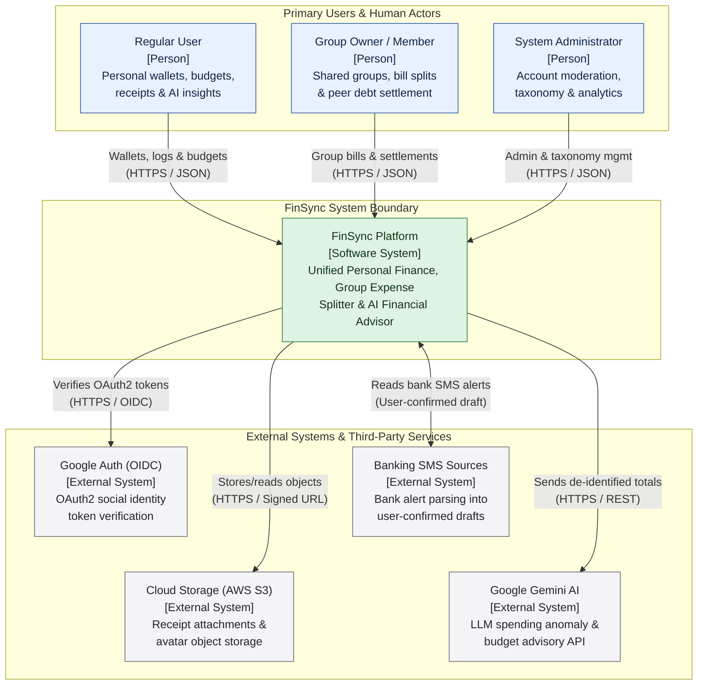

# C4 Model Level 1 — System Context Diagram & Architectural Narrative

> *Document Scope: Part B (`S4-03`) — PA4-2026 (Sprint 4) | Project: FinSync (Group 04)*  
> *Language: English | Notation: C4 Model Level 1 (System Context) in Mermaid*

---

## 1. System Context Diagram (C4 Model Level 1)

At C4 Level 1, the entire **FinSync Platform** (encompassing the Android Jetpack Compose app, React Admin Portal, Spring Boot 3 REST API, PostgreSQL 16 database, Redis 7 cache, and Python FastAPI AI microservice) is represented as a single cohesive software system at the center, illustrating its **human actors**, **external system dependencies**, **trust boundaries**, and **high-level interactions**.

---

## 2. Architectural Narrative & Element Catalog

### 2.1. Central Software System

* **FinSync Platform (`Software System`):**  
  FinSync is a unified financial bookkeeping, collaborative debt optimization, and AI-assisted budgeting platform. Under its **strict non-custodial business principle**, FinSync operates purely as an accounting ledger and calculation engine: it **never** stores banking credentials, holds user funds, or initiates automated bank-to-bank transfers. All monetary settlements between users occur externally and are manually recorded and confirmed inside FinSync for transparent reconciliation.

### 2.2. Human Actors (Users & Stakeholders)

| Actor | Role & Responsibilities | Primary Interactions with FinSync | Implementation Alignment |
| :--- | :--- | :--- | :--- |
| **Regular User** | Individual managing personal cash flow and savings discipline. | Registers/logs in via Android app; manages multi-wallet balances (`VND`/`USD`); logs income, expenses, and wallet transfers; attaches receipt photos; sets weekly/monthly category budgets with 80%/100% threshold alerts; views reports and AI financial advice. | **Implemented** in `src/mobile/android/` and `src/backend/` (`finance` & `auth` modules). |
| **Group Owner & Member** | Participant or organizer in shared living, travel, or event expense groups. | Creates shared groups; invites registered users or adds guest participants; contributes to shared group funds; logs group bills split via `EQUAL`, `EXACT`, `PERCENTAGE`, or `SHARES`; inspects simplified "Who owes Whom" debt plans; records and confirms settlements. | **Implemented** at backend/DB (`groups` entities & `V7` schema) and PA4 group-expense/debt specifications. |
| **System Administrator** | Platform operator responsible for governance and system integrity. | Logs into the web administration portal using privileged `ROLE_ADMIN` credentials; reviews user lists; locks/unlocks accounts; maintains global default income/expense categories; monitors platform usage metrics and service health. | **Target Architecture** (React Admin Web Portal & `/api/v1/admin/**` RBAC governance). |

### 2.3. External Systems & Third-Party Dependencies

| External System | Integration Purpose | Data Exchanged & Direction | Implementation Status & Fallback Behavior |
| :--- | :--- | :--- | :--- |
| **Google Auth (Google Identity Service)** | Provides optional OAuth2 / OpenID Connect social sign-in to streamline onboarding alongside email/password authentication. | **Outbound:** OAuth authorization code / ID token verification request. **Inbound:** Verified Google subject ID (`sub`) and email claim. | **Target Integration:** Current baseline implements stateless HS256 JWT + BCrypt email/password auth (`AuthController`); Google OAuth2 extends `SecurityConfig`. |
| **Banking SMS / Notification Sources** | Reduces manual data-entry friction by extracting amount, merchant, and timestamp candidates from user-permitted banking SMS/notifications. | **Inbound:** Raw notification text parsed into structured transaction draft suggestions requiring explicit user confirmation before persistence. | **Target Integration:** Non-custodial read-only parsing pipeline; FinSync never accesses live bank APIs or banking credentials. |
| **Cloud Object Storage (AWS S3 / S3-Compatible)** | Offloads binary receipt attachments and profile avatars from the relational database and local container filesystem for durable, horizontally scalable storage. | **Outbound:** Binary image/PDF streams and `storage_key` identifiers. **Inbound:** Short-lived Presigned URLs or authorized object byte streams. | **Hybrid (Local Baseline $\rightarrow$ S3 Target):** Currently implemented via private `FileSystemReceiptStorage` (`backend_receipts` volume) + 300s HMAC-SHA256 `ReceiptAccessTokenService`, abstracted by `storage_key` for seamless S3 migration. |
| **Google Gemini AI Platform (`Gemini AI`)** | Powers the AI Financial Advisor to detect spending spikes, evaluate savings/budget health, and recommend next-month category allocations. | **Outbound:** Strictly **de-identified financial aggregates** (category totals, currency, budget ratios, period deltas). **Inbound:** Structured JSON summary and actionable recommendations. | **Target LLM / Implemented Proxy:** Client traffic is isolated through Spring Boot $\rightarrow$ Python FastAPI (`src/ai-service`, `X-Service-Key`). On API timeout/quota exhaustion, the service degrades gracefully to deterministic `source="BASIC"` advice. |

---

## 3. System Boundaries, Security Controls & Data Flows

1. **Client-to-System Trust Boundary:**  
   All human actors interact with FinSync strictly over **HTTPS / REST JSON** (port `8080` in local Docker Compose). Clients never communicate directly with PostgreSQL (`5432`), Redis (`6379`), the internal AI microservice (`8001`), S3 buckets, or Gemini API endpoints. All protected requests require a valid Bearer JWT (`HS256`) stored on Android via `AndroidKeyStore` (`AES/GCM/NoPadding`).
2. **Non-Custodial Financial Boundary:**  
   No external banking gateway has write access to user funds, and FinSync stores zero bank PINs, passwords, or account tokens. Even with **Banking SMS** drafting, every transaction requires explicit user review or confirmation before affecting wallet or group balances.
3. **Privacy-Preserving AI Boundary:**  
   Before any data leaves the FinSync system boundary toward **Google Gemini AI**, the Spring Boot backend and FastAPI AI service enforce a privacy filter that strips PII (email addresses, user names, phone numbers), free-text transaction notes, and binary receipt attachments.
4. **Storage Decoupling Boundary:**  
   Relational metadata (`transaction_attachments.storage_key`, `content_type`, `size_bytes`) remains inside PostgreSQL under ACID transaction control, while binary objects reside behind signed access controls (`ReceiptAccessTokenService` locally or S3 Presigned URLs in Cloud deployments).
