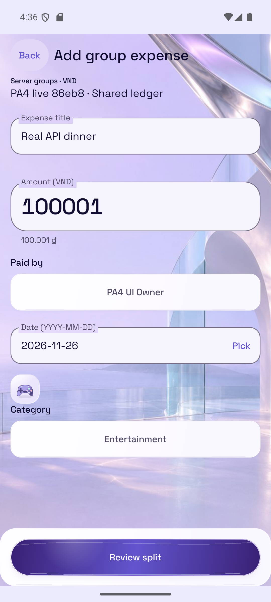
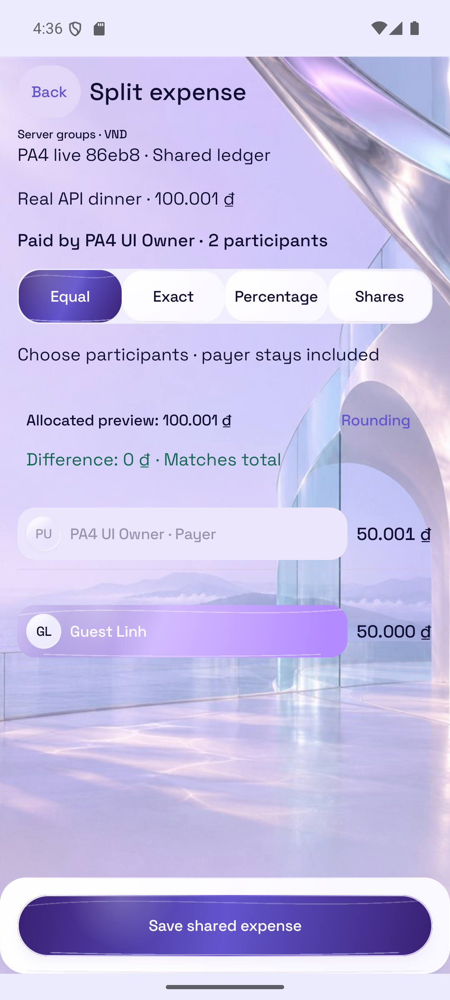
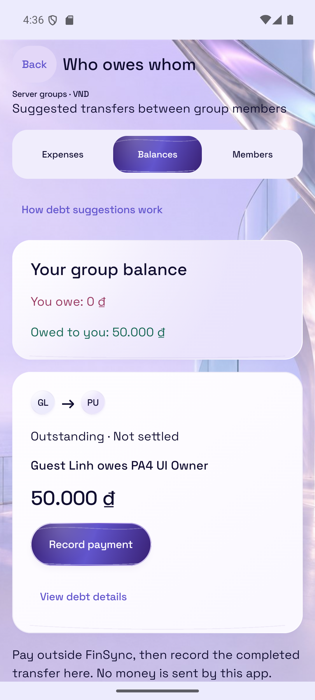
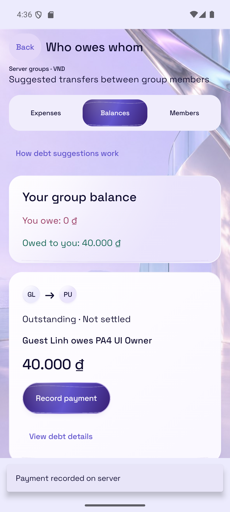
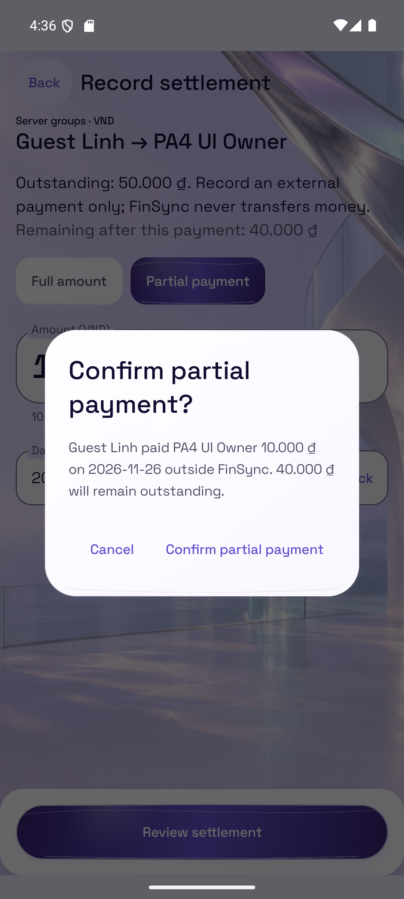
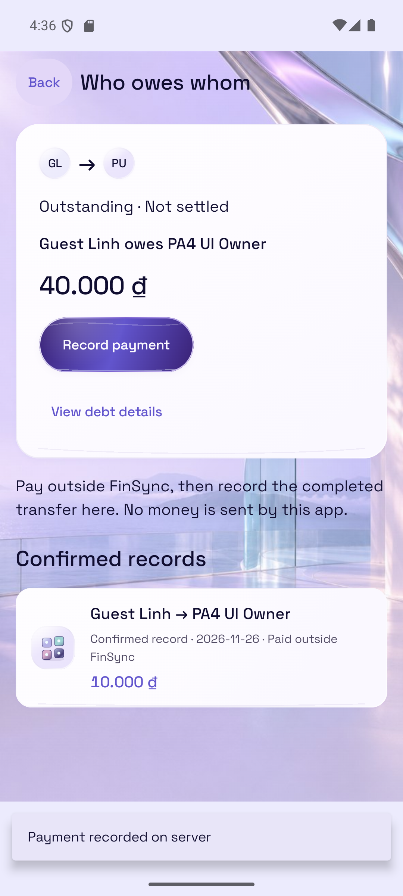

### E.6. Android Frontend Implementation and Verification Evidence
> *Performed by: Nguyen Phu Dat (24120038) | Reviewed by: Pham Dinh Tieu Long (24120087; assigned, review pending) | Edited by: Nguyen Phu Dat (24120038)*

**Delivered implementation:** [`66bb585`](https://github.com/pdtLong2929/FinSync/commit/66bb585) on `feat/pa4-group-expense-debt`. The Kotlin/Jetpack Compose/Material 3 client is connected to the PA4 account, group-expense and debt APIs. The evidence package contains nine original Android emulator screenshots, per-suite/case result tables, build result excerpts and PostgreSQL verification: [frontend evidence index](README.md).

#### E.6.1. Implemented frontend scope

| Functional group | Connected Android behavior | Verification |
| --- | --- | --- |
| Group Expense Management (`UC-CLI-10`, `UC-CLI-11`) | Create/edit VND groups; add/remove guest members; load server categories and paginated expenses; enter title, amount, payer, date and participants. | Native online create/member/expense journey and server reload. FE-01–FE-05. |
| Group Expense Management | Equal, Exact, Percentage and Shares split input, validation and VND preview matching server rounding. | Native Equal screen FE-03; all four methods and returned allocations checked by `realInvitationFourSplitMethodsIdempotencyAndAccessIsolation`. |
| Group Expense Management | Single-use invitation token creation and acceptance by a second authenticated account. | Actual Android repository → API test; access is denied to an unrelated account. |
| Smart Debt Simplification (`UC-CLI-12`) | Display server member balances and simplified transfer suggestions; show who owes whom and the outstanding amount. | FE-06 and live debt-summary reads. |
| Smart Debt Simplification | Review and confirm full/partial outside-app payment records; refresh debt/history after saving. | FE-07–FE-09; native partial-payment and fresh-server-read assertions. |
| Both groups | Loading, empty, validation, error/retry, guarded submission and successful-save feedback; stable request IDs for expense/payment retries. | JVM and Android tests, including idempotency, access isolation, disk rollback/retry and local ledger regressions. |

Server groups and On this device are separate modes. This integration does not automatically upload local groups or deduct group payments from personal wallet balances. Online expense/payment correction, deletion and Undo have no Backend endpoints in this revision, so those records are read-only; the existing device-ledger operations remain available. Guest rename/restore, group-fund entry, targeted guest-claim, token revocation and archive/ownership/leave UI are not connected by this adapter. Friends/email invitations remain unsent local drafts. These limits delimit the implemented frontend portion of the broader E.1 scope.

#### E.6.2. Actual Android screenshots

**Capture session:** 26 November 2026, Pixel 7 emulator, Android API 36, 1080 × 2400. The app used isolated QA accounts and the actual Java Backend/PostgreSQL. Screenshots are unchanged native captures, not prototype frames. SHA-256 hashes and original timestamps are recorded in [screenshots.csv](screenshots.csv).

| ID | Screen / original image | Observable result |
| --- | --- | --- |
| FE-01 | [Members](../../screenshots/features/frontend/FE-01-members.png) | Owner and guest saved on the server |
| FE-02 | [Expense form](../../screenshots/features/frontend/FE-02-expense-form.png) | Title, whole-VND amount, payer, date and server category |
| FE-03 | [Split review](../../screenshots/features/frontend/FE-03-split.png) | Equal allocation: 50,001 + 50,000 = 100,001 VND |
| FE-04 | [Expense list](../../screenshots/features/frontend/FE-04-expenses.png) | Persisted shared expense in the group history |
| FE-05 | [Expense detail](../../screenshots/features/frontend/FE-05-expense-detail.png) | Server record and original participant allocation |
| FE-06 | [Debt before payment](../../screenshots/features/frontend/FE-06-balances.png) | Guest owes 50,000 VND before payment |
| FE-07 | [Payment confirmation](../../screenshots/features/frontend/FE-07-confirm-payment.png) | Explicit confirmation of a 10,000 VND partial payment |
| FE-08 | [Debt after payment](../../screenshots/features/frontend/FE-08-payment.png) | Server balance reduced to 40,000 VND |
| FE-09 | [Payment history](../../screenshots/features/frontend/FE-09-payment-history.png) | Confirmed 10,000 VND payment record and remaining debt |

  
  

*Figure E.FE-1 — Online expense form and split review. The 100,001 VND expense is allocated as 50,001 VND to the payer and 50,000 VND to the guest; the displayed difference is zero.*

  
  

*Figure E.FE-2 — Server-backed debt before and after the confirmed 10,000 VND payment: 50,000 VND becomes 40,000 VND. FinSync records the completed payment; it does not transfer money.*

  
  

*Figure E.FE-3 — Confirmation and resulting payment history. The recorded 10,000 VND amount and remaining 40,000 VND debt are visible in the native app.*

#### E.6.3. Build and test results

| Verification | Date | Actual result | Evidence |
| --- | --- | --- | --- |
| Android final integration APK/test APK build | 25 Nov 2026 | Passed in 28s | [Result excerpts](verification-results.md) |
| Android JVM suite | 25 Nov 2026 | 98 tests; 0 failures/errors/skips | [Per-suite CSV](android-jvm-tests.csv) |
| Backend package and JVM/API suite | 25 Nov 2026 | 21 tests; 0 failures/errors/skips | [Per-suite CSV](backend-tests.csv) |
| Broad Pixel 7 UI run | 25 Nov 2026 | 14/15 passed; one auth/profile input-automation failure | [Per-case matrix](android-ui-tests.csv) |
| Targeted follow-up after correction | 25 Nov 2026 | 3/3 passed, including the prior auth/profile case and both live-group cases | [Result excerpts](verification-results.md) |
| Native online screenshot journey | 26 Nov 2026 | 1/1 passed in 37.096s; screenshot test-APK build passed in 26s | [Result excerpts](verification-results.md) |

All 15 distinct UI scenarios have passing results across the broad and targeted runs. The new capture run replays one native journey; it is not a claim that every suite was rerun on 26 November. The verification data retains the original failed broad-run result and the successful follow-up. The Android/API results here are independent of the team's Postman evidence in E.4.

#### E.6.4. Persistence verification and handoff

The native journey creates a real server group and expense, records a partial payment, then loads the group through a fresh `ServerGroups` instance. Assertions verify matching expenses/payments/balances and an unchanged personal ledger. PostgreSQL queries after the capture confirm:

| Database observation | Verified value |
| --- | --- |
| Flyway migration versions | V1, V2 and V3: successful |
| Latest QA expense `Real API dinner` | 100,001 VND |
| Sum of persisted participant splits | 100,001 VND |
| Recorded payment for that group | 10,000 VND |

The exact SQL and returned values are included in [PostgreSQL verification](postgresql-verification.md). The capture environment used the unchanged team Backend JAR with local PostgreSQL/Redis in an isolated QA database; these results do not certify Docker-engine startup or real bank transfers.

Handoff files: [evidence index](README.md), [screenshot gallery](gallery.html), [image manifest](screenshots.csv), [case matrix](android-ui-tests.csv), [Android integration test source](https://github.com/pdtLong2929/FinSync/blob/66bb585/src/mobile/app/src/androidTest/java/com/finsync/ui/ServerGroupIntegrationTest.kt) and [runtime/API limits](https://github.com/pdtLong2929/FinSync/blob/66bb585/src/mobile/PA4_BACKEND_INTEGRATION.md). The English narrated video and team Postman results remain separate deliverables.
