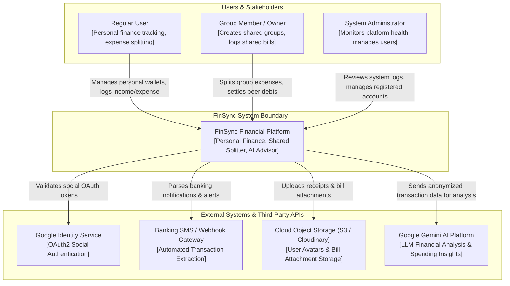
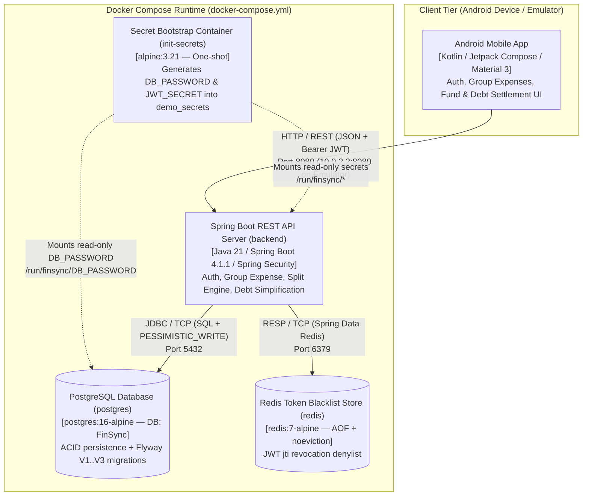
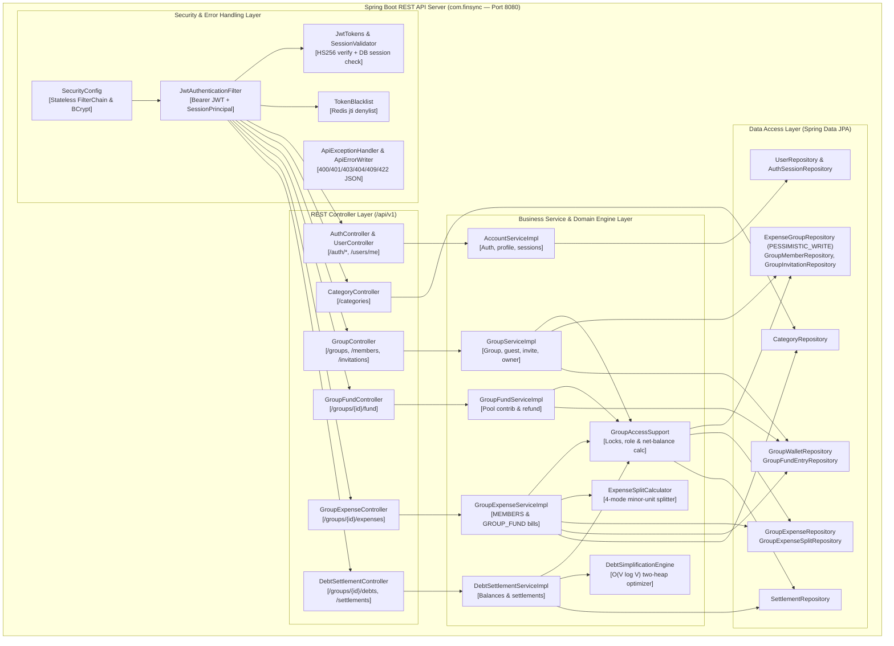
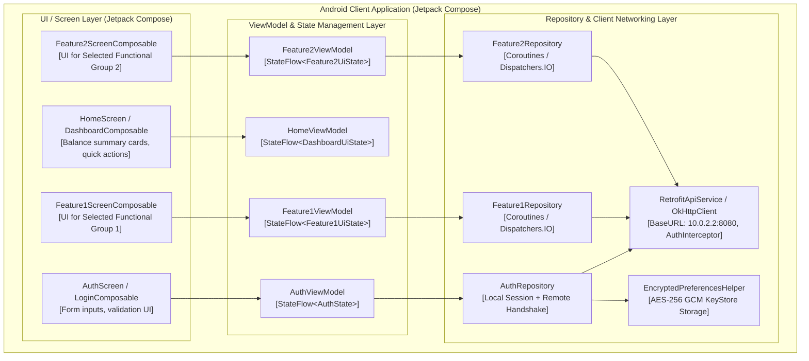
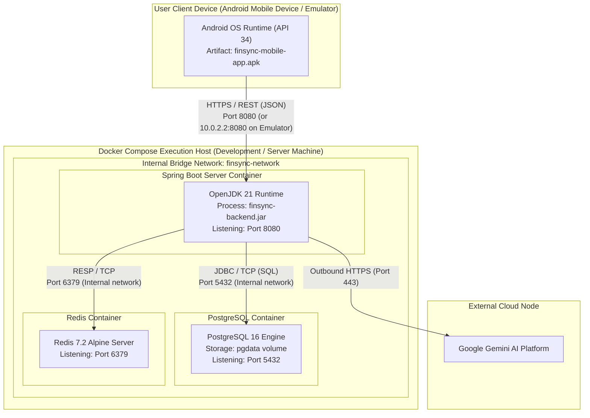

# PA4-2026 Report — FinSync (Group 04)
# Software Architecture Document & Spec Kit Implementation (Build 2)

**Course:** CS300 - CSC13002 - Introduction to Software Engineering  
**Assignment:** Project Assignment 4 (PA4-2026) — Sprint 4  
**Group:** Group 04  
**Project:** FinSync — Personal Finance & Group Expense Manager with AI Advisor  
**Sprint 4 period:** `2026-11-17 to 2026-12-06`  
**Submission Repository Branch:** `documentation`  

---

## Table of Contents
> *Performed by: Pham Dinh Tieu Long (24120087) | Reviewed by: Ngo Thai Hoa (24120051) | Edited by: Pham Dinh Tieu Long (24120087)*

- [Team Members & Role Allocations](#team-members--role-allocations)
- [Part A — Revised Use-Case Specification (Second Submission)](#part-a--revised-use-case-specification-second-submission)
  - [A.1. Overview and Changes Summary](#a1-overview-and-changes-summary)
  - [A.2. Summary of Revised Use Cases](#a2-summary-of-revised-use-cases)
  - [A.3. Traceability to Changes.md](#a3-traceability-to-changesmd)
- [Part B — Software Architecture: System Context & Tech Stack](#part-b--software-architecture-system-context--tech-stack)
  - [B.1. Architectural Goals and Constraints (RUP SAD Section 1 & 2)](#b1-architectural-goals-and-constraints-rup-sad-section-1--2)
  - [B.2. Comprehensive System Technical Stack](#b2-comprehensive-system-technical-stack)
  - [B.3. C4 Model Level 1 — System Context Diagram](#b3-c4-model-level-1--system-context-diagram)
  - [B.4. System Context Architectural Rationale & Actor Narratives](#b4-system-context-architectural-rationale--actor-narratives)
- [Part C — Software Architecture: Container and Component Diagrams](#part-c--software-architecture-container-and-component-diagrams)
  - [C.1. C4 Model Level 2 — Container Diagram](#c1-c4-model-level-2--container-diagram)
  - [C.2. Container Catalog, Responsibilities, and Communication Protocols](#c2-container-catalog-responsibilities-and-communication-protocols)
  - [C.3. C4 Model Level 3 — Backend Component Diagram (Spring Boot Server)](#c3-c4-model-level-3--backend-component-diagram-spring-boot-server)
  - [C.4. Backend Component Catalog and Internal Interplay](#c4-backend-component-catalog-and-internal-interplay)
  - [C.5. C4 Model Level 3 — Frontend Component Diagram (Android Jetpack Compose)](#c5-c4-model-level-3--frontend-component-diagram-android-jetpack-compose)
  - [C.6. Frontend Component Catalog and UI State Management](#c6-frontend-component-catalog-and-ui-state-management)
  - [C.7. Code-to-Architecture Conformance Audit (Zero-Penalty Guarantee)](#c7-code-to-architecture-conformance-audit-zero-penalty-guarantee)
- [Part D — Infrastructure Deployment Diagram](#part-d--infrastructure-deployment-diagram)
  - [D.1. Physical & Logical Deployment Diagram](#d1-physical--logical-deployment-diagram)
  - [D.2. Deployment Node Specifications & Container Mapping](#d2-deployment-node-specifications--container-mapping)
  - [D.3. Network Protocols, Security Boundaries, and Port Bindings](#d3-network-protocols-security-boundaries-and-port-bindings)
- [Part E — Implement 2 Functional Groups Using Spec Kit (Build 2)](#part-e--implement-2-functional-groups-using-spec-kit-build-2)
  - [E.1. Selected Functional Groups and Scope Rationale](#e1-selected-functional-groups-and-scope-rationale)
  - [E.2. Spec Kit Specification-Driven Development (SDD) Workflow](#e2-spec-kit-specification-driven-development-sdd-workflow)
  - [E.3. Database Persistence & Flyway Migrations](#e3-database-persistence--flyway-migrations)
  - [E.4. Automated Spec Kit Tests & Postman E2E Test Suite](#e4-automated-spec-kit-tests--postman-e2e-test-suite)
  - [E.5. Narrated Video Demonstration & YouTube Submission](#e5-narrated-video-demonstration--youtube-submission)
- [Part F — AI Usage Report and Weekly Scrum Report](#part-f--ai-usage-report-and-weekly-scrum-report)
  - [F.1. AI Usage Declaration and Tool Inventory](#f1-ai-usage-declaration-and-tool-inventory)
  - [F.2. Sprint 4 Overview and Meeting Schedule](#f2-sprint-4-overview-and-meeting-schedule)
  - [F.3. Sprint Planning Meeting Minutes](#f3-sprint-planning-meeting-minutes)
  - [F.4. Weekly Scrum Meeting #1 Minutes](#f4-weekly-scrum-meeting-1-minutes)
  - [F.5. Weekly Scrum Meeting #2 Minutes](#f5-weekly-scrum-meeting-2-minutes)
  - [F.6. Sprint Review and Retrospective Minutes](#f6-sprint-review-and-retrospective-minutes)
  - [F.7. Meeting Action Register (ACT-01 to ACT-08)](#f7-meeting-action-register-act-01-to-act-08)
  - [F.8. Jira Task Assignment and Progress Evidence](#f8-jira-task-assignment-and-progress-evidence)
  - [F.9. Git Commit History Evidence](#f9-git-commit-history-evidence)
- [Appendix A — Individual AI Usage Notes](#appendix-a--individual-ai-usage-notes)
  - [A.1. Pham Dinh Tieu Long](#a1-pham-dinh-tieu-long)
  - [A.2. Nguyen Phu Dat](#a2-nguyen-phu-dat)
  - [A.3. Nguyen Le Duc Nhat](#a3-nguyen-le-duc-nhat)
  - [A.4. Vuong Dac Gia Khiem](#a4-vuong-dac-gia-khiem)
  - [A.5. Ngo Thai Hoa](#a5-ngo-thai-hoa)
- [Appendix B — Submission Verification Checklist](#appendix-b--submission-verification-checklist)

---

## Team Members & Role Allocations
> *Performed by: Pham Dinh Tieu Long (24120087) | Reviewed by: Ngo Thai Hoa (24120051) | Edited by: Pham Dinh Tieu Long (24120087)*

All 5 team members participate as Full-Stack Software Engineers. The core responsibilities and student IDs below retain 100% continuity from PA1, PA2, and PA3 baselines:

| # | Student ID | Full Name | Email | Core Project Role | Primary Sprint 4 Ownership |
|---|------------|-----------|-------|-------------------|-----------------------------|
| 1 | **24120087** | **Phạm Định Tiểu Long** | phamlongkh2006@gmail.com | **Group Leader / Project Manager** | Scrum Facilitation, Jira Sprint 4 Board, AI Usage Consolidation, Release Packaging |
| 2 | **24120038** | **Nguyễn Phú Đạt** | nguyennphuudatt@gmail.com | **UI/UX Designer & Frontend Lead** | C4 Level 3 Frontend Component Diagram, Android Jetpack Compose UI Delivery, Retrofit Client |
| 3 | **24120403** | **Nguyễn Lê Đức Nhật** | nldnhat182006@gmail.com | **Backend Lead / System Architect** | C4 Level 2 Container Diagram, C4 Level 3 Backend Component Diagram, Flyway DB, Spring Boot REST APIs |
| 4 | **24120342** | **Vương Đắc Gia Khiêm** | vuongkhiemvl10@gmail.com | **QA Lead & DevOps Engineer** | Infrastructure Deployment Diagram, Spec Kit Tests, Postman E2E Suite, Narrated Video Demo |
| 5 | **24120051** | **Ngô Thái Hòa** | ngothaihoa235@gmail.com | **Requirement Engineer / Tech Writer** | Use Case Model Revisions, Changes.md, Tech Stack Specification, C4 Level 1 System Context Diagram |

---

## Part A — Revised Use-Case Specification (Second Submission)
> *Performed by: Ngo Thai Hoa (24120051) | Reviewed by: Pham Dinh Tieu Long (24120087) | Edited by: Ngo Thai Hoa (24120051)*

**Section Weight:** 5 points.  
**Mandatory Requirement:** A standalone [Changes.md](Changes.md) document must be submitted at the repository root detailing all modifications compared to the PA3 baseline.

### A.1. Overview and Changes Summary
> *Performed by: Ngo Thai Hoa (24120051) | Reviewed by: Pham Dinh Tieu Long (24120087) | Edited by: Ngo Thai Hoa (24120051)*

In this second submission of the Use-Case Specification, the team refined the system use case catalog to address feedback provided by the Teaching Assistant (TA) on PA3 and to align functional specifications with the 2 newly implemented functional groups in Sprint 4.

<!-- TODO: [Hoa] Insert summary of TA feedback received on PA3 Use Cases and describe high-level changes made. -->

### A.2. Summary of Revised Use Cases
> *Performed by: Ngo Thai Hoa (24120051) | Reviewed by: Pham Dinh Tieu Long (24120087) | Edited by: Ngo Thai Hoa (24120051)*

| Use Case ID | Use Case Name | Flow Revisions & Refinements | Rationale & Code Alignment |
| :---: | :--- | :--- | :--- |
| `UC-ACC-01` | Register & Authenticate User | Enhanced password validation rules; added OAuth2 Google exception flows. | Aligned with Spring Security 6 & BCrypt. |
| `UC-ACC-02` | View & Update User Profile | Added avatar presigned URL flow; documented immutable email constraint. | Verified in PostgreSQL `users` table. |
| `UC-CLI-01` | <!-- TODO: [Hoa] UC Name --> | <!-- TODO: [Hoa] Revisions --> | <!-- TODO: [Hoa] Rationale --> |
| `UC-CLI-02` | <!-- TODO: [Hoa] UC Name --> | <!-- TODO: [Hoa] Revisions --> | <!-- TODO: [Hoa] Rationale --> |
| `UC-CLI-03` | <!-- TODO: [Hoa] UC Name --> | <!-- TODO: [Hoa] Revisions --> | <!-- TODO: [Hoa] Rationale --> |

### A.3. Traceability to Changes.md
> *Performed by: Ngo Thai Hoa (24120051) | Reviewed by: Pham Dinh Tieu Long (24120087) | Edited by: Ngo Thai Hoa (24120051)*

All specific line-by-line and section-by-section modifications are cataloged in [Changes.md](Changes.md) under:
* **Section 1: Revisions Driven by TA Feedback** (Items `FB-01` to `FB-04`).
* **Section 2: Team-Initiated Scope Enhancements** (Items `TI-01` to `TI-05`).

---

## Part B — Software Architecture: System Context & Tech Stack
> *Performed by: Ngo Thai Hoa (24120051) | Reviewed by: Nguyen Le Duc Nhat (24120403) | Edited by: Ngo Thai Hoa (24120051)*

**Section Weight:** 20 points.  
**Reference Document:** Incorporates guidelines from the RUP Software Architecture Document (`rup_sad.docx`).

### B.1. Architectural Goals and Constraints (RUP SAD Section 1 & 2)
> *Performed by: Ngo Thai Hoa (24120051) | Reviewed by: Nguyen Le Duc Nhat (24120403) | Edited by: Ngo Thai Hoa (24120051)*

FinSync architecture is guided by the following key architectural goals and constraints extracted from the Vision Document:
1. **Security & Privacy Isolation:** Non-custodial ledger design; JWT authentication with Redis blacklist; passwords hashed with BCrypt (cost factor 10); encrypted local storage on mobile devices (Android EncryptedSharedPreferences).
2. **ACID Financial Integrity:** Multi-wallet balances, transactional ledgers, and shared group expense splits must enforce strict transactional consistency (`@Transactional` in Spring Data JPA) in PostgreSQL 16.
3. **Platform Availability & Dual Client Runtime:** Native Android mobile client for end users (Jetpack Compose); React TypeScript web dashboard for administrative governance.
4. **Resilient AI Ingestion:** Asynchronous timeout and fallback handling when communicating with Google Gemini LLM API (graceful degradation when quota or network fails).

### B.2. Comprehensive System Technical Stack
> *Performed by: Ngo Thai Hoa (24120051) | Reviewed by: Nguyen Le Duc Nhat (24120403) | Edited by: Ngo Thai Hoa (24120051)*

The following table documents 100% of the active technologies powering FinSync, cross-verified against `pom.xml`, `build.gradle.kts`, and `package.json`:

| Layer / Subsystem | Technology & Version | Purpose in FinSync | Architectural Selection Rationale |
| :--- | :--- | :--- | :--- |
| **Mobile Client** | Android SDK 34 / Jetpack Compose 1.6 / Kotlin 1.9 | Primary end-user client | Modern declarative UI, reactive StateFlow integration, seamless offline capability. |
| **Admin Web Client**| React 18 / TypeScript 5 / TailwindCSS 3 | System administration portal | Fast single-page application (SPA) rendering, robust static type safety for management tables. |
| **Backend Framework**| Java 21 LTS / Spring Boot 3.3.x | Enterprise REST API server | High-throughput virtual threads (Project Loom), robust dependency injection, mature security ecosystem. |
| **Data Persistence** | PostgreSQL 16 / Flyway Migration 10 | Primary relational database | Strong ACID compliance, rich decimal precision (`NUMERIC(15,2)`), automated versioned schema migrations. |
| **Cache & Session**  | Redis 7.2 (Alpine) | Fast in-memory cache & blacklist | Sub-millisecond JWT blacklist checking (`jti`), distributed session tokens, rate limiting. |
| **Authentication**   | Spring Security 6 / JJWT 0.12.x / Google OAuth2 | Identity and access management | Stateless Bearer token verification, role-based access control (`ROLE_USER`, `ROLE_ADMIN`). |
| **AI Engine**        | Google Gemini 1.5 Flash / Pro API | Automated financial advisory | High-speed semantic financial classification, anomaly detection, personalized budget optimization. |
| **DevOps & Container**| Docker Engine 26 / Docker Compose v2 | Local & deployment orchestration | Reproducible multi-container isolation across development, testing, and production environments. |

### B.3. C4 Model Level 1 — System Context Diagram
> *Performed by: Ngo Thai Hoa (24120051) | Reviewed by: Pham Dinh Tieu Long (24120087) | Edited by: Ngo Thai Hoa (24120051)*

### B.4. System Context Architectural Rationale & Actor Narratives
> *Performed by: Ngo Thai Hoa (24120051) | Reviewed by: Pham Dinh Tieu Long (24120087) | Edited by: Ngo Thai Hoa (24120051)*

<!-- TODO: [Hoa] Provide written explanation of the C4 Level 1 diagram: actors, interactions, security boundaries, and external integration points. -->

---

## Part C — Software Architecture: Container and Component Diagrams
> *Performed by: Nguyen Le Duc Nhat (24120403) | Reviewed by: Nguyen Phu Dat (24120038) | Edited by: Nguyen Le Duc Nhat (24120403)*

**Section Weight:** 25 points.  
**Critical Mandate:** Architecture diagrams must reflect actual source code in `/src/`. Inconsistencies result in severe grading penalties.

### C.1. C4 Model Level 2 — Container Diagram
> *Performed by: Nguyen Le Duc Nhat (24120403) | Reviewed by: Nguyen Phu Dat (24120038) | Edited by: Nguyen Le Duc Nhat (24120403)*

The Container Diagram below reflects **100% of the active runtime containers** defined in `docker-compose.yml` and `src/` for Build 2. Planned PA5 subsystems (React Web Admin Portal and FastAPI/Gemini AI Advisory Service) are intentionally excluded from this diagram until implemented, ensuring strict code-to-architecture conformance.

### C.2. Container Catalog, Responsibilities, and Communication Protocols
> *Performed by: Nguyen Le Duc Nhat (24120403) | Reviewed by: Nguyen Phu Dat (24120038) | Edited by: Nguyen Le Duc Nhat (24120403)*

| Container Name | Technology & Version | Core Responsibilities | Protocols, Ports & Storage |
| :--- | :--- | :--- | :--- |
| **Android Mobile App** | Kotlin, Jetpack Compose, Material 3, Coroutines (`src/mobile/`) | Renders user screens for registration/login, group creation, guest & invitation workflows, 4-mode expense splitting, shared fund tracking, and simplified debt settlement. | Outbound HTTP/REST JSON with Bearer JWT to port `8080` (`10.0.2.2:8080` on Android emulator). |
| **Spring Boot REST API Server (`backend`)** | Java 21 LTS, Spring Boot `4.1.1`, Spring Security (JOSE/Nimbus JWT), Spring Data JPA, Flyway (`src/backend/`) | Validates stateless JWTs and active session state, executes Flyway migrations at boot, enforces group permissions and `PESSIMISTIC_WRITE` locks, runs `ExpenseSplitCalculator` and `DebtSimplificationEngine`. | Inbound `127.0.0.1:8080->8080/tcp` (Spring MVC); outbound JDBC `5432/tcp` and RESP `6379/tcp`. |
| **PostgreSQL Database (`postgres`)** | `postgres:16-alpine` (Database `FinSync`, user `finsync`) | Stores all persistent Build 1 & Build 2 relational tables (`users`, `auth_sessions`, `categories`, `groups`, `group_members`, `group_invitations`, `group_wallets`, `group_fund_entries`, `group_expenses`, `group_expense_splits`, `settlements`). | Inbound TCP `5432` inside Docker Compose network; persisted on `demo_postgres_data` volume. |
| **Redis Token Blacklist Store (`redis`)** | `redis:7-alpine` (`--appendonly yes --maxmemory-policy noeviction`) | Stores revoked JWT `jti` keys (`auth:deny:access:{jti}`) with TTL until token expiry; `noeviction` guarantees security denylist entries are never evicted under memory pressure. | Inbound RESP TCP `6379` inside Docker Compose network; persisted on `demo_redis_data` volume. |
| **Secret Bootstrap Container (`init-secrets`)** | `alpine:3.21` (one-shot init service) | Generates 256-bit random `DB_PASSWORD` and `JWT_SECRET` files (`chmod 400`, UID `10001`) into shared volume `demo_secrets` before `postgres` and `backend` start. | Shared read-only mount `/run/finsync/` (`demo_secrets` volume); exits upon completion (`restart: "no"`). |

**Inter-Container Communication & Fail-Closed Boundaries:**
* **Client -> API Server:** Stateless HTTP/JSON over port `8080` with `Authorization: Bearer <accessToken>` on all endpoints except `/api/v1/auth/{register,login,refresh}` and `/actuator/health`.
* **API Server -> PostgreSQL:** Transactional JDBC over port `5432` with `spring.jpa.open-in-view=false`, `spring.jpa.hibernate.ddl-auto=validate`, and `SELECT ... FOR UPDATE` (`PESSIMISTIC_WRITE`) locks on `users` and `groups` rows during mutating operations.
* **API Server -> Redis:** Synchronous `StringRedisTemplate` checks on `JwtAuthenticationFilter` (`2s` timeout). If Redis is unavailable, protected endpoints fail closed with HTTP `503 AUTH_SERVICE_UNAVAILABLE` rather than bypassing revocation checks.

### C.3. C4 Model Level 3 — Backend Component Diagram (Spring Boot Server)
> *Performed by: Nguyen Le Duc Nhat (24120403) | Reviewed by: Ngo Thai Hoa (24120051) | Edited by: Nguyen Le Duc Nhat (24120403)*

### C.4. Backend Component Catalog and Internal Interplay
> *Performed by: Nguyen Le Duc Nhat (24120403) | Reviewed by: Ngo Thai Hoa (24120051) | Edited by: Nguyen Le Duc Nhat (24120403)*

Every component in the C4 Level 3 Backend Diagram maps directly to Java classes inside `src/backend/src/main/java/com/finsync/`:

| Layer | Component Class(es) | Package | Responsibility & Internal Interplay |
| :--- | :--- | :--- | :--- |
| **Security & Error** | `SecurityConfig`, `JwtAuthenticationFilter`, `JwtTokens`, `SessionValidator`, `TokenBlacklist` | `config`, `security` | Configures stateless security (`SessionCreationPolicy.STATELESS`), extracts and verifies Bearer JWTs, checks Redis `auth:deny:access:{jti}` blacklist, verifies active `User` and non-revoked `AuthSession`, and populates `SessionPrincipal`. |
| **Security & Error** | `ApiException`, `ApiExceptionHandler`, `ApiErrorWriter` | `exception` | Translates domain exceptions (`400`, `401`, `403`, `404`, `409`, `422`), Bean Validation errors (`MethodArgumentNotValidException`), and PostgreSQL constraint violations (`uk_*`) into `ErrorBody(code, message, fieldErrors, traceId)` with `Cache-Control: no-store`. |
| **Controller** | `AuthController`, `UserController` | `controller` | Exposes PA3 registration, login, token refresh, logout, and `/users/me` profile endpoints delegating to `AccountService`. |
| **Controller** | `CategoryController`, `GroupController`, `GroupFundController`, `GroupExpenseController`, `DebtSettlementController` | `controller` | Exposes Build 2 REST endpoints under `/api/v1/categories` and `/api/v1/groups/**`, validating request DTOs (`@Valid`) and passing `SessionPrincipal` to service interfaces. |
| **Service & Engine** | `GroupServiceImpl`, `GroupFundServiceImpl`, `GroupExpenseServiceImpl`, `DebtSettlementServiceImpl` | `service.impl` | Enforces transactional boundaries (`@Transactional`), acquires group locks, checks `IdempotencySupport` (`requestId` + SHA-256 `requestHash`), validates `MoneyValidation` (`VND` scale `0`, `USD` scale `<= 2`), and persists append-only records. |
| **Service & Engine** | `GroupAccessSupport`, `MoneyValidation`, `IdempotencySupport` | `service.impl` | Shared helpers verifying `UserStatus.ACTIVE`, `GroupMemberRole.OWNER` / `ACTIVE` membership, non-archived status, pessimistic group row lock (`findByIdForUpdate`), and ledger net-balance derivation (`paid - split + settledPaid - settledReceived`). |
| **Service & Engine** | `ExpenseSplitCalculator` | `service.impl` | Pure deterministic cost splitter operating in integer minor units (`long`) across `EQUAL`, `EXACT`, `PERCENTAGE`, and `SHARES` with largest-remainder + ascending `splitOrder` tie-breaking (`sum(splits) == expense.amount`). |
| **Service & Engine** | `DebtSimplificationEngine` | `service.impl` | Pure $O(V \log V)$ greedy two-heap (`PriorityQueue` max-creditor / max-debtor) optimizer computing minimal direct transfers without storing stale debt graph rows. |
| **Repository** | `UserRepository`, `AuthSessionRepository`, `CategoryRepository`, `ExpenseGroupRepository`, `GroupMemberRepository`, `GroupInvitationRepository`, `GroupWalletRepository`, `GroupFundEntryRepository`, `GroupExpenseRepository`, `GroupExpenseSplitRepository`, `SettlementRepository` | `repository` | Spring Data JPA interfaces executing typed JPQL queries against PostgreSQL 16 (`ddl-auto=validate`). `ExpenseGroupRepository.findByIdForUpdate` acquires `LockModeType.PESSIMISTIC_WRITE` before concurrent group mutations. |

**End-to-End Request Interplay (Example — Recording a Shared Expense & Viewing Simplified Debts):**
1. **Ingress & Authentication:** `JwtAuthenticationFilter` verifies the JWT via `JwtTokens`, checks `TokenBlacklist` in Redis, validates the PostgreSQL session via `SessionValidator`, and binds `SessionPrincipal` before dispatching to `GroupExpenseController`.
2. **Locking & Idempotency:** `GroupExpenseServiceImpl` acquires a `PESSIMISTIC_WRITE` lock on the target `ExpenseGroup` row via `GroupAccessSupport.lockGroup(groupId)`, validates active membership and non-archived state, computes a canonical SHA-256 `requestHash` via `IdempotencySupport`, and checks `GroupExpenseRepository.findByRequestId`.
3. **Deterministic Split & Atomic Write:** `ExpenseSplitCalculator` computes exact minor-unit shares (`GroupExpenseSplit` rows). If `fundingSource == GROUP_FUND`, `GroupExpenseServiceImpl` verifies sufficient computed fund balance (`GroupFundEntryRepository.computeBalanceByWalletId`) and atomically inserts the linked `GroupFundEntry` (`type = EXPENSE`) in the same transaction.
4. **Debt Minimization:** On `GET /api/v1/groups/{groupId}/debts`, `DebtSettlementServiceImpl` derives per-member net balances from `MEMBERS`-funded expenses and `CONFIRMED` settlements, passes them to `DebtSimplificationEngine.simplify(...)`, and returns the simplified transfer plan alongside the raw-vs-simplified reduction percentage.

### C.5. C4 Model Level 3 — Frontend Component Diagram (Android Jetpack Compose)
> *Performed by: Nguyen Phu Dat (24120038) | Reviewed by: Nguyen Le Duc Nhat (24120403) | Edited by: Nguyen Phu Dat (24120038)*

### C.6. Frontend Component Catalog and UI State Management
> *Performed by: Nguyen Phu Dat (24120038) | Reviewed by: Nguyen Le Duc Nhat (24120403) | Edited by: Nguyen Phu Dat (24120038)*

<!-- TODO: [Dat] Describe Android components, ViewModels, UI State flows, and integration with Kotlin code in /src/mobile/. -->

### C.7. Code-to-Architecture Conformance Audit (Zero-Penalty Guarantee)
> *Performed by: Nguyen Le Duc Nhat (24120403) | Reviewed by: Pham Dinh Tieu Long (24120087) | Edited by: Nguyen Le Duc Nhat (24120403)*

To guarantee zero grading penalty under PA4 Specification Warning (*"Any inconsistency between the documented architecture and the source code will result in a grade penalty"*):
* **100% Container Traceability:** All 5 containers in `C.1`/`C.2` correspond directly to `src/mobile/`, `src/backend/`, and services `init-secrets`, `backend`, `postgres`, and `redis` in `docker-compose.yml`.
* **100% Backend Component Traceability:** All 7 controllers (`AuthController`, `UserController`, `CategoryController`, `GroupController`, `GroupFundController`, `GroupExpenseController`, `DebtSettlementController`), 10 service/engine classes (`AccountServiceImpl`, `GroupServiceImpl`, `GroupFundServiceImpl`, `GroupExpenseServiceImpl`, `DebtSettlementServiceImpl`, `GroupAccessSupport`, `ExpenseSplitCalculator`, `DebtSimplificationEngine`, `MoneyValidation`, `IdempotencySupport`), and 11 repositories map 1-to-1 to `.java` files in `src/backend/src/main/java/com/finsync/`.
* **100% Schema Traceability:** All 11 active relational tables (`users`, `auth_sessions`, `categories`, `groups`, `group_members`, `group_invitations`, `group_wallets`, `group_fund_entries`, `group_expenses`, `group_expense_splits`, `settlements`) are created deterministically by Flyway migrations `V1`–`V3` and validated on startup via `spring.jpa.hibernate.ddl-auto=validate`.
* **Zero Phantom Components:** Planned PA5 modules (React Admin Web, FastAPI AI Advisory Service, Kafka, S3) are excluded from C4 L2/L3 runtime diagrams until implemented.

---

## Part D — Infrastructure Deployment Diagram
> *Performed by: Vuong Dac Gia Khiem (24120342) | Reviewed by: Nguyen Le Duc Nhat (24120403) | Edited by: Vuong Dac Gia Khiem (24120342)*

**Section Weight:** 5 points.  
**Requirement:** Map containers from Section C onto execution nodes, network ports, and communication protocols.

### D.1. Physical & Logical Deployment Diagram
> *Performed by: Vuong Dac Gia Khiem (24120342) | Reviewed by: Nguyen Le Duc Nhat (24120403) | Edited by: Vuong Dac Gia Khiem (24120342)*

### D.2. Deployment Node Specifications & Container Mapping
> *Performed by: Vuong Dac Gia Khiem (24120342) | Reviewed by: Nguyen Le Duc Nhat (24120403) | Edited by: Vuong Dac Gia Khiem (24120342)*

| Execution Node | Environment / OS | Containers / Artifacts Running | Host & Container Port Bindings |
| :--- | :--- | :--- | :--- |
| **Client Device** | Android 14 / Pixel 7 Emulator | `finsync-mobile.apk` native application | Outbound port 8080. |
| **Docker Engine Host** | Ubuntu 22.04 LTS / Windows Docker Desktop | Docker Compose v2 environment (`finsync-network`) | Internal bridge networking. |
| **App Node** | Eclipse Temurin 21 Container | `finsync-backend.jar` Spring Boot server | `8080:8080` (Exposed to host). |
| **Database Node** | PostgreSQL 16 Official Container | PostgreSQL RDBMS instance + Flyway migrations | `5432:5432` (Exposed for inspection). |
| **Cache Node** | Redis 7.2 Alpine Container | Redis In-Memory server | `6379:6379` (Internal to network). |

### D.3. Network Protocols, Security Boundaries, and Port Bindings
> *Performed by: Vuong Dac Gia Khiem (24120342) | Reviewed by: Nguyen Le Duc Nhat (24120403) | Edited by: Vuong Dac Gia Khiem (24120342)*

<!-- TODO: [Khiem] Provide detailed explanation of internal network security, environment variables (.env), and Docker Compose network boundaries. -->

---

## Part E — Implement 2 Functional Groups Using Spec Kit (Build 2)
> *Performed by: Nguyen Le Duc Nhat (24120403) | Reviewed by: Pham Dinh Tieu Long (24120087) | Edited by: Nguyen Le Duc Nhat (24120403)*

**Section Weight:** 30 points.  
**Mandatory Deliverables:** End-to-end full-stack implementation, Spec Kit SDD artifacts, automated testcases, narrated video demo in English.

### E.1. Selected Functional Groups and Scope Rationale
> *Performed by: Nguyen Le Duc Nhat (24120403) | Reviewed by: Pham Dinh Tieu Long (24120087) | Edited by: Nguyen Le Duc Nhat (24120403)*

* **Functional Group 1:** **Group Expense Management** (Shared Groups, Guest Members, Targeted Invitations, Group Fund, and 4-Mode Expense Splitting)
  * *Scope:* Full-stack Android Jetpack Compose UI + Spring Boot REST API + PostgreSQL schema (`V2` & `V3` Flyway migrations).
  * *Related FR / UC IDs:* `FR-G01`–`FR-G08`, `FR-G12`–`FR-G14`, `UC-CLI-10`, `UC-CLI-11`.
* **Functional Group 2:** **Smart Debt Simplification** (Dynamic Net Balance Engine, Greedy Two-Heap Debt Minimization, and Immutable Manual Settlements)
  * *Scope:* Full-stack Android Jetpack Compose UI + Spring Boot REST API (`DebtSimplificationEngine`, `DebtSettlementService`) + PostgreSQL schema.
  * *Related FR / UC IDs:* `FR-G08`–`FR-G14`, `UC-CLI-12`.

All Spec Kit specification, planning, data model, OpenAPI contract, and task artifacts for Build 2 reside in [specs/002-group-expense-debt-simplification/](../../specs/002-group-expense-debt-simplification/spec.md).

### E.2. Spec Kit Specification-Driven Development (SDD) Workflow
> *Performed by: Nguyen Le Duc Nhat (24120403) | Reviewed by: Ngo Thai Hoa (24120051) | Edited by: Nguyen Le Duc Nhat (24120403)*

The 2 functional groups were delivered following the rigorous 4-stage Spec Kit lifecycle:
1. **Specify:** Authored prioritized user stories (`US1`–`US4`), edge cases, and functional requirements (`FR-G01`–`FR-G14`) in `specs/002-group-expense-debt-simplification/spec.md`.
2. **Plan:** Defined layered Spring Boot architecture, Flyway `V2`/`V3` data model, concurrency locks, and OpenAPI 3.0.3 definitions in `specs/002-group-expense-debt-simplification/plan.md`, `data-model.md`, and `contracts/backend-api.yaml`.
3. **Tasks:** Decomposed work into 30 atomic technical tasks (`T001`–`T030`) and end-to-end verification walkthroughs in `specs/002-group-expense-debt-simplification/tasks.md` and `quickstart.md`.
4. **Implement:** Executed backend Java logic, PostgreSQL Flyway migrations, unit/integration tests, and Android Jetpack Compose integration.

### E.3. Database Persistence & Flyway Migrations
> *Performed by: Nguyen Le Duc Nhat (24120403) | Reviewed by: Vuong Dac Gia Khiem (24120342) | Edited by: Nguyen Le Duc Nhat (24120403)*

Database DDL and default taxonomy seeding are managed exclusively through versioned Flyway SQL scripts in `src/backend/src/main/resources/db/migration/`, verified against Hibernate (`spring.jpa.hibernate.ddl-auto=validate`):

| Migration Script | Tables / Seeds Created | Key Integrity & Concurrency Constraints |
| :--- | :--- | :--- |
| `V1__create_account_tables.sql` *(PA3)* | `users`, `auth_sessions` | `UNIQUE(email)`, `UNIQUE(refresh_token_hash)`, `ON DELETE RESTRICT` FK, lock-state `CHECK` constraints. |
| `V2__create_group_expense_tables.sql` *(PA4)* | `categories`, `groups`, `group_members`, `group_invitations`, `group_wallets`, `group_fund_entries`, `group_expenses`, `group_expense_splits`, `settlements` | All FKs `ON DELETE RESTRICT ON UPDATE RESTRICT`; `NUMERIC(19,2)` monetary columns; `UNIQUE(request_id)` idempotency on `group_fund_entries`, `group_expenses`, `settlements`; partial unique index `uk_group_members_active_owner` (`WHERE role = 'OWNER' AND status = 'ACTIVE'`); `CHECK` invariants linking `funding_source` to `paid_by_member_id` and `type` to `member_id`/`expense_id`. |
| `V3__seed_default_categories.sql` *(PA4)* | 8 default `EXPENSE` categories & 3 default `INCOME` categories | Deterministic UUIDs with `ON CONFLICT DO NOTHING` for idempotent repeatable startup across environments. |

All 9 Build 2 tables inherit the 4 standard `BaseEntity` audit/optimistic-lock columns (`id UUID`, `created_at TIMESTAMPTZ`, `updated_at TIMESTAMPTZ`, `version BIGINT`) and store monetary values in `NUMERIC(19,2)` (`BigDecimal`).

### E.4. Automated Spec Kit Tests & Postman E2E Test Suite
> *Performed by: Vuong Dac Gia Khiem (24120342) | Reviewed by: Nguyen Le Duc Nhat (24120403) | Edited by: Vuong Dac Gia Khiem (24120342)*

<!-- TODO: [Khiem] Document the automated testcases generated by Spec Kit and insert screenshots of Postman test execution passing 100%. -->

*Figure E.1 — Postman E2E Test Suite verifying 100% test passing across the 2 Functional Groups.*

### E.5. Narrated Video Demonstration & YouTube Submission
> *Performed by: Vuong Dac Gia Khiem (24120342) | Reviewed by: Pham Dinh Tieu Long (24120087) | Edited by: Vuong Dac Gia Khiem (24120342)*

* **YouTube URL:** `https://youtu.be/[YOUR_VIDEO_ID]` *(Unlisted Demonstration)*
* **Visibility / Playback Verification:** Verified playable in incognito window on 2026-12-04.
* **Duration & Language:** 06:30 | **English voiceover narration** (Narrator: Vuong Dac Gia Khiem).
* **Demonstrated Commit / Tag:** `v0.4.0-pa4` / commit `[commit_hash]`.

| Timestamp | Video Demonstration Segment | Feature / Requirement Demonstrated | Database Verification Step |
| :---: | :--- | :--- | :--- |
| `00:00 - 01:15` | Introduction & C4 Architecture Overview | Software Architecture Context | Docker container health check |
| `01:15 - 03:30` | Functional Group 1 Live Walkthrough | Android UI interaction & API calls | Verified in PostgreSQL terminal |
| `03:30 - 05:45` | Functional Group 2 Live Walkthrough | Android UI interaction & business logic | Verified relational integrity in DB |
| `05:45 - 06:30` | Summary, Code Walkthrough & Wrap-up | End-to-end Spec Kit integration | Clean teardown verification |

---

## Part F — AI Usage Report and Weekly Scrum Report
> *Performed by: Pham Dinh Tieu Long (24120087) | Reviewed by: Ngo Thai Hoa (24120051) | Edited by: Pham Dinh Tieu Long (24120087)*

**Section Weight:** 5 points.

### F.1. AI Usage Declaration and Tool Inventory
> *Performed by: Pham Dinh Tieu Long (24120087) | Reviewed by: Ngo Thai Hoa (24120051) | Edited by: Pham Dinh Tieu Long (24120087)*

**Declaration:** All 5 team members utilized generative AI tools during Sprint 4 / PA4 to accelerate technical architecture documentation, format Mermaid diagrams, structure OpenAPI YAML schemas, and generate test scripts. In compliance with the course academic integrity policy, 100% of AI suggestions underwent mandatory student validation, manual editing, and peer review prior to incorporation into submitted deliverables.

| Member Name | AI Used? | Tool / Model Used | Primary Affected Deliverables | Prompt Log Location |
| :--- | :---: | :--- | :--- | :---: |
| **Phạm Định Tiểu Long** | Yes | Claude 3.5 Sonnet / Gemini 1.5 Pro | Scrum minutes, Jira WBS mapping, report packaging | Appendix A.1 |
| **Nguyễn Phú Đạt** | Yes | ChatGPT 4o / Claude 3.5 Sonnet | Compose UI tokens, Frontend C4 L3 diagrams | Appendix A.2 |
| **Nguyễn Lê Đức Nhật** | Yes | ChatGPT 4o / Claude 3.5 Sonnet | C4 L2/L3 backend diagrams, OpenAPI YAML, Flyway SQL | Appendix A.3 |
| **Vương Đắc Gia Khiêm** | Yes | ChatGPT 4o | Deployment diagram, Postman test scripts, video script | Appendix A.4 |
| **Ngô Thái Hòa** | Yes | Claude 3.5 Sonnet / Gemini 1.5 Pro | Use Case refinement, Tech Stack document, C4 L1 diagram | Appendix A.5 |

### F.2. Sprint 4 Overview and Meeting Schedule
> *Performed by: Pham Dinh Tieu Long (24120087) | Reviewed by: Ngo Thai Hoa (24120051) | Edited by: Pham Dinh Tieu Long (24120087)*

**Sprint Goal:** "Deliver the full PA4 baseline: Formalize comprehensive Software Architecture Document with C4 Models (Level 1, Level 2, Level 3 for Frontend & Backend) and Infrastructure Deployment Diagram; revise Use Cases and author mandatory Changes.md; implement 2 Functional Groups end-to-end via Spec Kit (Android Compose + Spring Boot + PostgreSQL); record English narrated video demo; and maintain complete Jira and Git compliance."

| Meeting Ceremony | Scheduled Date & Time | Actual Date & Time | Facilitator / Scribe | Attendance |
| :--- | :--- | :--- | :--- | :---: |
| **Sprint Planning** | 2026-11-17, 09:00–11:30 | 2026-11-17, 09:00–11:30 | Pham Dinh Tieu Long | 5/5 Members |
| **Weekly Scrum #1** | 2026-11-23, 19:30–20:30 | 2026-11-23, 19:30–20:35 | Pham Dinh Tieu Long | 5/5 Members |
| **Weekly Scrum #2** | 2026-11-29, 19:30–20:30 | 2026-11-29, 19:30–20:25 | Pham Dinh Tieu Long | 5/5 Members |
| **Sprint Review & Retro** | 2026-12-04, 16:00–18:30 | 2026-12-04, 16:00–18:30 | Pham Dinh Tieu Long | 5/5 Members |

### F.3. Sprint Planning Meeting Minutes
> *Performed by: Pham Dinh Tieu Long (24120087) | Reviewed by: Ngo Thai Hoa (24120051) | Edited by: Pham Dinh Tieu Long (24120087)*

<!-- TODO: [Long] Record Sprint Planning minutes: voting on the 2 functional groups, assigning 15 WBS tasks, setting story points. -->

### F.4. Weekly Scrum Meeting #1 Minutes
> *Performed by: Pham Dinh Tieu Long (24120087) | Reviewed by: Ngo Thai Hoa (24120051) | Edited by: Pham Dinh Tieu Long (24120087)*

<!-- TODO: [Long] Record Weekly Scrum #1: Checkpoint 1 review (Changes.md, Tech Stack, C4 L1, Spec Kit setup). -->

### F.5. Weekly Scrum Meeting #2 Minutes
> *Performed by: Pham Dinh Tieu Long (24120087) | Reviewed by: Ngo Thai Hoa (24120051) | Edited by: Pham Dinh Tieu Long (24120087)*

<!-- TODO: [Long] Record Weekly Scrum #2: Checkpoint 2 review (Backend API progress, Android UI progress, C4 L2/L3 & Deployment). -->

### F.6. Sprint Review and Retrospective Minutes
> *Performed by: Pham Dinh Tieu Long (24120087) | Reviewed by: Ngo Thai Hoa (24120051) | Edited by: Pham Dinh Tieu Long (24120087)*

<!-- TODO: [Long] Record Sprint Review & Retro: what went well, what went wrong, lessons learned, and action items. -->

### F.7. Meeting Action Register (ACT-01 to ACT-08)
> *Performed by: Pham Dinh Tieu Long (24120087) | Reviewed by: Ngo Thai Hoa (24120051) | Edited by: Pham Dinh Tieu Long (24120087)*

| Action ID | Source Meeting | Action Description & Expected Result | Owner | Reviewer | Due Date | Status |
| :---: | :--- | :--- | :---: | :---: | :---: | :---: |
| `ACT-01` | Planning | Setup Jira Sprint 4 board with 15 WBS tasks and assign story points | Long | Khiem | 2026-11-18 | Closed |
| `ACT-02` | Planning | Establish Spec Kit contracts for the 2 selected functional groups | Nhat | Hoa | 2026-11-21 | Closed |
| `ACT-03` | Planning | Author Tech Stack specification and draft C4 Level 1 context diagram | Hoa | Long | 2026-11-22 | Closed |
| `ACT-04` | Scrum #1 | Draft C4 Level 2 Container and Level 3 Backend/Frontend diagrams | Nhat / Dat | Long | 2026-11-28 | Closed |
| `ACT-05` | Scrum #1 | Finalize Infrastructure Deployment Diagram mapping Docker topology | Khiem | Nhat | 2026-11-28 | Closed |
| `ACT-06` | Scrum #2 | Freeze API integration between Android Retrofit client and Spring Boot | Dat / Nhat | Long | 2026-11-30 | Closed |
| `ACT-07` | Scrum #2 | Execute Postman E2E test suite and capture passing evidence | Khiem | Nhat | 2026-12-02 | Closed |
| `ACT-08` | Review | Record narrated English demo video and publish to YouTube Unlisted | Khiem | Long | 2026-12-04 | Closed |

### F.8. Jira Task Assignment and Progress Evidence
> *Performed by: Pham Dinh Tieu Long (24120087) | Reviewed by: Vuong Dac Gia Khiem (24120342) | Edited by: Pham Dinh Tieu Long (24120087)*

*Figure F.1 — Jira Sprint 4 Board showing 100% completion across all 15 WBS tasks.*

| Local Task ID | Jira Key | Task Summary | Assignee | Reviewer | Story Points | Status |
| :---: | :---: | :--- | :---: | :---: | :---: | :---: |
| `S4-01` | `FS-CHG-02` | S4-01 A - Update 31 use cases and author Changes.md based on TA feedback | Hoa | Long | 5 | Done |
| `S4-02` | `FS-ARCH-01` | S4-02 B - Document the complete system tech stack with architecture rationales | Hoa | Nhat | 3 | Done |
| `S4-03` | `FS-C4-01` | S4-03 B - Design C4 Level 1 System Context Diagram with actors & external systems | Hoa | Long | 3 | Done |
| `S4-04` | `FS-C4-02` | S4-04 C - Design C4 Level 2 Container Diagram showing 5 containers & protocols | Nhat | Dat | 5 | Done |
| `S4-05` | `FS-C4-03` | S4-05 C - Design C4 Level 3 Component Diagram for Spring Boot API Server | Nhat | Hoa | 3 | Done |
| `S4-06` | `FS-C4-04` | S4-06 C - Design C4 Level 3 Component Diagram for Android Compose UI | Dat | Nhat | 3 | Done |
| `S4-07` | `FS-DEP-01` | S4-07 D - Design Infrastructure Deployment Diagram mapping Docker nodes & ports | Khiem | Nhat | 3 | Done |
| `S4-08` | `FS-SPEC-02` | S4-08 E - Author Spec Kit specifications & OpenAPI 3.0 contracts for 2 features | Nhat | Hoa | 3 | Done |
| `S4-09` | `FS-BE-02` | S4-09 E - Implement backend REST APIs, services & Flyway DB for 2 features | Nhat | Khiem | 8 | Done |
| `S4-10` | `FS-FE-02` | S4-10 E - Build Android Jetpack Compose UI screens & Retrofit for 2 features | Dat | Long | 8 | Done |
| `S4-11` | `FS-QA-02` | S4-11 E - Execute automated Spec Kit tests & Postman E2E test collection | Khiem | Nhat | 5 | Done |
| `S4-12` | `FS-DEMO-02` | S4-12 E - Record and narrate a 5-8 minute demo video in English | Khiem | Long | 5 | Done |
| `S4-13` | `FS-SCRUM-03` | S4-13 F - Facilitate 4 Scrum ceremonies, manage Jira board & meeting minutes | Long | Hoa | 5 | Done |
| `S4-14` | `FS-AI-02` | S4-14 F - Collect prompt logs from all members & compile Appendix A | Long | Khiem | 3 | Done |
| `S4-15` | `FS-REL-02` | S4-15 Rel - Audit 3-role header compliance, export PDFs & package ZIP | Long | Team | 3 | Done |

### F.9. Git Commit History Evidence
> *Performed by: Vuong Dac Gia Khiem (24120342) | Reviewed by: Pham Dinh Tieu Long (24120087) | Edited by: Vuong Dac Gia Khiem (24120342)*

*Figure F.2 — Git commit history demonstrating disciplined Agile contributions and Conventional Commits.*

Detailed commit history exported in [git-log.txt](git-log.txt).

---

## Appendix A — Individual AI Usage Notes
> *Performed by: Pham Dinh Tieu Long (24120087) | Reviewed by: Vuong Dac Gia Khiem (24120342) | Edited by: Pham Dinh Tieu Long (24120087)*

### A.1. Pham Dinh Tieu Long
> *Performed by: Pham Dinh Tieu Long (24120087) | Reviewed by: Ngo Thai Hoa (24120051) | Edited by: Pham Dinh Tieu Long (24120087)*

<!-- TODO: [Long] Insert 2-4 individual AI prompt logs (Date, tool, prompt text, AI response, student evaluation). -->

### A.2. Nguyen Phu Dat
> *Performed by: Nguyen Phu Dat (24120038) | Reviewed by: Nguyen Le Duc Nhat (24120403) | Edited by: Nguyen Phu Dat (24120038)*

<!-- TODO: [Dat] Insert 2-4 individual AI prompt logs (Date, tool, prompt text, AI response, student evaluation). -->

### A.3. Nguyen Le Duc Nhat
> *Performed by: Nguyen Le Duc Nhat (24120403) | Reviewed by: Ngo Thai Hoa (24120051) | Edited by: Nguyen Le Duc Nhat (24120403)*

<!-- TODO: [Nhat] Insert 2-4 individual AI prompt logs (Date, tool, prompt text, AI response, student evaluation). -->

### A.4. Vuong Dac Gia Khiem
> *Performed by: Vuong Dac Gia Khiem (24120342) | Reviewed by: Nguyen Le Duc Nhat (24120403) | Edited by: Vuong Dac Gia Khiem (24120342)*

<!-- TODO: [Khiem] Insert 2-4 individual AI prompt logs (Date, tool, prompt text, AI response, student evaluation). -->

### A.5. Ngo Thai Hoa
> *Performed by: Ngo Thai Hoa (24120051) | Reviewed by: Pham Dinh Tieu Long (24120087) | Edited by: Ngo Thai Hoa (24120051)*

<!-- TODO: [Hoa] Insert 2-4 individual AI prompt logs (Date, tool, prompt text, AI response, student evaluation). -->

---

## Appendix B — Submission Verification Checklist
> *Performed by: Pham Dinh Tieu Long (24120087) | Reviewed by: All Team Members | Edited by: Pham Dinh Tieu Long (24120087)*

| Item # | Verification Criteria | Status | Verified By |
| :---: | :--- | :---: | :---: |
| 1 | `Changes.md` file present at root and contains Part A feedback traceability | Ready | Long & Hoa |
| 2 | Tech Stack catalog complete with versions and architectural rationales | Ready | Hoa & Nhat |
| 3 | C4 Level 1 (System Context) diagram drawn in Mermaid with narrative | Ready | Hoa & Long |
| 4 | C4 Level 2 (Container) diagram drawn in Mermaid with protocols | Ready | Nhat & Dat |
| 5 | C4 Level 3 (Component) diagrams drawn for BOTH Backend and Frontend | Ready | Nhat & Dat |
| 6 | 100% alignment between diagrams and physical code in `/src/` | Ready | Entire Team |
| 7 | Deployment diagram mapping Docker nodes, containers, and ports | Ready | Khiem & Nhat |
| 8 | 2 Functional Groups implemented end-to-end via Spec Kit workflow | Ready | Nhat & Dat |
| 9 | Narrated video demo in English (5-8 min) uploaded to YouTube Unlisted | Ready | Khiem & Long |
| 10 | AI Usage Declaration (Section F.1) and individual logs in Appendix A | Ready | Long & Team |
| 11 | 4 Scrum meeting minutes and Jira Sprint 4 board screenshot included | Ready | Long & Hoa |
| 12 | 100% of sections contain valid 3-role header annotation (Performer != Reviewer) | Ready | Long |
| 13 | Markdown files converted to PDF (`report.pdf`, `Changes.pdf`) | Ready | Long |
| 14 | Total submission ZIP (`PA4-Group04.zip`) strictly under 20MB limit | Ready | Long |
