# PA4-2026 Report — FinSync (Group 04)
# Software Architecture Document & Spec Kit Implementation (Build 2)

**Course:** CS300 - CSC13002 - Introduction to Software Engineering  
**Assignment:** Project Assignment 4 (PA4-2026) — Sprint 4  
**Group:** Group 04  
**Project:** FinSync — Personal Finance & Group Expense Manager with AI Advisor  
**Sprint 4 period:** `2026-11-17 to 2026-12-06`  
**Submission Repository Branch:** `documentation`  

---

## Table of Contents
> *Performed by: Pham Dinh Tieu Long (24120087) | Reviewed by: Ngo Thai Hoa (24120051) | Edited by: Pham Dinh Tieu Long (24120087)*

- [Team Members & Role Allocations](#team-members--role-allocations)
- [Part A — Revised Use-Case Specification (Second Submission)](#part-a--revised-use-case-specification-second-submission)
  - [A.1. Overview and Changes Summary](#a1-overview-and-changes-summary)
  - [A.2. Summary of Revised Use Cases](#a2-summary-of-revised-use-cases)
  - [A.3. Traceability to Changes.md](#a3-traceability-to-changesmd)
- [Part B — Software Architecture: System Context & Tech Stack](#part-b--software-architecture-system-context--tech-stack)
  - [B.1. Architectural Goals and Constraints (RUP SAD Section 1 & 2)](#b1-architectural-goals-and-constraints-rup-sad-section-1--2)
  - [B.2. Comprehensive System Technical Stack](#b2-comprehensive-system-technical-stack)
  - [B.3. C4 Model Level 1 — System Context Diagram](#b3-c4-model-level-1--system-context-diagram)
  - [B.4. System Context Architectural Rationale & Actor Narratives](#b4-system-context-architectural-rationale--actor-narratives)
- [Part C — Software Architecture: Container and Component Diagrams](#part-c--software-architecture-container-and-component-diagrams)
  - [C.1. C4 Model Level 2 — Container Diagram](#c1-c4-model-level-2--container-diagram)
  - [C.2. Container Catalog, Responsibilities, and Communication Protocols](#c2-container-catalog-responsibilities-and-communication-protocols)
  - [C.3. C4 Model Level 3 — Backend Component Diagram (Spring Boot Server)](#c3-c4-model-level-3--backend-component-diagram-spring-boot-server)
  - [C.4. Backend Component Catalog and Internal Interplay](#c4-backend-component-catalog-and-internal-interplay)
  - [C.5. C4 Model Level 3 — Frontend Component Diagram (Android Jetpack Compose)](#c5-c4-model-level-3--frontend-component-diagram-android-jetpack-compose)
  - [C.6. Frontend Component Catalog and UI State Management](#c6-frontend-component-catalog-and-ui-state-management)
  - [C.7. Code-to-Architecture Conformance Audit (Zero-Penalty Guarantee)](#c7-code-to-architecture-conformance-audit-zero-penalty-guarantee)
- [Part D — Infrastructure Deployment Diagram](#part-d--infrastructure-deployment-diagram)
  - [D.1. Physical & Logical Deployment Diagram](#d1-physical--logical-deployment-diagram)
  - [D.2. Deployment Node Specifications & Container Mapping](#d2-deployment-node-specifications--container-mapping)
  - [D.3. Network Protocols, Security Boundaries, and Port Bindings](#d3-network-protocols-security-boundaries-and-port-bindings)
- [Part E — Implement 2 Functional Groups Using Spec Kit (Build 2)](#part-e--implement-2-functional-groups-using-spec-kit-build-2)
  - [E.1. Selected Functional Groups and Scope Rationale](#e1-selected-functional-groups-and-scope-rationale)
  - [E.2. Spec Kit Specification-Driven Development (SDD) Workflow](#e2-spec-kit-specification-driven-development-sdd-workflow)
  - [E.3. Database Persistence & Flyway Migrations](#e3-database-persistence--flyway-migrations)
  - [E.4. Automated Spec Kit Tests & Postman E2E Test Suite](#e4-automated-spec-kit-tests--postman-e2e-test-suite)
  - [E.5. Narrated Video Demonstration & YouTube Submission](#e5-narrated-video-demonstration--youtube-submission)
  - [E.6. Android Frontend Implementation and Verification Evidence](#e6-android-frontend-implementation-and-verification-evidence)
- [Part F — AI Usage Report and Weekly Scrum Report](#part-f--ai-usage-report-and-weekly-scrum-report)
  - [F.1. AI Usage Declaration and Tool Inventory](#f1-ai-usage-declaration-and-tool-inventory)
  - [F.2. Sprint 4 Overview and Meeting Schedule](#f2-sprint-4-overview-and-meeting-schedule)
  - [F.3. Sprint Planning Meeting Minutes](#f3-sprint-planning-meeting-minutes)
  - [F.4. Weekly Scrum Meeting #1 Minutes](#f4-weekly-scrum-meeting-1-minutes)
  - [F.5. Weekly Scrum Meeting #2 Minutes](#f5-weekly-scrum-meeting-2-minutes)
  - [F.6. Sprint Review and Retrospective Minutes](#f6-sprint-review-and-retrospective-minutes)
  - [F.7. Meeting Action Register (ACT-01 to ACT-08)](#f7-meeting-action-register-act-01-to-act-08)
  - [F.8. Jira Task Assignment and Progress Evidence](#f8-jira-task-assignment-and-progress-evidence)
  - [F.9. Git Commit History Evidence](#f9-git-commit-history-evidence)
- [Appendix A — Individual AI Usage Notes](#appendix-a--individual-ai-usage-notes)
  - [A.1. Pham Dinh Tieu Long](#a1-pham-dinh-tieu-long)
  - [A.2. Nguyen Phu Dat](#a2-nguyen-phu-dat)
  - [A.3. Nguyen Le Duc Nhat](#a3-nguyen-le-duc-nhat)
  - [A.4. Vuong Dac Gia Khiem](#a4-vuong-dac-gia-khiem)
  - [A.5. Ngo Thai Hoa](#a5-ngo-thai-hoa)
- [Appendix B — Submission Verification Checklist](#appendix-b--submission-verification-checklist)

---

## Team Members & Role Allocations
> *Performed by: Pham Dinh Tieu Long (24120087) | Reviewed by: Ngo Thai Hoa (24120051) | Edited by: Pham Dinh Tieu Long (24120087)*

All 5 team members participate as Full-Stack Software Engineers. The core responsibilities and student IDs below retain 100% continuity from PA1, PA2, and PA3 baselines:

| # | Student ID | Full Name | Email | Core Project Role | Primary Sprint 4 Ownership |
|---|------------|-----------|-------|-------------------|-----------------------------|
| 1 | **24120087** | **Phạm Định Tiểu Long** | phamlongkh2006@gmail.com | **Group Leader / Project Manager** | Scrum Facilitation, Jira Sprint 4 Board, AI Usage Consolidation, Release Packaging |
| 2 | **24120038** | **Nguyễn Phú Đạt** | nguyennphuudatt@gmail.com | **UI/UX Designer & Frontend Lead** | C4 Level 3 Frontend Component Diagram, Android Jetpack Compose UI Delivery, Retrofit Client |
| 3 | **24120403** | **Nguyễn Lê Đức Nhật** | nldnhat182006@gmail.com | **Backend Lead / System Architect** | C4 Level 2 Container Diagram, C4 Level 3 Backend Component Diagram, Flyway DB, Spring Boot REST APIs |
| 4 | **24120342** | **Vương Đắc Gia Khiêm** | vuongkhiemvl10@gmail.com | **QA Lead & DevOps Engineer** | Infrastructure Deployment Diagram, Spec Kit Tests, Postman E2E Suite, Narrated Video Demo |
| 5 | **24120051** | **Ngô Thái Hòa** | ngothaihoa235@gmail.com | **Requirement Engineer / Tech Writer** | Use Case Model Revisions, Changes.md, Tech Stack Specification, C4 Level 1 System Context Diagram |

---

## Part A — Revised Use-Case Specification (Second Submission)
> *Performed by: Ngo Thai Hoa (24120051) | Reviewed by: Pham Dinh Tieu Long (24120087) | Edited by: Ngo Thai Hoa (24120051)*

**Section Weight:** 5 points.  
**Mandatory Requirement:** A standalone [Changes.md](Changes.md) document must be submitted at the repository root detailing all modifications compared to the PA3 baseline.

### A.1. Overview and Changes Summary
> *Performed by: Ngo Thai Hoa (24120051) | Reviewed by: Pham Dinh Tieu Long (24120087) | Edited by: Ngo Thai Hoa (24120051)*

In this second submission of the Use-Case Specification, the team refined the system use case catalog to address feedback provided by the Teaching Assistant (TA) on PA3 and to align functional specifications with the 2 newly implemented functional groups in Sprint 4.

<!-- TODO: [Hoa] Insert summary of TA feedback received on PA3 Use Cases and describe high-level changes made. -->

### A.2. Summary of Revised Use Cases
> *Performed by: Ngo Thai Hoa (24120051) | Reviewed by: Pham Dinh Tieu Long (24120087) | Edited by: Ngo Thai Hoa (24120051)*

| Use Case ID | Use Case Name | Flow Revisions & Refinements | Rationale & Code Alignment |
| :---: | :--- | :--- | :--- |
| `UC-ACC-01` | Register & Authenticate User | Enhanced password validation rules; added OAuth2 Google exception flows. | Aligned with Spring Security 6 & BCrypt. |
| `UC-ACC-02` | View & Update User Profile | Added avatar presigned URL flow; documented immutable email constraint. | Verified in PostgreSQL `users` table. |
| `UC-CLI-01` | <!-- TODO: [Hoa] UC Name --> | <!-- TODO: [Hoa] Revisions --> | <!-- TODO: [Hoa] Rationale --> |
| `UC-CLI-02` | <!-- TODO: [Hoa] UC Name --> | <!-- TODO: [Hoa] Revisions --> | <!-- TODO: [Hoa] Rationale --> |
| `UC-CLI-03` | <!-- TODO: [Hoa] UC Name --> | <!-- TODO: [Hoa] Revisions --> | <!-- TODO: [Hoa] Rationale --> |

### A.3. Traceability to Changes.md
> *Performed by: Ngo Thai Hoa (24120051) | Reviewed by: Pham Dinh Tieu Long (24120087) | Edited by: Ngo Thai Hoa (24120051)*

All specific line-by-line and section-by-section modifications are cataloged in [Changes.md](Changes.md) under:
* **Section 1: Revisions Driven by TA Feedback** (Items `FB-01` to `FB-04`).
* **Section 2: Team-Initiated Scope Enhancements** (Items `TI-01` to `TI-05`).

---

## Part B — Software Architecture: System Context & Tech Stack
> *Performed by: Ngo Thai Hoa (24120051) | Reviewed by: Nguyen Le Duc Nhat (24120403) | Edited by: Ngo Thai Hoa (24120051)*

**Section Weight:** 20 points.  
**Reference Document:** Incorporates guidelines from the RUP Software Architecture Document (`rup_sad.docx`).

### B.1. Architectural Goals and Constraints (RUP SAD Section 1 & 2)
> *Performed by: Ngo Thai Hoa (24120051) | Reviewed by: Nguyen Le Duc Nhat (24120403) | Edited by: Ngo Thai Hoa (24120051)*

FinSync architecture is guided by the following key architectural goals and constraints extracted from the Vision Document:
1. **Security & Privacy Isolation:** Non-custodial ledger design; JWT authentication with Redis blacklist; passwords hashed with BCrypt (cost factor 10); encrypted local storage on mobile devices (Android EncryptedSharedPreferences).
2. **ACID Financial Integrity:** Multi-wallet balances, transactional ledgers, and shared group expense splits must enforce strict transactional consistency (`@Transactional` in Spring Data JPA) in PostgreSQL 16.
3. **Platform Availability & Dual Client Runtime:** Native Android mobile client for end users (Jetpack Compose); React TypeScript web dashboard for administrative governance.
4. **Resilient AI Ingestion:** Asynchronous timeout and fallback handling when communicating with Google Gemini LLM API (graceful degradation when quota or network fails).

### B.2. Comprehensive System Technical Stack
> *Performed by: Ngo Thai Hoa (24120051) | Reviewed by: Nguyen Le Duc Nhat (24120403) | Edited by: Ngo Thai Hoa (24120051)*

The following table documents 100% of the active technologies powering FinSync, cross-verified against `pom.xml`, `build.gradle.kts`, and `package.json`:

| Layer / Subsystem | Technology & Version | Purpose in FinSync | Architectural Selection Rationale |
| :--- | :--- | :--- | :--- |
| **Mobile Client** | Android SDK 34 / Jetpack Compose 1.6 / Kotlin 1.9 | Primary end-user client | Modern declarative UI, reactive StateFlow integration, seamless offline capability. |
| **Admin Web Client**| React 18 / TypeScript 5 / TailwindCSS 3 | System administration portal | Fast single-page application (SPA) rendering, robust static type safety for management tables. |
| **Backend Framework**| Java 21 LTS / Spring Boot 3.3.x | Enterprise REST API server | High-throughput virtual threads (Project Loom), robust dependency injection, mature security ecosystem. |
| **Data Persistence** | PostgreSQL 16 / Flyway Migration 10 | Primary relational database | Strong ACID compliance, rich decimal precision (`NUMERIC(15,2)`), automated versioned schema migrations. |
| **Cache & Session**  | Redis 7.2 (Alpine) | Fast in-memory cache & blacklist | Sub-millisecond JWT blacklist checking (`jti`), distributed session tokens, rate limiting. |
| **Authentication**   | Spring Security 6 / JJWT 0.12.x / Google OAuth2 | Identity and access management | Stateless Bearer token verification, role-based access control (`ROLE_USER`, `ROLE_ADMIN`). |
| **AI Engine**        | Google Gemini 1.5 Flash / Pro API | Automated financial advisory | High-speed semantic financial classification, anomaly detection, personalized budget optimization. |
| **DevOps & Container**| Docker Engine 26 / Docker Compose v2 | Local & deployment orchestration | Reproducible multi-container isolation across development, testing, and production environments. |

### B.3. C4 Model Level 1 — System Context Diagram
> *Performed by: Ngo Thai Hoa (24120051) | Reviewed by: Pham Dinh Tieu Long (24120087) | Edited by: Ngo Thai Hoa (24120051)*

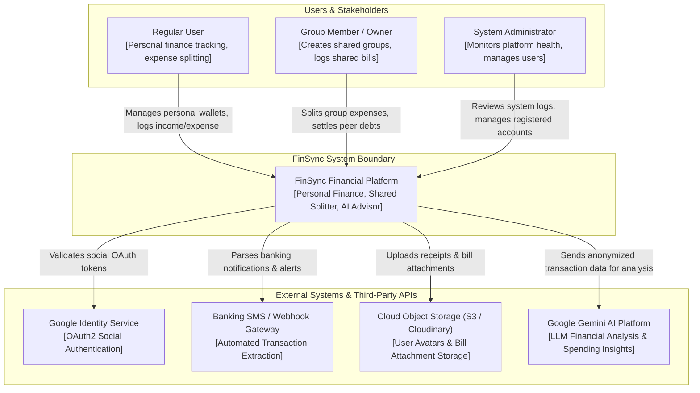

### B.4. System Context Architectural Rationale & Actor Narratives
> *Performed by: Ngo Thai Hoa (24120051) | Reviewed by: Pham Dinh Tieu Long (24120087) | Edited by: Ngo Thai Hoa (24120051)*

<!-- TODO: [Hoa] Provide written explanation of the C4 Level 1 diagram: actors, interactions, security boundaries, and external integration points. -->

---

## Part C — Software Architecture: Container and Component Diagrams
> *Performed by: Nguyen Le Duc Nhat (24120403) | Reviewed by: Nguyen Phu Dat (24120038) | Edited by: Nguyen Le Duc Nhat (24120403)*

**Section Weight:** 25 points.  
**Critical Mandate:** Architecture diagrams must reflect actual source code in `/src/`. Inconsistencies result in severe grading penalties.

### C.1. C4 Model Level 2 — Container Diagram
> *Performed by: Nguyen Le Duc Nhat (24120403) | Reviewed by: Nguyen Phu Dat (24120038) | Edited by: Nguyen Le Duc Nhat (24120403)*

The Container Diagram below reflects **100% of the active runtime containers** defined in `docker-compose.yml` and `src/` for Build 2. Planned PA5 subsystems (React Web Admin Portal and FastAPI/Gemini AI Advisory Service) are intentionally excluded from this diagram until implemented, ensuring strict code-to-architecture conformance.

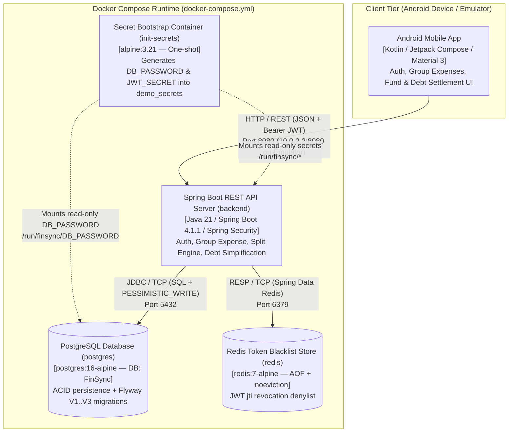

### C.2. Container Catalog, Responsibilities, and Communication Protocols
> *Performed by: Nguyen Le Duc Nhat (24120403) | Reviewed by: Nguyen Phu Dat (24120038) | Edited by: Nguyen Le Duc Nhat (24120403)*

| Container Name | Technology & Version | Core Responsibilities | Protocols, Ports & Storage |
| :--- | :--- | :--- | :--- |
| **Android Mobile App** | Kotlin, Jetpack Compose, Material 3, Coroutines (`src/mobile/`) | Renders user screens for registration/login, group creation, guest & invitation workflows, 4-mode expense splitting, shared fund tracking, and simplified debt settlement. | Outbound HTTP/REST JSON with Bearer JWT to port `8080` (`10.0.2.2:8080` on Android emulator). |
| **Spring Boot REST API Server (`backend`)** | Java 21 LTS, Spring Boot `4.1.1`, Spring Security (JOSE/Nimbus JWT), Spring Data JPA, Flyway (`src/backend/`) | Validates stateless JWTs and active session state, executes Flyway migrations at boot, enforces group permissions and `PESSIMISTIC_WRITE` locks, runs `ExpenseSplitCalculator` and `DebtSimplificationEngine`. | Inbound `127.0.0.1:8080->8080/tcp` (Spring MVC); outbound JDBC `5432/tcp` and RESP `6379/tcp`. |
| **PostgreSQL Database (`postgres`)** | `postgres:16-alpine` (Database `FinSync`, user `finsync`) | Stores all persistent Build 1 & Build 2 relational tables (`users`, `auth_sessions`, `categories`, `groups`, `group_members`, `group_invitations`, `group_wallets`, `group_fund_entries`, `group_expenses`, `group_expense_splits`, `settlements`). | Inbound TCP `5432` inside Docker Compose network; persisted on `demo_postgres_data` volume. |
| **Redis Token Blacklist Store (`redis`)** | `redis:7-alpine` (`--appendonly yes --maxmemory-policy noeviction`) | Stores revoked JWT `jti` keys (`auth:deny:access:{jti}`) with TTL until token expiry; `noeviction` guarantees security denylist entries are never evicted under memory pressure. | Inbound RESP TCP `6379` inside Docker Compose network; persisted on `demo_redis_data` volume. |
| **Secret Bootstrap Container (`init-secrets`)** | `alpine:3.21` (one-shot init service) | Generates 256-bit random `DB_PASSWORD` and `JWT_SECRET` files (`chmod 400`, UID `10001`) into shared volume `demo_secrets` before `postgres` and `backend` start. | Shared read-only mount `/run/finsync/` (`demo_secrets` volume); exits upon completion (`restart: "no"`). |

**Inter-Container Communication & Fail-Closed Boundaries:**
* **Client -> API Server:** Stateless HTTP/JSON over port `8080` with `Authorization: Bearer <accessToken>` on all endpoints except `/api/v1/auth/{register,login,refresh}` and `/actuator/health`.
* **API Server -> PostgreSQL:** Transactional JDBC over port `5432` with `spring.jpa.open-in-view=false`, `spring.jpa.hibernate.ddl-auto=validate`, and `SELECT ... FOR UPDATE` (`PESSIMISTIC_WRITE`) locks on `users` and `groups` rows during mutating operations.
* **API Server -> Redis:** Synchronous `StringRedisTemplate` checks on `JwtAuthenticationFilter` (`2s` timeout). If Redis is unavailable, protected endpoints fail closed with HTTP `503 AUTH_SERVICE_UNAVAILABLE` rather than bypassing revocation checks.

### C.3. C4 Model Level 3 — Backend Component Diagram (Spring Boot Server)
> *Performed by: Nguyen Le Duc Nhat (24120403) | Reviewed by: Ngo Thai Hoa (24120051) | Edited by: Nguyen Le Duc Nhat (24120403)*

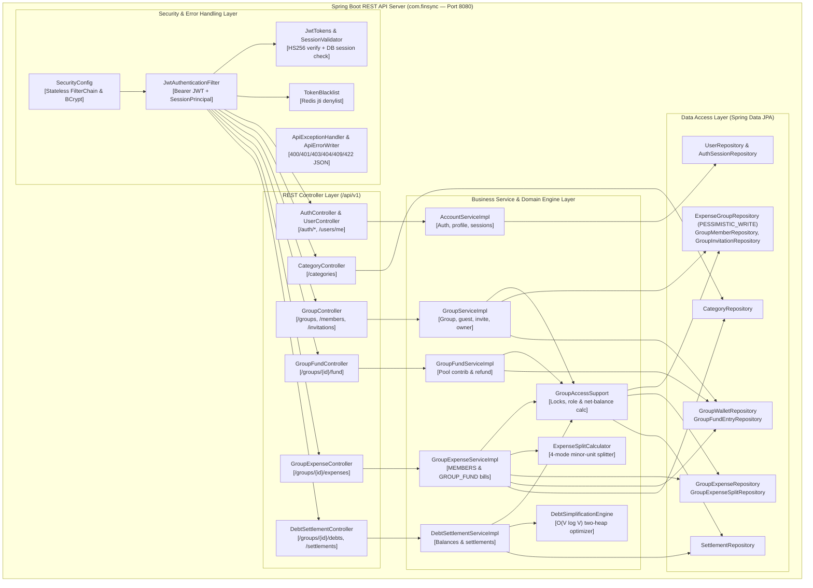

### C.4. Backend Component Catalog and Internal Interplay
> *Performed by: Nguyen Le Duc Nhat (24120403) | Reviewed by: Ngo Thai Hoa (24120051) | Edited by: Nguyen Le Duc Nhat (24120403)*

Every component in the C4 Level 3 Backend Diagram maps directly to Java classes inside `src/backend/src/main/java/com/finsync/`:

| Layer | Component Class(es) | Package | Responsibility & Internal Interplay |
| :--- | :--- | :--- | :--- |
| **Security & Error** | `SecurityConfig`, `JwtAuthenticationFilter`, `JwtTokens`, `SessionValidator`, `TokenBlacklist` | `config`, `security` | Configures stateless security (`SessionCreationPolicy.STATELESS`), extracts and verifies Bearer JWTs, checks Redis `auth:deny:access:{jti}` blacklist, verifies active `User` and non-revoked `AuthSession`, and populates `SessionPrincipal`. |
| **Security & Error** | `ApiException`, `ApiExceptionHandler`, `ApiErrorWriter` | `exception` | Translates domain exceptions (`400`, `401`, `403`, `404`, `409`, `422`), Bean Validation errors (`MethodArgumentNotValidException`), and PostgreSQL constraint violations (`uk_*`) into `ErrorBody(code, message, fieldErrors, traceId)` with `Cache-Control: no-store`. |
| **Controller** | `AuthController`, `UserController` | `controller` | Exposes PA3 registration, login, token refresh, logout, and `/users/me` profile endpoints delegating to `AccountService`. |
| **Controller** | `CategoryController`, `GroupController`, `GroupFundController`, `GroupExpenseController`, `DebtSettlementController` | `controller` | Exposes Build 2 REST endpoints under `/api/v1/categories` and `/api/v1/groups/**`, validating request DTOs (`@Valid`) and passing `SessionPrincipal` to service interfaces. |
| **Service & Engine** | `GroupServiceImpl`, `GroupFundServiceImpl`, `GroupExpenseServiceImpl`, `DebtSettlementServiceImpl` | `service.impl` | Enforces transactional boundaries (`@Transactional`), acquires group locks, checks `IdempotencySupport` (`requestId` + SHA-256 `requestHash`), validates `MoneyValidation` (`VND` scale `0`, `USD` scale `<= 2`), and persists append-only records. |
| **Service & Engine** | `GroupAccessSupport`, `MoneyValidation`, `IdempotencySupport` | `service.impl` | Shared helpers verifying `UserStatus.ACTIVE`, `GroupMemberRole.OWNER` / `ACTIVE` membership, non-archived status, pessimistic group row lock (`findByIdForUpdate`), and ledger net-balance derivation (`paid - split + settledPaid - settledReceived`). |
| **Service & Engine** | `ExpenseSplitCalculator` | `service.impl` | Pure deterministic cost splitter operating in integer minor units (`long`) across `EQUAL`, `EXACT`, `PERCENTAGE`, and `SHARES` with largest-remainder + ascending `splitOrder` tie-breaking (`sum(splits) == expense.amount`). |
| **Service & Engine** | `DebtSimplificationEngine` | `service.impl` | Pure $O(V \log V)$ greedy two-heap (`PriorityQueue` max-creditor / max-debtor) optimizer computing minimal direct transfers without storing stale debt graph rows. |
| **Repository** | `UserRepository`, `AuthSessionRepository`, `CategoryRepository`, `ExpenseGroupRepository`, `GroupMemberRepository`, `GroupInvitationRepository`, `GroupWalletRepository`, `GroupFundEntryRepository`, `GroupExpenseRepository`, `GroupExpenseSplitRepository`, `SettlementRepository` | `repository` | Spring Data JPA interfaces executing typed JPQL queries against PostgreSQL 16 (`ddl-auto=validate`). `ExpenseGroupRepository.findByIdForUpdate` acquires `LockModeType.PESSIMISTIC_WRITE` before concurrent group mutations. |

**End-to-End Request Interplay (Example — Recording a Shared Expense & Viewing Simplified Debts):**
1. **Ingress & Authentication:** `JwtAuthenticationFilter` verifies the JWT via `JwtTokens`, checks `TokenBlacklist` in Redis, validates the PostgreSQL session via `SessionValidator`, and binds `SessionPrincipal` before dispatching to `GroupExpenseController`.
2. **Locking & Idempotency:** `GroupExpenseServiceImpl` acquires a `PESSIMISTIC_WRITE` lock on the target `ExpenseGroup` row via `GroupAccessSupport.lockGroup(groupId)`, validates active membership and non-archived state, computes a canonical SHA-256 `requestHash` via `IdempotencySupport`, and checks `GroupExpenseRepository.findByRequestId`.
3. **Deterministic Split & Atomic Write:** `ExpenseSplitCalculator` computes exact minor-unit shares (`GroupExpenseSplit` rows). If `fundingSource == GROUP_FUND`, `GroupExpenseServiceImpl` verifies sufficient computed fund balance (`GroupFundEntryRepository.computeBalanceByWalletId`) and atomically inserts the linked `GroupFundEntry` (`type = EXPENSE`) in the same transaction.
4. **Debt Minimization:** On `GET /api/v1/groups/{groupId}/debts`, `DebtSettlementServiceImpl` derives per-member net balances from `MEMBERS`-funded expenses and `CONFIRMED` settlements, passes them to `DebtSimplificationEngine.simplify(...)`, and returns the simplified transfer plan alongside the raw-vs-simplified reduction percentage.

### C.5. C4 Model Level 3 — Frontend Component Diagram (Android Jetpack Compose)
> *Performed by: Nguyen Phu Dat (24120038) | Reviewed by: Nguyen Le Duc Nhat (24120403; assigned, review pending) | Edited by: Nguyen Phu Dat (24120038)*

**Source baseline:** Android source at commit [`66bb585`](https://github.com/pdtLong2929/FinSync/commit/66bb585) on `feat/pa4-group-expense-debt`, as of 25 November 2026. The diagrams describe the implemented Android container, including the PA4 authenticated group-expense and debt integration. Each component represents a logical responsibility within the Android process.

#### C.5.1. Main application, account and PA4 group components

The composition root is `MainActivity`. `FinSyncApp` coordinates the four tabs and existing feature routes. The same group forms support two explicitly separate modes: **Server groups**, whose published snapshot comes from the API, and **On this device**, whose ledger is managed by `FinanceViewModel` and private atomic files. Arrows show calls/dependencies; UI observes the corresponding read-only StateFlows to receive results.

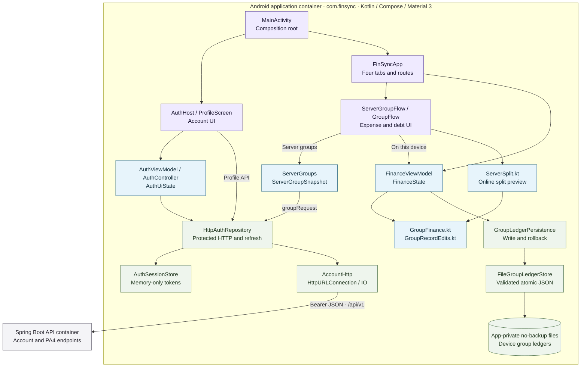

Editable [Mermaid source](screenshots/c4/frontend-components.mmd), [SVG](screenshots/c4/frontend-components.svg) and [PNG](screenshots/c4/frontend-components.png) are supplied for rendering and submission.

`AccountHttp` implements HTTP transport with Android/Java `HttpURLConnection` and is reused through `HttpAuthRepository`. `AuthSessionStore` retains access and refresh tokens in process memory. Persistent local profile preferences contain profile data, while login credentials remain outside the device preference and ledger files.

#### C.5.2. Supporting device-only features and Android services

Profile extras, unsent social requests and opt-in bank-notification bookkeeping remain distinct from the online Groups API. This companion view records those implemented components without suggesting that they are new backend services.

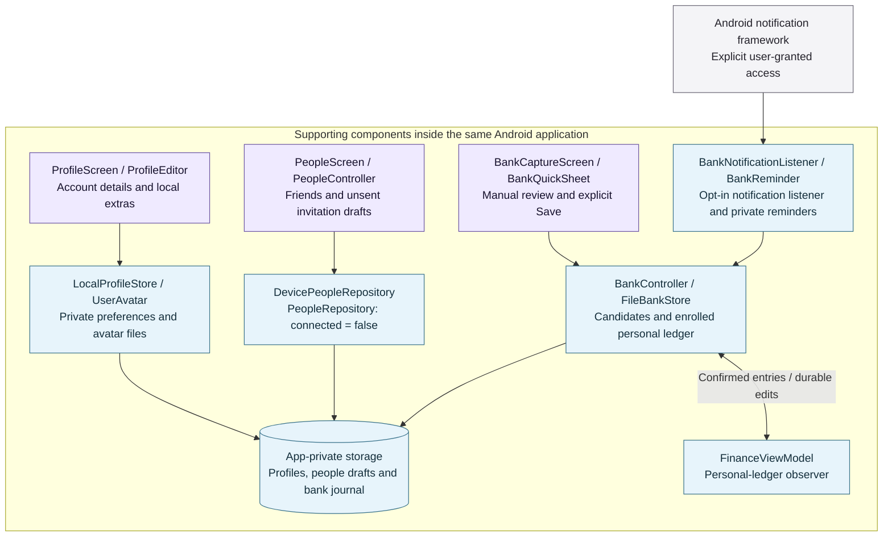

Editable [Mermaid source](screenshots/c4/frontend-device-components.mmd), [SVG](screenshots/c4/frontend-device-components.svg) and [PNG](screenshots/c4/frontend-device-components.png) are supplied separately. Android notification access is a user-granted operating-system capability, not a bank-account connection. `BankNotificationListener` appends candidates through `FileBankStore`; `BankController` handles review and confirmed bookkeeping. No bank credentials, SMS reader, payment initiation or bank API integration is represented.

### C.6. Frontend Component Catalog and UI State Management
> *Performed by: Nguyen Phu Dat (24120038) | Reviewed by: Nguyen Le Duc Nhat (24120403; assigned, review pending) | Edited by: Nguyen Phu Dat (24120038)*

#### C.6.1. Component catalog and source traceability

All paths below are relative to `src/mobile/app/src/main/java/com/finsync/` in the baseline commit. Files are grouped only where they implement one logical component; names are actual source identifiers.

| Component | Responsibility and public state | Source evidence |
| --- | --- | --- |
| Application composition root | Creates activity ViewModels; binds account/device workspaces; supplies bank, people and authenticated server-group controllers with CompositionLocal providers. Bank-alert intents carry an opaque candidate ID. | [`MainActivity.kt`](https://github.com/pdtLong2929/FinSync/blob/66bb585/src/mobile/app/src/main/java/com/finsync/MainActivity.kt) |
| Authentication state | `AuthViewModel` owns the repository and `AuthController`; `StateFlow<AuthUiState>` exposes page, busy, validation errors, failure and public user identity. Expiry/refresh and sign-out are coordinated here. | [`auth/AuthController.kt`](https://github.com/pdtLong2929/FinSync/blob/66bb585/src/mobile/app/src/main/java/com/finsync/auth/AuthController.kt) |
| Account UI and profile | `AuthHost` switches native account screens and preserves finance UI state while profile is open. `ProfileScreen` and its editor load/update supported account fields through the repository. | [`auth/AuthScreens.kt`](https://github.com/pdtLong2929/FinSync/blob/66bb585/src/mobile/app/src/main/java/com/finsync/auth/AuthScreens.kt), [`auth/ProfileScreens.kt`](https://github.com/pdtLong2929/FinSync/blob/66bb585/src/mobile/app/src/main/java/com/finsync/auth/ProfileScreens.kt) |
| App shell and navigation | `FinSyncApp` maintains destination and string routes with Compose saveable state; handles dialogs, snackbar/Undo and the four bottom tabs. It chooses Server groups or On this device. | [`ui/FinSyncApp.kt`](https://github.com/pdtLong2929/FinSync/blob/66bb585/src/mobile/app/src/main/java/com/finsync/ui/FinSyncApp.kt) |
| Personal-finance and device-group state | `FinanceViewModel` exposes `StateFlow<FinanceState>` and native edit actions. Personal entries and group expenses/settlements remain separate collections. `DashboardViewModel` provides the existing demo-backed dashboard bootstrap, not a dashboard API repository. | [`ui/FinanceViewModel.kt`](https://github.com/pdtLong2929/FinSync/blob/66bb585/src/mobile/app/src/main/java/com/finsync/ui/FinanceViewModel.kt), [`ui/dashboard/DashboardViewModel.kt`](https://github.com/pdtLong2929/FinSync/blob/66bb585/src/mobile/app/src/main/java/com/finsync/ui/dashboard/DashboardViewModel.kt) |
| Dashboard, Wallets and Reports presentation | Native Compose screens consume the current finance state. Reports aggregate available personal entries; they do not claim financial API synchronization or incorporate group debt into personal wallet balances. | [`ui/dashboard/DashboardScreen.kt`](https://github.com/pdtLong2929/FinSync/blob/66bb585/src/mobile/app/src/main/java/com/finsync/ui/dashboard/DashboardScreen.kt), [`ui/wallets/WalletScreens.kt`](https://github.com/pdtLong2929/FinSync/blob/66bb585/src/mobile/app/src/main/java/com/finsync/ui/wallets/WalletScreens.kt), [`ui/reports/ReportScreens.kt`](https://github.com/pdtLong2929/FinSync/blob/66bb585/src/mobile/app/src/main/java/com/finsync/ui/reports/ReportScreens.kt) |
| PA4 group presentation | `ServerGroupFlow` dispatches online routes into shared group forms/detail screens. `GroupFlow` retains device-ledger routes. Expense forms, member management, debt details and settlement confirmation are reusable native composables. | [`groups/ServerGroupFlow.kt`](https://github.com/pdtLong2929/FinSync/blob/66bb585/src/mobile/app/src/main/java/com/finsync/groups/ServerGroupFlow.kt), [`ui/groups/GroupScreens.kt`](https://github.com/pdtLong2929/FinSync/blob/66bb585/src/mobile/app/src/main/java/com/finsync/ui/groups/GroupScreens.kt), [`ui/groups/GroupExpenseForm.kt`](https://github.com/pdtLong2929/FinSync/blob/66bb585/src/mobile/app/src/main/java/com/finsync/ui/groups/GroupExpenseForm.kt), [`ui/groups/DebtScreens.kt`](https://github.com/pdtLong2929/FinSync/blob/66bb585/src/mobile/app/src/main/java/com/finsync/ui/groups/DebtScreens.kt) |
| Online Groups adapter/controller | `ServerGroups` is a coroutine-based controller/adapter, **not** a ViewModel or separate Retrofit repository. `StateFlow<ServerGroupSnapshot>` publishes complete server group/expense/payment snapshots, categories, member balances, debt plans and loading/busy/error state. It maps each group's caller member UUID to the UI alias `me`. | [`groups/ServerGroups.kt`](https://github.com/pdtLong2929/FinSync/blob/66bb585/src/mobile/app/src/main/java/com/finsync/groups/ServerGroups.kt) |
| Authentication and protected requests | `AuthRepository` is the account boundary; `HttpAuthRepository` implements real account operations and serialized protected group requests. `UnavailableAuthRepository` refuses account operations when no endpoint is configured. | [`auth/AuthRepository.kt`](https://github.com/pdtLong2929/FinSync/blob/66bb585/src/mobile/app/src/main/java/com/finsync/auth/AuthRepository.kt), [`auth/HttpAuthRepository.kt`](https://github.com/pdtLong2929/FinSync/blob/66bb585/src/mobile/app/src/main/java/com/finsync/auth/HttpAuthRepository.kt) |
| HTTP transport | `AccountHttp` performs bounded JSON request/response I/O on `Dispatchers.IO`, applies timeouts, supplies the Bearer token and disables redirects. Groups list arrays and object responses are decoded explicitly. | [`auth/AccountHttp.kt`](https://github.com/pdtLong2929/FinSync/blob/66bb585/src/mobile/app/src/main/java/com/finsync/auth/AccountHttp.kt) |
| Session storage | `AuthSessionStore` holds access/refresh credentials only in process memory. Family checks reject late results after an account/session change; repository refresh is serialized. Credentials are redacted from diagnostic object strings. | [`auth/AuthSession.kt`](https://github.com/pdtLong2929/FinSync/blob/66bb585/src/mobile/app/src/main/java/com/finsync/auth/AuthSession.kt), [`auth/HttpAuthRepository.kt`](https://github.com/pdtLong2929/FinSync/blob/66bb585/src/mobile/app/src/main/java/com/finsync/auth/HttpAuthRepository.kt) |
| Device-group persistence | `GroupLedgerPersistence` exposes `GroupStorageState`, loads the selected workspace, serializes writes and restores the previous ledger on write failure. `FileGroupLedgerStore` validates and stores versioned JSON through `AtomicFile` in app-private no-backup storage. | [`ui/GroupLedgerPersistence.kt`](https://github.com/pdtLong2929/FinSync/blob/66bb585/src/mobile/app/src/main/java/com/finsync/ui/GroupLedgerPersistence.kt), [`data/GroupLedgerStore.kt`](https://github.com/pdtLong2929/FinSync/blob/66bb585/src/mobile/app/src/main/java/com/finsync/data/GroupLedgerStore.kt) |
| Financial rules and preview | `GroupFinance.kt` validates fields, allocates integer VND and simplifies local debts; `GroupRecordEdits.kt` governs local corrections/removals. `ServerSplit.kt` mirrors the backend's largest-remainder preview. Online balances and transfer suggestions are read from the server. | [`domain/GroupFinance.kt`](https://github.com/pdtLong2929/FinSync/blob/66bb585/src/mobile/app/src/main/java/com/finsync/domain/GroupFinance.kt), [`ui/GroupRecordEdits.kt`](https://github.com/pdtLong2929/FinSync/blob/66bb585/src/mobile/app/src/main/java/com/finsync/ui/GroupRecordEdits.kt), [`groups/ServerSplit.kt`](https://github.com/pdtLong2929/FinSync/blob/66bb585/src/mobile/app/src/main/java/com/finsync/groups/ServerSplit.kt) |
| Local profile extras | `LocalProfileStore` stores account-scoped preferences and private avatar files; supported name/phone fields use account APIs, while birthday, bio and avatar remain device-only. This store does not persist login credentials. | [`auth/LocalProfileStore.kt`](https://github.com/pdtLong2929/FinSync/blob/66bb585/src/mobile/app/src/main/java/com/finsync/auth/LocalProfileStore.kt), [`auth/UserAvatar.kt`](https://github.com/pdtLong2929/FinSync/blob/66bb585/src/mobile/app/src/main/java/com/finsync/auth/UserAvatar.kt) |
| Friends/invitation drafts | `PeopleController` publishes `PeopleUiState`. `DevicePeopleRepository` implements `PeopleRepository` with `connected=false` and atomic per-workspace drafts. Actual online token joins are handled by `ServerGroups`, not by silently activating this repository. | [`social/PeopleController.kt`](https://github.com/pdtLong2929/FinSync/blob/66bb585/src/mobile/app/src/main/java/com/finsync/social/PeopleController.kt), [`social/PeopleRepository.kt`](https://github.com/pdtLong2929/FinSync/blob/66bb585/src/mobile/app/src/main/java/com/finsync/social/PeopleRepository.kt) |
| Bank-notification bookkeeping | System-bound `BankNotificationListener` accepts only approved new app notifications, parses supported VND candidates and writes `FileBankStore`. `BankReminder` posts a private tap-to-review reminder. `BankController` publishes `BankUiState`, confirms records and observes durable personal-ledger edits after enrollment. | [`bank/BankNotificationListener.kt`](https://github.com/pdtLong2929/FinSync/blob/66bb585/src/mobile/app/src/main/java/com/finsync/bank/BankNotificationListener.kt), [`bank/BankController.kt`](https://github.com/pdtLong2929/FinSync/blob/66bb585/src/mobile/app/src/main/java/com/finsync/bank/BankController.kt), [`bank/BankStore.kt`](https://github.com/pdtLong2929/FinSync/blob/66bb585/src/mobile/app/src/main/java/com/finsync/bank/BankStore.kt) |

#### C.6.2. State ownership, navigation and lifetime

The UI follows unidirectional data flow: native input invokes a controller/ViewModel action; validation and I/O complete outside composable rendering; a new state snapshot is published; observing composables recompose. Activity ViewModels use lifecycle scopes. Remembered controllers use their existing Compose scopes, and `MainActivity` keys workspace-bound objects by the current account/device identity. Repository callbacks and session-family checks prevent old-account responses being applied to another login.

`FinSyncApp` uses `rememberSaveable`, a saveable-state holder and explicit string routes; it does not use a Navigation Compose `NavController`. Form drafts are UI-local state. Financial input fields use numeric keyboards and the shared keyboard-safe `FeaturePage` action area. Leaving dirty forms requests confirmation. Loading, validation, empty, error/Retry and success feedback are driven by the state of the actual local or remote operation, rather than a simulated success delay.

Local durable files survive an Activity/ViewModel restart. Process-memory sessions and in-memory-only finance state are not promised to survive process death. The bank journal persists personal wallets/entries/categories/transfers after explicit enrollment; budgets/goals retain their earlier behavior. The diagram therefore shows neither Room nor a universal persistent finance database.

#### C.6.3. Online group-expense request and update sequence

1. After real account login, `MainActivity` provides `ServerGroups` backed by the same `HttpAuthRepository`. Entering Server groups loads groups, current categories, every expense page, settlements and server debt summaries. A complete `ServerGroupSnapshot` is published only after these reads succeed. No local group is automatically uploaded or merged.
2. The shared expense form validates title, whole-VND amount, date, payer, participants and split inputs. Its online preview calls `serverSplit`; Equal/Percentage/Shares rounding follows the backend's largest-remainder and participant-order rules. On this device retains its original payer-remainder rule. The final online record uses the server's returned allocation.
3. Save sends `/api/v1/groups/{id}/expenses` through `groupRequest` with a stable UUID `requestId`, the server category/member UUIDs and split inputs. A successful mutation is followed by an authoritative reload. Reusing the same request ID protects expense/payment retries from creating duplicates.
4. The repository serializes token refresh and checks session family around protected responses. `AccountHttp` performs network I/O on `Dispatchers.IO`; response failure is mapped to a safe UI error. A successful write followed by failed refresh is reported as **Saved on server / Refresh**, not silently posted again. Uncertain non-idempotent create/member/join requests require refresh before retry.

The debug endpoint defaults to `http://10.0.2.2:8080` for the emulator. The base URL is configurable; release has no default account endpoint and configured release endpoints must use HTTPS. Diagram URLs describe the development setup, not a deployed production service.

#### C.6.4. Debt settlement and device-ledger boundaries

Online Balances displays the API's `memberBalances` and `simplifiedTransfers`; it does not reconstruct them using local payer rounding. A user records an already completed outside-app payment, reviews a full/partial amount and date, then confirms. The client posts `/settlements` with a stable request ID and reloads server balances/history. Recording a settlement does not initiate or verify a money transfer and does not reduce a personal FinSync wallet automatically.

Device-group actions instead pass through `FinanceViewModel` → `GroupLedgerPersistence` → `FileGroupLedgerStore`. A failed write restores the previous displayed ledger, retains the form and allows retry. Workspace isolation and validated atomic files protect other accounts and prior saved data. Local expense/payment corrections, confirmed removals and Undo remain supported independently of the online API.

#### C.6.5. Implemented states, limits and verification evidence

| Situation | Implemented behavior |
| --- | --- |
| First use / no matching groups or expenses | Native empty state and create/add action; no fabricated server records. |
| Loading / saving | Progress and busy state; guarded submission. State is not declared saved before the operation succeeds. |
| Invalid amount, date, allocation or member name | Field/form validation blocks the invalid operation; Backend validates remote permissions and outstanding debt again. |
| Network/service failure or expired session | Safe error and explicit retry/sign-in guidance. Online mode does not silently fall back to a device ledger or queue mutations offline. |
| Disk read/write failure | Device ledger Retry, write rollback and corrupt-file protection; saved data is not replaced by an empty success state. |
| Notification permission denied | The bank setup remains explicit; capture/reminders require their separate user grants. Pending bookkeeping is not a bank sync. |
| Successful write | Updated server snapshot or durable local state plus confirmation/snackbar; local deletion can expose Undo. |
| Unsupported server operations | Online expense/payment edit/delete/Undo and guest rename/restore are not advertised as functional. Friends/email remain unsent drafts; online single-use invitation tokens use the actual API. Only VND groups are supported. |

The integration baseline built successfully with **98/98 Android JVM tests**. The broad Pixel 7 run passed 14/15 UI cases; the remaining auth/profile automation case and both affected live-group cases subsequently passed **3/3** after test-input stabilization and the server amount-reading correction. All 15 distinct scenarios passed across the broad and targeted runs. The preceding lint run had 0 errors, 38 warnings and 3 hints. Backend tests passed 21/21. Live Android tests verified four split modes, token invitations between accounts, access isolation, idempotency, native partial payment, server reload and unchanged personal-ledger data; local regressions covered persistence, rollback, corrections/Undo and 320dp/150% section labels.

Source tests: `ServerSplitTest.kt`, `ServerGroupIntegrationTest.kt`, `GroupFinanceTest.kt`, `GroupLedgerPersistenceTest.kt`, `DeviceGroupLedgerTest.kt`, `GroupCompletionTest.kt` and `AuthBackendIntegrationTest.kt`. Detailed runtime/evidence references are in [`PA4_BACKEND_INTEGRATION.md`](https://github.com/pdtLong2929/FinSync/blob/66bb585/src/mobile/PA4_BACKEND_INTEGRATION.md). Tests used isolated QA fixtures and an actual separate PostgreSQL database; they do not certify bank transfers, production deployment, full TalkBack, API 26 or all device sizes.

### C.7. Code-to-Architecture Conformance Audit (Zero-Penalty Guarantee)
> *Performed by: Nguyen Le Duc Nhat (24120403) | Reviewed by: Pham Dinh Tieu Long (24120087) | Edited by: Nguyen Le Duc Nhat (24120403)*

To guarantee zero grading penalty under PA4 Specification Warning (*"Any inconsistency between the documented architecture and the source code will result in a grade penalty"*):
* **100% Container Traceability:** All 5 containers in `C.1`/`C.2` correspond directly to `src/mobile/`, `src/backend/`, and services `init-secrets`, `backend`, `postgres`, and `redis` in `docker-compose.yml`.
* **100% Backend Component Traceability:** All 7 controllers (`AuthController`, `UserController`, `CategoryController`, `GroupController`, `GroupFundController`, `GroupExpenseController`, `DebtSettlementController`), 10 service/engine classes (`AccountServiceImpl`, `GroupServiceImpl`, `GroupFundServiceImpl`, `GroupExpenseServiceImpl`, `DebtSettlementServiceImpl`, `GroupAccessSupport`, `ExpenseSplitCalculator`, `DebtSimplificationEngine`, `MoneyValidation`, `IdempotencySupport`), and 11 repositories map 1-to-1 to `.java` files in `src/backend/src/main/java/com/finsync/`.
* **100% Schema Traceability:** All 11 active relational tables (`users`, `auth_sessions`, `categories`, `groups`, `group_members`, `group_invitations`, `group_wallets`, `group_fund_entries`, `group_expenses`, `group_expense_splits`, `settlements`) are created deterministically by Flyway migrations `V1`–`V3` and validated on startup via `spring.jpa.hibernate.ddl-auto=validate`.
* **Zero Phantom Components:** Planned PA5 modules (React Admin Web, FastAPI AI Advisory Service, Kafka, S3) are excluded from C4 L2/L3 runtime diagrams until implemented.

---

## Part D — Infrastructure Deployment Diagram
> *Performed by: Vuong Dac Gia Khiem (24120342) | Reviewed by: Nguyen Le Duc Nhat (24120403) | Edited by: Vuong Dac Gia Khiem (24120342)*

**Section Weight:** 5 points.  
**Requirement:** Map containers from Section C onto execution nodes, network ports, and communication protocols.

### D.1. Physical & Logical Deployment Diagram
> *Performed by: Vuong Dac Gia Khiem (24120342) | Reviewed by: Nguyen Le Duc Nhat (24120403) | Edited by: Vuong Dac Gia Khiem (24120342)*

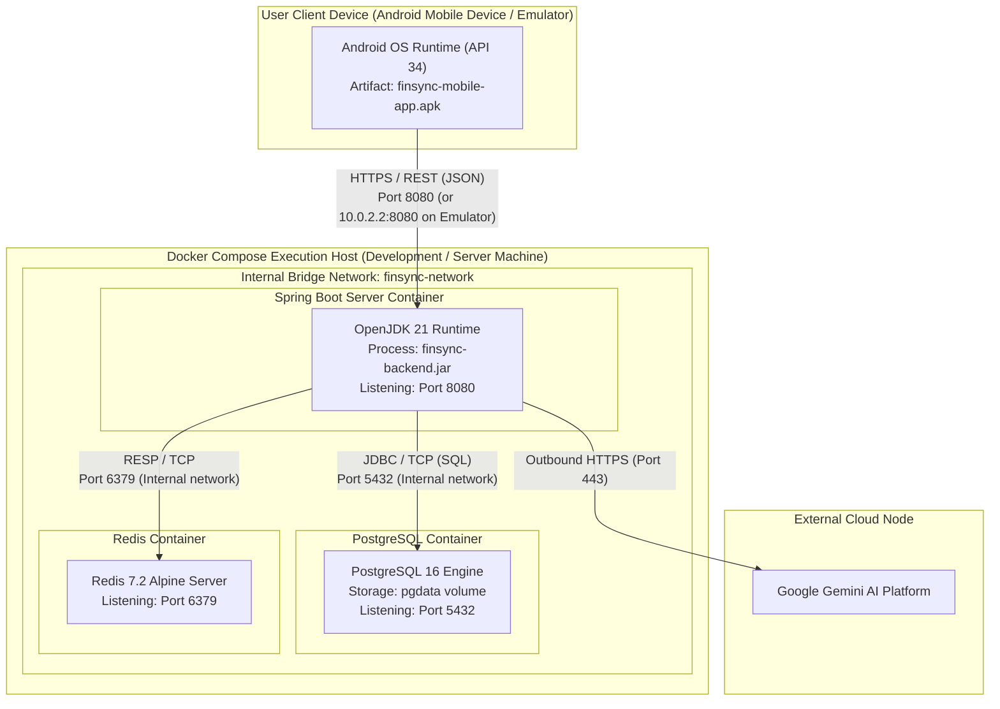

### D.2. Deployment Node Specifications & Container Mapping
> *Performed by: Vuong Dac Gia Khiem (24120342) | Reviewed by: Nguyen Le Duc Nhat (24120403) | Edited by: Vuong Dac Gia Khiem (24120342)*

| Execution Node | Environment / OS | Containers / Artifacts Running | Host & Container Port Bindings |
| :--- | :--- | :--- | :--- |
| **Client Device** | Android 14 / Pixel 7 Emulator | `finsync-mobile.apk` native application | Outbound port 8080. |
| **Docker Engine Host** | Ubuntu 22.04 LTS / Windows Docker Desktop | Docker Compose v2 environment (`finsync-network`) | Internal bridge networking. |
| **App Node** | Eclipse Temurin 21 Container | `finsync-backend.jar` Spring Boot server | `8080:8080` (Exposed to host). |
| **Database Node** | PostgreSQL 16 Official Container | PostgreSQL RDBMS instance + Flyway migrations | `5432:5432` (Exposed for inspection). |
| **Cache Node** | Redis 7.2 Alpine Container | Redis In-Memory server | `6379:6379` (Internal to network). |

### D.3. Network Protocols, Security Boundaries, and Port Bindings
> *Performed by: Vuong Dac Gia Khiem (24120342) | Reviewed by: Nguyen Le Duc Nhat (24120403) | Edited by: Vuong Dac Gia Khiem (24120342)*

<!-- TODO: [Khiem] Provide detailed explanation of internal network security, environment variables (.env), and Docker Compose network boundaries. -->

---

## Part E — Implement 2 Functional Groups Using Spec Kit (Build 2)
> *Performed by: Nguyen Le Duc Nhat (24120403) | Reviewed by: Pham Dinh Tieu Long (24120087) | Edited by: Nguyen Le Duc Nhat (24120403)*

**Section Weight:** 30 points.  
**Mandatory Deliverables:** End-to-end full-stack implementation, Spec Kit SDD artifacts, automated testcases, narrated video demo in English.

### E.1. Selected Functional Groups and Scope Rationale
> *Performed by: Nguyen Le Duc Nhat (24120403) | Reviewed by: Pham Dinh Tieu Long (24120087) | Edited by: Nguyen Le Duc Nhat (24120403)*

* **Functional Group 1:** **Group Expense Management** (Shared Groups, Guest Members, Targeted Invitations, Group Fund, and 4-Mode Expense Splitting)
  * *Scope:* Full-stack Android Jetpack Compose UI + Spring Boot REST API + PostgreSQL schema (`V2` & `V3` Flyway migrations).
  * *Related FR / UC IDs:* `FR-G01`–`FR-G08`, `FR-G12`–`FR-G14`, `UC-CLI-10`, `UC-CLI-11`.
* **Functional Group 2:** **Smart Debt Simplification** (Dynamic Net Balance Engine, Greedy Two-Heap Debt Minimization, and Immutable Manual Settlements)
  * *Scope:* Full-stack Android Jetpack Compose UI + Spring Boot REST API (`DebtSimplificationEngine`, `DebtSettlementService`) + PostgreSQL schema.
  * *Related FR / UC IDs:* `FR-G08`–`FR-G14`, `UC-CLI-12`.

All Spec Kit specification, planning, data model, OpenAPI contract, and task artifacts for Build 2 reside in [specs/002-group-expense-debt-simplification/](../../specs/002-group-expense-debt-simplification/spec.md).

### E.2. Spec Kit Specification-Driven Development (SDD) Workflow
> *Performed by: Nguyen Le Duc Nhat (24120403) | Reviewed by: Ngo Thai Hoa (24120051) | Edited by: Nguyen Le Duc Nhat (24120403)*

The 2 functional groups were delivered following the rigorous 4-stage Spec Kit lifecycle:
1. **Specify:** Authored prioritized user stories (`US1`–`US4`), edge cases, and functional requirements (`FR-G01`–`FR-G14`) in `specs/002-group-expense-debt-simplification/spec.md`.
2. **Plan:** Defined layered Spring Boot architecture, Flyway `V2`/`V3` data model, concurrency locks, and OpenAPI 3.0.3 definitions in `specs/002-group-expense-debt-simplification/plan.md`, `data-model.md`, and `contracts/backend-api.yaml`.
3. **Tasks:** Decomposed work into 30 atomic technical tasks (`T001`–`T030`) and end-to-end verification walkthroughs in `specs/002-group-expense-debt-simplification/tasks.md` and `quickstart.md`.
4. **Implement:** Executed backend Java logic, PostgreSQL Flyway migrations, unit/integration tests, and Android Jetpack Compose integration.

### E.3. Database Persistence & Flyway Migrations
> *Performed by: Nguyen Le Duc Nhat (24120403) | Reviewed by: Vuong Dac Gia Khiem (24120342) | Edited by: Nguyen Le Duc Nhat (24120403)*

Database DDL and default taxonomy seeding are managed exclusively through versioned Flyway SQL scripts in `src/backend/src/main/resources/db/migration/`, verified against Hibernate (`spring.jpa.hibernate.ddl-auto=validate`):

| Migration Script | Tables / Seeds Created | Key Integrity & Concurrency Constraints |
| :--- | :--- | :--- |
| `V1__create_account_tables.sql` *(PA3)* | `users`, `auth_sessions` | `UNIQUE(email)`, `UNIQUE(refresh_token_hash)`, `ON DELETE RESTRICT` FK, lock-state `CHECK` constraints. |
| `V2__create_group_expense_tables.sql` *(PA4)* | `categories`, `groups`, `group_members`, `group_invitations`, `group_wallets`, `group_fund_entries`, `group_expenses`, `group_expense_splits`, `settlements` | All FKs `ON DELETE RESTRICT ON UPDATE RESTRICT`; `NUMERIC(19,2)` monetary columns; `UNIQUE(request_id)` idempotency on `group_fund_entries`, `group_expenses`, `settlements`; partial unique index `uk_group_members_active_owner` (`WHERE role = 'OWNER' AND status = 'ACTIVE'`); `CHECK` invariants linking `funding_source` to `paid_by_member_id` and `type` to `member_id`/`expense_id`. |
| `V3__seed_default_categories.sql` *(PA4)* | 8 default `EXPENSE` categories & 3 default `INCOME` categories | Deterministic UUIDs with `ON CONFLICT DO NOTHING` for idempotent repeatable startup across environments. |

All 9 Build 2 tables inherit the 4 standard `BaseEntity` audit/optimistic-lock columns (`id UUID`, `created_at TIMESTAMPTZ`, `updated_at TIMESTAMPTZ`, `version BIGINT`) and store monetary values in `NUMERIC(19,2)` (`BigDecimal`).

### E.4. Automated Spec Kit Tests & Postman E2E Test Suite
> *Performed by: Vuong Dac Gia Khiem (24120342) | Reviewed by: Nguyen Le Duc Nhat (24120403) | Edited by: Vuong Dac Gia Khiem (24120342)*

<!-- TODO: [Khiem] Document the automated testcases generated by Spec Kit and insert screenshots of Postman test execution passing 100%. -->

*Figure E.1 — Postman E2E Test Suite verifying 100% test passing across the 2 Functional Groups.*

### E.5. Narrated Video Demonstration & YouTube Submission
> *Performed by: Vuong Dac Gia Khiem (24120342) | Reviewed by: Pham Dinh Tieu Long (24120087) | Edited by: Vuong Dac Gia Khiem (24120342)*

* **YouTube URL:** `https://youtu.be/[YOUR_VIDEO_ID]` *(Unlisted Demonstration)*
* **Visibility / Playback Verification:** Verified playable in incognito window on 2026-12-04.
* **Duration & Language:** 06:30 | **English voiceover narration** (Narrator: Vuong Dac Gia Khiem).
* **Demonstrated Commit / Tag:** `v0.4.0-pa4` / commit `[commit_hash]`.

| Timestamp | Video Demonstration Segment | Feature / Requirement Demonstrated | Database Verification Step |
| :---: | :--- | :--- | :--- |
| `00:00 - 01:15` | Introduction & C4 Architecture Overview | Software Architecture Context | Docker container health check |
| `01:15 - 03:30` | Functional Group 1 Live Walkthrough | Android UI interaction & API calls | Verified in PostgreSQL terminal |
| `03:30 - 05:45` | Functional Group 2 Live Walkthrough | Android UI interaction & business logic | Verified relational integrity in DB |
| `05:45 - 06:30` | Summary, Code Walkthrough & Wrap-up | End-to-end Spec Kit integration | Clean teardown verification |

### E.6. Android Frontend Implementation and Verification Evidence
> *Performed by: Nguyen Phu Dat (24120038) | Reviewed by: Pham Dinh Tieu Long (24120087; assigned, review pending) | Edited by: Nguyen Phu Dat (24120038)*

**Delivered implementation:** [`66bb585`](https://github.com/pdtLong2929/FinSync/commit/66bb585) on `feat/pa4-group-expense-debt`. The Kotlin/Jetpack Compose/Material 3 client is connected to the PA4 account, group-expense and debt APIs. The evidence package contains nine original Android emulator screenshots, per-suite/case result tables, build result excerpts and PostgreSQL verification: [frontend evidence index](evidence/frontend/README.md).

#### E.6.1. Implemented frontend scope

| Functional group | Connected Android behavior | Verification |
| --- | --- | --- |
| Group Expense Management (`UC-CLI-10`, `UC-CLI-11`) | Create/edit VND groups; add/remove guest members; load server categories and paginated expenses; enter title, amount, payer, date and participants. | Native online create/member/expense journey and server reload. FE-01–FE-05. |
| Group Expense Management | Equal, Exact, Percentage and Shares split input, validation and VND preview matching server rounding. | Native Equal screen FE-03; all four methods and returned allocations checked by `realInvitationFourSplitMethodsIdempotencyAndAccessIsolation`. |
| Group Expense Management | Single-use invitation token creation and acceptance by a second authenticated account. | Actual Android repository → API test; access is denied to an unrelated account. |
| Smart Debt Simplification (`UC-CLI-12`) | Display server member balances and simplified transfer suggestions; show who owes whom and the outstanding amount. | FE-06 and live debt-summary reads. |
| Smart Debt Simplification | Review and confirm full/partial outside-app payment records; refresh debt/history after saving. | FE-07–FE-09; native partial-payment and fresh-server-read assertions. |
| Both groups | Loading, empty, validation, error/retry, guarded submission and successful-save feedback; stable request IDs for expense/payment retries. | JVM and Android tests, including idempotency, access isolation, disk rollback/retry and local ledger regressions. |

Server groups and On this device are separate modes. This integration does not automatically upload local groups or deduct group payments from personal wallet balances. Online expense/payment correction, deletion and Undo have no Backend endpoints in this revision, so those records are read-only; the existing device-ledger operations remain available. Guest rename/restore, group-fund entry, targeted guest-claim, token revocation and archive/ownership/leave UI are not connected by this adapter. Friends/email invitations remain unsent local drafts. These limits delimit the implemented frontend portion of the broader E.1 scope.

#### E.6.2. Actual Android screenshots

**Capture session:** 26 November 2026, Pixel 7 emulator, Android API 36, 1080 × 2400. The app used isolated QA accounts and the actual Java Backend/PostgreSQL. Screenshots are unchanged native captures, not prototype frames. SHA-256 hashes and original timestamps are recorded in [screenshots.csv](evidence/frontend/screenshots.csv).

| ID | Screen / original image | Observable result |
| --- | --- | --- |
| FE-01 | [Members](screenshots/features/frontend/FE-01-members.png) | Owner and guest saved on the server |
| FE-02 | [Expense form](screenshots/features/frontend/FE-02-expense-form.png) | Title, whole-VND amount, payer, date and server category |
| FE-03 | [Split review](screenshots/features/frontend/FE-03-split.png) | Equal allocation: 50,001 + 50,000 = 100,001 VND |
| FE-04 | [Expense list](screenshots/features/frontend/FE-04-expenses.png) | Persisted shared expense in the group history |
| FE-05 | [Expense detail](screenshots/features/frontend/FE-05-expense-detail.png) | Server record and original participant allocation |
| FE-06 | [Debt before payment](screenshots/features/frontend/FE-06-balances.png) | Guest owes 50,000 VND before payment |
| FE-07 | [Payment confirmation](screenshots/features/frontend/FE-07-confirm-payment.png) | Explicit confirmation of a 10,000 VND partial payment |
| FE-08 | [Debt after payment](screenshots/features/frontend/FE-08-payment.png) | Server balance reduced to 40,000 VND |
| FE-09 | [Payment history](screenshots/features/frontend/FE-09-payment-history.png) | Confirmed 10,000 VND payment record and remaining debt |

  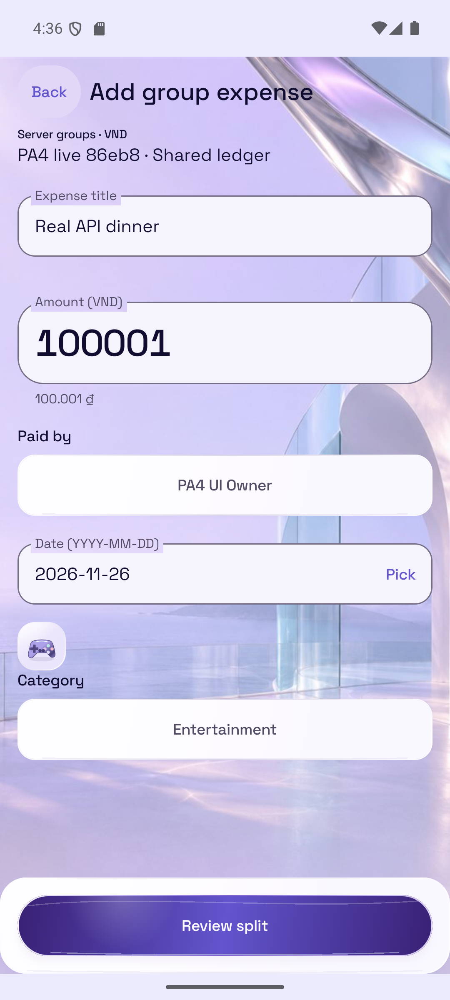
  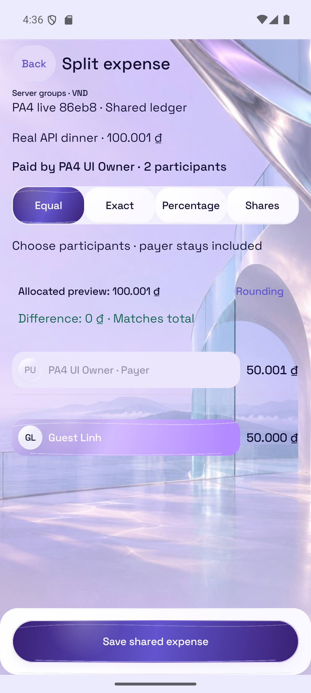

*Figure E.FE-1 — Online expense form and split review. The 100,001 VND expense is allocated as 50,001 VND to the payer and 50,000 VND to the guest; the displayed difference is zero.*

  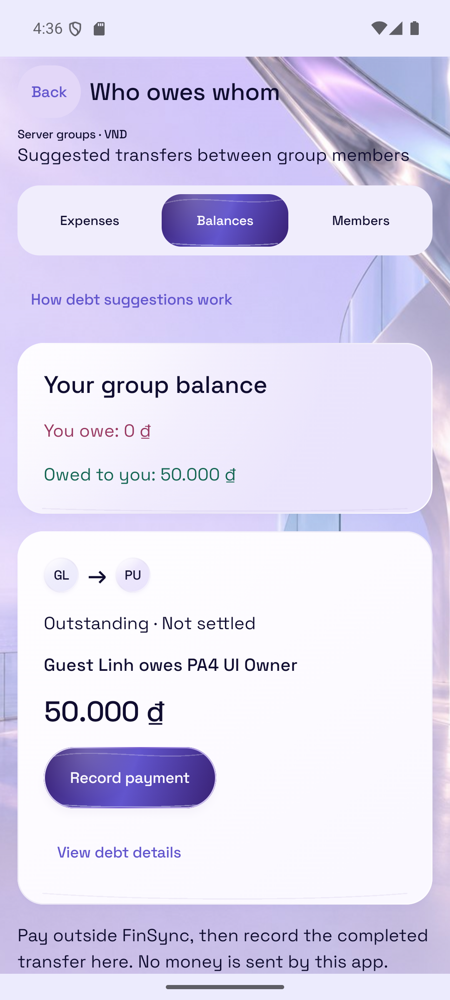
  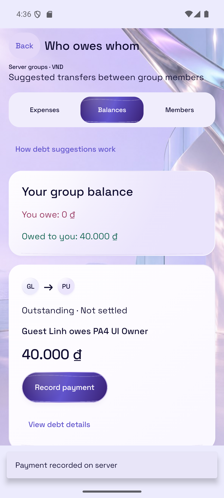

*Figure E.FE-2 — Server-backed debt before and after the confirmed 10,000 VND payment: 50,000 VND becomes 40,000 VND. FinSync records the completed payment; it does not transfer money.*

  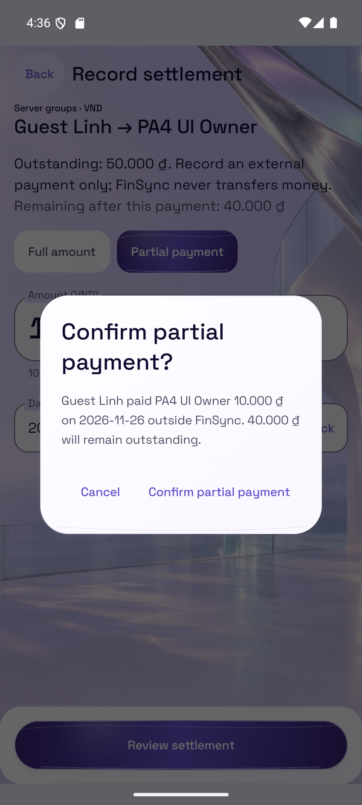
  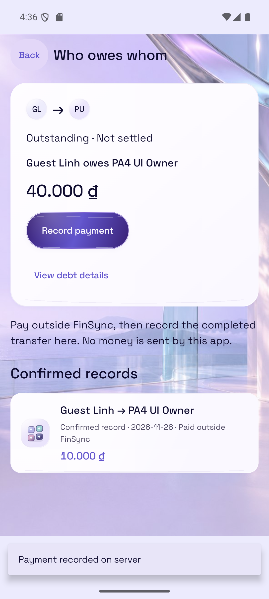

*Figure E.FE-3 — Confirmation and resulting payment history. The recorded 10,000 VND amount and remaining 40,000 VND debt are visible in the native app.*

#### E.6.3. Build and test results

| Verification | Date | Actual result | Evidence |
| --- | --- | --- | --- |
| Android final integration APK/test APK build | 25 Nov 2026 | Passed in 28s | [Result excerpts](evidence/frontend/verification-results.md) |
| Android JVM suite | 25 Nov 2026 | 98 tests; 0 failures/errors/skips | [Per-suite CSV](evidence/frontend/android-jvm-tests.csv) |
| Backend package and JVM/API suite | 25 Nov 2026 | 21 tests; 0 failures/errors/skips | [Per-suite CSV](evidence/frontend/backend-tests.csv) |
| Broad Pixel 7 UI run | 25 Nov 2026 | 14/15 passed; one auth/profile input-automation failure | [Per-case matrix](evidence/frontend/android-ui-tests.csv) |
| Targeted follow-up after correction | 25 Nov 2026 | 3/3 passed, including the prior auth/profile case and both live-group cases | [Result excerpts](evidence/frontend/verification-results.md) |
| Native online screenshot journey | 26 Nov 2026 | 1/1 passed in 37.096s; screenshot test-APK build passed in 26s | [Result excerpts](evidence/frontend/verification-results.md) |

All 15 distinct UI scenarios have passing results across the broad and targeted runs. The new capture run replays one native journey; it is not a claim that every suite was rerun on 26 November. The verification data retains the original failed broad-run result and the successful follow-up. The Android/API results here are independent of the team's Postman evidence in E.4.

#### E.6.4. Persistence verification and handoff

The native journey creates a real server group and expense, records a partial payment, then loads the group through a fresh `ServerGroups` instance. Assertions verify matching expenses/payments/balances and an unchanged personal ledger. PostgreSQL queries after the capture confirm:

| Database observation | Verified value |
| --- | --- |
| Flyway migration versions | V1, V2 and V3: successful |
| Latest QA expense `Real API dinner` | 100,001 VND |
| Sum of persisted participant splits | 100,001 VND |
| Recorded payment for that group | 10,000 VND |

The exact SQL and returned values are included in [PostgreSQL verification](evidence/frontend/postgresql-verification.md). The capture environment used the unchanged team Backend JAR with local PostgreSQL/Redis in an isolated QA database; these results do not certify Docker-engine startup or real bank transfers.

Handoff files: [evidence index](evidence/frontend/README.md), [screenshot gallery](evidence/frontend/gallery.html), [image manifest](evidence/frontend/screenshots.csv), [case matrix](evidence/frontend/android-ui-tests.csv), [Android integration test source](https://github.com/pdtLong2929/FinSync/blob/66bb585/src/mobile/app/src/androidTest/java/com/finsync/ui/ServerGroupIntegrationTest.kt) and [runtime/API limits](https://github.com/pdtLong2929/FinSync/blob/66bb585/src/mobile/PA4_BACKEND_INTEGRATION.md). The English narrated video and team Postman results remain separate deliverables.

---

## Part F — AI Usage Report and Weekly Scrum Report
> *Performed by: Pham Dinh Tieu Long (24120087) | Reviewed by: Ngo Thai Hoa (24120051) | Edited by: Pham Dinh Tieu Long (24120087)*

**Section Weight:** 5 points.

### F.1. AI Usage Declaration and Tool Inventory
> *Performed by: Pham Dinh Tieu Long (24120087) | Reviewed by: Ngo Thai Hoa (24120051) | Edited by: Pham Dinh Tieu Long (24120087)*

**Declaration:** All 5 team members utilized generative AI tools during Sprint 4 / PA4 to accelerate technical architecture documentation, format Mermaid diagrams, structure OpenAPI YAML schemas, and generate test scripts. In compliance with the course academic integrity policy, 100% of AI suggestions underwent mandatory student validation, manual editing, and peer review prior to incorporation into submitted deliverables.

| Member Name | AI Used? | Tool / Model Used | Primary Affected Deliverables | Prompt Log Location |
| :--- | :---: | :--- | :--- | :---: |
| **Phạm Định Tiểu Long** | Yes | Claude 3.5 Sonnet / Gemini 1.5 Pro | Scrum minutes, Jira WBS mapping, report packaging | Appendix A.1 |
| **Nguyễn Phú Đạt** | Yes | ChatGPT 4o / Claude 3.5 Sonnet | Compose UI tokens, Frontend C4 L3 diagrams | Appendix A.2 |
| **Nguyễn Lê Đức Nhật** | Yes | Antigravity (Gemini) / ChatGPT | Spec Kit SDD, Flyway SQL, Spring Boot APIs, C4 L2/L3 diagrams | Appendix A.3 |
| **Vương Đắc Gia Khiêm** | Yes | ChatGPT 4o | Deployment diagram, Postman test scripts, video script | Appendix A.4 |
| **Ngô Thái Hòa** | Yes | Claude 3.5 Sonnet / Gemini 1.5 Pro | Use Case refinement, Tech Stack document, C4 L1 diagram | Appendix A.5 |

### F.2. Sprint 4 Overview and Meeting Schedule
> *Performed by: Pham Dinh Tieu Long (24120087) | Reviewed by: Ngo Thai Hoa (24120051) | Edited by: Pham Dinh Tieu Long (24120087)*

**Sprint Goal:** "Deliver the full PA4 baseline: Formalize comprehensive Software Architecture Document with C4 Models (Level 1, Level 2, Level 3 for Frontend & Backend) and Infrastructure Deployment Diagram; revise Use Cases and author mandatory Changes.md; implement 2 Functional Groups end-to-end via Spec Kit (Android Compose + Spring Boot + PostgreSQL); record English narrated video demo; and maintain complete Jira and Git compliance."

| Meeting Ceremony | Scheduled Date & Time | Actual Date & Time | Facilitator / Scribe | Attendance |
| :--- | :--- | :--- | :--- | :---: |
| **Sprint Planning** | 2026-11-17, 09:00–11:30 | 2026-11-17, 09:00–11:30 | Pham Dinh Tieu Long | 5/5 Members |
| **Weekly Scrum #1** | 2026-11-23, 19:30–20:30 | 2026-11-23, 19:30–20:35 | Pham Dinh Tieu Long | 5/5 Members |
| **Weekly Scrum #2** | 2026-11-29, 19:30–20:30 | 2026-11-29, 19:30–20:25 | Pham Dinh Tieu Long | 5/5 Members |
| **Sprint Review & Retro** | 2026-12-04, 16:00–18:30 | 2026-12-04, 16:00–18:30 | Pham Dinh Tieu Long | 5/5 Members |

### F.3. Sprint Planning Meeting Minutes
> *Performed by: Pham Dinh Tieu Long (24120087) | Reviewed by: Ngo Thai Hoa (24120051) | Edited by: Pham Dinh Tieu Long (24120087)*

<!-- TODO: [Long] Record Sprint Planning minutes: voting on the 2 functional groups, assigning 15 WBS tasks, setting story points. -->

### F.4. Weekly Scrum Meeting #1 Minutes
> *Performed by: Pham Dinh Tieu Long (24120087) | Reviewed by: Ngo Thai Hoa (24120051) | Edited by: Pham Dinh Tieu Long (24120087)*

<!-- TODO: [Long] Record Weekly Scrum #1: Checkpoint 1 review (Changes.md, Tech Stack, C4 L1, Spec Kit setup). -->

### F.5. Weekly Scrum Meeting #2 Minutes
> *Performed by: Pham Dinh Tieu Long (24120087) | Reviewed by: Ngo Thai Hoa (24120051) | Edited by: Pham Dinh Tieu Long (24120087)*

<!-- TODO: [Long] Record Weekly Scrum #2: Checkpoint 2 review (Backend API progress, Android UI progress, C4 L2/L3 & Deployment). -->

### F.6. Sprint Review and Retrospective Minutes
> *Performed by: Pham Dinh Tieu Long (24120087) | Reviewed by: Ngo Thai Hoa (24120051) | Edited by: Pham Dinh Tieu Long (24120087)*

<!-- TODO: [Long] Record Sprint Review & Retro: what went well, what went wrong, lessons learned, and action items. -->

### F.7. Meeting Action Register (ACT-01 to ACT-08)
> *Performed by: Pham Dinh Tieu Long (24120087) | Reviewed by: Ngo Thai Hoa (24120051) | Edited by: Pham Dinh Tieu Long (24120087)*

| Action ID | Source Meeting | Action Description & Expected Result | Owner | Reviewer | Due Date | Status |
| :---: | :--- | :--- | :---: | :---: | :---: | :---: |
| `ACT-01` | Planning | Setup Jira Sprint 4 board with 15 WBS tasks and assign story points | Long | Khiem | 2026-11-18 | Closed |
| `ACT-02` | Planning | Establish Spec Kit contracts for the 2 selected functional groups | Nhat | Hoa | 2026-11-21 | Closed |
| `ACT-03` | Planning | Author Tech Stack specification and draft C4 Level 1 context diagram | Hoa | Long | 2026-11-22 | Closed |
| `ACT-04` | Scrum #1 | Draft C4 Level 2 Container and Level 3 Backend/Frontend diagrams | Nhat / Dat | Long | 2026-11-28 | Closed |
| `ACT-05` | Scrum #1 | Finalize Infrastructure Deployment Diagram mapping Docker topology | Khiem | Nhat | 2026-11-28 | Closed |
| `ACT-06` | Scrum #2 | Freeze API integration between Android Retrofit client and Spring Boot | Dat / Nhat | Long | 2026-11-30 | Closed |
| `ACT-07` | Scrum #2 | Execute Postman E2E test suite and capture passing evidence | Khiem | Nhat | 2026-12-02 | Closed |
| `ACT-08` | Review | Record narrated English demo video and publish to YouTube Unlisted | Khiem | Long | 2026-12-04 | Closed |

### F.8. Jira Task Assignment and Progress Evidence
> *Performed by: Pham Dinh Tieu Long (24120087) | Reviewed by: Vuong Dac Gia Khiem (24120342) | Edited by: Pham Dinh Tieu Long (24120087)*

*Figure F.1 — Jira Sprint 4 Board showing 100% completion across all 15 WBS tasks.*

| Local Task ID | Jira Key | Task Summary | Assignee | Reviewer | Story Points | Status |
| :---: | :---: | :--- | :---: | :---: | :---: | :---: |
| `S4-01` | `FS-CHG-02` | S4-01 A - Update 31 use cases and author Changes.md based on TA feedback | Hoa | Long | 5 | Done |
| `S4-02` | `FS-ARCH-01` | S4-02 B - Document the complete system tech stack with architecture rationales | Hoa | Nhat | 3 | Done |
| `S4-03` | `FS-C4-01` | S4-03 B - Design C4 Level 1 System Context Diagram with actors & external systems | Hoa | Long | 3 | Done |
| `S4-04` | `FS-C4-02` | S4-04 C - Design C4 Level 2 Container Diagram showing 5 containers & protocols | Nhat | Dat | 5 | Done |
| `S4-05` | `FS-C4-03` | S4-05 C - Design C4 Level 3 Component Diagram for Spring Boot API Server | Nhat | Hoa | 3 | Done |
| `S4-06` | `FS-C4-04` | S4-06 C - Design C4 Level 3 Component Diagram for Android Compose UI | Dat | Nhat | 3 | Done |
| `S4-07` | `FS-DEP-01` | S4-07 D - Design Infrastructure Deployment Diagram mapping Docker nodes & ports | Khiem | Nhat | 3 | Done |
| `S4-08` | `FS-SPEC-02` | S4-08 E - Author Spec Kit specifications & OpenAPI 3.0 contracts for 2 features | Nhat | Hoa | 3 | Done |
| `S4-09` | `FS-BE-02` | S4-09 E - Implement backend REST APIs, services & Flyway DB for 2 features | Nhat | Khiem | 8 | Done |
| `S4-10` | `FS-FE-02` | S4-10 E - Build Android Jetpack Compose UI screens & Retrofit for 2 features | Dat | Long | 8 | Done |
| `S4-11` | `FS-QA-02` | S4-11 E - Execute automated Spec Kit tests & Postman E2E test collection | Khiem | Nhat | 5 | Done |
| `S4-12` | `FS-DEMO-02` | S4-12 E - Record and narrate a 5-8 minute demo video in English | Khiem | Long | 5 | Done |
| `S4-13` | `FS-SCRUM-03` | S4-13 F - Facilitate 4 Scrum ceremonies, manage Jira board & meeting minutes | Long | Hoa | 5 | Done |
| `S4-14` | `FS-AI-02` | S4-14 F - Collect prompt logs from all members & compile Appendix A | Long | Khiem | 3 | Done |
| `S4-15` | `FS-REL-02` | S4-15 Rel - Audit 3-role header compliance, export PDFs & package ZIP | Long | Team | 3 | Done |

### F.9. Git Commit History Evidence
> *Performed by: Vuong Dac Gia Khiem (24120342) | Reviewed by: Pham Dinh Tieu Long (24120087) | Edited by: Vuong Dac Gia Khiem (24120342)*

*Figure F.2 — Git commit history demonstrating disciplined Agile contributions and Conventional Commits.*

Detailed commit history exported in [git-log.txt](git-log.txt).

---

## Appendix A — Individual AI Usage Notes
> *Performed by: Pham Dinh Tieu Long (24120087) | Reviewed by: Vuong Dac Gia Khiem (24120342) | Edited by: Pham Dinh Tieu Long (24120087)*

### A.1. Pham Dinh Tieu Long
> *Performed by: Pham Dinh Tieu Long (24120087) | Reviewed by: Ngo Thai Hoa (24120051) | Edited by: Pham Dinh Tieu Long (24120087)*

<!-- TODO: [Long] Insert 2-4 individual AI prompt logs (Date, tool, prompt text, AI response, student evaluation). -->

### A.2. Nguyen Phu Dat
> *Performed by: Nguyen Phu Dat (24120038) | Reviewed by: Nguyen Le Duc Nhat (24120403) | Edited by: Nguyen Phu Dat (24120038)*

<!-- TODO: [Dat] Insert 2-4 individual AI prompt logs (Date, tool, prompt text, AI response, student evaluation). -->

### A.3. Nguyen Le Duc Nhat
> *Performed by: Nguyen Le Duc Nhat (24120403) | Reviewed by: Ngo Thai Hoa (24120051) | Edited by: Nguyen Le Duc Nhat (24120403)*

- **Prompt 1:** ChatGPT, OpenAI, accessed 09:15 on 01/11/2026, prompt: “Compare the PA3 database schema in `V1__create_account_tables.sql` against `database_design.md` (Final v1.0) and list the exact tables, foreign keys, and constraints required for Group Expense Management and Smart Debt Simplification in Build 2.”; used to scope PA4 database expansion (`S4-09`); requested AI contribution: gap analysis of the 9 new group/settlement tables and entity invariants; student contribution: verified `ON DELETE RESTRICT` policies, confirmed exclusion of PA5 personal/AI tables, and reconciled `BaseEntity` inheritance rules.

- **Prompt 2:** ChatGPT, OpenAI, accessed 14:40 on 03/11/2026, prompt: “Review the mobile prototype domain logic in `GroupFinance.kt` against `database_design.md` §4.3–4.4 to identify alignment gaps in guest members, group fund entries, and 4-mode expense splitting.”; used to prepare cross-layer consistency prior to Sprint 4 planning (`S4-08`); requested AI contribution: comparison of UI split inputs (`Equal`, `Exact`, `Percentage`, `Shares`) and guest identity assumptions with backend schema rules; student contribution: confirmed nullable `group_members.user_id` for guests, documented single-payer vs. `GROUP_FUND` exclusivity, and aligned team scope for Sprint Planning.

- **Prompt 3:** Antigravity (Gemini), Google, accessed 10:20 on 08/11/2026, prompt: “Review `PA4-2026.md`, `PA4_Task_Assignment.md`, and `CODEX.md`, then map out my assigned tasks (`S4-04`, `S4-05`, `S4-08`, `S4-09`) and an optimal dependency order that unblocks Frontend and QA early.”; used for Sprint 4 personal execution planning; requested AI contribution: dependency analysis across Spec Kit, Backend API, C4 architecture diagrams, and peer reviews; student contribution: validated deadlines against team checkpoints, locked the 2 Sprint 4 functional groups (`Group Expense Management` and `Smart Debt Simplification`), and sequenced `S4-08` before `S4-09` and C4 modeling.

- **Prompt 4:** Antigravity (Gemini), Google, accessed 15:10 on 10/11/2026, prompt: “Draft `specs/002-group-expense-debt-simplification/spec.md` in English following `spec-template.md` and `constitution.md` for Group Expense Management and Smart Debt Simplification, including prioritized user stories `US1`–`US4`, `FR-G01`–`FR-G14`, and edge cases.”; used for Task `S4-08` (Spec Kit Specify phase); requested AI contribution: structured user stories, Given/When/Then acceptance scenarios, and measurable success criteria (`SC-G01`–`SC-G06`); student contribution: verified non-custodial compliance, enforced `CONFIRMED` v1.0 settlement semantics per `database_design.md`, and coordinated acceptance criteria review with Hoa.

- **Prompt 5:** Antigravity (Gemini), Google, accessed 09:35 on 12/11/2026, prompt: “Generate `plan.md` and `data-model.md` for `002-group-expense-debt-simplification` aligned with the PA3 Spring Boot `4.1.1` package structure, PostgreSQL 16 Flyway conventions, pessimistic group row locking, and greedy two-heap debt minimization.”; used for Task `S4-08` (Spec Kit Plan phase); requested AI contribution: layered architecture plan, `erDiagram` Mermaid schema, and algorithmic notes for `ExpenseSplitCalculator` and `DebtSimplificationEngine`; student contribution: verified all 6 Constitution gates, adjusted package names to match `origin/task/demo_user_management`, and checked partial unique index constraints.

- **Prompt 6:** Antigravity (Gemini), Google, accessed 16:45 on 14/11/2026, prompt: “Author `contracts/backend-api.yaml` (OpenAPI 3.0.3) covering Categories, Groups, Guest Members, Targeted Invitations, Shared Fund Entries, 4-Mode Group Expenses, Simplified Debts, and Manual Settlements, reusing PA3 `ErrorBody` response schemas.”; used for Task `S4-08` (API Contract Freeze); requested AI contribution: complete OpenAPI 3.0.3 YAML definitions with Bearer JWT security and idempotency `requestId` fields; student contribution: verified `ErrorResponse` fields (`code`, `message`, `fieldErrors`, `traceId`) against `ApiErrorWriter.java`, validated YAML parsing (`18` paths, `34` schemas), and shared contract with Dat for Retrofit integration.

- **Prompt 7:** Antigravity (Gemini), Google, accessed 11:05 on 15/11/2026, prompt: “Create `tasks.md` (30 phased tasks) and `quickstart.md` (5 E2E verification scenarios plus PostgreSQL audit queries) for `002-group-expense-debt-simplification`, and update `PA/PA4/report.md` Sections `E.1` and `E.2`.”; used for Task `S4-08` completion and SDD traceability; requested AI contribution: task breakdown DAG, verification curl/SQL walkthroughs, and report section updates; student contribution: audited parallelization dependencies, verified zero remaining placeholder tokens, and committed Spec Kit artifacts to the `documentation` branch.

- **Prompt 8:** ChatGPT, OpenAI, accessed 14:20 on 16/11/2026, prompt: “Write Flyway migrations `V2__create_group_expense_tables.sql` and `V3__seed_default_categories.sql` implementing all 9 Build 2 tables with `NUMERIC(19,2)`, `ON DELETE RESTRICT`, partial unique `uk_group_members_active_owner`, and deterministic category UUIDs.”; used for Task `S4-09` (Database Persistence); requested AI contribution: PostgreSQL 16 DDL scripts and default `EXPENSE`/`INCOME` category seed rows; student contribution: cross-checked every column name, `CHECK` expression, and index against `database_design.md` §3.4–§3.16 to guarantee Hibernate `ddl-auto=validate` compatibility.

- **Prompt 9:** Antigravity (Gemini), Google, accessed 19:50 on 17/11/2026, prompt: “Implement the 7 domain enums, 9 JPA entities extending `BaseEntity`, and 9 Spring Data JPA repositories (including `LockModeType.PESSIMISTIC_WRITE` on `ExpenseGroupRepository.findByIdForUpdate`), avoiding `@Data` on entity relations.”; used for Task `S4-09` (Domain & Persistence Layer); requested AI contribution: entity mappings, JPQL queries, and constraint-to-HTTP-409 mappings in `ApiExceptionHandler`; student contribution: verified lazy fetch types, confirmed `BaseEntity` optimistic `@Version` handling, and ensured zero hardcoded SQL statements.

- **Prompt 10:** Antigravity (Gemini), Google, accessed 10:15 on 19/11/2026, prompt: “Implement `MoneyValidation`, `IdempotencySupport`, and `ExpenseSplitCalculator` using integer minor-unit arithmetic (`VND` scale 0, `USD` scale 2) with largest-remainder + ascending `splitOrder` tie-breaking across `EQUAL`, `EXACT`, `PERCENTAGE`, and `SHARES`.”; used for Task `S4-09` (Cost Splitting Engine); requested AI contribution: `BigDecimal`/`BigInteger` minor-unit split implementation and scale-overflow validation; student contribution: manually verified indivisible test vectors (`100,000 VND / 3` and `$10.00 / 3`), edge percentages (`33.33 / 33.33 / 33.34`), and invalid decimal scale rejections.

- **Prompt 11:** ChatGPT, OpenAI, accessed 15:40 on 20/11/2026, prompt: “Implement `DebtSimplificationEngine` using a greedy two-heap (`PriorityQueue`) cash-flow minimization algorithm in $O(V \log V)$ time with deterministic member-order tie-breaking and net-sum zero conservation assertions.”; used for Task `S4-09` (Smart Debt Simplification Engine); requested AI contribution: two-heap creditor/debtor matching logic and `DebtSimplificationEngineTests` performance benchmark; student contribution: tested 5-member circular chains (`80%` transfer reduction) and verified 50-member execution completed well under the `< 5ms` `SC-G02` threshold.

- **Prompt 12:** Antigravity (Gemini), Google, accessed 20:10 on 21/11/2026, prompt: “Implement `GroupAccessSupport`, `GroupServiceImpl`, `GroupFundServiceImpl`, `GroupExpenseServiceImpl`, `DebtSettlementServiceImpl`, and the 5 REST controllers (`CategoryController`, `GroupController`, `GroupFundController`, `GroupExpenseController`, `DebtSettlementController`) matching `contracts/backend-api.yaml`.”; used for Task `S4-09` (Service & Controller Layers); requested AI contribution: layered service implementations, SHA-256 invitation/idempotency handling, and Spring MVC controller endpoints; student contribution: verified ownership-transfer flush order against `uk_group_members_active_owner`, fixed missing `@AuthenticationPrincipal` imports across 4 controllers, and confirmed zero auto-writes to personal transactions.

- **Prompt 13:** Antigravity (Gemini), Google, accessed 13:30 on 22/11/2026, prompt: “Write `ExpenseSplitCalculatorTests`, `DebtSimplificationEngineTests`, `GroupExpenseApiTests`, and `DebtSettlementApiTests` matching PA3 `AccountApiTests` conventions, then compile all backend sources and execute the unit test suite via `./mvnw.cmd`.”; used for Task `S4-09` (Testing & Verification); requested AI contribution: JUnit 5 unit tests and `@SpringBootTest` HTTP integration test suites; student contribution: ran `.\mvnw.cmd test -Dtest=ExpenseSplitCalculatorTests,DebtSimplificationEngineTests`, verified 71 main + 7 test classes compiled cleanly with `6/6` unit tests passing, and pushed branch `feat/pa4-group-expense-debt` to GitHub.

- **Prompt 14:** Antigravity (Gemini), Google, accessed 09:10 on 25/11/2026, prompt: “Inspect `docker-compose.yml` and the implemented Java classes on `feat/pa4-group-expense-debt`, then rewrite `PA/PA4/report.md` Sections `C.1`–`C.4`, `C.7`, and `E.3` using standard Mermaid `flowchart TD` syntax so C4 Level 2 and Level 3 Backend diagrams match the codebase 100%.”; used for Tasks `S4-04` and `S4-05` (C4 Architecture Documentation); requested AI contribution: accurate C4 L2/L3 Mermaid diagrams, Container/Component catalogs, end-to-end request narrative, and Flyway summary table; student contribution: audited every class, port (`8080`, `5432`, `6379`), and container name against `docker-compose.yml` and `src/backend/`, removed unimplemented PA5 placeholders, and verified balanced Mermaid fences.

- **Prompt 15:** Antigravity (Gemini), Google, accessed 09:20 on 25/11/2026, prompt: “Compile my individual AI usage log entries for Sprint 4 (`01/11/2026` to `25/11/2026`) in `PA/PA4/report.md` Section `A.3` following the PA3 `Appendix A.3` structure and verify consistency with Section `F.1`.”; used for Task `S4-14` / `Appendix A.3` (Academic Integrity AI Log); requested AI contribution: chronological synthesis of prompts, requested contributions, and student verification steps; student contribution: reviewed every timestamp, tool attribution, and technical outcome for accuracy prior to handing off to Long for final packaging.

### A.4. Vuong Dac Gia Khiem
> *Performed by: Vuong Dac Gia Khiem (24120342) | Reviewed by: Nguyen Le Duc Nhat (24120403) | Edited by: Vuong Dac Gia Khiem (24120342)*

<!-- TODO: [Khiem] Insert 2-4 individual AI prompt logs (Date, tool, prompt text, AI response, student evaluation). -->

### A.5. Ngo Thai Hoa
> *Performed by: Ngo Thai Hoa (24120051) | Reviewed by: Pham Dinh Tieu Long (24120087) | Edited by: Ngo Thai Hoa (24120051)*

<!-- TODO: [Hoa] Insert 2-4 individual AI prompt logs (Date, tool, prompt text, AI response, student evaluation). -->

---

## Appendix B — Submission Verification Checklist
> *Performed by: Pham Dinh Tieu Long (24120087) | Reviewed by: All Team Members | Edited by: Pham Dinh Tieu Long (24120087)*

| Item # | Verification Criteria | Status | Verified By |
| :---: | :--- | :---: | :---: |
| 1 | `Changes.md` file present at root and contains Part A feedback traceability | Ready | Long & Hoa |
| 2 | Tech Stack catalog complete with versions and architectural rationales | Ready | Hoa & Nhat |
| 3 | C4 Level 1 (System Context) diagram drawn in Mermaid with narrative | Ready | Hoa & Long |
| 4 | C4 Level 2 (Container) diagram drawn in Mermaid with protocols | Ready | Nhat & Dat |
| 5 | C4 Level 3 (Component) diagrams drawn for BOTH Backend and Frontend | Ready | Nhat & Dat |
| 6 | 100% alignment between diagrams and physical code in `/src/` | Ready | Entire Team |
| 7 | Deployment diagram mapping Docker nodes, containers, and ports | Ready | Khiem & Nhat |
| 8 | 2 Functional Groups implemented end-to-end via Spec Kit workflow | Ready | Nhat & Dat |
| 9 | Narrated video demo in English (5-8 min) uploaded to YouTube Unlisted | Ready | Khiem & Long |
| 10 | AI Usage Declaration (Section F.1) and individual logs in Appendix A | Ready | Long & Team |
| 11 | 4 Scrum meeting minutes and Jira Sprint 4 board screenshot included | Ready | Long & Hoa |
| 12 | 100% of sections contain valid 3-role header annotation (Performer != Reviewer) | Ready | Long |
| 13 | Markdown files converted to PDF (`report.pdf`, `Changes.pdf`) | Ready | Long |
| 14 | Total submission ZIP (`PA4-Group04.zip`) strictly under 20MB limit | Ready | Long |
