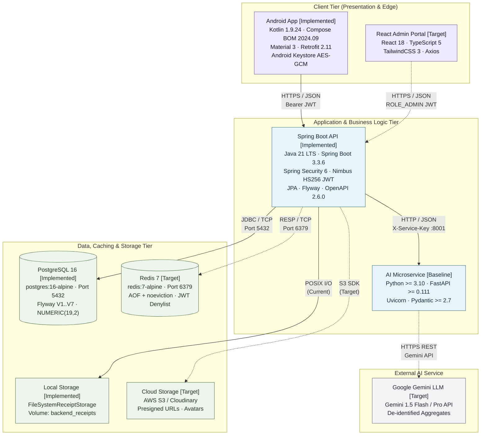

# Comprehensive Tech Stack Specification — FinSync Platform

> *Document Scope: Part B (`S4-02`) — PA4-2026 (Sprint 4) | Project: FinSync (Group 04)*  
> *Technology Coverage: Android Jetpack Compose, React Web, Spring Boot 3, Java 21, PostgreSQL 16, Redis 7, Cloud Storage, Gemini LLM (including AI Microservice & Docker Infrastructure).*

---

## 1. Purpose, Scope, and Code-to-Architecture Conformance Principles

This document provides a detailed technical specification of the **FinSync** personal finance and group expense management technology stack, covering exact versions, dependencies, architectural responsibilities, runtime configurations, communication protocols, security mechanisms, and engineering rationale.

To maintain strict **Code-to-Architecture Conformance**, every technology in this specification is categorized into one of two states:
1. **Implemented Baseline:** Technologies, versions, and components verified directly in the current repository source code (`src/backend/`, `src/mobile/android/`, `src/ai-service/`, `docker-compose.yml`).
2. **Target / Planned Architecture:** Technologies defined in the system-wide architectural design (`README.md`, `PA/PA4/PA4_Task_Assignment.md`, `PA/PA4/report.md`, `specs/`) to support cross-platform administration and cloud scaling, which are not yet merged into the active `src/` baseline on the current branch.

---

## 2. Multi-Tier Tech Stack Architecture Overview

### Summary Technology Matrix

| Subsystem / Layer | Technology & Version | Status | Primary Responsibility |
| :--- | :--- | :--- | :--- |
| **Mobile Client** | Kotlin `1.9.24`, Jetpack Compose BOM `2024.09.00`, Material 3, Retrofit `2.11.0`, Coroutines `1.8.1` | **Implemented** (`src/mobile/android`) | Native Android client for personal finance & group expense workflows |
| **Web Admin Portal** | React `18.x`, TypeScript `5.x`, TailwindCSS `3.x`, Axios | **Target Architecture** | Administrative dashboard for user moderation, default taxonomy & analytics |
| **Backend Core API** | Java `21` LTS, Spring Boot `3.3.6`, Spring Security 6, Nimbus JOSE/JWT, Spring Data JPA | **Implemented** (`src/backend`) | REST API, stateless JWT authentication, RBAC, and ACID financial logic |
| **Relational Database** | PostgreSQL `16` (`postgres:16-alpine`), Flyway Core & PostgreSQL | **Implemented** (`docker-compose.yml`, `V1..V7`) | Authoritative RDBMS for ledgers, wallets, budgets, groups, and metadata |
| **In-Memory Cache** | Redis `7` (`redis:7-alpine`, AOF + `noeviction`) | **Target Architecture** | JWT `jti` revocation denylist, session cache, and rate limiting |
| **File & Cloud Storage** | `FileSystemReceiptStorage` (Current) $\rightarrow$ AWS S3 / Cloudinary (Target) | **Current (Local) / Target (Cloud)** | Binary storage for transaction receipt attachments and user avatars |
| **AI & LLM Engine** | Python `>=3.10`, FastAPI `>=0.111.0` (Current) + Google Gemini `1.5 Flash / Pro` (Target) | **Current (FastAPI) / Target (Gemini API)** | De-identified spending analysis, anomaly detection, and budget advice |
| **Container & DevOps** | Docker, Docker Compose, Maven `3.9.9`, Gradle `8.9`, Testcontainers | **Implemented** | Multi-stage container builds, local orchestration, and integration testing |

---

## 3. Detailed Technology Specifications

### 3.1. Android Jetpack Compose (Mobile Client)

* **Implementation Status:** Implemented under `src/mobile/android/`.
* **Build & Platform Configuration (`build.gradle.kts`, `gradle-wrapper.properties`):**
  * **Language & Toolchain:** Kotlin `1.9.24`, Android Gradle Plugin `8.7.2`, Gradle `8.9`.
  * **SDK Targets:** `compileSdk = 35`, `targetSdk = 35`, `minSdk = 26` (Android 8.0+), Java/Kotlin JVM compatibility target `17`.
  * **Declarative UI Framework:** Jetpack Compose BOM `2024.09.00` (Compose Compiler Extension `1.5.14`), Material 3 (`androidx.compose.material3:material3`), `activity-compose:1.9.2`, `ui-tooling-preview`.
  * **Navigation:** `androidx.navigation:navigation-compose:2.8.0` orchestrating screen routes via `AppNavigation.kt` from the `MainActivity.kt` composition root.
  * **State Management & Concurrency:** MVVM with Unidirectional Data Flow (UDF) powered by `lifecycle-viewmodel-compose:2.8.6`, `lifecycle-runtime-ktx:2.8.6`, `kotlinx-coroutines-android:1.8.1`, `StateFlow`, and `MutableSharedFlow`.
  * **Networking & Serialization:** `Retrofit 2.11.0`, `converter-gson:2.11.0`, `Gson 2.11.0`, and `OkHttp` (configured in `ApiClient.kt` to inject `Authorization: Bearer <token>`, emit `sessionExpired` on HTTP `401` responses, upload receipts via `@Multipart`, and download attachments via `@Streaming` with `X-Receipt-Access-Token`).
  * **Environment Configuration:** `BuildConfig.API_BASE_URL` sourced from Gradle property `API_BASE_URL` (defaulting to `http://10.0.2.2:8080/api/` for the Android Emulator).
  * **Local Cryptographic Storage (`SecureTokenStore.kt`):** Access tokens are never stored in plaintext. Tokens are encrypted using `AES/GCM/NoPadding` (12-byte IV, 128-bit authentication tag) with a key generated and protected inside `AndroidKeyStore` (alias `finsync-access-token`), then persisted as Base64 in `SharedPreferences` (`MODE_PRIVATE`).
  * **Testing Stack:** `junit:4.13.2`, `androidx.test.ext:junit:1.3.0`, `espresso-core:3.7.0`, `ui-test-junit4`.
* **Architectural Rationale:** Jetpack Compose eliminates XML boilerplate, binds declaratively to reactive `StateFlow` financial snapshots, and delivers native performance alongside hardware-backed `AndroidKeyStore` security.

---

### 3.2. React Web (System Administration Portal)

* **Implementation Status:** Target Architecture (not yet present under `src/` on the current branch; specified in `README.md`, `PA/PA4/PA4_Task_Assignment.md`, and `PA/PA4/report.md`).
* **Specified Technology Stack:**
  * **Core UI Library:** **React 18** (Concurrent rendering, Hooks, Functional Components) deployed as a Single-Page Application (SPA).
  * **Language:** **TypeScript 5** for static type safety across administrative API DTOs, financial metrics tables, and configuration forms.
  * **Styling System:** **TailwindCSS 3** (utility-first styling) for responsive, maintainable data tables, moderation views, and analytics dashboards.
  * **HTTP Client:** **Axios** configured with a centralized `baseURL`, request interceptors attaching Bearer JWTs (`ROLE_ADMIN`), and response interceptors handling token expiration and forced sign-out.
* **Functional Responsibilities:**
  * **User Moderation:** Inspect registered accounts, lock/unlock compromised or policy-violating users.
  * **Default Taxonomy Governance:** Create, update, and archive global system income/expense categories (`categories`).
  * **Platform Analytics:** Monitor user growth, group activity metrics, and operational service health.
* **Security Boundary:** Communicates exclusively with Spring Boot Admin REST endpoints (`/api/v1/admin/**`) over HTTPS, enforced via Spring Security RBAC (`ROLE_ADMIN`), with zero direct access to PostgreSQL, Redis, or Gemini APIs.

---

### 3.3. Spring Boot 3 & Java 21 (Backend Core REST API)

* **Implementation Status:** Implemented under `src/backend/`.
* **Runtime & Build Configuration (`pom.xml`, `Dockerfile`):**
  * **JDK / Runtime:** **Java 21 LTS** (`<java.version>21</java.version>`), compiled via multi-stage Docker build using `maven:3.9.9-eclipse-temurin-21` and executed on `eclipse-temurin:21-jre-jammy` under a non-privileged system user (`useradd --system app`).
  * **Framework:** **Spring Boot `3.3.6`** (`spring-boot-starter-parent:3.3.6`). *(Conformance note: earlier draft notes in `report.md` Section C.2 referenced `4.1.1`, whereas `src/backend/pom.xml` pins `3.3.6` on Java 21 LTS).*
* **Core Dependencies & Modules:**
  * `spring-boot-starter-web`: Embedded Tomcat REST MVC server on port `8080` (`server.servlet.context-path: /api`), ISO-8601 date serialization (`write-dates-as-timestamps: false`).
  * `spring-boot-starter-validation`: Jakarta Bean Validation (`@Valid`, `@NotBlank`, `@Positive`) paired with `ApiExceptionHandler` for standardized error payloads (`400/401/403/404/409/422`).
  * `spring-boot-starter-security` & `spring-boot-starter-oauth2-resource-server`:
    * Enforces **Stateless** session policy (`SessionCreationPolicy.STATELESS`), disables CSRF for Bearer-token APIs, and enables `@EnableMethodSecurity`.
    * Uses **Nimbus JOSE/JWT** (`NimbusJwtEncoder` / `NimbusJwtDecoder`) signing and verifying **HMAC-SHA256 (`HS256`)** JWTs with a `JWT_SECRET` of at least 32 bytes (256 bits).
    * Hashes user passwords using **`BCryptPasswordEncoder(12)`** (cost factor 12).
  * `spring-boot-starter-data-jpa`: Hibernate ORM configured with `ddl-auto: validate` (enforcing strict Entity-to-Schema parity) and `hibernate.jdbc.time_zone: UTC`.
  * `flyway-core` & `flyway-database-postgresql`: Executes deterministic schema migrations at startup.
  * `springdoc-openapi-starter-webmvc-ui:2.6.0`: Exposes OpenAPI v3 specs (`/api/v3/api-docs`) and interactive Swagger UI (`/api/swagger-ui.html`).
  * **Testing Stack:** `spring-boot-starter-test`, `spring-security-test`, `org.testcontainers:junit-jupiter`, and `org.testcontainers:postgresql` for live PostgreSQL 16 integration verification.
* **Domain & Engineering Patterns:**
  * **Layered Architecture:** `controller` $\rightarrow$ `service` $\rightarrow$ `repository` $\rightarrow$ `entity`, complemented by `domain`, `dto`, `security`, and `config` packages.
  * **Monetary Precision (`Money.java`):** Enforces strict currency rules (`VND` scale `0`, `USD` scale `2`) with `RoundingMode.UNNECESSARY` to eliminate floating-point drift.
  * **Idempotent Financial Mutations:** `IdempotencyService` validates `Idempotency-Key` headers and request payload hashes to prevent duplicate transfers or transactions on network retries.
  * **Soft Delete & Undo:** `TransactionUndoService` supports reversible deletions via undo receipts.
  * **Transactional Concurrency:** `@Transactional` boundaries paired with database constraints and pessimistic locking (`PESSIMISTIC_WRITE`) for concurrent balance mutations.

---

### 3.4. PostgreSQL 16 (Primary Relational Database)

* **Implementation Status:** Implemented in `docker-compose.yml` and `src/backend/src/main/resources/db/migration/`.
* **Container & Connection Configuration:**
  * **Docker Image:** `postgres:16-alpine` (container `finsync-postgres`, port `5432`, backed by persistent volume `postgres_data:/var/lib/postgresql/data`).
  * **Healthcheck:** `pg_isready -U ${DB_USERNAME:-postgres} -d finsync` (`interval: 10s`, `timeout: 5s`, `retries: 5`), gating `backend` startup via `condition: service_healthy`.
  * **JDBC Driver:** `org.postgresql.Driver`.
* **Schema Evolution via Flyway Migrations (`V1` – `V7`):**
  * `V1__database_design_v1.sql`: Bootstraps core tables (`users`, `categories`, `personal_wallets`, `personal_transactions`).
  * `V2__create_wallet_transfers.sql`: Creates `wallet_transfers` with `CHECK (amount > 0)` and `CHECK (from_wallet_id <> to_wallet_id)`.
  * `V3__add_user_password_hash.sql`: Adds `password_hash` to `users`.
  * `V4__add_personal_transaction_support.sql`: Seeds default income/expense categories and adds personal transaction & receipt attachment support (`transaction_attachments`).
  * `V5__enforce_transfer_idempotency.sql`: Adds unique index `uq_wallet_transfers_request_id` for database-level idempotency enforcement.
  * `V6__create_budgets_and_notifications.sql`: Creates `budgets` (weekly/monthly caps with partial unique index `uq_budgets_active_scope` for active records) and `notifications` (80%/100% threshold alerts).
  * `V7__create_groups_and_invitations.sql`: Creates `groups`, `group_members` (`OWNER`/`MEMBER`), invitations, and group wallets.
* **ACID & Financial Integrity Safeguards:**
  * Exact decimal storage (`NUMERIC(19,2)`) preventing floating-point rounding anomalies.
  * `TIMESTAMPTZ` normalized to `UTC` for audit timestamps and `DATE` for account-timezone business dates.
  * `BIGSERIAL` primary keys, `ON DELETE RESTRICT ON UPDATE RESTRICT` foreign keys protecting financial history from accidental cascading deletes, and `version BIGINT` columns for JPA **Optimistic Locking** (`@Version`).

---

### 3.5. Redis 7 (In-Memory Cache & Security Denylist)

* **Implementation Status:** Target Architecture (specified in `PA/PA4/PA4_Task_Assignment.md` and `PA/PA4/report.md` Sections B.2, C.1, C.2, D; not yet wired into `docker-compose.yml` or `pom.xml` on the current branch).
* **Target Configuration:**
  * **Version & Image:** **`redis:7-alpine`**, listening on internal port **`6379/tcp`** within the isolated Docker bridge network `finsync-network` (not exposed publicly).
  * **Persistence & Eviction Policy:** Configured with `--appendonly yes` (AOF persistence across restarts) and `--maxmemory-policy noeviction` so security denylist entries are **never evicted** under memory pressure.
* **Architectural Roles in FinSync:**
  1. **Immediate JWT Revocation (Token Blacklist):** Upon user logout, password change, or admin account lock, the token's `jti` claim is written to Redis under key `auth:deny:access:{jti}` with a `TTL` matching the token's remaining lifetime.
  2. **Fail-Closed Security Enforcement:** During request filtering (`JwtAuthenticationFilter`), if Redis is unreachable or exceeds its timeout (~2s), protected endpoints fail closed with HTTP `503 Service Unavailable` rather than bypassing revocation checks.
  3. **Caching & Rate Limiting:** Stores short-lived rate-limiting counters (e.g., login throttling, AI request quotas) and caches read-heavy reference data such as default categories.

---

### 3.6. Cloud Storage & Receipt Attachment Storage

* **Implementation Status:** **Hybrid Evolutionary Architecture** — Private local filesystem storage (`FileSystemReceiptStorage`) is implemented in `src/backend/`, designed to transition cleanly to **Cloud Object Storage (AWS S3 / Cloudinary)** for multi-instance production deployments.
* **Implemented Baseline (Private Backend Storage):**
  * **Metadata vs. Binary Separation:** PostgreSQL (`transaction_attachments`) stores only attachment metadata (`storage_key`, `original_name`, `content_type`, `size_bytes`, `sort_order`), keeping large binary BLOBs out of the database.
  * **Physical Storage (`FileSystemReceiptStorage.java`):** Persists files under `ATTACHMENT_STORAGE_PATH` (`/var/lib/finsync/attachments` inside Docker, backed by the named volume `backend_receipts`). Enforces strict POSIX permissions (`rwx------` on directories, `rw-------` on files), rejects symbolic links (`LinkOption.NOFOLLOW_LINKS`), and validates canonical paths against Path Traversal (`resolved.startsWith(root)`). Multipart limits are capped at `10MB` per file (`11MB` per request).
  * **Scoped Access Tokens (`ReceiptAccessTokenService.java`):** Generates short-lived tokens (300-second TTL) signed with **`HmacSHA256`** bound to `(userId, transactionId, attachmentId)` and verified in constant time (`MessageDigest.isEqual`) via header `X-Receipt-Access-Token`.
* **Target Cloud Object Storage (AWS S3 / S3-Compatible / Cloudinary):**
  * **Scaling Rationale:** Local Docker volumes do not scale across horizontally replicated backend instances. Using the existing `storage_key` abstraction, binary storage migrates seamlessly to **AWS S3** (or S3-compatible object storage / **Cloudinary**).
  * **Target Flow:** Supports server-side encryption (SSE-S3 / KMS), strict MIME allowlisting (`image/jpeg`, `image/png`, `application/pdf`), and short-lived **Presigned URLs** for receipt attachments and user profile avatars.

---

### 3.7. Gemini LLM & AI Microservice (Intelligent Financial Advisor)

* **Implementation Status:** Internal **AI Microservice (FastAPI)** scaffold is implemented in `src/ai-service/`; live **Google Gemini LLM API** invocation is Target Architecture (currently `main.py` returns deterministic `source="BASIC"` responses as a safe baseline/fallback).
* **Implemented AI Microservice (`src/ai-service/`):**
  * **Runtime & Dependencies:** Python `>=3.10`, **FastAPI `>=0.111.0`**, **Uvicorn (`[standard]>=0.30.0`)**, and **Pydantic `>=2.7.0`** (`pytest >= 8.0.0`, `httpx >= 0.27.0` for testing).
  * **Container & Isolation:** Container `finsync-ai-service` on port `8001` inside `finsync-network`.
  * **Internal Service Contract:** Exposes `GET /health` and `POST /api/v1/analyze`, protected by internal shared-secret header `X-Service-Key` (`FINSYNC_SERVICE_KEY`). Mobile and web clients **never** call the AI service or Gemini API directly; all requests are brokered by the Spring Boot backend.
* **Target Google Gemini LLM Integration:**
  * **Model Selection:** **Google Gemini 1.5 Flash** (low-latency categorization and monthly summaries) and **Gemini 1.5 Pro** (deep anomaly detection and personalized budget optimization).
  * **Privacy-Preserving Data Boundary:** Before crossing from Spring Boot to `ai-service` and Gemini API, payloads strip all direct PII (emails, names, phone numbers), raw user notes, and receipt images—transmitting only **de-identified financial aggregates** (category totals, currency code, budget utilization ratios, and month-over-month deltas).
  * **Timeout & Graceful Degradation:** Enforces strict outbound HTTP timeouts; if Gemini API returns errors, hits rate/quota limits, or times out, the service degrades gracefully to its local rule-based baseline (`source="BASIC"`).

---

## 4. Packaging, Orchestration, and Engineering Tooling

| Concern | Tool / Standard | Verified Configuration |
| :--- | :--- | :--- |
| **Containerization** | Docker & Docker Compose v2 | `docker-compose.yml` orchestrates `postgres`, `backend`, and `ai-service` on bridge network `finsync-network` with persistent volumes `postgres_data` and `backend_receipts`. |
| **Backend Build** | Apache Maven `3.9.9` | Multi-stage `Dockerfile` separates JDK 21 compilation from the `eclipse-temurin:21-jre-jammy` runtime image to minimize attack surface and image size. |
| **Mobile Build** | Gradle `8.9` (Kotlin DSL) | Centralized `build.gradle.kts` and `gradle.properties` supporting `API_BASE_URL` overrides between Emulator (`10.0.2.2`) and physical LAN devices. |
| **API Documentation** | SpringDoc OpenAPI `2.6.0` | Auto-generates OpenAPI v3 JSON (`/api/v3/api-docs`) and Swagger UI (`/api/swagger-ui.html`). |
| **Secrets Management** | Environment Variables (`.env`) | Sensitive credentials (`JWT_SECRET`, `DB_PASSWORD`, `FINSYNC_SERVICE_KEY`, `GEMINI_API_KEY`) are injected exclusively via runtime environment variables and excluded from Git. |
| **Specification & QA** | Spec Kit (SDD), Testcontainers, JUnit, Pytest | OpenAPI contracts (`specs/`), real-PostgreSQL Testcontainers suites, FastAPI unit tests, and Postman E2E collections. |

---

## 5. Documentation-to-Code Synchronization Audit Matrix

The table below tracks discrepancies observed between earlier PA4 draft notes and the verified repository codebase so all team deliverables remain synchronized:

| Technology | Earlier PA4 Draft Reference | Verified Codebase Reality | Synchronization Action |
| :--- | :--- | :--- | :--- |
| **Spring Boot** | `PA/PA4/report.md` Section C.2 referenced `4.1.1` | `src/backend/pom.xml` pins **`3.3.6`** (Spring Boot 3) | Standardize all PA4 architecture sections on **Spring Boot 3.3.6**. |
| **Android Compose** | `PA/PA4/report.md` Section B.2 listed SDK 34 / Compose 1.6 | `app/build.gradle.kts` uses **`compileSdk 35`**, Compose BOM **`2024.09.00`**, Kotlin **`1.9.24`** | Align PA4 tables with `app/build.gradle.kts` (`SDK 35`, BOM `2024.09.00`). |
| **React Web & Redis 7** | Listed in system overview & PA4 task breakdown | No `src/admin-web` directory or `redis` service in `docker-compose.yml` on this branch | Explicitly label as **Target Architecture / Planned Extension** until merged. |
| **Cloud Storage & Gemini LLM** | Listed in C4 Level 1 Context & Tech Stack | Implemented via `FileSystemReceiptStorage` (local volume) and FastAPI `source="BASIC"` | Document the clean abstraction (`storage_key`, `ai-service` boundary) enabling zero-schema-change migration to **S3/Cloudinary** and **Gemini API**. |
