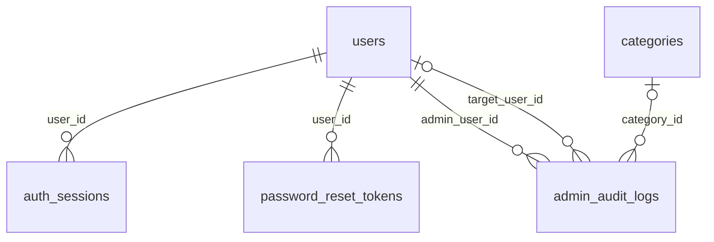
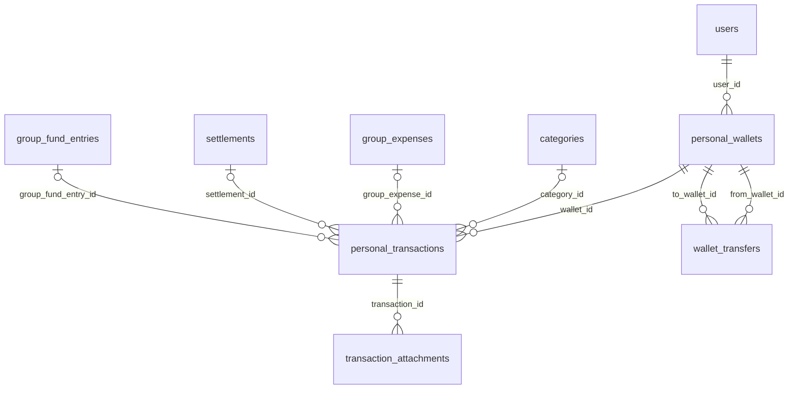
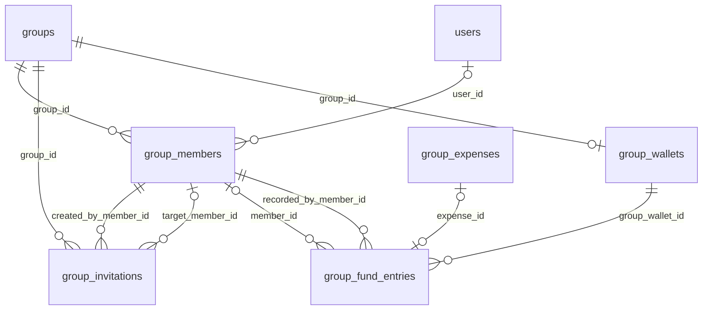
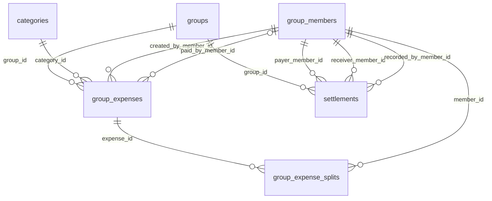
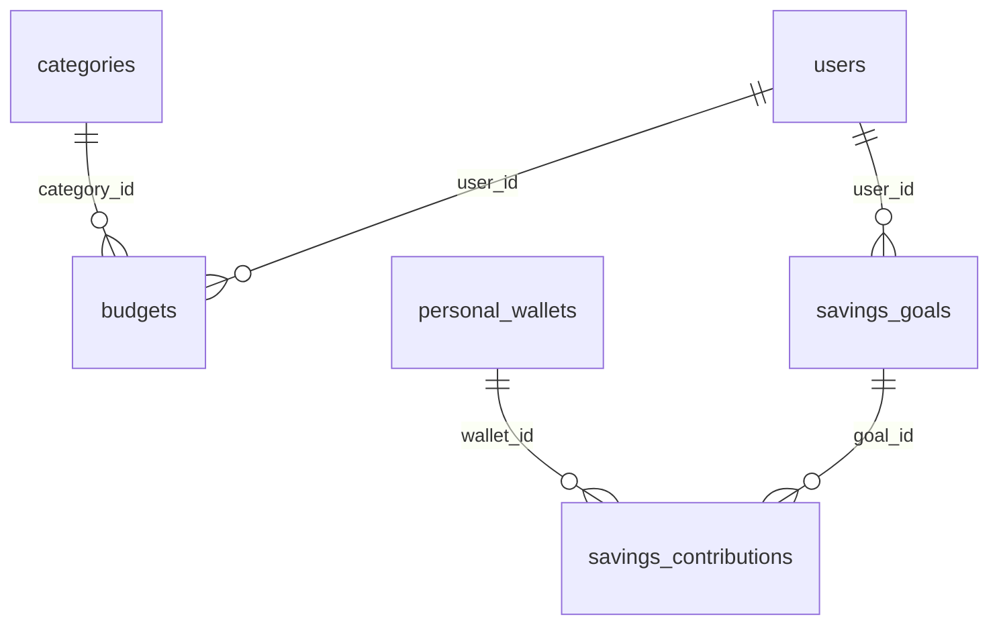
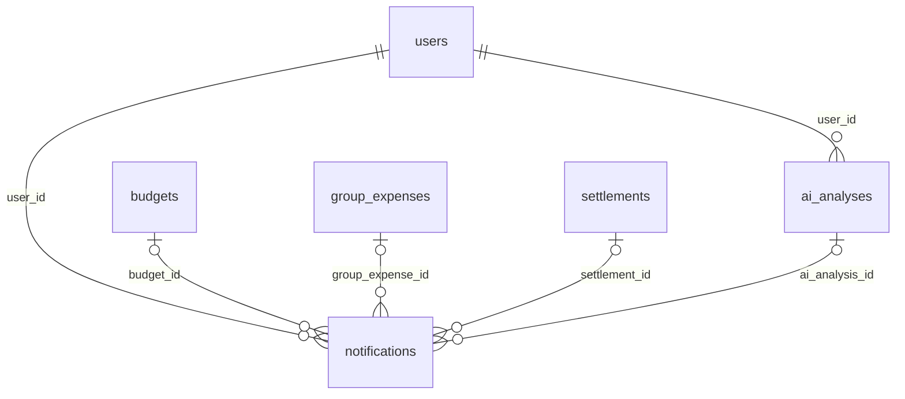

# FinSync — Thiết kế cơ sở dữ liệu v1.0 (Final)

**Mục đích:** Tài liệu bàn giao để tạo entity Spring Boot/JPA, viết Flyway migration và thống nhất hợp đồng dữ liệu. **22 bảng**, mô hình quan hệ PostgreSQL, tài liệu tiếng Việt. Đây là bản thiết kế final v1.0 theo yêu cầu; không có nghĩa database/entity đã được triển khai hoặc nhóm đã kiểm thử và phê duyệt.


**Cách đọc:** Mục 1 chốt phạm vi; mục 2 định nghĩa cột chung; mục 3 là toàn bộ field của 22 bảng; mục 4–5 chốt quy tắc nghiệp vụ; mục 6 hướng dẫn JPA/migration; mục 7 gồm 6 ERD theo tính năng. Khi triển khai, mỗi bảng có **các cột chung ở mục 2 + các cột riêng ở mục 3**.

## 1. Các quyết định triển khai v1.0


Các điểm còn mở ở bản nháp được chốt dưới đây để backend có thể triển khai; thay đổi sau này cần phiên bản thiết kế/migration mới.

| Nội dung | Quyết định |
|---|---|
| Phạm vi | Giữ 10 nhóm chức năng, AI Financial Advisor và admin web dùng chung database. Không thêm bảng riêng cho dashboard, biểu đồ hay kết quả tối ưu nợ. |
| Người ứng tiền | Một người trả toàn bộ hóa đơn, hoặc trả hoàn toàn từ quỹ chung. Không trộn nguồn; không hỗ trợ nhiều người ứng cùng một hóa đơn ở v1.0. |
| Thành viên chưa có tài khoản | Cho phép nhập tên như FE. Không có quyền truy cập; Owner gửi lời mời riêng để người đó đăng nhập và gắn tài khoản vào ID thành viên có sẵn. |
| Vai trò nhóm | Đúng một Owner có tài khoản. Member có tài khoản được ghi chi nhóm; chỉ Owner quản lý thành viên, lời mời, vai trò và quỹ. |
| Tiền tệ | VND và USD; không quy đổi. VND không có phần lẻ, USD tối đa 2 chữ số. Tổng tài sản/báo cáo tách theo tiền tệ; tiền tệ mặc định chỉ chọn cách lọc/hiển thị. |
| Ngân sách | Tính chi cá nhân, không cộng phần chi nhóm. Kỳ tuần/tháng rõ ngày đầu/cuối; cảnh báo 80% và 100%. |
| Tiết kiệm | Dành riêng tiền còn nằm trong ví; không tạo thu/chi. Tiến độ là tổng ALLOCATE trừ RELEASE. |
| Quỹ chung | Quỹ ghi sổ, không phải tài khoản ngân hàng thật. Owner quyết định hoàn quỹ cho thành viên, tối đa số dư quỹ; không tự suy ra quyền sở hữu quỹ theo tỷ lệ góp. |
| Trả nợ | Ghi nhận ngoài app; cho trả một phần. Người trả, người nhận hoặc Owner xác nhận ghi sổ; không có bước người nhận duyệt riêng. |
| Cá nhân và nhóm | Không tự ghi vào ví cá nhân. Bổ sung scope GROUP_MOVEMENT và FK nguồn để người dùng chủ động ghi dòng tiền nhóm mà không tính trùng chi tiêu; xem mục 4.3. |
| Danh mục | Danh mục hệ thống do admin quản lý; chưa có danh mục riêng do người dùng tạo. |
| Lịch sử | Không xóa cứng dữ liệu tài chính. Cá nhân được sửa/xóa mềm và Undo 7 giây; hóa đơn nhóm, trả nợ, chuyển ví, bút toán quỹ và tiết kiệm là sổ chỉ thêm trong v1.0. Không có API sửa/hủy khoản nhóm đã xác nhận. |
| AI | Một kết quả/người dùng/tháng kế hoạch, một tiền tệ phân tích; tái sinh cập nhật cùng dòng. Giữ lịch sử theo tháng và nhật ký áp dụng; chưa lưu mọi bản sinh cũ, không có chatbot hội thoại. |

## 2. Quy ước cột, kiểu dữ liệu và khóa


**Bốn cột sau tồn tại vật lý trong tất cả 22 bảng**, không chỉ là mô tả:

| Field chung | PostgreSQL | NULL | Ý nghĩa / mặc định |
|---|---|---|---|
| id | uuid | Không | PK; backend sinh UUID trước INSERT; không dựa vào ID demo FE. |
| created_at | timestamptz | Không | Thời điểm tạo; DEFAULT now(), không sửa. |
| updated_at | timestamptz | Không | DEFAULT now() khi tạo; backend cập nhật khi thay đổi. |
| version | bigint | Không | DEFAULT 0; Hibernate quản lý bằng @Version. |

- Bảng chỉ thêm vẫn có bốn cột trên cho thống nhất; updated_at thường bằng created_at, version giữ 0. Không dùng version như thời gian.
- Trong bảng field, **NULL = Có** nghĩa là được bỏ trống, mặc định NULL. Nếu không ghi DEFAULT thì backend phải cung cấp giá trị; chuỗi bắt buộc không được trắng sau trim.
- Tên bảng/cột snake_case; tên entity/property PascalCase/camelCase. Tiền dùng **BigDecimal ↔ numeric(19,2)**; UUID ↔ UUID; date ↔ LocalDate; timestamptz ↔ Instant; bigint ↔ Long; jsonb ↔ JsonNode/DTO JSON.
- Giá trị enum lưu varchar với CHECK danh sách, Java dùng EnumType.STRING. Không dùng ordinal hay PostgreSQL enum để tránh phụ thuộc thứ tự và giảm khó khăn migration.
- Tất cả cột currency_code/default_currency có CHECK IN ('VND','USD'). Backend từ chối phần lẻ VND, quá 2 chữ số USD và số vượt precision **trước khi PostgreSQL làm tròn khi ép kiểu**. Trường hợp tiền tệ nằm ở bảng cha được kiểm tra tại service.
- Ngày nghiệp vụ là ngày người dùng nhập; thời điểm tạo/sửa dùng UTC. Phân tích tháng và giới hạn hằng ngày theo users.time_zone. Backend kiểm tra múi giờ hợp lệ.
- Mọi FK dùng **ON DELETE RESTRICT, ON UPDATE RESTRICT**; không cascade xóa sổ. Quan hệ N:1 có thể có 0..N dòng con, trừ ràng buộc nghiệp vụ yêu cầu tối thiểu. Cột FK có UNIQUE là quan hệ tối đa 1:1.
- Tạo index B-tree cho mỗi FK, trừ khi đã có PK/UNIQUE/index khác bắt đầu bằng chính cột đó. Các index tổ hợp thêm được nêu dưới từng bảng; không tạo index trùng.
- CHECK chỉ kiểm tra nội bộ dòng; FK kiểm tra tồn tại, không tự bảo đảm cùng chủ/cùng nhóm. Các ràng buộc nhiều dòng phải được service kiểm tra trong transaction với khóa quy định ở mục 4; không viết CHECK chứa truy vấn tổng bảng khác. [Tham khảo PostgreSQL](https://www.postgresql.org/docs/current/ddl-constraints.html).
- request_id/request_hash là field vật lý ở các bảng ghi sổ có nêu: UNIQUE request_id chống lặp, request_hash giữ hash yêu cầu **tạo ban đầu**, không thay theo các lần sửa. Cùng mã/cùng nội dung trả kết quả cũ; khác nội dung trả conflict. Luôn kiểm tra chủ sở hữu trước khi trả bản ghi cũ; không dùng hash như cơ chế phân quyền.

## 3. Từ điển dữ liệu — 22 bảng


Mỗi phần liệt kê entity, toàn bộ cột riêng, FK và quan hệ. Các ràng buộc được ghi rõ là CHECK/UNIQUE/index để đưa vào Flyway; các điều kiện ghi “service” thuộc lớp nghiệp vụ.

### 3.1. `users` → `User`


Tài khoản, hồ sơ và phân quyền hệ thống. Bao gồm 4 cột chung ở mục 2.

| Field | PostgreSQL | NULL | Chức năng / liên kết / mặc định |
|---|---|---|---|
| email | varchar(254) | Không | Email đăng nhập chuẩn hóa lowercase/trim; UNIQUE. |
| password_hash | varchar(255) | Không | Mật khẩu băm BCrypt; không lưu mật khẩu gốc. |
| display_name | varchar(100) | Không | Tên hiển thị, không rỗng. |
| phone_number | varchar(30) | Có | Số điện thoại tùy chọn; không dùng làm khóa định danh. |
| avatar_key | varchar(512) | Có | Khóa tệp ảnh trong kho lưu trữ; không lưu URL ký tạm. |
| default_currency | varchar(3) | Không | VND hoặc USD; mặc định VND. |
| time_zone | varchar(64) | Không | Múi giờ IANA; mặc định Asia/Ho_Chi_Minh. |
| role | varchar(16) | Không | USER hoặc ADMIN; mặc định USER. |
| status | varchar(16) | Không | ACTIVE hoặc LOCKED; mặc định ACTIVE. |
| locked_at | timestamptz | Có | Thời điểm khóa. |
| lock_reason | varchar(500) | Có | Lý do khóa; chỉ admin xem. |

**Ràng buộc và index:** CHECK trạng thái ACTIVE có locked_at/lock_reason NULL; LOCKED có đủ hai trường. Vai trò admin không tự cấp quyền đọc sổ cá nhân. Đăng ký tự phục vụ luôn tạo USER. Index (status, created_at); UNIQUE(email).

### 3.2. `auth_sessions` → `AuthSession`


Phiên đăng nhập và refresh token. Bao gồm 4 cột chung ở mục 2.

| Field | PostgreSQL | NULL | Chức năng / liên kết / mặc định |
|---|---|---|---|
| user_id | uuid | Không | FK → users.id; AuthSession.user, N:1. |
| refresh_token_hash | varchar(64) | Không | SHA-256 của token ngẫu nhiên entropy cao; UNIQUE. |
| client_type | varchar(16) | Không | MOBILE hoặc ADMIN_WEB. |
| device_label | varchar(200) | Có | Nhãn thiết bị hiển thị trong quản lý phiên. |
| expires_at | timestamptz | Không | Hết hạn refresh token; TTL do cấu hình. |
| last_used_at | timestamptz | Có | Lần refresh gần nhất. |
| revoked_at | timestamptz | Có | Có giá trị nghĩa là phiên đã bị thu hồi. |

**Ràng buộc và index:** CHECK expires_at > created_at. Index (user_id, revoked_at), (expires_at). Access token là JWT chứa sub=user_id, sid=id và jti duy nhất; không lưu access token nguyên văn. Refresh token là chuỗi ngẫu nhiên, chỉ lưu hash; xoay hash trong transaction và kiểm tra version để token cũ không refresh được lần nữa. Logout/khóa tài khoản thu hồi phiên; API kiểm tra trạng thái tài khoản, phiên và blacklist Redis theo mục 5.3.

### 3.3. `password_reset_tokens` → `PasswordResetToken`


Token khôi phục mật khẩu dùng một lần. Bao gồm 4 cột chung ở mục 2.

| Field | PostgreSQL | NULL | Chức năng / liên kết / mặc định |
|---|---|---|---|
| user_id | uuid | Không | FK → users.id; PasswordResetToken.user, N:1. |
| token_hash | varchar(64) | Không | Hash token ngẫu nhiên; UNIQUE. |
| expires_at | timestamptz | Không | Hạn dùng. |
| consumed_at | timestamptz | Có | Thời điểm dùng; NULL khi chưa dùng. |
| revoked_at | timestamptz | Có | Thu hồi token chưa dùng. |

**Ràng buộc và index:** CHECK expires_at > created_at. Index (user_id), (expires_at). Khóa dòng token khi đổi mật khẩu; chỉ dùng khi chưa consumed/revoked và chưa hết hạn. Cập nhật password và consumed_at cùng transaction, thu hồi các reset token còn lại cùng các phiên sau reset. Đổi mật khẩu khi đã đăng nhập giữ phiên theo đặc tả; reset là luồng khôi phục riêng.

### 3.4. `categories` → `Category`


Danh mục thu/chi chung do admin quản lý. Bao gồm 4 cột chung ở mục 2.

| Field | PostgreSQL | NULL | Chức năng / liên kết / mặc định |
|---|---|---|---|
| name | varchar(100) | Không | Tên danh mục không rỗng. |
| type | varchar(16) | Không | INCOME hoặc EXPENSE. |
| icon_key | varchar(50) | Không | Mã biểu tượng FE; mặc định category. |
| color_key | varchar(30) | Không | Mã màu FE; mặc định violet. |
| archived_at | timestamptz | Có | Lưu trữ danh mục thay vì xóa lịch sử. |

**Ràng buộc và index:** UNIQUE INDEX (type, lower(name)). Không đổi type khi đã có tham chiếu. Danh mục lưu trữ vẫn hiển thị ở giao dịch cũ; không dùng cho giao dịch/ngân sách mới. V1 không có danh mục riêng theo người dùng.

### 3.5. `personal_wallets` → `PersonalWallet`


Ví ghi sổ riêng của người dùng. Bao gồm 4 cột chung ở mục 2.

| Field | PostgreSQL | NULL | Chức năng / liên kết / mặc định |
|---|---|---|---|
| user_id | uuid | Không | FK → users.id; PersonalWallet.user, N:1. |
| name | varchar(100) | Không | Tên ví không rỗng. |
| type | varchar(20) | Không | CASH, BANK, CREDIT_CARD, E_WALLET. |
| currency_code | varchar(3) | Không | VND hoặc USD. |
| opening_balance | numeric(19,2) | Không | Số dư ban đầu có dấu; mặc định 0. |
| color_key | varchar(30) | Không | Mã màu; mặc định violet. |
| archived_at | timestamptz | Có | Lưu trữ/khôi phục ví. |

**Ràng buộc và index:** CHECK opening_balance >= 0 OR type = 'CREDIT_CARD'. Index (user_id, archived_at). Không lưu current_balance hay debt: tính số dư từ ledger, nợ thẻ là số âm. Currency bất biến khi có giao dịch/chuyển ví/tiết kiệm. Không đổi chủ ví; sửa số dư ban đầu phải khóa ví, tính lại số dư và kiểm tra tiền dành cho mục tiêu.

### 3.6. `personal_transactions` → `PersonalTransaction`


Thu/chi cá nhân và ghi sổ tùy chọn cho tiền di chuyển liên quan nhóm. Bao gồm 4 cột chung ở mục 2.

| Field | PostgreSQL | NULL | Chức năng / liên kết / mặc định |
|---|---|---|---|
| wallet_id | uuid | Không | FK → personal_wallets.id; PersonalTransaction.wallet, N:1. |
| category_id | uuid | Có | FK → categories.id; PersonalTransaction.category, N:1. Bắt buộc cho PERSONAL. |
| type | varchar(16) | Không | INCOME hoặc EXPENSE; biểu thị tiền vào/ra ví. |
| scope | varchar(20) | Không | PERSONAL hoặc GROUP_MOVEMENT; mặc định PERSONAL. |
| amount | numeric(19,2) | Không | Số tiền > 0. |
| transaction_date | date | Không | Ngày nghiệp vụ theo người dùng. |
| title | varchar(200) | Không | Tiêu đề hiển thị; backend có thể tạo từ danh mục khi FE không nhập. |
| note | varchar(2000) | Có | Ghi chú. |
| group_expense_id | uuid | Có | FK → group_expenses.id; PersonalTransaction.groupExpense, N:1. |
| settlement_id | uuid | Có | FK → settlements.id; PersonalTransaction.settlement, N:1. |
| group_fund_entry_id | uuid | Có | FK → group_fund_entries.id; PersonalTransaction.groupFundEntry, N:1. |
| deleted_at | timestamptz | Có | Xóa mềm. |
| undo_expires_at | timestamptz | Có | Hết hạn hoàn tác; đặt deleted_at + 7 giây. |
| request_id | uuid | Không | Mã chống lặp yêu cầu tạo; UNIQUE. |
| request_hash | varchar(64) | Không | Hash payload tạo chuẩn hóa để nhận biết dùng lại mã với nội dung khác. |

**Ràng buộc và index:** CHECK PERSONAL: category_id NOT NULL và cả 3 FK nhóm NULL. CHECK GROUP_MOVEMENT: category_id NULL và đúng 1 trong 3 FK nhóm khác NULL. CHECK hai trường xóa cùng NULL hoặc cùng có giá trị, undo_expires_at > deleted_at. Index (wallet_id, transaction_date DESC), (category_id, transaction_date) WHERE deleted_at IS NULL. Mỗi nguồn nhóm chỉ một dòng còn hiệu lực cho một user: service khóa nguồn và kiểm tra qua wallet.user (không thể bảo đảm bằng UNIQUE(wallet_id, source_id) vì user có nhiều ví). Chi tiết mục 4.

### 3.7. `transaction_attachments` → `TransactionAttachment`


Tham chiếu ảnh hóa đơn, không lưu nhị phân vào database. Bao gồm 4 cột chung ở mục 2.

| Field | PostgreSQL | NULL | Chức năng / liên kết / mặc định |
|---|---|---|---|
| transaction_id | uuid | Không | FK → personal_transactions.id; TransactionAttachment.transaction, N:1. |
| storage_key | varchar(512) | Không | Khóa tệp trong kho lưu trữ riêng; UNIQUE. |
| original_name | varchar(255) | Không | Tên tệp ban đầu. |
| content_type | varchar(100) | Không | MIME đã được server kiểm tra. |
| size_bytes | bigint | Không | Dung lượng > 0. |
| sort_order | integer | Không | Thứ tự ảnh >= 0; mặc định 0. |

**Ràng buộc và index:** UNIQUE(transaction_id, sort_order). Ảnh kế thừa quyền từ giao dịch/ví; URL tải có thời hạn được sinh khi đọc. Xóa mềm giao dịch không xóa ảnh để Undo dùng lại. Không suy ra hỗ trợ upload từ source FE: đây là phần giữ từ thiết kế đồ án.

### 3.8. `wallet_transfers` → `WalletTransfer`


Chuyển tiền nội bộ giữa hai ví cùng chủ và tiền tệ. Bao gồm 4 cột chung ở mục 2.

| Field | PostgreSQL | NULL | Chức năng / liên kết / mặc định |
|---|---|---|---|
| from_wallet_id | uuid | Không | FK → personal_wallets.id; WalletTransfer.fromWallet, N:1. |
| to_wallet_id | uuid | Không | FK → personal_wallets.id; WalletTransfer.toWallet, N:1. |
| amount | numeric(19,2) | Không | Số tiền > 0. |
| transfer_date | date | Không | Ngày chuyển ghi sổ. |
| note | varchar(2000) | Có | Ghi chú. |
| request_id | uuid | Không | Mã chống ghi trùng; UNIQUE. |
| request_hash | varchar(64) | Không | Hash payload tạo. |

**Ràng buộc và index:** CHECK from_wallet_id <> to_wallet_id. Index (from_wallet_id, transfer_date), (to_wallet_id, transfer_date). Service kiểm tra cùng chủ/currency, hai ví active và số dư khả dụng nguồn. V1 chỉ tạo/xem lịch sử, không sửa/xóa; hủy ở màn hình review không ghi dòng.

### 3.9. `groups` → `ExpenseGroup`


Thông tin nhóm chi tiêu; entity tránh tên Group dễ nhầm. Bao gồm 4 cột chung ở mục 2.

| Field | PostgreSQL | NULL | Chức năng / liên kết / mặc định |
|---|---|---|---|
| name | varchar(100) | Không | Tên nhóm không rỗng. |
| description | varchar(1000) | Có | Mô tả. |
| currency_code | varchar(3) | Không | VND hoặc USD; cố định sau khi nhóm phát sinh tài chính. |
| archived_at | timestamptz | Có | Nhóm lưu trữ chỉ đọc. |

**Ràng buộc và index:** Tạo groups + group_members OWNER + group_wallets trong một transaction. Không thêm owner_user_id để tránh hai nguồn lưu chủ nhóm. Không bắt buộc đủ 2 người ngay lúc tạo; cần ít nhất 1 thành viên cho hóa đơn. Archive không xóa công nợ/lịch sử.

### 3.10. `group_members` → `GroupMember`


Bảng liên kết nhóm–người dùng, hỗ trợ người chỉ có tên. Bao gồm 4 cột chung ở mục 2.

| Field | PostgreSQL | NULL | Chức năng / liên kết / mặc định |
|---|---|---|---|
| group_id | uuid | Không | FK → groups.id; GroupMember.group, N:1. |
| user_id | uuid | Có | FK → users.id; GroupMember.user, N:1; NULL là thành viên chưa liên kết tài khoản. |
| display_name | varchar(100) | Không | Tên hiển thị trong nhóm; không dùng tên làm khóa tài khoản. |
| role | varchar(16) | Không | OWNER hoặc MEMBER; mặc định MEMBER. |
| status | varchar(16) | Không | ACTIVE hoặc LEFT; mặc định ACTIVE. |
| member_order | integer | Không | Thứ tự >= 0, ổn định trong nhóm. |
| joined_at | timestamptz | Không | Thời điểm thêm vào nhóm; mặc định now(). |
| left_at | timestamptz | Có | Thời điểm rời nhóm. |

**Ràng buộc và index:** UNIQUE(group_id, user_id), UNIQUE(group_id, member_order). PostgreSQL cho nhiều user_id NULL; không unique tên. CHECK OWNER phải có user_id và ACTIVE; CHECK LEFT ↔ left_at NOT NULL. Partial UNIQUE(group_id) WHERE role='OWNER' AND status='ACTIVE' bảo đảm tối đa một Owner; service bảo đảm luôn có một Owner, khóa groups khi đổi vai trò. Không xóa dòng đã có tài chính; tái tham gia dùng lại ID.

### 3.11. `group_invitations` → `GroupInvitation`


Lời mời có thời hạn; có thể dành riêng cho thành viên chưa có tài khoản. Bao gồm 4 cột chung ở mục 2.

| Field | PostgreSQL | NULL | Chức năng / liên kết / mặc định |
|---|---|---|---|
| group_id | uuid | Không | FK → groups.id; GroupInvitation.group, N:1. |
| created_by_member_id | uuid | Không | FK → group_members.id; GroupInvitation.createdByMember, N:1. |
| target_member_id | uuid | Có | FK → group_members.id; GroupInvitation.targetMember, N:1; NULL là lời mời tham gia mới. |
| token_hash | varchar(64) | Không | Hash token ngẫu nhiên gửi trong link/code; UNIQUE. |
| expires_at | timestamptz | Không | Hạn dùng. |
| max_uses | integer | Không | Số lượt tối đa > 0; mặc định 1. |
| use_count | integer | Không | Số lượt đã dùng; mặc định 0. |
| revoked_at | timestamptz | Có | Thu hồi lời mời. |

**Ràng buộc và index:** CHECK 0 <= use_count <= max_uses, expires_at > created_at; target_member_id có giá trị thì max_uses=1. Index (group_id), (created_by_member_id), (target_member_id). Owner tạo/thu hồi; người nhận phải đăng nhập. Lời mời chỉ định gắn user vào đúng ID guest; lời mời thường tạo/rejoin thành viên. Khóa nhóm và lời mời để không vượt lượt hay gắn một guest cho hai tài khoản.

### 3.12. `group_wallets` → `GroupWallet`


Một quỹ chung cho mỗi nhóm. Bao gồm 4 cột chung ở mục 2.

| Field | PostgreSQL | NULL | Chức năng / liên kết / mặc định |
|---|---|---|---|
| group_id | uuid | Không | FK → groups.id, UNIQUE; GroupWallet.group, 1:1. |
| name | varchar(100) | Không | Tên ví chung; mặc định Quỹ chung. |

**Ràng buộc và index:** Currency kế thừa groups, số dư ban đầu 0; số dư tính từ group_fund_entries. UNIQUE FK chỉ bảo đảm mỗi nhóm tối đa một ví; service tạo ví cùng nhóm để bảo đảm đúng một. Không có chủ cá nhân và không gắn personal_wallets.

### 3.13. `group_fund_entries` → `GroupFundEntry`


Góp quỹ, hoàn quỹ hoặc chi quỹ; sổ chỉ thêm. Bao gồm 4 cột chung ở mục 2.

| Field | PostgreSQL | NULL | Chức năng / liên kết / mặc định |
|---|---|---|---|
| group_wallet_id | uuid | Không | FK → group_wallets.id; GroupFundEntry.groupWallet, N:1. |
| member_id | uuid | Có | FK → group_members.id; GroupFundEntry.member, N:1; người góp/nhận hoàn. |
| expense_id | uuid | Có | FK → group_expenses.id, UNIQUE; GroupFundEntry.expense, 0..1:0..1. |
| recorded_by_member_id | uuid | Không | FK → group_members.id; GroupFundEntry.recordedByMember, N:1. |
| type | varchar(16) | Không | CONTRIBUTION, REFUND hoặc EXPENSE. |
| amount | numeric(19,2) | Không | Số tiền > 0. |
| entry_date | date | Không | Ngày nghiệp vụ. |
| note | varchar(2000) | Có | Nội dung ghi sổ. |
| request_id | uuid | Không | Mã chống ghi trùng; UNIQUE. |
| request_hash | varchar(64) | Không | Hash payload tạo. |

**Ràng buộc và index:** CHECK CONTRIBUTION/REFUND: member_id NOT NULL và expense_id NULL; EXPENSE: member_id NULL và expense_id NOT NULL. Index (group_wallet_id, entry_date), (member_id), (recorded_by_member_id). Service kiểm tra cùng nhóm; khoản EXPENSE phải khớp số tiền/ngày của hóa đơn GROUP_FUND. Một hóa đơn trả quỹ và bút toán tương ứng được tạo nguyên tử.

### 3.14. `group_expenses` → `GroupExpense`


Hóa đơn nhóm, một người ứng tiền hoặc trả hoàn toàn bằng quỹ. Bao gồm 4 cột chung ở mục 2.

| Field | PostgreSQL | NULL | Chức năng / liên kết / mặc định |
|---|---|---|---|
| group_id | uuid | Không | FK → groups.id; GroupExpense.group, N:1. |
| category_id | uuid | Không | FK → categories.id; GroupExpense.category, N:1; danh mục EXPENSE. |
| created_by_member_id | uuid | Không | FK → group_members.id; GroupExpense.createdByMember, N:1. |
| paid_by_member_id | uuid | Có | FK → group_members.id; GroupExpense.paidByMember, N:1. |
| title | varchar(200) | Không | Tiêu đề không rỗng. |
| note | varchar(2000) | Có | Ghi chú. |
| amount | numeric(19,2) | Không | Số tiền > 0. |
| expense_date | date | Không | Ngày chi tiêu. |
| funding_source | varchar(16) | Không | MEMBERS hoặc GROUP_FUND. |
| split_mode | varchar(16) | Không | EQUAL, EXACT, PERCENTAGE hoặc SHARES. |
| request_id | uuid | Không | Mã chống ghi trùng; UNIQUE. |
| request_hash | varchar(64) | Không | Hash toàn payload tạo, gồm phần chia. |

**Ràng buộc và index:** CHECK MEMBERS ↔ paid_by_member_id NOT NULL; GROUP_FUND ↔ paid_by_member_id NULL. Index (group_id, expense_date DESC), (category_id), (created_by_member_id), (paid_by_member_id). Sổ nhóm V1 chỉ tạo/xem, không sửa/xóa hóa đơn đã ghi; tránh thay đổi công nợ sau settlement. Không lưu bảng group_expense_payments.

### 3.15. `group_expense_splits` → `GroupExpenseSplit`


Phần chi phí và đầu vào chia tiền của từng thành viên. Bao gồm 4 cột chung ở mục 2.

| Field | PostgreSQL | NULL | Chức năng / liên kết / mặc định |
|---|---|---|---|
| expense_id | uuid | Không | FK → group_expenses.id; GroupExpenseSplit.expense, N:1. |
| member_id | uuid | Không | FK → group_members.id; GroupExpenseSplit.member, N:1. |
| amount | numeric(19,2) | Không | Phần chịu chi phí cuối cùng >= 0. |
| input_value | numeric(19,2) | Có | EQUAL: NULL; EXACT: số tiền; PERCENTAGE: phần trăm; SHARES: trọng số. |
| split_order | integer | Không | Thứ tự >= 0 để xử lý phần dư bằng nhau. |

**Ràng buộc và index:** UNIQUE(expense_id, member_id), UNIQUE(expense_id, split_order); index (member_id). CHECK input_value IS NULL OR input_value >= 0. Service kiểm tra input theo split_mode của hóa đơn và tổng amount bằng hóa đơn; phải có ít nhất một dòng chia. Không dùng CHECK truy vấn bảng cha hay tổng nhiều dòng.

### 3.16. `settlements` → `Settlement`


Ghi nhận tiền trả nợ thực hiện ngoài ứng dụng. Bao gồm 4 cột chung ở mục 2.

| Field | PostgreSQL | NULL | Chức năng / liên kết / mặc định |
|---|---|---|---|
| group_id | uuid | Không | FK → groups.id; Settlement.group, N:1. |
| payer_member_id | uuid | Không | FK → group_members.id; Settlement.payerMember, N:1. |
| receiver_member_id | uuid | Không | FK → group_members.id; Settlement.receiverMember, N:1. |
| recorded_by_member_id | uuid | Không | FK → group_members.id; Settlement.recordedByMember, N:1. |
| amount | numeric(19,2) | Không | Số tiền > 0, tối đa nợ còn lại của cặp. |
| settlement_date | date | Không | Ngày thực tế trả nợ. |
| note | varchar(2000) | Có | Ghi chú. |
| status | varchar(16) | Không | V1 chỉ CONFIRMED; mặc định CONFIRMED. |
| request_id | uuid | Không | Mã chống ghi trùng; UNIQUE. |
| request_hash | varchar(64) | Không | Hash payload tạo. |

**Ràng buộc và index:** CHECK payer_member_id <> receiver_member_id và status='CONFIRMED'. Index (group_id, settlement_date DESC) và từng FK thành viên. Không lưu DRAFT/PENDING: review/cancel ở FE chưa tạo dòng. Chỉ payer/receiver có tài khoản hoặc Owner được ghi; không cần receiver duyệt riêng trong V1. Đã ghi thì bất biến.

### 3.17. `budgets` → `Budget`


Ngân sách cá nhân cho một danh mục và một kỳ. Bao gồm 4 cột chung ở mục 2.

| Field | PostgreSQL | NULL | Chức năng / liên kết / mặc định |
|---|---|---|---|
| user_id | uuid | Không | FK → users.id; Budget.user, N:1. |
| category_id | uuid | Không | FK → categories.id; Budget.category, N:1; danh mục EXPENSE. |
| title | varchar(150) | Không | Tên ngân sách. |
| currency_code | varchar(3) | Không | VND hoặc USD. |
| period_type | varchar(16) | Không | WEEKLY hoặc MONTHLY. |
| period_start | date | Không | Đầu kỳ, bao gồm. |
| period_end | date | Không | Cuối kỳ, bao gồm. |
| limit_amount | numeric(19,2) | Không | Hạn mức > 0. |
| archived_at | timestamptz | Có | Ngừng sử dụng, giữ lịch sử. |

**Ràng buộc và index:** UNIQUE(user_id, category_id, currency_code, period_type, period_start), CHECK period_end >= period_start. Service chuẩn hóa WEEKLY từ thứ Hai đến Chủ nhật; MONTHLY từ ngày 1 đến ngày cuối tháng. Cho phép đồng thời ngân sách tuần và tháng, không cộng hai hạn mức. AI chỉ tạo/cập nhật MONTHLY. Index (user_id, period_start, period_end), (category_id).

### 3.18. `savings_goals` → `SavingsGoal`


Mục tiêu tiết kiệm và hạn hoàn thành. Bao gồm 4 cột chung ở mục 2.

| Field | PostgreSQL | NULL | Chức năng / liên kết / mặc định |
|---|---|---|---|
| user_id | uuid | Không | FK → users.id; SavingsGoal.user, N:1. |
| name | varchar(150) | Không | Tên mục tiêu. |
| currency_code | varchar(3) | Không | VND hoặc USD. |
| target_amount | numeric(19,2) | Không | Số tiền cần đạt > 0. |
| start_date | date | Không | Ngày bắt đầu. |
| target_date | date | Có | Hạn hoàn thành; NULL nếu không đặt hạn. |
| note | varchar(2000) | Có | Ghi chú. |
| archived_at | timestamptz | Có | Lưu trữ khi không còn tiền đang dành. |

**Ràng buộc và index:** CHECK target_date IS NULL OR target_date >= start_date. Index (user_id, archived_at). saved_amount, progress và completed là giá trị tính từ contributions/target, không lưu cột trùng. Không sửa chủ/currency sau khi có đóng góp. Cho phép số đã dành vượt mục tiêu.

### 3.19. `savings_contributions` → `SavingsContribution`


Sổ dành/giải phóng tiền trong ví cho mục tiêu. Bao gồm 4 cột chung ở mục 2.

| Field | PostgreSQL | NULL | Chức năng / liên kết / mặc định |
|---|---|---|---|
| goal_id | uuid | Không | FK → savings_goals.id; SavingsContribution.goal, N:1. |
| wallet_id | uuid | Không | FK → personal_wallets.id; SavingsContribution.wallet, N:1. |
| type | varchar(16) | Không | ALLOCATE hoặc RELEASE. |
| amount | numeric(19,2) | Không | Số tiền > 0. |
| entry_date | date | Không | Ngày ghi nhận. |
| note | varchar(2000) | Có | Ghi chú. |
| request_id | uuid | Không | Mã chống ghi trùng; UNIQUE. |
| request_hash | varchar(64) | Không | Hash payload tạo. |

**Ràng buộc và index:** Index (goal_id, entry_date), (wallet_id, entry_date). Cùng chủ/currency giữa goal và wallet. Chỉ thêm, không sửa/xóa; điều chỉnh bằng dòng ALLOCATE/RELEASE đối ứng. Không tạo personal_transactions vì tiền chưa rời ví.

### 3.20. `notifications` → `Notification`


Hộp thông báo và các liên kết nghiệp vụ. Bao gồm 4 cột chung ở mục 2.

| Field | PostgreSQL | NULL | Chức năng / liên kết / mặc định |
|---|---|---|---|
| user_id | uuid | Không | FK → users.id; Notification.user, N:1. |
| type | varchar(24) | Không | BUDGET_80, BUDGET_100, DEBT_REMINDER, SETTLEMENT_RECORDED, AI_READY hoặc SYSTEM. |
| title | varchar(200) | Không | Tiêu đề. |
| body | varchar(2000) | Không | Nội dung không chứa token hay bí mật. |
| budget_id | uuid | Có | FK → budgets.id; Notification.budget, N:1. |
| group_expense_id | uuid | Có | FK → group_expenses.id; Notification.groupExpense, N:1. |
| settlement_id | uuid | Có | FK → settlements.id; Notification.settlement, N:1. |
| ai_analysis_id | uuid | Có | FK → ai_analyses.id; Notification.aiAnalysis, N:1. |
| dedup_key | varchar(200) | Không | Khóa sự kiện ổn định để chống thông báo lặp. |
| read_at | timestamptz | Có | Thời điểm đã đọc. |

**Ràng buộc và index:** UNIQUE(user_id, dedup_key); index (user_id, created_at DESC), partial (user_id, created_at) WHERE read_at IS NULL. CHECK BUDGET_* chỉ có budget_id; DEBT_REMINDER chỉ group_expense_id; SETTLEMENT_RECORDED chỉ settlement_id; AI_READY chỉ ai_analysis_id; SYSTEM cả 4 FK NULL. Nội dung/đường dẫn phải kiểm tra quyền lại khi mở.

### 3.21. `ai_analyses` → `AiAnalysis`


Một kết quả tư vấn có thể cập nhật theo người dùng/tháng kế hoạch. Bao gồm 4 cột chung ở mục 2.

| Field | PostgreSQL | NULL | Chức năng / liên kết / mặc định |
|---|---|---|---|
| user_id | uuid | Không | FK → users.id; AiAnalysis.user, N:1. |
| analysis_month | date | Không | Ngày 1 tháng kế hoạch; dữ liệu chính là tháng trước. |
| currency_code | varchar(3) | Không | VND hoặc USD; tiền tệ phân tích chốt tại lần tạo đầu. |
| source | varchar(16) | Không | AI hoặc BASIC. |
| generation_number | integer | Không | Phiên bản kết quả trong cùng tháng; mặc định 1, > 0. |
| schema_version | integer | Không | Phiên bản cấu trúc JSON; mặc định 1. |
| limited_history | boolean | Không | Lịch sử ít hơn 3 tháng; mặc định false. |
| baseline_month_count | smallint | Không | Số tháng baseline thực có, từ 0 đến 3. |
| generated_at | timestamptz | Không | Thời điểm sinh thành công. |
| input_snapshot | jsonb | Không | Dữ liệu tổng hợp, kỳ dữ liệu, baseline, category/goal ID nội bộ. |
| result | jsonb | Không | Phân tích, bất thường, đề xuất ngân sách, đánh giá mục tiêu. |
| application_history | jsonb | Không | Mảng lần áp dụng tư vấn; mặc định []. |

**Ràng buộc và index:** UNIQUE(user_id, analysis_month); CHECK ngày trong tháng = 1, baseline_month_count BETWEEN 0 AND 3, limited_history=(baseline_month_count<3); CHECK JSON đầu vào/kết quả là object, lịch sử áp dụng là array. Chỉ lưu kết quả thành công đã kiểm tra; không tạo kết quả giả khi không có dữ liệu. Chi tiết JSON và tái sinh ở mục 5.

### 3.22. `admin_audit_logs` → `AdminAuditLog`


Nhật ký bất biến cho thao tác quản trị. Bao gồm 4 cột chung ở mục 2.

| Field | PostgreSQL | NULL | Chức năng / liên kết / mặc định |
|---|---|---|---|
| admin_user_id | uuid | Không | FK → users.id; AdminAuditLog.adminUser, N:1; actor phải có role ADMIN lúc ghi. |
| target_user_id | uuid | Có | FK → users.id; AdminAuditLog.targetUser, N:1. |
| category_id | uuid | Có | FK → categories.id; AdminAuditLog.category, N:1. |
| action | varchar(24) | Không | USER_LOCK, USER_UNLOCK, CATEGORY_CREATE, CATEGORY_UPDATE, CATEGORY_ARCHIVE hoặc CATEGORY_RESTORE. |
| reason | varchar(500) | Có | Lý do; bắt buộc cho USER_LOCK. |
| before_data | jsonb | Có | Snapshot trường được phép trước thay đổi; NULL khi tạo mới. |
| after_data | jsonb | Không | Snapshot trường được phép sau thay đổi. |

**Ràng buộc và index:** CHECK USER_* có target_user_id và category_id NULL; CATEGORY_* ngược lại. Snapshot không chứa password_hash/token. Index (admin_user_id, created_at DESC), (target_user_id, created_at DESC), (category_id, created_at DESC). Ghi log trong cùng transaction với thay đổi; không sửa/xóa qua API. Log đăng nhập thất bại nằm trong hệ thống logging, không giả làm thao tác admin có actor.

## 4. Quy tắc nghiệp vụ và tính nhất quán


### 4.1. Quyền truy cập và cùng phạm vi dữ liệu


- Cá nhân: truy vấn theo users.id lấy từ phiên đăng nhập, không tin user_id trong payload. Giao dịch/ảnh đi qua wallet.user; ngân sách/mục tiêu/AI/thông báo thuộc user. Admin được xem thống kê tổng hợp, không mặc nhiên đọc giao dịch hoặc ảnh hóa đơn riêng tư.
- Nhóm: người gọi phải là GroupMember ACTIVE có user_id khớp phiên. Guest chỉ là đối tượng chia tiền; người có tài khoản khác không được tự nhận là guest qua tên. Lời mời chỉ định cho guest là bí mật dùng một lần, Owner cấp và người nhận đăng nhập để chấp nhận; nếu đã có member liên kết user trong nhóm thì từ chối gắn thêm, không tự gộp lịch sử.
- Người tạo hóa đơn/ghi bút toán phải là thành viên có tài khoản đang hoạt động; người ứng tiền, người hưởng phần chia, người góp/nhận hoàn có thể là guest. Tất cả FK thành viên của cùng một nghiệp vụ phải thuộc cùng groups.id. Không cho thêm khoản mới cho member LEFT; lịch sử của họ vẫn được đọc và tính.
- Mọi chuyển ví/tiết kiệm phải cùng user, cùng currency. Mọi ghi sổ cá nhân cho nguồn nhóm phải thuộc đúng payer/receiver/member tương ứng và currency ví bằng currency nhóm.
- V1 không cho rời nhóm nếu công nợ ròng còn khác 0; Owner phải chuyển quyền trước khi rời. Khóa nhóm khi chuyển quyền, đổi role cũ thành MEMBER rồi role mới thành OWNER trong cùng transaction.
- Nhóm archived chỉ đọc; Owner có thể khôi phục rồi ghi sổ. Ví archived không nhận dòng mới, không chuyển tiền hoặc ALLOCATE; vẫn giữ lịch sử và tính vào tài sản ròng. Chỉ archive ví khi không còn tiền dành cho mục tiêu; khôi phục không đổi ID.

### 4.2. Số dư và tổng hợp


| Giá trị | Công thức / dữ liệu nguồn |
|---|---|
| Số dư ví | opening_balance + tổng INCOME - tổng EXPENSE của personal_transactions chưa xóa, **cả hai scope**, + transfer vào - transfer ra. |
| Tài sản ròng theo tiền tệ | Tổng số dư có dấu của ví cùng user/currency, kể cả ví archived. Thẻ nợ âm làm giảm tài sản; quỹ nhóm không tự cộng vào tài sản cá nhân. |
| Thu/chi báo cáo cá nhân | Chỉ personal_transactions.scope=PERSONAL, chưa xóa, đúng kỳ và bộ lọc. |
| Ngân sách đã dùng | Tổng EXPENSE, scope=PERSONAL, chưa xóa, của user/category/currency, period_start ≤ transaction_date ≤ period_end. |
| Quỹ chung | Tổng CONTRIBUTION - REFUND - EXPENSE trong group_fund_entries. Không âm. |
| Tiền dành cho một mục tiêu/ví | Tổng ALLOCATE - RELEASE của đúng (goal_id, wallet_id); không âm. |
| Tiến độ mục tiêu | Tổng tiền đang dành ở mọi ví / target_amount; có thể vượt 100%. |
| Công nợ ròng thành viên | Tổng hóa đơn MEMBERS mà mình ứng - tổng phần chia của hóa đơn MEMBERS + settlement mình gửi - settlement mình nhận. Dương là được nhận lại tiền. |
| Chi nhóm cho AI | Tổng group_expense_splits.amount của thành viên gắn user; gồm hóa đơn MEMBERS và GROUP_FUND, lọc kỳ/currency. Không cộng tiền ứng, góp quỹ, hoàn quỹ hoặc settlement. |

Số dư ví phản ánh tất cả dòng đã ghi nhận (kể cả ngày tương lai nếu người dùng nhập, tương thích FE); báo cáo thu/chi lọc theo ngày. Không dùng số dư hiện tại làm số dư đầu kỳ. Khi seed dữ liệu FE, quy đổi snapshot thành opening_balance trước, tránh cộng lại giao dịch mẫu.

**Sửa giao dịch cá nhân:** Giữ ID, kiểm tra version, khóa ví cũ và ví mới nếu đổi ví. Không sửa tiền tệ bằng cách đổi ví khác currency; yêu cầu tạo ghi chép mới phù hợp. Chuyển scope hoặc thay nguồn nhóm sau khi tạo không được phép; xóa/Undo giữ nguyên nguồn. Giao dịch GROUP_MOVEMENT có amount/type/date khớp nguồn, không cho sửa lệch nguồn.

**Undo:** Khi xóa, lưu deleted_at theo giờ server, undo_expires_at = deleted_at + 7 giây. Khi Undo, kiểm tra còn hạn và cùng chủ rồi đặt cả hai NULL. Hết hạn vẫn giữ bản ghi xóa mềm; không có API thùng rác. Luôn kiểm tra lại khả dụng tiết kiệm và liên kết nguồn; nếu đã có dòng nhóm thay thế còn hiệu lực thì từ chối Undo để tránh trùng.

**Ngân sách/báo cáo:** % dùng = spent / limit_amount × 100; không ép về tối đa 100. Không có dữ liệu trả 0/rỗng; kỳ so sánh bằng 0 trả tỷ lệ tăng trưởng NULL. Danh sách drilldown và biểu đồ dùng cùng điều kiện truy vấn. Cảnh báo dùng dedup_key `budget:{budgetId}:80` hoặc `budget:{budgetId}:100`; khi vượt thẳng 100 có thể tạo cả hai sự kiện, không lặp lại trong cùng kỳ. Mỗi kỳ mới là một budget row.

### 4.3. Không tính trùng giữa cá nhân và nhóm


Đây là bổ sung cụ thể hóa điểm còn mở ở bản nháp: giữ 22 bảng, thêm scope và 3 FK tùy chọn trong personal_transactions. Việc ghi hóa đơn nhóm/settlement/quỹ **không tự động** tạo giao dịch cá nhân. Người dùng có thể chọn “Ghi vào ví của tôi”; backend tạo GROUP_MOVEMENT gắn nguồn.

| Nguồn được liên kết | Người được ghi vào ví cá nhân | type và amount |
|---|---|---|
| group_expense_id | Người ứng tiền có tài khoản, hóa đơn funding_source=MEMBERS | EXPENSE, đúng toàn bộ giá trị hóa đơn. |
| settlement_id | Người trả hoặc người nhận có tài khoản | Người trả: EXPENSE; người nhận: INCOME; đúng số tiền settlement. |
| group_fund_entry_id | Thành viên góp/nhận hoàn có tài khoản | CONTRIBUTION: EXPENSE; REFUND: INCOME; đúng số tiền bút toán. Không ghi nguồn type=EXPENSE. |

Mỗi nguồn chỉ có tối đa một giao dịch cá nhân **còn hiệu lực cho mỗi user**, dù user có nhiều ví. Dòng này làm thay đổi số dư nhưng bị loại khỏi báo cáo chi tiêu/ngân sách cá nhân và đầu vào thu/chi cá nhân của AI; AI chỉ cộng phần chi nhóm phải chịu. Khi chưa ghi vào ví, số dư ví là số ghi sổ hiện có, có thể chưa phản ánh tiền thực tế đã ứng/trả bên ngoài.

Ví dụ: A ứng 300.000 VND cho ba người chia đều. A chọn ghi GROUP_MOVEMENT chi 300.000 ở ví; B trả A 100.000 và A ghi GROUP_MOVEMENT thu 100.000. Chi tiêu nhóm của A cho AI vẫn là 100.000; hai dòng tiền này không trở thành 400.000 chi tiêu. Không tạo thêm PERSONAL cho chính các khoản nhóm đó.

Database không thể tự nhận diện một giao dịch người dùng nhập nhầm thành PERSONAL nhưng thực tế là cùng hóa đơn nhóm. UI phải cung cấp luồng liên kết nguồn và hướng dẫn phân loại; không tuyên bố phát hiện trùng tự động bằng số tiền/ngày.

### 4.4. Chia tiền, quỹ và trả nợ


- Tính chia tiền bằng số nguyên theo đơn vị nhỏ nhất (VND: 1 đồng; USD: 1 cent), dùng phần dư lớn nhất; phần dư bằng nhau ưu tiên split_order nhỏ hơn. Persist split_order theo danh sách đã chọn, không tính lại theo tên hay thứ tự UI mới.
- EQUAL: input_value NULL. EXACT: input_value = amount của dòng chia. PERCENTAGE: 0..100, tối đa 2 chữ số thập phân, tổng 100. SHARES: số nguyên 1..1.000.000. Tổng amount của mọi split phải đúng expense.amount; số lượng split ≥ 1; người ứng có thể không nằm trong danh sách chịu chi phí.
- Tạo expense, splits và EXPENSE fund entry (nếu trả quỹ) trong một transaction. Fund entry dùng request_id nội bộ ổn định suy từ expense.id; API quỹ không cho tạo EXPENSE độc lập. Cùng group, currency, amount và ngày phải khớp.
- Quỹ là nguồn chung: CONTRIBUTION/REFUND không tạo công nợ giữa thành viên. Hóa đơn trả quỹ có splits để phân bổ tiêu dùng cho báo cáo/AI, nhưng không cộng/trừ công nợ. Owner chỉ hoàn tiền trong số dư quỹ; không có quyền hoàn tự động theo số đã góp, không cho trộn trả quỹ và ứng cá nhân.
- Trả nợ theo kết quả bù trừ công nợ hiện tại của nhóm, không gắn một hóa đơn riêng. Khóa nhóm rồi tính lại cặp payer→receiver trước khi ghi; amount ≤ nợ cặp đó, cho phép một phần. Kết quả gợi ý bù trừ không lưu thành bảng nợ vì sẽ lỗi thời sau mỗi nghiệp vụ.
- Sổ nhóm/chuyển ví đã ghi là bất biến trong V1. Không dùng giao dịch âm hoặc xóa trực tiếp để “sửa sai”; nghiệp vụ hủy/điều chỉnh các khoản đã chốt cần phiên bản thiết kế tiếp theo. UI xác nhận trước khi lưu.

### 4.5. Tiết kiệm, khóa và chống ghi lặp


- ALLOCATE chỉ vào ví/mục tiêu active cùng user/currency, amount không vượt **số dư ví - tổng tiền đã dành trong ví**. RELEASE không vượt số đang dành của đúng cặp goal/wallet. Không trừ thêm số dư ví khi dành tiền.
- Khi ví có tiền đã dành > 0, mọi thay đổi làm giảm số dư (chi, chuyển ra, xóa thu, Undo một khoản chi đã xóa, sửa opening_balance...) phải giữ số dư mới ≥ tổng dành. RELEASE trước nếu cần dùng số tiền đó. Khi không có tiền dành, giao dịch cá nhân được làm ví âm như FE; chuyển ví vẫn bắt buộc đủ số dư nguồn. Mọi thao tác sửa/xóa/Undo đều chạy kiểm tra này trên số dư sau thay đổi.
- Archive mục tiêu/ví chỉ khi tổng tiền đang dành bằng 0. Thay đổi target_amount không tự tạo hoặc giải phóng tiền. Hiển thị lịch sử theo entry_date; kiểm tra khả dụng dựa trên trạng thái ghi sổ hiện tại, không cam kết mô phỏng số dư khả dụng tại mọi ngày quá khứ.
- Mọi thao tác ghi tiền cá nhân khóa users row của chủ sở hữu trước khi đọc số dư/đặt dự trữ; khóa các wallets theo UUID tăng dần nếu cần. Mọi ghi sổ nhóm, lời mời, thành viên và settlement khóa groups row trước khi tính lại. Nếu cần cả nhóm và cá nhân (liên kết nguồn), thứ tự luôn **groups → users → wallets → goals → dòng con**, UUID tăng dần trong mỗi loại. Các đường ghi khác phải theo cùng quy ước.
- @Version dùng phát hiện chỉnh sửa từ màn hình cũ; **không thay thế khóa để kiểm tra tổng nhiều dòng**. Budget update/áp dụng AI cũng khóa user, kiểm tra version từng budget. Service chạy một transaction; khi lỗi ràng buộc, rollback toàn bộ.
- Tra request_id trước khi kiểm tra lại số dư của thao tác tạo; nếu cùng request và đúng chủ thì trả bản ghi cũ. UNIQUE là lớp chặn cuối khi hai request đồng thời; xử lý conflict sau rollback rồi đọc lại trong transaction mới. request_hash khác trả 409.
- Các luật cùng nhóm/cùng chủ/tổng tiền/tối thiểu một Owner là **service invariants**, không được bảo đảm chỉ bởi các FK đơn trong thiết kế. Mọi ghi của ứng dụng phải qua service; tài khoản ứng dụng không cho client/AI ghi SQL trực tiếp. Kiểm thử tích hợp bắt buộc cho các invariants ở mục 6.4.

## 5. AI, thông báo và admin


### 5.1. Hợp đồng JSON của ai_analyses


Các cấu trúc dưới là DTO JSON có schema_version=1; số tiền lưu JSON dạng **chuỗi thập phân** để không mất độ chính xác. UUID trong JSON là tham chiếu ứng dụng, **không phải FK được database cưỡng chế**.

| JSON field | Nội dung bắt buộc |
|---|---|
| input_snapshot.period | start/end của tháng được phân tích; analysis_month là tháng kế hoạch tiếp theo. |
| input_snapshot.baseline | Các tháng thực có trong tối đa 3 tháng trước tháng phân tích, income_baseline, baseline_month_count. |
| input_snapshot.categories[] | category_id, tên chụp tại thời điểm phân tích, personal_income, personal_spending, group_spending, personal_budget_limit, baseline_average; các giá trị cùng currency_code. |
| input_snapshot.goals[] | goal_id, tên chụp, target_amount, saved_amount, target_date. |
| result.summary | Tóm tắt; limited_history và source lấy từ cột, không tạo nguồn trạng thái thứ hai trong JSON. |
| result.anomalies[] | category_id, explanation, personal_spending, group_spending, baseline_average, reason_code. |
| result.budget_suggestions[] | category_id, suggested_limit, explanation; giới hạn đề xuất cho chi cá nhân MONTHLY. |
| result.savings_reserve | Số tiền đề xuất dành tiết kiệm; BASIC có thể NULL. |
| result.goal_assessments[] | goal_id, status (ON_TRACK, SLIGHTLY_BEHIND, BEHIND hoặc NO_DEADLINE), explanation. |
| application_history[] | request_id, request_hash, applied_at, generation_number, actor_user_id, currency_code, over_income_confirmed, changes[] gồm budget_id/category_id/before_limit/after_limit/period_start; snapshot các giá trị đã xác nhận. |

- Không có dữ liệu thu/chi cá nhân hoặc phần chi nhóm trong tháng trước thì không sinh kết quả. Kỳ mẫu: kế hoạch tháng 11 phân tích tháng 10; baseline tối đa tháng 7–9. Tháng thiếu lịch sử phải gắn nhãn, không coi thiếu dữ liệu là đã xác minh không chi tiêu.
- Chỉ phân tích currency_code đã chọn ở lần tạo đầu (mặc định user.default_currency); không cộng VND với USD. Giao diện phải ghi phạm vi tiền tệ và số liệu loại trừ. Thay default currency không sửa kết quả cũ; V1 không có nhiều báo cáo AI khác tiền tệ cho cùng user/tháng.
- Trước khi gọi LLM: chuyển ID nội bộ thành mã tạm, loại tên người, tên nhóm, tên mục tiêu do người dùng nhập, email, ghi chú và ảnh. Chỉ gửi số liệu tổng hợp/mã danh mục; ánh xạ kết quả về UUID ở backend.
- So sánh ngân sách dùng **personal_spending** vì ngân sách V1 là cá nhân. Phân tích xu hướng có thêm group_spending nhưng phải nêu riêng. AI input không cộng GROUP_MOVEMENT hoặc transfer/settlement/contribution lần nữa.
- Kiểm tra category/goal thuộc đúng phạm vi, không nhận ID lạ, số tiền không âm, đề xuất ngân sách + savings_reserve không vượt income baseline. Timeout 30 giây, retry một lần rồi BASIC theo đặc tả; tối đa 5 yêu cầu người dùng/ngày qua bộ đếm atomic có TTL ngoài 22 bảng. Bộ đếm không truy cập được thì từ chối chạy mới, không bỏ giới hạn.
- Cache theo UNIQUE(user_id, analysis_month). Công việc tính/call AI chạy ngoài transaction dài; sau khi có kết quả thì khóa user và kiểm tra version/generation trước khi ghi để tránh ghi đè kết quả mới. “Regenerate with AI” cập nhật cùng ID, tăng generation_number, không xóa application_history; lỗi giữ kết quả cũ. Kết quả cũ trước tái sinh không được giữ toàn bộ ở V1.
- Áp dụng chọn một phần danh mục, cho sửa số đề xuất; chỉ khi người dùng xác nhận mới upsert budget MONTHLY. Khóa user và analysis, kiểm tra version/generation cùng version budget người dùng đã xem; có thay đổi thì trả conflict. Lưu thay đổi và application_history nguyên tử. Mỗi application request_id duy nhất trong array, kiểm tra dưới khóa; retry không áp dụng lần hai. Tổng vượt baseline chỉ được áp dụng sau cảnh báo và over_income_confirmed=true như ca sử dụng.
- Cập nhật ngân sách tạo mới/dùng lại đúng UNIQUE kỳ, không tạo dòng ngân sách trùng. category đã archived thì từ chối áp dụng và yêu cầu làm mới. Lịch sử AI giữ snapshot để tên/số liệu cũ vẫn đọc được sau khi danh mục/mục tiêu đổi.

### 5.2. Thông báo, phiên và kiểm toán


- Thông báo ghi trong cùng transaction với sự kiện nghiệp vụ khi có thể. AI_READY dùng khóa `ai:{analysisId}:{generationNumber}`; settlement dùng `settlement:{id}`; nhắc nợ dùng `debt:{expenseId}:{yyyy-mm-dd}` theo ngày nhận. Trước nhắc nợ phải tính lại nợ; không coi phần chia gốc là số nợ còn lại.
- Hộp thông báo trong DB là nguồn chính; việc gửi push/email nằm ngoài v1 schema, thất bại gửi không rollback nghiệp vụ đã commit. Không có bảng outbox hay cam kết gửi push đúng một lần.
- Lock/unlock user và thay đổi category phải tạo admin_audit_logs trong cùng transaction. Khóa user thu hồi các phiên hiện có; kiểm tra status ở mọi request bảo vệ tài chính, không chỉ lúc login. Mở khóa không hồi sinh refresh token đã thu hồi.
- Auth/session token có thể dọn sau hạn theo cấu hình vận hành; v1 không tự xóa dữ liệu tài chính, thành viên, log admin hay lịch sử AI. API không hard-delete users/categories/wallets/groups đang được tham chiếu. Tệp hóa đơn thuộc bản ghi xóa mềm vẫn giữ để tránh mất minh chứng.

### 5.3. Spring Security: JWT, refresh token và blacklist

**Thiết kế bảo mật đã chốt:** Spring Security xác thực bằng JWT access token, cấp lại bằng refresh token và thu hồi access token bằng blacklist (denylist). PostgreSQL lưu phiên; Redis lưu blacklist có TTL, nên vẫn giữ **22 bảng PostgreSQL**. Đây là hợp đồng triển khai BE, chưa phải tính năng đã chạy trong FE.

Tham khảo claims của JWT trong [RFC 7519](https://www.rfc-editor.org/rfc/rfc7519.html#section-4.1) và kiểm tra token/denylist trong [OWASP REST Security](https://cheatsheetseries.owasp.org/cheatsheets/REST_Security_Cheat_Sheet.html#jwt). Cách dùng Redis, TTL và quản lý phiên dưới đây là lựa chọn triển khai của FinSync.

| Thành phần | Lưu ở đâu | Nội dung và thời hạn |
|---|---|---|
| Access token | Client; không lưu nguyên token trong DB/log | JWT ký RS256; claims bắt buộc iss, aud, sub, sid, jti, iat, exp. jti là UUID mới cho mỗi lần cấp. Mobile mặc định 15 phút; admin web 1 giờ theo đặc tả hiện tại; TTL cấu hình riêng. |
| Refresh token | Client giữ token; auth_sessions chỉ lưu refresh_token_hash | Chuỗi opaque ngẫu nhiên tối thiểu 256 bit, không bắt buộc là JWT. Mặc định 7 ngày; Remember me tối đa 30 ngày theo cấu hình lúc login. expires_at là hạn tuyệt đối của phiên, không kéo dài vô hạn qua refresh. |
| Blacklist access token | Redis key `auth:deny:access:{jti}` | Value là dấu thu hồi, không lưu JWT. TTL = thời gian còn lại đến exp + khoảng lệch đồng hồ cho phép (cấu hình tối đa 60 giây); token đã hết cửa sổ hợp lệ không cần thêm. |
| Thu hồi cả phiên | auth_sessions.revoked_at | Chặn tất cả access token có cùng sid và refresh token của phiên; không cần liệt kê mọi jti đã cấp. |
| Khóa tài khoản | users.status=LOCKED và thu hồi tất cả auth_sessions của user | Chặn mọi thiết bị; unlock không hồi sinh phiên cũ. |

**Luồng xử lý:**

1. **Login:** Kiểm tra BCrypt, user ACTIVE và quyền ADMIN nếu vào admin web. Tạo auth_sessions, sinh refresh token/hash và access JWT. Khóa ký lấy từ cấu hình bí mật, không commit vào repo; header alg phải khớp cấu hình server, không chọn thuật toán tùy ý theo token.
2. **Request được bảo vệ:** Kiểm chữ ký, iss/aud, thời gian hợp lệ; kiểm jti không có trong Redis; tải user/session theo sub/sid, xác nhận session.user_id=sub, user ACTIVE, phiên chưa revoked/chưa hết hạn và client_type phù hợp. Quyền lấy theo trạng thái hiện tại ở backend, không chỉ tin role cũ trong JWT. Không dùng cache trạng thái ACTIVE có thể làm chậm việc thu hồi ở v1.
3. **Refresh:** Không yêu cầu access token còn hạn. Hash refresh token gửi lên, tìm phiên hợp lệ, kiểm user ACTIVE rồi thay hash bằng refresh token mới trong transaction có khóa/version. Chỉ một request đồng thời được thắng; trả access JWT với jti mới và refresh token mới sau commit. Token refresh cũ bị từ chối; client phải tuần tự hóa refresh. Thiết kế chỉ giữ hash hiện tại, chưa có lịch sử token để truy vết và thu hồi toàn bộ token family khi phát hiện replay.
4. **Logout thiết bị:** Kiểm quyền phiên; commit revoked_at trước, sau đó thêm jti của access token đang dùng vào Redis. Tất cả JWT cùng sid đều bị chặn nhờ kiểm tra phiên, kể cả JWT từ lần refresh trước. Nếu Redis lỗi, phiên trong PostgreSQL vẫn đã bị thu hồi. Logout có thể dùng phiên từ refresh token khi access token đã hết hạn; không nhận sid tùy ý của người khác.
5. **Logout tất cả / admin khóa / reset mật khẩu:** Khóa users row và thu hồi mọi phiên trong cùng transaction với thay đổi liên quan. Login/refresh phải dùng cùng khóa user trước khi chốt để không tạo phiên sống sót qua một lần thu hồi đồng thời. Logout một phiên chỉ khóa phiên; không đảo thứ tự khóa user→session khi thao tác cần cả hai.
6. **Thu hồi riêng một access token:** Backend có thể đưa jti đã xác thực vào blacklist đến hết hạn; phiên/refresh token vẫn dùng được nếu không revoke sid. Khi muốn buộc đăng nhập lại phải thu hồi cả phiên. Việc refresh bình thường không tự blacklist access token cũ, token cũ sống đến exp hoặc đến lúc phiên bị thu hồi.

**Redis và client:** Blacklist là trạng thái bảo mật: dùng Redis riêng hoặc cấu hình không tự đẩy key ra để nhường bộ nhớ, persistence phù hợp và giám sát mất dữ liệu. Khi Redis không đọc được, API bảo vệ trả 503 thay vì bỏ qua blacklist. Nếu mất blacklist sau sự cố, thu hồi toàn bộ phiên trước khi mở lại xác thực. Refresh token admin web đặt trong cookie HttpOnly/Secure/SameSite với kiểm tra CSRF/Origin cho endpoint dùng cookie; access token giữ trong bộ nhớ. Mobile dùng kho lưu trữ bảo mật của nền tảng. Không đưa token vào URL, log hoặc bảng audit. TLS bắt buộc cho các endpoint xác thực.

**Kiểm thử Security cần có:** JWT giả chữ ký/sai audience/hết hạn bị từ chối; jti đã blacklist bị chặn; refresh cũ không dùng lại; logout chặn cả JWT cũ cùng sid; khóa tài khoản chặn mọi phiên; unlock không khôi phục phiên; Redis lỗi không cho request đi qua; login/refresh chạy đồng thời với revoke không tạo phiên hợp lệ trái quy tắc.

## 6. Ánh xạ JPA và triển khai backend


### 6.1. Quy tắc entity


- BaseEntity dùng @MappedSuperclass cho id, createdAt, updatedAt, version; @Id UUID, @Version Long. UUID sinh phía backend trước persist. Đồng bộ timestamp qua callback/auditing thống nhất; DB DEFAULT là dự phòng khi insert.
- Tên entity được ghi tại từng bảng. @Table(name="...") và @Column/@JoinColumn dùng tên cột vật lý; không để naming strategy quyết định ngầm các tên khác biệt.
- Mọi FK N:1 dùng @ManyToOne(fetch=LAZY), optional=false khi NULL=Không; @JoinColumn(nullable=false) tương ứng. FK tùy chọn dùng optional=true. Không cascade REMOVE/ALL từ con sang user/category/group/wallet.
- group_wallets.group_id dùng @OneToOne, owning side GroupWallet.group; FK UNIQUE. group_fund_entries.expense_id cũng @OneToOne(optional=true), owning side GroupFundEntry.expense. Không giả định LAZY cho OneToOne luôn loại bỏ truy vấn phụ; tối ưu bằng DTO/fetch plan khi cần.
- Quan hệ ngược chỉ khai báo khi cần điều hướng: User.wallets mappedBy="user", ExpenseGroup.members mappedBy="group", GroupExpense.splits mappedBy="expense", PersonalTransaction.attachments mappedBy="transaction". Không tạo cột FK ở phía mappedBy.
- users↔groups là N:N **qua entity GroupMember**, không @ManyToMany trực tiếp vì có role/status/tên riêng. GroupExpense↔GroupMember qua GroupExpenseSplit cũng là entity trung gian có amount/input/order.
- Dùng CascadeType.PERSIST cho collection con khi tạo nguyên tử nếu cần; không orphanRemoval tự xóa lịch sử. Phiên bản đầu có thể chỉ map FK một chiều và dùng repository lấy danh sách con.
- Entity không trả thẳng ra REST, không Lombok @Data trên toàn quan hệ để tránh vòng lặp/toString tải dữ liệu. Request DTO nhận ID, service tải và kiểm tra quyền trước gán relation.
- jsonb dùng Hibernate 6 @JdbcTypeCode(SqlTypes.JSON) và columnDefinition="jsonb", không @Lob; thay nguyên giá trị JSON khi cập nhật để dirty checking rõ ràng. Flyway làm chủ DDL; Hibernate ddl-auto=validate, không update/create trên DB dùng chung.

Các lựa chọn mapping ở trên dựa trên hướng dẫn [Hibernate: associations](https://docs.hibernate.org/orm/6.6/userguide/html_single/#associations) và [JSON mapping](https://docs.hibernate.org/orm/6.6/userguide/html_single/#basic-mapping-json). Chốt phiên bản Spring Boot/Hibernate thực tế khi tạo BE; tài liệu này chưa ghim dependency.

**Ví dụ owning side (đoạn minh họa, chưa phải entity đầy đủ):**

```java
@Entity
@Table(name = "group_expense_splits")
public class GroupExpenseSplit extends BaseEntity {
    @ManyToOne(fetch = FetchType.LAZY, optional = false)
    @JoinColumn(name = "expense_id", nullable = false)
    private GroupExpense expense;

    @ManyToOne(fetch = FetchType.LAZY, optional = false)
    @JoinColumn(name = "member_id", nullable = false)
    private GroupMember member;

    @Column(name = "amount", precision = 19, scale = 2, nullable = false)
    private BigDecimal amount;

    @Column(name = "input_value", precision = 19, scale = 2)
    private BigDecimal inputValue;

    @Column(name = "split_order", nullable = false)
    private Integer splitOrder;
}
```

FK, CHECK, UNIQUE và index đầy đủ vẫn phải có trong Flyway; annotation mẫu không thay thế các ràng buộc trong mục 3.

### 6.2. Ánh xạ dữ liệu FE sang backend


| FE hiện tại | DB / DTO backend |
|---|---|
| Wallet.id/name/type/tone/archived | personal_wallets.id/name/type/color_key/archived_at; DTO archived là boolean suy từ timestamp. |
| Wallet.balance và walletBalance() | Seed phải quy về opening_balance; current balance tính từ ledger. Không lưu snapshot mẫu như số dư thật. |
| Wallet.debt | Suy từ type=CREDIT_CARD; không có cột debt riêng. |
| Transaction.type/category/walletId/date/title/note | personal_transactions.type/category_id/wallet_id/transaction_date/title/note; dùng ID category thay tên. FE hiện tại mặc định scope=PERSONAL. |
| Transfer.source/destination/date | wallet_transfers.from_wallet_id/to_wallet_id/transfer_date. |
| Group.members[] | group_members; ID guest do backend sinh, user_id NULL. Demo id "you" ánh xạ tài khoản đang đăng nhập, không hardcode vào DB. |
| Group.invitation / FINSYNC-DEMO | group_invitations; không seed code demo thành lời mời thật. |
| GroupExpense.payer/mode/allocations | paid_by_member_id/split_mode và các dòng group_expense_splits; FE cần gửi input_value/split_order để bảo toàn cách chia. |
| Settlement.from/to/date | payer_member_id/receiver_member_id/settlement_date; recorded_by_member_id lấy từ phiên. |
| Budget.month/limit/title | period_start/period_end + period_type=MONTHLY, limit_amount, title. |
| workspace.trash / toast Undo | deleted_at/undo_expires_at; không tạo bảng trash. |
| hidden, bộ lọc, toast, form review, màn hình minh chứng | Trạng thái UI, không tạo bảng nghiệp vụ. |

### 6.3. Thứ tự migration và phân công entity


1. users, categories; sau đó auth_sessions, password_reset_tokens, personal_wallets.
2. groups → group_members → group_invitations, group_wallets.
3. group_expenses → group_expense_splits, settlements, group_fund_entries.
4. personal_transactions (sau nguồn nhóm) → transaction_attachments; wallet_transfers.
5. budgets, savings_goals → savings_contributions; ai_analyses.
6. notifications, admin_audit_logs; bổ sung index/constraint và seed danh mục.

Tất cả FK đều trỏ tới PK id tồn tại; không có vòng FK bắt buộc. Yêu cầu “mỗi group có ví và Owner” do service tạo nguyên tử sau khi các bảng đã được tạo. Chỉ seed danh mục hợp lệ; admin ban đầu qua cấu hình hoặc quy trình bootstrap, không commit mật khẩu/API key. Không chuyển các ID mẫu như cash/food/you thành dữ liệu production.

### 6.4. Kiểm thử bắt buộc khi triển khai BE


| Nhóm kiểm thử | Điều cần chứng minh |
|---|---|
| Ràng buộc database | Reject NULL bắt buộc, FK không tồn tại, request trùng, Owner trùng, sai tổ hợp nguồn/scope, số tiền âm/0 không hợp lệ. |
| Cùng phạm vi | Không đọc/ghi ví người khác; không ghép payer/split/settlement/invitation khác nhóm; guest không có quyền truy cập. |
| Giao dịch cá nhân | Sửa đổi ví tính lại cả hai; xóa/Undo đúng ID; hết 7 giây bị từ chối; category type khớp; ví âm được giữ dấu. |
| Đồng thời | Hai transfer không rút vượt nguồn; hai settlement không trả vượt nợ; hai ALLOCATE không vượt khả dụng; hai redeem không vượt lượt/claim guest. |
| Chia tiền | Tổng phần chia luôn bằng hóa đơn, kể cả VND lẻ; ổn định khi phần dư bằng nhau; đầu vào 4 mode hợp lệ. |
| Nguồn nhóm | Chỉ một GROUP_MOVEMENT/user/nguồn, kể cả chọn hai ví; không cộng movement vào budget/AI spending; Undo không làm trùng nguồn. |
| AI/ngân sách | Một kết quả user/tháng; không ghi đè khi generation đổi; áp dụng một phần có version conflict; rollback toàn bộ và retry không áp dụng hai lần. |
| Admin/lịch sử | Khóa user chặn phiên; log và thay đổi cùng commit; archive không mất FK/lịch sử; không cascade xóa dữ liệu tiền. |

Đây là danh sách nghiệm thu cần chạy sau khi có schema/entity/service. Lần bàn giao này chỉ rà soát tài liệu, không tuyên bố đã chạy integration test hay triển khai PostgreSQL.

## 7. Sơ đồ quan hệ theo tính năng


`||`: đúng một; `o|`: không hoặc một; `o{`: không hoặc nhiều. Đường nối đi từ bảng được tham chiếu đến bảng giữ FK; nhãn là tên cột FK. Bảng lặp lại ở nhiều sơ đồ là cùng một bảng. Các điều kiện như hóa đơn có ít nhất một split, nhóm có đúng một ví/Owner được service bảo đảm khi commit; ERD thể hiện lực lượng của FK và UNIQUE vật lý.

### 7.1. Tài khoản, xác thực và quản trị




### 7.2. Ví, thu chi và liên kết dòng tiền nhóm




### 7.3. Thành viên, lời mời và quỹ chung




### 7.4. Hóa đơn nhóm, phần chia và trả nợ




### 7.5. Ngân sách và tiết kiệm




### 7.6. AI và thông báo




