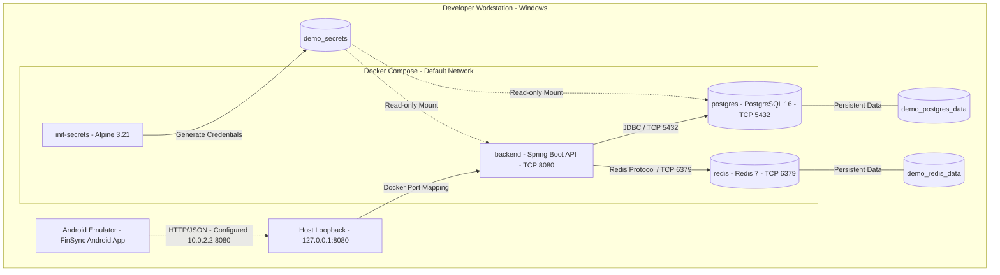

# D. Deployment Diagram

> *Performed by: Vuong Dac Gia Khiem | Reviewed by: Nguyen Le Duc Nhat | Edited by: Vuong Dac Gia Khiem*

## D.1. Deployment Diagram

The FinSync application is deployed in a local development environment using Android Emulator, Docker Desktop, and Docker Compose.

The backend environment consists of a Spring Boot API service, PostgreSQL 16, Redis 7, and a one-time secret initialization service.

The deployment diagram below illustrates the runtime environments, Docker containers, network communication, and persistent volumes.

## D.2. Deployment Architecture Description

### D.2.1. Deployment Overview

FinSync uses a containerized architecture for its local development and demonstration environment. The system consists of an Android mobile application and a backend infrastructure managed using Docker Desktop and Docker Compose.

The Android application provides the user interface, while the Spring Boot backend processes API requests and communicates with PostgreSQL and Redis.

Docker Compose manages the backend services, their startup dependencies, internal communication, and persistent storage.

### D.2.2. Deployment Nodes and Components

The deployment architecture consists of the following components:

**1. Android Client Device**

The FinSync mobile application is developed using Kotlin and Jetpack Compose and runs on an Android Emulator during local development.

The Android debug configuration specifies `http://10.0.2.2:8080` as the default backend API address. This address is used to access the development host from the Android Emulator.

This represents the configured communication path; successful connectivity must be verified independently.

**2. Developer Workstation and Docker Host**

The development workstation runs Windows and Docker Desktop. Docker Compose manages the backend containers and provides an isolated network for communication between services.

The Spring Boot API is published to the Windows host at `127.0.0.1:8080` by default.

**3. Spring Boot Backend Container**

The `backend` service is built from the `./src/backend` directory and listens on TCP port 8080.

It processes REST API requests, executes application business logic, and communicates with the database and Redis services.

**4. PostgreSQL Database Container**

The `postgres` service uses the `postgres:16-alpine` Docker image and listens internally on TCP port 5432.

The database is named `FinSync`, and the backend connects using `jdbc:postgresql://postgres:5432/FinSync`.

The `demo_postgres_data` Docker volume provides persistent storage for PostgreSQL data.

**5. Redis Container**

The `redis` service uses the `redis:7-alpine` image and listens internally on TCP port 6379.

The backend connects to Redis using the hostname `redis` and port `6379`.

Redis is configured with append-only persistence and uses the `demo_redis_data` volume.

**6. Secret Initialization Service**

The `init-secrets` service uses Alpine 3.21 to generate database and JWT credentials.

The generated credentials are stored in the `demo_secrets` Docker volume. The backend and PostgreSQL services mount the required secret files in read-only mode.

The initialization service completes before the dependent services start.

### D.2.3. Network Communication and Protocols

Docker Compose provides a default internal network allowing containers to communicate through their service names.

The following communication paths are configured:

| Source | Destination | Protocol / Port | Purpose |
|---|---|---|---|
| Android Emulator | Development Host | HTTP/JSON, port 8080 | Access backend REST APIs |
| Development Host | Spring Boot Backend | Docker port mapping, TCP 8080 | Forward API requests |
| Spring Boot Backend | PostgreSQL | JDBC over TCP 5432 | Access relational data |
| Spring Boot Backend | Redis | Redis protocol over TCP 6379 | Access Redis services |

The backend is published on the host loopback address by default. PostgreSQL and Redis do not expose their ports directly to the Windows host in the current Docker Compose configuration.

The Android-to-backend connection is configured for the local development environment and is not presented as a verified successful connection.

### D.2.4. Environment Configuration and Persistent Storage

Docker Compose defines the service configuration through `docker-compose.yml`.

The backend uses environment variables such as `SERVER_PORT`, `DB_URL`, `DB_USERNAME`, `REDIS_HOST`, and `REDIS_PORT` to configure its connections.

The published backend port can be customized through `API_BIND_ADDRESS` and `API_PORT`. Their default values are `127.0.0.1` and `8080`, respectively.

Three named volumes are used:

- `demo_postgres_data`: stores PostgreSQL database files.
- `demo_redis_data`: stores persistent Redis data.
- `demo_secrets`: stores generated database and JWT credentials.

Sensitive credentials are stored separately from the application source code. Actual secret values must not be included in documentation or screenshots.

### D.2.5. Deployment Verification

The deployment configuration was examined using the project's `docker-compose.yml` file and verified against the output of `docker compose ps`.

The following containers were observed running successfully:

| Container | Status | Exposed / Internal Port |
|---|---|---|
| `finsync-backend-1` | Healthy | `127.0.0.1:8080 → 8080/tcp` |
| `finsync-postgres-1` | Healthy | `5432/tcp` |
| `finsync-redis-1` | Healthy | `6379/tcp` |

The `init-secrets` service is a one-time initialization task and is not expected to remain running.

These observations confirm that the backend infrastructure was operational at the time of inspection. They do not independently confirm successful Android-to-backend communication.

### D.2.6. Conclusion

The FinSync deployment architecture separates the Android client from its containerized backend infrastructure.

Docker Compose simplifies service management, while PostgreSQL and Redis provide data storage and supporting backend services.

Named volumes preserve persistent data, and the secret initialization mechanism separates sensitive credentials from the source code.

The deployment diagram reflects the verified local Docker configuration and provides a reference for development, testing, and system integration.
