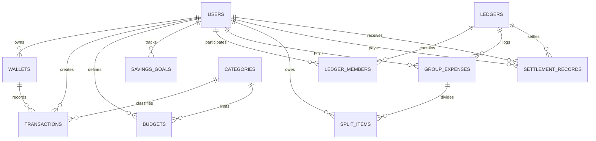
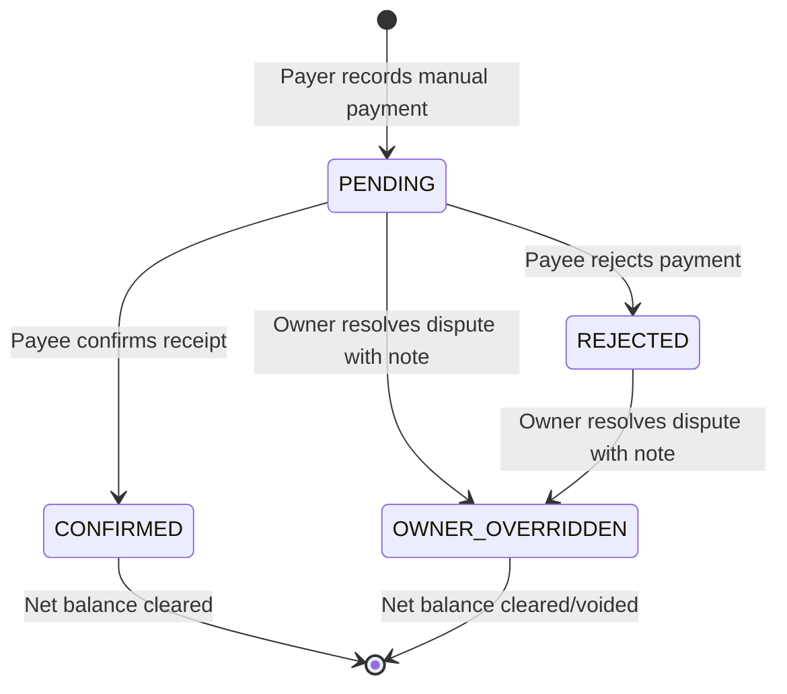
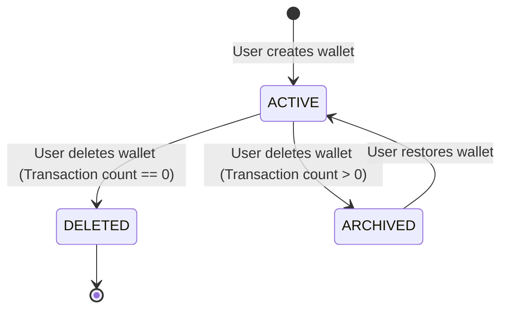

# Data Model: FinSync Core System

**Feature Branch**: `001-finsync-core-system` | **Date**: 2026-11-04

This document defines the relational database schema, entities, validation constraints, and state lifecycles for the FinSync Core System, executed via Flyway migrations on PostgreSQL 16.

---

## 1. Entity-Relationship Overview

---

## 2. Table Definitions & Constraints

### 2.1. `users`
Represents application account holders and system administrators.

| Column | Type | Constraints | Description |
|---|---|---|---|
| `id` | UUID | PRIMARY KEY, DEFAULT gen_random_uuid() | Unique user identifier |
| `email` | VARCHAR(255) | NOT NULL, UNIQUE | User email for authentication |
| `password_hash` | VARCHAR(255) | NOT NULL | BCrypt hashed password |
| `display_name` | VARCHAR(100) | NOT NULL | Profile display name |
| `role` | VARCHAR(20) | NOT NULL, DEFAULT 'ROLE_USER' | `ROLE_USER`, `ROLE_ADMIN` |
| `status` | VARCHAR(20) | NOT NULL, DEFAULT 'ACTIVE' | `ACTIVE`, `LOCKED` |
| `created_at` | TIMESTAMPTZ | NOT NULL, DEFAULT CURRENT_TIMESTAMP | Account creation time |
| `updated_at` | TIMESTAMPTZ | NOT NULL, DEFAULT CURRENT_TIMESTAMP | Last profile update |

**Validation Rules**:
- Email must conform to standard RFC 5322 format.
- Locked users immediately have sessions terminated (FR-013).

---

### 2.2. `wallets`
Represents user financial repositories (Cash, Bank Account, Credit Card).

| Column | Type | Constraints | Description |
|---|---|---|---|
| `id` | UUID | PRIMARY KEY, DEFAULT gen_random_uuid() | Unique wallet identifier |
| `user_id` | UUID | NOT NULL, REFERENCES users(id) ON DELETE RESTRICT | Owner of the wallet |
| `name` | VARCHAR(100) | NOT NULL | Wallet name (e.g., "Ví Tiền Mặt", "VCB") |
| `type` | VARCHAR(20) | NOT NULL | `CASH`, `BANK`, `CREDIT` |
| `currency` | VARCHAR(3) | NOT NULL, DEFAULT 'VND' | ISO 4217 currency code |
| `balance` | NUMERIC(15,2) | NOT NULL, DEFAULT 0.00 | Current balance (Outstanding debt for CREDIT) |
| `status` | VARCHAR(20) | NOT NULL, DEFAULT 'ACTIVE' | `ACTIVE`, `ARCHIVED` |
| `created_at` | TIMESTAMPTZ | NOT NULL, DEFAULT CURRENT_TIMESTAMP | Creation timestamp |
| `updated_at` | TIMESTAMPTZ | NOT NULL, DEFAULT CURRENT_TIMESTAMP | Last modification |

**Validation Rules & Constraints**:
- `UNIQUE(user_id, name)`: Wallet names must be unique per user.
- **Credit Card Semantics**: For `type = 'CREDIT'`, `balance` represents outstanding debt. Aggregate Net Worth is computed as:
  $$\text{Net Worth} = \sum_{\text{type} \in \{\text{CASH}, \text{BANK}\}} \text{balance} - \sum_{\text{type} = \text{CREDIT}} \text{balance}$$
- **Soft Delete**: Wallets with transaction records cannot be hard-deleted; their status transitions to `ARCHIVED`.

---

### 2.3. `categories`
Taxonomy classification for financial records.

| Column | Type | Constraints | Description |
|---|---|---|---|
| `id` | UUID | PRIMARY KEY, DEFAULT gen_random_uuid() | Unique category identifier |
| `user_id` | UUID | NULL, REFERENCES users(id) ON DELETE CASCADE | NULL for system defaults, FK for custom |
| `name` | VARCHAR(100) | NOT NULL | Category name (e.g., "Food", "Salary") |
| `direction` | VARCHAR(10) | NOT NULL | `INCOME`, `EXPENSE` |
| `icon` | VARCHAR(50) | NOT NULL | Material / Ionicons icon identifier |
| `color` | VARCHAR(7) | NOT NULL | Hex color string (e.g., `#FF5722`) |
| `scope` | VARCHAR(10) | NOT NULL, DEFAULT 'SYSTEM' | `SYSTEM`, `CUSTOM` |
| `created_at` | TIMESTAMPTZ | NOT NULL, DEFAULT CURRENT_TIMESTAMP | Creation timestamp |

---

### 2.4. `transactions`
Individual financial ledger records.

| Column | Type | Constraints | Description |
|---|---|---|---|
| `id` | UUID | PRIMARY KEY, DEFAULT gen_random_uuid() | Unique transaction identifier |
| `user_id` | UUID | NOT NULL, REFERENCES users(id) ON DELETE RESTRICT | Transaction creator |
| `wallet_id` | UUID | NOT NULL, REFERENCES wallets(id) ON DELETE RESTRICT | Source wallet |
| `destination_wallet_id` | UUID | NULL, REFERENCES wallets(id) ON DELETE RESTRICT | Destination wallet (for transfers) |
| `category_id` | UUID | NOT NULL, REFERENCES categories(id) ON DELETE RESTRICT | Assigned category |
| `amount` | NUMERIC(15,2) | NOT NULL, CHECK (amount > 0) | Transaction value |
| `direction` | VARCHAR(10) | NOT NULL | `INCOME`, `EXPENSE`, `TRANSFER` |
| `transaction_date` | TIMESTAMPTZ | NOT NULL | Date and time of occurrence |
| `note` | TEXT | NULL | User remarks |
| `receipt_image_url` | VARCHAR(500) | NULL | Object storage URL for attached receipt |
| `created_at` | TIMESTAMPTZ | NOT NULL, DEFAULT CURRENT_TIMESTAMP | System timestamp |

**Validation Rules**:
- If `direction = 'TRANSFER'`, `destination_wallet_id` must NOT be NULL and must differ from `wallet_id`.
- Monetary amounts must strictly be positive (`> 0`).

---

### 2.5. `budgets`
Spending limit definitions per category.

| Column | Type | Constraints | Description |
|---|---|---|---|
| `id` | UUID | PRIMARY KEY, DEFAULT gen_random_uuid() | Unique budget identifier |
| `user_id` | UUID | NOT NULL, REFERENCES users(id) ON DELETE CASCADE | Budget owner |
| `category_id` | UUID | NOT NULL, REFERENCES categories(id) ON DELETE CASCADE | Targeted category |
| `target_limit` | NUMERIC(15,2) | NOT NULL, CHECK (target_limit > 0) | Maximum spend limit |
| `period` | VARCHAR(10) | NOT NULL, DEFAULT 'MONTHLY' | `WEEKLY`, `MONTHLY` |
| `created_at` | TIMESTAMPTZ | NOT NULL, DEFAULT CURRENT_TIMESTAMP | Creation timestamp |

---

### 2.6. `savings_goals`
Financial savings milestones.

| Column | Type | Constraints | Description |
|---|---|---|---|
| `id` | UUID | PRIMARY KEY, DEFAULT gen_random_uuid() | Unique goal identifier |
| `user_id` | UUID | NOT NULL, REFERENCES users(id) ON DELETE CASCADE | Goal owner |
| `name` | VARCHAR(150) | NOT NULL | Goal title (e.g., "Mua Laptop Mới") |
| `target_amount` | NUMERIC(15,2) | NOT NULL, CHECK (target_amount > 0) | Financial target |
| `current_amount` | NUMERIC(15,2) | NOT NULL, DEFAULT 0.00 | Accumulated savings |
| `deadline` | DATE | NOT NULL | Milestone completion date |
| `created_at` | TIMESTAMPTZ | NOT NULL, DEFAULT CURRENT_TIMESTAMP | Creation timestamp |

---

### 2.7. `ledgers` & `ledger_members`
Collaborative group expense containers.

#### `ledgers`
| Column | Type | Constraints | Description |
|---|---|---|---|
| `id` | UUID | PRIMARY KEY, DEFAULT gen_random_uuid() | Unique ledger identifier |
| `name` | VARCHAR(150) | NOT NULL | Ledger title (e.g., "Chuyến đi Đà Lạt") |
| `owner_id` | UUID | NOT NULL, REFERENCES users(id) ON DELETE RESTRICT | Ledger creator |
| `currency` | VARCHAR(3) | NOT NULL, DEFAULT 'VND' | Uniform base currency |
| `version` | BIGINT | NOT NULL, DEFAULT 0 | Optimistic locking version column |
| `created_at` | TIMESTAMPTZ | NOT NULL, DEFAULT CURRENT_TIMESTAMP | Creation timestamp |

#### `ledger_members`
| Column | Type | Constraints | Description |
|---|---|---|---|
| `id` | UUID | PRIMARY KEY, DEFAULT gen_random_uuid() | Membership record identifier |
| `ledger_id` | UUID | NOT NULL, REFERENCES ledgers(id) ON DELETE CASCADE | Parent ledger |
| `user_id` | UUID | NOT NULL, REFERENCES users(id) ON DELETE RESTRICT | Participating member |
| `role` | VARCHAR(10) | NOT NULL, DEFAULT 'MEMBER' | `OWNER`, `MEMBER` |
| `net_balance` | NUMERIC(15,2) | NOT NULL, DEFAULT 0.00 | Net position (+ = creditor, - = debtor) |
| `joined_at` | TIMESTAMPTZ | NOT NULL, DEFAULT CURRENT_TIMESTAMP | Join timestamp |

**Validation Rules**:
- `UNIQUE(ledger_id, user_id)`: A user can join a ledger only once.
- Member count per ledger must NOT exceed 50 (FR-006).
- A member cannot be removed if `net_balance != 0.00` (FR-010).

---

### 2.8. `group_expenses` & `split_items`
Group expenditures and debt shares.

#### `group_expenses`
| Column | Type | Constraints | Description |
|---|---|---|---|
| `id` | UUID | PRIMARY KEY, DEFAULT gen_random_uuid() | Unique expense identifier |
| `ledger_id` | UUID | NOT NULL, REFERENCES ledgers(id) ON DELETE CASCADE | Associated ledger |
| `payer_user_id` | UUID | NOT NULL, REFERENCES users(id) ON DELETE RESTRICT | Single payer who fronted the expense |
| `total_amount` | NUMERIC(15,2) | NOT NULL, CHECK (total_amount > 0) | Total bill amount |
| `description` | VARCHAR(255) | NOT NULL | Expense description |
| `split_strategy` | VARCHAR(15) | NOT NULL | `EQUAL`, `EXACT`, `PERCENTAGE` |
| `created_at` | TIMESTAMPTZ | NOT NULL, DEFAULT CURRENT_TIMESTAMP | Timestamp |

#### `split_items`
| Column | Type | Constraints | Description |
|---|---|---|---|
| `id` | UUID | PRIMARY KEY, DEFAULT gen_random_uuid() | Split item identifier |
| `expense_id` | UUID | NOT NULL, REFERENCES group_expenses(id) ON DELETE CASCADE | Parent group expense |
| `debtor_user_id` | UUID | NOT NULL, REFERENCES users(id) ON DELETE RESTRICT | Member who owes their share |
| `allocated_amount` | NUMERIC(15,2) | NOT NULL, CHECK (allocated_amount > 0) | Exact amount owed |

**Constraint**: $\sum \text{allocated\_amount} = \text{total\_amount}$. Remainder cents are allocated to the first debtor to prevent lost cents.

---

### 2.9. `settlement_records`
Manual reimbursement records between group members.

| Column | Type | Constraints | Description |
|---|---|---|---|
| `id` | UUID | PRIMARY KEY, DEFAULT gen_random_uuid() | Settlement identifier |
| `ledger_id` | UUID | NOT NULL, REFERENCES ledgers(id) ON DELETE CASCADE | Associated ledger |
| `payer_id` | UUID | NOT NULL, REFERENCES users(id) ON DELETE RESTRICT | Member who sent external payment |
| `payee_id` | UUID | NOT NULL, REFERENCES users(id) ON DELETE RESTRICT | Member who received payment |
| `amount` | NUMERIC(15,2) | NOT NULL, CHECK (amount > 0) | Settlement amount |
| `status` | VARCHAR(25) | NOT NULL, DEFAULT 'PENDING' | Status lifecycle (see section 3) |
| `resolved_by_id` | UUID | NULL, REFERENCES users(id) ON DELETE RESTRICT | Ledger Owner ID if overridden |
| `resolution_reason` | TEXT | NULL | Reason note for override or rejection |
| `created_at` | TIMESTAMPTZ | NOT NULL, DEFAULT CURRENT_TIMESTAMP | Submission timestamp |
| `resolved_at` | TIMESTAMPTZ | NULL | Confirmation / override timestamp |

---

## 3. State Transitions & Lifecycles

### 3.1. Settlement Record State Machine

### 3.2. Wallet State Lifecycle

