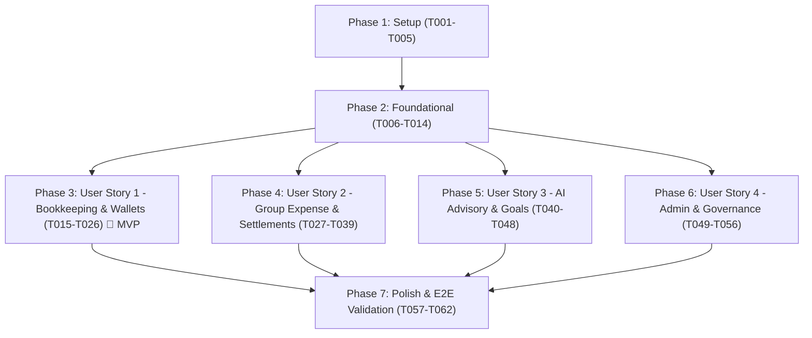

# Tasks: FinSync Core System

**Input**: Design documents from `specs/001-finsync-core-system/` (`spec.md`, `plan.md`, `data-model.md`, `contracts/`, `research.md`, `quickstart.md`)

**Prerequisites**: `plan.md` (architecture & project structure), `spec.md` (prioritized user stories), `data-model.md` (schema & constraints), `contracts/` (OpenAPI definitions), `constitution.md` (core principles).

**Organization**: Tasks are grouped into Setup, Foundational, and User Story phases (US1, US2, US3, US4) to enable independent implementation, parallelization (`[P]`), and MVP delivery.

---

## Format: `- [ ] [TaskID] [P?] [Story?] Description with file path`

- **[P]**: Can run in parallel (different files, no blocking dependencies).
- **[Story]**: User story label (`[US1]`, `[US2]`, `[US3]`, `[US4]`) for traceability.
- All descriptions include explicit relative file paths and concrete constraints.

---

## Phase 1: Setup (Shared Infrastructure)

**Purpose**: Project initialization, directory structure creation, and dependency configuration across all components.

- [x] T001 Initialize repository directory layout matching plan structure in `docker-compose.yml`, `src/backend/`, `src/ai-service/`, `src/mobile/android/`, and `src/admin-web/`
- [x] T002 [P] Configure multi-service Docker Compose orchestration for PostgreSQL 16, Spring Boot API, and AI Microservice in `docker-compose.yml`
- [x] T003 [P] Verify and update Spring Boot 4.1.1 Maven configuration with JPA, Security, Flyway, Validation, and SpringDoc OpenAPI in `src/backend/pom.xml`
- [x] T004 [P] Initialize Python 3.11 FastAPI microservice environment with FastAPI, Uvicorn, and Google Gemini SDK in `src/ai-service/requirements.txt` and `src/ai-service/Dockerfile`
- [x] T005 [P] Setup Android project with Kotlin 2.0, Jetpack Compose, Material 3, Coroutines, and Retrofit in `src/mobile/android/build.gradle.kts`

---

## Phase 2: Foundational (Blocking Prerequisites)

**Purpose**: Core infrastructure, database migrations, security, and shared components that MUST be complete before ANY user story can begin.

**⚠️ CRITICAL**: No user story implementation can start until this phase is complete.

- [x] T006 Create Flyway baseline migration `V1__init_schema.sql` defining `users`, `wallets`, `categories`, `transactions`, `budgets`, `savings_goals`, `ledgers`, `ledger_members`, `group_expenses`, `split_items`, and `settlement_records` tables with UUID primary keys and `NUMERIC(15,2)` monetary types in `src/backend/src/main/resources/db/migration/V1__init_schema.sql`
- [x] T007 [P] Create Flyway seed migration `V2__seed_default_categories.sql` populating default income and expense categories in `src/backend/src/main/resources/db/migration/V2__seed_default_categories.sql`
- [x] T008 Implement User JPA entity with status (`ACTIVE`, `LOCKED`) and role (`ROLE_USER`, `ROLE_ADMIN`) in `src/backend/src/main/java/com/finsync/user/User.java` and repository in `src/backend/src/main/java/com/finsync/user/UserRepository.java`
- [x] T009 Implement Category JPA entity with scope (`SYSTEM`, `CUSTOM`) in `src/backend/src/main/java/com/finsync/transaction/Category.java` and repository in `src/backend/src/main/java/com/finsync/transaction/CategoryRepository.java`
- [x] T010 [P] Implement stateless JWT token provider, signing keys, and validation utility in `src/backend/src/main/java/com/finsync/security/JwtTokenProvider.java`
- [x] T011 Implement JWT authentication filter and Spring Security filter chain enforcing stateless sessions and RBAC in `src/backend/src/main/java/com/finsync/security/JwtAuthenticationFilter.java` and `src/backend/src/main/java/com/finsync/security/SecurityConfig.java`
- [x] T012 Implement user registration, password hashing (`BCryptPasswordEncoder`), and login authentication service in `src/backend/src/main/java/com/finsync/user/AuthService.java`
- [x] T013 Implement Authentication REST controller (`POST /api/v1/auth/register`, `POST /api/v1/auth/login`) in `src/backend/src/main/java/com/finsync/user/AuthController.java`
- [x] T014 [P] Implement global exception handler, standardized error response DTO (`ErrorResponse`), and validation advice in `src/backend/src/main/java/com/finsync/common/GlobalExceptionHandler.java`

**Checkpoint**: Foundation ready — database migrations, authentication, and core entities in place. User Story implementation can now proceed.

---

## Phase 3: User Story 1 - Personal Bookkeeping & Multi-Wallet Tracking (Priority: P1) 🎯 MVP

**Goal**: Deliver personal income/expense tracking across Cash, Bank, and Credit Card wallets, category budget threshold alerts (80% and 100%), and user-initiated SMS text parsing drafts without storing credentials.

**Independent Test**: Register a user, create Bank and Credit wallets, log expenses with receipt attachments, verify Credit balance tracks outstanding debt, verify aggregate Net Worth calculation, trigger an 80% budget alert, and parse pasted bank notification text into a draft transaction.

- [ ] T015 [P] [US1] Implement Wallet JPA entity supporting `type` (`CASH`, `BANK`, `CREDIT`), `status` (`ACTIVE`, `ARCHIVED`), and `UNIQUE(user_id, name)` in `src/backend/src/main/java/com/finsync/wallet/Wallet.java` and repository in `src/backend/src/main/java/com/finsync/wallet/WalletRepository.java`
- [ ] T016 [P] [US1] Implement Transaction JPA entity with `direction` (`INCOME`, `EXPENSE`, `TRANSFER`), `amount` (`CHECK amount > 0`), and optional `receipt_image_url` in `src/backend/src/main/java/com/finsync/transaction/Transaction.java` and repository in `src/backend/src/main/java/com/finsync/transaction/TransactionRepository.java`
- [ ] T017 [P] [US1] Implement Budget JPA entity with target limit and period (`WEEKLY`, `MONTHLY`) in `src/backend/src/main/java/com/finsync/budget/Budget.java` and repository in `src/backend/src/main/java/com/finsync/budget/BudgetRepository.java`
- [ ] T018 [US1] Implement WalletService with unique name validation, soft-delete archive logic (archive if transaction count > 0, hard delete if 0), and aggregate Net Worth calculation formula (`Sum(Cash + Bank) - Sum(Credit)`) in `src/backend/src/main/java/com/finsync/wallet/WalletService.java`
- [ ] T019 [US1] Implement TransactionService supporting income/expense logging, intra-wallet transfers, balance auto-updates, and receipt attachment URL handling in `src/backend/src/main/java/com/finsync/transaction/TransactionService.java`
- [ ] T020 [US1] Implement BudgetService with spending progress calculation and automated 80% and 100% threshold alert notifications in `src/backend/src/main/java/com/finsync/budget/BudgetService.java`
- [ ] T021 [P] [US1] Implement Wallet REST Controller (`GET /api/v1/wallets`, `POST /api/v1/wallets`, `DELETE /api/v1/wallets/{id}`) in `src/backend/src/main/java/com/finsync/wallet/WalletController.java`
- [ ] T022 [P] [US1] Implement Transaction REST Controller (`GET /api/v1/transactions`, `POST /api/v1/transactions`) in `src/backend/src/main/java/com/finsync/transaction/TransactionController.java`
- [ ] T023 [P] [US1] Implement Budget REST Controller (`GET /api/v1/budgets`, `POST /api/v1/budgets`) in `src/backend/src/main/java/com/finsync/budget/BudgetController.java`
- [ ] T024 [P] [US1] Implement Vietnamese bank SMS regex matcher and user-initiated parsing endpoint (`POST /api/v1/parse-notification`) with fallback handling for unparseable text in `src/ai-service/parsers/vietnamese_bank_regex.py` and `src/ai-service/main.py`
- [ ] T025 [P] [US1] Implement Android Retrofit API client interfaces, DTOs, and Room offline cache for Wallets, Transactions, and Budgets in `src/mobile/android/app/src/main/java/com/finsync/mobile/data/`
- [ ] T026 [US1] Implement Android Jetpack Compose screens for Wallet Dashboard (Net Worth display), Transaction Entry with SMS Paste Parser sheet, and Budget Progress Cards in `src/mobile/android/app/src/main/java/com/finsync/mobile/ui/`

**Checkpoint**: User Story 1 (MVP) is fully functional and testable end-to-end. Personal bookkeeping and budget alerts operate independently.

---

## Phase 4: User Story 2 - Group Expense Sharing & Smart Debt Settlement (Priority: P1)

**Goal**: Deliver shared ledgers (up to 50 members), Single-Payer expense splitting (Equal, Exact, Percentage), graph-simplifying debt minimization (reducing transfer edges by \(\ge 30\%\)), and manual settlement confirmation with owner dispute override.

**Independent Test**: Create a shared ledger with 3 members, log expenses with different split strategies, calculate the simplified debt settlement plan, record a manual payment, and test both payee confirmation and owner dispute override flows.

- [ ] T027 [P] [US2] Implement Ledger and LedgerMember JPA entities with `currency`, `version` (optimistic lock), `role` (`OWNER`, `MEMBER`), and `net_balance` in `src/backend/src/main/java/com/finsync/ledger/Ledger.java`, `src/backend/src/main/java/com/finsync/ledger/LedgerMember.java`, and their repositories in `src/backend/src/main/java/com/finsync/ledger/`
- [ ] T028 [P] [US2] Implement GroupExpense and SplitItem JPA entities with Single Payer (`payer_user_id`), `split_strategy` (`EQUAL`, `EXACT`, `PERCENTAGE`), and `allocated_amount` in `src/backend/src/main/java/com/finsync/expense/GroupExpense.java`, `src/backend/src/main/java/com/finsync/expense/SplitItem.java`, and their repositories in `src/backend/src/main/java/com/finsync/expense/`
- [ ] T029 [P] [US2] Implement SettlementRecord JPA entity with `status` (`PENDING`, `CONFIRMED`, `REJECTED`, `OWNER_OVERRIDDEN`), `resolved_by_id`, and `resolution_reason` in `src/backend/src/main/java/com/finsync/settlement/SettlementRecord.java` and repository in `src/backend/src/main/java/com/finsync/settlement/SettlementRepository.java`
- [ ] T030 [US2] Implement LedgerService with member invitations, strict 50-member capacity enforcement, and guardrail blocking removal of members with non-zero balances in `src/backend/src/main/java/com/finsync/ledger/LedgerService.java`
- [ ] T031 [US2] Implement GroupExpenseService enforcing Single Payer model, remainder cents allocation to the first debtor (zero lost cents), and atomic net balance updates in `src/backend/src/main/java/com/finsync/expense/GroupExpenseService.java`
- [ ] T032 [US2] Implement DebtMinimizationService using greedy heap cash flow simplification algorithm, guaranteeing \(O(V \log V)\) execution and \(\ge 30\%\) transfer reduction in `src/backend/src/main/java/com/finsync/settlement/DebtMinimizationService.java`
- [ ] T033 [US2] Implement SettlementService supporting manual settlement creation (`PENDING`), payee confirmation (`CONFIRMED`), and ledger owner dispute override (`OWNER_OVERRIDDEN` with mandatory reason note) in `src/backend/src/main/java/com/finsync/settlement/SettlementService.java`
- [ ] T034 [P] [US2] Implement Ledger REST Controller (`GET /api/v1/ledgers`, `POST /api/v1/ledgers`, `POST /api/v1/ledgers/{id}/members`) in `src/backend/src/main/java/com/finsync/ledger/LedgerController.java`
- [ ] T035 [P] [US2] Implement Group Expense REST Controller (`POST /api/v1/ledgers/{id}/expenses`) in `src/backend/src/main/java/com/finsync/expense/GroupExpenseController.java`
- [ ] T036 [P] [US2] Implement Settlement REST Controller (`GET /api/v1/ledgers/{id}/settlement-plan`, `POST /api/v1/ledgers/{id}/settlements`, `PUT /api/v1/ledgers/{id}/settlements/{settlementId}/confirm`, `PUT /api/v1/ledgers/{id}/settlements/{settlementId}/resolve`) in `src/backend/src/main/java/com/finsync/settlement/SettlementController.java`
- [ ] T037 [P] [US2] Implement Android Retrofit API client interfaces and data models for Ledgers, Expenses, Debt Simplification, and Settlements in `src/mobile/android/app/src/main/java/com/finsync/mobile/data/ledger/`
- [ ] T038 [US2] Implement Android Jetpack Compose screens for Ledger Dashboard, Group Expense Creation with Split Selector (Equal, Exact, Percentage), and Optimized Settlement Plan view in `src/mobile/android/app/src/main/java/com/finsync/mobile/ui/ledger/`
- [ ] T039 [US2] Implement Android Settlement Confirmation and Owner Dispute Override dialog with proof inspection notes in `src/mobile/android/app/src/main/java/com/finsync/mobile/ui/ledger/SettlementResolutionDialog.kt`

**Checkpoint**: User Stories 1 and 2 both operate independently and reliably. Collaborative expenses, smart debt simplification, and dispute overrides fully verified.

---

## Phase 5: User Story 3 - Financial Analytics & Intelligent Advisory (Priority: P2)

**Goal**: Deliver savings goal milestones, spending anomaly detection (>40% deviation from 3-month rolling average), and proactive budget recommendations via Google Gemini API without storing credentials.

**Independent Test**: Create a savings goal, supply 3 months of historical spending with a 50% spike in one category, trigger anomaly scan, and verify that the AI microservice returns detected anomaly alerts and recommended budget reallocations.

- [ ] T040 [P] [US3] Implement SavingsGoal JPA entity with target amount, current accumulated progress, and target deadline in `src/backend/src/main/java/com/finsync/goal/SavingsGoal.java` and repository in `src/backend/src/main/java/com/finsync/goal/SavingsGoalRepository.java`
- [ ] T041 [US3] Implement SavingsGoalService calculating progress against linked wallets and target milestones in `src/backend/src/main/java/com/finsync/goal/SavingsGoalService.java`
- [ ] T042 [P] [US3] Implement Savings Goal REST Controller (`GET /api/v1/goals`, `POST /api/v1/goals`, `PUT /api/v1/goals/{id}`) in `src/backend/src/main/java/com/finsync/goal/SavingsGoalController.java`
- [ ] T043 [P] [US3] Implement AnomalyDetector service in Python FastAPI calculating rolling 3-month averages and identifying >40% category deviations (`POST /api/v1/analyze-anomalies`) in `src/ai-service/services/anomaly_detector.py`
- [ ] T044 [P] [US3] Implement GeminiAdvisor service in Python FastAPI constructing privacy-safe prompts for Google Gemini API (`POST /api/v1/budget-advice`) without financial credentials in `src/ai-service/services/gemini_advisor.py`
- [ ] T045 [US3] Implement Spring Boot client bridging Backend to AI Microservice (`AiServiceClient`) with retry logic and graceful circuit-breaking fallbacks in `src/backend/src/main/java/com/finsync/service/client/AiServiceClient.java`
- [ ] T046 [P] [US3] Implement Advisory REST Controller (`GET /api/v1/advisory/anomalies`, `GET /api/v1/advisory/budget-recommendations`) in `src/backend/src/main/java/com/finsync/advisory/AdvisoryController.java`
- [ ] T047 [P] [US3] Implement Android Retrofit API client interfaces for Savings Goals and AI Advisory Insights in `src/mobile/android/app/src/main/java/com/finsync/mobile/data/advisory/`
- [ ] T048 [US3] Implement Android Jetpack Compose screens for Savings Goal Progress Tracker and AI Financial Advisory Cards in `src/mobile/android/app/src/main/java/com/finsync/mobile/ui/advisory/`

**Checkpoint**: User Stories 1, 2, and 3 are complete. AI anomaly scanning and savings goal advisory operate reliably.

---

## Phase 6: User Story 4 - Platform Administration & Governance (Priority: P2)

**Goal**: Deliver administrative account governance (immediate session locking in < 2 seconds), system-wide category taxonomy management, and aggregated platform usage telemetry.

**Independent Test**: Log into the React Admin portal, lock a user account, verify active user session is terminated immediately, add a new system category, and verify aggregated platform analytics dashboard loads in under 3 seconds.

- [ ] T049 [US4] Implement AdminService with account locking/unlocking, immediate session token invalidation, and platform usage aggregation (active users, total transactions) in `src/backend/src/main/java/com/finsync/admin/AdminService.java`
- [ ] T050 [P] [US4] Implement Admin REST Controller (`PUT /api/v1/admin/users/{userId}/lock`, `GET /api/v1/admin/analytics`, `POST /api/v1/admin/categories`) in `src/backend/src/main/java/com/finsync/admin/AdminController.java`
- [ ] T051 [P] [US4] Initialize React Admin portal project with Axios, React Router v6, Tailwind CSS, and JWT authentication store in `src/admin-web/package.json` and `src/admin-web/src/App.jsx`
- [ ] T052 [P] [US4] Implement React Admin authentication service, protected routes, and login view in `src/admin-web/src/pages/Login.jsx` and `src/admin-web/src/services/auth.js`
- [ ] T053 [US4] Implement React Admin User Management page with user search, status filter, and immediate Lock/Unlock action modal in `src/admin-web/src/pages/UserManagement.jsx`
- [ ] T054 [P] [US4] Implement React Admin Category Taxonomy page to create, edit, and publish global default categories in `src/admin-web/src/pages/CategoryTaxonomy.jsx`
- [ ] T055 [P] [US4] Implement React Admin Platform Telemetry Dashboard displaying active users, transaction volume, and system metrics in `src/admin-web/src/pages/Dashboard.jsx`
- [ ] T056 [US4] Add automated unit and integration tests verifying admin account lock invalidates JWT authentication within 2 seconds in `src/backend/src/test/java/com/finsync/admin/AdminServiceTest.java`

**Checkpoint**: All 4 User Stories are complete, functional, and governed.

---

## Phase 7: Polish & Cross-Cutting Concerns

**Purpose**: System integration, end-to-end validation, security hardening, and performance benchmarking across all user stories.

- [ ] T057 [P] Configure environment templates (`.env.example`) with zero committed credentials across Backend, AI Microservice, and Admin Web in `src/backend/.env.example`, `src/ai-service/.env.example`, and `src/admin-web/.env.example`
- [ ] T058 Execute complete end-to-end validation scenarios (Scenarios 1 through 5) defined in `specs/001-finsync-core-system/quickstart.md`
- [ ] T059 [P] Verify SpringDoc OpenAPI documentation annotations on all REST controllers and validate contract alignment with `specs/001-finsync-core-system/contracts/backend-api.yaml`
- [ ] T060 Security audit check: verify zero banking credentials, PINs, or raw OTPs are logged or stored across Spring Boot logs and AI service outputs
- [ ] T061 Benchmark Debt Minimization Service with 50 ledger members to verify execution completes in < 5ms and transfer reduction meets \(\ge 30\%\) criterion (SC-002)
- [ ] T062 [P] Update project `README.md` with multi-service Docker startup instructions, Swagger URLs, and development guidelines

---

## Dependencies & Execution Order

### Story Completion Order & Team Parallelization

1. **Phase 1 (Setup)**: Must complete first. All setup tasks (`T001` - `T005`) marked `[P]` can run in parallel.
2. **Phase 2 (Foundational)**: CRITICAL prerequisite for all user stories. Must complete `T006` - `T014`.
3. **Phase 3 (User Story 1 - MVP)**: Can be implemented and shipped independently as a standalone personal finance application.
4. **Phase 4 (User Story 2)**: Adds group collaboration. Can run in parallel with US1 once Phase 2 is complete.
5. **Phase 5 (User Story 3)**: Adds AI insights. Can proceed in parallel once Phase 2 is complete.
6. **Phase 6 (User Story 4)**: Adds web administration. Can proceed in parallel once Phase 2 is complete.
7. **Phase 7 (Polish)**: Runs after desired user stories are implemented to validate quickstart scenarios.

---

## Implementation Strategy

### MVP First (Phases 1, 2, and 3)
1. Complete **Phase 1 (Setup)** and **Phase 2 (Foundational)**.
2. Complete **Phase 3 (User Story 1)**.
3. **Stop & Validate**: Execute Quickstart Scenario 1 and Scenario 2. The app now delivers a functional personal bookkeeping tool with multi-wallet net worth tracking, budget alerts, and SMS paste parsing.

### Incremental Feature Expansion
1. Implement **Phase 4 (User Story 2)** → Enables shared ledgers and smart debt settlements (Quickstart Scenarios 3 and 4).
2. Implement **Phase 5 (User Story 3)** → Connects AI anomaly detection and savings goals.
3. Implement **Phase 6 (User Story 4)** → Connects React web admin portal and account governance (Quickstart Scenario 5).
4. Execute **Phase 7 (Polish)** → Final security audit, performance benchmarking, and documentation sync.
