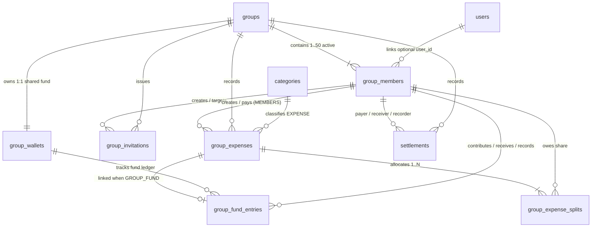

# Data Model: Group Expense Management & Smart Debt Simplification (Build 2)

> *Performed by: Nguyen Le Duc Nhat (24120403) | Reviewed by: Ngo Thai Hoa (24120051) | Edited by: Nguyen Le Duc Nhat (24120403)*

**Source of Truth**: `database_design.md` (Final v1.0)  
**Database Engine**: PostgreSQL 16  
**Migration Tool**: Flyway (`V2__create_group_expense_tables.sql`, `V3__seed_default_categories.sql`)  
**ORM**: Spring Data JPA / Hibernate (`spring.jpa.hibernate.ddl-auto=validate`)

---

## 1. Common Columns & Structural Conventions

Every table inherits 4 physical audit/versioning columns from `BaseEntity` (`@MappedSuperclass`):

| Column | PostgreSQL Type | Nullable | Default / Rule |
|---|---|---|---|
| `id` | `uuid` | `NOT NULL` | Primary key; UUID generated by backend before `INSERT` |
| `created_at` | `timestamptz` | `NOT NULL` | `DEFAULT CURRENT_TIMESTAMP`; immutable |
| `updated_at` | `timestamptz` | `NOT NULL` | `DEFAULT CURRENT_TIMESTAMP`; updated on modification |
| `version` | `bigint` | `NOT NULL` | `DEFAULT 0`; Hibernate `@Version` optimistic locking |

**Global Constraints**:
- Monetary columns use `NUMERIC(19,2)` mapped to `java.math.BigDecimal`.
- Enum columns use `VARCHAR` with explicit PostgreSQL `CHECK` constraints and Java `@Enumerated(EnumType.STRING)`.
- All foreign keys enforce `ON DELETE RESTRICT` and `ON UPDATE RESTRICT` (no cascading ledger deletions).
- Currency columns enforce `CHECK (currency_code IN ('VND', 'USD'))`.

---

## 2. Entity-Relationship Diagram (Mermaid)

---

## 3. Table & Entity Specifications

### 3.1. `categories` -> `Category`
Shared default income/expense categories seeded via `V3__seed_default_categories.sql`.

| Column | PostgreSQL Type | Null | Constraints / Description |
|---|---|---|---|
| `name` | `varchar(100)` | No | Non-blank trimmed name |
| `type` | `varchar(16)` | No | `INCOME` or `EXPENSE` |
| `icon_key` | `varchar(50)` | No | Default `'category'` |
| `color_key` | `varchar(30)` | No | Default `'violet'` |
| `archived_at` | `timestamptz` | Yes | Archived categories cannot be used on new group expenses |

**Indexes & Constraints**: `UNIQUE INDEX uk_categories_type_name ON categories (type, lower(name))`, `CHECK (btrim(name) <> '')`, `CHECK (type IN ('INCOME', 'EXPENSE'))`.

---

### 3.2. `groups` -> `ExpenseGroup`
Shared expense ledger container.

| Column | PostgreSQL Type | Null | Constraints / Description |
|---|---|---|---|
| `name` | `varchar(100)` | No | Non-blank trimmed group name |
| `description` | `varchar(1000)` | Yes | Optional group description |
| `currency_code` | `varchar(3)` | No | `VND` or `USD`; immutable once financial activity exists |
| `archived_at` | `timestamptz` | Yes | When non-null, group is read-only |

**Constraints**: `CHECK (btrim(name) <> '')`, `CHECK (currency_code IN ('VND', 'USD'))`.

---

### 3.3. `group_members` -> `GroupMember`
Associates `groups` with optional `users` (`user_id IS NULL` represents an unlinked guest participant).

| Column | PostgreSQL Type | Null | Constraints / Description |
|---|---|---|---|
| `group_id` | `uuid` | No | `FK -> groups.id` (`ON DELETE RESTRICT`) |
| `user_id` | `uuid` | Yes | `FK -> users.id` (`ON DELETE RESTRICT`); nullable for guests |
| `display_name` | `varchar(100)` | No | Non-blank member display name within the group |
| `role` | `varchar(16)` | No | `OWNER` or `MEMBER` (default `MEMBER`) |
| `status` | `varchar(16)` | No | `ACTIVE` or `LEFT` (default `ACTIVE`) |
| `member_order` | `integer` | No | `>= 0`; monotonic display/tie-break order within group |
| `joined_at` | `timestamptz` | No | Default `CURRENT_TIMESTAMP` |
| `left_at` | `timestamptz` | Yes | Non-null iff `status = 'LEFT'` |

**Indexes & Constraints**:
- `UNIQUE (group_id, user_id)` (PostgreSQL allows multiple `NULL` `user_id` guests per group)
- `UNIQUE (group_id, member_order)`
- Partial unique index: `CREATE UNIQUE INDEX uk_group_members_active_owner ON group_members (group_id) WHERE role = 'OWNER' AND status = 'ACTIVE'`
- `CHECK (role IN ('OWNER', 'MEMBER'))`, `CHECK (status IN ('ACTIVE', 'LEFT'))`, `CHECK (member_order >= 0)`
- `CHECK (role <> 'OWNER' OR (user_id IS NOT NULL AND status = 'ACTIVE'))`
- `CHECK ((status = 'ACTIVE' AND left_at IS NULL) OR (status = 'LEFT' AND left_at IS NOT NULL))`

---

### 3.4. `group_invitations` -> `GroupInvitation`
Expiring, revocable invitations supporting general join links and guest-claiming links.

| Column | PostgreSQL Type | Null | Constraints / Description |
|---|---|---|---|
| `group_id` | `uuid` | No | `FK -> groups.id` |
| `created_by_member_id` | `uuid` | No | `FK -> group_members.id` |
| `target_member_id` | `uuid` | Yes | `FK -> group_members.id`; non-null for guest-targeted invite |
| `token_hash` | `varchar(64)` | No | SHA-256 hex of raw invitation token; `UNIQUE` |
| `expires_at` | `timestamptz` | No | Must be `> created_at` |
| `max_uses` | `integer` | No | Default `1`; must be `= 1` when `target_member_id IS NOT NULL` |
| `use_count` | `integer` | No | Default `0`; `0 <= use_count <= max_uses` |
| `revoked_at` | `timestamptz` | Yes | Set when revoked by `OWNER` |

**Indexes & Constraints**:
- `UNIQUE (token_hash)`
- `CHECK (max_uses > 0 AND use_count >= 0 AND use_count <= max_uses)`
- `CHECK (expires_at > created_at)`
- `CHECK (target_member_id IS NULL OR max_uses = 1)`
- Indexes on `(group_id)`, `(created_by_member_id)`, `(target_member_id)`.

---

### 3.5. `group_wallets` -> `GroupWallet`
1:1 shared fund container created atomically with each `ExpenseGroup`.

| Column | PostgreSQL Type | Null | Constraints / Description |
|---|---|---|---|
| `group_id` | `uuid` | No | `FK -> groups.id`, `UNIQUE` (`1:1`) |
| `name` | `varchar(100)` | No | Non-blank; default `'Quỹ chung'` |

**Balance Formula** (computed, never stored as a mutable column):
$$\text{FundBalance} = \sum \text{CONTRIBUTION} - \sum \text{REFUND} - \sum \text{EXPENSE} \ge 0$$

---

### 3.6. `group_fund_entries` -> `GroupFundEntry`
Append-only shared fund ledger.

| Column | PostgreSQL Type | Null | Constraints / Description |
|---|---|---|---|
| `group_wallet_id` | `uuid` | No | `FK -> group_wallets.id` |
| `member_id` | `uuid` | Yes | `FK -> group_members.id`; required for `CONTRIBUTION`/`REFUND` |
| `expense_id` | `uuid` | Yes | `FK -> group_expenses.id`, `UNIQUE`; required for `EXPENSE` |
| `recorded_by_member_id` | `uuid` | No | `FK -> group_members.id` |
| `type` | `varchar(16)` | No | `CONTRIBUTION`, `REFUND`, or `EXPENSE` |
| `amount` | `numeric(19,2)` | No | `> 0` |
| `entry_date` | `date` | No | Business entry date |
| `note` | `varchar(2000)` | Yes | Optional description |
| `request_id` | `uuid` | No | Idempotency key; `UNIQUE` |
| `request_hash` | `varchar(64)` | No | Canonical SHA-256 hash |

**Constraints & Indexes**:
- `CHECK (type IN ('CONTRIBUTION', 'REFUND', 'EXPENSE'))`, `CHECK (amount > 0)`
- `CHECK ((type IN ('CONTRIBUTION', 'REFUND') AND member_id IS NOT NULL AND expense_id IS NULL) OR (type = 'EXPENSE' AND member_id IS NULL AND expense_id IS NOT NULL))`
- Indexes: `(group_wallet_id, entry_date DESC)`, `(member_id)`, `(recorded_by_member_id)`.

---

### 3.7. `group_expenses` -> `GroupExpense`
Append-only shared bill funded by a single member (`MEMBERS`) or the shared fund (`GROUP_FUND`).

| Column | PostgreSQL Type | Null | Constraints / Description |
|---|---|---|---|
| `group_id` | `uuid` | No | `FK -> groups.id` |
| `category_id` | `uuid` | No | `FK -> categories.id` (must be `EXPENSE` category) |
| `created_by_member_id` | `uuid` | No | `FK -> group_members.id` (registered active caller) |
| `paid_by_member_id` | `uuid` | Yes | `FK -> group_members.id`; required iff `funding_source = 'MEMBERS'` |
| `title` | `varchar(200)` | No | Non-blank expense title |
| `note` | `varchar(2000)` | Yes | Optional note |
| `amount` | `numeric(19,2)` | No | `> 0` |
| `expense_date` | `date` | No | Business expense date |
| `funding_source` | `varchar(16)` | No | `MEMBERS` or `GROUP_FUND` |
| `split_mode` | `varchar(16)` | No | `EQUAL`, `EXACT`, `PERCENTAGE`, or `SHARES` |
| `request_id` | `uuid` | No | Idempotency key; `UNIQUE` |
| `request_hash` | `varchar(64)` | No | Canonical SHA-256 hash |

**Constraints & Indexes**:
- `CHECK (btrim(title) <> '')`, `CHECK (amount > 0)`
- `CHECK (funding_source IN ('MEMBERS', 'GROUP_FUND'))`
- `CHECK (split_mode IN ('EQUAL', 'EXACT', 'PERCENTAGE', 'SHARES'))`
- `CHECK ((funding_source = 'MEMBERS' AND paid_by_member_id IS NOT NULL) OR (funding_source = 'GROUP_FUND' AND paid_by_member_id IS NULL))`
- Indexes: `(group_id, expense_date DESC)`, `(category_id)`, `(created_by_member_id)`, `(paid_by_member_id)`.

---

### 3.8. `group_expense_splits` -> `GroupExpenseSplit`
Per-participant cost allocation rows (`1..N` per `GroupExpense`).

| Column | PostgreSQL Type | Null | Constraints / Description |
|---|---|---|---|
| `expense_id` | `uuid` | No | `FK -> group_expenses.id` |
| `member_id` | `uuid` | No | `FK -> group_members.id` |
| `amount` | `numeric(19,2)` | No | Final allocated share `>= 0` |
| `input_value` | `numeric(19,2)` | Yes | `EQUAL`: `NULL`; `EXACT`: exact amount; `PERCENTAGE`: `0..100`; `SHARES`: integer weight |
| `split_order` | `integer` | No | `>= 0`; deterministic remainder allocation order |

**Constraints & Indexes**: `UNIQUE (expense_id, member_id)`, `UNIQUE (expense_id, split_order)`, `CHECK (amount >= 0)`, `CHECK (input_value IS NULL OR input_value >= 0)`, `CHECK (split_order >= 0)`, index `(member_id)`.

---

### 3.9. `settlements` -> `Settlement`
Immutable manual external debt repayment records (`status = 'CONFIRMED'`).

| Column | PostgreSQL Type | Null | Constraints / Description |
|---|---|---|---|
| `group_id` | `uuid` | No | `FK -> groups.id` |
| `payer_member_id` | `uuid` | No | `FK -> group_members.id` |
| `receiver_member_id` | `uuid` | No | `FK -> group_members.id` |
| `recorded_by_member_id` | `uuid` | No | `FK -> group_members.id` |
| `amount` | `numeric(19,2)` | No | `> 0`, `<=` remaining settleable debt |
| `settlement_date` | `date` | No | External settlement date |
| `note` | `varchar(2000)` | Yes | Optional reference note |
| `status` | `varchar(16)` | No | Default `'CONFIRMED'` |
| `request_id` | `uuid` | No | Idempotency key; `UNIQUE` |
| `request_hash` | `varchar(64)` | No | Canonical SHA-256 hash |

**Constraints & Indexes**:
- `CHECK (payer_member_id <> receiver_member_id)`
- `CHECK (amount > 0)`
- `CHECK (status = 'CONFIRMED')`
- Indexes: `(group_id, settlement_date DESC)`, `(payer_member_id)`, `(receiver_member_id)`, `(recorded_by_member_id)`.

---

## 4. Flyway Migration Plan

| Version | Filename | Scope |
|---|---|---|
| `V1` (PA3) | `V1__create_account_tables.sql` | `users`, `auth_sessions` |
| `V2` (PA4) | `V2__create_group_expense_tables.sql` | `categories`, `groups`, `group_members`, `group_invitations`, `group_wallets`, `group_fund_entries`, `group_expenses`, `group_expense_splits`, `settlements` + all constraints and indexes |
| `V3` (PA4) | `V3__seed_default_categories.sql` | Deterministic UUID seed rows for standard `EXPENSE` (`Food & Dining`, `Travel & Transport`, `Housing & Utilities`, `Groceries`, `Entertainment`, `Shopping`, `Health`, `Other`) and `INCOME` categories |
