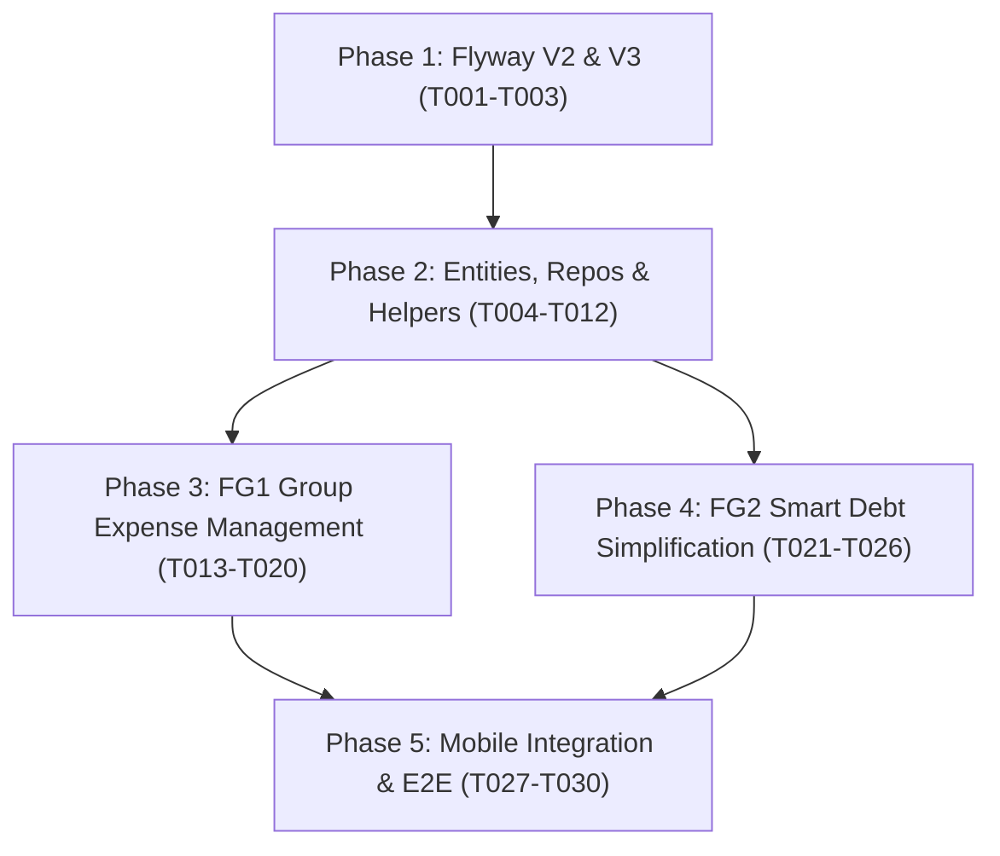

# Tasks: Group Expense Management & Smart Debt Simplification (Build 2)

> *Performed by: Nguyen Le Duc Nhat (24120403) | Reviewed by: Ngo Thai Hoa (24120051) | Edited by: Nguyen Le Duc Nhat (24120403)*

**Input**: Design documents from `specs/002-group-expense-debt-simplification/` (`spec.md`, `plan.md`, `data-model.md`, `contracts/backend-api.yaml`, `quickstart.md`)  
**Prerequisites**: PA3 Account & JWT Security baseline (`users`, `auth_sessions`, `JwtAuthenticationFilter`, `ApiExceptionHandler`) from `V1__create_account_tables.sql`

---

## Format: `[ID] [P?] [Story] Description with exact file path`

- **[P]**: Can execute in parallel (independent files, zero blocking dependencies)
- **[FG1]**: Functional Group 1 — Group Expense Management (`US1`, `US2`)
- **[FG2]**: Functional Group 2 — Smart Debt Simplification (`US3`, `US4`)

---

## Phase 1: Database Migrations & Baseline Alignment

**Purpose**: Establish Flyway DDL migrations and default category seeds before Java entity validation.

- [ ] T001 Create Flyway migration `V2__create_group_expense_tables.sql` defining `categories`, `groups`, `group_members`, `group_invitations`, `group_wallets`, `group_fund_entries`, `group_expenses`, `group_expense_splits`, and `settlements` with `ON DELETE RESTRICT` FKs, CHECK constraints, partial owner unique index, and B-tree indexes in `src/backend/src/main/resources/db/migration/V2__create_group_expense_tables.sql`
- [ ] T002 Create Flyway seed migration `V3__seed_default_categories.sql` populating standard `EXPENSE` and `INCOME` system categories with deterministic UUIDs in `src/backend/src/main/resources/db/migration/V3__seed_default_categories.sql`
- [ ] T003 Verify `application.properties` and `docker-compose.yml` settings (`spring.jpa.hibernate.ddl-auto=validate`, PostgreSQL 16, Redis 7.2) in `src/backend/src/main/resources/application.properties` and `docker-compose.yml`

---

## Phase 2: Shared Domain Enums, JPA Entities & Repositories

**Purpose**: Implement all 7 enums, 9 JPA entities, 9 Spring Data JPA repositories, and shared idempotency/currency validation utilities.

- [ ] T004 [P] Create domain enums (`CategoryType`, `GroupMemberRole`, `GroupMemberStatus`, `GroupFundEntryType`, `FundingSource`, `SplitMode`, `SettlementStatus`) in `src/backend/src/main/java/com/finsync/entity/enums/`
- [ ] T005 [P] Implement `Category` entity and `CategoryRepository` in `src/backend/src/main/java/com/finsync/entity/Category.java` and `src/backend/src/main/java/com/finsync/repository/CategoryRepository.java`
- [ ] T006 [P] Implement `ExpenseGroup`, `GroupMember`, `GroupInvitation`, and `GroupWallet` JPA entities in `src/backend/src/main/java/com/finsync/entity/`
- [ ] T007 [P] Implement `GroupFundEntry`, `GroupExpense`, `GroupExpenseSplit`, and `Settlement` JPA entities in `src/backend/src/main/java/com/finsync/entity/`
- [ ] T008 [P] Implement `ExpenseGroupRepository` (with `@Lock(LockModeType.PESSIMISTIC_WRITE)` `findByIdForUpdate`), `GroupMemberRepository`, `GroupInvitationRepository`, and `GroupWalletRepository` in `src/backend/src/main/java/com/finsync/repository/`
- [ ] T009 [P] Implement `GroupFundEntryRepository`, `GroupExpenseRepository`, `GroupExpenseSplitRepository`, and `SettlementRepository` in `src/backend/src/main/java/com/finsync/repository/`
- [ ] T010 [P] Implement `IdempotencySupport` (canonical SHA-256 `requestHash` computation + conflict check) and `MoneyValidation` (`VND` scale 0, `USD` scale <= 2) in `src/backend/src/main/java/com/finsync/service/impl/`
- [ ] T011 Implement `CategoryController` (`GET /api/v1/categories`) and `CategoryDtos` in `src/backend/src/main/java/com/finsync/controller/CategoryController.java` and `src/backend/src/main/java/com/finsync/dto/CategoryDtos.java`
- [ ] T012 Update `ApiExceptionHandler` to map group/settlement/fund `DataIntegrityViolationException` constraint names (`uk_group_fund_entries_request_id`, `uk_group_expenses_request_id`, `uk_settlements_request_id`, `uk_group_members_active_owner`) cleanly to HTTP `409 Conflict` in `src/backend/src/main/java/com/finsync/exception/ApiExceptionHandler.java`

**Checkpoint**: Hibernate `ddl-auto=validate` passes on startup against PostgreSQL 16 with `V1`, `V2`, and `V3` migrations applied.

---

## Phase 3: Functional Group 1 — Group Expense Management (`US1` & `US2`)

**Goal**: Deliver atomic group & shared wallet creation, guest members, general & guest-targeted invitations, 50-member & zero-balance guardrails, shared fund ledger (`CONTRIBUTION`/`REFUND`), and 4-mode expense splitting with zero lost cents.

**Independent Test**: Create a group, add a guest member, issue and redeem a guest-targeted invitation, record a fund contribution, reject an over-balance refund, log `MEMBERS` expenses across all 4 split modes and a `GROUP_FUND` expense, and verify `sum(splits.amount) == expense.amount` and zero auto-created `personal_transactions`.

- [ ] T013 [P] [FG1] Define `GroupDtos` and `GroupExpenseDtos` matching `contracts/backend-api.yaml` in `src/backend/src/main/java/com/finsync/dto/GroupDtos.java` and `src/backend/src/main/java/com/finsync/dto/GroupExpenseDtos.java`
- [ ] T014 [FG1] Implement `GroupService` and `GroupServiceImpl` (atomic group + owner + wallet creation, guest addition, 50-member cap, SHA-256 invitation creation/revocation/redemption, ownership transfer, zero-balance removal/leave guardrail, archive/unarchive) in `src/backend/src/main/java/com/finsync/service/GroupService.java` and `src/backend/src/main/java/com/finsync/service/impl/GroupServiceImpl.java`
- [ ] T015 [FG1] Implement `GroupController` endpoints (`/api/v1/groups/**`) in `src/backend/src/main/java/com/finsync/controller/GroupController.java`
- [ ] T016 [FG1] Implement `GroupFundService`, `GroupFundServiceImpl` (`CONTRIBUTION` and `REFUND` validation, non-negative fund balance check under `groups` lock, `requestId` idempotency), and `GroupFundController` in `src/backend/src/main/java/com/finsync/service/impl/GroupFundServiceImpl.java` and `src/backend/src/main/java/com/finsync/controller/GroupFundController.java`
- [ ] T017 [P] [FG1] Implement `ExpenseSplitCalculator` supporting `EQUAL`, `EXACT`, `PERCENTAGE` (scale <= 2, sum = 100.00), and `SHARES` (1..1,000,000) in integer minor units with largest-remainder + ascending `splitOrder` tie-breaking in `src/backend/src/main/java/com/finsync/service/impl/ExpenseSplitCalculator.java`
- [ ] T018 [FG1] Implement `GroupExpenseService`, `GroupExpenseServiceImpl` (`MEMBERS` single-payer and `GROUP_FUND` atomic `EXPENSE` fund entry creation, currency scale check, `requestId` idempotency), and `GroupExpenseController` in `src/backend/src/main/java/com/finsync/service/impl/GroupExpenseServiceImpl.java` and `src/backend/src/main/java/com/finsync/controller/GroupExpenseController.java`
- [ ] T019 [P] [FG1] Write unit tests for `ExpenseSplitCalculatorTests` covering indivisible VND/USD splits across all 4 split modes and invalid input rejections in `src/backend/src/test/java/com/finsync/ExpenseSplitCalculatorTests.java`
- [ ] T020 [FG1] Write integration tests in `GroupExpenseApiTests` covering group lifecycle, guest claiming, 50-member limit, fund contributions/refunds, `MEMBERS` + `GROUP_FUND` expenses, archived group blocks, and idempotency in `src/backend/src/test/java/com/finsync/GroupExpenseApiTests.java`

**Checkpoint**: Functional Group 1 (`Group Expense Management`) passes all unit and API integration tests independently.

---

## Phase 4: Functional Group 2 — Smart Debt Simplification (`US3` & `US4`)

**Goal**: Deliver dynamic net balance calculation, $O(V \log V)$ greedy two-heap debt minimization (`>= 30%` transfer reduction in `< 5ms`), and immutable partial/full manual settlement recording.

**Independent Test**: Construct a 5-member circular debt graph (`MEMBERS` + `GROUP_FUND` expenses), verify `GET /api/v1/groups/{groupId}/debts` ignores `GROUP_FUND` expenses and reduces transfer edges by `>= 30%`, record partial and full settlements (`POST /api/v1/groups/{groupId}/settlements`), verify authorization and overpayment rejection, and confirm balances reach zero.

- [ ] T021 [P] [FG2] Define `SettlementDtos` (`GroupDebtSummaryResponse`, `MemberBalanceItem`, `SimplifiedTransferItem`, `CreateSettlementRequest`, `SettlementResponse`) in `src/backend/src/main/java/com/finsync/dto/SettlementDtos.java`
- [ ] T022 [P] [FG2] Implement `DebtSimplificationEngine` using greedy max-creditor / max-debtor priority queues in integer minor units ($O(V \log V)$) in `src/backend/src/main/java/com/finsync/service/impl/DebtSimplificationEngine.java`
- [ ] T023 [FG2] Implement `DebtSettlementService` and `DebtSettlementServiceImpl` (net balance ledger aggregation excluding `GROUP_FUND`/`CONTRIBUTION`/`REFUND`, simplified debt summary + reduction metrics, `CONFIRMED` manual settlement validation under `groups` lock, payer/receiver/owner authorization, `requestId` idempotency) in `src/backend/src/main/java/com/finsync/service/impl/DebtSettlementServiceImpl.java`
- [ ] T024 [FG2] Implement `DebtSettlementController` (`GET /api/v1/groups/{groupId}/debts`, `GET /api/v1/groups/{groupId}/settlements`, `POST /api/v1/groups/{groupId}/settlements`) in `src/backend/src/main/java/com/finsync/controller/DebtSettlementController.java`
- [ ] T025 [P] [FG2] Write unit tests & performance benchmark in `DebtSimplificationEngineTests` verifying exact balance conservation, `>= 30%` reduction on circular graphs, and `< 5ms` execution for 50 members in `src/backend/src/test/java/com/finsync/DebtSimplificationEngineTests.java`
- [ ] T026 [FG2] Write integration tests in `DebtSettlementApiTests` verifying dynamic balances, `GROUP_FUND` exclusion, partial/full settlements, overpayment `422` rejection, unrelated member `403` rejection, zero-balance member removal unblock, and idempotency in `src/backend/src/test/java/com/finsync/DebtSettlementApiTests.java`

**Checkpoint**: Functional Group 2 (`Smart Debt Simplification`) passes all unit, benchmark, and integration tests.

---

## Phase 5: Mobile Retrofit Integration, E2E Suite & Contract Verification

**Purpose**: Connect Android Jetpack Compose client screens to Build 2 REST APIs, run Postman E2E tests, and verify OpenAPI/code conformance.

- [ ] T027 [P] Configure Retrofit API client interfaces and DTOs matching `contracts/backend-api.yaml` for Groups, Fund, Expenses, Debts, and Settlements in `src/mobile/app/src/main/java/com/finsync/data/`
- [ ] T028 Wire Android Jetpack Compose group management, expense split, shared fund, and debt settlement screens (`src/mobile/app/src/main/java/com/finsync/ui/groups/`) to live backend endpoints
- [ ] T029 [P] Verify Swagger/SpringDoc OpenAPI output against `specs/002-group-expense-debt-simplification/contracts/backend-api.yaml`
- [ ] T030 Execute full Maven test suite (`./mvnw test`), Docker Compose stack smoke test, and `quickstart.md` scenarios 1–6

---

## Dependencies & Execution Order

### Parallel Opportunities
- **Phase 2**: All entity, enum, repository, and helper tasks (`T004`–`T010`) can be authored concurrently before service wiring.
- **Phase 3 & Phase 4**: `ExpenseSplitCalculator` (`T017`) and `DebtSimplificationEngine` (`T022`) are pure domain services that can be built and unit-tested (`T019`, `T025`) in parallel with repository/DTO creation.
- **Cross-Team Parallelization**: Once `contracts/backend-api.yaml` is committed in `S4-08`, Frontend (`S4-10`) can build Retrofit interfaces/DTOs (`T027`) concurrently while Backend (`S4-09`) implements Phases 1–4.
